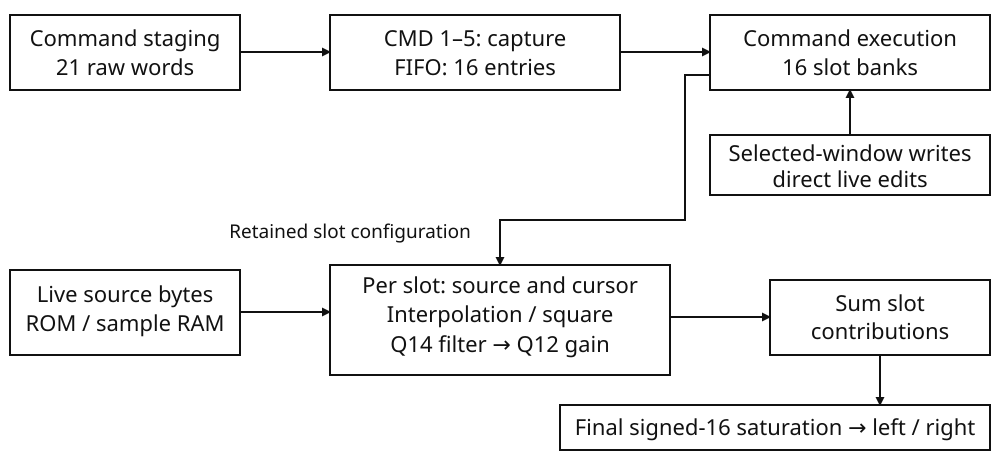
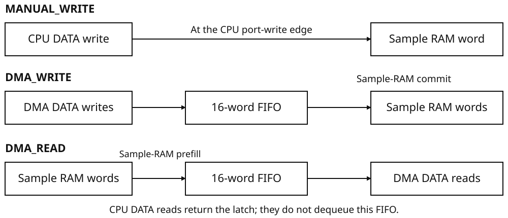

# Audio processing unit {#sec-apu}

The audio processing unit (APU) plays up to sixteen voices at once and mixes
them into one stereo output at 44,100 frames per second. Each voice plays
8-bit or 16-bit PCM, BADP compressed sound or a square wave, with its own
pitch, volume, loop, filter and fade.

Voices play directly from system ROM, cartridge ROM or the APU's 512 KiB
sample RAM. Several voices may play the same sample data, each at its own
position. Sample RAM is loaded through a transfer port, by the CPU or by DMA,
while the voices keep playing.

To start a voice, write its settings to the parameter registers and then the
PLAY command to CMD. Commands pass through a sixteen-entry command queue.

## Specifications {#sec-apu-apu-specifications}

| Item | Specification |
|---|---|
| Voices | 16 (slots 0–15) |
| Sample formats | PCM8, PCM16, BADP (4-bit compressed), square wave; mono or stereo |
| Output | Stereo, 16-bit, 44,100 frames per second |
| Sample RAM | 512 KiB; voice address `40000000H`–`4007FFFFH` |
| Command queue | 16 commands |
| Transfer FIFO | 16 words |
| Transfer speed | 1,058,400 words per second (32 cycles per word) |
| Interrupt | IRQ_APU (voice ended) |

The address range `40000000H` is used only in the voice settings. The CPU and
DMA reach sample RAM through the transfer port.

{#fig-apu-paths}

## Terms {#sec-apu-from-sample-data-to-a-playing-voice}

A **sample** is one amplitude value of one channel. A **source frame** holds
the samples of all channels at one moment: one sample for mono, two for
stereo. A mono PCM16 frame occupies 2 bytes, a stereo PCM16 frame 4 bytes.
Frame counts, start positions and loop points are counted in source frames.

An **output frame** is one stereo value of the mixer; there are 44,100 per
second. Each voice moves through its source frames at its own rate. Between
two source frames the APU interpolates. A mono voice is heard on both
channels.

### Example: a 440 Hz tone {#sec-apu-make-the-pcm-example-repeat-at-440-hz}

The [PCM example](#sec-apu-start-a-pcm-loop-or-square-voice) holds a sine
wave of 16 frames per cycle, stored twice (32 frames, 64 bytes). To play a
steady tone, loop frames 0 to 15 (loop start 0, loop end 16). A source rate of
7040 frames per second plays 7040 ÷ 16 = 440 cycles per second.

RATE_STEP_Q16 multiplies the source rate: 2 doubles the pitch. GAIN_Q12 sets
the volume: ½ halves the amplitude.

| Setting | Value |
|---|---|
| Format | Mono PCM16, 32 frames, 64 bytes |
| Source rate; rate step | 7040; 1 |
| Start; loop | 0; frames 0–15 |
| Gain; filter | ½; off |
| Slot | 2 |

### The PLAY command {#sec-apu-turn-the-choices-into-a-play-command}

The settings are written to the 21 parameter registers; writing PLAY to CMD
then puts them, with the command, into the command queue. When the command is
executed the voice starts in the given slot.

RATE_STEP_Q16 is a 16.16 number: 1 is `00010000H`. GAIN_Q12 is a 4.12 number:
1 is `00001000H`, so ½ is `00000800H`.

A square wave needs no sample data. One cycle of the square wave takes one
source frame, so source rate 440 with loop 0–1 gives 440 Hz. The duty setting
gives the part of each cycle that is positive.

## Programming {#sec-apu-programming-sequence}

| Sample data in | Use |
|---|---|
| System ROM or cartridge ROM | Play directly: set SOURCE_ADDR to its address |
| Sample RAM | Play from `40000000H` + offset, after it has been loaded |
| Main RAM or cartridge RAM | Load it into sample RAM first |
| (Square wave) | GENERATOR_KIND = 1; no sample data |

SOURCE_BITS_PER_SAMPLE selects the format: 4 = BADP, 16 = PCM16, any other
value = PCM8.

### Starting a voice {#sec-apu-submit-the-prepared-voice}

1. Choose a free slot. PLAY on a slot that is in use replaces its voice.
2. Write the 21 parameter registers, SLOT included.
3. Write PLAY (`00000001H`) to CMD. The parameter registers return to their
   default values and the command waits in the queue.
4. When the command executes, the slot's bit in ACTIVE_MASK is set. Check
   STATUS.FAULT.
5. Keep the sample data unchanged until the voice has ended.

When the command queue is full, a new command **replaces the oldest command
in the queue**. Check CMD_FREE before writing several commands in a row.

PLAY uses the cartridge slot selected when the command executes. Keep the
cartridge selected until the voice has started.

### Example: PCM loop and square wave {#sec-apu-start-a-pcm-loop-or-square-voice}

PCM data in cartridge ROM, at address A:

```lua
rodata pcm: i16[32] = {
  0, 3135, 5793, 7568, 8192, 7568, 5793, 3135,
  0, -3135, -5793, -7568, -8192, -7568, -5793, -3135,
  0, 3135, 5793, 7568, 8192, 7568, 5793, 3135,
  0, -3135, -5793, -7568, -8192, -7568, -5793, -3135,
}
```

Write all 21 registers, then CMD:

| Address | Parameter | PCM loop | Square |
|---|---|---|---|
| `08000120H` | SOURCE_ADDR | A | `00000000H` |
| `08000124H` | SOURCE_BYTES | 64 | 0 |
| `08000128H` | SOURCE_SAMPLE_RATE_HZ | 7040 | 440 |
| `0800012CH` | SOURCE_CHANNELS | 1 | 1 |
| `08000130H` | SOURCE_BITS_PER_SAMPLE | 16 | 16 |
| `08000134H` | SOURCE_FRAME_COUNT | 32 | 1 |
| `08000138H` | SOURCE_DATA_OFFSET | 0 | 0 |
| `0800013CH` | SOURCE_DATA_BYTES | 64 | 0 |
| `08000140H` | SOURCE_LOOP_START_SAMPLE | 0 | 0 |
| `08000144H` | SOURCE_LOOP_END_SAMPLE | 16 | 1 |
| `08000148H` | SLOT | 2 | 4 |
| `0800014CH` | RATE_STEP_Q16 | `00010000H` | `00010000H` |
| `08000150H` | GAIN_Q12 | `00000800H` | `00000400H` |
| `08000154H` | START_SAMPLE | 0 | 0 |
| `08000158H` | FILTER_CONTROL | 0 | 0 |
| `0800015CH` | FILTER_B0_B1 | `00004000H` | `00004000H` |
| `08000160H` | FILTER_B2_A1 | 0 | 0 |
| `08000164H` | FILTER_A2 | 0 | 0 |
| `08000168H` | FADE_SAMPLES | 0 | 0 |
| `0800016CH` | GENERATOR_KIND | 0 | 1 |
| `08000170H` | GENERATOR_DUTY_Q12 | `00000800H` | `00000800H` |
| `08000174H` | CMD | `00000001H` | `00000001H` |

When PLAY executes, ACTIVE_MASK bit 2 (PCM) or bit 4 (square) is set. The
square wave at gain ¼ alone gives output levels of +8191 and −8192.

To change the PCM voice to gain ¼ without restarting it, write 2 to SLOT,
`00000400H` to GAIN_Q12 and SET_SLOT_GAIN (`00000003H`) to CMD.

To stop it at once, write 2 to SLOT, 0 to FADE_SAMPLES and STOP_SLOT
(`00000002H`) to CMD.

## Sample data {#sec-apu-voice-sources-and-their-lifetime}

| Parameter | Meaning |
|---|---|
| SOURCE_ADDR | Address of the sample data area |
| SOURCE_BYTES | Size of the area in bytes |
| SOURCE_SAMPLE_RATE_HZ | Source frames per second at rate step 1 |
| SOURCE_CHANNELS | 1 = mono, 2 = stereo |
| SOURCE_BITS_PER_SAMPLE | 4 = BADP, 16 = PCM16, other = PCM8 |
| SOURCE_FRAME_COUNT | Number of source frames |
| SOURCE_DATA_OFFSET | Offset of the samples from SOURCE_ADDR, in bytes |
| SOURCE_DATA_BYTES | Size of the samples in bytes (for information; not checked) |
| SOURCE_LOOP_START_SAMPLE, SOURCE_LOOP_END_SAMPLE | Loop start and end frame |
| GENERATOR_KIND | 0 = sample data, 1 = square wave |
| GENERATOR_DUTY_Q12 | Square wave duty |

The area SOURCE_ADDR to SOURCE_ADDR + SOURCE_BYTES must lie within:

| Memory | Addresses |
|---|---|
| System ROM | The fitted system ROM, from `00000000H` |
| Cartridge ROM | The fitted ROM of the selected cartridge |
| Sample RAM | `40000000H`–`4007FFFFH` |

Otherwise PLAY fails with fault SOURCE_RANGE and the slot keeps its previous
voice. The APU reads the samples while the voice plays; do not change them.
The APU uses SOURCE_FRAME_COUNT and the format to find the samples; make sure
they lie within the area.

## PCM formats {#sec-apu-pcm-byte-layouts-and-interpolation}

The samples start at SOURCE_ADDR + SOURCE_DATA_OFFSET. Channel 0 is left,
channel 1 right.

| Format | Bytes of frame n |
|---|---|
| PCM8 mono | n |
| PCM8 stereo | 2n left, 2n + 1 right |
| PCM16 mono | 2n low, 2n + 1 high |
| PCM16 stereo | 4n, 4n + 1 left; 4n + 2, 4n + 3 right |

PCM8 is unsigned: the value is (byte − 128) × 256, so `80H` is silence, `00H`
is −32768 and `FFH` is +32512. PCM16 is signed, low byte first.

Between two frames the APU interpolates linearly. With n the current frame
and f the fraction (0–65535):

```text
sample = first + ((second − first) × f) >> 16
```

where `>>` rounds towards −∞. Without a loop, the last frame is interpolated
with itself. In a loop, the frame after the last loop frame is the loop start: with
loop start 4 and loop end 8, position 7.5 lies between frames 7 and 4.

Example: mono PCM16 frames 0, 10000, −10000, 0 at 22,050 Hz give the output
0, 5000, 10000, 0, −10000, −5000, 0, 0.

### Sample memory size {#sec-apu-size-a-pcm-source}

| Format | Bytes per frame | One second at 44.1 kHz | Frames in 512 KiB |
|---|---:|---:|---:|
| 8-bit mono | 1 | 44,100 | 524,288 |
| 8-bit stereo | 2 | 88,200 | 262,144 |
| 16-bit mono | 2 | 88,200 | 262,144 |
| 16-bit stereo | 4 | 176,400 | 131,072 |

Sample RAM is shared by all voices.

## Pitch, loops and duration {#sec-apu-source-phase-rate-and-duration}

Each voice has a play position in source frames, with a 16-bit fraction.
PLAY sets it to START_SAMPLE. RATE_STEP_Q16 is a signed 16.16 number: 1 plays
forward at the source rate, −1 plays backward, 0 holds the position.

Per output frame the position advances by

```text
SOURCE_SAMPLE_RATE_HZ × RATE_STEP_Q16 / 44100   (in 1/65536 frames)
```

The APU keeps the remainder of this division, so the average rate is exact.
At 8000 Hz and rate step 1 the position advances by 11888 or 11889 units per
output frame.

### Loops {#sec-apu-loops-apply-before-the-first-sample}

The loop is on when SOURCE_LOOP_END_SAMPLE is greater than
SOURCE_LOOP_START_SAMPLE. The loop includes its start frame and excludes its
end frame. Whenever the position leaves the loop, in either direction, it is
brought back into it by the loop length. This also applies to the start
position: with loop start 4 and loop end 8, START_SAMPLE 1 starts at frame 5.

### End of a voice {#sec-apu-nonloop-completion}

Without a loop the voice ends when the position leaves frames 0 to
SOURCE_FRAME_COUNT − 1. Played forward from 0, a voice of N frames plays
frames 0 to N − 1; played backward, start at N − 1.

## Square wave {#sec-apu-square-generator}

With GENERATOR_KIND = 1 the voice produces a square wave instead of reading
samples. For each output frame:

```text
fraction of the position × 4096 < GENERATOR_DUTY_Q12 × 65536:  +32767
otherwise:                                                     −32768
```

| Duty | Wave |
|---|---|
| `00000000H` | Always −32768 |
| `00000800H` | Half positive, half negative |
| `00001000H` or more | Always +32767 |

The frequency is SOURCE_SAMPLE_RATE_HZ × rate step. Set a loop of 0–1 for a
continuous tone; FRAME_COUNT and the loop work as for sample data. Example:
441 Hz, duty ½ gives 50 output frames positive and 50 negative.

## Volume and mixing {#sec-apu-gain-stereo-mixing-and-clipping}

GAIN_Q12 is a signed 4.12 number:

| Gain | Factor |
|---|---:|
| `00000000H` | 0 |
| `00000800H` | ½ |
| `00001000H` | 1 |
| `00002000H` | 2 |
| `FFFFF000H` | −1 (inverted) |

For each channel the mixer adds sample × gain of all voices and then limits
the sum:

```text
output = limit16((sum of sample × gain) >> 12)
```

Two voices of +20000 at gain 1 give +40000, which is limited to +32767.

## Filter {#sec-apu-per-voice-q14-filter}

Each voice has a second-order (biquad) filter, enabled by bit 0 of
FILTER_CONTROL. The coefficients are signed 2.14 numbers (`4000H` = 1):

| Register | Bits 15–0 | Bits 31–16 |
|---|---|---|
| FILTER_B0_B1 | b0 | b1 |
| FILTER_B2_A1 | b2 | a1 |
| FILTER_A2 | a2 | — |

For each channel, with input x:

```text
y  = (b0 × x + z1) >> 14
z1 ← b1 × x − a1 × y + z2
z2 ← b2 × x − a2 × y
output = limit16(y)
```

z1 and z2 are 32-bit values that wrap on overflow. Both channels use the same
coefficients and their own z1, z2. PLAY clears z1 and z2. When the filter is
switched off, z1 and z2 keep their values.

Example: b0 = b1 = ½ (`FILTER_B0_B1` = `20002000H`) averages two successive
samples: input 8192, 0, −8192, 0 gives 4096, 4096, −4096, −4096.

## Stopping and fading {#sec-apu-stop-and-fade}

STOP_SLOT with FADE_SAMPLES = 0 stops the voice at once and clears its slot.
With FADE_SAMPLES = N, the volume falls in a straight line over N output
frames, after which the voice ends. Starting from gain 4096 with N = 4, the
four frames have gain 4096, 3072, 2048 and 1024. A voice without a loop that
reaches its end during the fade ends there. A paused voice fades only after it
is resumed.

## Pause and live changes {#sec-apu-pause-resume-and-live-programming}

PAUSE_SLOT holds a voice at its position; RESUME_SLOT continues it. A paused
voice keeps its ACTIVE_MASK bit.

The selected-slot registers at `08000194H`–`080001E4H` show the settings of
the slot chosen by the SLOT parameter register at `08000148H`. Writing them
changes the playing voice at once, without a command:

| Register written | Effect |
|---|---|
| Loop start or end | New loop |
| RATE_STEP_Q16 | New pitch |
| GAIN_Q12 | New volume (a fade in progress continues from it) |
| START_SAMPLE | Jump to this position |
| GENERATOR_DUTY_Q12 | New duty |
| Filter registers | New coefficients |
| FADE_SAMPLES | No effect until STOP_SLOT |

### Changing the sample data of a playing voice {#sec-apu-source-fields-are-individually-live}

A write to SOURCE_ADDR, SOURCE_BYTES, SOURCE_SAMPLE_RATE_HZ, SOURCE_CHANNELS,
SOURCE_BITS_PER_SAMPLE, SOURCE_FRAME_COUNT, SOURCE_DATA_OFFSET,
SOURCE_DATA_BYTES or GENERATOR_KIND takes effect immediately with the other
current settings. The voice continues at its position. If the new settings are
not valid, the voice stops with fault SOURCE_RANGE. Each write takes effect on
its own; to change several of these settings together, use PLAY.

## Commands {#sec-apu-commands-and-slot-ownership}

### Command queue {#sec-apu-stage-capture-execute}

Writing a command to CMD puts the command and all 21 parameter registers into
the queue. The parameter registers then return to their default values, and
the selected-slot registers show slot 0. Commands execute in order.

### Queue size {#sec-apu-preserve-fifo-entries-when-every-command-matters}

CMD_QUEUED gives the number of waiting commands, CMD_FREE the free places and
CMD_CAPACITY the size (16). A command written when the queue is full replaces
the oldest waiting command.

### Command codes {#sec-apu-command-words}

| CMD | Name | Parameters used | Function |
|---|---|---|---|
| `00000000H` | NONE | — | No command |
| `00000001H` | PLAY | All | Start a voice in SLOT |
| `00000002H` | STOP_SLOT | SLOT, FADE_SAMPLES | Stop or fade out |
| `00000003H` | SET_SLOT_GAIN | SLOT, GAIN_Q12 | Set the volume |
| `00000004H` | PAUSE_SLOT | SLOT | Pause |
| `00000005H` | RESUME_SLOT | SLOT | Resume |

SLOT bits 3–0 select the slot. Other CMD values give fault BAD_CMD. STOP_SLOT
without fade clears the slot's registers.

### Slot status {#sec-apu-live-slot-parameters}

Bit n of ACTIVE_MASK is 1 while slot n plays, is paused or fades.
STATUS.BUSY is 1 while any slot is active or a command waits.
SELECTED_SOURCE_ADDR gives the SOURCE_ADDR of the selected slot.

## BADP format {#sec-apu-badp-compressed-source-format}

BADP stores each sample in 4 bits (adaptive delta coding). It is selected by
SOURCE_BITS_PER_SAMPLE = 4. Pitch, loops, interpolation, filter and volume
work as for PCM.

A BADP area starts with a header. The APU uses two of its words:

| Offset from SOURCE_ADDR | Contents |
|---:|---|
| 28 | Number of seek table entries |
| 32 | Offset of the seek table, from SOURCE_ADDR |

| Seek table entry (8 bytes) | |
|---:|---|
| +0 | Frame number |
| +4 | Offset of the block that contains it, from SOURCE_ADDR + SOURCE_DATA_OFFSET |

To start at a frame, the APU uses the last entry whose frame number is not
greater than the frame wanted, and decodes forward from there.

### Blocks {#sec-apu-blocks-and-channel-state}

| Offset in the block | Contents |
|---:|---|
| +0 | Number of frames (16 bits) |
| +2 | Size of the block in bytes, header included (16 bits) |
| +4 + 4c | Channel c: start value (signed 16 bits) |
| +6 + 4c | Channel c: step index (8 bits) |
| +7 + 4c | Unused |
| +4 + 4 × channels | Data |

Each data byte holds two codes, high nibble first. For stereo, the left and
right codes alternate. The start value is not itself output: each frame is the
start value changed by its code.

### Decoding {#sec-apu-exact-nibble-recurrence}

| Index | Step | Index | Step | Index | Step | Index | Step |
|---:|---:|---:|---:|---:|---:|---:|---:|
| 0 | 7 | 23 | 66 | 46 | 598 | 69 | 5358 |
| 1 | 8 | 24 | 73 | 47 | 658 | 70 | 5894 |
| 2 | 9 | 25 | 80 | 48 | 724 | 71 | 6484 |
| 3 | 10 | 26 | 88 | 49 | 796 | 72 | 7132 |
| 4 | 11 | 27 | 97 | 50 | 876 | 73 | 7845 |
| 5 | 12 | 28 | 107 | 51 | 963 | 74 | 8630 |
| 6 | 13 | 29 | 118 | 52 | 1060 | 75 | 9493 |
| 7 | 14 | 30 | 130 | 53 | 1166 | 76 | 10442 |
| 8 | 16 | 31 | 143 | 54 | 1282 | 77 | 11487 |
| 9 | 17 | 32 | 157 | 55 | 1411 | 78 | 12635 |
| 10 | 19 | 33 | 173 | 56 | 1552 | 79 | 13899 |
| 11 | 21 | 34 | 190 | 57 | 1707 | 80 | 15289 |
| 12 | 23 | 35 | 209 | 58 | 1878 | 81 | 16818 |
| 13 | 25 | 36 | 230 | 59 | 2066 | 82 | 18500 |
| 14 | 28 | 37 | 253 | 60 | 2272 | 83 | 20350 |
| 15 | 31 | 38 | 279 | 61 | 2499 | 84 | 22385 |
| 16 | 34 | 39 | 307 | 62 | 2749 | 85 | 24623 |
| 17 | 37 | 40 | 337 | 63 | 3024 | 86 | 27086 |
| 18 | 41 | 41 | 371 | 64 | 3327 | 87 | 29794 |
| 19 | 45 | 42 | 408 | 65 | 3660 | 88 | 32767 |
| 20 | 50 | 43 | 449 | 66 | 4026 | — | — |
| 21 | 55 | 44 | 494 | 67 | 4428 | — | — |
| 22 | 60 | 45 | 544 | 68 | 4871 | — | — |

For each code c, with step s from the table (an index above 88 counts as 88):

```text
d = s >> 3
if c & 4: d += s
if c & 2: d += s >> 1
if c & 1: d += s >> 2
value = limit16(value − d)  if c & 8
value = limit16(value + d)  otherwise
```

Then the index changes by −1 for codes 0–3 (ignoring bit 3), and by +2, +4,
+6, +8 for 4–7, limited to 0–88.

Example, a mono block of two frames:

```text
02 00 09 00 E8 03 00 00 17
```

Start value 1000, index 0. Code 1: d = 1, output 1001, index 0. Code 7:
d = 11, output 1012, index 8.

### Seeking and playing backward {#sec-apu-seeking-and-reverse-playback}

Playing backward and jumping to an earlier frame make the APU decode forward
again from a seek table entry. Closely spaced entries shorten this.

## Sample RAM transfer {#sec-apu-sample-ram-transfer}

Sample RAM is loaded and read back through the transfer port. Do not change
sample RAM that a voice is playing.

{#fig-apu-transfer}

### Loading sample RAM {#sec-apu-load-changing-sample-data-before-play}

To play a sound prepared in main RAM, copy it into sample RAM and give PLAY
the address `40000000H` + offset.

- **By the CPU:** select MANUAL_WRITE and write the words to TRANSFER_DATA.
  Each word is stored at once.
- **By DMA:** select DMA_WRITE and transfer the words with route TO_APU. The
  words pass through the FIFO into sample RAM. When the DMA transfer is DONE,
  the last words may still be in the FIFO: **wait until TRANSFER_BUSY in
  STATUS is 0** before starting the voice or changing the transfer mode.

To read sample RAM back, select DMA_READ and transfer with route FROM_APU. The
APU fills the FIFO in advance, and may still be reading ahead when the DMA
transfer is DONE: select STOP after the transfer.

### Addresses {#sec-apu-private-ram-and-the-two-address-forms}

Sample RAM is 524,288 bytes and is cleared at reset. The CPU cannot address
it directly: an access to `40000000H` causes a bus fault (UNMAPPED).

| Address | Register | Function |
|---|---|---|
| `080001E8H` | TRANSFER_ADDRESS | Start offset in sample RAM |
| `080001ECH` | TRANSFER_DATA | Data |
| `080001F0H` | TRANSFER_CONTROL | Mode |

Bits 18–2 of TRANSFER_ADDRESS give the start offset (a multiple of 4). The
offset increases by 4 per word and wraps from the end of sample RAM to 0.
TRANSFER_ADDRESS reads back the value written.

### Modes {#sec-apu-modes-latch-and-fifo}

| TRANSFER_CONTROL bits 1–0 | Mode | Function |
|---:|---|---|
| 0 | STOP | No transfer |
| 1 | MANUAL_WRITE | CPU writes to DATA go to sample RAM |
| 2 | DMA_WRITE | DMA writes to DATA go through the FIFO to sample RAM |
| 3 | DMA_READ | Sample RAM is read through the FIFO for DMA |

Changing the mode empties the FIFO and cancels a transfer between FIFO and
sample RAM in progress; sample RAM is not changed. A CPU read of DATA returns
the last word written or read and does not take a word from the FIFO.

### DMA {#sec-apu-requests-and-admitted-blocks}

| Route | Burst |
|---|---|
| 6 TO_APU | 16 words, when the FIFO is empty (DMA_WRITE) |
| 7 FROM_APU | 16 words, when the FIFO is full (DMA_READ) |

After each burst the APU moves the FIFO contents to sample RAM (DMA_WRITE) or
refills the FIFO from sample RAM (DMA_READ). TRANSFER_BUSY is 1 during this.

### STATUS bits for transfers {#sec-apu-status-and-cpu-port-ownership}

| Bit | Value | Meaning |
|---:|---|---|
| 7 | `00000080H` | DMA_REQUEST: bit 8 or bit 9 |
| 8 | `00000100H` | DMA_READ_REQUEST |
| 9 | `00000200H` | DMA_WRITE_REQUEST |
| 10 | `00000400H` | TRANSFER_BUSY: words moving between FIFO and sample RAM |

While a DMA channel is transferring on an APU route, CPU writes to DATA wait
until it has finished.

### Completing a transfer {#sec-apu-completing-uploads-and-downloads}

- **Upload:** wait for DMA DONE, then for TRANSFER_BUSY = 0.
- **Download:** wait for DMA DONE, then select STOP.

The transfer unit has no interrupt of its own. Reset clears the transfer
registers, the FIFO and sample RAM, and selects STOP.

## Timing {#sec-apu-clocks-and-transfer-timing}

### Rates {#sec-apu-installed-rates}

| Item | Cycles |
|---|---:|
| One output frame | 768 |
| One word between FIFO and sample RAM | 32 |
| 16 words | 512 |
| 4 words | 128 |

All sixteen voices keep playing during transfers.

### Sample counter {#sec-apu-sample-sequence-and-edge-order}

SAMPLE_SEQUENCE at `08000200H` counts output frames (modulo 2^32^), also when
no voice plays. It can be used to wait a number of output frames.

### Example: uploading 20 words {#sec-apu-dma-transport-and-ram-commit-are-separate}

A DMA transfer of 20 words from cartridge ROM (9N + 4 cycles per burst) in
DMA_WRITE mode:

| Cycle | Event |
|---:|---|
| 0 | DMA burst of 16 words (148 cycles) |
| 148 | FIFO full; moving 16 words to sample RAM (512 cycles) |
| 660 | DMA burst of 4 words (40 cycles) |
| 700 | DMA DONE; moving 4 words to sample RAM (128 cycles) |
| 828 | TRANSFER_BUSY = 0: all 20 words are in sample RAM |

Selecting STOP at cycle 700 would lose the last four words.

## Example: reading back sample RAM {#sec-apu-worked-download-requested-data-and-surplus-prefetch}

A DMA transfer of 20 words from sample RAM to main RAM (2N + 1 cycles per
burst), starting at offset O:

| Cycle | Event |
|---:|---|
| 0 | DMA_READ selected; FIFO being filled (512 cycles) |
| 512 | DMA burst of 16 words (33 cycles) |
| 545 | FIFO being filled (512 cycles) |
| 1057 | DMA burst of 4 words (9 cycles) |
| 1066 | DMA DONE; the FIFO still holds 12 words, and 4 more are being read |

For a 4-word transfer, DMA is DONE at cycle 521. Select STOP after DONE: this
empties the FIFO.

### Programming example {#sec-apu-download-words-in-blua}

This example writes 40 words to sample RAM with the CPU, reads 20 words back
from offset 0 and then 4 words from offset `40H`.

```lua
bss received: word[24]
rodata counts: word[2] = { 20, 4 }
rodata offsets: word[2] = { 0, 0x40 }
local irq_ack<const>: *word = 0x08000004
local irq_mask<const>: *word = 0x08000008
local dma0<const>: *word = 0x0800000c
local address<const>: *word = 0x080001e8
local data<const>: *word = 0x080001ec
local control<const>: *word = 0x080001f0

*irq_mask = 0
*control = 0                -- STOP
*address = 0
*control = 1                -- MANUAL_WRITE
for index = 0, 39 do
    *data = 0x5a000000 | index
end
for phase = 0, 1 do
    *control = 0            -- STOP
    *address = offsets[phase]
    *irq_ack = 1
    dma0[1] = &received[phase * 20]
    dma0[2] = counts[phase]
    dma0[3] = 7             -- FROM_APU
    dma0[5] = 1             -- START
    *control = 3            -- DMA_READ
    while (dma0[4] & 1) ~= 0 do end
    *control = 0            -- STOP: discard the words read ahead.
end
*irq_ack = 1
```

| Words | Contents |
|---|---|
| `received[0..19]` | `5A000000H`–`5A000013H` |
| `received[20..23]` | `5A000010H`–`5A000013H` |

## Voice end and interrupt {#sec-apu-end-events-and-interrupts}

When a voice ends by itself or at the end of a fade, the APU sets the event
registers and requests IRQ_APU (bit 5, `00000020H`):

| Register | Contents |
|---|---|
| EVENT_KIND | 1 (voice ended) |
| EVENT_SLOT | Slot number |
| EVENT_SOURCE_ADDR | SOURCE_ADDR of the voice |
| EVENT_SEQ | Increased by 1 for each event |

The registers hold the last event only. If two voices end before the program
reads them, EVENT_SEQ increases by 2 and EVENT_SLOT shows the second. Use
ACTIVE_MASK to see which slots are still playing.

STOP_SLOT without fade, pause and faults produce no event. Clear IRQ_APU
through the interrupt controller; the event registers keep their values.

## Faults {#sec-apu-faults-and-reset}

The APU records its first fault in FAULT_CODE and FAULT_DETAIL and sets
STATUS.FAULT. Writing a value other than 0 to FAULT_ACK clears the fault. A
fault causes no interrupt.

| Code | Name | Cause; FAULT_DETAIL |
|---|---|---|
| `00000000H` | NONE | No fault |
| `00000001H` | BAD_CMD | Unknown command; the CMD value |
| `00000102H` | SOURCE_RANGE | Sample area outside valid memory; SOURCE_ADDR |

Reset clears sample RAM, the transfer unit, the command queue, all voices, the
faults, the events and SAMPLE_SEQUENCE.

## Registers {#sec-apu-register-reference}

Use 32-bit word accesses. Writing a read-only register causes a READ_ONLY
bus fault.

### Parameter registers {#sec-apu-staging-and-selected-window-parameters}

The parameter registers (at `08000120H`) prepare the next command. The
selected-slot registers (at `08000194H`) are the settings of the slot selected
by the SLOT parameter register.

#### Sample data {#sec-apu-source-description-words}

| No. | Parameter | Parameter register | Selected slot | Default |
|---:|---|---|---|---|
| 0 | SOURCE_ADDR | `08000120H` | `08000194H` | 0 |
| 1 | SOURCE_BYTES | `08000124H` | `08000198H` | 0 |
| 2 | SOURCE_SAMPLE_RATE_HZ | `08000128H` | `0800019CH` | 0 |
| 3 | SOURCE_CHANNELS | `0800012CH` | `080001A0H` | 0 |
| 4 | SOURCE_BITS_PER_SAMPLE | `08000130H` | `080001A4H` | 0 |
| 5 | SOURCE_FRAME_COUNT | `08000134H` | `080001A8H` | 0 |
| 6 | SOURCE_DATA_OFFSET | `08000138H` | `080001ACH` | 0 |
| 7 | SOURCE_DATA_BYTES | `0800013CH` | `080001B0H` | 0 |
| 8 | SOURCE_LOOP_START_SAMPLE | `08000140H` | `080001B4H` | 0 |
| 9 | SOURCE_LOOP_END_SAMPLE | `08000144H` | `080001B8H` | 0 |

: {tbl-colwidths="[6,40,18,18,18]"}

#### Voice settings {#sec-apu-slot-and-playback-words}

| No. | Parameter | Parameter register | Selected slot | Default |
|---:|---|---|---|---|
| 10 | SLOT | `08000148H` | `080001BCH` | 0 |
| 11 | RATE_STEP_Q16 | `0800014CH` | `080001C0H` | `00010000H` |
| 12 | GAIN_Q12 | `08000150H` | `080001C4H` | `00001000H` |
| 13 | START_SAMPLE | `08000154H` | `080001C8H` | 0 |
| 14 | FILTER_CONTROL | `08000158H` | `080001CCH` | 0 |
| 15 | FILTER_B0_B1 | `0800015CH` | `080001D0H` | `00004000H` |
| 16 | FILTER_B2_A1 | `08000160H` | `080001D4H` | 0 |
| 17 | FILTER_A2 | `08000164H` | `080001D8H` | 0 |
| 18 | FADE_SAMPLES | `08000168H` | `080001DCH` | 0 |
| 19 | GENERATOR_KIND | `0800016CH` | `080001E0H` | 0 |
| 20 | GENERATOR_DUTY_Q12 | `08000170H` | `080001E4H` | `00000800H` |

: {tbl-colwidths="[6,40,18,18,18]"}

The defaults apply to the parameter registers, after reset and after each
command. The slot registers are 0 after reset.

### Command and status registers {#sec-apu-command-status-event-and-queue-ports}

| Address | Name | Access | Value after reset |
|---|---|---|---|
| `08000174H` | CMD | W (reads 0) | 0 |
| `08000178H` | STATUS | R | `00000020H` |
| `0800017CH` | EVENT_KIND | R | 0 |
| `08000180H` | EVENT_SLOT | R | 0 |
| `08000184H` | EVENT_SOURCE_ADDR | R | 0 |
| `08000188H` | EVENT_SEQ | R | 0 |
| `0800018CH` | SELECTED_SOURCE_ADDR | R | 0 |
| `08000190H` | ACTIVE_MASK | R | 0 |
| `080001F4H` | CMD_QUEUED | R | 0 |
| `080001F8H` | CMD_FREE | R | 16 |
| `080001FCH` | CMD_CAPACITY | R | 16 |
| `08000200H` | SAMPLE_SEQUENCE | R | 0 |

### Transfer and fault registers {#sec-apu-transfer-and-fault-ports}

| Address | Name | Access | Value after reset |
|---|---|---|---|
| `080001E8H` | TRANSFER_ADDRESS | R/W | 0 |
| `080001ECH` | TRANSFER_DATA | R/W | 0 |
| `080001F0H` | TRANSFER_CONTROL | R/W | 0 |
| `08010218H` | FAULT_CODE | R | 0 |
| `0801021CH` | FAULT_DETAIL | R | 0 |
| `08010220H` | FAULT_ACK | W (reads 0) | 0 |

### STATUS {#sec-apu-status-fields}

| Bit | Name | Meaning |
|---:|---|---|
| 0 | FAULT | A fault is recorded |
| 1 | SELECTED_SLOT_ACTIVE | The selected slot is active |
| 2 | BUSY | A slot is active or a command waits |
| 5 | CMD_FIFO_EMPTY | No command waits |
| 6 | CMD_FIFO_FULL | 16 commands wait |
| 7 | DMA_REQUEST | Bit 8 or bit 9 |
| 8 | DMA_READ_REQUEST | DMA_READ mode and FIFO full |
| 9 | DMA_WRITE_REQUEST | DMA_WRITE mode and FIFO empty |
| 10 | TRANSFER_BUSY | Words moving between FIFO and sample RAM |
| Others | — | 0 |
