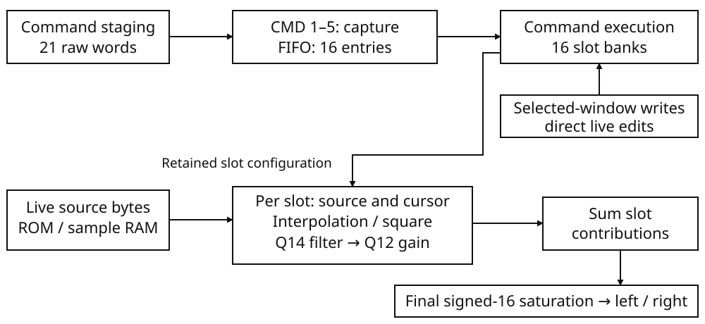
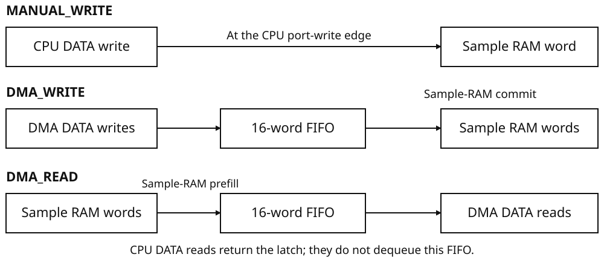

# Audio processing unit {#sec-apu}

The BMSX has sixteen independently programmed playback slots feeding one stereo
mixer. Each slot holds one PCM voice, BADP compressed voice or square generator,
with its own source, cursor, rate, gain, filter history and playback state.
A stereo source still occupies one slot; PLAY on an occupied slot replaces its
voice. All playing slots contribute at the common 44,100-frame-per-second output
cadence, even when their source rates differ. The mixer sums their left and
right contributions separately, then saturates each final output to signed
sixteen-bit range.

Sampled voices read installed system ROM, cartridge ROM or the shared 512 KiB
sample RAM. Several slots can read the same bytes with independent playback
positions. Main RAM is not a direct playback source, and the square generator
needs no sample payload.

Use the sample-transfer port to load private sample RAM. For a CPU upload,
MANUAL_WRITE stores each word directly. For DMA, a sixteen-word FIFO buffers the
transfer while the APU moves words to or from sample RAM. This path operates
alongside playback.

To start a voice, write its source and playback parameters to the shared staging
bank, then issue PLAY. The command FIFO holds that configuration until execution.
Later gain, pause and stop commands use the same path; a selected-slot register
window also permits live parameter changes. The programming sequence below
separates sample loading, command execution and playback.

## APU specifications {#sec-apu-apu-specifications}

| Resource | Specification |
|---|---|
| Playback slots | 16, numbered 0–15 |
| Slot parameter banks | 21 retained 32-bit words per slot |
| Command staging bank | One separate set of 21 parameter words |
| Command FIFO | 16 commands, each retaining its command and 21 parameter words |
| Selected-slot window | 21 word ports addressing one of the sixteen slot banks |
| Private sample RAM | 512 KiB; sample-source addresses `40000000H`–`4007FFFFH` |
| Sample-transfer FIFO | 16 words, 64 bytes |
| Output cadence | 44,100 stereo frames per second |
| Output components | Signed sixteen-bit left and right values |
| System-cycle timebase | 33,868,800 cycles per second; 768 cycles per output frame |
| Sample-RAM transfer budget | 1,058,400 words per second; 32 cycles per transferred word |

The `40000000H` source range addresses private RAM for voice playback.
CPU and DMA transfers use TRANSFER_DATA instead of accessing that range directly.

{#fig-apu-paths}

The command path installs a voice's parameters. At each output frame, the
voice path reads or generates samples, applies interpolation, filtering and
gain, and contributes to the stereo mixer. The separate transfer path supplies
sample RAM.

## From sample data to a playing voice {#sec-apu-from-sample-data-to-a-playing-voice}

A **source** supplies the waveform; a **voice** is one playback of it. The
source description identifies its bytes, format and source-time scale. The
voice adds a current position, playback-rate multiplier, gain and optional
filter. A slot holds that voice. Two slots can use the same source while
playing different positions, pitches or gains.

A channel **sample** is one amplitude value at one instant. A **source frame**
contains the channel samples for that instant: one for mono, or a left/right
pair for stereo. A mono PCM16 frame therefore occupies two bytes; a stereo
PCM16 frame occupies four. Frame counts, start positions and loop bounds count
these source-time positions, not individual channel samples or bytes.

An **output frame** is the stereo result produced by the mixer at 44,100
frames/s. Its cadence is common to all voices. A voice's source rate says how
quickly its cursor travels through source frames. When a cursor lies between
stored frames, the APU interpolates their samples for the current output
frame. A mono source supplies the same sample to both output channels.

### Make the PCM example repeat at 440 Hz {#sec-apu-make-the-pcm-example-repeat-at-440-hz}

The [PCM example below](#sec-apu-start-a-pcm-loop-or-square-voice) stores a
waveform whose first sixteen mono frames form one cycle. Its source sample
values begin at zero, reach +8192 at frame 4, return to zero at frame 8, and
reach −8192 at frame 12. The declaration contains that cycle twice: 32 frames
and 64 bytes in total.

To sustain a tone, repeat the first cycle. Choose a loop beginning at frame 0
and ending just before frame 16, with playback starting at frame 0. At unity
rate, a source rate of 7040 frames/s carries the cursor through this sixteen-frame
cycle 440 times per second:

```text
waveform cycle rate = 7040 source frames/s ÷ 16 source frames/cycle
                    = 440 cycles/s
```

The loop repeats frames 0–15; the end bound 16 is excluded. The complete source
still contains 32 frames. Its byte extent, declared frame count and loop length
describe different things, even though all are needed for this one voice.

RATE_STEP_Q16 multiplies the source-time rate. Unity uses the 7040-frame/s
rate as programmed; a multiplier of two traverses the loop twice as quickly.
This changes the tone's pitch, not the 44,100-frame/s output clock. For a
nonlooped sound, faster traversal also shortens playback. The exact cursor and
remainder arithmetic is given under
[Source phase, rate and duration](#sec-apu-source-phase-rate-and-duration).

GAIN_Q12 multiplies the voice's sample amplitudes before mixing. Choose a gain
of one half for this voice. This halves its contribution to the mix without
changing pitch or duration; it is an amplitude ratio, not a statement about
perceived loudness. Leave the filter disabled for the first example.

The choices for the PCM voice are therefore:

| Choice | Meaning for this sound |
|---|---|
| Mono PCM16, 32 source frames | 32 signed channel samples, occupying 64 bytes |
| Source rate 7040 frames/s; rate multiplier 1 | Traverse source time at 7040 frames/s |
| Start 0, loop [0,16) | Repeat the first sixteen-frame waveform cycle |
| Gain 1/2; filter disabled | Half-amplitude contribution without filtering |
| Slot 2 | Keep this voice and its cursor separate from the other slots |

### Turn the choices into a PLAY command {#sec-apu-turn-the-choices-into-a-play-command}

Source and playback settings share a 21-word **staging bank**. Writing it
prepares a command; it does not start or change a voice by itself. Describe
the source, choose slot 2 and prepare the loop, rate and gain, then write PLAY
to CMD. That final write captures the complete description into the command
FIFO. At execution, PLAY binds the source and installs the captured settings
in slot 2. The slot then supplies samples at the output-frame cadence.

The stored rate and gain have different scales. Unity rate is 65536
(`00010000H`) in RATE_STEP_Q16. Unity gain is 4096 (`00001000H`) in GAIN_Q12,
so the chosen half gain is 2048 (`00000800H`). Loop bounds and START_SAMPLE
remain ordinary source-frame indices. These are the values carried into the
complete staging sequence below.

The square alternative generates its sample instead of reading PCM bytes.
One phase cycle spans one source frame, so it uses source rate 440 and loop
[0,1) for the same 440-cycle/s phase rate. Its duty setting chooses the positive
part of that phase cycle. The square column below uses one-half duty and
one-quarter gain; it needs no sample-memory transfer.

## Programming sequence {#sec-apu-programming-sequence}

First choose where the samples will reside and how they will be decoded.
ROM samples can play in place. Samples prepared in main RAM or card RAM must
be loaded into private sample RAM before playback.

| Starting material | Hardware route to playback |
|---|---|
| PCM or BADP in installed system ROM or the selected cartridge ROM | Bind the complete region with SOURCE_ADDR and SOURCE_BYTES, and program its source metadata. PCM metadata is not read from a container header. |
| PCM or BADP in private sample RAM | Bind the source at `40000000H + byte_offset`, after the sample bytes have committed to RAM. This range is not a CPU load/store window. |
| Samples in main RAM, cartridge RAM or cartridge mailbox space | Transfer the bytes into private sample RAM first; these are not direct playback sources. |
| Square generator | Program GENERATOR_KIND=1, rate, loop and duty. No sample upload or source-buffer binding is needed. |

For source decoding, SOURCE_BITS_PER_SAMPLE values 4 and 16 select BADP and
PCM16 respectively; other values select PCM8. SOURCE_DATA_OFFSET counts bytes
within the bound region, whereas START_SAMPLE and loop bounds count source
frames.

### Submit the prepared voice {#sec-apu-submit-the-prepared-voice}

1. **Choose the slot and source.** Select an idle slot when another voice must
   be preserved. PLAY on an occupied slot replaces it. Make the sample bytes
   available in ROM or finish loading them into sample RAM; the
   [sample-transfer procedure](#sec-apu-load-changing-sample-data-before-play)
   distinguishes DMA delivery from the final RAM write. A square generator
   needs neither operation.
2. **Prepare one complete command.** Write its source and playback settings to
   staging, with SLOT identifying the target. Finish those writes before CMD.
   Another routine must not interleave a different description: both routines
   would be writing the same staging bank. Check CMD_FREE before a burst that
   must preserve every command; a full sixteen-entry FIFO replaces its oldest
   entry rather than waiting.
3. **Issue PLAY and allow execution.** A recognized nonzero CMD captures all
   21 words, restores staging defaults and selects live bank zero. PLAY binds
   at execution, not capture, so keep the intended cartridge socket selected
   until it executes. The starting example below shows its active-bit result;
   inspect the fault words as well.
4. **Keep later changes distinct.** Staging writes prepare the next command.
   Selected-slot writes instead change a live bank: reselect through staging
   SLOT after capture before using that window. They are not queued behind a
   pending PLAY. Use another captured PLAY when a replacement source description
   must take effect together.
5. **Retain the source until the voice has stopped.** PLAY does not copy the
   payload, and pause retains its source requirement. Natural ends and completed
   nonzero fades publish SLOT_ENDED; an immediate zero-fade STOP_SLOT does not.
   The latest-event registers and APU interrupt are distinct from DMA completion.
   [End events and interrupts](#sec-apu-end-events-and-interrupts) gives the
   overwrite and acknowledgement rules.

The [source](#sec-apu-voice-sources-and-their-lifetime),
[command](#sec-apu-commands-and-slot-ownership) and
[transfer](#sec-apu-sample-ram-transfer) sections specify the full formats and
write effects used by this sequence.

### Start a PCM loop or square voice {#sec-apu-start-a-pcm-loop-or-square-voice}

These two configurations encode the PCM and square choices explained above.
They show the complete staging bank. Start with the selected slot idle, no
queued commands and no outstanding APU fault; keep this staging sequence
separate from other command preparation. No DMA or transfer-port operation is
needed: PCM is read from cartridge ROM, while the square generator has no sample
buffer.

For the PCM case, place the following mono PCM16 samples in cartridge ROM.
Let **A** be their mapped byte address; the declaration occupies 64 bytes.
Keep the cartridge containing these bytes selected until PLAY executes.

```lua
rodata pcm: i16[32] = {
  0, 3135, 5793, 7568, 8192, 7568, 5793, 3135,
  0, -3135, -5793, -7568, -8192, -7568, -5793, -3135,
  0, 3135, 5793, 7568, 8192, 7568, 5793, 3135,
  0, -3135, -5793, -7568, -8192, -7568, -5793, -3135,
}
```

Choose one column and write **all 21 words** with aligned CPU stores. Do not
interleave another producer's staging writes. Parameter order below follows
increasing address; CMD is separate and must be written last.

| Staging address | Parameter | PCM loop | Square |
|---|---|---|---|
| `08000120H` | SOURCE_ADDR | A | `00000000H` |
| `08000124H` | SOURCE_BYTES | 64 | 0 |
| `08000128H` | SOURCE_SAMPLE_RATE_HZ | 7040 | 440 |
| `0800012CH` | SOURCE_CHANNELS | 1 | 1 |
| `08000130H` | SOURCE_BITS_PER_SAMPLE | 16 | 16 |
| `08000134H` | SOURCE_FRAME_COUNT | 32 | 1 |
| `08000138H` | SOURCE_DATA_OFFSET | 0 | 0 |
| `0800013CH` | SOURCE_DATA_BYTES | 64 | 0 |
| `08000140H` | SOURCE_LOOP_START_SAMPLE | 0 | 0 |
| `08000144H` | SOURCE_LOOP_END_SAMPLE | 16 | 1 |
| `08000148H` | SLOT | 2 | 4 |
| `0800014CH` | RATE_STEP_Q16 | `00010000H` | `00010000H` |
| `08000150H` | GAIN_Q12 | `00000800H` | `00000400H` |
| `08000154H` | START_SAMPLE | 0 | 0 |
| `08000158H` | FILTER_CONTROL | 0 | 0 |
| `0800015CH` | FILTER_B0_B1 | `00004000H` | `00004000H` |
| `08000160H` | FILTER_B2_A1 | 0 | 0 |
| `08000164H` | FILTER_A2 | 0 | 0 |
| `08000168H` | FADE_SAMPLES | 0 | 0 |
| `0800016CH` | GENERATOR_KIND | 0 | 1 |
| `08000170H` | GENERATOR_DUTY_Q12 | `00000800H` | `00000800H` |

Write `00000001H` to CMD at `08000174H` to submit PLAY. Capture restores
staging defaults and the visible selector to zero; it does not mean that the
voice has started. For these idle-slot starting conditions, ACTIVE_MASK at
`08000190H` gains bit 2 (`00000004H`) for PCM or bit 4 (`00000010H`) for the
square when PLAY executes. Check the fault words as well as the active bit.

The PCM loop repeats sixteen source frames at 7040 frames/s, giving a 440 Hz
waveform at one-half gain. The square uses 440 as its source rate, a one-frame
loop and one-half duty; it is a continuous 440 Hz generator, not a sound lasting
one output frame. Its quarter-gain contribution is mixed at Q12 precision;
with no other contributing voices, the final channel levels are +8191 and
−8192. Leave the PCM ROM bytes intact for the voice's complete lifetime,
including pauses.

To reduce the PCM voice's contribution from one-half to one-quarter without
restarting its waveform, write slot 2 to staging SLOT at `08000148H`, gain
`00000400H` to staging GAIN_Q12 at `08000150H`, then SET_SLOT_GAIN
(`00000003H`) to CMD. When this command executes, the existing playback cursor
continues; a new PLAY would instead start from its captured START_SAMPLE.

To stop either voice without a fade, write its slot number to `08000148H`,
zero to FADE_SAMPLES at `08000168H`, then `00000002H` to CMD. These are new
staging writes, not edits to the selected live bank. The slot's active bit
clears when STOP_SLOT executes; submitting it does not release the source
immediately. This zero-fade stop does not publish SLOT_ENDED.

## Voice sources and their lifetime {#sec-apu-voice-sources-and-their-lifetime}

Program a source description for each sampled voice. The description identifies
the byte region, decoder, channel layout, frame count and loop. PCM uses these
register values directly, so a PCM source needs only sample bytes rather than
a file header.

| Source field | Meaning |
|---|---|
| SOURCE_ADDR | Base address of the complete bound source region |
| SOURCE_BYTES | Byte extent of that region |
| SOURCE_SAMPLE_RATE_HZ | Source rate in Hz, used with RATE_STEP_Q16 |
| SOURCE_CHANNELS | Channel count used by the decoder |
| SOURCE_BITS_PER_SAMPLE | Decoder selection: 4 for BADP, 16 for PCM16, otherwise PCM8 |
| SOURCE_FRAME_COUNT | Number of source frames used for playback duration |
| SOURCE_DATA_OFFSET | Byte displacement from SOURCE_ADDR to sample or compressed-block data |
| SOURCE_DATA_BYTES | Retained data-byte metadata; not a decoder read bound |
| SOURCE_LOOP_START_SAMPLE / SOURCE_LOOP_END_SAMPLE | Source-frame loop bounds |
| GENERATOR_KIND | Zero for source-buffer playback; one for the square generator |
| GENERATOR_DUTY_Q12 | Square-generator duty threshold |

A frame contains the channel samples at one source-time position. Thus a stereo frame is two samples, not two frames. START_SAMPLE and loop bounds count frames; byte offsets count bytes.

For source-buffer playback, PLAY binds the entire region identified by SOURCE_ADDR and SOURCE_BYTES when the command executes. Every accepted binding requires a nonzero byte count and the complete requested extent within the applicable storage.

| Source region | Admitted storage |
|---|---|
| System ROM | Actual installed firmware-image bytes, starting at 00000000H |
| Selected cartridge ROM | Entire extent within 10000000H–2FFFFFFFH, with a ROM device present and the extent within that card's actual ROM bytes |
| Private sample RAM | 512 KiB at 40000000H–4007FFFFH |

For samples held in main RAM, card RAM or other storage, transfer the bytes
into private sample RAM first. A bound source must fit within actual installed
storage, including the end of private RAM or a ROM. The zero-filled tail of a
CPU ROM read is outside the bindable source extent.

PLAY binds the cartridge ROM selected at execution. Keep that socket selected
until the command executes; later SELECT writes leave the voice on its bound
ROM. Live source-field writes bind again using the selection at that access.
See [Source fields are individually live](#sec-apu-source-fields-are-individually-live)
and [[Cartridge controller](../book3/cartridge.md#sec-cartridge-cartridge-controller)]{.content-visible when-format="html"}[Book III, §1.3]{.content-visible when-format="pdf"}.

The voice reads the bound storage while playing; PLAY does not copy the sample payload. Keep that storage available for the voice's lifetime. PCM reads use the current bytes. BADP retains its current and previous decoded
frames; edits to compressed bytes take effect when those bytes are decoded again.

A failed binding raises SOURCE_RANGE (`00000102H`) with SOURCE_ADDR as detail;
a failed PLAY leaves the old voice and slot bank intact. Binding checks the
source region. The decoder then uses the programmed rate, channels, frame count,
data offset and bit depth directly.

**SOURCE_DATA_BYTES does not limit decoding.** SOURCE_BYTES sets the bound
region, while decode addresses follow the format and frame metadata. Keep the
sample payload and, for BADP, its header and seek table consistent with those
values.

GENERATOR_KIND=1 selects the square generator and bypasses source binding.
Other nonzero values also bypass binding but have no defined waveform; use one
for square output and zero for sampled output.

## PCM byte layouts and interpolation {#sec-apu-pcm-byte-layouts-and-interpolation}

PCM data starts at SOURCE_ADDR + SOURCE_DATA_OFFSET. For frame n, the first sample index is n multiplied by SOURCE_CHANNELS. Channel zero supplies left; channel one supplies right. Mono repeats its one decoded sample on both output channels.

| Format | Bytes in frame n, relative to the data start |
|---|---|
| PCM8 mono | n: mono byte |
| PCM8 stereo | 2n: left byte; 2n+1: right byte |
| PCM16 mono | 2n: low byte; 2n+1: high byte |
| PCM16 stereo | 4n, 4n+1: left low/high; 4n+2, 4n+3: right low/high |

PCM8 is unsigned offset-binary. Its decoded value is (byte minus 128) multiplied by 256. Bytes 00H, 80H, FFH and 40H therefore decode to −32768, 0, 32512 and −16384. In particular, FFH is not +32767 and 00H is not silence.

PCM16 is signed little-endian. Bytes 00H 80H mean −32768; FFH 7FH mean +32767; 00H C0H mean −16384. A stereo data sequence `00H 80H FFH 7FH 00H 00H 00H C0H` contains two frames: (−32768, +32767), then (0, −16384).

Playback uses linear interpolation for PCM and for decoded BADP samples. Let n be the current integer source-frame position and f its 16-bit fractional part. For either channel:

```text
sample = first + ASR16((second − first) × f)
```

Here first is frame n, second is its interpolation neighbor, and ASR16 divides by 65536 with rounding toward negative infinity. Interpolate left and right independently. With first=−10000, second=10000 and f=16384, the result is −5000. With first=1000, second=−1001 and f=32768, the difference contributes −1001, giving −1; truncation toward zero would give the wrong result.

Without a loop, the last source frame is also its own interpolation neighbor. Interpolation does not read frame SOURCE_FRAME_COUNT beyond that last frame. With a loop, a neighbor reaching or passing the loop end is replaced by the loop-start frame. For loop [4,8), position 7.5 interpolates frame 7 with frame 4, not frame 8.

For example, mono PCM16 frames [0,10000,−10000,0], a source rate of 22050 Hz and unity RATE_STEP_Q16 produce eight output samples:

```text
0, 5000, 10000, 0, −10000, −5000, 0, 0
```

The final pair is zero because the last source frame is held for interpolation until the cursor reaches the nonloop end.

### Size a PCM source {#sec-apu-size-a-pcm-source}

For mono or stereo PCM, count storage from source frames, not output frames:

```text
bytes per source frame = channels × bytes per channel sample
PCM payload bytes      = SOURCE_FRAME_COUNT × bytes per source frame
```

SOURCE_DATA_OFFSET locates that payload within the bound SOURCE_BYTES region.
Keep the complete payload inside the region. The descriptor words are programmed
separately; no PCM file header is required in the sample bytes.

At a source rate of 44,100 Hz, the following sizes hold one second of source
material. With unity RATE_STEP_Q16, no loop and START_SAMPLE=0, each produces
44,100 output frames:

| PCM format | Bytes per source frame | One second of payload | Frames in all 512 KiB of sample RAM |
|---|---:|---:|---:|
| 8-bit mono | 1 | 44,100 | 524,288 |
| 8-bit stereo | 2 | 88,200 | 262,144 |
| 16-bit mono | 2 | 88,200 | 262,144 |
| 16-bit stereo | 4 | 176,400 | 131,072 |

The last column assumes one payload starting at RAM offset zero, with no other
sample storage allocated. For example, 131,072 stereo PCM16 frames last about
2.972 seconds at 44,100 Hz and unity rate. Slots share this RAM: sixteen slots
do not provide sixteen private 512-KiB banks. Several slots can instead bind
the same stored sample and retain independent cursors and playback settings.

## Source phase, rate and duration {#sec-apu-source-phase-rate-and-duration}

The playback cursor locates a position in source time. For a sampled voice, its
integer part selects a source frame, and its fractional part supplies the
interpolation weight.
Rate controls the cursor's advance; loop bounds control where it wraps.

PLAY copies the captured parameters into the target slot, makes it PLAYING, clears fade progress and filter histories, and sets the cursor to START_SAMPLE multiplied by 65536. START_SAMPLE is an unsigned frame index, not a signed word. Its initial fractional position and accumulated rate remainder are zero.

RATE_STEP_Q16 is a complete signed 32-bit Q16 word. 00010000H is +1, FFFF0000H is −1, and zero freezes phase. SOURCE_SAMPLE_RATE_HZ is an unsigned word. Convert the source-rate/rate combination as follows:

```text
P = signed(RATE_STEP_Q16) × SOURCE_SAMPLE_RATE_HZ
P = q × 44100 + r
```

Choose q by division truncated toward zero; r is signed and has magnitude less than 44100. q is a cursor increment in Q16 units, not an integer source-frame count. Retain r rather than rounding it away on every output frame.

For each output frame, render the current cursor, filter if enabled, and contribute the current-gain product to the mix. Then add r to the accumulated rate remainder. At +44100 or above, subtract 44100 and add a +1 cursor-unit carry. At −44100 or below, add 44100 and use a −1 carry. Advance the cursor by q plus that carry. A cursor unit is 1/65536 of a source frame.

For 8000-Hz source data at unity rate, P=524288000, q=11888 and r=27200. Starting with remainder zero, the first two advances are 11888 and 11889 cursor units: the remainders become 27200 and 10300. The second advance includes the carry. Negative unity rate gives q=−11888 and r=−27200, with correspondingly negative carries. Zero rate, or zero source rate, causes no phase advancement; neither is rejected or clamped by this conversion.

### Loops apply before the first sample {#sec-apu-loops-apply-before-the-first-sample}

Looping exists exactly when SOURCE_LOOP_END_SAMPLE is greater than SOURCE_LOOP_START_SAMPLE as unsigned words. Otherwise it is disabled. Bounds are converted directly to Q16 and are not restricted to SOURCE_FRAME_COUNT.

An enabled loop wraps the cursor **before the first output sample**, and again after every phase advance. It is not an introduction followed by a loop. The exact wrap is:

```text
loopStart + positiveModulo(cursor − loopStart, loopEnd − loopStart)
```

The loop interval includes its start and excludes its end. Positive modulo produces a nonnegative result even for negative input. This also handles an advance longer than the entire loop.

For loop [4,8), START_SAMPLE=1 wraps to frame 5 before playback, not to frame 1 or necessarily frame 4. A forward advance from 7.75 by 0.5 wraps to 4.25; a reverse advance from 4.25 by −1 wraps to 7.25. The interpolation neighbor wraps at the same loop boundary.

### Nonloop completion {#sec-apu-nonloop-completion}

Before an output sample, an unlooped cursor outside [0, SOURCE_FRAME_COUNT×65536) ends without contributing a sample. Otherwise the current frame is rendered before phase advancement. Crossing either boundary then ends the voice after that rendered sample, including while a fade is active.

At source rate 44100 Hz and unity rate, a nonloop source of N frames played from zero emits frames 0 through N−1. At negative unity rate, start at N−1 to emit N−1 down through zero. Starting at N is already outside the interval. An in-range zero-rate voice does not naturally end by phase motion alone.

Natural source completion and fade completion use the same output-sample edge.
The earlier condition ends the voice; coincident completion produces one end
notification. A fade does not extend an unlooped source.

## Square generator {#sec-apu-square-generator}

GENERATOR_KIND=1 selects the square generator. It reads no sample bytes and supplies the same sample to left and right. Let f be the cursor's fractional position modulo 65536:

```text
if f × 4096 < GENERATOR_DUTY_Q12 × 65536: sample = +32767
otherwise:                                      sample = −32768
```

Duty is an unsigned Q12 threshold, unlike signed GAIN_Q12.

| Duty word | Result for an in-range fractional cursor |
|---|---|
| 00000000H | Always −32768 |
| 00000800H | Positive for the first half of the phase cycle |
| 00001000H or greater | Always +32767 |

The phase uses the same signed rate conversion as source playback. One integer source-frame advance corresponds to one complete square phase cycle. The unwrapped phase rate in cycles per second is SOURCE_SAMPLE_RATE_HZ multiplied by signed(RATE_STEP_Q16)/65536; the actual 44,100-Hz output sequence is determined by the comparison above.

For example, source rate 441 Hz, unity rate, half duty and loop [0,1) give a 100-output-frame pattern: 50 positive samples followed by 50 negative samples. FRAME_COUNT and loop bounds still govern duration and wrapping; selecting a generator does not remove those controls.

## Gain, stereo mixing and clipping {#sec-apu-gain-stereo-mixing-and-clipping}

Gain controls a voice's amplitude contribution without changing its playback
cursor. All slots share the final left and right outputs, so their sum can clip
even when each source sample is within signed sixteen-bit range.

GAIN_Q12 is the signed value of the entire word. It is not an unsigned volume percentage.

| Gain word | Multiplier |
|---|---:|
| 00000000H | 0 |
| 00000800H | +0.5 |
| 00001000H | +1 |
| 00002000H | +2 |
| FFFFF000H | −1 |

Negative gain inverts polarity. Gain values above unity are not clipped when written. During a fade the retained current gain changes without rewriting the programmed slot GAIN_Q12 word.

For each channel separately, sum the products of every running voice's filtered sample and current Q12 gain. Only then shift and saturate:

```text
mix = sum(sample × currentGainQ12)
output = signed16Saturate(ASR12(mix))
```

ASR12 rounds negative results toward negative infinity. There is no per-voice gain-product saturation. Two samples of +20000 at unity therefore yield a pre-clipped result of +40000 and final output +32767. One +20000 sample at unity plus one at half gain yields +30000 without clipping. Two samples of +1 at half gain combine to +1 because their fractional contributions are summed before shifting.

Minus-unity gain applied to −32768 produces +32768 before final clipping and thus +32767 at the output. This is the signed-16 asymmetry, not a gain-write restriction. An enabled filter has a separate signed-16 saturation before gain and mixing.

## Per-voice Q14 filter {#sec-apu-per-voice-q14-filter}

The biquad shapes each voice's sample stream after interpolation or generation
and before gain. Its histories carry earlier input into later output frames;
changing a coefficient can therefore affect more than the current sample.

FILTER_CONTROL bit 0 enables the stereo biquad. Other bits have no decoded filter effect. The two channels share five coefficients but have independent two-word histories.

| Register halfword | Coefficient |
|---|---|
| FILTER_B0_B1 bits 15:0 | b0 |
| FILTER_B0_B1 bits 31:16 | b1 |
| FILTER_B2_A1 bits 15:0 | b2 |
| FILTER_B2_A1 bits 31:16 | a1 |
| FILTER_A2 bits 15:0 | a2 |
| FILTER_A2 bits 31:16 | Not decoded |

Each coefficient is signed 16-bit Q14: 4000H is +1, 2000H is +0.5, C000H is −1 and 8000H is −2. Decode each halfword independently; the sign of the whole packed register is not the sign of both coefficients.

For one channel, x is the interpolated source or generator sample and z1,z2 are retained signed 32-bit history words. Use the old histories for the right-hand sides:

```text
y      = ASR14(b0 × x + z1)
nextZ1 = WRAP32(b1 × x − a1 × y + z2)
nextZ2 = WRAP32(b2 × x − a2 × y)
output = signed16Saturate(y)
```

ASR14 rounds toward negative infinity. WRAP32 retains the low 32 bits and interprets them as signed: 2147483648 wraps to −2147483648. History overflow wraps; it does not saturate. Crucially, history updates use the unsaturated y, not the clipped filter output. Left and right execute this recurrence with separate histories.

For a two-sample average, program FILTER_B0_B1=20002000H, FILTER_B2_A1=0 and FILTER_A2=0, then enable bit 0. Starting from zero histories, input [8192,0,−8192,0] yields [4096,4096,−4096,−4096]. On the first sample, y=(8192×8192)/16384=4096 and nextZ1=67108864. On the next zero input, that history alone gives 4096; the new history becomes zero. The negative pair follows the same recurrence.

PLAY clears histories and filter output before installing its programmed coefficients. The filter datapath's reset setting is disabled, with b0=4000H and the other coefficients zero. Live control or coefficient writes install all five coefficients from the slot words without clearing histories. Disabling bypasses processing entirely: histories remain frozen, and re-enabling resumes them. Live source replacement, live START_SAMPLE seeks and pause also retain histories.

## Stop and fade {#sec-apu-stop-and-fade}

Use a fade to reduce a voice's contribution over a chosen interval before
releasing its slot. FADE_SAMPLES counts **output frames**, not source frames:
441 rendered frames span 10 ms at the fixed output cadence, regardless of
source rate or pitch. Pause suspends this progress.

STOP_SLOT with FADE_SAMPLES=0 stops immediately and clears all 21 slot words. Stopping an idle slot also clears its bank. With a non-idle slot and a positive duration, STOP_SLOT instead enters FADING for at most that many rendered output frames: an unlooped source can end sooner. A paused voice remains paused, so its fade waits for resume. Writing FADE_SAMPLES alone does not begin a fade.

For initial retained signed gain G0 and duration N, configure:

```text
Q = truncTowardZero(G0 / N)
R = G0 − Q × N
error = N − 1
remaining = N
```

Each frame uses the current gain before any fade adjustment. After phase advancement, first apply the loop wrap or nonloop source-end check. If the source has ended, stop. Otherwise decrement remaining. If it becomes zero, end immediately without another gain update. Otherwise add the magnitude of R to error. If error is at least N, subtract N and use carry=sign(R); otherwise carry=0. The new current gain is WRAP32(currentGain−Q−carry).

At G0=4096 and N=4, with sufficient remaining source data or an enabled loop, the four frame gains are 4096,3072,2048,1024, then the voice stops. There is no fifth frame at zero gain. A live GAIN_Q12 write sets current gain immediately and replans this arithmetic over the remaining frame count, not the original duration.

An unlooped source stops when its cursor first leaves its declared frame
interval, even with fade frames remaining. No sample is fetched beyond that
interval to finish the fade. For example, three remaining source frames at
44100 Hz and unity rate permit only three output frames of an eight-frame
fade. With G0=4096 their gains are 4096,3584,3072, then playback ends. Provide
enough remaining data or a valid loop when the complete fade is required.

Natural completion and fade completion end and clear the slot and produce the slot-ended notification described in the event section. An immediate explicit stop does not emit that notification.

## Pause, resume and live programming {#sec-apu-pause-resume-and-live-programming}

PAUSE_SLOT changes a non-idle, unpaused voice to paused without discarding it. RESUME_SLOT acts on a paused voice without replaying it. The active-mask bit remains set while paused.

A paused voice contributes no samples and consumes no phase, fade frames or filter history. Resume continues the retained cursor, gain, fade and histories. Selected-slot writes can nevertheless modify a paused voice, because it remains non-idle.

Selected-slot reads observe the voice after all output-frame edges through the access cycle. A write takes effect for subsequent output frames; it cannot change samples already due through that cycle. These accesses are distinct from writing command staging words.

### Source fields are individually live {#sec-apu-source-fields-are-individually-live}

The following active-slot stores each replace the source description:

- SOURCE_ADDR and SOURCE_BYTES;
- SOURCE_SAMPLE_RATE_HZ, SOURCE_CHANNELS and SOURCE_BITS_PER_SAMPLE;
- SOURCE_FRAME_COUNT, SOURCE_DATA_OFFSET and SOURCE_DATA_BYTES;
- GENERATOR_KIND.

Each store first changes its raw slot word, then reloads all source metadata
and rebinds using the cartridge selection at that access. Consecutive stores
are **not an atomic source update**.

A successful replacement preserves cursor, accumulated phase remainder, current gain, fade progress and filter histories. It reconfigures the rate conversion, loop bounds and filter coefficients. BADP state is reset and sought to the retained source position. Thus even a change to a rate or extent word in this group takes the full source-replacement route.

If a live replacement cannot bind, it stops and deactivates the slot and raises SOURCE_RANGE with the newly programmed SOURCE_ADDR. Unlike a failed PLAY, this failure occurs after the raw bank write. The bank words are retained rather than cleared.

| Field written | Active or paused voice effect |
|---|---|
| Loop start or end | Recompute loop bounds |
| RATE_STEP_Q16 | Recompute q and r; retain accumulated phase remainder |
| GAIN_Q12 | Replace signed current gain; replan any remaining fade |
| START_SAMPLE | Seek immediately; clear accumulated phase remainder; retain filter histories |
| GENERATOR_DUTY_Q12 | Change the square duty threshold |
| FILTER_CONTROL or a coefficient word | Reload all five coefficients; retain histories |
| FADE_SAMPLES | Store the word only; do not start a fade |

Writing a raw bank word does not activate an idle slot. Use the command programming route when a new voice, reset histories or a coherent replacement of all captured parameters is required.

## Commands and slot ownership {#sec-apu-commands-and-slot-ownership}

### Stage, capture, execute {#sec-apu-stage-capture-execute}

Write the parameters to the shared staging bank, then write CMD last. CMD
decodes the entire word; the command table defines values zero through five.
Serialize access to staging so another routine cannot alter a partly prepared
command.

A valid nonzero command captures **all 21 staging words** into one FIFO entry.
Subsequent staging writes cannot change that entry. Capture resets the visible
staging words to their defaults, returns CMD readback to zero and selects slot
0 for the selected-slot window. The queued command still targets its captured
slot; clearing the visible selector does not retarget it.

NONE captures nothing and leaves the staged parameters intact. An unrecognized
word records BAD_CMD and clears staging to defaults. A latched APU fault does
not itself block later valid commands.

Queued commands execute in FIFO order, after the output-frame edges due
through their execution cycle. Consecutive commands can execute without an
output frame between them. Use SAMPLE_SEQUENCE when an
operation requires an elapsed number of output frames.

### Preserve FIFO entries when every command matters {#sec-apu-preserve-fifo-entries-when-every-command-matters}

The FIFO retains sixteen entries. CMD_QUEUED reports its count, CMD_FREE reports
sixteen minus that count, and CMD_CAPACITY reports sixteen. With a full FIFO,
another accepted command replaces the oldest entry. It neither waits for free
space nor reports a FIFO-full fault. Use the reported space before submitting a
burst that must preserve every command.

Queue-counter reads return the current queue state. They leave commands
queued; STATUS and selected-slot reads observe output-frame progress through
their access cycle as described below.

### Command words {#sec-apu-command-words}

| CMD word | Name | Captured inputs and operation |
|---|---|---|
| `00000000H` | NONE | No FIFO entry; staging parameters remain |
| `00000001H` | PLAY | Bind captured source, replace the target voice and copy all parameters into its bank on successful binding |
| `00000002H` | STOP_SLOT | Target SLOT and FADE_SAMPLES choose immediate stop or a sample-based fade |
| `00000003H` | SET_SLOT_GAIN | Target SLOT and GAIN_Q12 update the raw gain through the live-parameter path |
| `00000004H` | PAUSE_SLOT | Pause a non-idle slot without clearing its parameter bank |
| `00000005H` | RESUME_SLOT | Resume a paused slot without reloading its source |

PLAY and the other slot commands use bits 3:0 of captured SLOT. The complete
word remains retained data. PLAY binds at execution, not capture. A failed
source bind does not replace the old slot's parameters, phase or output; it
records SOURCE_RANGE with the source address as detail.

STOP_SLOT with zero fade, or with an inactive target, clears the target bank and
stops it immediately. This immediate explicit stop does **not** produce a
slot-ended event. A nonzero fade of an active slot instead retains its bank
while fading. Pause and resume do not clear it. SET_SLOT_GAIN can also retain a
gain word in an inactive bank; that write does not start playback.

### Live slot parameters {#sec-apu-live-slot-parameters}

Write staging SLOT to select one bank through its low four bits. Only that
staging write immediately changes selection; the other staging parameter
writes merely prepare a later command. The selected window reads and writes
the bank itself, with output-frame progress observed through the access cycle.
A live write does not enqueue CMD, reset staging or activate an idle slot.

Select a bank through staging SLOT at `08000148H`. The selected-window SLOT
word at `080001BCH` is ordinary bank data and leaves the selection unchanged.

ACTIVE_MASK bit n means slot n is non-idle. Paused and fading slots still have
active bits. STATUS.BUSY is any active slot or queued command, so it can remain
set while paused sound produces no samples. It is not TRANSFER_BUSY.
SELECTED_SOURCE_ADDR is the selected bank's original source address while that
slot is active, otherwise zero. It is not the moving playback cursor.

Every active source-field write can rebind that voice independently, using the
other words currently in its bank. Several source writes are not an atomic
source replacement. [Source fields are individually live](#sec-apu-source-fields-are-individually-live)
specifies the resulting cursor, filter and binding effects. Use captured PLAY
when a new source description must be supplied together rather than assembled
through intermediate live states.

## BADP compressed source format {#sec-apu-badp-compressed-source-format}

BADP reconstructs signed sample values from compressed blocks. Those decoded
frames use the same playback cursor, interpolation, loop, filter and gain path
as PCM. The block state and seek table described here determine how the decoder
reaches a requested source frame; they do not set the voice's playback rate.

BADP is selected by SOURCE_BITS_PER_SAMPLE=4. Its source metadata still comes from the slot fields. The decoder consumes the following header words relative to SOURCE_ADDR, not relative to SOURCE_DATA_OFFSET:

| Source byte offset | Consumed field |
|---:|---|
| 28 | Little-endian 32-bit seek-entry count |
| 32 | Little-endian 32-bit seek-table byte offset, relative to SOURCE_ADDR |

Each seek entry occupies eight bytes.

| Entry byte offset | Field |
|---:|---|
| +0 | Little-endian 32-bit source-frame number |
| +4 | Little-endian 32-bit compressed-block byte offset, relative to the data start |

The data start is SOURCE_ADDR + SOURCE_DATA_OFFSET. Header and seek-table
addresses use the source base; compressed-block offsets use the data base.
Only the header fields listed above are consumed.

Seeking chooses the last entry whose frame number is no greater than the
requested frame. An empty table starts at frame zero and compressed offset
zero. If every entry frame exceeds the request, entry zero is selected.

### Blocks and channel state {#sec-apu-blocks-and-channel-state}

At a block offset relative to the data start, the block has this layout:

| Block byte offset | Field |
|---:|---|
| +0 | Little-endian 16-bit BLOCK_FRAMES |
| +2 | Little-endian 16-bit total BLOCK_BYTES |
| +4 + 4c | Channel c signed little-endian 16-bit predictor |
| +6 + 4c | Channel c unsigned byte step-table index |
| +7 + 4c | One byte not read by the decoder |
| +4 + 4×SOURCE_CHANNELS | Nibble payload begins |

Channel records are stored in increasing channel order. BLOCK_BYTES includes the block header and payload and locates the next block: next block offset equals current block offset plus BLOCK_BYTES. Loading a block replaces each channel's predictor and index and resets the block frame index and nibble cursor to zero.

Payload bytes are consumed **high nibble first, then low nibble**. Within a frame, channel zero is decoded before the next channel. The nibble cursor continues across frames.

| Layout | Payload byte consumption |
|---|---|
| Mono | Byte 0 high: frame 0; byte 0 low: frame 1; byte 1 high: frame 2; and so on |
| Stereo | Byte 0 high: frame 0 left; byte 0 low: frame 0 right; byte 1 high/low: frame 1 left/right |

The header predictor is a starting accumulator, **not an extra first output frame**. Every emitted frame first applies a nibble to its channel predictor. Mono duplicates the decoded result to right. After BLOCK_FRAMES decoded frames, the next frame loads the next block using BLOCK_BYTES.

### Exact nibble recurrence {#sec-apu-exact-nibble-recurrence}

The step table has 89 entries, indexed 0 through 88.

| Index | Step | Index | Step | Index | Step | Index | Step |
|---:|---:|---:|---:|---:|---:|---:|---:|
| 0 | 7 | 23 | 66 | 46 | 598 | 69 | 5358 |
| 1 | 8 | 24 | 73 | 47 | 658 | 70 | 5894 |
| 2 | 9 | 25 | 80 | 48 | 724 | 71 | 6484 |
| 3 | 10 | 26 | 88 | 49 | 796 | 72 | 7132 |
| 4 | 11 | 27 | 97 | 50 | 876 | 73 | 7845 |
| 5 | 12 | 28 | 107 | 51 | 963 | 74 | 8630 |
| 6 | 13 | 29 | 118 | 52 | 1060 | 75 | 9493 |
| 7 | 14 | 30 | 130 | 53 | 1166 | 76 | 10442 |
| 8 | 16 | 31 | 143 | 54 | 1282 | 77 | 11487 |
| 9 | 17 | 32 | 157 | 55 | 1411 | 78 | 12635 |
| 10 | 19 | 33 | 173 | 56 | 1552 | 79 | 13899 |
| 11 | 21 | 34 | 190 | 57 | 1707 | 80 | 15289 |
| 12 | 23 | 35 | 209 | 58 | 1878 | 81 | 16818 |
| 13 | 25 | 36 | 230 | 59 | 2066 | 82 | 18500 |
| 14 | 28 | 37 | 253 | 60 | 2272 | 83 | 20350 |
| 15 | 31 | 38 | 279 | 61 | 2499 | 84 | 22385 |
| 16 | 34 | 39 | 307 | 62 | 2749 | 85 | 24623 |
| 17 | 37 | 40 | 337 | 63 | 3024 | 86 | 27086 |
| 18 | 41 | 41 | 371 | 64 | 3327 | 87 | 29794 |
| 19 | 45 | 42 | 408 | 65 | 3660 | 88 | 32767 |
| 20 | 50 | 43 | 449 | 66 | 4026 | — | — |
| 21 | 55 | 44 | 494 | 67 | 4428 | — | — |
| 22 | 60 | 45 | 544 | 68 | 4871 | — | — |

For code c, read step s from the current index. Start difference at s shifted right by three. Add s when bit 2 is set, s shifted right by one when bit 1 is set, and s shifted right by two when bit 0 is set. These shifts discard low bits. If bit 3 is set, subtract the difference from the predictor; otherwise add it. Saturate the new predictor to −32768 through +32767.

Then change the index using the low three code bits, independently of bit 3:

| Code bits 2:0 | Index change |
|---:|---:|
| 0 | −1 |
| 1 | −1 |
| 2 | −1 |
| 3 | −1 |
| 4 | +2 |
| 5 | +4 |
| 6 | +6 |
| 7 | +8 |

Saturate the updated index to 0 through 88. The header's index byte is used for the initial lookup before that update saturation; it is not checked or clipped first.

As a byte-level example, this complete mono block has two frames:

```text
02 00 09 00 E8 03 00 00 17
```

BLOCK_FRAMES=2, BLOCK_BYTES=9, initial predictor=1000 and index=0. Code 1 comes first: step 7 gives difference 1, so the first output is 1001 and the index remains 0 after saturation. Code 7 gives difference 11, so the second output is 1012 and the index becomes 8. The initial value 1000 is never emitted by itself.

### Seeking and reverse playback {#sec-apu-seeking-and-reverse-playback}

A seek discards both retained decoded frames. Starting from the seek-table choice, decoding advances through block headers to the block containing the requested frame, then applies the forward nibble recurrence through that frame. A request for the current or previous retained frame reuses that decoded pair. An earlier request seeks again and decodes forward.

With negative RATE_STEP_Q16, the cursor requests earlier frames. A frame not
already retained is obtained by seeking to an earlier entry and decoding
forward through it. Closely spaced seek entries reduce the amount of
compressed data needed for these backward requests.

## Sample RAM transfer {#sec-apu-sample-ram-transfer}

The transfer ports and FIFO form one shared path to sample RAM. Finish the
previous transfer before reprogramming them for another operation. Either
system-DMA channel can supply or drain this FIFO with the same capability;
reserve the chosen channel while it uses the port. Keep sample-RAM ranges in
use by existing voices separate from data being replaced for a new sound.

{#fig-apu-transfer}

The rows are alternative mode paths through the same RAM. They are not three
separate memories. All DATA writes update the latch; CPU DATA reads return only
that latch and do not dequeue the FIFO.

### Load changing sample data before PLAY {#sec-apu-load-changing-sample-data-before-play}

Suppose a program has assembled a new sound in main RAM and wants a voice to
read it. SOURCE_ADDR cannot name that main-RAM buffer: first copy its bytes
through TRANSFER_DATA into private sample RAM, then give PLAY the corresponding
`40000000H + byte_offset` source address. CPU stores in MANUAL_WRITE mode write
sample RAM directly. DMA uploads instead fill the transfer FIFO, from which
the APU transfers words into sample RAM.

At DMA DONE, the final words can still be in that FIFO. Starting playback then
can make the voice read old sample-RAM bytes where the new sound's tail belongs.
Changing transfer mode then can cancel the tail's pending write entirely. Keep
the upload buffer unchanged until DMA DONE, then wait for
STATUS.TRANSFER_BUSY to clear before issuing PLAY or changing mode. This second
wait establishes that the final sample-RAM batch has committed. The
[20-word upload timeline](#sec-apu-dma-transport-and-ram-commit-are-separate)
shows the two completion points numerically.

Downloads use the opposite direction. DMA DONE means the requested words have
arrived in the destination, but the APU can have started another prefetch.
Select transfer STOP after receipt to discard that surplus; waiting for a
transfer-completion IRQ would not work because the transfer unit has none.
The [worked download](#sec-apu-worked-download-requested-data-and-surplus-prefetch)
shows the requested data and the surplus separately.

### Private RAM and the two address forms {#sec-apu-private-ram-and-the-two-address-forms}

The APU contains 512 KiB of private sample RAM: 524,288 bytes or 131,072 four-byte words. Reset clears it to zero. A sample-source descriptor addresses these bytes at 40000000H–4007FFFFH inclusive. A nonempty descriptor must fit entirely within this range; descriptor binding neither wraps an overlong range nor requires word alignment.

This source-address range is **not a CPU load/store aperture**. An aligned CPU word read or write there raises system bus fault UNMAPPED = 1 without accessing sample RAM. An ordinary CPU load takes the resulting exception rather than returning sample data. Use the transfer port to write or read back the private RAM.

| Address | Register | Function |
|---|---|---|
| 080001E8H | TRANSFER_ADDRESS | Program transfer offset; read raw programmed word |
| 080001ECH | TRANSFER_DATA | CPU data latch or DMA FIFO port |
| 080001F0H | TRANSFER_CONTROL | Program transfer mode; read raw programmed word |
| 08000178H | STATUS | Read transfer requests and transfer-in-progress state |

Writing TRANSFER_ADDRESS retains the entire word for readback and loads a separate moving byte offset:

**moving offset = programmed word AND 0007FFFCH**

Upper bits and bits 1:0 do not enter that offset. For example, programming 40000003H selects offset zero but still reads back as 40000003H. Offset zero corresponds to descriptor address 40000000H. Each actual RAM transfer reads or writes a little-endian four-byte word, then advances the offset:

**next offset = (current offset + 4) AND 0007FFFFH**

Transfers therefore wrap from the last RAM word to the first. TRANSFER_ADDRESS readback does not follow this progress.

### Modes, latch and FIFO {#sec-apu-modes-latch-and-fifo}

TRANSFER_CONTROL retains the entire programmed word. Only bits 1:0 select the mode; upper bits have no transfer function.

| Bits 1:0 | Mode | Sample-RAM operation |
|---:|---|---|
| 0 | STOP | No transfer batches |
| 1 | MANUAL_WRITE | CPU DATA writes store directly into RAM |
| 2 | DMA_WRITE | FIFO-to-RAM batches |
| 3 | DMA_READ | RAM-to-FIFO batches |

Changing the decoded mode cancels the pending batch and empties the FIFO.
It preserves sample RAM, the data latch, TRANSFER_ADDRESS readback and the moving
offset. Rewriting the same mode, even with different upper bits, preserves the
FIFO and pending batch. Either write updates the request levels and starts an
eligible batch when none is pending.

CPU DATA reads always return the existing data latch. They never fetch RAM, dequeue FIFO data or advance the offset. CPU DATA writes always replace the latch. In MANUAL_WRITE only, they also write RAM immediately and advance the offset. In every other mode a CPU DATA write changes only the latch; it cannot feed the DMA FIFO.

DMA DATA writes also replace the latch. In DMA_WRITE they append to the FIFO if space exists; a full FIFO discards the new word while retaining its value in the latch. Outside DMA_WRITE they neither enqueue nor write RAM. DMA DATA reads in DMA_READ dequeue the oldest available word into the latch and return it. An empty FIFO, or any other mode, returns the existing latch without dequeue or address movement. These full, empty and wrong-mode cases do not themselves raise an APU fault.

### Requests and admitted blocks {#sec-apu-requests-and-admitted-blocks}

| DMA request selector | Asserted condition |
|---|---|
| APU_WRITE = 3 | DMA_WRITE mode and FIFO empty |
| APU_READ = 4 | DMA_READ mode and FIFO full with 16 words |

The controller admits a block only when both its read and write request selectors pass. FORCE = 0 always passes; DISABLED = 15 never passes. Once admitted, every word in that block executes even if the APU request drops after the first word. Requests gate **whole blocks**, not individual ready words. Use the appropriate APU selector, the intended transfer mode and a fixed TRANSFER_DATA endpoint; FORCE cannot override the latch, overflow or empty-read behavior above.

At the end of each DMA block, DMA_WRITE starts an eligible FIFO-to-RAM transfer
and DMA_READ starts an eligible RAM-to-FIFO refill. This applies to intermediate
blocks as well as the block that finishes a channel. It is not synonymous with
channel DONE.

With no batch in progress, DMA_WRITE starts a batch containing the FIFO count then present. DMA_READ starts a batch filling the free capacity, 16 minus that count. Zero words start no transfer. A batch's word count and completion cycle are fixed when it starts; later FIFO activity does not change either. The batch transfers words in FIFO order and advances the offset per word. At completion, requests update and another eligible batch can start.

The offset is **not captured with the batch**. Writing TRANSFER_ADDRESS while a batch is in progress retargets that batch to the new offset, unless the batch is already due at the access cycle. Changing mode instead cancels it.

### Status and CPU port ownership {#sec-apu-status-and-cpu-port-ownership}

| STATUS bit | Mask | Meaning |
|---:|---|---|
| 7 | 00000080H | DMA_REQUEST: read request OR write request |
| 8 | 00000100H | DMA_READ_REQUEST |
| 9 | 00000200H | DMA_WRITE_REQUEST |
| 10 | 00000400H | TRANSFER_BUSY: a RAM batch is in progress |

TRANSFER_BUSY is not a mode indicator. DMA_WRITE with an empty FIFO can request a block while TRANSFER_BUSY is clear. DMA_READ with a full FIFO can likewise request a block without pending RAM service. STATUS BUSY, bit 2, concerns active voices or queued commands; it is not transfer completion.

A CPU DATA write waits while either busy DMA channel owns DATA as its exact read or write port, even when that channel is waiting for requests. For an admitted block, ownership uses its captured base address; otherwise it uses the channel's current programmed address. The write proceeds only after neither direction owns that port. This is not FIFO-full backpressure. CPU DATA reads are not blocked by this ownership rule. DMA DATA writes are always accepted by the port without an occupancy stall; their actual effect follows the FIFO rules above.

### Completing uploads and downloads {#sec-apu-completing-uploads-and-downloads}

For upload, program the offset, select DMA_WRITE, and DMA to the fixed DATA port using APU_WRITE admission. DMA channel DONE reports completion of the controller's final mapped accesses and count/address updates; its DMA IRQ does not report sample-RAM commit. Wait for the final batch to finish before changing mode or using the new bytes. In particular, a mode change immediately after DONE can discard the final upload batch.

For download, program the offset before selecting DMA_READ. Filling the FIFO costs sample-RAM transfer time; APU_READ asserts only when all 16 words are available. DMA reads dequeue those prefetched words. The final DMA block can start further prefetch even when the channel reaches DONE. After receiving the desired words, select STOP to cancel unwanted prefetch. CPU DATA reads cannot drain the FIFO. The transfer unit has no separate START/DONE register or transfer-completion IRQ.

A nonzero DMA count sets channel BUSY at START. Zero count reaches DONE at START without accessing DATA. Neither DONE nor TRANSFER_BUSY = 0 proves that the intended RAM bytes received valid data. An admitted DMA block is not aborted by a system bus fault and can still finish with DONE and its IRQ after accesses to an unmapped or read-only destination.

Use aligned word accesses for these ports. The
[CPU alignment check](memory.md#sec-memory-width-and-alignment) precedes mapped
I/O access. After that check, I/O byte writes, halfword accesses and accesses
to a non-word-aligned I/O slot raise system bus fault UNALIGNED_IO = 2 without
performing the intended port operation. An aligned byte read invokes the word
read and returns its low eight bits; it does not select a byte lane. STATUS
rejects word writes with READ_ONLY = 3. These system bus faults are distinct
from the APU fault latch.

Reset clears the programmed transfer words, offset, latch, FIFO contents/count and timing state, selects STOP, cancels the transfer and deasserts both request lines. Reset clears sample RAM as well; ordinary STOP and mode changes preserve it.

## Clocks and transfer timing {#sec-apu-clocks-and-transfer-timing}

### Installed rates {#sec-apu-installed-rates}

The installed system clock is 33,868,800 Hz. The APU sample clock runs at 44,100 output frames per second. Sample-RAM transfer service has a separate budget of 1,058,400 words per second: 24 four-byte words per output frame.

| Quantity | Installed value |
|---|---:|
| System cycles per output frame | 33,868,800 / 44,100 = 768 |
| System cycles per sample-RAM transfer word | 33,868,800 / 1,058,400 = 32 |
| Sample-RAM service for 16 words | 16 × 32 = 512 cycles |
| Sample-RAM service for 4 words | 4 × 32 = 128 cycles |

These costs cover the sample-RAM side of a DMA transfer. Add CPU setup and
system-DMA transport separately. MANUAL_WRITE stores take effect at the CPU
port-write edge, bypassing the FIFO and its timed batches.

All transfers share the RAM/FIFO path. Playback reads its bound sources
independently of that path, so all sixteen slots retain the 44,100-Hz output
cadence during sample transfers. Transfer-mode changes leave the output-frame
clock running.

For a batch of N words:

**batch completion cycle = batch start cycle + 32 × N**

Rewriting the same mode preserves a pending batch; changing mode cancels it.

### Sample sequence and edge order {#sec-apu-sample-sequence-and-edge-order}

SAMPLE_SEQUENCE at `08000200H` is the low 32 bits of the output-frame count.
Reset establishes its phase and clears the count. It advances once per 768
system cycles even when every slot is idle. A read includes all frames due
through that access cycle. Writes leave the running count unchanged and cause
no read-only-port fault.

A transfer completing at an output-sample edge is visible to voice processing for that sample. For an access to TRANSFER_ADDRESS, TRANSFER_DATA or TRANSFER_CONTROL at cycle t, the order is:

1. Complete earlier transfer deadlines, with intervening voice progress.
2. Advance voice processing through cycle t − 1.
3. Complete a transfer batch due exactly at t.
4. Perform the register access.
5. Advance voice processing through t.

Thus a control write at the batch's exact deadline cannot cancel that already-due batch. An address write at that deadline affects subsequent transfers, not the batch just completed. The same transfer-before-sample rule applies when no register access occurs.

### DMA transport and RAM commit are separate {#sec-apu-dma-transport-and-ram-commit-are-separate}

DMA transports words between its source and the APU DATA port. The APU then transfers those words between its FIFO and private sample RAM. Each stage has its own timing and completion condition; adding only the sample-RAM cost does not give the complete upload time.

For a contiguous cartridge-ROM source and a fixed I/O destination, an admitted DMA block of N words costs **8 × N + 4 cycles**. The setup cost applies afresh to each admitted block. This cost and the APU's **32 × N** service cost describe separate stages.

The following controlled upload transfers 20 words. Before cycle 0, the address and DMA registers are programmed, DMA_WRITE is selected, and the FIFO is empty. The DMA source increments through readable cartridge ROM without a region crossing; its destination remains TRANSFER_DATA. Its blocks contain at most 16 words, with FORCE read admission and APU_WRITE write admission. There are no intervening mode/address writes or competing work. Cycle 0 is the first DMA block admission, not the start of CPU setup.

| Cycle | Event |
|---:|---|
| 0 | Admit the first 16-word DMA block. Its cost is 8 × 16 + 4 = 132 cycles. |
| 132 | DMA supplies 16 FIFO words. The end of the block starts a 16-word RAM transfer: 512 cycles. |
| 644 | The first 16-word sample-RAM transfer completes. The empty FIFO requests the remaining four DMA words; their block costs 8 × 4 + 4 = 36 cycles. |
| 680 | DMA supplies the four-word tail, starts 128 cycles of RAM transfer, and reaches channel DONE. The tail is not yet in sample RAM. |
| 808 | The four-word tail commits; TRANSFER_BUSY clears. All 20 words are now in sample RAM. |

Here, DMA DONE occurs at cycle 680, while final RAM commit occurs at cycle **132 + 512 + 36 + 128 = 808**. Switching to STOP at DMA DONE would cancel the tail's pending commit.

## Worked download: requested data and surplus prefetch {#sec-apu-worked-download-requested-data-and-surplus-prefetch}

The following examples download twenty words and four words from sample RAM.
Let **O** be the word-aligned starting byte offset and **Wi** the word at
**O + 4i**. The tables show the moving offset; TRANSFER_ADDRESS continues to
read O. Both examples stay within sample RAM without wrapping.

With the transfer unit stopped and FIFO empty, program TRANSFER_ADDRESS and
arm DMA0 for a fixed TRANSFER_DATA source, an aligned incrementing RAM destination,
count 20 or 4, APU_READ/FORCE requests and sixteen-word blocks
(`CONTROL=00003C12H`). The channel waits for prefill. Cycle 0 is the write changing
TRANSFER_CONTROL from STOP to DMA_READ. The timelines use the installed
33,868,800-Hz clock, with no intervening CPU accesses, other DMA activity, system
pause or destination-region crossing.

Sample transfer costs 32 cycles per word. The initial prefill always contains 16 words and therefore takes 512 cycles, even for a four-word DMA request. APU_READ is asserted by a full FIFO, not by the requested count. Once admitted, a DMA block completes without rechecking that request between words. Fixed-port-to-RAM transport costs **N + 1** cycles per block: 17 for 16 words, then 5 for four. Prefill and transport are separate stages; the tables show states after each completed operation, not individual word-access edges.

**Twenty-word request: 16 + 4 DMA words**

| Cycle | Completed work | FIFO contents | Moving offset | Next work |
|---:|---|---|---|---|
| 0 | DMA_READ selected; DMA waits | Empty | O | Prefill 16 |
| 512 | Prefill 16 | W0–W15 | O + 64 | DMA 16, 17 cycles |
| 529 | DMA writes W0–W15 | Empty | O + 64 | Prefill 16, 512 cycles |
| 1041 | Prefill 16 | W16–W31 | O + 128 | DMA 4, 5 cycles |
| 1046 | DMA writes W16–W19; DONE | W20–W31: 12 words | O + 128 | Surplus prefill 4, 128 cycles |
| 1174 | Surplus prefill 4 | W20–W35: 16 words | O + 144 | None |

**Four-word request**

| Cycle | Completed work | FIFO contents | Moving offset | Next work |
|---:|---|---|---|---|
| 0 | DMA_READ selected; DMA waits | Empty | O | Prefill 16 |
| 512 | Prefill 16 | W0–W15 | O + 64 | DMA 4, 5 cycles |
| 517 | DMA writes W0–W3; DONE | W4–W15: 12 words | O + 64 | Surplus prefill 4, 128 cycles |
| 645 | Surplus prefill 4 | W4–W19: 16 words | O + 80 | None |

DMA DONE marks receipt of all requested destination words and raises the DMA interrupt. It does not mean sample transfer is idle: the final block starts prefill into four free FIFO slots, leaving `TRANSFER_BUSY` set. Twenty requested words therefore require two 16-word prefills before DONE; the subsequent surplus is four words, not sixteen. Do not wait for `TRANSFER_BUSY` to recognize requested receipt. The low APU BUSY bit concerns voices and commands instead.

After DMA DONE, STOP strictly before the surplus deadline cancels those four pending words and discards the 12 FIFO leftovers. STOP exactly at 1174, or 645 for the short request, first completes the due prefill, then clears the FIFO. The moving offset consequently remains O + 128 or O + 64 before the deadline, versus O + 144 or O + 80 at it. STOP preserves sample RAM, copied destination words and the DATA latch; DONE remains set. STOP does not rewind the moving offset or change the programmed O. `TRANSFER_ADDRESS` still reads the programmed O, while CPU DATA reads return the latch rather than draining the FIFO. The STOP cycles refer to register-write edges. A polling loop adds its own
instruction time before that write.

### Download words in BLua {#sec-apu-download-words-in-blua}

Own DMA0, the interrupt mask, the sample-transfer ports and sample-RAM bytes
0–159. Start with no voices using those bytes and no transfer in flight. This
sequence writes recognizable raw words manually, downloads twenty words,
then downloads four overlapping words from offset `40H`. It does not require
an audio source format or start a voice.

```lua
bss received: word[24]
rodata counts: word[2] = { 20, 4 }
rodata offsets: word[2] = { 0, 0x40 }
local irq_ack<const>: *word = 0x08000004
local irq_mask<const>: *word = 0x08000008
local dma0<const>: *word = 0x0800000c
local address<const>: *word = 0x080001e8
local data<const>: *word = 0x080001ec
local control<const>: *word = 0x080001f0

*irq_mask = 0
*control = 0
*address = 0
*control = 1                -- MANUAL_WRITE: each CPU DATA write commits RAM.
for index = 0, 39 do
    *data = 0x5a000000 | index
end
for phase = 0, 1 do
    *control = 0
    *address = offsets[phase]
    *irq_ack = 1
    dma0[0] = 0x080001ec
    dma0[1] = &received[phase * 20]
    dma0[2] = counts[phase]
    dma0[3] = 0x00003c12    -- APU_READ/FORCE, fixed source, incrementing RAM.
    dma0[5] = 1
    *control = 3            -- DMA_READ: prefill before the first DMA block.
    while (dma0[4] & 1) ~= 0 do
    end
    *control = 0            -- Requested receipt is complete; discard surplus.
end
*irq_ack = 1
```

After successful bus accesses, the results are:

| Destination | Words |
|---|---|
| `received[0..19]` | `5A000000H OR 0..19` |
| `received[20..23]`, from byte offset `40H` | `5A000010H`–`5A000013H` |

The second receipt shows that STOP preserves the overlapping sample-RAM bytes.
Both channel completions have count zero and STATUS=DONE, even with their
interrupts masked. STOP clears the transfer FIFO and any not-yet-due prefetch;
it does not clear the DMA status or copied destination. The timing tables above show how the moving offset differs when STOP occurs
before or exactly at the prefetch deadline.

## End events and interrupts {#sec-apu-end-events-and-interrupts}

An output-reported natural or faded end clears the ended slot, then publishes
one SLOT_ENDED event. EVENT_KIND becomes `00000001H`, EVENT_SLOT identifies the
slot, and EVENT_SOURCE_ADDR records that slot's source address from before its
bank was cleared. EVENT_SEQ advances modulo 2³². All event words are published
before the central APU interrupt request, bit 5 (`00000020H`), is raised.

The event registers hold the latest end. If slots 0 and 1 end in that order
before software reads the registers, EVENT_SEQ advances twice and EVENT_SLOT
becomes 1. The central pending bit can combine both requests. Compare the sequence to detect
new ends and inspect ACTIVE_MASK to determine which slots remain occupied;
intermediate event addresses are overwritten.

Reading event words does not clear them. There is no separate APU event-ACK
port. Acknowledge central bit 5 through the [interrupt controller](irq.md#sec-irq);
that does not erase the latest event payload. FAULT_ACK is not an event or
central interrupt acknowledgement.

Immediate explicit STOP, pause, resume, gain changes and command/source faults
do not emit SLOT_ENDED. In particular, a program waiting for an end IRQ after
STOP with zero fade will wait for an event that command does not produce.
A nonzero fade needs output progress to reach its end; pausing suspends it.
[Stop and fade](#sec-apu-stop-and-fade) specifies the frame-by-frame progression.

When waiting for an end interrupt, have the handler record the event sequence
and service the central APU source. Retain a baseline before starting the voice
or fade, then recheck the completion predicate after every `halt_until_irq`.
An unrelated interrupt can also wake the CPU. When several voices may end,
account for the latest-event overwrite rule rather than assigning one handler
call to each voice.

## Faults and reset {#sec-apu-faults-and-reset}

APU faults are retained separately from system memory bus faults and central
interrupt pending. An APU fault does not raise an interrupt request. The first
unacknowledged APU fault sets STATUS.FAULT and
retains FAULT_CODE/FAULT_DETAIL. Later raises preserve that first report.
A nonzero FAULT_ACK clears code, detail and the fault bit; zero changes nothing.
Neither operation clears an event, acknowledges central IRQ, flushes commands
or stops all other voices. FAULT_ACK reads zero.

| Code | Name | Condition and detail |
|---|---|---|
| `00000000H` | NONE | No latched fault |
| `00000001H` | BAD_CMD | Unrecognized complete CMD word; detail is that word |
| `00000102H` | SOURCE_RANGE | Source binding failed; detail is SOURCE_ADDR |

A failed PLAY leaves the previous slot unchanged. A failed live source-field
write retains the newly written parameter but stops and deactivates the voice;
its bank remains readable. Use a staged PLAY for a coherent replacement.

Source metadata controls decode addresses directly. Match it to the supplied
format and payload. Command-queue overflow is separate from these faults: a
full queue replaces its oldest entry, so check CMD_FREE before a required burst.

Ordinary CPU access to `40000000H` does not reach sample RAM; it raises the
system UNMAPPED fault. The CPU checks ordinary load/store alignment first;
misalignment takes an address-error exception before mapped I/O is reached.
After that check, invalid I/O widths or slot alignment use system UNALIGNED_IO,
as described under [Completing uploads and downloads](#sec-apu-completing-uploads-and-downloads).
Mapped writes to the read-only APU ports use system
READ_ONLY and do not change those ports. These accesses report through the system bus-fault registers, separately from
the APU BAD_CMD/SOURCE_RANGE latch.

An APU reset clears sample RAM, transfer FIFO/state, commands, slots, output
voices, faults, events and sample-clock sequence. It restores the staging
parameter defaults and clears all slot-bank words. No global-reset command is
encoded among CMD zero through five. STOP_SLOT affects its target; transfer
STOP changes transfer mode. Neither is a private-sample-RAM clear operation.

## Register reference {#sec-apu-register-reference}

The APU exposes sixty distinct word ports: 21 staging words, 21 selected-window
words and eighteen command/status/event/transfer/fault ports. Fault ports are
not adjacent to the main bank. All addresses below are byte addresses.

Use word accesses. STATUS, fault code/detail, event words, selected-source and
ACTIVE_MASK writes raise system READ_ONLY without mutation. Queue-counter and
SAMPLE_SEQUENCE writes are accepted but do not change their device-produced values.

### Staging and selected-window parameters {#sec-apu-staging-and-selected-window-parameters}

All rows below have read/write word access. Staging defaults are also restored
after each recognized nonzero command; reset slot banks contain zero rather
than a copy of the staging defaults.
The selected addresses alias the bank chosen by staging SLOT bits 3:0.

#### Source-description words {#sec-apu-source-description-words}

| Index | Parameter | Staging address | Selected address | Staging reset | Selected reset |
|---:|---|---|---|---|---|
|0|SOURCE_ADDR| `08000120H` | `08000194H` | `00000000H` | `00000000H` |
|1|SOURCE_BYTES| `08000124H` | `08000198H` | `00000000H` | `00000000H` |
|2|SOURCE_SAMPLE_RATE_HZ| `08000128H` | `0800019CH` | `00000000H` | `00000000H` |
|3|SOURCE_CHANNELS| `0800012CH` | `080001A0H` | `00000000H` | `00000000H` |
|4|SOURCE_BITS_PER_SAMPLE| `08000130H` | `080001A4H` | `00000000H` | `00000000H` |
|5|SOURCE_FRAME_COUNT| `08000134H` | `080001A8H` | `00000000H` | `00000000H` |
|6|SOURCE_DATA_OFFSET| `08000138H` | `080001ACH` | `00000000H` | `00000000H` |
|7|SOURCE_DATA_BYTES| `0800013CH` | `080001B0H` | `00000000H` | `00000000H` |
|8|SOURCE_LOOP_START_SAMPLE| `08000140H` | `080001B4H` | `00000000H` | `00000000H` |
|9|SOURCE_LOOP_END_SAMPLE| `08000144H` | `080001B8H` | `00000000H` | `00000000H` |

: {tbl-colwidths="[6,36,15,15,14,14]"}

#### Slot and playback words {#sec-apu-slot-and-playback-words}

| Index | Parameter | Staging address | Selected address | Staging reset | Selected reset |
|---:|---|---|---|---|---|
|10|SLOT| `08000148H` | `080001BCH` | `00000000H` | `00000000H` |
|11|RATE_STEP_Q16| `0800014CH` | `080001C0H` | `00010000H` | `00000000H` |
|12|GAIN_Q12| `08000150H` | `080001C4H` | `00001000H` | `00000000H` |
|13|START_SAMPLE| `08000154H` | `080001C8H` | `00000000H` | `00000000H` |
|14|FILTER_CONTROL| `08000158H` | `080001CCH` | `00000000H` | `00000000H` |
|15|FILTER_B0_B1| `0800015CH` | `080001D0H` | `00004000H` | `00000000H` |
|16|FILTER_B2_A1| `08000160H` | `080001D4H` | `00000000H` | `00000000H` |
|17|FILTER_A2| `08000164H` | `080001D8H` | `00000000H` | `00000000H` |
|18|FADE_SAMPLES| `08000168H` | `080001DCH` | `00000000H` | `00000000H` |
|19|GENERATOR_KIND| `0800016CH` | `080001E0H` | `00000000H` | `00000000H` |
|20|GENERATOR_DUTY_Q12| `08000170H` | `080001E4H` | `00000800H` | `00000000H` |

: {tbl-colwidths="[6,36,15,15,14,14]"}

Each port retains the complete parameter word. The
[source description](#sec-apu-voice-sources-and-their-lifetime),
[rate](#sec-apu-source-phase-rate-and-duration),
[gain](#sec-apu-gain-stereo-mixing-and-clipping) and
[filter](#sec-apu-per-voice-q14-filter) sections define their units and encodings.
[Live programming](#sec-apu-pause-resume-and-live-programming) defines the
selected-window write effects.

### Command, status, event and queue ports {#sec-apu-command-status-event-and-queue-ports}

| Address | Name | Access | Reset read |
|---|---|---|---|
| `08000174H` | CMD | Command write / read zero | `00000000H` |
| `08000178H` | STATUS | Read; writes fault | `00000020H` |
| `0800017CH` | EVENT_KIND | Read; writes fault | `00000000H` |
| `08000180H` | EVENT_SLOT | Read; writes fault | `00000000H` |
| `08000184H` | EVENT_SOURCE_ADDR | Read; writes fault | `00000000H` |
| `08000188H` | EVENT_SEQ | Read; writes fault | `00000000H` |
| `0800018CH` | SELECTED_SOURCE_ADDR | Read; writes fault | `00000000H` |
| `08000190H` | ACTIVE_MASK | Read; writes fault | `00000000H` |
| `080001F4H` | CMD_QUEUED | Read; writes have no queue effect | `00000000H` |
| `080001F8H` | CMD_FREE | Read; writes have no queue effect | `00000010H` |
| `080001FCH` | CMD_CAPACITY | Read; writes have no queue effect | `00000010H` |
| `08000200H` | SAMPLE_SEQUENCE | Read; writes have no clock effect | `00000000H` |

STATUS reads observe output-frame progress through their access cycle.
SAMPLE_SEQUENCE includes the same progress and returns the low 32 bits of elapsed output
frames, even with no active slots. Event words, ACTIVE_MASK and
SELECTED_SOURCE_ADDR are retained mirrors, not read-to-clear operations.

### Transfer and fault ports {#sec-apu-transfer-and-fault-ports}

| Address | Name | Access | Reset read |
|---|---|---|---|
| `080001E8H` | TRANSFER_ADDRESS | R/W full programmed word | `00000000H` |
| `080001ECH` | TRANSFER_DATA | R/W data port | `00000000H` |
| `080001F0H` | TRANSFER_CONTROL | R/W full programmed word | `00000000H` |
| `08010218H` | FAULT_CODE | Read; writes fault | `00000000H` |
| `0801021CH` | FAULT_DETAIL | Read; writes fault | `00000000H` |
| `08010220H` | FAULT_ACK | Nonzero write acknowledges / read zero | `00000000H` |

### STATUS fields {#sec-apu-status-fields}

| Bit | Name | Condition |
|---:|---|---|
| 0 | FAULT | APU first-fault latch is set |
| 1 | SELECTED_SLOT_ACTIVE | Selected slot is active |
| 2 | BUSY | Any slot active or command FIFO nonempty |
| 3–4 | Unassigned | Read zero |
| 5 | CMD_FIFO_EMPTY | No queued commands |
| 6 | CMD_FIFO_FULL | Sixteen queued commands |
| 7 | DMA_REQUEST | DMA read request OR DMA write request |
| 8 | DMA_READ_REQUEST | DMA_READ mode and full transfer FIFO |
| 9 | DMA_WRITE_REQUEST | DMA_WRITE mode and empty transfer FIFO |
| 10 | TRANSFER_BUSY | A sample-RAM transfer batch is in progress |
| 11–31 | Unassigned | Read zero |

TRANSFER_CONTROL bits 1:0 select STOP=0, MANUAL_WRITE=1, DMA_WRITE=2 or
DMA_READ=3. Upper bits remain retained/readable but are not transfer controls.
TRANSFER_ADDRESS retains its full programmed word, while the moving internal
byte offset starts from its bits 18:2 with bits 1:0 zero. Its readback is not a
progress counter. TRANSFER_DATA reads return the existing data latch to the CPU;
DMA accesses have the distinct FIFO effects described in sample RAM transfer.
