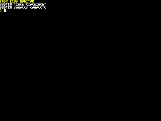
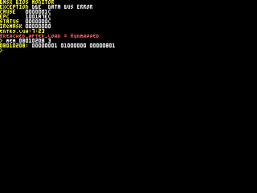
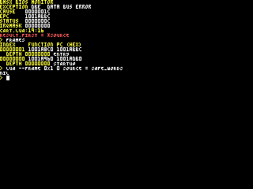

# BIOS diagnostics {#sec-bios-monitor}

When a program stops on a fault, the BIOS monitor shows the fault and lets the
programmer examine registers, memory and source, change values and continue
the program. During normal execution, a program can send text to the
development system through the diagnostic output, or with BIOS `print` also to
the console.

## Diagnostic text and the console {#sec-system-send-a-diagnostic-line}

BIOS `print` sends a line to the diagnostic output and to the console. Writing
the SYSTEM ports sends text to the diagnostic output only. In this example the
first and last lines use `print`, and the middle line is written directly:

```lua
local print_char<const>: *word = 0x08010230
local print_flush<const>: *word = 0x08010234

print('SYSTEM timer experiment')
*print_char = 0x00000053
*print_char = 0x000000e9
*print_char = 0x0001f600
*print_char = 0xffffffff
local char_readback<const> = *print_char
*print_flush = 0
local flush_readback<const> = *print_flush
print('SYSTEM samples complete')
```

PRINT_CHAR reads back `FFFFFFFFH` and PRINT_FLUSH 0: the values last written.
The middle line is sent as:

```text
53 C3 A9 F0 9F 98 80 3F 0A
```

The diagnostic output is:

```text
SYSTEM timer experiment
Sé😀?
SYSTEM samples complete
```

{#fig-system-console}

The console shows only the two `print` lines.

## Memory faults and the monitor {#sec-memory-installed-response-to-a-memory-exception}

A memory fault always enters the exception function of the system ROM, also
when the faulting instruction belongs to a cartridge; a cartridge `exception`
function is not used for it. The BIOS records the CPU registers with the SYSTEM
FAULT command, enters the monitor, prepares its display and, one VBlank later,
writes FAULT_PUBLISH.

Clearing the bus-fault record (ACK) and continuing the program are separate
steps: ACK does not repair the cause, and continuing does not clear the record.

### Example: an unmapped load {#sec-memory-inspect-an-actual-unmapped-load}

```lua
module<entry>

bss reached_after_load: word
local unmapped<const>: *word = 0x01000000

-- This load enters the BIOS monitor.
*reached_after_load = *unmapped

while true do
	halt_until_irq
end
```

The load causes a data bus error, shown as **DBE**: Cause `0000001CH` (code 7).
The bus-fault CODE is `00000001H` (unmapped). BadAddress is not set by a bus
error; the address is in the bus-fault ADDR register. At the monitor prompt,
type:

```text
MEM 08010208 3
```

The monitor shows three words from `08010208H`:

```text
08010208: 00000001 01000000 00000801
```

| Word | Meaning |
|---|---|
| `00000001` | CODE: unmapped |
| `01000000` | ADDR: the address |
| `00000801` | ACCESS: read, Word |

{#fig-memory-bus-fault}

The monitor shows DBE, the source line that caused the fault and its EPC.

### Clearing and continuing {#sec-memory-clearing-a-report-is-not-repairing-the-program}

`FAULT` shows the fault report kept by the BIOS; `FAULT CLEAR` deletes it. The
bus-fault registers are not changed.

`CONT` continues the program at EPC: it restores the device state (LEAVE) and
the CPU registers. In the example above the address is still invalid, so the
load faults again. To continue past the fault, first repair its cause.

### Example: repairing a load {#sec-memory-repair-a-word-load-and-retry}

Here the address is held in a local variable, which the monitor can change.
The program needs the [diagnostic directory](#sec-memory-optional-bios-diagnostic-directory)
for its source and variable names.

```lua
module<entry>

struct memory_recovery_result
	first: word
	second: word
	fault_before_ack: word
	fault_after_ack: word
	completed: word
end

data source_address: word = 0x01000000
data safe_words: word[2] = { 0x12345678, 0x9abcdef0 }
bss result: memory_recovery_result

local source: *word = *source_address
local fault_code<const>: *word = 0x08010208
local fault_ack<const>: *word = 0x08010214

result.first = *source
source = source + sizeof(word)
result.second = *source
result.fault_before_ack = *fault_code
*fault_ack = 1
result.fault_after_ack = *fault_code
result.completed = 1
print('RECOVERED')
print(string.format('WORDS %08X %08X', result.first, result.second))
print(string.format('FAULT %08X -> %08X', result.fault_before_ack, result.fault_after_ack))

while true do
	halt_until_irq
end
```

The first read faults because `source` holds `01000000H`. Set `source` to the
address of `safe_words` and continue; EPC stays the same, so the read is
repeated.

`FRAMES` lists the active functions: for each one its index, function-record
address and PC, followed by its source scopes (`DEPTH`), inlined functions
included. Here the function that faulted is index `00000001`, depth
`00000000`. Selectors are given in hexadecimal with `0x`:

```text
FRAMES
LUA --FRAME 0x00000001 0x00000000 source = safe_words
CONT
```

A variable can be changed only where it is live and not constant.

{#fig-memory-fault-repair}

After `CONT` the first read succeeds, and the program reads the second word.
The bus-fault CODE stays 1 until the program clears it. The diagnostic output
is:

```text
RECOVERED
WORDS 12345678 9ABCDEF0
FAULT 00000001 -> 00000000
```

`REBOOT` restarts the console; see
[[System control and timing — Reset](system.md#sec-system-reset-requests)]{.content-visible when-format="html"}[Book I, §12.10]{.content-visible when-format="pdf"}.
Reading CP0 in an interrupt handler is shown in
[CPU — Reading CP0 in an interrupt](cpu.md#sec-cpu-read-cp0-in-a-cartridge-irq).

## Diagnostic directory {#sec-memory-optional-bios-diagnostic-directory}

The ROM word at offset `3CH` gives the offset of a diagnostic directory in the
ROM, or 0 if there is none. The directory gives the BIOS the source lines and
variable names of the program. Without it, the program runs normally, but the
monitor cannot show source or variables.

All words are 32-bit little-endian. The header is 76 bytes; offsets are from
the start of the directory, and counts are numbers of records.

| Offset | Field |
| --- | --- |
| `00H`, `04H` | Number of source ranges; offset of the range table |
| `08H`, `0CH` | Number of files; offset of the file table |
| `10H`, `14H` | Number of line offsets; offset of the line table |
| `18H`, `1CH` | Offset of the path bytes; number of path bytes |
| `20H`, `24H` | Number of scope functions; offset of the function table |
| `28H`, `2CH` | Number of scope frames; offset of the frame table |
| `30H`, `34H` | Number of bindings; offset of the binding table |
| `38H`, `3CH` | Number of intervals; offset of the interval table |
| `40H`, `44H` | Number of name bytes; offset of the name bytes |
| `48H` | Number of static global bindings (the first binding records) |

### Source lines {#sec-memory-source-locations}

| Record | Bytes | Words |
| --- | ---: | --- |
| Range | 12 | PC start; line and file; column |
| File | 20 | Path offset; path length; source offset in ROM; source length; first line-offset index |
| Line offset | 4 | Byte offset in the source |

The ranges are sorted by PC; the last range with a start not greater than the
PC applies. The line and file word holds the line (from 1) in bits 31–16 and
the file (from 0) in bits 15–0; `FFFFFFFFH` means no source. Columns count from
1. Put a range without source at PC 0 and one at the end of the code.

The line offsets of a file start at 0 and end with the length of the source.
Line L runs from offset `first + L − 1` to `first + L`; CR and LF at its end are
not shown. Paths and sources are given by length, not terminated by 0; the
source can be the ordinary source in ROM.

### Variables {#sec-memory-named-frame-scopes}

The scope functions are sorted by function-record address. For a PC, the BIOS
finds the function, computes the word position `(PC − code address) >> 2` and
selects the frame with the requested depth whose active interval contains it.

| Record | Bytes | Words |
| --- | ---: | --- |
| Scope function | 16 | Function-record address; code address; first frame; number of frames |
| Scope frame | 28 | Depth; name offset; name length; first active interval; number of active intervals; first binding; number of bindings |
| Binding | 32 | Name offset; name length; flags; location; first visible interval; number of visible intervals; first live interval; number of live intervals |
| Interval | 8 | First word position; end position (excluded) |

Intervals are sorted and do not overlap. Names are UTF-8. A frame's bindings
come after the static globals; a later binding with the same name hides an
earlier one. The visible intervals tell where a name is in scope; the live
intervals where its value is available.

| Flag bit | Name | Meaning |
|---|---|---|
| 0 | UPVALUE | Location is a captured variable |
| 1 | CONST | The value may not be changed |
| 2 | ADDRESS | Location is a static address (always available) |
| 3 | TYPE | A type, not a value |

Without ADDRESS or TYPE, location is a register number (or captured variable
number with UPVALUE). `FFFFFFFFH` means no location. A register or captured
variable outside the frame raises `INVALID_ARGUMENT`.
