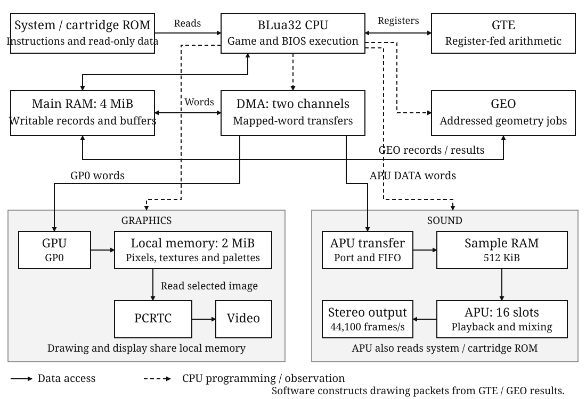

# System overview {#sec-console}

The BMSX is a cartridge-based game console. Its BLua32 processor runs the game
and coordinates the units that calculate geometry, draw pictures, read the
display and play sound. Main RAM holds writable game data and transfer buffers;
the graphics and audio units have their own memories for pixels and samples.

These resources give a program several ways to divide its work. It can calculate
screen positions itself or use GTE, construct drawing commands in RAM and send
them by DMA, and leave the APU playing a sound while it prepares the next
picture. The units have separate controls and completion indications. The
program decides both what each unit will do and when its storage can be reused.

This chapter establishes the relationships between those operations. The
following hardware chapters give their programming procedures and complete
register, command, format and timing references. Book II describes BLua32 and
the BIOS; Book III describes the cartridge sockets and mapped card devices.

## System structure {#sec-console-system-structure}

The CPU connects the game's calculations to the drawing and sound paths.
System ROM supplies the BIOS, and cartridge ROM supplies the game's program
and read-only data. Main RAM holds writable records and buffers. The GPU writes pixels into its local
memory, and PCRTC reads a selected picture from that memory for display. The
APU reads its sound sources and produces stereo output.

@fig-console-system locates these resources and their principal access paths.
The detailed graphics and sound diagrams later in this chapter expand the two
output paths. The lines identify functional access and control, rather than
electrical bus wiring.

{#fig-console-system}

GTE returns arithmetic results through registers; GEO reads and writes addressed
records. Software uses the results when constructing drawing commands. Neither
unit submits those commands to the GPU. Likewise, GPU local memory and APU sample
RAM are accessed through their respective unit interfaces, not as additional
main-RAM addresses.

| Installed resource | Specification |
|---|---|
| CPU/system timebase | 33,868,800 cycles per second |
| Main RAM | 4 MiB, including reserved areas and firmware static storage |
| GPU local memory | 2 MiB shared by drawing destinations, textures, palettes and display sources |
| APU sample RAM | 512 KiB, separate from main RAM and GPU local memory |
| System DMA | Two equivalent channels; one transfer block is serviced at a time |
| GTE | Register-fed transformation, projection and lighting arithmetic |
| GEO | Memory-addressed geometry and collision jobs |
| PCRTC | Two programmable reading circuits with output composition; 13,500,000 Hz beam-timing reference |
| APU | 16 playback slots; 44,100 stereo output frames per second |
| Input | Keyboard, pointer and four game-pad records |
| Cartridge interface | Two physical sockets sharing the cartridge address windows |

The CPU timebase expresses instruction and transfer costs. PCRTC's reference
is used to calculate the programmed display timing, while the APU output rate
defines the interval between stereo sample frames. These quantities describe
different operations; the device chapters specify their timing relationships.

## Processor and system control {#sec-console-processor-and-system-control}

At reset, the CPU enters the system-ROM startup program. The BIOS initializes
its working storage and selects an executable cartridge. Cartridge ROM supplies
the game's program and read-only data; main RAM supplies writable data and
buffers. System-ROM routines remain available through the BIOS interfaces.
The startup and storage requirements are described in
[[Program images and startup](program-images.md#sec-memory-reset-and-cartridge-startup)]{.content-visible when-format="html"}[Book II, “Program images and startup”, under “Reset and cartridge startup”]{.content-visible when-format="pdf"}.

The CPU controls the units through memory-mapped ports. A word
write can set a parameter, supply data or issue a command, depending on the port;
a read can return status, retained configuration or a result. The device's
programming sequence establishes which values must be prepared before its start
command. The [[CPU reference](cpu.md#sec-cpu)]{.content-visible when-format="html"}[Book II, “CPU and BLua32 instruction reference”]{.content-visible when-format="pdf"}
defines instruction operation and cycle costs.

Three supporting units connect program execution to the rest of the machine:

- **IRQ** combines device requests into the CPU's shared maskable interrupt
  line. Programs use it to receive events such as VBlank and DMA completion.
- **SYSTEM** provides console-time and frame-period readouts, reset requests
  and supervisor controls. Its diagnostic words retain CPU fault information
  for BIOS service.
- **INPUT** captures keyboard, pointer and pad states at a requested display
  boundary. The program interprets those states as game actions.

Their operation is introduced below after the picture, sound and transfer paths.

## Storage and the address map {#sec-console-storage-and-the-address-map}

The three writable memories serve different purposes. Main RAM supplies CPU
variables, geometry records and DMA buffers. GPU local memory supplies pixels,
textures and palettes. APU sample RAM supplies playback samples. Moving bytes
into one memory does not make them available in another: an image upload sends
words through the GPU, and a sample upload sends words through the APU transfer
ports.

BMSX uses 32-bit byte addresses. A register or DMA word occupies four bytes.
The address map below locates the CPU-visible regions. It uses half-open
intervals: the start is included and the end is excluded. An address window is
the range assigned to an interface; installed storage can occupy less than that
range.

| Region | Byte-address interval | Capacity or use |
|---|---|---|
| System ROM | `[0x00000000, 0x01000000)` | 16 MiB address window for the installed firmware |
| Unmapped | `[0x01000000, 0x08000000)` | No mapped storage or device |
| Main RAM | `[0x08000000, 0x10000000)` | 128 MiB window; 4 MiB installed in `[0x08000000, 0x08400000)`, including the reservations below |
| Cartridge ROM | `[0x10000000, 0x30000000)` | 512 MiB window; capacity depends on the selected card |
| Cartridge RAM | `[0x30000000, 0x30f00000)` | 15 MiB window for optional card RAM |
| Cartridge devices | `[0x30f00000, 0x31000000)` | 1 MiB window for the selected card's mapped devices |
| Unmapped | At or above `0x31000000` | No mapped storage or device through the end of the address space |

The main-RAM window beyond the installed 4 MiB does not provide additional or
mirrored RAM. Both cartridge sockets use the same windows; the socket selection
chooses which card an access reaches. The capacities of the two cards are not
combined into a larger address range. See
[[Cartridge sockets and mapped card devices](../book3/cartridge.md#sec-cartridge)]{.content-visible when-format="html"}[Book III, “Cartridge sockets and mapped card devices”]{.content-visible when-format="pdf"}
for CPU, instruction-fetch and DMA selection.

### Reservations before cartridge storage {#sec-console-reservations-before-cartridge-storage}

The beginning of installed main RAM is reserved as follows:

| Reservation | Byte-address interval or extent | Purpose |
|---|---|---|
| I/O | `[0x08000000, 0x08040000)` | 256 KiB reservation containing the device-register aperture |
| GEO scratch | `[0x08040000, 0x080c0000)` | 512 KiB reserved area |
| Firmware static storage | Starting at `0x080c0000`, through the actual end of system BSS | Initialized DATA and zero-initialized BSS used by the BIOS |

The I/O and GEO reservations occupy 768 KiB. This leaves 3.25 MiB before
subtracting firmware and cartridge static storage; it is not a free-memory
figure. Reserve both complete areas even where no register is decoded. Place
cartridge data and buffers outside the firmware's complete DATA/BSS extent.
The [Memory chapter](memory.md#sec-memory-reserved-and-cartridge-storage-in-main-ram)
specifies the register aperture, reserved storage and RAM placement.
[[Program images and startup](program-images.md#sec-program-images)]{.content-visible when-format="html"}[Book II, “Program images and startup”]{.content-visible when-format="pdf"} in Book II
describes section initialization and cartridge entry.

Firmware also retains part of GPU local memory for its terminal and system
texture. Keep this area separate from game graphics, including after cartridge
entry. The reservation and its BIOS query are described under
[Firmware reservation in VRAM](memory.md#sec-memory-firmware-reservation-in-vram).

## From cartridge data to a displayed picture {#sec-console-from-cartridge-data-to-a-displayed-picture}

Consider a game character made from textured polygons. Its stored vertices
specify its shape; they are not yet the screen positions required by a drawing
command. The program transforms and projects them, prepares the texture in GPU
local memory, and supplies the resulting drawing packets. After the GPU has
drawn the picture, the program selects that picture for display.

These are distinct operations on different representations:

| Operation | Information supplied | Result used by the next operation |
|---|---|---|
| Calculate geometry and color | Vertices, transforms and lighting parameters | Screen coordinates and colors for software to place in drawing packets |
| Prepare image storage | Texture and palette words, optionally compressed for IMGDEC | Texture and palette data in GPU local memory |
| Draw | GP0 packets containing screen positions, colors, texture coordinates and drawing settings | Pixels in a selected local-memory drawing region |
| Display | PCRTC source, display-window and composition settings | Video output reading the selected local-memory regions |

For sprites or other screen-space graphics, the program can supply positions
directly. The geometry calculation is useful when the scene requires it, not a
mandatory first stage for every drawing command.

### GTE and GEO: two different arithmetic routes {#sec-console-gte-and-geo-two-different-arithmetic-routes}

A three-dimensional vertex must be expressed relative to the viewer before it
can be projected onto the screen. GTE performs the matrix/vector, translation
and perspective calculations for this route, as well as lighting and color
arithmetic. Software writes operands and controls into its registers, issues
the appropriate command, then reads the results for its drawing packets.

GEO instead processes batches of addressed geometry records and writes its
results to RAM. It transforms two-dimensional shapes, calculates bounds and
tests convex shapes for contact. A character's collision hull can therefore
be processed separately from the polygons or sprite used to draw it.

The choice is therefore between register-fed arithmetic and addressed record
processing, according to the task. The [GTE](gte.md#sec-gte) and
[GEO](geo.md#sec-geo) chapters explain the coordinate systems, numeric formats,
commands and result handling.

### Image decoding {#sec-console-image-decoding}

Compressed image data needs a different path from vertex arithmetic. IMGDEC
expands its compressed word stream into GPU upload headers and texture or
palette words. One DMA channel can feed the compressed input while the other
carries the generated stream from IMGDEC DATA to GPU GP0. The GPU then performs
the local-memory writes described by those upload packets.

This route changes the representation of image data, not the drawing geometry.
The program supplies the source stream, destination fields and word counts;
request signals pace the DMA transfers as the decoder consumes input and
produces output. The [IMGDEC chapter](imgdec.md#sec-imgdec) specifies the
compressed tokens, packet output, FIFO capacities and decoding costs.

### Graphics storage and drawing {#sec-console-graphics-storage-and-drawing}

The GPU draws triangles, quads, lines, polylines and rectangles. Polygons may
use flat or Gouraud color and optional texturing; rectangles can also be
textured. Texture sources are 4-bit indexed, 8-bit indexed or direct16. Indexed
textures obtain their colors from palettes in the same local memory.

GP0 receives drawing and image-transfer packets as a stream of 32-bit words,
either from CPU stores or DMA. The GPU executes the packets in order and
updates local memory. A texture upload followed by a textured drawing command
therefore puts the image data before the draw that uses it.

Drawing destinations, textures and display sources occupy the same 2 MiB
local memory. The program assigns regions to these uses and arranges their
lifetimes so that drawing or uploading one picture does not overwrite data
still needed by another.

The [GPU chapter](gpu.md#sec-gpu) gives the packet formats, drawing environment,
storage mappings and execution costs. Its capabilities describe supported
operations; throughput depends on the actual command sequence.

### Programmable PCRTC output {#sec-console-programmable-pcrtc-output}

Drawing produces stored pixels. PCRTC determines which of those pixels become
the displayed picture. Its two reading circuits each select a local-memory
source and a display window; output controls combine their contributions with
a background. Two circuits can read different regions of the same 2 MiB, rather
than requiring a separate memory bank for each circuit.

A source selection establishes the framebuffer base, width, storage
interpretation and source origin. A display window establishes placement and
magnification in signal space. Moving the source origin selects another part
of the stored picture; moving the display window places that selection at
another output position. The [PCRTC chapter](pcrtc.md#sec-pcrtc) illustrates this
distinction and specifies the supported storage interpretations.

Display-source changes are latched at VBlank entry. This boundary lets the
program arrange which stored picture will be displayed next. Display dimensions
and refresh are programmable; the PCRTC chapter separates source selection,
window placement and beam-timing controls.

{#fig-console-video}

## APU sound and sample-memory route {#sec-console-apu-sound-and-sample-memory-route}

To play a stored sound, a program describes its sample data, selects a playback
slot and issues PLAY. The APU advances through that source using the programmed
rate and loop settings, applies gain and the optional stereo biquad filter,
and combines the active voices into stereo output. A square generator provides
an alternative source that needs no sample bytes.

The 16 slots support PCM8, PCM16, 4-bit BADP and square generation. The mixer
produces 44,100 stereo frames per second, each containing signed sixteen-bit
left and right samples after saturation. Source rate and playback step control
how a voice moves through its samples; they do not change this output cadence.

A sample source can reside in system ROM, cartridge ROM or the private 512 KiB
sample RAM. Main-RAM samples first pass through the APU transfer ports into
sample RAM. This distinction matters for generated or modified sounds: writing
a main-RAM buffer prepares the source of an upload, not a buffer that PLAY can
read directly.

DMA can carry sample words from main RAM to the APU transfer port. The APU
then commits those words to sample RAM, from which the voices read them.
Delivery to the port and completion of the sample-memory transfer are distinct
steps. The APU chapter gives their completion indications and transfer rates.

During playback the APU continues to read the selected source. Preserve its
bytes for the voice's use. The [APU chapter](apu.md#sec-apu) gives the source formats,
slot controls, transfer modes and completion procedures.

{#fig-console-audio}

## Mapped access and DMA transfers {#sec-console-mapped-access-and-dma-transfers}

DMA supplies words to an operation; the receiving unit interprets those words.
For example, a GPU upload consists of a GP0 header followed by image words. The
DMA channel moves that sequence to the fixed GP0 address, while the GPU uses
the header to determine where its local-memory writes belong. DMA does not
need a CPU-linear VRAM address for this transfer.

A channel describes the source, destination and amount of data to move.
The two channels can have outstanding work together, but share the transfer
path. Device requests pace transfers so that a receiving port can accept the
next words. The DMA chapter explains channel programming and arbitration.

The endpoint regions determine the transfer charge. Main RAM, system ROM and
the cartridge bus have different charges; cartridge RAM and mapped card devices
use the cartridge-bus charge too. Device requests and competing-channel blocks
can add waiting time. The
[DMA timing reference](dma.md#sec-dma-transfer-rates-by-route) supplies the route
calculations, including GPU and APU transfers. CPU instruction costs are
specified separately in the CPU reference.

### Completion and storage reuse {#sec-console-completion-and-storage-reuse}

Suppose DMA reads a command buffer while the CPU begins to construct the next
picture in that same buffer. Words not yet transferred could then belong to the
new picture while earlier words belong to the old one. Keep the source stable
until DMA completes, or prepare the next stream in different storage.

Once those command words have been delivered, the buffer can be reused, but
the GPU can still be drawing. If the next operation overwrites the drawing
region, GPU completion matters. If that region is the current display source,
the program must also arrange a new display selection before reusing it.
Each hand-off answers a different question:

| Question | Relevant operation or boundary |
|---|---|
| Has the command source been consumed? | Completion of the DMA transfer reading it |
| Have the drawing commands finished? | GPU completion, observed through the appropriate GPU status |
| Has a new display source become active? | PCRTC display latch at VBlank entry |
| Have uploaded sound words reached sample RAM? | APU transfer completion after DMA delivery |
| Can sample bytes be overwritten? | Completion of every voice or transfer still using those bytes |

This division permits overlap: the CPU can prepare another command buffer while
the GPU draws, and sound playback can continue during both. The requirement is
to keep each producer's writes separate from storage still being read. The
[Memory chapter](memory.md#sec-memory-device-specific-buffer-lifetimes) gives
buffer lifetimes. The GPU's
[two-surface sequence](gpu.md#sec-memory-prepare-publish-and-reuse-two-surfaces)
follows preparation, display publication and reuse.

## Timing and input capture {#sec-console-timing-and-input-capture}

A game's update routine needs elapsed time and a definite set of controls.
SYSTEM TIME_MS measures elapsed console cycles in milliseconds; its frame words
report the programmed PCRTC period in fractional milliseconds and whole system
cycles. These readouts measure intervals. VBlank interrupts provide the event
used to synchronize with the display.

The input controller captures keyboard, pointer and pad states at a requested
display boundary. This produces a stable set of controls for the game to
process. Software requests later captures as it needs new input; the INPUT
chapter specifies the request and snapshot-reading sequence.

The [INPUT chapter](input.md#sec-input) explains raw representations and sampling.
[SYSTEM](system.md#sec-system-system-time-and-frame-timing) explains the time
readouts. Display timing determines the capture opportunity, not how long the
CPU takes to process the resulting controls.

## Interrupts, faults and reset {#sec-console-interrupts-faults-and-reset}

The IRQ controller records pending requests from the devices and enables
selected sources onto the CPU's maskable interrupt line. CPU interrupt enable
also controls acceptance. For example, a program can receive DMA completion
without continuously polling the channel. The handler identifies and services
the source, then acknowledges its pending request; some devices also retain a
local event that needs its own acknowledgement. The
[IRQ chapter](irq.md#sec-irq) gives the source map, acknowledgement rules and
handler entry sequence.

A synchronous exception follows the system exception route rather than the
maskable interrupt route. BIOS fault handling records the CPU cause, exception
program counter and other diagnostic words in SYSTEM. Supervisor controls and
the separate supervisor-request input coordinate entry to firmware service;
they are not application input mappings. The
[SYSTEM chapter](system.md#sec-system) specifies privilege, device boundaries
and fault capture.

A reset returns execution to system-ROM startup and the BIOS cartridge
selection process. See
[Reset requests](system.md#sec-system-reset-requests) and
[[Reset and cartridge startup](program-images.md#sec-memory-reset-and-cartridge-startup)]{.content-visible when-format="html"}[Book II, “Program images and startup”, under “Reset and cartridge startup”]{.content-visible when-format="pdf"}
for the reset and subsequent firmware sequence.
