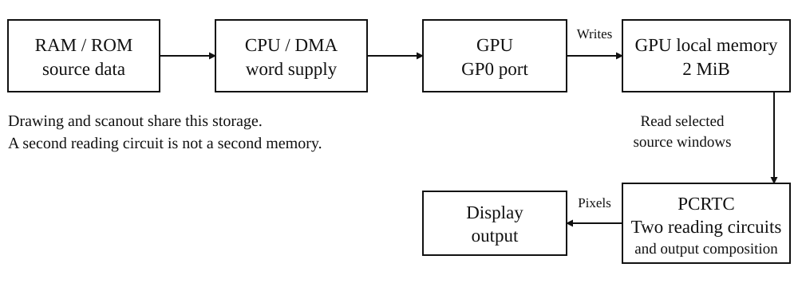
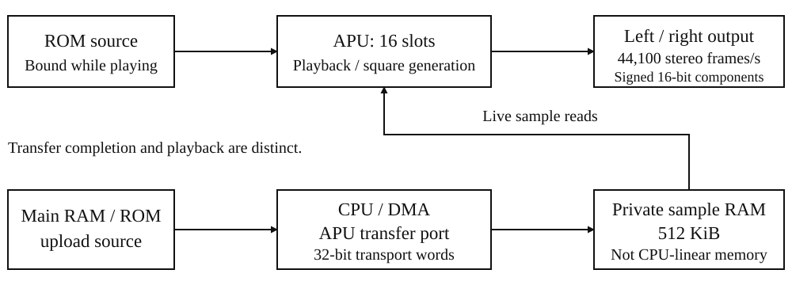

# System overview {#sec-console}

The BMSX is a cartridge-based game console with a BLua32 processor, 4 MiB of
main RAM, 2 MiB of GPU local memory and 512 KiB of APU sample RAM. The CPU uses
a 33.8688 MHz system timebase. Drawing, display reading and sound playback have
their own programming interfaces and completion conditions; the processor
coordinates them through memory-mapped word ports and two DMA channels.

This chapter introduces the installed units and the paths between them. The
following chapters explain how to program each unit and give its complete
register, command, format and timing reference.

The processor prepares drawing commands and operands in main RAM or in unit
registers. GTE performs transform and lighting arithmetic; GEO processes
addressed geometry records. Software uses their results to construct the GPU's
GP0 command stream. The GPU draws into local memory, which PCRTC reads for
video output. DMA supplies and collects words through the mapped ports.

The sound path runs alongside the graphics path. APU voices read sample data
and feed the stereo mixer; its transfer unit moves data between the sample
FIFO and private sample RAM. Software synchronizes each stage using that
unit's completion indication.

Book I describes the installed machine. Book II supplies the BLua32 and BIOS
software reference; cartridge and expansion-device protocols belong to Book III.

## From cartridge data to a displayed picture {#sec-console-from-cartridge-data-to-a-displayed-picture}

A picture passes through several independently programmed operations:

| Stage | Programming task | Hardware result |
|---|---|---|
| Prepare | Place command words, vertices, colors, texture data and palettes in the required storage and formats. | Addressed input bytes and numeric operands. |
| Calculate | Use CPU arithmetic, register-fed GTE operations or addressed GEO jobs as the task requires. | Transformed coordinates, lighting or geometry results for software to use. |
| Draw | Supply GP0 commands by CPU stores or DMA; upload image data when required. | Drawing and image operations update GPU local memory in command order. |
| Select the display | Program PCRTC source, output-window and composition words; observe its publication edge. | The display circuits read the selected local-memory storage. |

GTE and GEO results do not automatically submit GP0 commands. Likewise, DMA
finishing a command-stream transfer releases that stream's source storage but
does not establish that drawing or display publication has completed. Use the
[GPU](gpu.md#sec-gpu), [DMA](dma.md#sec-dma) and [PCRTC](pcrtc.md#sec-pcrtc) completion rules at those
boundaries. Audio playback proceeds independently through the [APU](apu.md#sec-apu).

## Processor and system control {#sec-console-processor-and-system-control}

The BLua32 CPU executes four-byte instruction words. A WIDE prefix extends an
instruction to eight bytes. Instruction times are expressed in cycles of the
**33,868,800 Hz** system timebase; individual instruction costs are specified
in the [[CPU reference](cpu.md#sec-cpu)]{.content-visible when-format="html"}[Book II, “CPU and BLua32 instruction reference”]{.content-visible when-format="pdf"}.

| Unit | Resources | Role |
|---|---|---|
| BLua32 CPU | 32-bit instruction words | Executes the instruction stream; accepts enabled maskable interrupts and handles synchronous exceptions separately. |
| IRQ | FLAGS, ACK and MASK words | Holds pending source bits and supplies the shared maskable interrupt line. |
| SYSTEM | Time, frame-timing, reset and supervisor-control words; captured fault words | Reports timing and coordinates reset requests, supervisor entry and fault capture. |
| INPUT | 8 keyboard words covering 256 USB HID usage bits; pointer buttons, X, Y and wheel; 4 pad records, each with a buttons word and 6 axes | Publishes raw captured input states, not application action mappings. |
| IMGDEC | 32-word input FIFO, 64-word output FIFO and 4096-word history; 16-word DMA request quantum | Decodes a compressed word-token stream into a GPU upload command stream. |

### Interrupts, faults and reset {#sec-console-interrupts-faults-and-reset}

DMA and device interrupt sources feed the shared IRQ controller; the CPU accepts its enabled interrupt line. Raising a source sets its pending bit regardless of MASK; repeated raises while the bit is pending coalesce. FLAGS reads do not clear pending bits. ACK clears the pending bits written as ones, while MASK replaces the enabled-source mask without clearing pending state. The maskable line is asserted when pending and enabled bits overlap; CPU acceptance also requires its current interrupt enable. Pending bits and the mask reset to zero.

An accepted maskable interrupt enters the IRQ routine selected by CPU mode.
Synchronous exceptions enter the system exception routine. SYSTEM retains the
CPU cause, EPC, bad-address, Lua-reason and execution-domain words for BIOS
diagnostics. Its supervisor controls require supervisor mode, and an external
supervisor request passes through the device-quiescence sequence before NMI.
The [IRQ](irq.md#sec-irq) and [SYSTEM](system.md#sec-system) chapters specify these entry routes.

A SYSTEM reset command requests a reboot at a CPU execution boundary. Repeated
requests before service coalesce. The RESET write completes before the reboot;
software must allow for a variable request-to-reboot interval.

### Timing and input capture {#sec-console-timing-and-input-capture}

SYSTEM TIME_MS reports elapsed system cycles in milliseconds. Its frame-timing
words report the programmed PCRTC period in fractional milliseconds and whole
system cycles. Use these as period measurements; the next VBlank is observed
through its interrupt source.

INPUT ARM requests one capture at the next accepted VBlank edge. Capture samples the raw states, increments the sequence, consumes the pending capture request and publishes the input latches and status. The separate supervisor-request wire is checked for a rising edge at each VBlank-begin edge whether or not capture is armed; it is not a designated application key. See the [INPUT](input.md#sec-input) chapter for the capture protocol.

### Image decoding {#sec-console-image-decoding}

IMGDEC expands a compressed word-token stream into GP0 CPU-to-VRAM upload
headers and texture/CLUT payload. Use one DMA channel to supply compressed
words and another to carry decoder output from DATA to GPU GP0. The decoder
has a 32-word input FIFO, 64-word output FIFO and 4096-word history.

Output work costs **2 system cycles per word**, including each three-word
upload header. Payload batches contain at most 16 words; input availability,
run/stage boundaries and output-FIFO space determine the actual batch. A
header requires three free output words. Device requests pace both DMA sides.
The [IMGDEC chapter](imgdec.md#sec-imgdec) defines tokens, FIFO reads and complete upload
programming.

## Storage and the address map {#sec-console-storage-and-the-address-map}

BMSX uses a 32-bit, byte-addressed space. A mapped register or DMA transfer word is 32 bits, or four bytes. Address windows describe where storage or devices can be reached; they do not, by themselves, specify how much storage is installed.

The console contains **4 MiB of main RAM** at the beginning of a 128 MiB
main-RAM address window. System firmware occupies system ROM. Cartridge ROM,
optional RAM and mapped devices are selected through the cartridge bus; their
installed capacities depend on the card. An address window specifies which
addresses reach a region, while its capacity specifies how many bytes are
installed there.

The table uses half-open intervals: the start is included and the end is excluded. Main-RAM subentries describe reservations within that window, not additional storage.

| Window or reservation | Byte-address interval | Size and interpretation |
|---|---|---|
| System ROM | `[0x00000000, 0x01000000)` | 16 MiB window; firmware image size is independent of the window size. |
| Unmapped | `[0x01000000, 0x08000000)` | No mapped storage or device. |
| Main RAM | `[0x08000000, 0x10000000)` | 128 MiB window; installed backing is only `[0x08000000, 0x08400000)`, before I/O interception. |
| Main RAM: I/O reservation | `[0x08000000, 0x08040000)` | 256 KiB reserved. The implemented register aperture is `[0x08000000, 0x08010440)`. |
| Main RAM: GEO scratch reservation | `[0x08040000, 0x080c0000)` | 512 KiB reserved. |
| Main RAM: system and cartridge statics | Starting at `0x080c0000` | Image-dependent DATA and BSS within installed RAM. |
| Cartridge ROM | `[0x10000000, 0x30000000)` | 512 MiB window for the selected card; actual ROM capacity is card-dependent. |
| Cartridge RAM | `[0x30000000, 0x30f00000)` | 15 MiB window; actual optional RAM capacity is card-dependent. |
| Cartridge MMIO | `[0x30f00000, 0x31000000)` | 1 MiB window for the selected card's mapped devices. |
| Unmapped | At or above `0x31000000` | No mapped storage or device through the end of the 32-bit address space. |

There are two physical card slots. Ordinary CPU cartridge access selects one card using bit 0 of the selection word; the three cartridge windows then route to that selected card. The windows do not combine the capacities of both cards.

Main-window addresses beyond the installed RAM backing neither provide additional RAM nor mirror lower RAM. The console also has 2 MiB of VRAM separately from main RAM; that capacity is not an additional CPU-linear window in the map above.

Reserve the complete 256 KiB I/O area and 512 KiB GEO scratch area when
placing program storage. The I/O decoder occupies 16,656 word slots, or
66,624 bytes, within that reservation. All remaining bytes in both reservations
remain unavailable for application variables and buffers.

The two reservations occupy 768 KiB before static storage begins. In the installed 4 MiB configuration, 3.25 MiB remains after that span, **before** subtracting system and cartridge statics. This is not a free-memory or usable-heap figure.

A compact program-storage arrangement places the sections in this order:

- System DATA begins at `0x080c0000`.
- System BSS follows system DATA.
- Cartridge DATA begins at the end of system BSS.
- Cartridge BSS follows cartridge DATA.

Other arrangements are permitted within unreserved installed RAM. Preserve the
firmware's complete DATA/BSS extent and use the chosen addresses consistently
in program records and startup instructions. The firmware footprint determines
the first available cartridge address.

DATA has initializer bytes in ROM and working bytes in RAM; startup copies
between these addresses. BSS occupies RAM and is cleared by startup. The
[Memory chapter](memory.md#sec-memory) defines the section records, initialization sequence
and complete storage reservations.

## Mapped access and DMA transfers {#sec-console-mapped-access-and-dma-transfers}

Byte addresses and hardware words must be kept distinct when programming mapped memory. A register word occupies four bytes, whereas addresses identify bytes. CPU load/store instructions apply the alignment of their access kind before mapped access; word operations use the mapped-word route.

Mapped word reads in the implemented I/O aperture reach a device register or its retained register slot rather than ordinary RAM. Other mapped reads route to the supplied system ROM, installed main RAM or selected cartridge. Within the system-ROM window, scalar reads beyond the supplied firmware image return zero bytes; writes do not change the firmware. That system-ROM behavior must not be mistaken for additional storage backing elsewhere.

BMSX provides **two DMA channels**, sharing one admitted transfer block at a time. Both channels may have outstanding transfers; block admission selects which channel uses the transfer path. DMA reads and writes mapped memory in four-byte words. A programmed block contains 1–16 words, limited by the remaining transfer count. When source or destination incrementing is enabled, the corresponding byte address advances by four for each word. Ready channels are selected round-robin at block boundaries.

DMA time depends on the regions touched by both endpoints. For one uninterrupted classified span of `n` words, starting at its beginning, the installed configuration assigns these region charges:

| Region | Charge at region start |
|---|---|
| Main RAM | `n + 1` cycles |
| System ROM | `n` cycles |
| Cartridge bus | `8n + 4` cycles |
| I/O or other classification | Zero region charge |

The cartridge charge applies to cartridge ROM, RAM and MMIO—not just ROM. The extra RAM cycle and four extra cartridge cycles are setup charges. Setup applies when an endpoint starts a new classified span, not again for each subdivision introduced solely by the other endpoint. Cartridge ROM, RAM and MMIO boundaries start new spans even though all three use the cartridge charge. Every admitted block starts its own span accounting.

Source and destination charges are not always simply added. If both endpoints are RAM, or both are on the cartridge bus, their charges are summed. Otherwise, the greater charge applies. The total charge for an admitted block is at least one cycle. For a block wholly within one uninterrupted classified span at each endpoint, with no RAM/I/O/backing or cartridge ROM/RAM/MMIO boundary crossing, this gives:

| Transfer | Charge for `n` words |
|---|---|
| RAM to RAM | `2n + 2` cycles |
| Cartridge to RAM | `8n + 4` cycles |
| RAM to I/O | `n + 1` cycles |
| System ROM to I/O | `n` cycles |

DMA schedules service at the block's anchor cycle plus its admitted charge. Service performs the mapped word transfers and advances the addresses and remaining count.

Use these charges to calculate the admitted DMA interval. Add request waits
and competing-channel blocks when calculating elapsed transfer time, and wait
separately for work performed by the receiving unit. The [DMA chapter](dma.md#sec-dma-transfer-rates-by-route)
gives complete route-rate calculations, region crossings and VRAM-port examples.
CPU instruction timing is specified separately in the CPU reference.

## Graphics storage and drawing {#sec-console-graphics-storage-and-drawing}

The GPU draws from commands into 2 MiB of GPU local memory. Raster destinations, texture and palette data, and PCRTC display reads share this storage; texture memory and display memory are not additional banks.

| Resource or function | Capability |
| --- | --- |
| Installed GPU local memory | 2 MiB: 1,048,576 sixteen-bit words |
| Primitive drawing | Triangles, quads split into triangles, lines, polylines and rectangles |
| Other drawing and movement | Fills and VRAM image transfers |
| Polygon color | Flat or Gouraud color, with optional texturing |
| Texture sources | 4-bit indexed, 8-bit indexed and direct16 |

Rectangles may also be textured. Indexed textures use palette data in the same local memory. Texture bit depth describes the texture source, not the framebuffer format or installed memory capacity.

The drawing address domain has raw-coordinate periods of 1024 words horizontally and 1024 rows vertically. These are storage-address periods, not a 1024 × 1024 screen mode. Drawing coordinates address sixteen-bit storage words; indexed texture coordinates select packed texels within those words. PCRTC has its own selectable storage interpretations. Sharing the bytes does not make these coordinate mappings interchangeable.

Firmware uses the shared GPU memory for its terminal surface and system texture. Reserve the complete bounding rectangle returned by the named BIOS function `gpu/system_vram_region`; cartridge entry does not release that reservation. The query is not an allocation operation and does not establish that every other VRAM location is free. See [Memory, “Firmware reservation in VRAM”](memory.md#sec-memory-firmware-reservation-in-vram), for the call and coordinate units.

These drawing capabilities describe supported commands, not a guaranteed primitive throughput. See the [GPU chapter](gpu.md#sec-gpu) for command formats and drawing details.

## GTE and GEO: two different arithmetic routes {#sec-console-gte-and-geo-two-different-arithmetic-routes}

GTE provides register-fed transform and lighting arithmetic. Its registerfile contains 32 data words, 32 control words and 10 PLUS words, all stored as raw 32-bit words. In the CPU-fed programming route, software writes operands and controls, issues a command, and reads the resulting registers. The ordinary command invokes arithmetic directly. Operations include matrix/vector arithmetic, rotation and translation with perspective projection, and lighting/color calculations.

GTE operands and results pass through its mapped register ports. Software reads
the result words and places the required coordinates, colors and attributes
into GP0 command packets.

GEO is a separate, memory-addressed batch engine. It captures source and destination addresses, record count, parameters and strides for one active job. Its commands are `XFORM2_BATCH`, `SAT2_BATCH` and `OVERLAP2D_PASS`. For example, XFORM2 reads records, vertices and matrices from addressed memory and writes transformed vertices to RAM. A command submitted while GEO is busy does not enter a job queue.

GEO accrues a work budget of **16,384,000 outer-record service units per second**, consuming one unit per serviced outer record. This is not an independent core clock or a vertices-, triangles- or collision-pairs-per-second rating.

Choose GTE for register-fed arithmetic and GEO for memory-record jobs. Their
results become inputs to the cartridge's subsequent calculations and drawing
commands. The [GTE](gte.md#sec-gte) and [GEO](geo.md#sec-geo) chapters specify the operand
formats, commands and result handling.

## Programmable PCRTC output {#sec-console-programmable-pcrtc-output}

PCRTC reads GPU local memory through two programmable scanout circuits. Each circuit selects its framebuffer base, width, storage interpretation and source origin, together with a display window and magnification in signal space. The output can compose these circuits with background and blending controls. Two circuits do not add two framebuffer RAM banks.

Supported scanout interpretations are CT32, CT24, CT16, CT16S and GX16; GPU24 is available on circuit 1 only. These interpretations select how existing local-memory bytes are sampled. They do not establish that the primitive rasterizer writes every one of these layouts natively.

Beam timing is programmed through the SMODE, SYNCH and SYNCV words. PCRTC timing calculations use a **13,500,000 Hz reference** to derive half-line and field periods and refresh from those words. Output extent follows the enabled display windows and signal step. Consequently, the hardware overview has no single universal screen resolution or fixed 50/60 Hz refresh specification.

Programmed display configuration is retained for presentation at its publication
boundary; beam timing has separate live effects. See [PCRTC](pcrtc.md#sec-pcrtc) for
programming details.

{#fig-console-video}

## APU sound and sample-memory route {#sec-console-apu-sound-and-sample-memory-route}

The APU provides 16 independently programmed playback slots. Each supports
PCM8, PCM16, 4-bit BADP or the square generator, with source-rate, loop and gain
controls and an optional stereo biquad stage. Stereo sources feed the stereo
mixer.

| APU resource | Capacity or rate |
| --- | --- |
| Playback slots | 16, each with 21 raw parameter words |
| Command FIFO | 16 captured command entries |
| Sample-transfer FIFO | 16 thirty-two-bit words: 64 bytes |
| Private sample RAM | 512 KiB |
| Output cadence | 44,100 stereo frames per second |
| Sample-memory DMA service budget | 1,058,400 thirty-two-bit words per second |

Each output frame contains signed sixteen-bit left and right samples after mix saturation. Source sample rates and rate steps are separate programming parameters; changing them does not change this output cadence. Output cadence is not an APU core-frequency or electrical-output rating.

Sample playback reads private sample RAM, system ROM or cartridge ROM. PLAY
selects the cartridge socket when that command executes and retains the source
selection for playback. Source data must remain available for the voice's use.
The descriptor address `0x40000000` selects private sample RAM; CPU transfers to
that RAM use the APU transfer ports. Upload main-RAM samples through those ports
before PLAY.

To upload data from main RAM, program system DMA to deliver it through APU DATA and the sample-transfer FIFO into private sample RAM. Downloads reverse the FIFO-to-sample-memory route. DMA delivery into the FIFO and completion of the private-RAM batch are distinct boundaries; delivery alone is not playback. A scheduled batch takes effect at its completion edge, not as individually committed words at each word-period.

The sample-memory service rate governs FIFO-to-sample-RAM batches. Include the
source bus and DMA request waits in an upload's elapsed time. In manual-write
mode, each accepted CPU DATA write stores one 32-bit word immediately and
advances the sample-RAM address by four bytes. The [APU chapter](apu.md#sec-apu) defines
playback and both transfer directions.

{#fig-console-audio}
