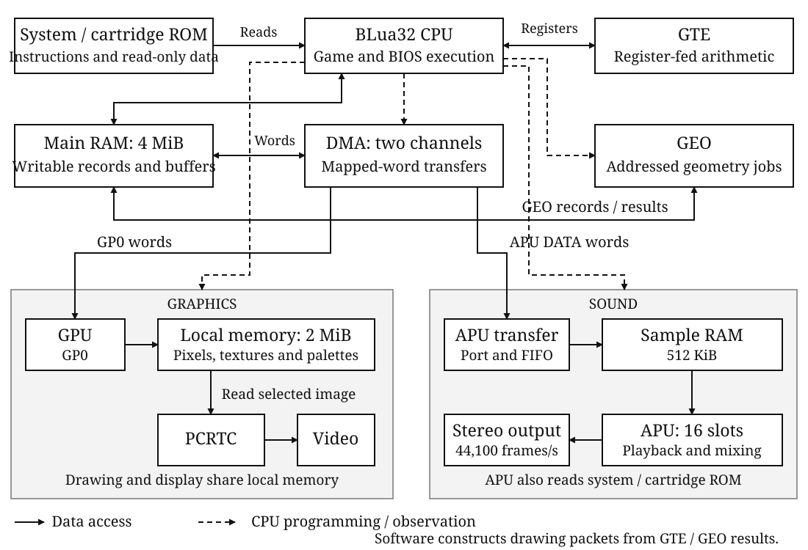
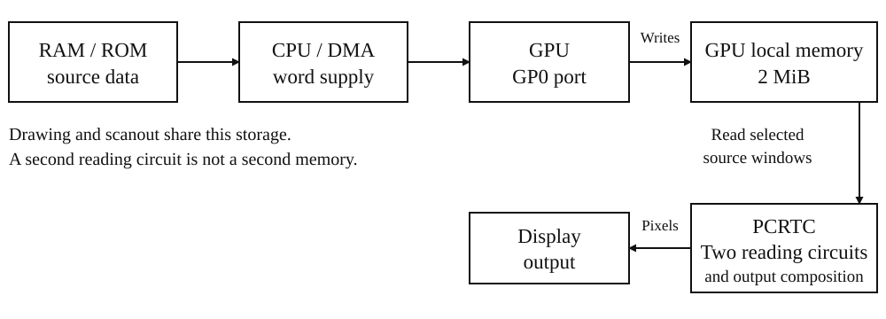
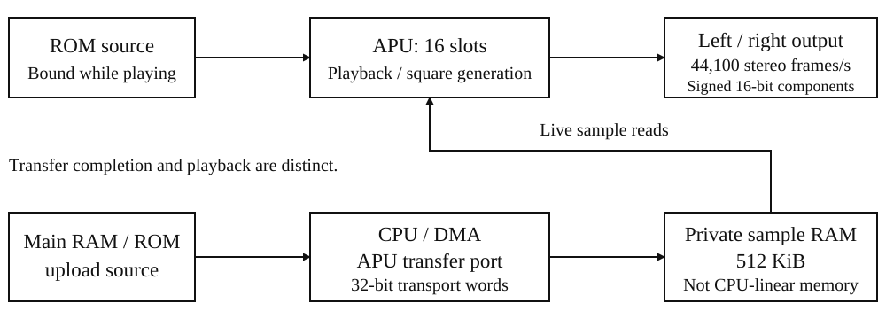

# System overview {#sec-console}

The BMSX is a cartridge game console. The BLua32 processor runs the game and
controls the units that calculate geometry, draw, display and play sound. Main
RAM holds the game's variables and buffers; the GPU and the APU each have
their own memory, for pixels and for samples.

The program divides the work among the units: it calculates screen positions
itself or with the GTE, builds drawing commands in RAM and sends them by DMA,
and lets the APU play while it prepares the next picture.

This chapter shows how the units work together. The following chapters give
their programming and complete references. Book II describes BLua32 and the
BIOS; Book III the cartridge sockets and cartridge devices.

## System structure {#sec-console-system-structure}

System ROM holds the BIOS, cartridge ROM the game's program and data. The GPU
draws into its local memory (VRAM), from which the PCRTC reads the picture for
display. The APU reads its samples and produces stereo sound.

{#fig-console-system}

The GTE returns its results in registers; the GEO reads and writes records in
memory. The program places the results in drawing commands. VRAM and sample
RAM are reached through the GPU and APU, not by CPU address.

| Unit | Specification |
|---|---|
| CPU clock | 33,868,800 Hz |
| Main RAM | 4 MiB |
| VRAM | 2 MiB: drawing areas, textures, palettes, display pictures |
| Sample RAM | 512 KiB |
| DMA | 2 channels |
| GTE | Transformation, perspective and lighting, register based |
| GEO | 2D geometry and collision, on records in memory |
| PCRTC | 2 display circuits with composition; dot clock 13,500,000 Hz |
| APU | 16 voices; 44,100 Hz stereo output |
| Input | Keyboard, pointer, 4 game pads |
| Cartridge | 2 sockets |

## Processor and system control {#sec-console-processor-and-system-control}

At reset the CPU starts the BIOS in System ROM, which sets up its storage and
starts a cartridge; see
[[Program images and startup](program-images.md#sec-memory-reset-and-cartridge-startup)]{.content-visible when-format="html"}[Book II, §11.3]{.content-visible when-format="pdf"}.

The CPU controls the units through I/O registers in memory. A write sets a
parameter, supplies data or starts a command; a read returns status or a
result. See the
[[CPU reference](cpu.md#sec-cpu)]{.content-visible when-format="html"}[Book II, Chapter 12]{.content-visible when-format="pdf"}.

| Unit | Function |
|---|---|
| IRQ | Combines the interrupt requests of the units, such as VBlank and DMA end |
| SYSTEM | Time, frame period, reset, supervisor control, fault information |
| INPUT | Samples keyboard, pointer and pads at a chosen moment |

## Memory map {#sec-console-storage-and-the-address-map}

Addresses are 32-bit byte addresses. Each memory has its own use: main RAM for
variables, geometry records and DMA buffers; VRAM for pixels, textures and
palettes; sample RAM for sound. Images are written to VRAM through the GPU,
samples to sample RAM through the APU.

| Address | Area |
|---|---|
| `00000000H`–`00FFFFFFH` | System ROM |
| `01000000H`–`07FFFFFFH` | — |
| `08000000H`–`083FFFFFH` | Main RAM, 4 MiB (`08400000H`–`0FFFFFFFH` not used) |
| `10000000H`–`2FFFFFFFH` | Cartridge ROM |
| `30000000H`–`30EFFFFFH` | Cartridge RAM |
| `30F00000H`–`30FFFFFFH` | Cartridge devices |
| `31000000H`– | — |

Both cartridge sockets use the same address areas; the socket selection
chooses the cartridge. See
[[Cartridge sockets](../book3/cartridge.md#sec-cartridge)]{.content-visible when-format="html"}[Book III, Chapter 1]{.content-visible when-format="pdf"}.

### Main RAM reservations {#sec-console-reservations-before-cartridge-storage}

| Area | Address | Use |
|---|---|---|
| I/O | `08000000H`–`0803FFFFH` | I/O registers |
| BIOS | From `08040000H` to the end of the BIOS BSS | BIOS DATA and BSS |

The remaining RAM holds the cartridge's sections and the storage for BLua values. Part
of VRAM is reserved for the BIOS screen and system texture. See
[RAM placement](memory.md#sec-memory-reserved-and-cartridge-storage-in-main-ram),
[VRAM reservation](memory.md#sec-memory-firmware-reservation-in-vram) and
[[Program images](program-images.md#sec-program-images)]{.content-visible when-format="html"}[Book II, Chapter 11]{.content-visible when-format="pdf"}.

## Drawing a picture {#sec-console-from-cartridge-data-to-a-displayed-picture}

A character made of textured polygons is drawn in four steps:

| Step | Input | Result |
|---|---|---|
| Geometry | Vertices, matrices, light | Screen coordinates and colors |
| Texture | Texture and palette data, possibly compressed | Texture in VRAM |
| Drawing | GP0 commands | Pixels in a drawing area |
| Display | PCRTC settings | The picture on screen |

Sprites and other 2D graphics are given in screen coordinates and need no
geometry step.

### GTE and GEO {#sec-console-gte-and-geo-two-different-arithmetic-routes}

The GTE transforms 3D vertices to the viewer, projects them to the screen and
calculates lighting and colors. The program writes registers, gives a command
and reads the results.

The GEO processes lists of records in memory: it transforms 2D shapes,
calculates bounds and tests convex shapes for overlap, for instance for
collision. See [GTE](gte.md#sec-gte) and [GEO](geo.md#sec-geo).

### Image decoding {#sec-console-image-decoding}

IMGDEC decompresses images. One DMA channel supplies the compressed data from
ROM or RAM, the other carries the decoded blocks to RAM or to the GPU. See
[IMGDEC](imgdec.md#sec-imgdec).

### Drawing {#sec-console-graphics-storage-and-drawing}

The GPU draws triangles, quadrilaterals, lines and rectangles, flat or
Gouraud-shaded, with or without texture. Textures are 4-bit or 8-bit indexed
(with a palette in VRAM) or 16-bit direct color.

The GPU receives its commands as 32-bit words on GP0, from the CPU or by DMA,
and executes them in order: a texture loaded before a drawing command is used
by that command. The program divides VRAM among drawing areas, textures and
display pictures. See [GPU](gpu.md#sec-gpu).

### Display {#sec-console-programmable-pcrtc-output}

Each of the two PCRTC circuits reads a picture from VRAM (address, width,
format, origin) and shows it in a window on screen (position, magnification).
The outputs are combined with a background colour. Changes to the picture
selection take effect at the start of VBlank. Resolution and refresh rate are
programmable. See [PCRTC](pcrtc.md#sec-pcrtc).

{#fig-console-video}

## Sound {#sec-console-apu-sound-and-sample-memory-route}

To play a sound, the program describes the samples, chooses a voice and gives
PLAY. Each voice has pitch, loop, volume and a stereo filter; the APU mixes
the 16 voices to 44,100 stereo frames of 16 bits per second. Sample formats:
PCM8, PCM16, 4-bit BADP; a voice can also generate a square wave.

Samples are played from System ROM, cartridge ROM or sample RAM. Samples in
main RAM are first transferred to sample RAM, by the CPU or by DMA. Do not
change samples that are being played. See [APU](apu.md#sec-apu).

{#fig-console-audio}

## DMA {#sec-console-mapped-access-and-dma-transfers}

A DMA channel moves words from a source to a destination; the destination
unit interprets them. For a texture, DMA sends a GP0 header and the image
words to the GPU; the header gives the place in VRAM.

The two channels share one bus. A unit requests data when it can accept it.
The transfer time depends on source and destination; see
[DMA timing](dma.md#sec-dma-transfer-rates-by-route).

### Buffers {#sec-console-completion-and-storage-reuse}

Do not change a DMA source before the transfer has ended. Each step has its
own completion:

| Question | Indication |
|---|---|
| Has the command buffer been read? | DMA end |
| Has the drawing finished? | GPU status |
| Is the new picture displayed? | Start of VBlank |
| Have the samples reached sample RAM? | APU transfer end |
| Can samples be overwritten? | End of every voice using them |

The CPU can thus prepare the next command buffer while the GPU draws, and the
APU plays meanwhile. See
[buffer use](memory.md#sec-memory-device-specific-buffer-lifetimes) and the
[two-picture example](gpu.md#sec-memory-prepare-publish-and-reuse-two-surfaces).

## Time and input {#sec-console-timing-and-input-capture}

SYSTEM gives the time in milliseconds and the frame period. The VBlank
interrupt marks each frame. INPUT samples the controls at a chosen moment in
the frame, so the game processes one consistent set of inputs. See
[INPUT](input.md#sec-input) and
[System timing](system.md#sec-system-system-time-and-frame-timing).

## Interrupts, faults and reset {#sec-console-interrupts-faults-and-reset}

The IRQ controller collects the interrupt requests of the units and passes the
enabled ones to the CPU. The handler services the unit and acknowledges the
request. See [IRQ](irq.md#sec-irq).

A fault in the program goes to the BIOS, which stores the cause and the
address in SYSTEM. See [SYSTEM](system.md#sec-system).

A reset restarts the BIOS, which selects a cartridge again; see
[Reset](system.md#sec-system-reset-requests) and
[[Reset and startup](program-images.md#sec-memory-reset-and-cartridge-startup)]{.content-visible when-format="html"}[Book II, §11.3]{.content-visible when-format="pdf"}.
