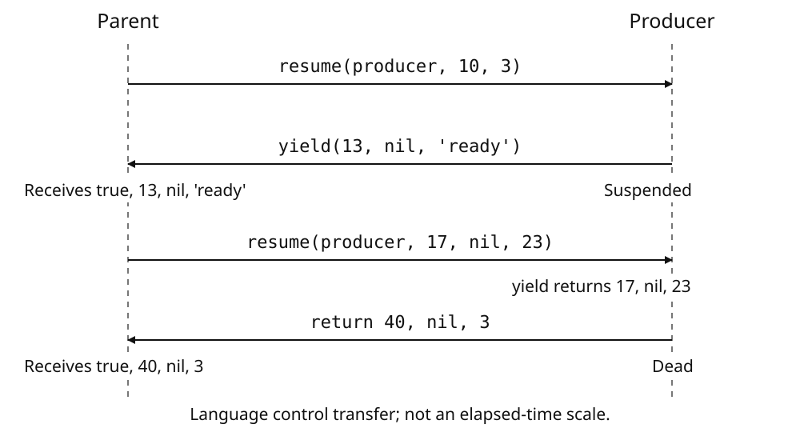

# Protected calls and coroutines {#sec-coroutines}

> WARNING! The behavior of protected calls and coroutines in BLua may not fully conform to the Lua standard due to implementation-specific details. Any deviations from the Lua standard should actually be regarded as bugs and not as intended features. Therefore, treat any non-standard behavior in this document as bugs and not as contracts!

A protected call runs a function and returns any error it raises to the
caller, instead of stopping the program. A coroutine is a function that can
suspend itself and later continue where it stopped, with its local variables
intact. The BIOS provides `error`, `pcall`, `xpcall` and the `coroutine`
table; they are available when the program starts.

## Overview {#sec-coroutines-control-flow-and-hardware-progress}

| Function | Effect | Returns to the caller when |
| --- | --- | --- |
| `pcall`, `xpcall` | Calls a function and catches its errors | The function returns or raises an error |
| `coroutine.resume` | Runs a coroutine | The coroutine yields, returns or raises an error |
| `coroutine.yield` | Suspends the running coroutine | The coroutine is resumed again |
| `halt_until_irq` | Stops the CPU until an interrupt | An interrupt is accepted; see [HALT](cpu.md#sec-cpu-halt) |

Only one coroutine runs at a time; the devices keep running meanwhile. Use
the device's status or interrupt to know when a device operation is complete.

## Protected calls {#sec-coroutines-protected-calls}

### Functions {#sec-coroutines-signatures}

| Function | Description |
|---|---|
| `error(value [, level])` | Raises `value` as an error |
| `pcall(f, ...)` | Calls `f(...)` and catches errors |
| `xpcall(f, handler, ...)` | Calls `f(...)`; an error is passed to `handler` |

### error {#sec-coroutines-raising-a-value}

`error` raises its first argument unchanged. Any value may be raised,
including nil and tables. `level` is ignored, and no position or traceback is
added to the value.

### pcall and xpcall {#sec-coroutines-calling-and-receiving-results}

`f` must be a function. The results are:

| Outcome | Results |
|---|---|
| `f` returns | `true`, followed by the results of `f` |
| `pcall`: `f` raises an error | `false`, error value |
| `xpcall`: `f` raises an error | `false`, first result of `handler` |

Test the first result to find out whether an error occurred; the error value
itself may be nil or false. All results of `f` are passed on, including nil
values. A function that ends without `return`, or with a bare `return`,
returns no values, so `pcall` returns only `true`.

### Error handler {#sec-coroutines-transforming-an-error}

`handler` must be a function; otherwise `xpcall` raises an error itself,
which an enclosing `pcall` can catch. The handler is called after the calls
inside `f` have been left, with the error value as its only argument. Its
first result becomes the second result of `xpcall`. If the handler raises an
error, `xpcall` returns `false, 'error in error handling'`.

### Errors caught {#sec-coroutines-which-failures-are-protected}

A protected call catches values raised with `error`, errors of the language
itself and out-of-memory errors. Language errors give these messages:

| Condition | Message |
|---|---|
| Calling a value that is not a function | `Attempted to call a non-function value.` |
| `xpcall` handler not a function | `xpcall error handler must be a function.` |
| nil used as a table key | `Table index is nil.` |
| Out of memory | `Out of memory.` |

For example, `pcall(rawget, {}, nil)` returns `false, 'Table index is nil.'`.

Bus errors, address errors and other CPU exceptions are not caught; they go
to the exception handler. A protected call inside an interrupt handler catches
only errors raised within the handler.

Each coroutine has its own protected calls. An error in a coroutine is first
caught by a protected call in that coroutine; only if there is none is it
returned to `coroutine.resume`.

`f` may yield while it runs under `pcall` or `xpcall`. The `xpcall` handler
may not yield.

Variables changed before an error keep their new values.

### Timing {#sec-coroutines-incremental-cycle-charges}

`error` takes 2 cycles; `pcall` and `xpcall` take 4 cycles, plus 1 cycle for
each result returned. The called function's own time is added.

## Coroutines {#sec-coroutines-coroutines}

A coroutine keeps its function, its calls in progress, its local variables
and the point where it stopped. The program starts in the main thread.

### Example {#sec-coroutines-argument-and-result-transfer}

{#fig-coroutines-transfer}

#### Yield and resume {#sec-coroutines-yield-and-resume}

The first `resume` passes its arguments to the coroutine's function. A later
`resume` passes its arguments as the results of the `yield` at which the
coroutine stopped.

```lua
local producer = coroutine.create(function(a, b)
    local x, y, z = coroutine.yield(a + b, nil, 'ready')
    return x + z, nil, b
end)
-- coroutine.status(producer) is 'suspended'.
local first_ok, first, gap, label = coroutine.resume(producer, 10, 3)
-- true, 13, nil, 'ready'; producer is suspended again.
local final_ok, final, middle, original =
    coroutine.resume(producer, 17, nil, 23)
-- true, 40, nil, 3; producer is now dead.
local dead_ok, message = coroutine.resume(producer)
-- false, 'cannot resume non-suspended coroutine'.
```

### coroutine.create, running, status {#sec-coroutines-creating-and-identifying-threads}

**`coroutine.create(f)`** returns a new coroutine with function `f`, in state
`suspended`. `f` must be a BLua function; BIOS functions are not accepted. If
there is not enough memory, `create` raises an out-of-memory error.

**`coroutine.running()`** returns the running coroutine and `true` if it is
the main thread, `false` otherwise.

**`coroutine.status(co)`** returns one of:

| Result | Meaning |
|---|---|
| `"suspended"` | Not yet started, or stopped at `yield` |
| `"running"` | Running |
| `"normal"` | Has resumed another coroutine and waits for it |
| `"dead"` | Finished, closed or stopped by an error |

### coroutine.resume, yield {#sec-coroutines-transferring-execution-and-values}

**`coroutine.resume(co, ...)`** runs `co` until it yields, returns or raises
an error, and returns:

| Outcome | Results |
|---|---|
| `co` yields | `true`, followed by the arguments of `yield` |
| `co` returns | `true`, followed by the results of its function |
| `co` raises an error | `false`, error value |
| `co` is not suspended | `false, 'cannot resume non-suspended coroutine'` |

**`coroutine.yield(...)`** suspends the running coroutine. Its arguments
become the results of `resume`. When the coroutine is resumed, the arguments
of that `resume` become the results of `yield`.

All values are passed on, including nil values. Calling `yield` in the main
thread raises `Invalid argument.`

### coroutine.isyieldable {#sec-coroutines-querying-yieldability}

**`coroutine.isyieldable([co])`** returns `true` if `co` (default: the running
coroutine) may yield. The main thread, an interrupt or exception handler and
an `xpcall` handler may not yield. `isyieldable` does not show whether a
coroutine can be resumed; use `status` for that.

### coroutine.close {#sec-coroutines-failure-and-closing}

**`coroutine.close(co)`** ends a coroutine that is not running and sets it to
`dead`. The rest of its function is not executed. Variables of the coroutine
that are used by other functions keep their current values.

| State of `co` | Results |
|---|---|
| Suspended or finished | `true` |
| Stopped by an error | `false`, error value |

After `close` has reported an error, a second `close` returns `true`. Closing
a running or `normal` coroutine raises `Invalid argument.`

An error returned by `resume` is not raised in the caller. `pcall(coroutine.resume, co)`
therefore returns `true, false, error`.

### coroutine.wrap {#sec-coroutines-wrapped-coroutines}

**`coroutine.wrap(f)`** creates a coroutine and returns a function that
resumes it. The function returns the same values as `resume`, without the
leading `true`. If the coroutine raises an error, the function closes the
coroutine and raises the error in the caller.

### Arguments {#sec-coroutines-call-arity}

Wrong or missing arguments to the `coroutine` functions raise
`Invalid argument.` `coroutine.isyieldable()` and `coroutine.isyieldable(nil)`
are different: the second raises `Invalid argument.`

### Interrupts and exceptions {#sec-coroutines-hardware-irq-and-exception-boundaries}

An interrupt or exception handler may not resume or yield a coroutine.
`resume` returns `false, 'cannot resume coroutine across a hardware exception'`,
and `yield` raises an error. An error that is not caught inside the handler
stops the program; see [[System control](system.md#sec-system)]{.content-visible when-format="html"}[Book I, Chapter 12]{.content-visible when-format="pdf"}.

### Timing {#sec-coroutines-cycle-increments}

`create`, `resume`, `yield`, `status`, `running`, `close` and `isyieldable`
each take 4 cycles, plus 1 cycle for each argument and result passed. The
coroutine's own instructions are added.

## Error codes {#sec-coroutines-language-fault-reasons}

An error that is not caught stops the program with a trap exception. The
LuaReason register then holds:

| LuaReason | Condition |
|---|---|
| 1 | Calling a value that is not a function |
| 4 | nil used as a table key |
| 7 | `xpcall` handler not a function |
| 8 | Value raised with `error` |
| 9 | Out of memory |
| 10 | Invalid argument |

See [[System control and timing](system.md#sec-system-supervisor-fault-registers)]{.content-visible when-format="html"}[Book I, §12.8]{.content-visible when-format="pdf"}.

## Reset {#sec-coroutines-reset-and-startup-boundary}

A reset ends all coroutines and protected calls without returning results.

## Programming examples {#sec-coroutines-programming-examples}

### pcall and xpcall {#sec-coroutines-protected-results-and-errors}

```lua
local ok, sum, gap, difference = pcall(function(a, b)
    return a + b, nil, a - b
end, 7, 3)
-- true, 10, nil, 4
local failure = {code = 72}
local state = {value = 0}
local caught_ok, object = pcall(function()
    state.value = 77
    error(failure)
end)
-- false, failure; state.value is 77
local nil_ok, nil_error = pcall(error, nil)          -- false, nil
local index_ok, index_error = pcall(rawget, {}, nil)
-- false, 'Table index is nil.'
```

```lua
local failure = {code = 72}
local ok, code = xpcall(function() error(failure) end,
    function(value) return value.code * 2, 'discarded' end)
-- false, 144
local handled, message = xpcall(function() error('body') end,
    function() error('handler') end)
-- false, 'error in error handling'
```

### Closing a coroutine {#sec-coroutines-failure-and-explicit-close}

```lua
local failure = {code = 72}
local failed = coroutine.create(function() error(failure) end)
local ok, value = coroutine.resume(failed)       -- false, failure
local closed, original = coroutine.close(failed) -- false, failure
local closed_again = coroutine.close(failed)     -- true
```

```lua
local read
local abandoned = coroutine.create(function()
    local value = 19
    read = function() return value end
    coroutine.yield(value)
    value = 20
end)
local ok, yielded = coroutine.resume(abandoned) -- true, 19
coroutine.close(abandoned)
local retained = read()                         -- 19
```

### coroutine.wrap {#sec-coroutines-wrapped-calls}

```lua
local wrapped = coroutine.wrap(function()
    local next_value = coroutine.yield(12)
    return next_value
end)
local first = wrapped()   -- 12
local final = wrapped(34) -- 34

local failure = {code = 72}
local failed_thread
local invoke = coroutine.wrap(function()
    failed_thread = coroutine.running()
    error(failure)
end)
local ok, caught = pcall(invoke)              -- false, failure
local closed = coroutine.close(failed_thread) -- true: wrap has closed it
```
