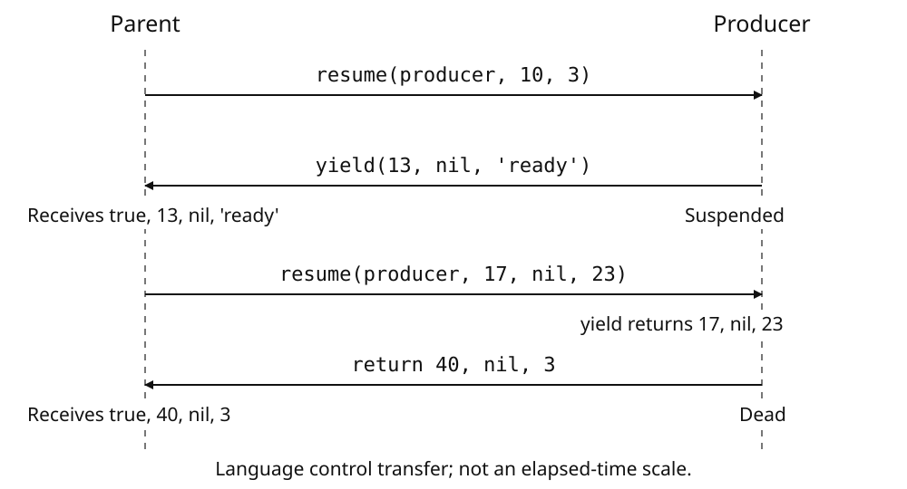

# Protected calls and coroutines

Protected calls let a program receive a language error and continue at a
chosen call boundary. Coroutines let one procedure suspend and later continue
with its local values intact. The BIOS supplies `error`, `pcall`, `xpcall`
and the `coroutine` Table before normal program entry.

These interfaces carry language values and result tuples. Device status,
interrupt acceptance and hardware exception return remain governed by the
[CPU](cpu.md), [interrupt controller](irq.md) and
[system-control](system.md) interfaces.

## Control flow and hardware progress

Protected calls, coroutines and interrupt waits solve different problems:

| Mechanism | What it changes | What resumes the caller |
| --- | --- | --- |
| `pcall` or `xpcall` | Adds a language-error boundary around a call. | The target returns or an eligible language error reaches that boundary. |
| `coroutine.resume(thread, ...)` | Transfers language execution to the selected suspended thread. | That thread yields, returns or fails with an unhandled language error. |
| `coroutine.yield(...)` | Suspends the current coroutine and returns values to its resumer. | A later accepted `resume` supplies the yield call's results. |
| `halt_until_irq` | Waits at the current call depth unless an interrupt event is already pending. | An accepted interrupt event; the [CPU reference](cpu.md#halt) defines the latch and return rules. |

Coroutine execution is cooperative: the resumer waits while its selected
thread runs. Device operations continue according to their own hardware
rules. Establish completion from the device's status or interrupt condition
before consuming its result. A coroutine transfer or a protected error result
is not a completion indication from a device.

## Protected calls

Call `pcall` to receive a function's success flag and results or its error
value. Choose `xpcall` when a handler should transform that error before it
returns to the caller. Test the success flag: an error value can be nil,
false, a Number or an object as well as a String.

### Signatures

| Function | Signature | Purpose |
|---|---|---|
| `error` | `error(message [, level])` | Raise the supplied value; do not return normally. |
| `pcall` | `pcall(f, ...)` | Call `f` with protection. |
| `xpcall` | `xpcall(f, msgh, ...)` | Call `f` with protection and transform its error through `msgh`. |

Brackets mark the optional `level` argument. The ellipses denote arguments forwarded to the target. Supply the leading arguments shown in each signature. If an indirect call omits a fixed argument, that argument arrives as nil: a missing first argument to `error` raises nil, and a missing protected target is nil. No maximum argument or result count is specified here.

### Raising a value

`error` raises its first value unchanged. Every language kind is permitted,
including nil, false and a Table reference. A raised Table retains its identity.
The optional `level` and surplus arguments are ignored; the value carries no
automatically added source prefix or traceback.

An error payload of `nil` is still an error. Inspect the success flag, not the payload's truth value, to distinguish failure from success.

### Calling and receiving results

`pcall` forwards the arguments after `f`. `xpcall` forwards the arguments after `f` and `msgh`; the handler is not one of the body's arguments. The target must be a function: either a BLua closure or a built-in function. A value of another kind is not accepted as a protected target.

When the surrounding expression receives all results, the layouts are:

| Outcome | Results, in order |
|---|---|
| Target returns no values | `true` |
| Target returns values | `true`, followed by every target result |
| `pcall` catches an error | `false, errorValue` |
| `xpcall` handles an error | `false, handlerValue` |

Result count and `nil` positions matter. The arithmetic example below produces `true, 10, nil, 4`, not a compressed three-value result. An ordinary BLua function that falls through, or uses a bare return, returns one `nil`; its protected success therefore gives `true, nil`, not just `true`. A caught `nil` error produces exactly two results, `false, nil`. If the caller requests a fixed number of results instead, extra results are discarded and missing positions are filled with `nil`.

A protected target can itself be `pcall` or `xpcall`. Its own success flag and remaining results are then ordinary results of the outer target; an outer success flag does not mean that every nested operation succeeded.

### Transforming an error

`xpcall` requires `msgh` to be a function before it establishes its new protected call. An absent or non-function handler therefore raises an error outside that new boundary. An already active outer protected call can catch it.

A body error unwinds the body's calls before the saved handler runs. The handler receives exactly one argument: the incoming error value. If it returns normally, only its first result becomes `handlerValue`; further results are discarded. A handler returning no results supplies `nil`. The example below transforms its error into `144` and discards the handler's extra result.

A language error reaching the same protected boundary while its handler is active replaces the payload with the exact string `error in error handling`. It does not return the handler's newly thrown value.

For a directly called built-in handler, explicit raised values and language
execution errors produce that handler-error result. Memory exhaustion in that
handler follows its out-of-memory path instead.

<section class="keep-together">

### Which failures are protected?

The protected language-error path handles explicitly raised values, language execution errors, and classified out-of-memory errors. Explicit values remain unchanged; the latter two categories supply reason strings.

| Condition | Error payload |
|---|---|
| Non-function protected target | `Attempted to call a non-function value.` |
| Non-function `xpcall` handler | `xpcall error handler must be a function.` |
| Nil Table key | `Table index is nil.` |
| Classified memory exhaustion | `Out of memory.` |

</section>

The target check occurs inside the new protected boundary. For `pcall`, a non-function target therefore gives `false` and its reason string. For `xpcall`, the valid handler receives that target error. The handler check, by contrast, occurs before the new boundary, as described above. For example, `pcall(rawget, {}, nil)` returns `false, 'Table index is nil.'`.

Bus, address and coprocessor faults enter the hardware exception route.
An entered hardware exception or interrupt also blocks unwinding to an older
protected call across that boundary. A handler may establish a new protected
call for language operations on its own side of the boundary. Use the CPU
exception interface for hardware recovery.

Protected calls belong to individual threads. The innermost active protected call in the current thread receives an eligible error. Installing protection in one thread does not install it in another. Protection in a coroutine is considered before that coroutine is marked failed and its error is returned to its resumer.

A protected body is not made non-yieldable merely by using `pcall` or `xpcall`. An active `xpcall` handler is non-yieldable. A protected body can yield and resume before raising an error. Attempting to yield from its active handler instead produces the handler-error result rather than suspending there.

Protected unwinding closes captured locals of the removed calls and
releases those calls. Writes already completed remain visible: the example
below leaves the earlier assignment of `77` in place.

### Incremental cycle charges

`error` adds 2 cycles; `pcall` and `xpcall` each add 4 cycles, with no additional per-argument or per-result charge. A protected built-in target or handler also incurs its own base charge. These are incremental charges, not total timings: target and handler execution, call and return instructions, and other machine work still contribute. Do not budget an entire protected operation as a fixed 4-cycle service.

## Coroutines

The BIOS installs the `coroutine` table before cartridge execution. Its eight functions are available through that table; no cartridge import is needed.

A coroutine keeps its entry function, call chain, local values, protected
calls and suspension point. The main thread starts active. Creating another
thread leaves it suspended; an accepted `resume` starts or continues it.
Yield, final return or an unhandled language error transfers control back to
its resumer. At each point only one language thread is active.

### Creating and identifying threads

**`coroutine.create(fn) → thread`** returns exactly one thread value. The entry `fn` must be a language function closure. A built-in function value is not accepted merely because it is callable. Omitting `fn`, passing nil, or passing another value raises `Invalid argument.` Creation leaves the thread unstarted and publicly `"suspended"`.

**`coroutine.running() → thread, is_main`** returns exactly two values: the active thread and a boolean. The boolean is true in the main thread and false in a created coroutine. Keep thread values as language values; the operations below require a thread, not an address or numeric identifier.

**`coroutine.status(thread) → string`** returns exactly one of these strings:

| Result | Meaning |
|---|---|
| `"suspended"` | Created but not started, or stopped at a yield. |
| `"running"` | Currently active. |
| `"normal"` | Waiting inside an accepted resume of another thread. |
| `"dead"` | Finished, closed, or failed with an unhandled language error. |

A missing or non-thread argument raises `Invalid argument.` The public status does not distinguish an unstarted thread from a yielded thread, or a normally completed thread from a failed one.

### Transferring execution and values

**`coroutine.resume(thread, ...) → true, ...` or `false, error`** resumes an unstarted or yielded thread. Its first argument must be a thread. A missing or incorrectly typed first argument raises `Invalid argument.` in the caller; it is not converted into an ordinary `false, error` result.

On the first accepted resume, all arguments after `thread` become the entry function's arguments. The caller becomes `"normal"`, and the target becomes `"running"`. If that target resumes another coroutine, it becomes normal while its own target runs. When control returns to a resumer, that resumer becomes running again.

An accepted resume returns a true prefix followed by either the values supplied to `yield` or the entry function's final return values. Yield leaves the target suspended; a final return leaves it dead. An unhandled language error instead returns exactly `false` and the original error value, subject to the hardware boundaries below. The target then has failed state, publicly reported as dead.

Attempting to resume a running, normal, completed, closed, or failed thread returns exactly `false, "cannot resume non-suspended coroutine"`. This rejection does not close or otherwise change the target. Hardware-exception rejection is a separate case described below.

**`coroutine.yield(...) → ...`**, when later resumed, returns the next resume's arguments. Yield first suspends the active coroutine and returns its supplied values to the resumer, after the resumer's true prefix. Later, the values after `thread` in the next resume become the results of that suspended yield call. They do not restart the entry function and do not become another set of entry arguments. Calling yield where yielding is forbidden raises `Invalid argument.`; yield does not return a false prefix.

The exchange carries a value tuple, not an automatically packed table. Its count and nil positions are preserved. In the producer example below, the first resume supplies 10 and 3; the child yields 13, nil, and `"ready"`. The caller receives true followed by all three values. The next resume supplies 17, nil, and 23; these are the three results of the child's yield call. The child finally returns 40, nil, and 3, so the caller receives true followed by those three values.

Ordinary call-result adjustment still applies. A fixed number of receiving variables truncates excess results or supplies nil for missing results. An expanding result position carries the actual tuple count. Preserve that count when nil values matter; nil is not an end marker. An explicit bare `return`, and an ordinary BLua function that reaches its end without a return value, each return **one nil value**, not a zero-result tuple. Accepting all results of a successful resume of that function therefore gives `true, nil`.

### Querying yieldability

**`coroutine.isyieldable([thread]) → boolean`** returns one boolean. With no argument it examines the active thread. With an argument it examines that thread; explicit nil is invalid and raises `Invalid argument.` Extra arguments are unused.

The main thread is not yieldable. A selected thread carrying a hardware exception frame or an active `xpcall` error-handler continuation is also not yieldable. Ordinary `pcall` execution and the body protected by `xpcall` do not themselves forbid yielding. Executing the `xpcall` error handler does. Merely having an error-handler function stored somewhere does not affect the answer.

**Yieldability does not check status and is not permission to resume.** An unstarted thread can report true. A normally completed or closed thread can also report true, and a failed thread may report true. None of those answers changes resume's requirement that the target be unstarted or suspended. Ask status when deciding whether a target can be resumed; ask yieldability about the selected context's yield restrictions.

### Failure and closing

Language errors are first offered to protected calls in the active thread. If none consumes an error and the coroutine has a resumer, ordinary coroutine error transfer returns `false, error` to that resumer. The error remains its original value, including nil or the identity of a table; it is not necessarily a string. Failed state retains the error and language frames until closing. A public dead status alone does not indicate whether this retained failure exists.

A false result returned by resume is not itself an error thrown in the caller. Consequently, protecting resume with `pcall` adds the protected call's success boolean outside resume's own result tuple. A protected invocation can therefore succeed while resume reports a target failure. By contrast, an invalid argument raised in the caller is a caller-side error.

**`coroutine.close(thread) → true` or `false, original_error`** closes an unstarted, suspended, dead, or failed thread. A missing or non-thread argument raises `Invalid argument.` Closing a running or normal thread also raises `Invalid argument.`

Closing releases the thread's language frames, pending protected-call state, entry function, and register-stack state, and leaves it dead. It does not resume the function to execute remaining statements. Open upvalues are closed while preserving their current captured values. A surviving closure can therefore still read its captured local after the owning coroutine is closed. In the closing example below, closing after yielding the captured value 19 prevents the later assignment of 20; the surviving reader still returns 19.

An unstarted, suspended, or normally dead target returns exactly true when closed. A failed target returns exactly false and its retained original error, **but is still closed**. That close clears the retained failure; closing the same thread again returns true. The false prefix in this case reports the earlier failure, not a refusal to close.

<section class="keep-together">

### Wrapped coroutines

**`coroutine.wrap(fn) → wrapped_function`** returns exactly one variadic function, backed by one newly created coroutine. The entry requirement is the same as for create. Each call to the returned function resumes that coroutine with the supplied arguments. Successful calls remove resume's true prefix and return the yielded or final tuple unchanged, including nil positions and result count.

</section>

On a false resume result, the wrapped function raises the first error value returned by that resume instead of returning a false prefix. If the retained coroutine is in failed state, the wrapper closes it before raising that value. A retained handle to that failed thread subsequently closes successfully because the wrapper has already cleared its retained failure. This failed-state cleanup also applies if resume rejected an already failed thread. In that case the wrapper raises the rejection string, not the earlier retained body error. Rejection in other non-suspended states does not trigger failed-thread cleanup. A finished wrapper cannot be used to restart its entry function. Replacing the public `coroutine.close` table entry does not replace the wrapper's captured closing operation.

### Call arity

Create, status, close, and wrap each declare one fixed parameter; omitted fixed parameters arrive as nil, and excess arguments are not forwarded. Running declares no parameters. Resume has one fixed parameter and a variadic tail; yield and the function returned by wrap are variadic. Isyieldable also preserves its argument list, which is why omission differs from explicit nil.

### Hardware IRQ and exception boundaries

If the active caller has a hardware exception frame, `resume` returns
`false, "cannot resume coroutine across a hardware exception"`. This check
precedes the target-status check and leaves the target unchanged.

Yield is also forbidden across an entered exception boundary. A language
error that cannot reach protection on its own side enters the Lua fault
exception route. It does not unwind through an older hardware handler to
return a coroutine result. See [System control](system.md) for device-context
switching and the [CPU HALT interface](cpu.md#halt) for interrupt waits.

### Cycle increments

The underlying create, resume, yield, status, running, close, and isyieldable operations each add four cycles, with no additional per-argument or per-result charge. This is not their service time or the total cost of calling the installed function. Ordinary function instructions add work; wrap also creates and resumes a coroutine and may inspect, close, and raise an error. Resumed cartridge code contributes its own execution. No total per-call cycle bound is specified here.

<section class="keep-together">

## Language fault reasons

If a classified language error reaches the CPU fault-exception route, its Lua
fault reason identifies the condition below. A protected failure result does
not itself mean that this route was entered. Arbitrary values raised by `error`
keep their own value and identity; their text does not select a reason code.

| Reason | Condition |
|---|---|
| 1 | Attempt to call a non-function value |
| 4 | Nil Table key |
| 7 | Non-function `xpcall` handler |
| 8 | Explicitly raised value |
| 9 | Classified out-of-memory condition |
| 10 | Invalid argument |

</section>

[System control and timing](system.md) describes retained fault words and publication.
[Interrupt controller](irq.md) describes interrupt handling. Protected language calls
are not substitutes for those hardware interfaces.

## Reset and startup boundary

A newly created coroutine has not run its entry and is reported as `suspended`.
CPU reset is not an ordinary `coroutine.close` call. It clears the active call
and resumer chain, including protected-call ownership, and starts the selected
system startup; it does not deliver a close-result tuple to the interrupted
caller. [CPU reference](cpu.md) and [System control and timing](system.md)
describe CPU startup and the system-wide reset request separately.

<section class="keep-together">

## Argument and result transfer

The figure shows the producer in the yield-and-resume example below. `resume` and
`yield` abbreviate `coroutine.resume` and `coroutine.yield`. Arrows show language
control and value transfers; vertical distance is not elapsed machine time.



</section>

## Programming examples

### Protected results and errors

A protected call keeps the target's result count and nil positions. A caught
error keeps the original value, even when that value is nil or a Table.

```lua
local ok, sum, gap, difference = pcall(function(a, b)
    return a + b, nil, a - b
end, 7, 3)
-- true, 10, nil, 4.
local failure = {code = 72}
local state = {value = 0}
local caught_ok, object = pcall(function()
    state.value = 77
    error(failure)
end)
-- caught_ok is false; object is failure; state.value remains 77.
local nil_ok, nil_error = pcall(error, nil) -- false, nil
local index_ok, index_error = pcall(rawget, {}, nil)
-- false, 'Table index is nil.'.
```

Only the handler's first result is retained. A language error in the handler
instead produces the handler-error String.

```lua
local failure = {code = 72}
local ok, code = xpcall(function() error(failure) end,
    function(value) return value.code * 2, 'discarded' end)
-- false, 144.
local handled, message = xpcall(function() error('body') end,
    function() error('handler') end)
-- false, 'error in error handling'.
```

### Yield and resume

This producer follows the transfers in the figure. Its first arguments are
entry arguments; the next resume supplies the results of its suspended yield.

```lua
local producer = coroutine.create(function(a, b)
    local x, y, z = coroutine.yield(a + b, nil, 'ready')
    return x + z, nil, b
end)
-- coroutine.status(producer) is 'suspended'.
local first_ok, first, gap, label = coroutine.resume(producer, 10, 3)
-- true, 13, nil, 'ready'; producer is suspended again.
local final_ok, final, middle, original =
    coroutine.resume(producer, 17, nil, 23)
-- true, 40, nil, 3; producer is now dead.
local dead_ok, message = coroutine.resume(producer)
-- false, 'cannot resume non-suspended coroutine'.
```

While the producer runs, `coroutine.running()` returns its Thread with false
as the second result. Its resumer has status `normal`; when the producer yields
or returns, the resumer becomes `running` again.

### Failure and explicit close

Closing a failed coroutine reports its retained error but still completes the
close. A second close therefore succeeds.

```lua
local failure = {code = 72}
local failed = coroutine.create(function() error(failure) end)
local ok, value = coroutine.resume(failed)       -- false, failure
local closed, original = coroutine.close(failed) -- false, failure
local closed_again = coroutine.close(failed)    -- true
```

Closing a suspended coroutine does not run its remaining statements. A closure
that outlives the coroutine keeps the current value of its captured local:

```lua
local read
local abandoned = coroutine.create(function()
    local value = 19
    read = function() return value end
    coroutine.yield(value)
    value = 20
end)
local ok, yielded = coroutine.resume(abandoned) -- true, 19
coroutine.close(abandoned)
local retained = read() -- 19: the assignment of 20 never ran.
```

### Wrapped calls

A wrapped coroutine exchanges the same tuples without resume's Boolean prefix.
An error is raised in the caller; a failed coroutine is closed before that
error is propagated.

```lua
local wrapped = coroutine.wrap(function()
    local next_value = coroutine.yield(12)
    return next_value
end)
local first = wrapped()   -- 12
local final = wrapped(34) -- 34

local failure = {code = 72}
local failed_thread
local invoke = coroutine.wrap(function()
    failed_thread = coroutine.running()
    error(failure)
end)
local ok, caught = pcall(invoke) -- false, failure
local closed = coroutine.close(failed_thread) -- true: already closed by wrap.
```
