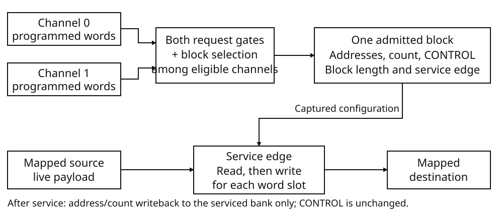

# Direct memory access

The DMA unit moves whole words between mapped addresses without a CPU load and
store for each word. It has two programmable channels and one shared block
transfer path. A channel selects its source and destination, the number of
words, address increments, two request gates and a block length. The unit does
not transform the payload or interpret it as a graphics, sound or image command.

### Installed resources

| Resource | Specification |
|---|---|
| Channels | Two, numbered 0 and 1 |
| Register interface | Six 32-bit word ports per channel; the two banks are not adjacent |
| Transfer word | 32 bits, four bytes, little-endian |
| Address and remaining-count words | 32 bits each; addresses count bytes, transfer count counts words |
| Programmed block length | 1–16 words, independently selected by each channel |
| Shared transfer capacity | One admitted block across both channels |
| Block configuration | Captured read address, write address, full remaining count and CONTROL |
| Completion requests | One IRQ source per channel |
| Timing unit | 33,868,800 system cycles per second |

The captured configuration is not a payload buffer. Admission does not copy the
source words into the DMA unit. The source is read when the admitted block is
serviced. DMA completion is also not completion of work submitted to another
unit: a GPU packet may still be queued after its last word has been transferred.



The upper path selects and captures configuration. The lower path moves data
at the service edge. Address/count writeback belongs to the serviced channel;
CONTROL is not rewritten by block completion.

## Program a transfer

Use a channel that the cartridge owns and that is not BUSY. Program its read
address, write address, transfer count and CONTROL, then write START to TRIGGER.
These are separate word transactions, not an atomic descriptor submission.
Once START is accepted, the channel becomes BUSY and its previous DONE state
is replaced. An eligible block can be admitted immediately.

Choose address increments from the endpoints, not from the request names:

| Route | Read increment | Write increment | Read request | Write request |
|---|---:|---:|---|---|
| Memory → memory | 1 | 1 | FORCE | FORCE |
| Memory → fixed GP0 port | 1 | 0 | FORCE | GX_WRITE |
| GPUREAD port → memory | 0 | 1 | GX_READ | FORCE |

A fixed address is used again for every word. An enabled increment adds four
bytes after each read or write. Count is the number of words to transfer, not
the final address, byte length, number of packets or number of blocks. Count 20
with block length 16 admits a 16-word block and a four-word tail.

Both request gates must be true for admission. Selecting a request does not
select or change an endpoint address. For example, GX_WRITE does not redirect
a destination to GP0; the cartridge must program that destination explicitly.
The requests and device-port section explains why FORCE is not a substitute
for a device's own transfer protocol.

### Assemble CONTROL

The following expression describes its defined fields. Each request is its
four-bit encoding, and block length is 1–16:

```text
CONTROL = read_increment
        | (write_increment << 1)
        | (read_request << 2)
        | (write_request << 6)
        | ((block_length - 1) << 10)
```

This is a word-layout equation, not an additional command or a required library
function. For the example routes:

| CONTROL | Operation |
|---|---|
| `00003c03H` | Both increments, FORCE/FORCE, 16-word blocks |
| `00000c03H` | Both increments, FORCE/FORCE, four-word blocks |
| `00003c41H` | Read increment, fixed destination, FORCE/GX_WRITE, 16-word blocks |
| `00003c0aH` | Fixed source, write increment, GX_READ/FORCE, 16-word blocks |

### START and zero count

TRIGGER bit 0 is START. Writing it while idle replaces STATUS with BUSY and
starts the transfer protocol. A zero count instead reaches DONE and requests
its IRQ immediately, without a data block and without waiting for either
request gate. Do not assume a minimum time between START and completion.

START written while BUSY is ignored: it is not queued, does not restart the
channel and does not cancel an admitted block. A write with START clear also
does not start anything. TRIGGER reads zero after either kind of write.

## Register reference

Use whole-word accesses at the addresses below. Each reset word is zero.
READ_ADDR, WRITE_ADDR, TRANSFER_COUNT and CONTROL are ordinary read/write
words. STATUS is read-only. TRIGGER accepts command writes and reads zero.
Reading these words does not acknowledge an IRQ or clear DONE.

| Register | Channel 0 address | Channel 1 address | Access | Reset |
|---|---|---|---|---|
| READ_ADDR | `0800000cH` | `080103e4H` | R/W | `00000000H` |
| WRITE_ADDR | `08000010H` | `080103e8H` | R/W | `00000000H` |
| TRANSFER_COUNT | `08000014H` | `080103ecH` | R/W | `00000000H` |
| CONTROL | `08000018H` | `080103f0H` | R/W | `00000000H` |
| STATUS | `0800001cH` | `080103f4H` | R | `00000000H` |
| TRIGGER | `08000020H` | `080103f8H` | Command / R=0 | `00000000H` |

Do not derive channel 1 by adding one channel-0 bank length. READ_ADDR and
WRITE_ADDR retain complete byte-address words. TRANSFER_COUNT retains a
complete unsigned word. Neither the address nor count writes clear STATUS.

### CONTROL fields

| Bits | Field | Meaning | Reset |
|---|---|---|---:|
| 31:14 | Unassigned retained bits | Stored and read back; not decoded as transfer controls | 0 |
| 13:10 | BLOCK_WORDS | Programmed block length minus one | 0: one word |
| 9:6 | WRITE_REQUEST | Destination-side admission request selector | 0: FORCE |
| 5:2 | READ_REQUEST | Source-side admission request selector | 0: FORCE |
| 1 | WRITE_INCREMENT | 1 adds four bytes per word; 0 repeats the write address | 0 |
| 0 | READ_INCREMENT | 1 adds four bytes per word; 0 repeats the read address | 0 |

The complete CONTROL word is retained, including bits 31:14. Those bits are
not cleared by a write or admission. No transfer-control meaning is assigned
to them here.

<div class="keep-together">

### Request-selector encodings

Both selector fields use the same encodings. The fields gate admission
independently; their meanings are not reversed when used on the other side.

| Encoding | Name |
|---:|---|
| 0 | FORCE |
| 1 | GX_WRITE |
| 2 | GX_READ |
| 3 | APU_WRITE |
| 4 | APU_READ |
| 5 | IMGDEC_WRITE |
| 6 | IMGDEC_READ |
| 7 | CARTRIDGE_SLOT0_WRITE |
| 8 | CARTRIDGE_SLOT0_READ |
| 9 | CARTRIDGE_SLOT1_WRITE |
| 10 | CARTRIDGE_SLOT1_READ |
| 11–14 | Unnamed; test their corresponding request-line bits |
| 15 | DISABLED |

</div>

FORCE is always asserted and DISABLED is never asserted. Do not equate the
unnamed encodings with either one. For cartridge socket selection and card
protocols, see [Book III: Cartridge sockets and mapped card devices — DMA between sockets](../book3/cartridge.md#dma-between-sockets).

### STATUS and TRIGGER

| Word | Bits | Name | Meaning |
|---|---|---|---|
| STATUS | 0 | BUSY | Accepted transfer is in progress, including a wait for requests |
| STATUS | 1 | DONE | Transfer count reached completion |
| STATUS | 31:2 | Unassigned | Reset, accepted START and completion write these bits zero |
| TRIGGER write | 0 | START | Start only if the channel is idle |
| TRIGGER write | 31:1 | No start action | Do not start a channel without bit 0 |
| TRIGGER read | 31:0 | Zero | Written command bits are not retained for readback |

Accepted START sets STATUS to exactly `00000001H`; finish sets it to exactly
`00000002H`. DONE is not write-one-to-clear. Writing STATUS faults instead
of clearing it. A later accepted START replaces DONE, and reset clears it.

Address/count/CONTROL writes take effect in the programmed words on their
accepted writes. This is distinct from the admission edge and the service
edge described next. A register read is not a peek into the current word slot
of an admitted block.

## Programmed state and an admitted block

### Configuration is captured; source data is not

Each DMA channel has programmed read-address, write-address, transfer-count and CONTROL words. Admission captures those four words, the actual block length and the block's service edge. The captured count is the full remaining transfer count, not just the block length. The block length is the smaller of the remaining count and the programmed size of 1–16 words.

These captured words govern the admitted block even if software programs different channel words before service. Admission does **not** capture the source payload. Source words are read at service, using the captured addresses and CONTROL. A changed source word can therefore change the transferred data without changing the admitted configuration.

### What happens at service

The complete admitted block is serviced at its service edge; there are no separate per-word service edges. Within that service, each word has this order:

1. Read the mapped source word.
2. Write that word to the mapped destination.
3. Update the read address.
4. Update the write address.
5. Decrement the remaining count.

CONTROL bit 0 enables a four-byte source step; bit 1 enables a four-byte destination step. A disabled step leaves that address unchanged. Address addition and count subtraction wrap as unsigned 32-bit arithmetic. For example, a four-byte step from `0xFFFFFFFC` produces `0x00000000`.

Only after the entire block are the resulting read address, write address and remaining count written back to the channel registers. Register values are therefore not a per-word progress display. Destination writes occur during service, not at admission. When the transfer ends, the final address/count words are published before DONE, and DONE is published before the completion IRQ.

Keep source contents unchanged until completion if the transfer must reproduce their original values. Admission alone does not release that requirement. Likewise, admission does not make destination contents final. These are consequences of the ordered reads and writes, not a separate buffer-lifetime mechanism.

### Worked example: three-word forward overlap

Let `A` be four-byte aligned, with `A` through `A + 15` in one ordinary writable RAM span, outside I/O. All addresses below are relative to `A`. Initially:

| Address | Word |
|---|---:|
| `A` | `0x11111111` |
| `A + 4` | `0x22222222` |
| `A + 8` | `0x33333333` |

Admit one three-word block with read address `A`, write address `A + 4`, count 3 and both increments enabled.

- Word 1 reads `0x11111111` at `A`, then writes it to `A + 4`.
- Word 2 reads the **new** `0x11111111` at `A + 4`, then writes it to `A + 8`.
- Word 3 reads the **new** `0x11111111` at `A + 8`, then writes it to `A + 12`.

The three destination words all become `0x11111111`. The channel finishes with read address `A + 12`, write address `A + 16` and count zero. Forward overlap does not preserve the original source sequence: each write precedes the next read.

### Programming while BUSY

BUSY does not reject address, count or CONTROL programming. It also does not turn those writes into edits of an admitted block.

**Schematic active-block example.** Suppose admission captured read address `A`, write address `B`, count 5, three-word blocks and both increments enabled. Before service, software programs read address `X`, write address `Y`, count 9, and changes CONTROL to two-word blocks with a fixed source and incrementing destination. Assume both request gates remain asserted.

The admitted block still transfers three words using the old configuration. Its writeback replaces `X`, `Y` and 9 with `A + 12`, `B + 12` and 2. The changed CONTROL word remains. The next admission for this channel can therefore capture those resulting addresses and count together with the new CONTROL: two words, fixed source, incrementing destination.

When a BUSY channel has no admitted block, newly programmed words instead supply subsequent admission; programming count zero can complete the channel even with closed request gates. START while BUSY is ignored and does not restart, recapture or cancel a block. Reasserting START therefore cannot rescue address/count words that the admitted block will overwrite.

## Requests and device-port ownership

A request selects when a block may begin. It does not select the source or destination address, validate a packet, or indicate that the destination has finished its work. Keep four conditions separate: the channel's request gates, ownership of a CPU-visible port, acceptance of a DMA access by that port, and completion of the admitted block.

<div class="keep-together">

### Request gates

CONTROL selects a read request and a write request independently. Both must be asserted before a nonzero block is admitted. The selectors are not inferred from READ_ADDR or WRITE_ADDR. FORCE (0) is always asserted; DISABLED (15) is always deasserted. Unnamed selectors 11–14 test their respective request bits; they are not aliases for DISABLED and have no assigned device meaning here.

| Selector | Request | Asserted condition |
|---|---|---|
| 1 | GX_WRITE | GPU direction is FIFO or CPU_TO_GP0, and the corresponding write request is asserted as described below. |
| 2 | GX_READ | DMA read is enabled by GPUREAD_TO_CPU direction, and readback is READY. Consuming the last packed readback word returns readback to IDLE. |
| 3 | APU_WRITE | APU transfer mode is DMA_WRITE and the transfer FIFO is empty. |
| 4 | APU_READ | APU transfer mode is DMA_READ and the 16-word transfer FIFO is full. |
| 5 | IMGDEC_WRITE | IMGDEC is active, not quiescing, has nonzero input words remaining, and has at least `min(input words remaining, 16)` free input-FIFO words. |
| 6 | IMGDEC_READ | IMGDEC is active, not quiescing, has nonzero output words remaining, and holds at least `min(output words remaining, 16)` output-FIFO words. |

</div>

In GPU FIFO direction, GX_WRITE requires ingress not stopped, empty DMA ingress, and room in the command FIFO. In CPU_TO_GP0 direction, packet acceptance requires readback IDLE, ingress not stopped, and empty DMA ingress. With image-load words outstanding, it tests command-FIFO space. During polyline payload it is false. Otherwise, no partial fixed packet and an empty FIFO permit acceptance; the remaining case requires an incomplete packet that is neither a polygon nor a line. This packet request is not the CPU's one-word write-ready condition.

IMGDEC's remaining quantities belong to its stream, not to the DMA channel. APU requests describe transfer-FIFO batches, not completion of sample-memory filling or draining. Selectors 7–10 are cartridge-slot 0 write/read and slot 1 write/read respectively; their device protocols belong to Book III.

### Admission is a block boundary

Once admitted, a block retains its captured endpoints, count and CONTROL. A request dropping during a port access does not stop the remaining words of that block. Requests are tested again for a later admission, not between the words of an admitted block. Choose the block length to suit the destination's transfer contract; reducing the count or selecting FORCE does not make an otherwise invalid payload valid.

The last read and last write of each admitted block carry BLOCK_END. GPU DMA ingress processes its staged words at this boundary; APU batch scheduling and IMGDEC decode/request updates also use their applicable end-of-block paths. The boundary is not necessarily channel completion.

Payload words are read at the block's service edge, not captured by START. Keep source contents available until their transfer has completed: changing a source buffer after START can change the transmitted words. A destination write can also affect a later source read when the ranges overlap. Capturing an address does not capture the data at that address.

### CPU access while BUSY

DMA ownership compares an exact port address. An admitted channel owns its captured starting endpoint; another BUSY channel uses its programmed endpoint. This is not a range lock or a reservation of every register in the device. A channel waiting for a request can still own its configured port. Rewriting an admitted channel's address does not move that block's ownership to the new address.

CPU writes to GP0 require no DMA write owner, empty DMA ingress, command-FIFO room, and ingress not stopped. APU transfer-data CPU writes require neither read nor write DMA ownership of that port. IMGDEC CPU writes require no DMA write owner, an active nonquiescing stream, input still expected, and FIFO room. Their DMA write-ready conditions differ: GP0 requires ingress not stopped; DMA write-ready is always asserted at the APU and IMGDEC data ports.

A refused CPU store waits before writing and retries the instruction after release. DMA ownership release requires the same blocked address and no remaining read or write owner there; release itself does not deposit a word. Reads are different: GP0 and IMGDEC CPU reads while DMA read-owned return their retained data latches rather than consuming DMA's data. APU CPU reads return its data latch. Do not use these reads as evidence that the DMA source FIFO is empty or that a transfer has stopped.

## Faults and recovery

DMA bus faults and DMA completion are separate reports. An unmapped source read records UNMAPPED and supplies zero; an unmapped destination write records UNMAPPED without writing. An unaligned I/O read records UNALIGNED_IO and supplies zero; an unaligned I/O write records it without writing. A write to read-only STATUS records READ_ONLY without changing that register. Program DMA registers with whole-word writes.

Each bus fault advances the system fault sequence. The first unacknowledged fault retains the CODE, ADDR and ACCESS details. DMA has no corresponding error field or error-completion interrupt: it still attempts the destination write after a faulting source read, advances enabled addresses, decrements count, and continues the admitted block. Earlier read side effects and accepted writes are not undone.

A DMA destination can also refuse a write through its DMA write-ready condition. That refusal raises no bus fault by itself, and counting still proceeds. DONE therefore means that the channel's count reached zero, not that every write was accepted, that no bus fault occurred, or that GPU, APU or IMGDEC work has finished. START while BUSY is ignored; DISABLED prevents a later admission but does not cancel an admitted block.

DMA-unit reset cancels DMA service, discards the admitted block, clears all twelve mapped DMA words and request latches, and returns the next arbitration turn to channel 0. It preserves the installed timing configuration. These are reset effects, not a DMA CONTROL command or a device-port reset operation.

## Completion and interrupts

At ordinary completion, the last block first publishes its final read address,
write address and zero remaining count. Finish then replaces STATUS with DONE,
and only then raises the channel's interrupt request. There is no DMA-local
interrupt-enable bit in CONTROL.

| Channel | Controller source | Pending/mask bit | ACK word |
|---:|---|---:|---|
| 0 | DMA0_DONE | 0 | `00000001H` |
| 1 | DMA1_DONE | 8 | `00000100H` |

The [interrupt-controller chapter](irq.md) specifies FLAGS, MASK, ACK and CPU
acceptance. Masking completion IRQs neither prevents DMA completion nor clears
DONE. STATUS reads do not clear pending; controller ACK does not clear STATUS.
Repeated unacknowledged completions coalesce in one pending bit, not a transfer
counter.

For interrupt-driven service, reserve one software sequence per channel. The
handler acknowledges the selected controller source and advances that channel's
sequence. Snapshot the sequence before issuing START, then wait for it to
change in a predicate loop containing `halt_until_irq`. Other accepted IRQs may
wake the CPU without completing that channel. Completion can also occur before
the caller first executes HALT. Do not treat one wake-up as a completion test.

DMA DONE means that the programmed word slots have been processed. It does
not certify that every bus access succeeded, nor that downstream work has
finished. For a GP0 command stream, transfer completion, execution of an
in-order GPU marker, GPU idle and publication of a displayed picture are
different conditions. The worked program waits for DMA and GPU separately;
the [PCRTC chapter](pcrtc.md) covers display latching.

## Transfer timing and sharing the bus

DMA timing is expressed in cycles of the installed **33,868,800 Hz timebase**. A charge of C cycles corresponds to C / 33,868,800 seconds on that timebase. The costs below describe transfer timing; they do not specify separate RAM, system-ROM, cartridge, or I/O electrical clocks, rated bandwidth, or sustainable throughput. No fixed interval from a CPU launch instruction to first admission, or from completion to CPU interrupt handling, is guaranteed here.

### Blocks are the unit of admission

The two DMA channels share **one admitted block**. They do not have two independently progressing transfer buses. A channel programs a block size of 1–16 words using CONTROL bits 10–13, which contain the block size minus one. Each word is four bytes. The admitted length is

```text
admitted_words = min(remaining_word_count, programmed_block_length)
```

A short final block therefore uses its actual length, not the programmed maximum. Source and destination increment are independently enabled; an enabled endpoint advances four bytes per word, and a disabled endpoint repeats its address. Address arithmetic wraps at 32 bits.

Admission captures the addresses, remaining count, complete control word, and actual block length, then establishes the block's completion deadline. An admitted block is nonpreemptible: another channel becoming ready, or a request dropping, does not interrupt it. Programming new values does not retime that block. At its deadline, the block performs its ordered word transfers and publishes the resulting addresses and remaining count. No intermediate per-word completion boundaries are provided.

### Calculating a block's charge

Calculate source and destination costs over paired timing spans. A span ends at the first mapping boundary reached by either incrementing endpoint, or at the block end. A mapping crossing splits the timing calculation, **not** the admitted block.

<div class="keep-together">

The installed region costs for a span of n words are:

| Endpoint region | Word charge | Setup charge at that endpoint's region start |
|---|---:|---:|
| RAM | n | 1 |
| System ROM | n | 0 |
| Cartridge region | 8n | 4 |
| I/O | 0 | 0 |
| Other | 0 | 0 |

</div>

Both endpoints begin a new region span at every block admission. Thus each RAM or cartridge endpoint pays setup again in the next block. Within a block, splitting a span because the *opposite* endpoint crosses a boundary does not repeat setup for the continuing endpoint. An endpoint pays setup again when its own mapping span ends, including crossings between cartridge ROM, RAM, and MMIO subregions. A fixed endpoint has one region span for the entire block: repeated accesses to its address do not repeatedly incur setup.

<div class="keep-together">

For each paired span, let R and W include the applicable endpoint setup charges. Its contribution is

```text
Span charge = R + W       if both endpoints are RAM or both are Cartridge
            = max(R,W)    otherwise
Block charge = max(1, sum of all span charges)
```

</div>

“Both” refers to region kind, not matching addresses or cartridge slots. System-ROM-to-system-ROM uses the maximum rule, not addition. The one-cycle minimum applies once to the **whole block**, not to each word or each span. Consequently an all-I/O block costs one cycle regardless of its admitted word count. The cartridge charge applies throughout the classified cartridge aperture, not only to physical ROM storage.

### Single-channel examples

Assume uninterrupted request eligibility, no mapping crossings, and no programming changes during these transfers. All source addresses increment; destination addresses increment except for the fixed GP0 port.

| Transfer | Count | Programmed block | Actual blocks | Calculation | Total cycles |
|---|---:|---:|---|---|---:|
| RAM → RAM | 20 | 16 | 16, 4 | (17 + 17) + (5 + 5) | **44** |
| RAM → RAM | 20 | 4 | 4, 4, 4, 4, 4 | 5 × (5 + 5) | **50** |
| Cartridge-region ROM → RAM | 20 | 16 | 16, 4 | max(132,17) + max(36,5) | **168** |
| Cartridge-region ROM → fixed GP0 I/O port | 5 | 16 | 5 | max(44,0) | **44** |

For RAM copies, a block of n words costs 2n + 2: the two endpoints share the RAM charge additively, and each has one setup charge. Smaller blocks increase repeated setup. In the cartridge examples the source cost dominates the maximum. **System ROM is different:** the corresponding 20-word system-ROM-to-RAM transfer with block size 16 costs 17 + 5 = 22 cycles, not 168.

### Transfer rates by route

The following rates convert the admitted DMA charge into transferred words and
payload bytes. They assume one eligible channel, complete 16-word blocks,
continuously asserted requests, successful endpoint accesses, no mapping
crossings and no register changes. CPU setup, request gaps and work performed
by the destination are outside this calculation. A fixed I/O address identifies
a port, not a directly addressed VRAM word.

For a block of 16 words charged C cycles:

```text
Words per second = 16 × 33,868,800 / C
Bytes per second = 4 × words per second
```

Count each payload byte once, not once for its read and again for its write.
The table uses decimal millions: Mword/s is 1,000,000 words/s and MB/s is
1,000,000 bytes/s. Rates are rounded to three decimal places.

| Source → destination | Cycles per 16 words | Mword/s | MB/s |
|---|---:|---:|---:|
| RAM → RAM | 34 | 15.938 | 63.753 |
| System ROM → RAM | 17 | 31.877 | 127.506 |
| Cartridge ROM → RAM | 132 | 4.105 | 16.421 |
| RAM → fixed I/O | 17 | 31.877 | 127.506 |
| System ROM → fixed I/O | 16 | 33.869 | 135.475 |
| Cartridge ROM → fixed I/O | 132 | 4.105 | 16.421 |
| Fixed I/O → RAM | 17 | 31.877 | 127.506 |
| Fixed I/O → fixed I/O | 1 | 541.901 | 2167.603 |

These are **DMA-charge rates**, not independent memory or device bandwidth
ratings. In particular, the last row follows from zero I/O endpoint charges
and the one-cycle whole-block minimum. It does not certify that any pair of
ports can supply, accept or process sixteen words per cycle. FORCE removes a
request condition; it does not make an unavailable port accept data. A count
reaching zero after refused or faulting accesses is not useful payload delivery.

### Block size, tails and waiting time

For RAM → RAM, repeated setup changes the rate even without contention:

| Words per full block | Cycles per block | Payload MB/s |
|---:|---:|---:|
| 1 | 4 | 33.869 |
| 4 | 10 | 54.190 |
| 16 | 34 | 63.753 |

Use the actual final block when budgeting a finite transfer. The 20-word,
16-word-block RAM copy above costs 44 cycles, so its 80-byte payload averages
**61.580 MB/s** over admitted transfer time, not the full-block 63.753 MB/s.
A larger block reduces repeated setup, but keeps the shared DMA path until
that block completes. It does not make both channels progress simultaneously.

For elapsed throughput, include intervals in which no block can be admitted.
Suppose a 64-word RAM copy with 16-word blocks starts at cycle zero, but a
selected request remains false until cycle 100. Its first block completes at
134. If that request drops at 133, the admitted block still completes, but
another block cannot start. If the request returns at 200 and remains true,
the remaining blocks complete at 234, 268 and 302. The transfer has 136 charged
cycles and 166 waiting cycles: 256 bytes over 302 cycles, or **28.710 MB/s**.
Those request edges are conditions of this example, not prescribed device
response times.

When both channels are eligible, include the competing blocks in each
channel's elapsed interval. The following round-robin trace shows why equal
channel count does not imply an equal split of bandwidth: the channels can
have different block lengths, endpoint costs and remaining counts.

### Worked block-round-robin trace

A channel is eligible only when BUSY, its count is nonzero, and **both** its read and write requests are asserted. FORCE is always asserted. Selection scans from the retained next-channel turn, skipping ineligible channels. Admission gives the next turn to the other channel; skips and completions do not themselves advance it. Thus round-robin is at block granularity, not word interleaving or a promise to wait for an unready channel.

Take two incrementing RAM-to-RAM copies, each with count 20 and FORCE on both requests. Channel 0 programs block size 16; channel 1 programs block size 4. Assume no earlier bus work, continuously true requests, no mapping crossings, and no register rewrites. Let **A** be channel 0's first admission. Channel 1 starts after A but before channel 0's first deadline, so it cannot preempt that first block.

| Block | Channel | Words | Charge | Service edge | Remaining count |
|---:|---:|---:|---:|---|---:|
| 1 | 0 | 16 | 34 | A + 34 | 4 |
| 2 | 1 | 4 | 10 | A + 44 | 16 |
| 3 | 0 | 4 | 10 | A + 54 | 0: complete |
| 4 | 1 | 4 | 10 | A + 64 | 12 |
| 5 | 1 | 4 | 10 | A + 74 | 8 |
| 6 | 1 | 4 | 10 | A + 84 | 4 |
| 7 | 1 | 4 | 10 | A + 94 | 0: complete |

Each continuously eligible successor is anchored to the preceding block's deadline. Channel 0 completes at **A + 54**; channel 1 completes at **A + 94**. The complete sequence costs 34 + 6 × 10 = 94 cycles. After channel 0 completes, it is skipped: channel 1 continues without waiting, while the retained turn remains channel 0. Final addresses and count are published before DONE and the channel's completion IRQ; these completion boundaries do not specify when the CPU handles that IRQ.

### Budgeting transfers to and from VRAM

VRAM is GPU-local storage, not a separate mapped DMA endpoint. Uploads send a
command and packed image words to **GP0 at 0801023cH**. Downloads read packed
image words from **GPUREAD at that same address**. The DMA timing classification
of that address is I/O. Select the proper GPU DMA direction and GX_WRITE or
GX_READ request; the I/O row alone says nothing about the GPU's readiness.

For an image containing P pixels, an A0–BF upload sends three command words
followed by P/2 payload words, rounded upward. Each payload word contains two
sixteen-bit pixels; an odd final pixel leaves one unused halfword. When DMA
sends both command and image, its count includes the three command words.

A C0–DF readback command also contains
three words, but its returned data is a separate stream of P/2 words, rounded
upward. Wait for **GPUSTAT bit 27, readback ready**, before consuming that stream.
A word read before readiness returns retained GPUREAD data, not a newly
transferred image word.

For example, an 8×8 image has 64 pixels and 32 packed payload words. Assume
16-word DMA blocks, no competing channel, no mapping crossing and uninterrupted
request eligibility throughout each data transfer:

| Operation | DMA words | Actual blocks | DMA charge |
|---|---:|---|---:|
| Upload command + image, RAM → fixed GP0 | 35 | 16, 16, 3 | 17 + 17 + 4 = **38 cycles** |
| Same upload, cartridge ROM → fixed GP0 | 35 | 16, 16, 3 | 132 + 132 + 28 = **292 cycles** |
| Ready readback data, fixed GPUREAD → RAM | 32 | 16, 16 | 17 + 17 = **34 cycles** |

The readback row excludes submission of its three-word command and all waiting
for readiness. The upload rows count command overhead, not just image bytes.
All three rows describe DMA work, not a fixed interval to completed VRAM writes
or a displayed result. Request gaps add elapsed time; an unready endpoint cannot
be made ready by substituting FORCE.

The GPU has a separate sixteen-word DMA ingress and a sixteen-word GP0 FIFO;
they are not thirty-two interchangeable CPU input slots. A block's final word
releases its captured ingress block for processing. Upload assembly and ordered
GPU work are separate from DMA completion. The upload/readback command's
one-tick charge is not a pixel-transfer bandwidth specification. A local VRAM
copy uses no DMA payload path at all, so its command charge must not be
substituted for a RAM-to-VRAM bus rate.

For downloads, observe readback readiness and consume the full returned count.
For other GPU work, use the command ordering and completion protocol in the
[GPU chapter](gpu.md). Neither DMA DONE, GPU idle nor a GPU IRQ marker certifies
that new pixels have reached the display latch; display publication belongs to
[PCRTC](pcrtc.md).

## Worked BLua program

This program performs three operations: seed a RAM buffer from cartridge ROM,
copy it through both channels, and submit a ROM command stream to GP0. It owns
both DMA channels, their completion IRQs and GP0 for the duration. Begin under
ordinary cartridge startup, with zero-initialized BSS, CPU interrupt acceptance
enabled and no outstanding cartridge DMA. GP0 must not have an unfinished
packet or an unconsumed readback. Waiting for idle does not repair such a stream.

Create a const module named `results`. Concatenate all following **Entry module**
parts, in their printed order, into one entry module; they continue one program.
Requiring `results` supplies the record types and the address of its BSS record. It does not allocate a register table. `seed` and `gpu_commands` are
fixed typed ROM data; their braces are compile-time initializers. The three RAM
arrays and the interrupt-visible sequences live in explicit BSS.

The retained channel records are observations, not descriptors fetched by DMA.
Each operation still writes the five real source, destination, count, CONTROL
and START words. The listing exposes each of those register transactions. The same raw payload words, including `80000000H` and
`ffffffffH`, pass through all three memory copies.

### Read the three phases

1. **Cartridge ROM → RAM.** Channel 0 transfers 20 words to `source` using
   CONTROL=`00003c03H`. The sequence is sampled before START. After completion,
   both addresses have advanced 80 bytes, count is zero, STATUS is DONE and
   TRIGGER reads zero. The retained `rom_copy` words preserve that observation
   before channel 0 is reprogrammed.
2. **Two RAM copies.** Both channels are configured before either START.
   Channel 0 uses 16-word blocks and channel 1 four-word blocks. Both read the
   same unchanged source into separate 20-word destinations. The predicate
   waits until both channel sequences have changed; either IRQ alone is not
   enough. `parallel_status` records the two reads made after START. These are
   separate software observations, not an atomic view or an arbitration trace.
3. **Cartridge ROM → fixed GP0.** GP1 command `04000002H` selects CPU_TO_GP0
   request operation. Channel 0 increments the ROM address, holds GP0 at
   `0801023cH`, and selects FORCE/GX_WRITE with CONTROL=`00003c41H`. Its five
   words set mask mode, fill a red 64×64 area at (0,0), and append an in-order
   GPU IRQ marker. DMA completion returns the source buffer to the caller; the
   following waits separately observe the marker and GPU idle.

Only DMA0 and DMA1 delivery are enabled by MASK=`00000101H`. The handler
advances the matching sequences and acknowledges only those two controller
bits, even if `flags` also contains a masked source. The GPU source stays masked
and is polled explicitly. Its local request is cleared with GP1(02), while
controller ACK clears bit 6 separately. Disabled VBlank pending is preserved;
the final FLAGS word need not be zero.

The 20-word ROM transfer has 168 cycles of admitted DMA work. The two RAM
copies have the 94-cycle schedule under the assumptions in the preceding
trace. The five-word ROM-to-GP0 block costs 44 DMA cycles. These budgets exclude
CPU configuration, IRQ delivery, handler execution, request waiting and GPU
command work. Do not time a DMA block by the caller's return from HALT.

### Const module: retained storage

```lua
module<const>

struct dma_manual_channel
  read_address: word
  write_address: word
  count: word
  control: word
  status: word
  trigger: word
end

struct dma_manual_result
  completed_phase: word
  dma0_sequence: word
  dma1_sequence: word
  seed_address: word
  gpu_stream_address: word
  source: word[20]
  copies: word[2][20]
  rom_copy: dma_manual_channel
  parallel: dma_manual_channel[2]
  parallel_status: word[2]
  gpu_copy: dma_manual_channel
  gpu_at_dma_done: word
  gpu_at_marker: word
  irq_at_marker: word
  gpu_at_idle: word
  final_irq_flags: word
end

bss result: dma_manual_result

return { result = result }
```

### Entry module: ports and fixed operands

```lua
module<entry>

local state<const> = require('results')
local result<const>: *dma_manual_result = state.result
local irq_flags<const>: *word = 0x08000000
local irq_ack<const>: *word = 0x08000004
local irq_mask<const>: *word = 0x08000008
local dma0_read<const>: *word = 0x0800000c
local dma0_write<const>: *word = 0x08000010
local dma0_count<const>: *word = 0x08000014
local dma0_control<const>: *word = 0x08000018
local dma0_status<const>: *word = 0x0800001c
local dma0_trigger<const>: *word = 0x08000020
local dma1_read<const>: *word = 0x080103e4
local dma1_write<const>: *word = 0x080103e8
local dma1_count<const>: *word = 0x080103ec
local dma1_control<const>: *word = 0x080103f0
local dma1_status<const>: *word = 0x080103f4
local dma1_trigger<const>: *word = 0x080103f8
local gp1<const>: *word = 0x08010240

rodata seed: word[20] = {
  0x00000000, 0x00000001, 0x00000002, 0x00000003,
  0x12345678, 0x87654321, 0x80000000, 0xffffffff,
  0xaaaaaaaa, 0x55555555, 0x0000ffff, 0xffff0000,
  0x01020304, 0x10203040, 0x11223344, 0x55667788,
  0xdeadbeef, 0xcafebabe, 0x7fffffff, 0x80000001,
}

-- E6, a red 64 x 64 fill at (0,0), then the in-order GPU IRQ marker.
rodata gpu_commands: word[5] = {
  0xe6000000, 0x020000ff, 0x00000000, 0x00400040, 0x1f000000,
}
```

### Entry module: IRQ service and initial ownership

```lua
function irq(flags)
  if (flags & 0x00000001) ~= 0 then
    result.dma0_sequence = result.dma0_sequence + 1
  end
  if (flags & 0x00000100) ~= 0 then
    result.dma1_sequence = result.dma1_sequence + 1
  end
  *irq_ack = flags & 0x00000101
end

-- The cartridge owns both channels and GP0. Preserve disabled VBlank pending.
*irq_mask = 0
while (*gp1 & 0x04000000) == 0 do
end
*gp1 = 0x02000000
*irq_ack = 0x00000141
*irq_mask = 0x00000101
```

### Entry module: seed RAM from ROM

```lua
-- 1. Cartridge ROM -> RAM: two incrementing endpoints, block length sixteen.
result.seed_address = seed
local seed_sequence<const> = result.dma0_sequence
*dma0_read = seed
*dma0_write = &result.source[0]
*dma0_count = #seed
*dma0_control = 0x00003c03
*dma0_trigger = 1
while result.dma0_sequence == seed_sequence do
  halt_until_irq
end
result.rom_copy.read_address = *dma0_read
result.rom_copy.write_address = *dma0_write
result.rom_copy.count = *dma0_count
result.rom_copy.control = *dma0_control
result.rom_copy.status = *dma0_status
result.rom_copy.trigger = *dma0_trigger
result.completed_phase = 1
```

### Entry module: both RAM copies

```lua
-- 2. Prepare both channels BEFORE either START. RAM -> RAM, different blocks.
local copy0_sequence<const> = result.dma0_sequence
local copy1_sequence<const> = result.dma1_sequence
*dma0_read = &result.source[0]
*dma0_write = &result.copies[0][0]
*dma0_count = 20
*dma0_control = 0x00003c03
*dma1_read = &result.source[0]
*dma1_write = &result.copies[1][0]
*dma1_count = 20
*dma1_control = 0x00000c03
*dma0_trigger = 1
*dma1_trigger = 1
result.parallel_status[0] = *dma0_status
result.parallel_status[1] = *dma1_status
while result.dma0_sequence == copy0_sequence or result.dma1_sequence == copy1_sequence do
  halt_until_irq
end
result.parallel[0].read_address = *dma0_read
result.parallel[0].write_address = *dma0_write
result.parallel[0].count = *dma0_count
result.parallel[0].control = *dma0_control
result.parallel[0].status = *dma0_status
result.parallel[0].trigger = *dma0_trigger
result.parallel[1].read_address = *dma1_read
result.parallel[1].write_address = *dma1_write
result.parallel[1].count = *dma1_count
result.parallel[1].control = *dma1_control
result.parallel[1].status = *dma1_status
result.parallel[1].trigger = *dma1_trigger
result.completed_phase = 2
```

### Entry module: submit GP0, then fence GPU work

```lua
-- 3. ROM -> fixed GP0. GP1 direction 2 supplies the GX_WRITE request gate.
*gp1 = 0x04000002
result.gpu_stream_address = gpu_commands
local gpu_sequence<const> = result.dma0_sequence
*dma0_read = gpu_commands
*dma0_write = 0x0801023c
*dma0_count = #gpu_commands
*dma0_control = 0x00003c41
*dma0_trigger = 1
while result.dma0_sequence == gpu_sequence do
  halt_until_irq
end
-- DMA submission ends before this fill's marker and GPU-idle edge.
result.gpu_at_dma_done = *gp1
result.gpu_copy.read_address = *dma0_read
result.gpu_copy.write_address = *dma0_write
result.gpu_copy.count = *dma0_count
result.gpu_copy.control = *dma0_control
result.gpu_copy.status = *dma0_status
result.gpu_copy.trigger = *dma0_trigger
while (*gp1 & 0x01000000) == 0 do
end
result.gpu_at_marker = *gp1
result.irq_at_marker = *irq_flags
while (*gp1 & 0x04000000) == 0 do
end
result.gpu_at_idle = *gp1
*gp1 = 0x02000000
*irq_ack = 0x00000040
*irq_mask = 0
result.final_irq_flags = *irq_flags
result.completed_phase = 3
while true do
  halt_until_irq
end
```

### Interpret the retained observations

With the supplied program, the three RAM arrays contain the same 20 words,
DMA0's sequence reaches 3, and DMA1's sequence reaches 1. Each completed channel
record has count zero, STATUS=`00000002H` and TRIGGER zero. Incrementing memory
endpoints advance 80 bytes; GP0 remains fixed, while its five-word ROM source
advances 20 bytes.

For this fill workload, `gpu_at_dma_done` is sampled before the later GPU
marker and idle conditions: bits 24 and 26 are clear. Later
`gpu_at_marker` has bit 24 set and `irq_at_marker` has controller bit 6 set;
`gpu_at_idle` also has bit 26 set. This illustrates two completion domains, not
a rule that every shorter GPU stream must still be busy when a DMA handler
returns. The local fill result at (0,0) is RGB555 word `001fH`; a marker or idle
bit alone is not a pixel readback.

After phase 3 the program deliberately masks delivery and parks. Its final
controller acknowledgement has cleared the owned DMA/GPU bits, not every other
pending source. The example does not program a display mode or select a new
scanout source. A buffer submitted to GP0, finished GPU work and a newly
published display configuration remain different things.
