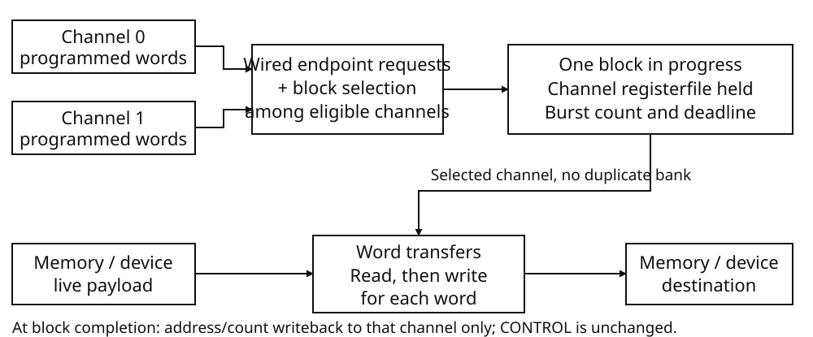

# Direct memory access {#sec-dma}

The DMA controller moves 32-bit words between memory and the console's
devices while the CPU is free for other work. Use it to copy memory, to send
command lists and image data to the GPU, to read images back from the GPU,
and to feed or empty the image decoder and the audio transfer port.

The controller has two identical channels and one transfer engine. The engine
moves words in bursts of up to 256 words. During a burst the CPU waits; the
other devices keep running. Between bursts the CPU runs normally, so a channel
that is waiting for a device does not hold up the CPU or the other channel.

## Specifications {#sec-dma-dma-specifications}

| Item | Specification |
|---|---|
| Channels | 2 (channel 0 and channel 1) |
| Registers | 6 words per channel |
| Transfer unit | 1 word (4 bytes, little-endian) |
| Transfer count | Up to 2^32^ − 1 words |
| Burst length | Up to 256 words |
| Routes | 8 (memory to memory, and memory to or from four devices) |
| Interrupts | IRQ_DMA0_DONE, IRQ_DMA1_DONE |
| Clock | 33,868,800 Hz |

## Routes {#sec-dma-routes}

The ROUTE field of CONTROL selects the source and the destination. Memory
addresses increase by four bytes per word. Device ports are fixed: the
program supplies only the memory-side address.

| ROUTE | Source | Destination | Address registers used |
|---:|---|---|---|
| 0 COPY | Memory | Memory | READ_ADDR, WRITE_ADDR |
| 1 TO_GPU | Memory | GPU GP0 | READ_ADDR |
| 2 FROM_GPU | GPU GPUREAD | Memory | WRITE_ADDR |
| 3 TO_IMGDEC | Memory | Image decoder input | READ_ADDR |
| 4 FROM_IMGDEC | Image decoder output | Memory | WRITE_ADDR |
| 5 IMGDEC_TO_GPU | Image decoder output | GPU GP0 | — |
| 6 TO_APU | Memory | APU transfer input | READ_ADDR |
| 7 FROM_APU | APU transfer output | Memory | WRITE_ADDR |

DMA can address system ROM, main RAM and the ROM, RAM and devices of either
cartridge. It cannot address the I/O area or main RAM from
[`RAM_END`](memory.md#sec-memory-language-heap) up; an address in either
area causes a bus fault. An address register that the route does not use
keeps its value.

{#fig-dma-transfer}

## Function {#sec-dma-follow-a-buffer-through-a-transfer}

Set the start address, the number of words and the route, then write START.
The channel transfers the words in order and then sets DONE.

For example, to copy a 20-word table from address S to address D, set
READ_ADDR to S, WRITE_ADDR to D, TRANSFER_COUNT to 20 and ROUTE to COPY. The
count is in words, not bytes. When the transfer is complete, READ_ADDR holds
S + 80, WRITE_ADDR holds D + 80 and TRANSFER_COUNT holds 0.

### Using the source and the result {#sec-dma-source-reuse-and-result-use}

DMA reads the source while it transfers. Do not change the source data until
DONE is set.

Each word is read before it is written, in ascending address order. When the
destination of a COPY overlaps the source at a higher address, the copied
words are therefore read again: copying with WRITE_ADDR = READ_ADDR + 4 fills
the whole destination with the first word.

DONE means that all words have been delivered. The receiving device then
processes them in its own time. To know when the GPU has finished drawing,
when the APU has stored its samples, or when a new picture is on the screen,
use that device's own status or interrupt.

## Setting example {#sec-dma-program-a-transfer}

1. Choose a channel that is not BUSY.
2. Set READ_ADDR and/or WRITE_ADDR as the route requires.
3. Set TRANSFER_COUNT and CONTROL.
4. Prepare the device (GPU DMA direction, decoder or APU transfer mode).
5. If the program polls the interrupt pending bit, clear it first.
6. Write START. BUSY is set.
7. Wait for DONE, or for the channel's interrupt.

While the channel is BUSY, writes to its configuration registers and further
START commands are ignored. A count of zero sets DONE immediately.

### Copying memory in BLua {#sec-dma-copy-words-in-blua}

The following example copies four words with channel 0 and polls DONE.

```lua
local flags<const>: *word = 0x08000000
local ack<const>: *word = 0x08000004
local mask<const>: *word = 0x08000008
local dma<const>: *word = 0x0800000c
data seed: word[4] = {0x01234567, 0x89abcdef, 0x55aa33cc, 0xf00dcafe}
bss received: word[4]

*mask = 0
*ack = 1                        -- Clear channel 0's pending bit.
dma[0] = seed                   -- READ_ADDR
dma[1] = received               -- WRITE_ADDR
dma[2] = 4                      -- TRANSFER_COUNT
dma[3] = 0                      -- CONTROL: COPY
dma[5] = 1                      -- TRIGGER: START
while (dma[4] & 2) == 0 do end  -- Wait for DONE.
*ack = 1
```

A memory-to-memory copy of this size completes in a single burst, during
which the CPU waits. DONE is often already set at the first status read.

### Sending a command list to the GPU {#sec-dma-send-a-command-stream-to-gp0}

Set READ_ADDR to the command list, TRANSFER_COUNT to its length in words and
CONTROL to 1 (TO_GPU). Set the GPU's DMA direction to FIFO or CPU_TO_GP0
before START.

A GPU command may be split across bursts; the GPU assembles it from the words
as they arrive. No padding or alignment is needed. To find out when the GPU
has executed the list, end it with a GPU IRQ command.

### Using both channels {#sec-dma-use-both-channels}

Both channels may be started at the same time. When both have words to move,
they take turns burst by burst. A typical use is to decode an image straight
into VRAM: start IMGDEC_TO_GPU on channel 1, start TO_IMGDEC on channel 0,
then start the decoder. Channel 0 feeds the decoder and channel 1 carries the
decoded words to the GPU as they become available.

The decoder supplies only the pixel data. Send the GPU image header
separately, as described in the [image decoder chapter](imgdec.md).

## Registers {#sec-dma-register-reference}

| Register | Channel 0 | Channel 1 | Access | Reset value |
|---|---|---|---|---:|
| READ_ADDR | `0800000CH` | `080103E4H` | R/W | 0 |
| WRITE_ADDR | `08000010H` | `080103E8H` | R/W | 0 |
| TRANSFER_COUNT | `08000014H` | `080103ECH` | R/W | 0 |
| CONTROL | `08000018H` | `080103F0H` | R/W | 0 |
| STATUS | `0800001CH` | `080103F4H` | R | 0 |
| TRIGGER | `08000020H` | `080103F8H` | W (reads 0) | 0 |

READ_ADDR, WRITE_ADDR and TRANSFER_COUNT advance as the transfer proceeds and
can be read back at any time. Writes to the first four registers are ignored
while the channel is BUSY. Writing STATUS causes a bus fault.

### CONTROL {#sec-dma-control-fields}

| Bits | Name | Function |
|---|---|---|
| 2–0 | ROUTE | Route number (see the route table) |
| 3 | READ_SLOT | Cartridge slot for the source: 0 or 1 |
| 4 | WRITE_SLOT | Cartridge slot for the destination: 0 or 1 |
| 31–5 | — | Stored; no function |

The slot bits apply only to cartridge addresses and are independent of the
CPU's slot selection. To copy from the ROM in slot 0 to the RAM in slot 1,
set CONTROL to `00000010H`; for the opposite direction use `00000008H`. See
[cartridge DMA](../book3/cartridge.md#sec-cartridge-dma-between-sockets).

### STATUS and TRIGGER {#sec-dma-status-and-trigger}

| STATUS bit | Name | Function |
|---:|---|---|
| 0 | BUSY | 1 from START until the transfer ends |
| 1 | DONE | 1 when all words have been transferred |
| 31–2 | — | 0 |

| TRIGGER bit | Name | Function |
|---:|---|---|
| 0 | START | Start the transfer |
| 1 | STOP | Stop the transfer, or clear DONE |
| 31–2 | — | Ignored |

If both bits are written as 1, STOP takes effect. STOP clears BUSY and DONE
and leaves the address and count registers as they are. It raises no
interrupt and does not clear a pending interrupt.

## Bursts and device requests {#sec-dma-requests-and-device-port-ownership}

A burst ends at 256 words, at the end of the transfer, when the device can
take or supply no more words, or at the boundary of a memory area. The
channel then waits until the device is ready and continues with the next
burst. A transfer may take any number of bursts.

| Endpoint | Words per burst |
|---|---|
| System ROM, main RAM, cartridge ROM and RAM | Up to the end of the memory area |
| Cartridge devices | Up to 16 while the cartridge requests DMA |
| GPU GP0 | 256 when the GPU's input buffer is empty |
| GPU GPUREAD | The remaining readback words |
| Image decoder input | The free space in the input FIFO |
| Image decoder output | The words of a finished output block |
| APU transfer input | 16 when the transfer FIFO is empty |
| APU transfer output | 16 when the transfer FIFO is full |

The address and count registers are updated at the end of each burst.

While a channel is BUSY, the device ports on its route belong to the channel.
A CPU read of GPUREAD or the decoder's DATA register in that time returns the
last value read and removes no data. A CPU write to such a port waits until
the channel has finished.

### Monitor entry {#sec-dma-supervisor-boundaries}

When the monitor is entered, a burst in progress is completed and no further
bursts start. The channels keep their register values and continue when the
program resumes.

## Interrupts and errors {#sec-dma-completion-and-interrupts}

When DONE is set, the channel's interrupt is requested: bit 0 (`00000001H`)
of the interrupt flags for channel 0 and bit 8 (`00000100H`) for channel 1.
The transfer takes place whether or not the interrupt is enabled. A new START
does not clear the pending bit of the previous transfer; clear it through the
interrupt acknowledge register.

A transfer to or from an invalid address causes a bus fault and continues to
the end. A word read from an invalid address is 0; a word written to one is
lost. See
[bus faults](memory.md) for the fault report.

If a device stops requesting words, for example after a decoder error, the
channel remains BUSY. Write STOP, then reset the device as described in its
chapter. STOP does not empty device FIFOs or withdraw words already delivered.

## Transfer timing {#sec-dma-transfer-timing-and-sharing-the-bus}

### Burst time {#sec-dma-calculating-a-blocks-charge}

A burst of N words takes the sum of the source time and the destination time:

| Source or destination | Cycles for N words |
|---|---:|
| Main RAM | N + 1 |
| System ROM | N |
| Cartridge ROM, RAM or device | 8N + 4 |
| GPU, image decoder or APU port | N |

### Transfer rates {#sec-dma-transfer-rates-by-route}

| Route | Cycles per burst | 256-word burst |
|---|---:|---:|
| RAM to RAM | 2N + 2 | 514 |
| System ROM to RAM | 2N + 1 | 513 |
| Cartridge ROM to RAM | 9N + 5 | 2309 |
| Cartridge to cartridge | 16N + 8 | 4104 |
| RAM to or from a device | 2N + 1 | 513 |
| System ROM to a device | 2N | 512 |
| Cartridge to or from a device | 9N + 4 | 2308 |
| Image decoder to GPU | 2N | 512 |

RAM to RAM moves about 16.9 million words (67 MB) per second. Bursts to the APU
and to cartridge devices are 16 words long. Time spent waiting for a device or
for the other channel adds to these figures.

### Example: transfers to and from VRAM {#sec-dma-budgeting-transfers-to-and-from-vram}

An 8×8 image upload consists of 3 header words and 32 pixel words. From main
RAM the 35 words take 71 cycles; from cartridge ROM they take 319 cycles.
Reading the same image back into RAM (32 words) takes 65 cycles. These
figures cover the transfer only, not the time the GPU needs to draw.
