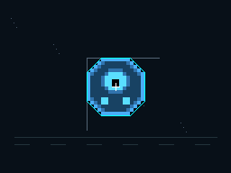
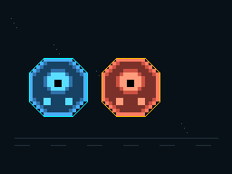
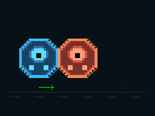
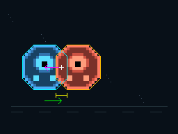
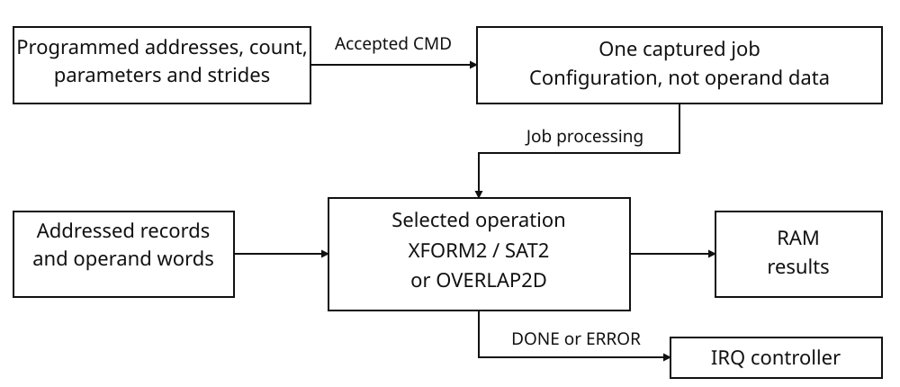

# Geometry batch unit {#sec-geo}

The geometry batch unit transforms two-dimensional vertex arrays and tests
shapes for intersection. A game can use it to place collision hulls in a common
world coordinate system, compare selected pairs and obtain overlap information
while the CPU performs other work. GEO reads the geometry supplied by the
program and writes results to main RAM. The GPU separately draws the images
that represent those objects.

The distinction is useful even when two objects share the same artwork. Their
collision hull can be stored once in local coordinates, then placed at each
object's world position. A pair test answers whether the placed hulls meet;
a contact query can additionally return a point representing their overlap.
The following drone scene carries these choices from geometry to job records
and displayed results.

## Geometry, placement and query results {#sec-geo-geometry-placement-and-query-results}

A collision shape describes the occupied region used by the calculation.
For a convex polygon, supply its perimeter vertices in order. A local vertex
list describes one shape; a placement puts an instance of that shape into the
coordinate system in which it will be compared with another object. The
visible sprite and the collision shape are separate program data.

An **axis-aligned bounding box**, or AABB, records the shape's least and
greatest X and Y coordinates. It encloses the shape in a rectangle aligned with
the coordinate axes. A polygon's box can overlap another box even when the
polygons themselves are separate. Bounds are therefore useful for rejecting
unpromising pairs before an exact polygon test, but overlapping bounds alone
do not establish a polygon contact.

Choose the operation according to the data already available and the required
result:

| Required operation | Program supplies | GEO returns |
|---|---|---|
| Place local vertices with `XFORM2_BATCH` | Vertex runs and affine matrices | Transformed vertices and optional bounds |
| Compare placed convex polygons with `SAT2_BATCH` | Pair records and vertices already in a common coordinate system | One hit/miss result per pair, with normal, overlap depth and selected edge |
| Find translated-shape contacts with `OVERLAP2D_PASS` | Local AABBs, convex polygons or compounds, their bounds, and translated instances | Packed contacts for strictly overlapping pairs, plus a summary |

XFORM2's output vertices can be SAT2's input without a coordinate conversion.
Its bounds output is separate: SAT2 tests the vertices, not the boxes.
OVERLAP2D instead reads binary32 shape data and applies each instance's
translation while querying it. The Q16 XFORM2 output is not an OVERLAP2D input
format.

Each command processes a batch described by memory records. A transform
record selects one vertex run; a SAT2 record selects one pair. For an OVERLAP2D
query, the program can supply candidate pairs or ask GEO to visit every
distinct pair in the instance array. The programmer retains the geometry and
receives results in addressed RAM; the command does not attach geometry to a
sprite or update the game's object positions.

## An authored sprite and its collision hull {#sec-geo-an-authored-sprite-and-its-collision-hull}

The following scene uses two copies of a 16 × 16 indexed drone sprite. Its
artwork determines the visible drone; a separately supplied convex hull
determines the shape used for collision calculations. The hull is a list of
coordinates, not a selection of the sprite's opaque pixels. Both instances
share this octagon, in the stated vertex order:

```
(4,0), (12,0), (16,4), (16,12),
(12,16), (4,16), (0,12), (0,4)
```

The sprite and hull share local origin `(0,0)`; the white cross marks their
center `(8,8)`. These poses use translation only. A remains at `(0,0)` while B
moves to `(20,0)`, `(16,0)` and `(12,0)`. Add the instance translation to each
local vertex to obtain its world coordinates.

{#fig-geo-scene-local}

**Local coordinates.** Gray axes start at the image origin. Cyan marks the
collision hull and the white cross marks `(8,8)`. The view maps local coordinates
to display pixels as `(96+4x,64+4y)`, placing the cross at `(128,96)`.

{#fig-geo-scene-plain}

**Artwork alone.** The drones share one texture against a star and lane
background. The world views use display coordinates `(32+4x,64+4y)`: positive X
runs right and positive Y down, at four pixels per world unit.

### Transform first, then test the resulting vertices {#sec-geo-transform-first-then-test-the-resulting-vertices}

Local coordinates describe the drone's shape independently of its position.
World coordinates place each copy in the scene, so that a comparison uses one
coordinate system for both objects. XFORM2 applies an affine matrix to make
that change. For these translation-only poses, its linear part is the identity:

```text
world x = local x + tx
world y = local y + ty
```

A uses `(tx,ty) = (0,0)`. For the overlapping pose, B uses `(12,0)`, so its
local vertex `(16,4)` becomes world vertex `(28,4)`. A's bounds remain
`(0,0,16,16)`; B's become `(12,0,28,16)`. The same local vertex list therefore
produces two different world-space hulls. XFORM2 can write both the transformed
vertices and their axis-aligned bounds.

SAT2 compares supplied vertices without applying a placement transform. It
must receive these world vertices, rather than two copies of the local list.
The transformation must finish first: GEO holds one active job, so submitting
SAT2 while XFORM2 is BUSY discards the transformation and rejects the new job.
Wait for successful transformation completion, then use its output as SAT2's
input. The [job procedure](#sec-geo-launching-and-observing-a-job) gives the exact
completion and fault checks.

### Three exact poses {#sec-geo-three-exact-poses}

Move B towards A while keeping A fixed. At X=20 there is a four-unit gap.
At X=16 the hulls share the segment from `(16,4)` to `(16,12)`. At X=12 their
horizontal projection intervals are `[0,16]` and `[12,28]`, with a four-unit
intersection. SAT2 tests the polygons' edge-normal axes; the horizontal axis
wins for the touching and overlapping poses.

A separating-axis test projects both polygons onto a line perpendicular to a
polygon edge. If their projection intervals are separate on any such axis,
the polygons cannot intersect. Otherwise SAT2 selects the smallest interval
overlap among the tested axes. In the X=12 pose, the horizontal intervals
intersect over `[12,16]`: four units along X. This is an overlap length on the
selected axis, not a point on either hull.

SAT2 returns a hit flag, the selected normal, its overlap depth and an edge
identifier. A touching pair is a hit with depth zero. These scene results are:

| B translation | B world bounds | SAT2 result in spatial units |
|---|---|---|
| `(20,0)` | `(20,0,36,16)` | No hit |
| `(16,0)` | `(16,0,32,16)` | Hit; normal `(1,0)`; depth 0 |
| `(12,0)` | `(12,0,28,16)` | Hit; normal `(1,0)`; depth 4 |

The selected edge is A's edge 2, `(16,4) → (16,12)`. For both hits, the normal
points from A towards B. It identifies a direction, not a contact location:
SAT2 returns no contact point. The raw result words are given with the
[drone job records](#sec-geo-encode-the-drone-jobs) below.

### A separate floating-point contact query {#sec-geo-a-separate-floating-point-contact-query}

Use OVERLAP2D when the required result includes an overlap point. It accepts
binary32 shape geometry and instance translations, rather than SAT2's fixed-point
world-vertex buffer. Both drone instances can share the local polygon and its
bounds `(0,0,16,16)`; their translations select the same three world poses.
An instance applies translation only. Rotation or scale requires separately
transformed binary32 geometry and matching bounds.

OVERLAP2D first uses the two instances' layer/mask fields to select permitted
comparisons, then compares their translated bounds before loading exact
geometry. Here both instances permit the pair. At B=(20,0), the bounds already
separate, so no exact polygon comparison is needed. At B=(16,0), the bounds
touch and permit an exact test; that test still finds no positive overlap.
At B=(12,0), the polygons overlap as well as their bounds.

Supply local bounds enclosing the shape and keep them consistent with any
change to its geometry. The query translates the supplied bounds; it does not
rebuild them from the vertices. Bounds that exclude part of the shape can
filter out a pair before those vertices are examined.

This query requires strictly positive overlap. The separated and touching
poses therefore produce no contact. The overlapping pose produces normal
`(-1,0)`, depth 4 and world point `(14,8)`. Its normal points from B towards A,
opposite to SAT2's convention in this scene. Piece indices are `0,0` and
feature 2 names the selected edge index, without SAT2's shape selector.

For this vertex order, the clipped intersection has six vertices. Their
arithmetic mean is `(14,8)`. The reported point is the world-space mean of
clipped vertices, rather than an area-weighted centroid or a boundary contact.
Supply the directed winding required by the clipping rule.

{#fig-geo-scene-separated}

**Separated.** Cyan identifies A's transformed hull; amber identifies B's. SAT2 reports no hit and OVERLAP2D reports no contact, so no arrow, contact cross or depth bracket is drawn.

{#fig-geo-scene-touching}

**Touching.** B's amber outline is drawn after A's cyan outline, making the shared segment amber. The green arrow shows SAT2's A-to-B normal. Its deliberately chosen 24-pixel length is 6 world units, not penetration depth. SAT2's depth is zero: no yellow bracket is drawn, and OVERLAP2D supplies no contact arrow or point cross.

{#fig-geo-scene-overlap}

**Overlapping.** The green SAT2 arrow points A-to-B from an illustrative anchor, not a reported point. The magenta OVERLAP2D arrow points B-to-A from the actual world contact point `(14,8)`, marked by the white cross at display pixel `(88,96)`. Both arrows are 24 pixels long for visibility, not depth measures. The yellow bracket below the hulls is the depth measure: its endpoints `(80,136)` and `(96,136)` are 16 pixels apart, representing 4 world units.

After reuse, trust the **current completed summary**, not retained contact bytes. The cartridge returns to separation using the same live contact buffer without clearing it. Its previous normal, depth, point and feature remain, but the new result count is zero, so no contact slot is valid and no old marker is submitted. The resulting picture is identical to the separated plate. SAT2 differs: separation overwrites all five result words with zero.

The program uses these completed query results to choose its next action and
to draw the explanatory overlays. Moving an object means changing the geometry
or instance translation supplied for its next query. GEO writes the requested
results; software submits the corresponding GPU drawing commands. The
[rendering notes](#sec-geo-from-geometry-results-to-video-packets) describe the
pictures' textures, coordinate mapping and display sequence.

## GEO specifications {#sec-geo-geo-specifications}

Choose a command according to the operation and coordinate representation:

| Command word | Operation | Coordinate representation | One outer record |
|---|---|---|---|
| 00000020H | XFORM2_BATCH | Signed Q16.16 | Transform a vertex span; optionally write its bounds |
| 00000021H | SAT2_BATCH | Signed Q16.16 | Test one supplied convex-polygon pair |
| 00000022H | OVERLAP2D_PASS | Binary32 | Test one candidate pair, or one full-pass outer instance |

| Resource | Specification |
|---|---|
| Programmed bank | Sixteen 32-bit words, 64 bytes, at 08000024H…08000060H |
| Local fault acknowledgement | Separate word at 08010224H; not the next bank word |
| Active job capacity | One captured job; no command FIFO |
| COUNT / PROCESSED | Full unsigned 32-bit outer-record counts |
| XFORM2 span / SAT2 polygon | At most 64 vertices |
| OVERLAP2D polygon / clipping workspace | At most 64 input vertices / 128 clipping vertices |
| Installed main RAM | 4 MiB; addressed operand and result storage, not a private GEO payload buffer |
| Assigned GEO workspace | 512 KiB of main RAM at 08040000H…080BFFFFH; not an automatic operand destination |
| System-cycle timebase | 33,868,800 cycles/s |
| Outer-record processing rate | 16,384,000 outer records/s |

Program source and destination addresses explicitly. The assigned workspace
is available in main RAM; commands use the addresses supplied by the program.
Record sizes and operation-specific limits appear in the command reference.

{#fig-geo-job}

A command latches addresses, counts, parameters and strides. Processing then
reads the addressed records and writes their results. OVERLAP2D clears its
summary when the command is accepted. A zero-count job completes at launch
without processing a record.

XFORM2 and SAT2 share their fixed-point vertex representation. OVERLAP2D
requires separately prepared binary32 geometry. The [GTE](gte.md#sec-gte)
provides register-fed transformation and projection arithmetic; GEO instead
processes addressed records and geometry. Software constructs the subsequent
[GPU](gpu.md#sec-gpu) packets from the results.

## Launching and observing a job {#sec-geo-launching-and-observing-a-job}

A write to `CMD` is the launch doorbell. Writing the source, destination, count, parameter, or stride registers only changes the programmed register words; it does not begin processing. Submit a job in this order:

1. Read `STATUS`. Do not write `CMD` while `BUSY` is set: that write terminates the running job rather than waiting for it.
2. If `ERROR` or `REJECTED` is set, inspect `FAULT` and `PROCESSED`, then acknowledge the local fault before submitting another job.
3. Prepare the command's records and payloads in memory. Program every register required by that command, including `COUNT`.
4. Write the complete command word to `CMD` once.
5. Observe `STATUS`, or use the central GEO interrupt sources. Read `PROCESSED` and `FAULT` to distinguish successful completion, execution failure, and rejection.

There is one active job and no command queue. `DONE` does not require a local acknowledgement before the next launch. An accepted launch clears the previous `STATUS`, `PROCESSED`, and `FAULT` before proceeding.

| State before the `CMD` write | Effect of the write |
|---|---|
| Idle or `DONE` | A supported complete command word starts a new job. Any other command word produces `REJECT_BAD_CMD`. |
| `BUSY` | The active job is discarded and `REJECT_BUSY` is reported. The new command is not launched. |
| `ERROR` or `REJECTED` | No new job is launched. The first fault, status, and progress remain unchanged until local fault acknowledgement. |

Every `CMD` write changes its raw readback, including a write ignored because a fault is still latched. Reading `CMD` therefore identifies the last word written, not necessarily the command that produced the current result. The supported complete words are `XFORM2_BATCH = 20H`, `SAT2_BATCH = 21H`, and `OVERLAP2D_PASS = 22H`. These are whole-word encodings, not independent command bits. Extra set bits do not retain the meaning of a supported command.

### Captured operands and live memory {#sec-geo-captured-operands-and-live-memory}

At launch, GEO captures `CMD`, all three source words, both destination words, `COUNT`, both parameter words, and all three stride words. Subsequent writes to these registers change their readback and the configuration available to a later launch. They do not redirect or resize the active job. In particular, reading `COUNT` during processing returns the programmed word, which may differ from the count captured by that job; use `PROCESSED` for published progress.

Launch does not capture the payload bytes. Records and their referenced data are read from memory as processing reaches them. Keep an active job's input memory stable when a consistent batch is required. Changing a register and changing the memory addressed by a captured register are different actions: only the latter can change data still to be read by that job.

Command acceptance checks the complete opcode, not the record pointers, strides, parameters, alignment, flags, or payload shape. Those checks belong to the selected operation when it processes a record. A supported command with `COUNT = 0` completes immediately without processing a record; it is not a way to validate a record layout or payload. An unsupported command is still rejected when `COUNT = 0`.

`OVERLAP2D_PASS` has a launch side effect: after command acceptance, GEO writes four zero summary words at `DST1 + 0`, `+4`, `+8`, and `+12`. This happens before testing `COUNT`, including for a zero-count job. No launch-time destination validation precedes those summary writes. Program `DST1` for this operation even when no outer records will run.

### Encode and submit the drone jobs {#sec-geo-encode-the-drone-jobs}

The geometry above determines the operands. XFORM2 and SAT2 use signed Q16.16
coordinates: the signed value of each 32-bit word divided by 65536. The integer
coordinates here are encoded exactly by multiplying by 65536. An affine matrix
contains `m00, m01, tx, m10, m11, ty`. Each drone matrix has the form
`[00010000H,0,tx,0,00010000H,0]`, with the X translation selected for its pose.

Store one local eight-vertex hull, two matrices, and these XFORM2 records. Fields are `flags, source_index, destination_index, matrix_index, vertex_count, bounds_index`:

```
[0, 0, 0, 0, 8, 0]
[0, 0, 8, 1, 8, 1]
```

They share the local hull and write A's eight world vertices followed by B's: 128 bytes altogether, plus two 16-byte Q16 bounds records. `source_index` is multiplied by STRIDE1; vertices within a hull are consecutive eight-byte records. `destination_index` is a vertex index, not a byte offset.

For XFORM2, set SRC0=records, SRC1=local vertices, SRC2=matrices, DST0=world vertices, DST1=bounds, COUNT=2 and strides `24,8,24`; submit CMD=`20H` after setup.

SAT2 must consume **that completed world buffer**. Its descriptors contain `flags`, `vertex_count`, `vertex_offset_bytes`, `reserved`:

```
A: [1, 8, 0, 0]
B: [1, 8, 64, 0]
```

The pair is `[0,0,0,1,0]`, in field order `flags, shape_a, result_index, shape_b, flags2`. Set SRC0=pair, SRC1=descriptors, SRC2=XFORM2's world buffer, DST0=20-byte result, COUNT=1, STRIDE0=20 and STRIDE1=16; submit CMD=`21H`.

Retain XFORM2's records, local hull and matrices until completion. For this
job, successful completion gives STATUS=2, FAULT=0 and PROCESSED=2. Then submit
SAT2, retaining its pair, descriptors and world vertices until it completes with
STATUS=2, FAULT=0 and PROCESSED=1. Read the results before reusing the buffers.

A's world bounds remain `(0,0,16,16)`. SAT2 returns `hit, nx, ny, depth, meta`; normal and depth words are Q16.16.

| Pose | B translation word | B world bounds | SAT2 result words |
|---|---|---|---|
| Separated | `00140000H` | `(20,0,36,16)` | `(0,0,0,0,0)` |
| Touching | `00100000H` | `(16,0,32,16)` | `(1,00010000H,0,0,2)` |
| Overlapping | `000C0000H` | `(12,0,28,16)` | (`1`, `00010000H`, `0`, `00040000H`, `2`) |

Metadata 2 selects A's edge 2, the directed segment `(16,4) → (16,12)`. SAT2 packs the shape selector into the high 16 bits and edge index into the low 16 bits; flipping the normal does not change that identity. SAT2 supplies no contact point.

#### Encode the contact query {#sec-geo-encode-the-contact-query}

Prepare the local vertices and bounds as binary32 numbers, separately from the
Q16 arrays. Both instances use the same shape descriptor; their F32 translations
are `(0,0)` and the selected B position. The following configuration uses one
explicit candidate pair.

The 96-byte polygon object has kind=3, count=8, data offset=32 and bounds offset=16, with offsets relative to its descriptor. Both instances use layer=mask=1. The candidate is `[0,1,44524F4EH]`; its final word is cartridge-supplied pair information, not a computed feature. Set SRC0=instances, SRC1=candidate, DST0=36-byte contact storage, DST1=16-byte summary, COUNT=1, PARAM0=1, PARAM1=1 and strides `20,12,2`; submit CMD=`22H`.

The completed summary is `result_count, exact_pairs, broadphase_pairs, flags`:

| Pose | Summary | Valid contact |
|---|---|---|
| Separated | `(0,0,1,0)` | None |
| Touching | `(0,1,1,0)` | None |
| Overlapping | `(1,1,1,0)` | Normal `(-1,0)`, depth 4, world point `(14,8)` |

Only `result_count` contact records are valid. The other summary counts report
which filtering and exact-test stages were reached; the
[contact-pass reference](#sec-geo-overlap2d_pass-translated-shape-contacts)
defines them and the packed result layout.

### Transform the drone hulls and pass them to SAT2 {#sec-geo-transform-two-squares-and-pass-them-to-sat2}

This fragment starts with GEO idle, no sticky fault and interrupt delivery
masked. It owns GEO and uses the drone octagon in the overlapping pose:
A at `(0,0)`, B at `(12,0)`. The two jobs share the **same RAM vertex buffer**;
no coordinate conversion or copying separates XFORM2 and SAT2. All array values
are complete words in the command layouts below.

```lua
local geo<const>: *word = 0x08000024
local irq_ack<const>: *word = 0x08000004
rodata hull: word[16] = {
    0x00040000, 0, 0x000c0000, 0,
    0x00100000, 0x00040000, 0x00100000, 0x000c0000,
    0x000c0000, 0x00100000, 0x00040000, 0x00100000,
    0, 0x000c0000, 0, 0x00040000,
}
rodata matrices: word[12] = {
    0x00010000, 0, 0, 0, 0x00010000, 0,
    0x00010000, 0, 0x000c0000, 0, 0x00010000, 0,
}
rodata transforms: word[12] = {
    0, 0, 0, 0, 8, 0,
    0, 0, 8, 1, 8, 1,
}
rodata pair: word[5] = { 0, 0, 0, 1, 0 }
rodata shapes: word[8] = { 1, 8, 0, 0, 1, 8, 64, 0 }
bss vertices: word[32]
bss bounds: word[8]
bss pair_result: word[5]

geo[0] = transforms                  -- SRC0: two 24-byte records
geo[1] = hull                        -- SRC1: shared local vertices
geo[2] = matrices                    -- SRC2: two 24-byte matrices
geo[3] = vertices                    -- DST0: sixteen world vertices
geo[4] = bounds                      -- DST1: two 16-byte bounds
geo[5] = 2                           -- COUNT
geo[11] = 24                         -- STRIDE0
geo[12] = 8                          -- STRIDE1: run-selection step
geo[13] = 24                         -- STRIDE2: matrix step
geo[6] = 0x20                        -- CMD: XFORM2_BATCH
while (geo[8] & 1) ~= 0 do           -- STATUS.BUSY
end
```

Successful completion gives STATUS=2, PROCESSED=2 and FAULT=0. The world
vertices describe A's unchanged octagon and B's copy translated by `(12,0)`.
Their bounds are (`0`, `0`, `00100000H`, `00100000H`) and
(`000C0000H`, `0`, `001C0000H`, `00100000H`). If ERROR or REJECTED is set,
use the fault/recovery reference rather than launching the dependent job.
Continue after successful completion:

```lua
geo[0] = pair                        -- SRC0: one pair record
geo[1] = shapes                      -- SRC1: two descriptors
geo[2] = vertices                    -- SRC2: completed XFORM2 output
geo[3] = pair_result                 -- DST0: one five-word SAT2 result
geo[5] = 1
geo[11] = 20                         -- Pair-record bytes
geo[12] = 16                         -- Descriptor bytes
geo[6] = 0x21                        -- CMD: SAT2_BATCH
while (geo[8] & 1) ~= 0 do
end
*irq_ack = 0x00000018                -- Acknowledge owned central sources
```

The descriptor offsets 0 and 64 are **bytes**, not vertex indices. SAT2 ignores
DST1, PARAM0, PARAM1 and STRIDE2, so the previous values need not be rewritten.
Successful completion gives STATUS=2, PROCESSED=1, FAULT=0 and result words
`1,00010000H,0,00040000H,2`: hit, +X unit normal, depth 4, A's edge 2.
The interrupt acknowledgement does not acknowledge a sticky local fault.

### Contact-pass modes and fault recovery {#sec-geo-extend-the-sequence-to-a-contact-query-or-fault-recovery}

The drone contact query above shows one candidate pair. To compare candidate
and full-pass settings with minimal shape data, the following separate case
uses two axis-aligned squares of side 4 at `(0,0)` and `(1,1)`. Prepare binary32
shapes and instances, rather than using the Q16 vertex array. Use kind 1
descriptors with bounds `(0,0,4,4)`, layer=mask=1, and candidate words `[0,1,12345678H]`.
Program the following words, then issue CMD=22H and wait until STATUS.BUSY clears:

| Register | Candidate mode | Full-pass mode over the same two instances |
|---|---|---|
| SRC0 | Address of the two 20-byte instances | Same |
| SRC1 | Address of the 12-byte candidate | 0; unused |
| DST0 | Address of at least one 36-byte contact | Same |
| DST1 | Address of a writable 16-byte summary | Same |
| COUNT | 1 | 2 |
| PARAM0 / PARAM1 | 1 / 1 | 2 / 1 |
| STRIDE0 / STRIDE1 / STRIDE2 | 20 / 12 / 2 | 20 / 0 / 0 |

Both modes produce normal `(0,−1)`, depth 3 and world contact `(2.5,2.5)`;
piece indices and feature are zero. The normal points **B to A**, unlike SAT2.
Both summaries are `(1,1,1,0)`. Candidate mode retains pair information
12345678H; full-pass mode generates 1 for pair `(0,1)`. PROCESSED is respectively
1 and 2: even the last full-pass instance consumes an outer record.

#### Recover after a failed record {#sec-geo-recover-after-a-failed-record}

To see the fault boundary, substitute an XFORM2 record whose flags word is 1,
set COUNT=1 and CMD=20H. It produces STATUS=6, PROCESSED=0 and
FAULT=00080000H before fetching vertices or a matrix. Acknowledge the local
fault, then submit an empty job:

```lua
local fault_ack<const>: *word = 0x08010224
*fault_ack = 1                       -- Clear sticky FAULT; STATUS becomes 2
*irq_ack = 0x00000010                -- Separate GEO_ERROR acknowledgement
geo[5] = 0
geo[6] = 0x20
```

The zero-count job immediately completes with STATUS=2, PROCESSED=0 and
FAULT=0 without reading the still-programmed bad record. It raises GEO_DONE;
acknowledge central bit 3 separately when that request is no longer needed.
No recovery step erases the earlier RAM results.

## Register reference {#sec-geo-register-reference}

| Offset | Address | Register | Access | Reset | Word interpretation |
|---|---|---|---|---|---|
| `+00H` | `08000024H` | `SRC0` | RW | `0` | Full 32-bit captured source word; command-specific meaning. |
| `+04H` | `08000028H` | `SRC1` | RW | `0` | Full 32-bit captured source word; command-specific meaning. |
| `+08H` | `0800002CH` | `SRC2` | RW | `0` | Full 32-bit captured source word; command-specific meaning. |
| `+0CH` | `08000030H` | `DST0` | RW | `0` | Full 32-bit captured destination word; command-specific meaning. |
| `+10H` | `08000034H` | `DST1` | RW | `0` | Full 32-bit captured destination word; command-specific meaning. |
| `+14H` | `08000038H` | `COUNT` | RW | `0` | Unsigned 32-bit outer-record count, captured at launch. |
| `+18H` | `0800003CH` | `CMD` | RW | `0` | Whole-word launch doorbell: `20H`, `21H`, or `22H`. Other complete words reject when launch is permitted. |
| `+1CH` | `08000040H` | `CTRL` | RW | `0` | Bit 0: self-clearing `ABORT` pulse. Bits 31:1 retain the written bits and define no further controller action. |
| `+20H` | `08000044H` | `STATUS` | RO | `0` | Bit 0 `BUSY`; bit 1 `DONE`; bit 2 `ERROR`; bit 3 `REJECTED`. No further status bits are defined. |
| `+24H` | `08000048H` | `PARAM0` | RW | `0` | Full 32-bit captured parameter word; command-specific meaning. |
| `+28H` | `0800004CH` | `PARAM1` | RW | `0` | Full 32-bit captured parameter word; command-specific meaning. |
| `+2CH` | `08000050H` | `STRIDE0` | RW | `0` | Full 32-bit captured stride word; command-specific meaning. |
| `+30H` | `08000054H` | `STRIDE1` | RW | `0` | Full 32-bit captured stride word; command-specific meaning. |
| `+34H` | `08000058H` | `STRIDE2` | RW | `0` | Full 32-bit captured stride word; command-specific meaning. |
| `+38H` | `0800005CH` | `PROCESSED` | RO | `0` | Full 32-bit number of completed outer records. |
| `+3CH` | `08000060H` | `FAULT` | RO | `0` | Bits 31:16: fault code. Bits 15:0: failing outer-record index, or rejection sentinel `FFFFH`. |
| Separate | `08010224H` | `FAULT_ACK` | RW | `0` | Zero write does nothing. Any nonzero write acknowledges the local fault and immediately returns readback to zero; no individual acknowledgement bit is assigned. |

The bank begins at `08000024H` and occupies 16 consecutive 32-bit words. The table offsets are relative to that address. All bank words and the separate `FAULT_ACK` word reset to zero. Use aligned, mapped 32-bit accesses. The [CPU alignment check](memory.md#sec-memory-width-and-alignment) precedes mapped I/O; an ordinary misaligned word load or store takes an address-error exception. Mapped byte or halfword writes fault without operating the register. A mapped write to a read-only GEO word raises the memory `READ_ONLY` bus fault and does not change that word.

Writable configuration words retain and read back all written bits, including
those unused by the selected command. `CMD` also retains its complete written
word. `CTRL` retains the written word except that bit 0 is cleared whenever
written as one; it has no start, interrupt-enable, or reset bit.

GEO's RAM data path accesses bytes directly, including RAM at addresses
reserved for CPU I/O. Writing a GEO result there changes the underlying RAM
rather than operating an I/O register. Apply each command's range rules when
allocating buffers, and keep results out of memory reserved for other uses.

## Processing rate and timing {#sec-geo-work-budget-and-timing}

GEO processes outer records at a rate of 16,384,000 records/s against the
33,868,800-Hz system timebase. Each attempted outer record, including one that
faults, uses the same timing budget. XFORM2 counts one record per vertex span,
SAT2 one per supplied pair, and OVERLAP2D one per candidate or full-pass outer
instance.

The work within a record adds no separate charge. In particular, an OVERLAP2D
full-pass record can test several pairs and produce several contacts. Use the
outer-record count, rather than vertex or contact count, for this timing budget.

The rate is `16,384,000 / 33,868,800 = 640 / 1323` outer records per system
cycle. Timing begins anew at each accepted launch; idle time does not shorten
a later job. The processing budget for `N > 0` attempted outer records is
`ceiling(N × 1323 / 640)` system cycles:

| Attempted outer records | System-cycle budget |
|---|---|
| 1 | 3 |
| 2 | 5 |
| 4 | 9 |
| 16 | 34 |
| 64 | 133 |
| 640 | 1323 |

The table covers GEO processing. CPU setup and interrupt handling add to an
operation's elapsed time; a fault, abort or rejection can terminate it early.
The processing rate is fixed.

COUNT accepts the full unsigned 32-bit range. Per-record limits still apply:
64 vertices for an XFORM2 span or SAT2/OVERLAP polygon, and 128 clipping vertices
in OVERLAP2D.

## Completion, faults, and recovery {#sec-geo-completion-faults-and-recovery}

Each successful outer record increments `PROCESSED` by one. Successful completion publishes `STATUS = 2H` (`DONE` only), the completed count, and `FAULT = 0`, then raises `GEO_DONE`.

An execution fault publishes `STATUS = 6H` (`DONE | ERROR`) and raises `GEO_ERROR`. The failing record is not added to `PROCESSED`. `FAULT` contains its zero-based outer-record index in bits 15:0 and the fault code in bits 31:16. The index is truncated to 16 bits independently of the full-width count and progress words. Preserve `PROCESSED` when diagnosing a large batch; the fault word alone does not retain the index's high bits.

A rejected submission publishes `STATUS = 8H` (`REJECTED` without `DONE`), resets `PROCESSED` to zero, and uses fault index `FFFFH`. It raises `GEO_ERROR`. Rejection during `BUSY` discards the active job even if some records had already completed. Neither rejection nor execution failure rolls back output memory already written.

| Fault code | Name |
|---|---|
| `0001H` | `ABORTED` |
| `0002H` | `BAD_RECORD_ALIGNMENT` |
| `0003H` | `BAD_VERTEX_COUNT` |
| `0004H` | `SRC_RANGE` |
| `0005H` | `DST_RANGE` |
| `0006H` | `DESCRIPTOR_KIND` |
| `0007H` | `NUMERIC_OVERFLOW_INTERNAL` |
| `0008H` | `BAD_RECORD_FLAGS` |
| `0009H` | `RESULT_CAPACITY` |
| `8001H` | `REJECT_BUSY` |
| `8002H` | `REJECT_BAD_CMD` |

The command reference below identifies which conditions produce each fault.

To stop a busy job, write `CTRL` with bit 0 set. `ABORT` terminates it with `DONE | ERROR`, code `ABORTED`, and the current completed-record index. Earlier outputs remain. The pulse clears itself. In idle or `DONE`, it changes no job result. With `ERROR` or `REJECTED` already latched, it cannot replace the first fault.

After inspecting a fault, write any nonzero word to `FAULT_ACK`. This clears `ERROR`, `REJECTED`, and `FAULT`; it preserves `DONE`, `BUSY`, and `PROCESSED`. An execution-error result consequently becomes `DONE`; a rejection becomes idle. A zero write has no effect. Acknowledgement never resumes the discarded job.

Local fault acknowledgement and central interrupt acknowledgement are separate. `GEO_DONE` uses central bit 3 (`8H`); `GEO_ERROR` uses bit 4 (`10H`). Success raises only the done source; execution fault, abort, and rejection raise only the error source. Pending sources are recorded regardless of masking. The central IRQ registers are `FLAGS` at `08000000H`, `ACK` at `08000004H`, and `MASK` at `08000008H`. Clear a pending source by writing its one bit to central `ACK`; that write leaves other pending sources untouched. Central `ACK` then reads zero. Masking a source does not clear it. `FAULT_ACK` does not clear central pending bits, and central acknowledgement does not release a sticky GEO fault. Use the interrupt-controller chapter for CPU interrupt entry.

GEO reset discards the active job, returns to idle, and zeroes all 16 bank words and `FAULT_ACK`. It does not itself clear central IRQ pending state; full device reset resets the interrupt controller separately. No GEO register write provides a reset operation.

## XFORM2_BATCH: transform vertices and build bounds {#sec-geo-xform2_batch-transform-vertices-and-build-bounds}

Command word: **20H**.

XFORM2_BATCH applies one affine matrix to each selected run of two-dimensional vertices. Each record selects its source run, matrix, destination run and, optionally, an axis-aligned bounding box (AABB).

### Registers and address selection {#sec-geo-registers-and-address-selection}

| Register | XFORM2_BATCH role |
|---|---|
| SRC0 | Transformation-record table base |
| STRIDE0 | Byte step between transformation records |
| SRC1 | Local-vertex data base |
| STRIDE1 | Byte step used to select a source run; not the step between its vertices |
| SRC2 | Matrix-table base |
| STRIDE2 | Byte step between selectable matrices |
| DST0 | Transformed-vertex output base; vertices occupy 8 bytes each |
| DST1 | AABB output base; boxes occupy 16 bytes each |
| COUNT | Number of transformation records |
| PARAM0, PARAM1 | Ignored |

For record ordinal `n`, beginning at zero, the selected addresses are:

| Object | Address | Size accessed |
|---|---|---|
| Record | `SRC0 + n × STRIDE0` | 24 bytes |
| Source run | `SRC1 + src_index × STRIDE1` | `vertex_count × 8` bytes |
| Matrix | `SRC2 + aux_index × STRIDE2` | 24 bytes |
| Output run | `DST0 + dst_index × 8` | `vertex_count × 8` bytes |
| AABB | `DST1 + dst1_index × 16` | 16 bytes, unless suppressed |

Thus `dst_index` counts vertices, while `dst1_index` counts boxes. The source vertices within a run are consecutive 8-byte records. Neither a field in the record nor a destination index changes the batch record ordinal.

### Record and data layouts {#sec-geo-record-and-data-layouts}

All offsets and strides below are in **bytes**. Each word occupies four little-endian bytes. Index, count and flags words are unsigned. Signed Q16 words represent the signed 32-bit word divided by 65536; the same representation is used for coordinates, matrix coefficients, translations and bounds.

**Transformation record — 24 bytes**

| Offset | Word | Meaning |
|---|---|---|
| +0 | flags | Must be zero |
| +4 | src_index | Source-run index, scaled by STRIDE1 |
| +8 | dst_index | Output-vertex index, scaled by 8 |
| +12 | aux_index | Matrix index, scaled by STRIDE2 |
| +16 | vertex_count | Number of consecutive vertices; 0–64 |
| +20 | dst1_index | AABB index, scaled by 16; `FFFFFFFFH` suppresses the box |

The `FFFFFFFFH` value is special only in `dst1_index`: it suppresses both AABB address checking and writing. No equivalent sentinel applies to the other indices. A zero vertex count succeeds after the record and flags checks, without checking or accessing the source run, matrix, vertex output or AABB.

| Data object | Size | Word offsets and contents |
|---|---|---|
| Vertex | 8 bytes | +0: x; +4: y, both signed Q16 |
| Matrix | 24 bytes | +0: m00; +4: m01; +8: tx; +12: m10; +16: m11; +20: ty, all signed Q16 |
| AABB | 16 bytes | +0: min_x; +4: min_y; +8: max_x; +12: max_y, all signed Q16 |

### Transformation arithmetic {#sec-geo-transformation-arithmetic}

The matrix's linear part rotates, scales or shears the supplied coordinates;
`tx` and `ty` then translate them. In spatial units, its two rows express:

```text
world x = m00 × local x + m01 × local y + tx
world y = m10 × local x + m11 × local y + ty
```

The following rules define the fixed-point products, rounding and saturation
of that operation. Using the signed **raw words**, a row `(a, b, t)` is evaluated
as follows:

1. Form the exact signed 64-bit products `a × x` and `b × y`.
2. Add those products, saturating the sum to the signed 64-bit range.
3. Add `t × 65536`, again saturating to signed 64-bit range.
4. Shift arithmetically right by 16 bits, then saturate to signed 32-bit range.

The first row is `(m00, m01, tx)` and the second is `(m10, m11, ty)`. Saturation does not wrap, and arithmetic overflow does not raise a numeric-overflow fault. The shift is not round-to-nearest: a negative fractional raw unit rounds downward. For example, raw `a = -1`, `x = 1`, with the other terms zero, produces raw `-1` (`FFFFFFFFH`), not zero. An identity x coefficient with a +1 translation applied to raw `2147483647` remains `2147483647` through saturation.

The matrix is read before processing the vertices. Vertices are then read and written in ascending order, with each source vertex read immediately before its output x and y are written. Bounds are formed from the saturated output words, initialized from the first vertex, and written only after all vertices: min_x, min_y, max_x, max_y. Overlapping source and output storage is not prohibited or copied aside; an earlier output can change a later source read. The already-read matrix is unaffected.

### Address and memory rules {#sec-geo-address-and-memory-rules}

These rules also apply to SAT2_BATCH below. For a nonempty indexed span, the byte displacement, base-plus-displacement and span end must not overflow the 32-bit address space. A span end exactly `100000000H` passes this arithmetic check. A zero stride is permitted and repeatedly selects the same address.

Every input span must lie wholly within one readable region: the system-ROM window `00000000H–00FFFFFFH`, installed main RAM beginning at `08000000H`, or the cartridge-bus window `10000000H–30FFFFFFH`. The cartridge window is not a promise of ROM at every address; it includes cartridge RAM and device mappings. System-ROM reads beyond the populated contents, but within its window, return zero. Output spans must lie wholly in installed main RAM. The RAM checks do not exclude its I/O-address window, and these word transfers do not invoke mapped-I/O handling.

XFORM2_BATCH imposes no separate word-alignment check on these addresses or strides. In particular, the fault name BAD_RECORD_ALIGNMENT must not be read as an additional alignment requirement.

### Fault priority and output preservation {#sec-geo-fault-priority-and-output-preservation}

The first applicable entry below determines the current record's fault. All checks precede output writes; a failed record writes neither vertices nor its AABB.

| Priority | Condition | Fault word |
|---|---|---|
| 1 | Record address/span overflows | 2 — BAD_RECORD_ALIGNMENT |
| 2 | Record span is not readable | 4 — SRC_RANGE |
| 3 | flags is nonzero | 8 — BAD_RECORD_FLAGS |
| 4 | vertex_count is zero | Success; no further checks or writes |
| 5 | vertex_count exceeds 64 | 3 — BAD_VERTEX_COUNT |
| 6 | Source-run span overflows or is not readable | 4 — SRC_RANGE |
| 7 | Matrix span overflows or is not readable | 4 — SRC_RANGE |
| 8 | Vertex-output span overflows or is outside installed main RAM | 5 — DST_RANGE |
| 9 | Unsuppressed AABB span overflows or is outside installed main RAM | 5 — DST_RANGE |

### Worked transformation {#sec-geo-worked-transformation}

Take four local vertices `(0,0), (4,0), (4,4), (0,4)`. Their raw words use `4 = 262144`. Matrix 0 is identity with zero translation; matrix 1 is identity with `tx = ty = 65536`, translating by `(1,1)`.

| Record | flags | src_index | dst_index | aux_index | vertex_count | dst1_index |
|---|---|---|---|---|---|---|
| 0 | 0 | 0 | 0 | 0 | 4 | 0 |
| 1 | 0 | 0 | 4 | 1 | 4 | 1 |

The first output run is unchanged. The second starts 32 bytes after DST0 and contains `(1,1), (5,1), (5,5), (1,5)`. For example, its x coordinate for input `(4,0)` is raw `327680`, representing 5. The AABB words are `(0,0,262144,262144)` and `(65536,65536,327680,327680)` respectively. These eight consecutive output vertices can also supply the two SAT2 shapes below.

## SAT2_BATCH: test convex-polygon pairs {#sec-geo-sat2_batch-test-convex-polygon-pairs}

Command word: **21H**.

SAT2_BATCH tests pairs of polygon descriptors using their edge normals as separating axes. It returns a hit flag, selected normal, interval-overlap depth and the edge that supplied that axis. Polygon coordinates are signed Q16 words in one common coordinate space; SAT2 does not transform them.

### Registers and layouts {#sec-geo-registers-and-layouts}

| Register | SAT2_BATCH role |
|---|---|
| SRC0, STRIDE0 | Pair-table base and byte step between pair records |
| SRC1, STRIDE1 | Shared descriptor-table base and byte step for both shape indices |
| SRC2 | Shared vertex-pool base |
| DST0 | Result-table base; each result occupies 20 bytes |
| COUNT | Number of pair records |
| DST1, PARAM0, PARAM1, STRIDE2 | Ignored |

| Object | Address | Size |
|---|---|---|
| Pair n | `SRC0 + n × STRIDE0` | 20 bytes |
| Descriptor A/B | `SRC1 + shape_A/B_index × STRIDE1` | 16 bytes each |
| Vertex run A/B | `SRC2 + vertex_offset_bytes` | `vertex_count × 8` bytes each |
| Result | `DST0 + result_index × 20` | 20 bytes |

A descriptor's vertex offset counts **bytes**, not vertices. Vertices are consecutive x/y records in the same 8-byte format as XFORM2. All pair and descriptor fields are unsigned words, with no index sentinel.

**Pair record — 20 bytes**

| Offset | Word | Requirement or unit |
|---|---|---|
| +0 | flags | Must be zero |
| +4 | shape_A_index | Descriptor index, scaled by STRIDE1 |
| +8 | result_index | Result index, scaled by 20 |
| +12 | shape_B_index | Descriptor index, scaled by STRIDE1 |
| +16 | flags2 | Must be zero |

**Polygon descriptor — 16 bytes**

| Offset | Word | Requirement or unit |
|---|---|---|
| +0 | flags | Exactly 1: convex polygon |
| +4 | vertex_count | 3–64 |
| +8 | vertex_offset_bytes | Byte offset from SRC2; divisible by 4 |
| +12 | reserved | Must be zero, not ignored |

There is no separate alignment test for pair, descriptor or result addresses. The vertex-offset test checks the offset alone, not the final address or an 8-byte boundary. No winding, convexity, area, distinct-vertex or topology check is performed.

**Result — 20 bytes**

| Offset | Word | Interpretation |
|---|---|---|
| +0 | hit | Unsigned 0 or 1 |
| +4 | nx | Signed Q16 normal x component |
| +8 | ny | Signed Q16 normal y component |
| +12 | depth | Signed Q16 overlap depth |
| +16 | meta | Shape selector in high 16 bits; zero-based edge index in low 16 bits |

The selector is 0 for A and 1 for B; edge indices are 0–63. There are no hit or normal-sign bits in meta.

### Axis selection and arithmetic {#sec-geo-axis-selection-and-arithmetic}

Axes are visited in A edge order, then B edge order, including each closing edge back to vertex 0. An edge from `(x0,y0)` to `(x1,y1)` supplies the perpendicular `(-(y1-y0), x1-x0)`, normalized by its Euclidean length. Zero-length edges are skipped. Axes are not deduplicated; up to 128 candidate edges may be visited.

Edge differences, normalization and projections use double-precision floating-point arithmetic on signed coordinate raw words, without a Q16 product shift. Each projection is `x × axis_x + y × axis_y`; every vertex contributes to the interval minimum and maximum. An axis separates only when `A.min > B.max` or `B.min > A.max`. The first separating axis writes five zero words and finishes the pair successfully; no separating-edge metadata is returned.

Otherwise its overlap is `min(A.max,B.max) − max(A.min,B.min)`. This is interval intersection length, including containment, not a special containment escape distance. The smallest overlap wins; equal overlaps retain the earlier axis. Touching intervals therefore can return hit 1 with depth 0.

For a hit, the normal is flipped only if its dot product with `meanB − meanA` is negative. Each mean is the arithmetic mean of vertices, not an area centroid. A zero dot product preserves the edge-derived direction. Flipping does not change meta. Normal components are multiplied by 65536 before rounding to output words. Depth is already in Q16 raw coordinate units and is **not** multiplied by 65536 again. Both round to nearest, with exact halves toward positive infinity, then saturate to signed 32-bit range.

Duplicate vertices are allowed through the stated checks. If all edges of both shapes have zero length, the pair faults without a result write. One nonzero edge is sufficient for evaluation, even for collinear, zero-area or nonconvex lists. Identical collinear lists `(0,0), (1,0), (2,0)` consequently return a hit with normal `(0,1)` and zero depth.

### Fault priority and writes {#sec-geo-fault-priority-and-writes}

| Priority | Condition | Fault word |
|---|---|---|
| 1 | Pair address/span overflows | 2 — BAD_RECORD_ALIGNMENT |
| 2 | Pair is not readable | 4 — SRC_RANGE |
| 3 | Either pair flags word is nonzero | 8 — BAD_RECORD_FLAGS |
| 4 | Result span overflows or is outside installed main RAM | 5 — DST_RANGE |
| 5 | Either descriptor span overflows or is not readable | 4 — SRC_RANGE |
| 6 | Either descriptor flags differs from 1, or reserved is nonzero | 6 — DESCRIPTOR_KIND |
| 7 | Either vertex count is below 3 | 3 — BAD_VERTEX_COUNT |
| 8 | Either vertex offset is not divisible by 4 | 2 — BAD_RECORD_ALIGNMENT |
| 9 | Either vertex count exceeds 64 | 3 — BAD_VERTEX_COUNT |
| 10 | Either vertex span overflows or is not readable | 4 — SRC_RANGE |
| 11 | No nonzero edge axis exists | 6 — DESCRIPTOR_KIND |

Thus a misaligned vertex offset takes priority over a count above 64, but not over a count below 3. Neither operation returns fault 7, NUMERIC_OVERFLOW_INTERNAL.

Failures leave the current result untouched. Successful hits and misses overwrite all five words in layout order. Source data for the pair is read before its result is written. No alias restriction or automatic result clearing is imposed: a later pair can observe an earlier result write if their buffers overlap.

### Worked pair and output interpretation {#sec-geo-worked-pair-and-output-interpretation}

Use the two square runs from the worked transformation above. Descriptor 0 contains `(flags=1, count=4, offset=0, reserved=0)`; descriptor 1 uses offset 32. The pair words are `(0,0,0,1,0)`, selecting A=0, B=1 and result 0.

A edge 0 supplies axis `(0,+1)`. The projected intervals are raw `[0,262144]` and `[65536,327680]`, giving overlap `196608`, or 3 units. A edge 1 has the same overlap and loses the strict tie. The mean displacement is `(1,1)`, so the normal is not flipped. The five result words are **`(1,0,65536,196608,0)`**: hit, normal `(0,1)`, depth 3, A edge 0.

With B translated by `(4,0)` instead, the squares touch and return `(1,65536,0,0,1)`: depth zero, normal `(1,0)`, A edge 1. Translation by `(5,0)` returns five zero words. Identical squares retain A edge 0 and return `(1,0,65536,262144,0)`. For extreme coordinates, depth saturates: identical squares spanning raw `-2147483648` to `2147483647` on both axes return depth `2147483647`, not a wrapped value.

## OVERLAP2D_PASS: translated-shape contacts {#sec-geo-overlap2d_pass-translated-shape-contacts}

`OVERLAP2D_PASS` (`22H`) finds strict two-dimensional overlaps between translated shapes. It accepts AABBs, convex polygons, and compounds of those primitives. For each overlapping instance pair it emits at most one contact: a normal, penetration depth, contact point, and identifiers for the selected pieces and feature. Non-overlapping pairs occupy no output slots.

Use **candidate mode** when the cartridge already has a pair list, needs a particular pair order, or carries its own pair metadata. Use **full pass** to examine every distinct pair in an instance array. The two modes share the same mask, bounds, exact-overlap, and contact operations.

A compound represents one instance with several AABB or convex-polygon
pieces. Use it when one convex outline does not describe the desired occupied
region. Each piece shares the instance translation. GEO tests the reached
piece pairs and selects at most one contact for the instance pair; it does not
emit a contact for every intersecting piece.

All addresses and offsets below are byte quantities unless explicitly identified as indices or counts. `U32` means an unsigned 32-bit register or memory word. `F32` means the IEEE 754 binary32 bit pattern stored in one word; geometry is not fixed-point. Source F32 values are decoded for double-precision calculation, and contact components are rounded back to F32 on output.

### Pass configuration {#sec-geo-pass-configuration}

The pass uses the configuration captured at launch:

| Launch word | Candidate mode | Full pass |
|---|---|---|
| `SRC0` | Instance-array address | Instance-array address |
| `STRIDE0` | Instance stride in bytes | Instance stride in bytes |
| `SRC1` | Candidate-pair-array address | Unused |
| `STRIDE1` | Candidate-pair stride in bytes | Unused |
| `COUNT` | Number of candidate records | Number of instances |
| `STRIDE2` | Number of addressable instances | Unused |
| `SRC2` | Unused | Unused |
| `DST0` | Packed contact-result array | Packed contact-result array |
| `DST1` | 16-byte summary address | 16-byte summary address |
| `PARAM1` | Result capacity, in records | Result capacity, in records |

Only `PARAM0 & 3` selects the mode. Selector `1` is candidate mode; selectors `0`, `2`, and `3` are full pass. Thus `2` is the named full-pass encoding, but is not its only accepted encoding.

The pass always uses local-bounds filtering, clipped-feature contact points,
and stop-on-overflow output. Only the mode field selects behavior. The other
named fields retain these encodings but have no effect on the operation:

| Field | Bits / mask | Named encodings |
|---|---|---|
| Broadphase | 2–3 / `0000000CH` | NONE=`0`; LOCAL_BOUNDS=`4` |
| Contact | 4–5 / `00000030H` | CLIPPED_FEATURE=`0` |
| Output | 6–7 / `000000C0H` | STOP_ON_OVERFLOW=`0` |
| Reserved | Mask `FFFF0000H` | All values accepted without an additional action |

For example, `PARAM0=6` selects full pass with the same bounds filtering as
`PARAM0=2`. Bits outside the mode field do not disable filtering, select
another contact algorithm or cause a reserved-encoding fault.

A launch clears the processed, result, exact-pair, and broadphase-pair counts and writes a zero summary, including when `COUNT=0`. There is no separate OVERLAP2D configuration-validation stage.

### Input records {#sec-geo-input-records}

#### Instances and candidate pairs {#sec-geo-instances-and-candidate-pairs}

An instance occupies five words, 20 bytes:

| Byte offset | Encoding | Meaning |
|---:|---|---|
| `+0` | U32 | Absolute shape-descriptor address |
| `+4` | F32 | Translation `tx` |
| `+8` | F32 | Translation `ty` |
| `+12` | U32 | Layer bitmask |
| `+16` | U32 | Collision mask |

Instance index `i` addresses `SRC0 + i × STRIDE0`. Several instances may reference the same descriptor with different translations. Translation is the only instance transform: there is no rotation or scale field.

A candidate record occupies three words, 12 bytes:

| Byte offset | Encoding | Meaning |
|---:|---|---|
| `+0` | U32 | Instance A index |
| `+4` | U32 | Instance B index |
| `+8` | U32 | Opaque pair metadata |

These are instance indices, not byte offsets. Records are visited in array order at `SRC1 + recordIndex × STRIDE1`. A self-pair faults before the instance-index bounds check. Otherwise both indices must be less than `STRIDE2`. A is read before B. Repeated and reversed records remain separate operations; neither ordering nor metadata is normalized.

Full pass visits `(0,1), (0,2), …, (1,2), …`, with A index increasing in the outer loop and B running from A+1 to `COUNT−1`. It generates no self-pairs or reversed pairs. Its pair metadata is `((A & 0xFFFF) << 16) | (B & 0xFFFF)`. Only metadata is truncated to 16-bit halves; instance addressing uses the complete indices, with no separate 65,535- or 65,536-instance limit.

#### Shape descriptors and bounds {#sec-geo-shape-descriptors-and-bounds}

Every shape descriptor is 16 bytes:

| Byte offset | Encoding | Meaning |
|---:|---|---|
| `+0` | U32 | Kind: AABB=`1`, convex polygon=`3`, compound=`4` |
| `+4` | U32 | Data count; interpretation depends on kind |
| `+8` | U32 | Data offset in bytes, relative to this descriptor |
| `+12` | U32 | Bounds offset in bytes, relative to this descriptor |

A bounds block is four consecutive F32 words: left at `+0`, top at `+4`, right at `+8`, bottom at `+12`. Its world bounds add `tx` to left/right and `ty` to top/bottom. Bounds are neither reordered nor recomputed from exact geometry, and their consistency with the shape is not checked. Supply bounds even if the named broadphase NONE encoding is present in `PARAM0`.

| Kind | Exact data at descriptor + data offset | Data count |
|---|---|---|
| AABB (`1`) | Four F32 words: left, top, right, bottom | Exactly `4` |
| Convex polygon (`3`) | Vertices, each 8 bytes: x F32 at `+0`, y F32 at `+4` | Vertex count, `3` through `64` |
| Compound (`4`) | Inline 16-byte child descriptors | Nonzero piece count |

An AABB uses four world vertices in this order: `(left,top)`, `(right,top)`, `(right,bottom)`, `(left,bottom)`, with the instance translation added. The exact-data block may also serve as its bounds block. Setting both offsets to `16` therefore gives a 32-byte AABB shape.

Polygon data spans `dataCount × 8` bytes. Translation is added to every vertex read. Convexity, winding, finite coordinates, duplicate vertices, and nonzero area are not validated or repaired.

Compound piece `i` is the descriptor at `parent + dataOffset + i × 16`: the array contains descriptors, not pointers or indices. Each child's offsets are relative to that child descriptor. All children inherit the instance translation; there is no per-piece transform. There is no explicit upper piece-count limit. The zero-count check occurs only after the outer instance bounds overlap. Child descriptors, bounds, and exact data are checked as they are reached. Narrowphase accepts only AABB or polygon children, so a nested compound faults if exact loading reaches it; a child whose bounds miss need not reach that check.

#### Address spans {#sec-geo-address-spans}

Descriptor offsets are unsigned byte offsets, not signed displacements. Indexed address formation retains the low 32 bits, but an accepted input span must also pass the no-overflow checks: the index-times-stride product and base-plus-offset must fit in 32 bits, and the span end must not exceed `100000000H`. There is no alignment predicate in this pass.

Guarded inputs must lie in the readable system-ROM, main-RAM, or cartridge-bus windows. System-ROM and RAM words are little-endian; cartridge reads use the cartridge bus. Results require installed main RAM. Summary writes use ordinary word writes without a preceding summary-span or RAM check; an invalid `DST1` can produce a bus fault rather than an OVERLAP2D destination-range fault. The four summary words are written separately, in order.

### Filtering, order, and counts {#sec-geo-filtering-order-and-counts}

For each instance pair, the pass checks readability of both shape descriptors before applying masks. The pair proceeds only when both `(maskA & layerB) != 0` and `(maskB & layerA) != 0`. A rejected pair reads no bounds and changes none of the three summary counts.

A mask-passing pair increments `broadphasePairCount`, then reads A bounds followed by B bounds. Bounds reject only when A lies strictly beyond B on an axis: `leftA > rightB`, `rightA < leftB`, `topA > bottomB`, or `bottomA < topB`. Touching bounds therefore pass. Bounds are used exactly as supplied.

After overlapping outer bounds, the pass checks top-level kinds and compound piece counts, then increments `exactPairCount` once for the instance pair—not for each piece test or hit. Piece iteration visits A pieces in ascending order and, within each, B pieces in ascending order. Before the B-piece loop, the pass checks A's piece-descriptor span and reads A's bounds. It checks B's descriptor span and reads B's bounds for each piece pair. Disjoint piece bounds skip exact loading; overlapping piece bounds cause both descriptors to be read again for exact loading.

All overlapping piece pairs are tested. The selected contact has the smallest penetration depth; ties choose the smaller A piece index, then smaller B piece index, then smaller feature metadata. A later fault aborts the record even if an earlier piece pair had produced a provisional contact.

### Exact overlap and contact {#sec-geo-exact-overlap-and-contact}

AABB and polygon pieces use the same polygon operation; there is no separate AABB/AABB shortcut. Exact loading reads A before B. An AABB count other than four, or a polygon count outside 3–64, faults before its exact-data range check.

The separating-axis test visits A's edges first, then B's, in ascending edge order, with the closing edge last. For an edge from `(x0,y0)` to `(x1,y1)`, its axis is the left normal `(-(y1−y0), x1−x0)` divided by `sqrt((x1−x0)² + (y1−y0)²)`. An edge is skipped unless its length is positive. Every world vertex is projected onto each usable axis.

The overlap on an axis is `min(maxA,maxB) − max(minA,minB)`. Unless it is strictly positive, the pair has no contact. Touching is not overlap, and a pair with no usable axes has no contact. Depth is the smallest of these interval-intersection lengths, without a special containment-depth correction. Equal depths favor an A-owned edge, then the lower edge index. Feature metadata contains only that edge index; it does not identify which shape supplied the edge.

The normal is directed using the arithmetic means of the two shapes' vertices. If `(meanA−meanB) · axis` is negative, the chosen axis is flipped; if zero, its original left-normal direction is retained. The ordinary direction is therefore **from B toward A**, not A toward B. Changing the supplied A/B order changes this orientation rule.

The contact point is computed separately by clipping world polygon A successively against B's directed edges. A point is inside when `(x1−x0) × (py−y0) − (y1−y0) × (px−x0) >= 0`: the left half-plane, including its boundary. Winding is not normalized.

For each clipping plane, processing starts with the last input vertex as S and visits each E in ascending order:

| S → E classification | Output |
|---|---|
| Inside → inside | E |
| Inside → outside | Intersection |
| Outside → inside | Intersection, then E |
| Outside → outside | Nothing |

For signed distances `sd` and `ed`, the intersection uses `t = sd / (sd−ed)` and `S + (E−S) × t`. Clipping stops if the input becomes empty. Vertices are not deduplicated.

A nonempty clipped polygon produces the arithmetic mean of its output vertices—not an area-weighted centroid. Duplicate vertices retain their weight. An empty clipped polygon does not cancel a successful separating-axis test: its point is `(meanA + meanB) / 2`. Clipping does not change normal or depth.

The clipping workspace holds 128 intermediate vertices; there is no explicit clipping-capacity fault. Zero-length edges are skipped, and zero projected overlap rejects contact. Non-finite values receive the stated arithmetic and comparisons, not a separate value-classification check.

### Output records and summary {#sec-geo-output-records-and-summary}

Results are packed at `DST0 + resultCount × 36`, independent of input strides:

| Byte offset | Encoding | Meaning |
|---:|---|---|
| `+0`, `+4` | F32 | Normal x, y |
| `+8` | F32 | Penetration depth |
| `+12`, `+16` | F32 | Contact-point x, y |
| `+20`, `+24` | U32 | Winning A, B piece indices |
| `+28` | U32 | Winning edge index, without edge-owner bit |
| `+32` | U32 | Candidate metadata or generated full-pass metadata |

Primitive shapes report piece index zero. There is no hit flag: misses emit nothing.

The summary at `DST1` is:

| Byte offset | Encoding | Meaning |
|---:|---|---|
| `+0` | U32 | `resultCount` |
| `+4` | U32 | `exactPairCount` |
| `+8` | U32 | `broadphasePairCount` |
| `+12` | U32 | Flags: bit 0 overflow; ordinary value zero |

The exact-pair and broadphase-pair counters are unsigned 32-bit counters. Each
increment wraps modulo 2^32: `FFFFFFFFH + 1` becomes `00000000H`. The counters
do not impose a smaller limit on COUNT or terminate a full pass at rollover.

It contains neither capacity nor processed count. The processed count advances only after an entire input record succeeds: one candidate record in candidate mode, one outer instance in full pass. Full pass reads its final instance and publishes a summary even though that record has no later partner.

### Capacity, partial progress, and faults {#sec-geo-capacity-partial-progress-and-faults}

Capacity is checked only after the complete piece search selects a hit. If `resultCount >= PARAM1`, the pass publishes current counters with overflow bit 0 set, then faults with `RESULT_CAPACITY`; it writes no new result and does not increment `resultCount`. Capacity zero can succeed when there are no hits. This check precedes destination validation.

Each actual result separately requires a non-wrapping 36-byte span in installed main RAM. The entire declared capacity is not preflighted. `resultCount` advances after all nine result words are written. Earlier results remain after a later fault.

The summary is written initially, after every successful input record, and on capacity overflow. Other faults do not refresh it. In particular, a failing full-pass outer record may already have advanced counters or written contacts that its last published summary does not include. The failing record does not advance the processed count.

| Code | OVERLAP2D fault |
|---:|---|
| `3` | `BAD_VERTEX_COUNT`: invalid AABB or polygon count |
| `4` | `SRC_RANGE`: invalid input span or candidate instance index |
| `5` | `DST_RANGE`: invalid result span or non-RAM result destination |
| `6` | `DESCRIPTOR_KIND`: unsupported shape kind or zero-piece compound |
| `8` | `BAD_RECORD_FLAGS`: candidate self-pair |
| `9` | `RESULT_CAPACITY`: selected hit exceeds result capacity |

The declared alignment fault (`2`) and numeric-overflow fault (`7`) are not emitted by this pass. Reserved parameter bits are not rejected.

In candidate mode, fault checks begin with candidate-record span/readability, then self-pair rejection, instance-index bounds, and the A and B instance-record spans/readability in that order. Full pass first reads/checks its outer A instance, then each B instance.

For each reached pair, the order is descriptor readability, mask filtering, A bounds, B bounds, outer-bounds rejection, top-level kind/count checks, exact-count increment, A-piece descriptor/bounds, B-piece descriptor/bounds, piece-bounds rejection, exact A kind/count/data, exact B kind/count/data, contact selection, capacity, and result destination. The first encountered fault stops the record.

### Small AABB example {#sec-geo-small-aabb-example}

Build one 32-byte shape from descriptor words `[1, 4, 16, 16]`, followed by F32 bounds/data `[0, 0, 4, 4]`. Two 20-byte instances share it: A has translation `(0,0)`, B `(1,1)`, and both have layer and mask `1`. Supply candidate `[0, 1, 12345678H]`.

Set `SRC0` to the instances, `STRIDE0=20`, `SRC1` to the candidate, `STRIDE1=12`, `COUNT=1`, `STRIDE2=2`, `PARAM0=1`, and `PARAM1>=1`, with result and summary storage provided as described above. The result is normal `(0,−1)`, depth `3`, point `(2.5,2.5)`, pieces `0/0`, feature `0`, and unchanged metadata `12345678H`. The normal's x component may carry signed zero; positive-zero bits are not promised. Summary is `[1,1,1,0]`, processed count `1`.

With full-pass `PARAM0=2` and `COUNT=2`, the contact is the same, metadata is `1`, and processed count is `2`. Moving B to `(4,0)` yields touching bounds but no exact overlap: summary `[0,1,1,0]`, even with capacity zero. At `(5,0)`, summary is `[0,0,1,0]`. Either mask set to zero gives `[0,0,0,0]`, provided both descriptor spans remain readable.

Repeating the original overlapping candidate twice with capacity one leaves the first result intact. The second hit publishes `[1,2,2,1]` and faults with code `9` at record index `1`; processed count remains `1`.

## From geometry results to video packets {#sec-geo-from-geometry-results-to-video-packets}

The sprite's six direct16 RGB555 palette words are `0000H`, `8000H`, `294AH`,
`4631H`, `6318H` and `7FFFH`. Index 0 is transparent; index 1 is opaque black.
The image is enlarged before upload: each authored pixel becomes a 4 × 4 block in a 64 × 64 RGB555 texture. The 8192-byte texture is uploaded to VRAM origin `(640,0)` using image-upload command `A0H`, origin word `00000280H` and size `00400040H`. Its 2048 payload words each contain two adjacent 16-bit texels. These are repeated scalar writes to the fixed GP0 port. The 64 × 64 textured rectangles do not themselves scale a 16 × 16 image; they use the prepared texture, modulated blue for A and red for B.

Sprites are submitted before hulls. Each hull becomes eight finite flat-line packets: command/color with opcode `40H`, then two endpoints. Command colors use RGB888 with red in the low byte, then green and blue. Endpoints pack signed 11-bit integer pixel X in the low halfword and Y in the high halfword. For these positive integral poses, shifting a Q16 coordinate right by 14 combines division by 65536 with the four-pixel scale; add the display origin afterwards.

The yellow bracket uses the winning horizontal projection interval. The green arrow has a separate illustrative anchor. The magenta arrow and white cross use the valid F32 world point. The cross is drawn last. These arrowheads and bracket placements are authored for the illustrated horizontal normals, not an arbitrary rotated-normal renderer.

The scene uses two 256 × 192 GX16 drawing surfaces: VRAM word-X `[0,256)`,
rows `[0,192)` and `[256,448)`. The texture occupies word-X `[640,704)`, rows
`[0,64)`. Each VRAM row has 1024 halfwords. These rectangles leave the BIOS
reservation untouched: in this example its queried origin is `(704,720)` and
size `320 × 252`. Query the installed BIOS reservation before allocating VRAM;
its extent can differ between firmware images.

PCRTC is reset and display output disabled during setup. Drawing selects the surface's draw area and offset. Fill command `02H` ignores both, so clearing the second surface explicitly uses its raw VRAM origin `(0,256)` rather than relying on the draw offset.

After drawing, wait for GPUSTAT bit 26, then select the completed framebuffer
and enable display. PCRTC applies the display configuration at its VBlank latch;
wait for a fresh VBlank to observe the new picture. With exclusive use of the
interrupt mask, mask delivery during setup, acknowledge old VBlank bit `4`,
record the handler's VBlank counter and enable the owned sources with mask
`1CH`. A change in that counter identifies the required edge. The illustrations
hold each pose for eight further VBlank intervals for viewing.

The scene therefore has three explicit hand-offs: XFORM2 output becomes SAT2 input, completed collision results select drawing packets, and a completed GPU picture becomes a PCRTC source. None of these hand-offs launches the next unit automatically.
