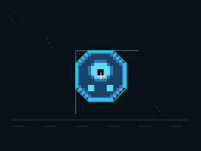
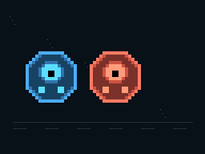
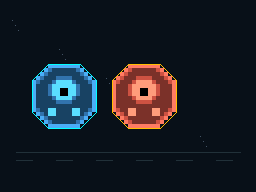
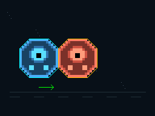
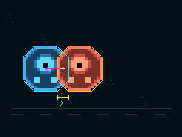
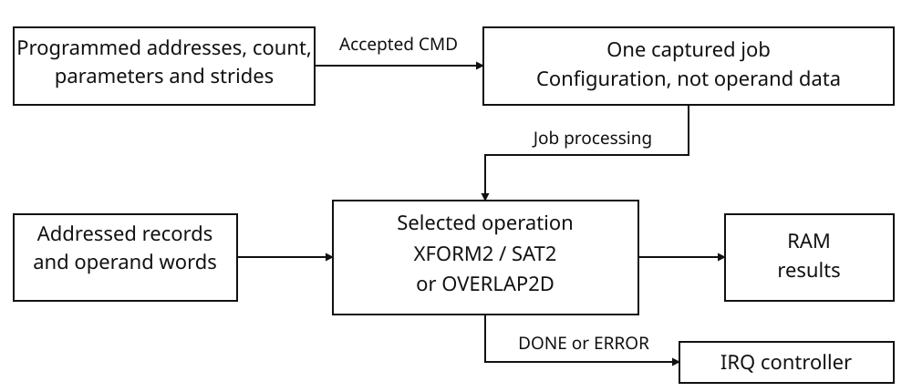

# Geometry batch unit {#sec-geo}

The geometry batch unit (GEO) transforms lists of two-dimensional vertices
and tests shapes for overlap, while the CPU does other work. A game uses it to
place collision shapes in the world, to test pairs of objects against each
other and to find where they overlap. GEO reads its input from memory and
writes its results to main RAM.

A collision shape is separate from the sprite that shows the object. The
shape is stored once, in the object's own (local) coordinates, and is placed
at each object's position in the world when it is tested.

## Commands {#sec-geo-geometry-placement-and-query-results}

| Command | Code | Input | Result |
|---|---|---|---|
| `XFORM2_BATCH` | `20H` | Vertex lists and 2 × 3 matrices | Transformed vertices and their bounding boxes |
| `SAT2_BATCH` | `21H` | Pairs of convex polygons in world coordinates | Hit or miss, normal, depth and edge for each pair |
| `OVERLAP2D_PASS` | `22H` | Shapes and their positions | One contact (normal, depth, point) for each overlapping pair |

XFORM2 and SAT2 use 16.16 fixed-point numbers. The output vertices of XFORM2
can be used directly as input for SAT2. OVERLAP2D uses 32-bit floating-point
numbers and applies the position of each object itself.

A bounding box (AABB) is the smallest rectangle, aligned with the X and Y axes,
that contains a shape. Two boxes can overlap while their shapes do not, so
boxes are used to rule out pairs quickly before the exact test.

## Example: two drones {#sec-geo-an-authored-sprite-and-its-collision-hull}

Two drones use the same 16 × 16 sprite. Their collision shape is an octagon
with these vertices, in this order:

```
(4,0), (12,0), (16,4), (16,12),
(12,16), (4,16), (0,12), (0,4)
```

The sprite and the octagon both have their origin at (0, 0). Drone A stays at
(0, 0); drone B is placed at (20, 0), (16, 0) and (12, 0) in turn.

{#fig-geo-scene-local}

**Local coordinates.** The cyan outline is the collision shape; the white cross
marks the centre (8, 8). Each unit is drawn as 4 pixels.

{#fig-geo-scene-plain}

**The sprites alone.** X increases to the right and Y downward.

### Transforming, then testing {#sec-geo-transform-first-then-test-the-resulting-vertices}

XFORM2 places each copy of the octagon in the world. Since the drones are only
moved, not rotated, the matrix adds the position to each vertex:

```text
world x = local x + tx
world y = local y + ty
```

With B at (12, 0), the local vertex (16, 4) becomes (28, 4), and B's bounding
box becomes (12, 0)–(28, 16). SAT2 then tests the two world-coordinate
octagons. Start SAT2 only when XFORM2 has finished: GEO runs one command at a
time.

### Results {#sec-geo-three-exact-poses}

SAT2 projects both polygons onto the normal of each edge. If the projections
are separate on any of these axes, the polygons do not overlap. Otherwise
SAT2 reports the axis with the smallest overlap: its direction (the normal),
the length of the overlap (the depth) and the edge it belongs to.

| B position | B bounding box | SAT2 result |
|---|---|---|
| (20, 0) | (20,0)–(36,16) | No hit |
| (16, 0) | (16,0)–(32,16) | Hit; normal (1, 0); depth 0 |
| (12, 0) | (12,0)–(28,16) | Hit; normal (1, 0); depth 4 |

At (16, 0) the octagons touch along the edge (16,4)–(16,12), edge 2 of A.
SAT2 reports touching as a hit with depth 0. The SAT2 normal points from A
towards B. SAT2 gives no contact point.

### The contact point {#sec-geo-a-separate-floating-point-contact-query}

OVERLAP2D also gives the point where the shapes overlap. Both drones use the
same floating-point octagon with bounding box (0,0)–(16,16), and each has its
own position.

OVERLAP2D reports only shapes that overlap by more than zero. The touching
pose therefore gives no contact. The overlapping pose gives normal (−1, 0),
depth 4 and point (14, 8). The OVERLAP2D normal points from B towards A,
opposite to SAT2. The point is the average of the corners of the overlapping
area.

{#fig-geo-scene-separated}

**Separated.** No hit and no contact.

{#fig-geo-scene-touching}

**Touching.** The green arrow shows the SAT2 normal. SAT2 depth is 0;
OVERLAP2D gives no contact.

{#fig-geo-scene-overlap}

**Overlapping.** Green: SAT2 normal (A to B). Magenta: OVERLAP2D normal (B to
A), drawn from the contact point (14, 8), marked by the white cross. The
yellow bracket shows the depth of 4 units.

OVERLAP2D writes contact records only for overlapping pairs and reports their
number in its summary. When the drones separate again, the old contact record
stays in memory but the summary reports 0 contacts. SAT2, in contrast, writes
zeros for a pair that does not overlap.

## Specifications {#sec-geo-geo-specifications}

| Item | Specification |
|---|---|
| Registers | 16 words at `08000024H`–`08000060H`, plus FAULT_ACK at `08010224H` |
| Commands | XFORM2_BATCH, SAT2_BATCH, OVERLAP2D_PASS |
| Command queue | None; one command at a time |
| Records per command | Up to 2^32^ − 1 |
| Vertices per list or polygon | Up to 64 |
| Clipping buffer (OVERLAP2D) | 128 vertices |
| Arithmetic speed | 16,384,000 operations per second |
| Interrupts | IRQ_GEO_DONE, IRQ_GEO_ERROR |

Put the input and result buffers in the program's own memory and write their
addresses to the GEO registers. Results must be in main RAM.

{#fig-geo-job}

## Starting a command {#sec-geo-launching-and-observing-a-job}

1. Wait until BUSY in STATUS is 0.
2. If ERROR or REJECTED is set, read FAULT and PROCESSED, then write 1 to
   FAULT_ACK.
3. Prepare the records and data in memory, and set the registers the command
   uses, including COUNT.
4. Write the command code to CMD.
5. Wait for DONE, or for IRQ_GEO_DONE or IRQ_GEO_ERROR. Check ERROR.

Do not write CMD while BUSY is set. GEO does not queue commands: the running
command is stopped and the new one is refused (REJECT_BUSY).

| State when CMD is written | Result |
|---|---|
| Idle or DONE | A valid code starts the command; any other value gives REJECT_BAD_CMD |
| BUSY | The running command stops; REJECT_BUSY |
| ERROR or REJECTED | Nothing happens until FAULT_ACK is written |

### Registers and memory during a command {#sec-geo-captured-operands-and-live-memory}

GEO takes the register values when CMD is written. The registers may be loaded
for the next command while the current one runs. The records and data in
memory, however, are read while the command runs: do not change them until the
command has finished.

With COUNT = 0, XFORM2 and SAT2 finish at once. OVERLAP2D first clears its
16-byte summary at DST1, so set DST1 even when COUNT is 0.

### Encoding the drone commands {#sec-geo-encode-the-drone-jobs}

A 16.16 number is the 32-bit word divided by 65536; the integer 4 is therefore
`00040000H`. A matrix consists of `m00, m01, tx, m10, m11, ty`. Each drone
matrix is `00010000H, 0, tx, 0, 00010000H, 0`.

The XFORM2 records (`flags, source_index, destination_index, matrix_index,
vertex_count, bounds_index`) are:

```
[0, 0, 0, 0, 8, 0]
[0, 0, 8, 1, 8, 1]
```

Both records use the same octagon. A's eight world vertices are written first,
then B's: 128 bytes in all, plus two 16-byte bounding boxes. Set SRC0 to the
records, SRC1 to the octagon, SRC2 to the matrices, DST0 to the vertex buffer,
DST1 to the box buffer, COUNT to 2 and the strides to 24, 8 and 24. Then write
`20H` to CMD.

SAT2 reads the vertex buffer written by XFORM2. The polygon descriptors
(`flags, vertex_count, vertex_offset_bytes, reserved`) are:

```
A: [1, 8, 0, 0]
B: [1, 8, 64, 0]
```

The pair record is `[0, 0, 0, 1, 0]` (`flags, shape_a, result_index, shape_b,
flags2`). Set SRC0 to the pair, SRC1 to the descriptors, SRC2 to the vertex
buffer, DST0 to a 20-byte result, COUNT to 1, STRIDE0 to 20 and STRIDE1 to 16.
Then write `21H` to CMD.

SAT2 writes `hit, nx, ny, depth, edge`:

| Pose | B tx | B bounding box | SAT2 result |
|---|---|---|---|
| Separated | `00140000H` | (20,0)–(36,16) | `0, 0, 0, 0, 0` |
| Touching | `00100000H` | (16,0)–(32,16) | `1, 00010000H, 0, 0, 2` |
| Overlapping | `000C0000H` | (12,0)–(28,16) | `1, 00010000H, 0, 00040000H, 2` |

#### Encoding the contact query {#sec-geo-encode-the-contact-query}

For OVERLAP2D, store the octagon and its bounding box again as floating-point
numbers. The 96-byte shape has kind 3, 8 vertices, data at offset 32 and
bounds at offset 16. Both objects have layer and mask 1. The candidate pair is
`[0, 1, 44524F4EH]`; the last word is a value of the program's choosing that
GEO copies into the contact record. Set SRC0 to the objects, SRC1 to the
candidate, DST0 to a 36-byte contact buffer, DST1 to a 16-byte summary,
COUNT = 1, PARAM0 = 1, PARAM1 = 1 and the strides to 20, 12 and 2. Then write
`22H` to CMD.

The summary is `contacts, exact_tests, box_tests, flags`:

| Pose | Summary | Contact |
|---|---|---|
| Separated | `0, 0, 1, 0` | — |
| Touching | `0, 1, 1, 0` | — |
| Overlapping | `1, 1, 1, 0` | Normal (−1, 0), depth 4, point (14, 8) |

### Programming example: XFORM2 and SAT2 {#sec-geo-transform-two-squares-and-pass-them-to-sat2}

This example uses the overlapping pose: A at (0, 0), B at (12, 0).

```lua
local geo<const>: *word = 0x08000024
local irq_ack<const>: *word = 0x08000004
rodata hull: word[16] = {
    0x00040000, 0, 0x000c0000, 0,
    0x00100000, 0x00040000, 0x00100000, 0x000c0000,
    0x000c0000, 0x00100000, 0x00040000, 0x00100000,
    0, 0x000c0000, 0, 0x00040000,
}
rodata matrices: word[12] = {
    0x00010000, 0, 0, 0, 0x00010000, 0,
    0x00010000, 0, 0x000c0000, 0, 0x00010000, 0,
}
rodata transforms: word[12] = {
    0, 0, 0, 0, 8, 0,
    0, 0, 8, 1, 8, 1,
}
rodata pair: word[5] = { 0, 0, 0, 1, 0 }
rodata shapes: word[8] = { 1, 8, 0, 0, 1, 8, 64, 0 }
bss vertices: word[32]
bss bounds: word[8]
bss pair_result: word[5]

geo[0] = transforms                  -- SRC0: records
geo[1] = hull                        -- SRC1: octagon
geo[2] = matrices                    -- SRC2: matrices
geo[3] = vertices                    -- DST0: world vertices
geo[4] = bounds                      -- DST1: bounding boxes
geo[5] = 2                           -- COUNT
geo[11] = 24                         -- STRIDE0: record size
geo[12] = 8                          -- STRIDE1: source list step
geo[13] = 24                         -- STRIDE2: matrix size
geo[6] = 0x20                        -- CMD: XFORM2_BATCH
while (geo[8] & 1) ~= 0 do end       -- Wait while BUSY.
```

STATUS is now 2 (DONE), PROCESSED 2 and FAULT 0. The bounding boxes are
`0, 0, 00100000H, 00100000H` and `000C0000H, 0, 001C0000H, 00100000H`.

```lua
geo[0] = pair                        -- SRC0: pair record
geo[1] = shapes                      -- SRC1: descriptors
geo[2] = vertices                    -- SRC2: XFORM2 output
geo[3] = pair_result                 -- DST0: result
geo[5] = 1                           -- COUNT
geo[11] = 20                         -- STRIDE0: pair record size
geo[12] = 16                         -- STRIDE1: descriptor size
geo[6] = 0x21                        -- CMD: SAT2_BATCH
while (geo[8] & 1) ~= 0 do end
*irq_ack = 0x00000018                -- Clear IRQ_GEO_DONE and IRQ_GEO_ERROR.
```

`pair_result` now holds `1, 00010000H, 0, 00040000H, 2`: a hit, normal
(1, 0), depth 4, edge 2 of A. The descriptor offsets 0 and 64 are in bytes.

### OVERLAP2D candidate list and full pass {#sec-geo-extend-the-sequence-to-a-contact-query-or-fault-recovery}

OVERLAP2D can test a list of chosen pairs (candidate mode) or every pair of
objects in a list (full pass). Take two 4 × 4 squares at (0, 0) and (1, 1),
stored as kind-1 shapes with bounding box (0,0)–(4,4), layer and mask 1, and
candidate `[0, 1, 12345678H]`:

| Register | Candidate mode | Full pass |
|---|---|---|
| SRC0 | Objects (2 × 20 bytes) | Same |
| SRC1 | Candidate (12 bytes) | 0 |
| DST0 | Contact buffer (36 bytes or more) | Same |
| DST1 | Summary (16 bytes) | Same |
| COUNT | 1 (candidates) | 2 (objects) |
| PARAM0 / PARAM1 | 1 / 1 | 2 / 1 |
| STRIDE0 / STRIDE1 / STRIDE2 | 20 / 12 / 2 | 20 / 0 / 0 |

Both give normal (0, −1), depth 3 and point (2.5, 2.5), with summary
`1, 1, 1, 0`. The pair value is `12345678H` in candidate mode and 1 (objects 0
and 1) in full pass. PROCESSED is 1 and 2 respectively.

#### Recovering from a fault {#sec-geo-recover-after-a-failed-record}

An XFORM2 record with flags = 1 gives STATUS = 6 (DONE + ERROR),
PROCESSED = 0 and FAULT = `00080000H` (BAD_RECORD_FLAGS, record 0). To
continue:

```lua
local fault_ack<const>: *word = 0x08010224
*fault_ack = 1                       -- Clear the fault; STATUS becomes 2.
*irq_ack = 0x00000010                -- Clear IRQ_GEO_ERROR.
```

Results already written stay in memory.

## Registers {#sec-geo-register-reference}

| Address | Register | Access | Function |
|---|---|---|---|
| `08000024H` | `SRC0` | R/W | Source address 0 |
| `08000028H` | `SRC1` | R/W | Source address 1 |
| `0800002CH` | `SRC2` | R/W | Source address 2 |
| `08000030H` | `DST0` | R/W | Destination address 0 |
| `08000034H` | `DST1` | R/W | Destination address 1 |
| `08000038H` | `COUNT` | R/W | Number of records |
| `0800003CH` | `CMD` | R/W | Command code; writing starts the command |
| `08000040H` | `CTRL` | R/W | Bit 0: ABORT |
| `08000044H` | `STATUS` | R | Bit 0 BUSY, bit 1 DONE, bit 2 ERROR, bit 3 REJECTED |
| `08000048H` | `PARAM0` | R/W | Parameter 0 |
| `0800004CH` | `PARAM1` | R/W | Parameter 1 |
| `08000050H` | `STRIDE0` | R/W | Step 0, in bytes |
| `08000054H` | `STRIDE1` | R/W | Step 1, in bytes |
| `08000058H` | `STRIDE2` | R/W | Step 2, in bytes |
| `0800005CH` | `PROCESSED` | R | Number of records completed |
| `08000060H` | `FAULT` | R | Bits 31–16: fault code; bits 15–0: record number |
| `08010224H` | `FAULT_ACK` | W (reads 0) | Any value other than 0 clears the fault |

All registers are 0 after reset. Use 32-bit word accesses. The meaning of
SRC, DST, PARAM and STRIDE depends on the command. CMD reads back the last
value written.

## Timing {#sec-geo-work-budget-and-timing}

The time of a command is the sum of its memory accesses and its arithmetic.

| Memory | Cycles per word read or written |
|---|---:|
| Main RAM, system ROM | 1 |
| Cartridge | 8 |

The arithmetic runs at 16,384,000 operations per second. For U operations
the time is `ceiling(U × 1323 / 640)` system cycles. The number of operations
of each command is given in its section. GEO runs in parallel with the CPU and
does not occupy the bus during its arithmetic.

## Completion and faults {#sec-geo-completion-faults-and-recovery}

| Outcome | STATUS | FAULT | Interrupt |
|---|---|---|---|
| Completed | `2H` (DONE) | 0 | IRQ_GEO_DONE (bit 3) |
| Fault in a record | `6H` (DONE, ERROR) | Code and record number | IRQ_GEO_ERROR (bit 4) |
| Command refused | `8H` (REJECTED) | Code and `FFFFH` | IRQ_GEO_ERROR (bit 4) |

PROCESSED gives the number of records completed before a fault. Records
completed before the fault keep their results. FAULT holds only the low 16
bits of the record number; use PROCESSED for longer lists.

| Code | Name |
|---|---|
| `0001H` | `ABORTED` |
| `0002H` | `BAD_RECORD_ALIGNMENT` |
| `0003H` | `BAD_VERTEX_COUNT` |
| `0004H` | `SRC_RANGE` |
| `0005H` | `DST_RANGE` |
| `0006H` | `DESCRIPTOR_KIND` |
| `0007H` | `NUMERIC_OVERFLOW_INTERNAL` |
| `0008H` | `BAD_RECORD_FLAGS` |
| `0009H` | `RESULT_CAPACITY` |
| `000AH` | `CLIP_CAPACITY` |
| `8001H` | `REJECT_BUSY` |
| `8002H` | `REJECT_BAD_CMD` |

Writing 1 to bit 0 of CTRL (ABORT) stops a running command with code ABORTED.

After a fault, read FAULT and PROCESSED, then write any value other than 0 to
FAULT_ACK. This clears ERROR, REJECTED and FAULT; DONE and PROCESSED remain.
No new command starts until FAULT_ACK has been written. FAULT_ACK and the
interrupt acknowledge register are independent: clear both.

## XFORM2_BATCH: transform vertices {#sec-geo-xform2_batch-transform-vertices-and-build-bounds}

Command code **20H**. Each record transforms a list of vertices with a matrix
and can also write the bounding box of the result.

### Registers {#sec-geo-registers-and-address-selection}

| Register | Function |
|---|---|
| SRC0, STRIDE0 | Records and record size |
| SRC1, STRIDE1 | Source vertices and the step for `src_index` |
| SRC2, STRIDE2 | Matrices and matrix size |
| DST0 | Output vertices (8 bytes each) |
| DST1 | Output bounding boxes (16 bytes each) |
| COUNT | Number of records |

| Item | Address |
|---|---|
| Record n | `SRC0 + n × STRIDE0` |
| Source vertices | `SRC1 + src_index × STRIDE1` |
| Matrix | `SRC2 + matrix_index × STRIDE2` |
| Output vertices | `DST0 + dst_index × 8` |
| Bounding box | `DST1 + bounds_index × 16` |

### Data formats {#sec-geo-record-and-data-layouts}

All values are 32-bit words; coordinates, matrix values and boxes are signed
16.16 numbers.

| Offset | Record (24 bytes) |
|---|---|
| +0 | flags: 0 |
| +4 | src_index |
| +8 | dst_index (in vertices) |
| +12 | matrix_index |
| +16 | vertex_count: 0–64 |
| +20 | bounds_index; `FFFFFFFFH` = no bounding box |

| Item | Size | Words |
|---|---|---|
| Vertex | 8 bytes | x, y |
| Matrix | 24 bytes | m00, m01, tx, m10, m11, ty |
| Bounding box | 16 bytes | min_x, min_y, max_x, max_y |

A record with vertex_count 0 writes nothing.

### Arithmetic {#sec-geo-transformation-arithmetic}

```text
x' = m00 × x + m01 × y + tx
y' = m10 × x + m11 × y + ty
```

Each product and sum is computed exactly, then shifted right by 16 bits
(rounding towards −∞) and limited to the signed 32-bit range. Results that
are too large are limited, not wrapped.

GEO reads the whole source list before it writes any output, so the output
may overwrite the source. A later record may use the output of an earlier one.

### Timing {#sec-geo-xform-work-intervals}

Each vertex takes one operation, two reads and two writes. With all data in
main RAM, one record of v vertices takes

`12 + 4v + 4b + ceiling(v × 1323 / 640)` cycles,

where b is 1 when a bounding box is written and 0 otherwise. For 4 vertices
with a box: 12 + 16 + 4 + 9 = 41 cycles. For 64 vertices with a box: 405
cycles.

### Memory {#sec-geo-address-and-memory-rules}

Source data may be in system ROM, main RAM or a cartridge. Output must be in
main RAM. This also applies to SAT2. The addresses need not be aligned.

### Faults {#sec-geo-fault-priority-and-output-preservation}

| Condition | Fault |
|---|---|
| Record address beyond the end of the address space | BAD_RECORD_ALIGNMENT |
| Record, vertices or matrix not in readable memory | SRC_RANGE |
| flags not 0 | BAD_RECORD_FLAGS |
| vertex_count above 64 | BAD_VERTEX_COUNT |
| Output not in main RAM | DST_RANGE |

A record with a fault writes nothing.

### Example {#sec-geo-worked-transformation}

The square (0,0), (4,0), (4,4), (0,4) is transformed twice: with matrix 0
(no change) and with matrix 1 (moved by (1, 1)).

| Record | flags | src_index | dst_index | matrix_index | vertex_count | bounds_index |
|---|---|---|---|---|---|---|
| 0 | 0 | 0 | 0 | 0 | 4 | 0 |
| 1 | 0 | 0 | 4 | 1 | 4 | 1 |

The second output list holds (1,1), (5,1), (5,5), (1,5). The bounding boxes are
`(0, 0, 262144, 262144)` and `(65536, 65536, 327680, 327680)`.

## SAT2_BATCH: test polygon pairs {#sec-geo-sat2_batch-test-convex-polygon-pairs}

Command code **21H**. Each record tests a pair of convex polygons, given in
the same coordinates, for overlap.

### Registers and data formats {#sec-geo-registers-and-layouts}

| Register | Function |
|---|---|
| SRC0, STRIDE0 | Pair records and record size |
| SRC1, STRIDE1 | Polygon descriptors and descriptor size |
| SRC2 | Vertices |
| DST0 | Results (20 bytes each) |
| COUNT | Number of pairs |

| Offset | Pair record (20 bytes) |
|---|---|
| +0 | flags: 0 |
| +4 | shape_A_index |
| +8 | result_index |
| +12 | shape_B_index |
| +16 | flags2: 0 |

| Offset | Polygon descriptor (16 bytes) |
|---|---|
| +0 | flags: 1 |
| +4 | vertex_count: 3–64 |
| +8 | vertex_offset_bytes from SRC2; a multiple of 4 |
| +12 | 0 |

| Offset | Result (20 bytes) |
|---|---|
| +0 | hit: 0 or 1 |
| +4 | nx (16.16) |
| +8 | ny (16.16) |
| +12 | depth (16.16) |
| +16 | Bits 31–16: 0 = edge of A, 1 = edge of B; bits 15–0: edge number |

The vertices use the same format as XFORM2. GEO does not check that a polygon
is convex.

### Method {#sec-geo-axis-selection-and-arithmetic}

The axes tested are the normals of all edges of A, then of B, including the
edge from the last vertex back to the first. Both polygons are projected onto
each axis. If the projections are separate on an axis, the result is five
zero words. Otherwise the result is the axis with the smallest overlap; on
equal overlap the first such axis is used. Touching polygons give a hit with
depth 0.

The normal points from A towards B (measured between the averages of the
vertices of the two polygons). The calculation uses floating-point arithmetic;
the normal and depth are rounded to the nearest 16.16 value.

### Timing {#sec-geo-sat-work-intervals}

| Operation | Operations |
|---|---:|
| Each vertex (average) | 1 |
| Averages | 4 |
| Each edge tested | 2 |
| Each edge of non-zero length: each vertex projected, plus 2 | E + 2 |

For E vertices in total, a edges tested and s edges of non-zero length, the
arithmetic is `E + 4 + 2a + (E + 2)s` operations. A pair reads 13 record and
descriptor words and 2 words per vertex, and writes 5 result words. Testing
stops at the first separating axis.

Example: two overlapping squares (all 8 edges tested), all data in main RAM:
29 reads + 5 writes + `ceiling(108 × 1323 / 640)` = 34 + 224 = 258 cycles.

### Faults {#sec-geo-fault-priority-and-writes}

| Condition | Fault |
|---|---|
| Pair record address beyond the end of the address space | BAD_RECORD_ALIGNMENT |
| Record, descriptor or vertices not in readable memory | SRC_RANGE |
| flags or flags2 not 0 | BAD_RECORD_FLAGS |
| Result not in main RAM | DST_RANGE |
| Descriptor flags not 1, or word +12 not 0 | DESCRIPTOR_KIND |
| vertex_count below 3 or above 64 | BAD_VERTEX_COUNT |
| vertex_offset_bytes not a multiple of 4 | BAD_RECORD_ALIGNMENT |
| All edges have zero length | DESCRIPTOR_KIND |

A pair with a fault writes no result.

### Example {#sec-geo-worked-pair-and-output-interpretation}

Using the two squares of the XFORM2 example, with descriptors
`(1, 4, 0, 0)` and `(1, 4, 32, 0)` and pair `(0, 0, 0, 1, 0)`, the result is
`(1, 0, 65536, 196608, 0)`: hit, normal (0, 1), depth 3, edge 0 of A.

| B moved by | Result |
|---|---|
| (1, 1) | `1, 0, 65536, 196608, 0` |
| (4, 0) (touching) | `1, 65536, 0, 0, 1` |
| (5, 0) | `0, 0, 0, 0, 0` |

## OVERLAP2D_PASS: contacts between shapes {#sec-geo-overlap2d_pass-translated-shape-contacts}

Command code **22H**. OVERLAP2D finds pairs of shapes that overlap and writes
one contact record for each: normal, depth, contact point and the parts of the
shapes involved. Pairs that do not overlap produce no record.

A shape is an AABB, a convex polygon or a compound of several of these. Each
object refers to a shape and has a position. Values are 32-bit floating-point
numbers.

### Registers and modes {#sec-geo-pass-configuration}

| Register | Candidate mode | Full pass |
|---|---|---|
| SRC0, STRIDE0 | Objects and object size | Objects and object size |
| SRC1, STRIDE1 | Candidate pairs and pair size | Work area (indexed full pass only) |
| COUNT | Number of candidate pairs | Number of objects |
| STRIDE2 | Number of objects | — |
| DST0 | Contact records (36 bytes each) | Same |
| DST1 | Summary (16 bytes) | Same |
| PARAM1 | Maximum number of contact records | Same |

Bits 1–0 of PARAM0 select the mode:

| PARAM0 bits 1–0 | Mode |
|---|---|
| 0, 2 | Full pass: every pair of objects |
| 1 | Candidate mode: the pairs in the candidate list |
| 3 | Indexed full pass |

The indexed full pass suits lists with many objects whose layers rarely
match. It needs a work area at SRC1 in main RAM: 256 bytes for every 32
objects (for 271 objects, 9 × 256 = 2304 bytes). The other bits of PARAM0 have
no function.

A full pass tests the pairs (0,1), (0,2), …, (1,2), …. Its pair value is
`(A << 16) | B` (low 16 bits of each object number).

### Objects and candidate pairs {#sec-geo-input-records}

#### Formats {#sec-geo-instances-and-candidate-pairs}

| Offset | Object (20 bytes) |
|---:|---|
| +0 | Shape address |
| +4 | Position x (float) |
| +8 | Position y (float) |
| +12 | Layer bits |
| +16 | Mask bits |

| Offset | Candidate pair (12 bytes) |
|---:|---|
| +0 | Object A number |
| +4 | Object B number |
| +8 | Pair value, copied into the contact record |

#### Shapes {#sec-geo-shape-descriptors-and-bounds}

| Offset | Shape (16 bytes) |
|---:|---|
| +0 | Kind: 1 = AABB, 3 = convex polygon, 4 = compound |
| +4 | Number of data items |
| +8 | Offset of the data, from the shape |
| +12 | Offset of the bounding box, from the shape |

| Kind | Data | Number |
|---|---|---|
| AABB (1) | left, top, right, bottom | 4 |
| Polygon (3) | Vertices: x, y | 3–64 |
| Compound (4) | Shapes (16 bytes each, kind 1 or 3) | 1 or more |

A bounding box is left, top, right, bottom. It must enclose the shape; GEO does
not check it. For an AABB the data can serve as the bounding box: set both
offsets to 16 to make a 32-byte shape.

#### Memory {#sec-geo-address-spans}

Input may be in system ROM, main RAM or a cartridge. Contact records must be in
main RAM. The addresses need not be aligned.

### Method {#sec-geo-filtering-order-and-counts}

For each pair:

1. The pair is tested only if `maskA & layerB` and `maskB & layerA` are both
   non-zero. Such a pair is counted in `box_tests`.
2. If the bounding boxes are separate, the pair is finished. Touching boxes
   count as overlapping. Otherwise the pair is counted in `exact_tests`.
3. Each part of A is tested against each part of B. Of all overlapping parts,
   the contact with the smallest depth is kept.

Do not change the objects, shapes or vertices while the command runs.

### Contact {#sec-geo-exact-overlap-and-contact}

The overlap test uses the edge normals of both shapes, as in SAT2. Only an
overlap greater than zero counts: shapes that touch give no contact. The
normal points from B towards A. On equal depth an edge of A is preferred, then
the lower edge number.

The contact point is the average of the corners of the overlapping area,
which GEO finds by clipping A against each edge of B. Supply polygon vertices
in the same order (winding) for all shapes. If the clipped area has no corners,
the point is midway between the averages of the vertices of A and B. Clipping
can produce at most 128 corners; more give CLIP_CAPACITY.

### Timing {#sec-geo-overlap-work-intervals}

Each word read or written takes the memory time given above. Clearing the
summary at the start takes 4 cycles. In a full pass with both objects and
shapes in main RAM, reading one pair (objects, shapes and bounding boxes)
takes 26 cycles.

| Exact test operation | Operations |
|---|---:|
| Each edge tested, its length, and the normal (2 divisions) | 4 (2 for an edge of zero length) |
| Each vertex projected on an edge | 1 |
| Each vertex added to an average; each coordinate divided | 1 |
| Each vertex of A copied for clipping | 1 |
| Each edge of B used for clipping | 1 |
| Each vertex tested against a clipping edge | 1 |
| Each crossing of a clipping edge | 1 |

### Contact record and summary {#sec-geo-output-records-and-summary}

Contact records are written one after another at DST0.

| Offset | Contact record (36 bytes) |
|---:|---|
| +0, +4 | Normal x, y (float) |
| +8 | Depth (float) |
| +12, +16 | Contact point x, y (float) |
| +20, +24 | Part of A, part of B (0 for a simple shape) |
| +28 | Edge number |
| +32 | Pair value |

| Offset | Summary (16 bytes) |
|---:|---|
| +0 | Number of contact records |
| +4 | Number of exact tests |
| +8 | Number of box tests |
| +12 | Bit 0: more contacts than PARAM1 allows |

The summary is written at the start, after each record and on overflow.
PROCESSED counts candidate pairs in candidate mode and objects in a full pass.

### Faults {#sec-geo-capacity-partial-progress-and-faults}

| Code | Condition |
|---:|---|
| 3 `BAD_VERTEX_COUNT` | AABB data count not 4, or polygon count outside 3–64 |
| 4 `SRC_RANGE` | Input not in readable memory, or object number ≥ STRIDE2 |
| 5 `DST_RANGE` | Contact record not in main RAM |
| 6 `DESCRIPTOR_KIND` | Unknown kind, empty compound or compound inside a compound |
| 8 `BAD_RECORD_FLAGS` | Candidate pair with A = B |
| 9 `RESULT_CAPACITY` | More contacts than PARAM1 |
| 10 `CLIP_CAPACITY` | More than 128 clipping corners |

On RESULT_CAPACITY, bit 0 of the summary flags is set and the extra contact is
not written. Contacts already written remain.

### Example {#sec-geo-small-aabb-example}

A 32-byte AABB shape: words `1, 4, 16, 16`, then floats `0, 0, 4, 4`. Object A
at (0, 0) and object B at (1, 1) use this shape, with layer and mask 1.
Candidate: `0, 1, 12345678H`. Set STRIDE0 = 20, STRIDE1 = 12, COUNT = 1,
STRIDE2 = 2, PARAM0 = 1 and PARAM1 ≥ 1.

The contact is normal (0, −1), depth 3, point (2.5, 2.5), parts 0 and 0,
edge 0 and pair value `12345678H`. The summary is `1, 1, 1, 0`.

| Change | Summary |
|---|---|
| Full pass (PARAM0 = 2, COUNT = 2) | `1, 1, 1, 0`; pair value 1 |
| B at (4, 0) (touching) | `0, 1, 1, 0` |
| B at (5, 0) | `0, 0, 1, 0` |
| Mask of A or B set to 0 | `0, 0, 0, 0` |
| Same candidate twice, PARAM1 = 1 | `1, 2, 2, 1`; RESULT_CAPACITY at record 1 |

## Drawing the results {#sec-geo-from-geometry-results-to-video-packets}

GEO does not draw. The pictures in this chapter were drawn with GPU commands
built by the program from the GEO results: the sprites as textured
rectangles, the outlines as lines from the world vertices, and the arrows and
cross from the normal and the contact point. See the [GPU chapter](gpu.md#sec-gpu).
