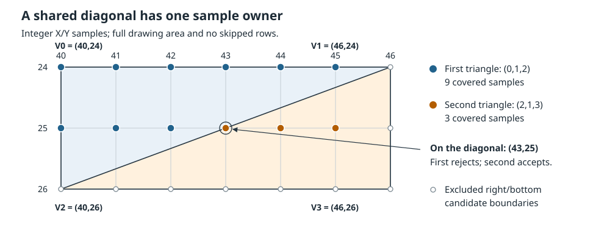

# GPU Drawing Engine

<a id="gpu-function"></a>
## Function and data flow

The GPU draws supplied screen-space polygons, lines and rectangles into GPU local
memory. It also fills, uploads, reads and copies raw local-memory images. Supplied
colors and texture coordinates determine the source pixels; drawing state controls
the drawing area, offsets, texturing, blending and stored mask bit.

Three-dimensional projection, lighting, near-plane clipping and depth-order
selection precede primitive submission. Triangle interpolation has no depth or
reciprocal-depth input. A quad is
two triangle operations, not a four-corner bilinear surface. The cartridge supplies
the intended draw order and retains any geometry results needed to construct it.

Stored pixels are not display output. PCRTC reads local memory using its selected
source layout, display windows and output settings. The choice of display storage
format does not change how GPU primitives address their raw destination words.

<a id="gpu-specifications"></a>
## Technical specifications

GPU programming words, local-memory words and command-cost ticks are different
units. A GP0 input word carries **32 bits**; a local-memory word stores **16 bits**.
Neither is a count of displayed pixels. Drawing, texture lookup and display
sampling share the same local memory.

| Resource or interface | Specification |
|---|---|
| Installed main RAM | 4 MiB, separate from GPU local memory |
| GPU local memory | 2 MiB: 1,048,576 sixteen-bit words; low byte first |
| GP0 — `0x0801023c` | Write command/input words; read GPUREAD |
| GP1 — `0x08010240` | Write control words; read GPUSTAT, not the last control word |
| GP0 input FIFO | 16 thirty-two-bit words |
| Separate DMA ingress | 16 thirty-two-bit words; not another 16 CPU FIFO slots |
| Ordinary programming access | Thirty-two-bit words, four-byte alignment |
| Input coordinates | Each supplied X and Y is signed eleven-bit: −1024…1023 |
| Drawing offset | Separate signed eleven-bit X and Y values |
| Input color | Independent unsigned eight-bit R, G and B components: 0–255 |
| Rendered color storage | R in bits 4:0, G in 9:5, B in 14:10; bit 15 stored separately |
| Installed CPU/system-cycle frequency | 33,868,800 Hz; approximately 29.526 ns per cycle |
| Command-cost conversion | Two command ticks per system cycle |

The input coordinate range is not a maximum display mode. Polygon vertices
receive the drawing offset as integer sums. Before triangle raster shifting,
a triangle is rejected if its inclusive span exceeds **1024 in X or 512 in Y**:
`maxX−minX+1 > 1024` or `maxY−minY+1 > 512`. The test applies separately to
each triangle, including each half of a quad.

Triangle color and texture-coordinate planes use supplied screen X/Y only.
Their inputs contain no Z, W, reciprocal depth, perspective correction or depth
comparison. Commands affect local memory in their supplied order; the GPU does
not sort polygons. Projection, lighting, near-plane clipping and depth ordering,
when required, must precede this drawing path.

**Issue cost and command completion.** An ordinary scalar word load or store,
including its displacement form, has a **two-system-cycle base cost**. Address
and value preparation, control flow and readiness waits are additional. A
word-sequence store instead charges two base cycles plus its word count divided
by four, rounded upward. These are charges for the actual issuing instruction,
not a transfer-bandwidth rating. The sequence advances the destination by four
bytes per word: starting at GP0 reaches GP1 next, not another GP0 stream word.

Accepting a GP0 word and completing an assembled command are separate events.
For a command with positive cost N ticks starting execution at cycle C:

```text
Completion deadline = C + (N/2 rounded upward)
```

Zero-cost work completes immediately. Queued execution continues from the prior
command's deadline, not from a later status-read time. CPU work can overlap
these intervals; summing every issue charge and every command interval does not
by itself give a complete workload budget. GP1 controls have no separate queued
raster-cost interval, and there is no GPU CYCLES register.

For a fill with rounded width 32 and height 4, the command cost is
`46 + (32/8 + 9)×4 = 98` ticks, or **49 system cycles**. A normalized
3×5 local-memory copy costs `2×3×5 = 30` ticks, or **15 cycles**. These
intervals begin at execution, not at preparation of the first packet word.
With the GPU IRQ request initially clear, an IRQ marker queued behind a fill
starting at cycle zero executes and raises its request at cycle 49; its own one-tick
interval completes at cycle 50. The IRQ request can therefore be set while the
GPU is not yet idle.

An image-upload or readback command's one-tick cost does **not** mean its whole
payload transfers in one cycle. Readback becomes pending at command execution
completion and becomes consumable only when ready; GPUSTAT bit 27 reports that
ready condition. Until then, GP0 reads return the retained GPUREAD value.
Neither command completion, idle status nor an IRQ marker acknowledges that a
new picture has reached the display latch.

**Access-width cautions.** Use complete word transfers for commands. An aligned
byte load runs the full GP0 read operation before returning its low byte; it is
not a byte-wise peek into a ready readback word. Byte stores and halfword IO
accesses fault. F32 uses one word's bit pattern; F64 accesses the word at A and
then A+4, stopping if the first faults. Thus an F64 access at GP0 reaches
**GP0 then GP1**, not two words of the GP0 stream, and is not an atomic GPU
transaction. Misaligned accesses fault before the corresponding device operation.

**Unspecified electrical ratings.** The system frequency and two-tick conversion
do not specify an independent GPU core/PLL clock, electrical IO or local-memory
bus clock or pin width, arbitration schedule, physical per-pixel fetch cost, or
guaranteed sustained command, pixel or byte rate. Coordinate and storage limits
are representable capacities, not rated maximum-resolution video modes.

<a id="gpu-ports-status"></a>
## GP0, GPUREAD, GP1 and GPUSTAT

The GPU has two thirty-two-bit programming ports. Their read and write meanings
are different; neither address is an ordinary read/write register variable.

| Address | Write operation | Read operation | Full-reset read at beam epoch zero |
|---|---|---|---|
| `0x0801023c` | GP0 command or payload word | GPUREAD latch or next permitted ready readback word | `0x00000000` |
| `0x08010240` | GP1 control word | GPUSTAT | `0x14922000` |

Writing GP0 does not make a following read return that command word. Writing at
the GPUSTAT address sends a GP1 control; it does not assign a status-bit mask.
The reset status above includes the reset display-mode fields. It is the value
read at the stated epoch, not a promise that beam-derived bits remain constant.

### Access and ordering

Use aligned word operations for normal programming. Ordinary scalar word loads
and stores, including their displacement forms, have a two-system-cycle base
cost; preparation, control flow and a blocked store's wait/retry are separate.

| Access | Port effect |
|---|---|
| Word or U32 | Four-byte aligned; one complete thirty-two-bit port operation |
| U8 load | Only at a word-aligned IO address; perform the full word read, then return its low byte |
| U8 store; U16 load/store | Fault rather than partially access the port |
| F32 | Four-byte aligned; one word's bit pattern |
| F64 | Four-byte aligned; low word at A, then high word at A+4; a first-word fault prevents the second operation |

A byte read is not a peek into one byte of GPUREAD: it can consume the same
complete readback word as a word load. Misaligned word/F32/F64 accesses and odd
halfword accesses are rejected before a GPU operation occurs.

An F64 instruction is still **one CPU instruction**, but its two ordered word
operations are not a paired GPU register transaction. At GP0 they address
**GP0 then GP1**, not two GP0 stream words. An F64 store checks admission for its
first address only; it does not reserve both ports. Do not infer a sixty-four-bit
GPU command or atomic GP0/GP1 update from the CPU instruction boundary.

A CPU word-sequence store also advances the destination by four bytes for each
word. Starting it at GP0 therefore reaches GP1 next; it is not a burst of
repeated writes to the GP0 stream port.

### GPUSTAT fields

A GPUSTAT read first synchronizes already-due GPU command completions, then
updates beam-derived fields and recomputes command/DMA conditions. Stored
configuration readback, a retained request latch and current readiness are thus
parts of the same returned word, not interchangeable kinds of completion.

<table>
<thead><tr><th>Bits</th><th>Field</th><th>Value and producer</th></tr></thead>
<tbody>
<tr><td>31</td><td>Displayed-line parity</td><td>Beam-derived; calculation below. Not command readiness.</td></tr>
<tr><td>30:29</td><td>DMA direction</td><td>GP1 direction low two bits: 0 off, 1 FIFO, 2 CPU→GP0, 3 GPUREAD→CPU.</td></tr>
<tr><td>28</td><td>DMA packet acceptance</td><td>The packet-state test below; not a general CPU-store-ready bit.</td></tr>
<tr><td>27</td><td>Readback ready</td><td>One exactly when a readback stream is READY, not merely when its header has been accepted.</td></tr>
<tr><td>26</td><td>Idle</td><td>One only under all idle conditions below.</td></tr>
<tr><td>25</td><td>DMA request</td><td>Direction 0: zero. Direction 1: DMA ingress empty and GP0 FIFO has room. Direction 2: bit 28. Direction 3: bit 27. A system ingress stop suppresses the write-side requests for directions 1 and 2.</td></tr>
<tr><td>24</td><td>GPU interrupt request</td><td>Latched by GP0(1Fh); GP1(02h) clears this GPU request latch.</td></tr>
<tr><td>23</td><td>Display disabled</td><td>GP1 display-disable low bit; one means disabled.</td></tr>
<tr><td>22</td><td>Vertical-interlace mode</td><td>GP1 display-mode bit 5.</td></tr>
<tr><td>21</td><td>24-bit display-color mode</td><td>GP1 display-mode bit 4.</td></tr>
<tr><td>20</td><td>PAL-mode flag</td><td>GP1 display-mode bit 3.</td></tr>
<tr><td>19</td><td>Vertical-resolution mode</td><td>GP1 display-mode bit 2.</td></tr>
<tr><td>18:17</td><td>Horizontal-resolution mode 1</td><td>GP1 display-mode bits 1:0.</td></tr>
<tr><td>16</td><td>Horizontal-resolution mode 2</td><td>GP1 display-mode bit 6.</td></tr>
<tr><td>15</td><td>Texture-page Y high</td><td>GP0 draw-mode bit 11, moved here rather than copied to bit 11.</td></tr>
<tr><td>14</td><td>Reverse mask</td><td>Cleared by a display-mode update. Retained display-mode bit 7 is not mapped here and specifies no reverse-image action.</td></tr>
<tr><td>13</td><td>Interlaced-field flag</td><td>One if GPU vertical-interlace mode is clear or the PCRTC field is zero; otherwise zero.</td></tr>
<tr><td>12</td><td>Destination-mask check</td><td>Stored mask-mode bit 1.</td></tr>
<tr><td>11</td><td>Set output mask</td><td>Stored mask-mode bit 0.</td></tr>
<tr><td>10:0</td><td>Draw-mode readback</td><td>Stored GP0 draw-mode bits 10:0, without re-encoding.</td></tr>
</tbody>
</table>

The GP1 mode fields are GPU register readback, not PCRTC beam-clock selectors.
For bit 31, use the decoded display-start Y and the current PCRTC field. When
both GPU vertical-resolution and vertical-interlace bits are set, its parity is
`(displayStartY + displayedField) AND 1`, where displayedField is zero during
VBlank and otherwise the current field. In other modes it is
`(displayStartY + integer-quotient(currentHalfLine,2)) AND 1`.
If the beam is stopped, bits 13 and 31 retain their existing values.

### Idle, DMA acceptance and CPU admission are different tests

**Bit 26** is one only when readback is idle, no command-completion deadline is
pending, both input FIFOs are empty, and no fixed-packet assembly, image-upload
payload or open polyline remains. Retained completed commands awaiting
presentation do not prevent this idle indication. It does not acknowledge a
new displayed picture.

**Bit 28** first requires idle readback, no system ingress stop and empty DMA
ingress. After those requirements:

- During an image-upload payload, it is one when the GP0 FIFO has room.
- During a polyline payload, it is zero.
- With no partial packet and no FIFO words, it is one.
- Otherwise it is one only for a nonpolygon, nonline packet with fewer
  accumulated words than its target length.

**A direct CPU GP0 word store** instead requires no system ingress stop, empty
DMA ingress, a physical GP0 FIFO count below sixteen, and no DMA ownership of
the GP0 write port. It need not wait for GPU idle or readback completion if a
word can still be admitted. A polygon or line prefix can therefore clear bit 28
while a CPU word store remains admissible. Do not substitute bit 28 for this
store-admission protocol.

The scalar CPU store checks admission before writing. If blocked, it waits and
retries; no command word has yet been accepted. GP1's store-admission gate is
the system supervisor-quiesce condition, not GP0 busy status. A full GP0 FIFO,
ordinary command execution or an active readback does not by itself block GP1.

### GPUREAD and status do not return the same result

GPUREAD retains the most recent info-query result or consumed readback word.
An info query that produces a result updates this same latch; it does not make
the query result appear at the GP1 read address.

| State at a CPU read | GP0 result and side effect | GP1 result |
|---|---|---|
| No READY readback | Existing GPUREAD value, including a retained query result; no stream advance | GPUSTAT with bit 27 clear |
| READY, and DMA does not own GP0's read port | Consume the next complete readback word and replace GPUREAD | GPUSTAT; bit 27 indicates readiness, not the data word |
| READY, but DMA owns GP0's read port | Return the existing GPUREAD latch without consuming the stream | GPUSTAT may still have bit 27 set |

A permitted read packs the first sixteen-bit pixel in the low half and the next
in the high half. An odd final pixel has a zero high half. Consuming the final
word returns readback to idle and allows queued command processing to resume;
that is not a guarantee that the whole GPU immediately becomes idle. The next
permitted READY read replaces any intervening query result with image data.

### Reset and display visibility

The other programmed defaults associated with full GPU reset are:

| State | Raw default |
|---|---|
| Draw mode, texture window, drawing bounds, drawing offset, mask mode | Zero |
| Display start | Zero |
| Display mode | `0x00000009` |
| Horizontal display range | `0x00c60260` |
| Vertical display range | `0x00044c23` |
| VRAM Y-address extension | Zero |
| DMA direction; GPU interrupt-request latch | Zero |

These are stored control values, not additional directly addressed ports.
**GP1(00h) is not a full device reset:** it restores the GPU control defaults
above except that it preserves GPUREAD and the VRAM Y-extension latch. It does
not initialize local memory or reset PCRTC. Writing a zero GP1 word is therefore
not a promise to erase every retained result.

Accepted GP1 changes appear immediately in programmed GPU state after due
command completions have synchronized. Presented display/status/start/range
and Y-extension values are copied at VBlank presentation instead of on every
control write. Immediate GPUSTAT readback proves programmed state, not
presentation-latch completion. PCRTC's separately programmed reading circuits,
windows, timing and displayed latch remain a distinct interface.

<a id="gpu-gp1-controls"></a>
## GP1 control commands

Write each control as one aligned word to **GP1, `0x08010240`**. A read from
that address returns GPUSTAT, not the control word. GP1 is separate from the GP0
packet stream: a control is not inserted between a GP0 packet's operands.

<table>
<thead><tr><th>Bits</th><th>Encoding</th></tr></thead>
<tbody>
<tr><td>31:24</td><td>Complete eight-bit opcode</td></tr>
<tr><td>23:0</td><td>Payload; each command below states which bits it consumes</td></tr>
</tbody>
</table>

The word is `(opcode << 24) OR (payload AND 0x00ffffff)`. Decode uses all eight
opcode bits, not the low six. A payload bit outside a command's mask is ignored
unless explicitly described as retained. An accepted GP1 write first synchronizes
already-due GPU work, then applies its control to programmed state. It does not
join the GP0 FIFO or acquire a separate queued raster-completion interval.

An ordinary scalar word store has a two-system-cycle base cost, separate from
instruction preparation and any admission wait. GP0 busy status does not by
itself prevent a GP1 store: GP1 admission is the system supervisor-quiesce gate.
The reset and clear controls can therefore be issued while GP0 has an incomplete
stream; they do not wait for idle.

### GP1(00h) — reset GPU command and register state

**Word:** `0x00000000`; all payload bits are ignored.

Perform the GP0 stream clear described under GP1(01h), then restore these GPU
register defaults:

| Programmed state | Reset value |
|---|---|
| Draw mode, texture window, drawing-area corners, drawing offset, mask mode | Zero |
| Display start | Zero |
| Display mode | `0x09` |
| Horizontal display range | `0x00c60260` |
| Vertical display range | `0x00044c23` |
| Display-disabled latch | One |
| DMA direction; GPU interrupt-request latch | Zero |

This is **not a full machine or display reset**. It preserves GPUREAD and the
VRAM Y-address-extension latch, does not initialize local memory, and does not
reset PCRTC registers or its beam timing. It does not acknowledge the system
IRQ controller's pending GPU bit. A later GPUSTAT read is recomputed from these
control values and current beam/command conditions; do not substitute a fixed
status constant for that read.

### GP1(01h) — clear the GP0 stream

**Word:** `0x01000000`; all payload bits are ignored.

Clear the GP0 FIFO, separate DMA ingress FIFO, incomplete fixed-packet/image
header and polyline assembly, and cancel the pending command deadline. Drawing,
display and DMA-direction registers are not reset. Neither GPUSTAT's interrupt
request latch nor the system IRQ pending latch is acknowledged.

A clear is **not a rollback of every previously accepted operation**. An accepted
pending raster/upload target is completed where present. If an A0 upload has
already consumed at least one payload word, its accepted partial payload is
flushed; a header-only upload is discarded. The unaccepted remainder is not
manufactured. Do not resume that abandoned image payload as though its header
were still active: subsequent GP0 words begin a new stream.

Readback cancellation depends on its phase:

| Readback boundary | Clear effect |
|---|---|
| C0 has not activated | Remove an unexecuted C0 at the executed-command prefix boundary |
| Readback pending | Remove C0 and following retained commands; preserve the prior command prefix |
| Readback submitted or READY | Clear retained command state and reset the readback stream |

Thus GP1(01h) can abandon a readback barrier; it is not equivalent to reading
and consuming its remaining image words. Choose GP1(00h) instead only when the
GPU register defaults are also wanted.

### GP1(02h) — acknowledge the GPU request latch

**Word:** `0x02000000`; all payload bits are ignored.

Clear **GPUSTAT bit 24**. This does not clear the independent GPU pending bit
in the system interrupt controller. The in-order GP0(1Fh) marker sets bit 24 and
raises `IRQ_GPU`, bit 6 (`0x00000040`), only when the GPU request latch was clear;
markers received while it remains set do not raise a fresh request. A complete
acknowledgement therefore services the GPU latch with this command and the
controller latch through its own acknowledgement register. This command is not
an idle, VBlank or displayed-picture acknowledgement. Becoming idle does not itself
raise `IRQ_GPU`.

### GP1(03h) — set display-disable state

**Word:** `0x03000000 OR d`; **payload mask:** `0x000001`.

| d | Programmed GPU display state | GPUSTAT bit 23 |
|---|---|---|
| 0 | Enabled | 0 |
| 1 | Disabled | 1 |

All other payload bits are ignored. This controls the GPU display-disabled
latch, not PCRTC's circuit enables or timing registerfiles. Its immediate status
readback does not prove that a new displayed presentation has latched.

### GP1(04h) — select DMA direction and request source

**Word:** `0x04000000 OR direction`; **payload mask:** `0x000003`.

| Direction | Selection | GPUSTAT bit 25, DMA request |
|---|---|---|
| 0 | Off | Zero |
| 1 | FIFO | DMA ingress empty and GP0 FIFO has room |
| 2 | CPU→GP0 | GPUSTAT bit 28, DMA packet acceptance |
| 3 | GPUREAD→CPU | GPUSTAT bit 27, readback READY |

GPUSTAT bits 30:29 return the selected direction. A system ingress stop
suppresses the write-side requests for directions 1 and 2. Entering direction 3
enables readback DMA request generation; leaving it disables that generation.
The command selects GPU-side direction/request behavior only: it does not
program a DMA channel's addresses or count, start a channel transfer, or grant
a CPU read ownership of a DMA-owned GP0 read port. In particular, direction 2's
request source is not a general CPU-store-ready predicate.

### GP1(05h) — set the GPU display-start word

**Word:** `0x05000000 OR start`; **payload mask:** `0x0ffffe`.

The retained word is `start AND 0x000ffffe`: bit 0 is discarded. Decode it as

- source X = `retained AND 0x3ff`, an even raw-word X address;
- source Y = `(retained >> 10) AND Ymask`, where GP1(09h) selects `Ymask` as
  `0x1ff` or `0x3ff`.

This is GPU display-start state. It neither writes PCRTC's DISPFB/DISPLAY
registers nor restarts the beam. The stored high Y bit remains available when
the Y gate is closed; changing the gate changes its decoded address rather than
requiring that the stored start word be rewritten.

For example, `0x05ffffff` retains `0x000ffffe`: X is 1022, and Y is 511 with the
nine-bit gate or 1023 with the ten-bit gate. This is address decoding, not a
promise that the selected start and a particular display window form a useful
picture.

### GP1(06h) — retain horizontal-display-range state

**Word:** `0x06000000 OR range`; **payload mask:** `0xffffff`.

Retain all twenty-four payload bits as the GPU horizontal-display-range word.
For example, `0x06ffffff` retains `0x00ffffff`. These are GPU control values,
not writes to PCRTC's horizontal synchronization or reading-window registers;
this command does not establish a physical pixel clock or beam interval.

### GP1(07h) — set vertical-display-range state

**Word:** `0x07000000 OR range`; **payload mask:** `0x0fffff`.

| Retained bits | Field |
|---|---|
| 9:0 | Range start |
| 19:10 | Range end |

The retained word is `range AND 0x000fffff`; payload bits 23:20 are ignored.
Start and end are stored without ordering validation: equal or reversed values
are not silently replaced by a preferred range. This is not a write to PCRTC's
vertical timing or DISPLAY window. `0x07ffffff` therefore stores `0x000fffff`,
with both ten-bit fields equal to 1023, rather than selecting a maximum valid
monitor mode.

### GP1(08h) — set GPU display-mode fields

**Word:** `0x08000000 OR mode`; **payload mask:** `0x0000ff`.

All eight mode bits are retained. Their GPUSTAT mapping is:

<table>
<thead><tr><th>Mode bits</th><th>Field</th><th>GPUSTAT destination</th></tr></thead>
<tbody>
<tr><td>1:0</td><td>Horizontal-resolution mode 1</td><td>18:17</td></tr>
<tr><td>2</td><td>Vertical-resolution mode</td><td>19</td></tr>
<tr><td>3</td><td>PAL-mode flag</td><td>20</td></tr>
<tr><td>4</td><td>24-bit display-color mode</td><td>21</td></tr>
<tr><td>5</td><td>Vertical-interlace mode</td><td>22</td></tr>
<tr><td>6</td><td>Horizontal-resolution mode 2</td><td>16</td></tr>
<tr><td>7</td><td>Retained raw bit</td><td>None; no reverse-image action</td></tr>
</tbody>
</table>

A mode update clears GPUSTAT's bit-14 reverse mask; retained mode bit 7 is not
copied there. For example, `0x08ffffff` retains mode `0xff`, sets GPUSTAT bits
22:16 to `0x7f`, and leaves bit 14 clear. Do not reinterpret that raw high bit as
a horizontal-reversal command.

These GPU mode/status fields do not program PCRTC's clock, synchronization,
reading-circuit layout or display window. The vertical-resolution/interlace
flags also participate in the beam-derived GPUSTAT fields described in the
status reference; they are not command-completion flags.

### GP1(09h) — select the VRAM Y-address gate

**Word:** `0x09000000 OR extension`; **payload mask:** `0x000001`.

| Extension | Decoded Y bits | Ymask |
|---|---|---|
| 0 | Nine | `0x1ff` |
| 1 | Ten | `0x3ff` |

This selects address interpretation; it does not resize the installed local
memory. It is a different latch from GP0 draw-mode's texture-page-Y-high bit.
GP1(00h) preserves it; a full device reset clears it. Draw commands retain the
Y-extension value when emitted, so a later gate change does not retroactively
reinterpret already emitted drawing operands.

### Opcode boundaries and display visibility

Opcodes `0x10`–`0x1f` are info-query aliases, not additional controls in this
catalog; the payload's low four bits select the query. Other eight-bit opcodes
have no selected control action and do not raise an unknown-opcode exception.
An opcode whose low six bits resemble a listed command does not alias it.

GP1 control changes are visible immediately in programmed GPU state after due
work synchronizes. Corresponding presented display/status/start/range and
Y-extension values are copied at VBlank presentation, not by each GP1 write.
GPUSTAT readback, an IRQ marker and GPU idle therefore do not acknowledge a
newly displayed picture. PCRTC remains the separate interface for the actual
reading circuits, windows and beam timing.

<a id="gpu-info-queries"></a>
## Query drawing state through GPUREAD

Write an information query to **GP1**, then obtain its result through **GP0/GPUREAD**. Reading GP1 instead returns GPUSTAT, not the query answer. All sixteen GP1 opcodes `10H–1FH` select the same query operation. The **payload's low four bits**, not the opcode's low four bits, select the requested result; payload bits 23:4 are ignored.

For example, `10000002H` and `1F000002H` both request selector `02H`. So does `1F345672H`: its opcode is `1FH`, but its selector is `2`. Changing the query opcode within that range does not change which register is requested.

| Payload selector | Value placed in GPUREAD |
|---|---|
| `02H` | Stored texture-window word, low 20 bits; mask `000FFFFFH` |
| `03H` | Stored drawing-area top-left word, low 20 bits; mask `000FFFFFH` |
| `04H` | Stored drawing-area bottom-right word, low 20 bits; mask `000FFFFFH` |
| `05H` | Stored drawing-offset word, low 22 bits; mask `003FFFFFH` |
| `07H` | Constant `00000002H` |
| `08H` | Constant `00000000H` |
| `00H`,`01H`,`06H`,`09H–0FH` | Preserve the previous GPUREAD latch |

The register answers are **raw stored words**, not expanded texture-window masks, separately sign-extended offset components or a displayed-picture snapshot. A supported query updates the shared GPUREAD latch immediately after already-due work synchronizes; it does not build a queue of answers. In particular, selector `00H` does not reset the GPU, and selector `01H` does not clear its stream: within a query they are unsupported selectors and leave the latch unchanged. An unsupported selector does not force zero or raise a query exception. Conversely, selector `08H` deliberately writes zero.

GPUREAD also carries image-readback data. With no READY readback, a GP0 read returns the current latch. With a READY stream, a permitted read instead consumes the next packed image word and **replaces** that latch. Issuing a query does not consume, cancel or reserve the readback stream, and does not make its answer take priority over image data.

Consider this sequence. Initially no readback is READY, and the stored texture-window word is `00010C62H`. Later, an already-requested readback becomes READY with three raw pixel words `001FH,03E0H,7C00H`. Throughout this example no DMA owns the GP0 read port, and no subsequent readback is queued:

| Action before the CPU's GP0 word read | Latch just after query | GP0 read returns | READY after read |
|---|---|---|---|
| Write GP1 `1F345672H` | `00010C62H` | `00010C62H` | 0 |
| Write GP1 `10000006H` | Unchanged | `00010C62H` | 0 |
| Readback becomes READY; write GP1 `10000007H` | `00000002H` | `03E0001FH` | 1 |
| No further query; read next word | — | `00007C00H` | 0 |
| No new query or readback; read again | — | `00007C00H` | 0 |

The third read returns two pixels, low halfword first, rather than the freshly queried constant. The next word has zero in its unused high half because only one pixel remains. Consuming that last word returns readback to idle and allows queued GP0 processing to resume. The final read then repeats the last GPUREAD value; it does not manufacture another pixel.

Ownership is independent of READY. If DMA owns GP0's read port, a CPU read returns the current latch **without consuming** a ready image word; DMA reads can consume that stream. A query neither grants CPU ownership nor protects its answer from a later permitted read. GPUSTAT bit 27 reports READY, not a guarantee that an arbitrary CPU read will return a query answer. Use word reads: a byte read still invokes the full callback and can consume an entire packed image word.

These queries report programmed drawing state. They do not acknowledge VBlank presentation or prove that a newly displayed picture has latched. Keep state inspection, image-data consumption and display acknowledgement separate.

<a id="gpu-ingress-ownership"></a>
## Hand a GP0 stream between CPU and DMA

The [GP0, GPUREAD, GP1 and GPUSTAT reference](#gpu-ports-status) gives the complete
CPU admission tests, status fields and access-width rules. The additional DMA
boundary matters even when both producers supply the same sequence of GP0 words.

### A stalled CPU store is not an admitted DMA block

A direct scalar CPU store checks admission before writing. If blocked, that
instruction waits and retries; its word has not entered the stream. A DMA
transfer owning GP0's write port excludes direct CPU writes even if the physical
GP0 FIFO has room. Do not use the FIFO's free space or GPUSTAT bit 28 as permission
to interleave CPU words into that DMA-owned stream.

DMA writes first enter a **separate sixteen-word ingress FIFO**, not sixteen
extra CPU FIFO slots. For an admitted DMA block:

1. Words before its `BLOCK_END` indication are staged without running the normal
   GP0 pipeline for those writes.
2. At block end, the GPU synchronizes already-due work and drains the staged
   words toward the GP0 command FIFO.
3. The GP0 parser interprets those words under its current packet phase, subject
   to command-completion and readback barriers.

The DMA write-ready check at this boundary tests whether ingress is stopped.
The DMA controller owns block sizing and admission; that limited check is not
permission to submit an arbitrarily large block to sixteen-word storage. Channel
addresses, counts and transfer controls belong to the DMA interface, not an
additional GPU register map.

### A DMA block boundary is not a GP0 packet boundary

`BLOCK_END` is a transfer indication, not a GP0 opcode or polyline terminator.
It does not supply missing packet fields, end an image payload or close an open
polyline. The next supplied word still has the role required by the current
[GP0 command-stream phase](#gpu-command-stream). Conversely, a DMA hand-off is
not an execution or pixel-completion fence: queued command intervals and a
non-idle readback can still prevent the parser from progressing. Acceptance,
packet completion and execution completion remain different events.

### Keep ownership separate from READY and access width

The same distinction applies in the other direction: GPUSTAT bit 27 can be set
while DMA owns GP0's read port. A CPU read then returns the existing GPUREAD latch
without consuming image data; READY does not transfer ownership to the CPU.
The [query/readback reference](#gpu-info-queries) describes that latch interaction.

A system ingress stop gates both direct CPU and DMA GP0 writes; GP1 also has its
supervisor-quiesce gate. This is not another name for ordinary GPU busy status.
Use the word operations specified under **Access and ordering** in the
[two-port reference](#gpu-ports-status): a byte read can consume a whole readback
word, narrow writes are not partial command writes, and a contiguous CPU word
sequence does not repeatedly address fixed GP0. DMA ownership does not redefine
those CPU access side effects or turn either port into ordinary RAM.

<a id="gpu-storage"></a>
## Choose the storage contract before drawing

Keep three units distinct: a **VRAM word** stores sixteen bits, a **GP0 command/input word** carries thirty-two bits, and a **PCRTC source sample** is a color decoded according to the selected display storage format. They are not interchangeable pixel counts or addresses. GPU local memory contains **2 MiB: 1,048,576 sixteen-bit words**, shared by drawing, texture reads and display reads. Selecting a display format changes how PCRTC interprets these words; it does not add storage or change the drawing address calculation.

Raw GPU coordinates address rows of **1,024 words**. For an already decoded raw coordinate, the word index and byte offset within local memory are:

```text
Word index  = (1024 × Y + (X AND 03FFH)) AND 000FFFFFH
Byte offset = 2 × word index
```

X wraps within its row. Thus `(1024,16)` addresses word `00004000H`, the same as `(0,16)`, not word `00004400H` at `(0,17)`. The final word-index mask wraps the installed memory. Distinguish that physical storage period from the **Y-address gate**: transfer Y, drawing-area Y, texture-page Y and palette-row Y decode with a nine-bit mask when the gate is closed, or a ten-bit mask when it is open. For a raw image transfer, logical `(32,512)` therefore selects word `00000020H` with the gate closed and `00080020H` with it open. Closing the gate does not remove the upper half of local memory.

Rendered RGB555 words place red in bits 4:0, green in 9:5 and blue in 14:10; bit 15 is stored separately. Eight-bit color components reduce to five bits by discarding their low three bits at storage conversion. Raw image data can instead supply complete sixteen-bit words. Within each stored word, the low byte comes first.

For a small placement example, arrange a two-by-two RGB555 tile at raw origin `(32,16)`:

| Raw coordinate | Word index | Byte offset | Stored word |
|---|---|---|---|
| (32,16) | `00004020H` | `00008040H` | `001FH` |
| (33,16) | `00004021H` | `00008042H` | `03E0H` |
| (32,17) | `00004420H` | `00008840H` | `7C00H` |
| (33,17) | `00004421H` | `00008842H` | `FFFFH` |

The first row is red then green; the second is blue then white. The white word has bit 15 set; that bit is not an extra blue-color bit. The second row starts **1,024 words**, or **2,048 bytes**, after the first—not immediately after its two pixels. These indices and offsets describe local-memory placement, not a GP0 packet or a display-window position.

Before using this image as a framebuffer, choose its PCRTC storage interpretation and source layout together. The PCRTC chapter's **Local-memory address layout** gives the GX16 linear layout and the other supported mappings. In particular, selecting CT16 for display does **not** make a primitive write through CT16 page, block and column addressing. Arrange the bytes for the display format you actually select; then use PCRTC's source origin and display window to choose which samples become visible.

<a id="gpu-primitive-choice"></a>
## Choose a primitive for the required image

Choose the primitive's coverage and attributes before constructing its packet.
The GPU consumes screen positions, not a three-dimensional surface. It does not
sort overlapping primitives or compare their depths. Projection and draw ordering
must already have supplied the positions and sequence that the image requires.

| Required operation | Primitive | Supplied attributes |
|---|---|---|
| Solid axis-aligned area | Untextured rectangle | One RGB color and an origin; fixed or variable dimensions |
| Axis-aligned texture image | Textured rectangle | One RGB color, initial U/V and dimensions; raw or modulated texture |
| Straight segment or connected segments | Line or polyline | One RGB color, or endpoint RGB colors for a color ramp; no texture lookup |
| Three-corner shape | Triangle | One RGB color or three vertex colors; optional U/V at each vertex |
| Four-corner shape | Quad | Four positions, with the corresponding flat/vertex-color and texture choices; executed as two triangles |

A rectangle has no four-corner color interpolation. Its variable width uses ten
bits and its variable height uses nine bits: 0–1023 by 0–511. Either zero extent
covers no samples. Fixed rectangles are 1×1, 8×8 or 16×16. These are drawing
rectangle rules, not the raw image-transfer size encoding or fill operation.

### A small area with explicit sample limits

Suppose the drawing area contains the entire region, the drawing offset is zero,
no row is suppressed, and no texture, blending or destination protection removes
or changes a write. A rectangle at `(40,24)` with width 4 and height 3 covers:

```text
Y = 24:  X = 40, 41, 42, 43
Y = 25:  X = 40, 41, 42, 43
Y = 26:  X = 40, 41, 42, 43
```

Its right boundary is 44 and bottom boundary is 27; those boundaries are excluded.
The result is twelve destination samples, not a five-by-four inclusive rectangle.
A quad with vertices `(40,24)`, `(44,24)`, `(40,27)`, `(44,27)` describes the same
rectangular coverage under these conditions, but takes a different arithmetic path:

| Triangle | Vertex indices | Positions |
|---|---|---|
| First | 0, 1, 2 | `(40,24)`, `(44,24)`, `(40,27)` |
| Second | 2, 1, 3 | `(40,27)`, `(44,24)`, `(44,27)` |

The common diagonal joins vertices 1 and 2. Each triangle applies its own coverage
and attribute calculations. The edge rule assigns a normal shared diagonal to
one half, but it does not prevent twice-written pixels when the two halves
overlap. A crossed or overlapping four-corner input is not repaired into a
nonoverlapping rectangle.

### Color and texture choices are independent of the corner count

Flat color supplies one RGB value for the primitive. Vertex coloring supplies
RGB at triangle or quad vertices, or at line endpoints. Triangle color and U/V
attributes are affine functions of screen X/Y, evaluated with the specified
integer precision. A quad therefore has two attribute planes, meeting at its
chosen diagonal; it is not a bilinear blend of four corners. A shape with the
same outline can have different interior colors when its diagonal or vertex
attributes change.

Textured triangles and rectangles fetch their source words from GPU local memory.
Raw texturing keeps the sampled RGB555 color; modulated texturing combines it
with the supplied or interpolated RGB components. Lines have no texture lookup.
The later texture and color sections give the actual window, palette, transparency,
modulation and dither rules; choosing a textured primitive does not bypass them.

A line uses a different coverage rule from an area. An accepted unclipped segment
with endpoint difference `(dx,dy)` generates `max(abs(dx),abs(dy))+1` samples,
including its two endpoints; a zero-length segment generates one sample. Adjacent
polyline segments can therefore write their common endpoint twice. That matters
when blending or destination-mask protection makes a second write observable.

<a id="gpu-coordinate-placement"></a>
## Place primitives across coordinate boundaries

A drawing coordinate uses **signed eleven-bit** X and Y values, each ranging from −1024 through 1023. Only the low eleven bits of each sixteen-bit coordinate component participate: `03FFH` means 1023, `0400H` means −1024, and both `07E0H` and `FFE0H` mean −32. Drawing-offset X uses bits 10:0 of its word; drawing-offset Y uses bits 21:11, with the same signed interpretation. The offset moves primitives, not the drawing area. Use each primitive's coordinate rule—not the raw VRAM X-address mask—to determine where it reaches that area.

Suppose the already-programmed drawing-offset word is `00008400H`: X field `0400H` supplies −1024 and Y field `0010H` supplies +16. Select a drawing area from `(0,0)` through `(1023,511)`, inclusive. Consider this triangle:

| Raw X / Y components | Supplied coordinate | Ordinary offset sum | Triangle coordinate after common shift |
|---|---|---|---|
| `07E0H / 0000H` | (−32,0) | (−1056,16) | (992,16) |
| `0020H / 0000H` | (32,0) | (−992,16) | (1056,16) |
| `0000H / 0020H` | (0,32) | (−1024,48) | (1024,48) |

Triangles first form the **ordinary integer sums**. Their inclusive span is tested before shifting or drawing-area clipping: `maxX−minX+1` must not exceed 1024, and `maxY−minY+1` must not exceed 512. This example spans 65 by 33 and passes. Separately on each axis, a minimum sum **below −1024** adds 2048 to all three coordinates on that axis; otherwise no shift is added. Here the X minimum is −1056, so every X receives 2048; Y receives no shift. The threshold is strict: a minimum of exactly −1024 does not trigger it. Positive results such as 1056 are not individually wrapped back into the signed range. The drawing area limits which part can produce pixels.

The span limit is not a clipping limit or a display-resolution rating. For example, X extremes −512 and 511 have inclusive span 1024 and pass the X test. Change the second extreme to 512 and the span becomes 1025: that triangle is rejected before clipping could hide the excess. The corresponding raw X components are `0600H`, `01FFH` and `0200H`. The size check applies to each triangle, including each half of a quad.

**Rectangles wrap their origin instead.** Decode the supplied origin, add the offset, then decode each sum again as signed eleven bits. With the same state, a rectangle anchored at `(−32,0)` starts at `(992,16)`, while one anchored at `(32,0)` starts at `(−992,16)`—not at the triangle's `(1056,16)`. A width of 16 extends the first X interval to `[992,1008)` and the second to `[−992,−976)`. The endpoint is not repeatedly wrapped as the rectangle extends. Variable rectangle widths are 0…1023 and heights 0…511; a zero extent covers nothing, rather than selecting a maximum extent.

**Lines wrap generated samples.** Their offset endpoint sums undergo the same span limits as triangles, but each generated sample is decoded as signed eleven bits before the drawing-area test. Do not wrap the endpoints first and generate a different line between them. For the two sums −1056 and −992 above, the ordinary X span is only 65. At the sample-conversion boundary, −1056 becomes 992, −1025 becomes 1023, −1024 stays −1024 and −992 stays −992. This is neither the triangle's common shift nor a rectangle's origin-only wrap; the line calculation determines which samples occur between its endpoints.

Drawing-area right and bottom fields are **inclusive**: `(0,0)` through `(1023,511)` permits coordinate tests `0≤X<1024` and `0≤Y<512`. X area fields use ten bits. Y area fields use nine bits with the Y-address gate closed and ten with it open. Thus raw top/bottom Y fields `0200H/03FFH` decode to `0/511` when closed but `512/1023` when open; this does not apply a blanket nine-bit wrap to supplied vertex Y. Reversed **decoded** area endpoints make that dimension empty: left 900 and right 100 do not exchange places or select a wrapped interval.

Row suppression is separate from this area. When the vertical-resolution and interlace status bits are both set and draw-to-displayed-field is clear, samples on the retained active-line parity are skipped; otherwise this parity rule skips no rows. It does not protect an entire displayed rectangle. The GP0 drawing-environment and GPU control references define how to program the named state used here.

<a id="gpu-shared-edges"></a>
## Predict shared-edge and joint writes

Triangle coverage tests **integer pixel coordinates**, not half-pixel centers. After placement, its candidate bounds include the minimum X/Y and exclude the maximum X/Y, intersected with the drawing area. Both nonzero windings are accepted; reversing the winding does not by itself reject a triangle. A zero-area triangle produces no pixels.

For vertices `(x0,y0)`, `(x1,y1)`, `(x2,y2)`, calculate:

```text
A = (x2−x0)×(y1−y0) − (y2−y0)×(x1−x0)
s = +1 when A > 0; −1 when A < 0
```

For each directed edge `v1→v2`, `v2→v0`, `v0→v1`, with endpoints `(ax,ay)` and `(bx,by)`, use:

```text
E(X,Y) = s × ((X−ax)×(by−ay) − (Y−ay)×(bx−ax))
stepX  = s × (by−ay)
stepY  = −s × (bx−ax)
minimum = 0 if stepX > 0, or if stepX = 0 and stepY > 0
          1 otherwise
```

A candidate sample must satisfy `E≥minimum` for **all three edges**. An exact edge value of zero therefore belongs to some directed boundaries but not their opposites. Do not replace this rule with “include every boundary pixel.” A rectangle instead covers its clipped left/top inclusive and right/bottom exclusive; it does not run these triangle edge tests.

To make write counts visible, use flat untextured RGB bytes `(32,0,0)`, dithering off, and **enabled additive blending, selection 1**. The source quantizes to RGB555 word `0004H`. Start each case with the shown destination words at `0000H`; disable destination-mask rejection and force-mask, skip no row parity, and include X=0…63 and Y=0…31 in the drawing area. Each write then adds four to the five-bit red channel: one write gives `0004H`, two give `0008H`. Neither result saturates, and stored bit 15 remains zero.

Choose quad vertices `v0=(40,24)`, `v1=(46,24)`, `v2=(40,26)`, `v3=(46,26)`. The two triangles execute as `(0,1,2)` then `(2,1,3)`. Put `i=X−40`, `j=Y−24`; candidate samples have `0≤i<6`, `0≤j<2`. Both triangles have A=−12. Their three tests reduce to:

| Triangle (0,1,2) | Triangle (2,1,3) |
|---|---|
| `12−2i−6j ≥ 1` | `12−2i ≥ 1` |
| `2i ≥ 0` | `12−6j ≥ 1` |
| `6j ≥ 0` | `2i+6j−12 ≥ 0` |

The complete sample sets are:

| Y | First triangle: covered X | Second triangle: covered X |
|---|---|---|
| 24 | 40, 41, 42, 43, 44, 45 | None |
| 25 | 40, 41, 42 | 43, 44, 45 |



All **twelve** pixels receive exactly one write and finish at `0004H`. Sample `(43,25)` is exactly on the diagonal: `2i+6j=12`. The first triangle requires its opposite edge value to be at least one, so excludes it; the second accepts zero, so owns it. It does not become `0008H`. Swapping the first triangle's second and third vertices changes its area sign, but normalization preserves its nine covered samples. By contrast, collinear vertices `(40,24)`, `(43,25)`, `(46,26)` give A=0 and no triangle writes.

There is no once-only coverage operation over an arbitrary four-vertex outline. Move only `v3` to `(41,25)`: the first triangle is unchanged, while the second now has A=+4 and overlapping coverage. Its tests are `i+5j−6≥0`, `i+j−2≥0`, `12−2i−6j≥1`; only `(41,25)` and `(42,25)` pass within its bounds. Both already belong to the first triangle, so each finishes at **`0008H`**. The first triangle's other seven samples finish at `0004H`; `(43,25)` is now untouched at `0000H`. Overlapping halves can blend twice even though an ordinary shared diagonal is owned once.

A polyline joint is different again. Two accepted, unclipped segments `(40,30)→(43,30)→(46,30)` each include **both endpoints** and generate four samples. The shared endpoint `(43,30)` is consequently written by both segments and finishes at `0008H` under the same state; either outer endpoint finishes at `0004H`. A zero-length accepted line generates one sample, rather than following the triangle's zero-area rule. Plan additive or other repeated-write effects around the primitive's actual coverage, not around its apparent outline.

<a id="gpu-interpolation"></a>
## Predict interpolated colors and texture coordinates

Triangle interpolation supplies a byte value for each covered pixel. Gouraud
color uses three separate planes, one for each RGB component. Textured triangles
use two planes for U and V. Flat color uses its supplied RGB bytes without a
color plane; raw texturing ignores supplied RGB for the output. Coverage is a
separate calculation: the attribute's rounding bias does not move a triangle's
edges.

Each plane is affine in the final screen X/Y coordinates. There is no Z or
reciprocal-depth term, texture filtering or mip-level selection in this sample
path. Supplying projected vertices therefore does not make the U/V calculation
perspective-correct. Software must choose geometry and texture coordinates that
produce the required approximation.

### Form a finite plane, not an ideal interpolator

Let the triangle's shifted coordinates be `(x0,y0)`, `(x1,y1)`, `(x2,y2)` and
let one supplied byte attribute be `a0`, `a1`, `a2`. Use the nonzero determinant:

```text
D = (x1−x0)×(y2−y0) − (x2−x0)×(y1−y0)
Nx = (a1−a0)×(y2−y1) − (a2−a1)×(y1−y0)
Ny = (x1−x0)×(a2−a1) − (x2−x1)×(a1−a0)
```

The X/Y step quotients are `trunc(4096×Nx/D)` and `trunc(4096×Ny/D)`.
Here `trunc` discards a fractional part **toward zero**, including for a negative
quotient. Retain only the low twenty bits of each quotient. Decode each retained
step as signed twenty-bit two's complement when forming the intercept:

```text
raw step range       = 00000H…FFFFFH
signed interpretation = raw, if bit 19 is clear
                      = raw − 100000H, if bit 19 is set
```

Thus the raw twenty-bit plane retains twelve fractional bits. A large derivative
wraps in that field; it is not saturated to a plausible color slope. For example,
a quotient of 983040 has raw value `F0000H` and signed interpretation −65536,
not a saturated positive step.

The intercept is anchored at one supplied vertex. The selection depends on X
and its exact tie rules:

| Condition | Anchor |
|---|---|
| `x1≤x0` and `x2≤x1` | 2 |
| `x1≤x0` and `x2>x1` | 1 |
| `x1>x0` and `x2<x0` | 2 |
| `x1>x0` and `x2≥x0` | 0 |

Using the signed retained steps `sx`, `sy`, calculate:

```text
intercept = (4096×aAnchor + 2048 − xAnchor×sx − yAnchor×sy)
            AND FFFFFH
value(X,Y) = ((intercept + X×sx + Y×sy) >> 12) AND FFH
```

Only bits 19:12 supply the final byte. Attribute overflow therefore wraps rather
than clamping to 0 or 255. Adding 2048 biases the **attribute** by one half unit:
one half of a color count or texel-coordinate count, not one half screen pixel.
The quantized steps and anchor still matter; this is not a promise to round an
ideal mathematical plane to the nearest byte at every pixel.

### A half-count that the quantized slope does not reach

Use zero drawing offset and these positions and attributes:

| Vertex | X | Y | Attribute a |
|---|---:|---:|---:|
| 0 | 0 | 0 | 10 |
| 1 | 7 | 0 | 250 |
| 2 | 0 | 6 | 11 |

The determinant is 42. X1 exceeds X0 while X2 equals X0, so the anchor is
**vertex 0**, not vertex 2. The arithmetic is:

| Quantity | Exact expression | Retained value |
|---|---|---|
| X step | `983040/7 = 140434 + 2/7` | 140434, raw `22492H` |
| Y step | `4096/6 = 682 + 2/3` | 682, raw `002AAH` |
| Intercept | `10×4096+2048` | 43008, raw `0A800H` |

At `(0,3)`, the ideal unquantized attribute is 10.5. The actual retained plane
instead evaluates `43008+3×682=45054`, two raw counts below `11×4096=45056`.
Its byte is therefore **10**, not 11. Moving along that row gives:

| Sample (X,3) | Raw plane expression | Extracted byte |
|---|---:|---:|
| (0,3) | 45054 | 10 |
| (1,3) | 185488 | 45 |
| (2,3) | 325922 | 79 |
| (3,3) | 466356 | 113 |

These four integer positions pass this triangle's edge tests when the drawing
area contains them and no row suppression is active. Other pixel-write controls
still apply after attribute evaluation. If a is a Gouraud color component, its
byte proceeds to the color/texture calculation and eventual RGB555 conversion;
if it is U or V, the byte proceeds to texture-window replacement and lookup.
It is not itself a stored framebuffer word.

Using vertex 2 as an arbitrary substitute anchor would give intercept 43012 and
byte 11 at `(0,3)`: the difference is observable. The exact anchor rule is part
of the arithmetic, not a choice left to software.

For the signed contrast, retain the same positions but use attributes
`(250,10,249)`. The quotients become −140434 and −682, not −140435 and −683;
raw steps are `DDB6EH` and `FFD56H`. Anchor 0 gives intercept `FA800H`. At
`(0,3)` its expression is 1024002 and its byte is 250. Do not replace the
specified toward-zero derivative quotients with downward-rounded division.

A quad evaluates these rules separately for triangles `(0,1,2)` and `(2,1,3)`.
The common diagonal's coverage ownership does not turn their attribute planes
into one bilinear four-vertex interpolator.

<a id="gpu-line-sampling"></a>
## Predict line samples and color ramps

Start with the ordinary offset endpoint sums after the line's span check. If the first X exceeds the second, exchange **both endpoint coordinates and their RGB colors**. Do not exchange colors independently of their positions. Equal-X vertical lines retain the supplied order; there is no corresponding Y-order swap.

After this ordering, let `ΔX=x1−x0`, `ΔY=y1−y0`, and `N=max(abs(ΔX),abs(ΔY))`. The line generates samples numbered 0 through N, including both endpoints of an accepted unclipped segment. For N=0, all steps are zero and one sample uses the first supplied color. Consecutive polyline segments perform this calculation separately, so their common endpoint can be processed twice.

**Position equations—mathematical notation.** Q32 denotes thirty-two fractional bits, not a thirty-two-bit total word width. Let `S=2^32`, and let `trunc0` mean signed division rounded toward zero. For N>0:

```text
dX = trunc0((ΔX×S + sign(ΔX)×(N−1)) / N)
dY = trunc0((ΔY×S + sign(ΔY)×(N−1)) / N)
```

Here `sign` is −1, 0 or +1. These steps round a nonintegral step magnitude **outward**, not to nearest. The initial Q32 positions are:

```text
PX(0) = x0×S + S/2 − 1024
PY(0) = y0×S + S/2 − bY
bY    = 1024 when dY < 0; otherwise 0
PX(k) = PX(0) + k×dX
PY(k) = PY(0) + k×dY
```

The bias 1024 is measured in Q32 units: it is `2^−22` of a pixel, not 1,024 pixels. Convert each position by the mathematical floor of `P/S`, including downward rounding for negative values. Then decode the resulting X/Y as signed eleven-bit coordinates and apply drawing-area and row-parity tests. This floor conversion differs from the `trunc0` used to obtain steps.

Color uses a separate **twelve-fractional-bit** calculation. For each RGB byte C, N>0 gives:

```text
dC      = trunc0((C1−C0)×4096 / N)
Cfixed(k) = C0×4096 + 2048 + k×dC
Cbyte(k)  = trunc0(Cfixed(k) / 4096)
```

For N=0, dC is zero. The half-unit color bias and truncated color step are distinct operations; replacing them with an ideal color interpolation rounded once at the end can change a tie. The resulting RGB bytes then undergo eligible dithering and RGB555 reduction. Lines use the draw-mode dither bit for **both flat and Gouraud color**, unlike the more restricted polygon rule. The following source-color calculations have dithering disabled; they do not include later blending or destination protection.

For a Gouraud line, supply `(14,5)` with RGB `(20,200,40)`, followed by `(10,12)` with RGB `(220,20,180)`. The X-order swap makes the calculation start at `(10,12)` with its associated color. Now `ΔX=4`, `ΔY=−7`, N=7:

```text
dX = 2454267027 = 92492493H Q32 units
dY = −4294967296 = −100000000H Q32 units
(dR,dG,dB) = (−117028,105325,−81920) Q12 units
```

The steep, negative-Y line produces:

| k | Sample (X,Y) | Interpolated RGB bytes | RGB555 source word |
|---|---|---|---|
| 0 | (10,12) | (220,20,180) | `585BH` |
| 1 | (11,11) | (191,46,160) | `50B7H` |
| 2 | (11,10) | (163,71,140) | `4514H` |
| 3 | (12,9) | (134,97,120) | `3D90H` |
| 4 | (12,8) | (106,123,100) | `31EDH` |
| 5 | (13,7) | (77,149,80) | `2A49H` |
| 6 | (13,6) | (49,174,60) | `1EA6H` |
| 7 | (14,5) | (20,200,40) | `1722H` |

If the drawing area admits only rows 7 through 10 and odd rows are suppressed, only k=2 and k=4 pass those tests. They retain source words `4514H` and `31EDH`. Clipping and row suppression do **not** restart position or color progression: the first admitted sample is not assigned the original starting color, and N is not recomputed for the surviving portion.

Equal-X order can be observable at a color tie. Supply `(20,20)` with RGB `(7,64,128)` and `(20,26)` with `(8,64,128)`. N=6 and the red step is `trunc0(4096/6)=682`. At the middle sample `(20,23)`, red fixed value is `7×4096+2048+3×682=32766`, giving byte 7. Reverse the two complete endpoint/color pairs: equal X prevents a swap, the red step becomes −682, and the same middle coordinate has `8×4096+2048−3×682=32770`, giving byte 8. With dithering off, the RGB555 source words are respectively **`4100H` and `4101H`**. Keep this specified order and precision when reproducing a vertical ramp; geometric reversal is not a promise of identical quantized interior colors.

<a id="gpu-texture-lookup"></a>
## Locate texture texels and palette colors

Texture U and V are **unsigned eight-bit coordinates**. Apply the texture window first; the resulting U/V select a texel within its page. Page X is measured in **raw sixteen-bit words**, not texels: draw-mode bits 3:0 select X in units of 64 words. Page Y combines bit 4 in units of 256 rows and bit 11 in units of 512 rows, then passes through the Y-address gate. Depth bits 8:7 determine how many texels occupy each raw word:

| Depth field | Texels per raw word | Source-word X | Selection from that word |
|---|---|---|---|
| 0: palette4 | 4 | `pageX + (U>>2)` | Nibble `(word>>(4×(U AND 3))) AND 0FH` |
| 1: palette8 | 2 | `pageX + (U>>1)` | Byte `(word>>(8×(U AND 1))) AND FFH` |
| 2: direct16 | 1 | `pageX + U` | Complete sixteen-bit color word |
| 3: direct16 | 1 | `pageX + U` | Same direct lookup as depth 2 |

Source-word Y is `pageY+V`. A 256-texel row therefore occupies 64, 128 or 256 raw words; a 64-word page-base unit does not mean every depth occupies only 64 words. All lookups use raw 1,024-word rows: X wraps within its row, and the installed word-index mask is `000FFFFFH`.

Palette depths use the extracted index for a second local-memory read. The CLUT attribute supplies base X `(attribute AND 003FH)×16` and base Y `attribute>>6`, with Y passed through the address gate. Palette4 has sixteen possible indices; palette8 has 256. The CLUT base is sixteen-word-aligned in either case, so a palette8 lookup can cross X=1023 and wrap to X=0 **on the same palette row**.

### A packed palette8 lookup across both row ends

Use already-selected page/depth fields `0000089FH`, an **open Y-address gate**, texture-window fields `00000000H`, and CLUT attribute `E13FH`. These are field values, not complete command packets. They decode to page `(960,768)`, depth 1, an identity window, and CLUT base `(1008,900)`. Suppose local memory contains:

| Purpose | Raw coordinate | Word index | Stored word |
|---|---|---|---|
| Packed indices | (1023,791) | `000C5FFFH` | `100FH` |
| Packed indices | (0,791) | `000C5C00H` | `1100H` |
| Palette entry | (1023,900) | `000E13FFH` | `001FH` |
| Palette entry | (0,900) | `000E1000H` | `03E0H` |
| Palette entry | (1008,900) | `000E13F0H` | `7C00H` |
| Palette entry | (1,900) | `000E1001H` | `0000H` |

For V=23, source Y is `768+23=791`. Four lookups produce:

| U | Source-word index | Selected byte/index | CLUT word index | Fetched color word |
|---|---|---|---|---|
| 126 | `000C5FFFH` | `0FH` | `000E13FFH` | `001FH` |
| 127 | `000C5FFFH` | `10H` | `000E1000H` | `03E0H` |
| 128 | `000C5C00H` | `00H` | `000E13F0H` | `7C00H` |
| 129 | `000C5C00H` | `11H` | `000E1001H` | `0000H` |

U=126 selects the low byte of `100FH`; U=127 selects its high byte. U=128 advances the raw source X from 1023 to 0, not to the next row. Independently, palette index 16 advances CLUT X from base 1008 to wrapped X=0. Index zero returns the nonzero color word `7C00H`: **palette index zero is not automatically transparent**. Index 17 returns the zero color word, which is transparent. These are fetched source colors, before later color and destination-write controls.

With the Y gate closed, the same page fields select page Y=256 and the same CLUT attribute selects row 388. The reads use different words; the depth and palette-index range are unchanged. Depth 3 is also deterministic: with page/depth fields `0000099FH`, the same page base and U=63,V=23 directly return `100FH` from `(1023,791)`. That word is a color, not two palette indices. Depth 2 performs the same direct lookup.

### Replace coordinate bits with a texture window

The E2 window fields are X mask bits 4:0, Y mask bits 9:5, X offset bits 14:10 and Y offset bits 19:15. Independently for U and V, the mathematical transformation is:

```text
A = NOT(mask×8) AND FFH
O = (offset AND mask)×8
windowed coordinate = (coordinate AND A) OR O
```

Only masked offset bits participate; the low three coordinate bits are preserved. This is bit replacement, not clipping to a pixel rectangle or adding an ordinary offset. For raw window value `00010C62H`, the four fields are `(2,3,3,2)`: U uses AND/OR masks `EFH/10H`, and V uses `E7H/10H`. Input `(U,V)=(6FH,1FH)` becomes `(7FH,17H)`, or `(127,23)`. Reusing the example's page and CLUT, it selects the high byte `10H` from `100FH` and fetches color word `03E0H`. Both the texture window and the palette placement must therefore be included when predicting a texture read.

<a id="gpu-texture-rectangles"></a>
## Keep a clipped or flipped rectangle on its texture

A textured rectangle anchors its initial U/V at its **unclipped destination origin**. X-flip independently selects a U step of −1 instead of +1; Y-flip selects a V step of −1 instead of +1. Neither bit changes the destination rectangle. It also does not move the texture anchor automatically to the opposite edge: choose the initial U/V for the traversal you intend.

For already-placed destination origin `(X0,Y0)` and supplied byte coordinates `(U0,V0)`, the mathematical texture-coordinate calculation is:

```text
U = U0 + (X−X0)×stepU
V = V0 + (Y−Y0)×stepV
stepU = −1 with X-flip set; otherwise +1
stepV = −1 with Y-flip set; otherwise +1
```

Use the original destination coordinates in these differences, not the number of pixels which survive clipping. The texture window then transforms the stepped U/V; clipping does not restart them at U0/V0.

Consider a rectangle covering X=10…17 and Y=20…25 before clipping. Let the drawing area remove its first three columns and first two rows, leaving X=13…17 and Y=22…25. Use initial U0=2,V0=1. The first surviving coordinate is therefore three U steps and two V steps from the anchor—not a new texture origin.

Select these texture-window fields: X mask=1, Y mask=3, X offset=0, Y offset=1. They give U AND/OR masks `F7H/00H` and V masks `E7H/08H`. The first surviving pixel `(13,22)` demonstrates independent flip choices:

| X-flip | Y-flip | Stepped U/V before window | Windowed U/V |
|---|---|---|---|
| 0 | 0 | (5,3) | (`05H`,`0BH`) |
| 1 | 0 | (−1,3) | (`F7H`,`0BH`) |
| 0 | 1 | (5,−1) | (`05H`,`EFH`) |
| 1 | 1 | (−1,−1) | (`F7H`,`EFH`) |

The negative values are traversal intermediates, not negative command U/V bytes. The window consumes the eight-bit coordinate domain through its bit replacement. For example, an identity window would map −1 to `FFH`; the selected U window instead gives `(−1 AND F7H) OR 00H = F7H`. Do not substitute raw VRAM's 1,024-word X-row wrap for this eight-bit UV transformation. The texture placement rules determine the later raw-word address.

Keep **both flip bits set**. Across X=13,14,15,16,17, stepped U is −1,−2,−3,−4,−5 and windowed U is `F7H,F6H,F5H,F4H,F3H`. Each row starts with this same first U; it does not continue from the end of the preceding row.

For row suppression, assume the GPU vertical-resolution and interlace status bits are both set, draw-to-displayed-field is clear, and the retained active-line parity is odd. Odd destination rows are then skipped:

| Destination Y | Stepped V | Windowed V | Row qualification |
|---|---|---|---|
| 22 | −1 | `EFH` | Admitted |
| 23 | −2 | `EEH` | Skipped |
| 24 | −3 | `EDH` | Admitted |
| 25 | −4 | `ECH` | Skipped |

The next admitted row after Y=22 uses `EDH`, **not `EEH`**: skipped Y=23 still advances V. Its first lookup coordinate is `(F7H,EDH)`, while Y=22 starts at `(F7H,EFH)`. These are texture-lookup inputs; later source-color and destination-write rules determine the stored result. Neither drawing-area clipping nor row suppression compresses the texture into fewer rows. The rectangle flip bits do not reverse a triangle's interpolated U/V.

<a id="gpu-color-dither"></a>
## Choose texture gain and dither deliberately

Choose **raw texturing** when the fetched texture color itself is the desired source RGB555. The supplied RGB color does not tint that result, and raw texturing bypasses dithering. Choose **modulated texturing** to multiply the texture's five-bit channels by supplied RGB bytes; a Gouraud polygon uses its interpolated RGB bytes at each pixel. These bytes are gain controls, not replacement texture colors. In particular, `80H` (128), not `FFH` (255), is exact neutral gain with dithering off.

A fetched texture word of `0000H` is skipped before either calculation. A nonzero word, including black `8000H`, proceeds. The words calculated below specify the **source RGB555**, before later blending, destination protection and stored-bit-15 selection; they are not unconditional final-memory results.

For each modulated channel, let T be the texture component (0…31), C the supplied or interpolated byte (0…255), and d the eligible dither offset, or zero with dithering off. The mathematical calculation is:

```text
P = (T × C) >> 4             P is in 0…494
S = P + d
F = 0                       if S < 0
F = min(S >> 3, 31)          otherwise
```

Both right shifts discard low bits. Keep the two stages and their order: do not expand the five-bit texture channel by bit replication, clamp P to a byte before adding d, or add d after producing F. Saturation belongs after the dither addition.

For texture word `6208H`, RGB5=(8,16,24), the following choices give different material behavior. Dithering is off:

| Supplied RGB bytes | Intermediate P for R/G/B | Source RGB5 | Source word |
|---|---|---|---|
| (128,128,128) | (64,128,192) | (8,16,24) | `6208H` |
| (64,128,192) | (32,128,288) | (4,16,31) | `7E04H` |
| (255,255,255) | (127,255,382) | (15,31,31) | `7FEFH` |

The second choice halves red, preserves green and saturates blue: blue reaches 36 before the limit of 31. The third is not neutral white modulation. Selecting raw texturing instead preserves source `6208H` for all three supplied colors.

Dither uses the **final destination coordinate**, with the following offset at row `Y AND 3`, column `X AND 3`:

| Y phase \ X phase | 0 | 1 | 2 | 3 |
|---|---|---|---|---|
| 0 | −4 | 0 | −3 | +1 |
| 1 | +2 | −2 | +3 | −1 |
| 2 | −3 | +1 | −4 | 0 |
| 3 | +3 | −1 | +2 | −2 |

The same offset is added separately to all three components. It is not indexed by U/V or restarted at a primitive's origin. Moving an otherwise identical sample to a different destination phase can therefore change its source RGB555. Dither acts before five-bit reduction and blending; it is not a PCRTC display effect.

Take an eligible modulated textured polygon with dithering enabled. Suppose its samples fetch texture word `3527H`, RGB5=(7,9,13), with RGB bytes=(124,100,160). The first products reduce to P=(54,56,130):

| Destination / setting | d | S for R/G/B | Source RGB5 | Source word |
|---|---|---|---|---|
| Dithering off | 0 | (54,56,130) | (6,7,16) | `40E6H` |
| (18,21), phase (2,1) | +3 | (57,59,133) | (7,7,16) | `40E7H` |
| (16,20), phase (0,0) | −4 | (50,52,126) | (6,6,15) | `3CC6H` |

Neutral gain 128 does not cancel these offsets. At the lower limit, a nonzero fetched word `0001H` with RGB bytes=(1,0,0) gives P=(0,0,0); offset −4 clamps every source channel to zero. That resulting black source does **not** trigger the earlier fetched-zero skip.

Finally, the draw-mode dither setting is not universal. It applies to modulated textured polygons, untextured Gouraud polygons, and both flat and Gouraud lines. Flat untextured polygons, raw-textured polygons, and all rectangles do not dither. Without texturing, eligible dithering adds d to each RGB byte, clamps to 0…255, then discards three bits to obtain RGB555. Thus a modulated textured rectangle can use the same gain calculation, but not the polygon's dither variation.

<a id="gpu-blending-mask"></a>
## Separate texture transparency, blending and destination protection

Four decisions act at different stages. A fetched texture word of **exactly `0000H`** skips the pixel. The command's semitransparency selection enables a possible blend. For textured drawing, fetched **source bit 15** must also be one for that blend to occur. Finally, mask-mode controls can reject a write using the **old destination bit 15**, or force the **new output bit 15**. These are not interchangeable meanings of transparency.

For an untextured primitive, its semitransparency selection enables blending of eligible covered pixels without a texture-bit condition. For a textured primitive, a nonzero fetched word with bit 15 clear remains opaque even under a semitransparent command. Setting source bit 15 alone is insufficient: an opaque command still replaces the destination RGB. Neither source nor destination bit 15 supplies a fractional alpha coefficient.

When blending is enabled, let F be one already-quantized five-bit source channel and B the current five-bit destination channel. The draw-mode selection chooses the following calculation independently for red, green and blue:

| Blend selection | Result channel |
|---|---|
| 0: half sum | `(B + F) >> 1` |
| 1: saturated addition | `min(B + F, 31)` |
| 2: saturated subtraction | `max(B − F, 0)` |
| 3: quarter-source addition | `min(B + (F >> 2), 31)` |

The right shifts discard low bits. In selection 0, add **before** halving: B=5,F=3 gives 4, not `(5>>1)+(3>>1)=3`. An odd sum such as 2+7 gives 4. In selection 3, reduce the source **before** adding it; F=3 contributes zero, while F=7 contributes one.

For destination RGB5=(5,2,29), RGB word `7445H`, and source RGB5=(3,7,7), RGB word `1CE3H`, all four choices are distinguishable:

| Selection | Result RGB5 | Result RGB word, excluding bit 15 |
|---|---|---|
| 0 | (4,4,18) | `4884H` |
| 1 | (8,9,31) | `7D28H` |
| 2 | (2,0,22) | `5802H` |
| 3 | (5,3,30) | `7865H` |

Addition clips blue's 29+7 to 31. Subtraction clips green's 2−7 to zero; it does not wrap. Quarter-source addition instead adds (0,1,1), preserving those integer truncations.

The following independent raw-texture samples all start with destination `7445H` and use blend selection 0. Check-mask is off. “Force” means mask-mode bit 0, which sets the output bit 15 without changing blend eligibility:

| Fetched word | Semitransparent command | Force | Effect and resulting stored word |
|---|---|---|---|
| `0000H` | Yes | 1 | Skipped; destination stays `7445H` |
| `8000H` | Yes | 0 | Black source blends; stores `B822H` |
| `8000H` | No | 0 | Opaque black; stores `8000H` |
| `1CE3H` | Yes | 0 | Source bit 15 clear: opaque; stores `1CE3H` |
| `9CE3H` | No | 0 | Command does not blend; stores `9CE3H` |
| `9CE3H` | Yes | 0 | Both blend conditions met; stores `C884H` |
| `1CE3H` | Yes | 1 | Still opaque; forced output stores `9CE3H` |

`8000H` is therefore not the transparent word: it is nonzero black. In the blended row its RGB becomes (2,1,14), while the output bit 15 comes from the fetched sample. Conversely, force-mask cannot turn `0000H` into a write or turn a bit-15-clear texel into a blended source.

**Check-mask**, mask-mode bit 1, tests the destination's old bit 15 before blending or storing. If that bit is one, the complete write is suppressed, including any forced output-bit change. Starting instead with destination `F445H`, check-mask leaves `F445H` unchanged, whether force-mask is zero or one. With both controls clear, an opaque write of `1CE3H` replaces it and clears its old bit 15.

To mark newly drawn pixels and protect them on later checked draws, enable both controls: mask-mode low bits=`3`. Starting at `7445H`, a raw `1CE3H` sample passes the check and stores `9CE3H`. A second checked draw then fails against that newly set bit. Clearing check-mask permits overwriting it again; force-mask does not override protection.

On an admitted write, output bit 15 is one if forced. Otherwise textured drawing copies the fetched bit, untextured drawing writes zero, and raw upload/copy preserves its source bit. Blended RGB never determines that output bit, and the old destination bit is not implicitly retained. Raw upload/copy also uses these check/set controls, but not the drawing blend calculation.

<a id="gpu-memory-operations"></a>
## Choose fill, drawing or a raw transfer

A fill, a drawing rectangle and an image transfer can touch a rectangular region, but they do not have the same dimensions, address rules or write controls. Choose **fill** for an aligned solid-color memory operation; choose a **drawing rectangle** for the drawing-area, offset and pixel-write rules; choose **upload or VRAM copy** to move raw sixteen-bit storage words.

For a variable drawing rectangle, width is the low ten size bits and height the low nine: zero is empty. Fill uses those same low-bit fields but rounds width upward to a multiple of 16 and aligns destination X downward to a multiple of 16. Upload, copy and readback instead normalize each dimension with:

```text
W = ((rawWidth  − 1) AND 3FFH) + 1
H = ((rawHeight − 1) AND 1FFH) + 1
```

Thus these raw width fields have different meanings, before clipping or write suppression:

| Raw width | Variable drawing rectangle | Fill | Upload/copy/readback |
|---|---|---|---|
| 0 | Empty | Empty | 1024 |
| 1 | 1 | 16 | 1 |
| 16 | 16 | 16 | 16 |
| 1023 | 1023 | 1024 | 1023 |

Zero height likewise means empty for fill/drawing, but 512 rows for an image transfer. A zero image-size word requests **1024×512**, not no work. Fixed 1×1, 8×8 and 16×16 drawing rectangles have no variable size word.

The write controls are also different:

| Operation | Drawing offset/area | Check-mask and force-mask | Retained skipped-row parity |
|---|---|---|---|
| Fill | Bypassed | Bypassed | Applied |
| Drawing rectangle | Applied | Applied | Applied |
| Raw upload/copy | Bypassed | Applied | Bypassed |

Fill truncates its RGB bytes to RGB555 and writes bit 15 clear; it does not blend or dither. Raw upload/copy preserves the supplied RGB bits and source bit 15 unless mask controls reject the write or force bit 15. It does not blend or dither. Drawing rectangles follow their color/texture path, but neither kind dithers. Their origin follows the drawing-coordinate rule; transfer X wraps within a 1,024-word row and transfer Y follows the selected address gate. Do not substitute transfer wrapping for drawing placement.

For a small control contrast, start both `(31,20)` and `(31,21)` at `8010H`, use zero drawing offset, an including drawing area, and retained suppression of odd rows. Each following operation starts from those same contents:

| Operation and controls | Word at (31,20) | Word at (31,21) |
|---|---|---|
| Red fill, raw width=1,height=2; check and force set | `001FH` | `8010H` |
| Untextured red drawing rectangle, width=1,height=2; check and force set | `8010H` | `8010H` |
| Upload `001FH,0000H`, width=1,height=2; check and force set | `8010H` | `8010H` |
| Same upload; check clear, force set | `801FH` | `8000H` |

Red here is supplied RGB=(255,0,0). The fill also writes X=16…30 on admitted row 20: its requested X=31 aligns to 16. It ignores both mask controls, but skips row 21. Drawing cannot replace the protected row-20 destination, while upload ignores row suppression but still obeys destination protection. With checking disabled, upload writes even its zero source word and forces the stored high bit.

**Horizontal overlap is handled per row.** A copy traverses columns backward when `((targetX−sourceX) AND 3FFH)` is nonzero and less than W; otherwise it traverses forward. With both mask controls clear, copy width=3 from X=1022 to X=1023 on one row. In column order X=(1022,1023,0,1), let the before-words be `(0011H,0022H,0033H,0044H)`. The reads run X=0,1023,1022 and write X=1,0,1023, producing `(0011H,0011H,0022H,0033H)`. The X wrap stays in that row.

**Vertical overlap is not a rectangle snapshot.** Rows always advance in logical order, reading each source word immediately before its write. Select the 512-row Y gate and clear both mask controls. Copy 3×3 from `(1023,510)` to `(1023,511)`; the three columns wrap to X=(1023,0,1):

| Physical Y | Before words at X=(1023,0,1) | After words |
|---|---|---|
| 510 | `0011H,0022H,0033H` | `0011H,0022H,0033H` |
| 511 | `0044H,0055H,0066H` | `0011H,0022H,0033H` |
| 0 | `0077H,0088H,0099H` | `0011H,0022H,0033H` |
| 1 | `00AAH,00BBH,00CCH` | `0011H,0022H,0033H` |

The first row writes 510→511. The second reads that newly written row 511 and writes it to row 0; the third reads the newly written row 0 and writes row 1. Retained row suppression does not prevent these raw-copy writes. To preserve the original rows in this shift, copy logical rows 2,1,0 as separate one-row commands, or use a nonoverlapping intermediate region; do not expect a hidden snapshot.

Upload data is row-major raw words, packed low halfword first in each GP0 payload word. A 3×3 upload needs five payload words: only the last high halfword is unused, with no padding after each odd-width row. Supply the counted payload, not an end-image marker. Readback reports raw storage words, not PCRTC-converted or composed display pixels.

<a id="gpu-command-stream"></a>
## Frame the GP0 command stream

Supply GP0 input as complete **32-bit words**. A command's first word selects
its operation with bits 31:24; bits 23:0 have the meaning assigned by that
command. Later words belong to the selected packet until its required fields
or payload have been consumed. Their high bytes are not independently decoded
as new opcodes.

### Select the family before interpreting option bits

The complete opcode-byte map is:

| Opcode byte | Operation family |
|---|---|
| `02H` | Local-memory fill |
| `1FH` | GPU interrupt request |
| `20H–3FH` | Polygons |
| `40H–5FH` | Finite lines or streamed polylines |
| `60H–7FH` | Rectangles |
| `80H–9FH` | Local-memory copy |
| `A0H–BFH` | Image upload to local memory |
| `C0H–DFH` | Local-memory readback |
| `E1H–E6H` | Drawing environment |

Every opcode within a listed range selects that family. The option bits do not
have one universal meaning:

| Family | Opcode bits within that family |
|---|---|
| Polygon | Bit 4 selects Gouraud colors; bit 3 selects a quad rather than a triangle; bit 2 enables texture; bit 1 requests semi-transparency; bit 0 selects raw rather than modulated texture when textured |
| Line | Bit 4 selects Gouraud colors; bit 3 selects a streamed polyline; bit 1 requests semi-transparency. Bits 2 and 0 do not insert texture fields |
| Rectangle | Bits 4:3 select the size form; bit 2 enables texture; bit 1 requests semi-transparency; bit 0 selects raw rather than modulated texture when textured |

In particular, rectangle bit 4 does not request Gouraud colors. Bit 0 does not
create a raw-color mode for an untextured primitive. Use the selected family's
word list to determine the exact packet length; do not infer it from an option
bit borrowed from another family.

At a **command boundary**, opcode bytes `00H`, `04H–1EH`, `E0H` and `E7H–EFH`
are discarded NOPs without a command-cost interval. The remaining unlisted
values—`01H`, `03H` and `F0H–FFH`—are one-word ignored operations with a
one-command-tick cost, not rejected opcodes. `01H` does not perform a texture-cache
operation. These rules do not turn matching high bytes inside a packet into NOPs
or new commands.

A packed word's role also determines its numerical interpretation. RGB consumes
three unsigned bytes in bits 7:0, 15:8 and 23:16. Primitive positions consume
signed eleven-bit X/Y fields within their two halfwords. Image addresses instead
use raw local-memory coordinates, including the selected Y-address mask. The
common 32-bit container does not make these representations interchangeable.

### Finish the current packet before starting another

A fixed packet waits for its exact field count. An image-upload header selects
a counted pixel payload: words in that payload remain image data even when they
look like opcodes or polyline terminators. If a field is omitted, the next word is consumed in its place—even when
that word looks like the start of another command.

A polyline has a different boundary. Its initial two-endpoint header contains
three words for flat color or four for Gouraud color. Subsequent flat vertices
supply one position each; Gouraud vertices supply a color followed by a position.
Each complete new vertex defines another segment from the retained previous
endpoint. The initial segment and later complete segments need not wait for the
terminator before executing.

After that header, the polyline terminator is any word satisfying:

```text
(word AND F000F000H) = 50005000H
```

Test this only where a new continuation vertex begins: the next position for a
flat polyline, or the next **color** for a Gouraud polyline. A matching word in
a Gouraud continuation's position slot is position data, not a terminator. The
terminator adds no segment. Without it, the stream remains a polyline; an
unfinished Gouraud color/position pair remains unfinished.

For example, supply this Gouraud polyline followed by a drawing-environment
command. The high byte `58H` selects the line family with both Gouraud and
polyline bits set:

| Word | Raw input | Role in the stream |
|---|---|---|
| 1 | `58000020H` | Command and first RGB `(32,0,0)` |
| 2 | `00180028H` | First position `(40,24)` |
| 3 | `E10000FFH` | Second RGB `(255,0,0)`; **not** an E1 command |
| 4 | `0018002EH` | Second position `(46,24)`; completes the initial header |
| 5 | `0000FF00H` | Continuation RGB `(0,255,0)` |
| 6 | `001A002EH` | Continuation position `(46,26)`; completes the next segment |
| 7 | `5ABC5DEFH` | Terminator at the next continuation-color boundary |
| 8 | `E1000000H` | A new E1 drawing-environment command |

Word 3 belongs to the header, so its `E1H` high byte cannot change drawing state.
Word 7 qualifies because masking it gives `50005000H`; the other bits need not
be zero. If that same word occupied word 6's position slot, it would not end the
polyline. Only after a legal termination can word 8 be interpreted as a new
command.

Finally, **word framing is not execution timing**. A positive-cost command of
N ticks starting at system cycle C has an execution-completion deadline of
`C + (N/2 rounded upward)`; zero-cost work completes immediately. Queued execution continues from the prior
completion deadline, not from a later observation. These intervals do not tell
how many words a packet contains or the cost of preparing and supplying them.

<a id="gpu-flat-polygons"></a>
## Flat untextured polygons — GP0(20H–23H,28H–2BH)

Use a flat untextured polygon to cover a triangle or quad with **one supplied
RGB color**. There is no texture lookup or per-vertex color interpolation.
“Flat” describes the color input, not an axis-aligned shape.

### Opcode and packet

| Opcode byte | Shape | Color operation | Total words |
|---|---|---|---|
| `20H`, `21H` | Triangle | Opaque | 4 |
| `22H`, `23H` | Triangle | Semi-transparent | 4 |
| `28H`, `29H` | Quad | Opaque | 5 |
| `2AH`, `2BH` | Quad | Semi-transparent | 5 |

Bit 3 selects four rather than three vertices; bit 1 requests semi-transparency.
Bit 0 is ignored for these untextured polygons: it neither changes the color
calculation nor adds a field. Bits 4 and 2 are clear in this entry's variants;
setting them selects Gouraud or textured polygon formats instead.

Supply these thirty-two-bit words to GP0 in order:

| Word | Triangle | Quad |
|---|---|---|
| 1 | `(opcode << 24) OR C` | `(opcode << 24) OR C` |
| 2 | `P0` | `P0` |
| 3 | `P1` | `P1` |
| 4 | `P2` | `P2` |
| 5 | — | `P3` |

`C` contains red in bits 7:0, green in 15:8 and blue in 23:16. Each is an
unsigned byte. Every `Pi` contains X in bits 10:0 and Y in bits 26:16, decoded
as signed eleven-bit coordinates, −1024…1023. The remaining five bits of each
halfword do not extend that range. One direct packing equation is:

```text
C = R OR (G << 8) OR (B << 16)
P = (X AND 07FFH) OR ((Y AND 07FFH) << 16)
```

For example, X=−32 has low field `07E0H`; a sign-extended component `FFE0H`
decodes to the same X, not a different sixteen-bit position. See [Place primitives across coordinate boundaries](#gpu-coordinate-placement) for drawing-offset and placement
rules.

There is no second color, U/V word, size word or terminator. The last required
position completes the packet; the following word begins the next command.
Omitting a position does not shorten the packet: the next word is consumed as
that missing position even if its high byte resembles another opcode.

### Drawing state and geometry

The quad executes triangles **(0,1,2), then (2,1,3)**, both using C. Supply the
corners for that split, not an arbitrary perimeter order. Each triangle has its
own size, area and coverage tests. Overlapping halves can write the same pixel
twice; the GPU does not repair the four positions into a nonoverlapping outline.

The packet uses the current drawing environment without replacing its values.
At draw emission it retains the draw mode, texture window, drawing bounds,
drawing offset, mask mode, Y-address gate and row-suppression parity. Later
changes do not reinterpret that emitted draw. No texture-page field is present
in this packet. The GP0 packet also has no Z, W or GTE operation: projection,
lighting, any three-dimensional clipping and draw ordering must already have
provided the desired positions, color and sequence.

Apply the named **coordinate placement** and **shared-edge** rules, rather than
assuming a bounding rectangle is filled. In particular:

- Each triangle's inclusive source span must fit 1024 by 512; larger triangles
  are rejected before drawing-area clipping can hide the excess.
- Accepted triangles receive the common coordinate shift described under
  [Place primitives across coordinate boundaries](#gpu-coordinate-placement), then drawing-area clipping.
  The drawing area's programmed right and bottom limits are inclusive.
- A zero-area triangle writes nothing. Both nonzero windings are accepted;
  reversing winding is not a backface-culling request.
- Coverage tests integer samples with the shared-edge tie rule. Mask protection
  or retained row suppression can subsequently remove otherwise covered writes.

For this family, a set dither-enable bit does **not** dither the color. Drop
three low bits from each RGB byte to obtain the five-bit source channels.
Opaque variants replace the eligible destination RGB. Semi-transparent variants
blend that quantized source using the draw-mode blend selection; no texture
bit is needed to enable their blend. Destination-mask checking can suppress
an entire write, and force-mask controls stored bit 15 separately from RGB.

### Complete packet and exact result

Assume the drawing area is `(0,0)` through `(63,31)`, the drawing offset is zero,
no row parity is suppressed, and destination protection and force-mask are off.
Select additive blend mode 1; leave dither enabled to demonstrate that it does
not affect this flat family. Before each trial below, initialize the affected
destination words to `1882H`, RGB5=(2,4,6). These are programmed-state and memory
preconditions, not extra fields in the polygon packet.

This opaque quad supplies RGB bytes (124,100,160):

| Word | Raw input | Meaning |
|---|---|---|
| 1 | `28A0647CH` | Opaque flat untextured quad; C=`A0647CH` |
| 2 | `00180028H` | P0=(40,24) |
| 3 | `0018002EH` | P1=(46,24) |
| 4 | `001A0028H` | P2=(40,26) |
| 5 | `001A002EH` | P3=(46,26) |

The source channels are `(124>>3,100>>3,160>>3)`=(15,12,20), so the stored RGB
word is `15 OR (12<<5) OR (20<<10)` = **`518FH`**. Bit 15 is zero. The opaque
opcode ignores the selected additive blend operation, and enabled dithering
does not vary this result between destination phases.

Using the sample ownership derived in [Predict shared-edge and joint writes](#gpu-shared-edges):

| Y | Triangle (0,1,2) writes X | Triangle (2,1,3) writes X |
|---|---|---|
| 24 | 40,41,42,43,44,45 | None |
| 25 | 40,41,42 | 43,44,45 |

All twelve samples finish at `518FH`; other samples remain unchanged. The
on-diagonal sample (43,25) belongs only to the second triangle. For a triangle
instead, change word 1 to `20A0647CH` and omit word 5: only the first triangle's
nine samples are written.

In a separate trial from the same `1882H` background, change only word 1 to
`2AA0647CH`. Additive blending gives RGB5=(17,16,26), hence **`6A11H`** at each
of the twelve samples. The shared diagonal does not receive a second addition.
`29H` is equivalent to `28H`, and `2BH` to `2AH`, because bit 0 is ignored.
For an opaque trial with force-mask enabled the result is `D18FH`; if instead
destination protection is enabled and an old destination is `9882H`, that
entire old word remains unchanged.

### Command cost

Flat untextured setup is **46 command ticks for a triangle, 82 for a quad**,
plus one geometric work estimate for each triangle in its split. For timing,
use ordinary decoded vertex-plus-offset sums, not the later raster common
coordinate shift. An oversized source span or empty drawing area contributes
zero work. Otherwise clamp each vertex to the inclusive drawing bounds and
start with `p = absolute-double-area >> 1`. If semi-transparency **or**
destination-mask checking is enabled, add `(p+1)>>1`; if a row parity is
suppressed, halve the resulting estimate by a right shift. This is an estimate,
not a count of covered or successfully stored pixels.

Neither clipping nor those modifiers apply in the opaque packet's example.
Each triangle has absolute double area 12 and contributes p=6:

| Variant under the example's state | Tick calculation | Command interval |
|---|---|---|
| Opaque triangle | `46+6=52` | 26 system cycles |
| Opaque quad | `82+6+6=94` | 47 system cycles |
| Semi-transparent quad | `82+9+9=100` | 50 system cycles |

The first triangle actually covers nine samples and the second three, although
their work estimates are both six. An in-area collinear triangle contributes
zero work but still has its 46-tick setup. Convert ticks to the execution
completion deadline using [Frame the GP0 command stream](#gpu-command-stream). These intervals do
not include CPU packet preparation or input-store waits, and do not acknowledge
local-memory presentation or display completion.

<a id="gpu-gouraud-polygons"></a>
## Gouraud untextured polygons — GP0(30H–33H,38H–3BH)

Use this family when each vertex supplies its own RGB color and no texture lookup is required. The GPU interpolates three color planes across each triangle, quantizes the resulting RGB bytes to RGB555, then applies the selected pixel-write rules.

| Opcode bytes | Primitive | Blend request | Packet words |
|---|---|---|---|
| `30H`,`31H` | Triangle | Off | 6 |
| `32H`,`33H` | Triangle | On | 6 |
| `38H`,`39H` | Quad | Off | 8 |
| `3AH`,`3BH` | Quad | On | 8 |

Within each pair, bit 0 has no color-mode effect because texturing is absent. Bit 4 selects Gouraud color, bit 3 selects the quad, bit 2 is clear, and bit 1 requests semitransparency. Do not insert texture or CLUT words.

The complete word order is:

```text
Triangle: (opcode<<24) OR C0, P0, C1, P1, C2, P2
Quad:     (opcode<<24) OR C0, P0, C1, P1, C2, P2, C3, P3
```

This is packet notation, not cartridge-language code. Each C contains R in bits 7:0, G in 15:8 and B in 23:16, as unsigned bytes. Only the first word's high byte selects an opcode; bits 31:24 of C1–C3 are ignored as color data, even when they resemble a drawing-environment command. The next word after the sixth/eighth starts a new command; there is no terminator.

Each P consumes signed eleven-bit X in bits 10:0 and Y in 26:16, range −1024…1023. The remaining five bits in each halfword do not extend its coordinate. Drawing offsets, per-triangle span rejection, triangle coordinate shifting, drawing-area clipping and retained row suppression follow [Place primitives across coordinate boundaries](#gpu-coordinate-placement). A quad uses triangles (0,1,2) then (2,1,3), with each half constructing its own color planes; it is not four-corner bilinear shading.

The calculation follows [Predict interpolated colors and texture coordinates](#gpu-interpolation): derivatives are determinant quotients truncated toward zero, retained as twenty-bit words with twelve fractional bits. Signed twenty-bit derivatives form the biased intercept; readout extracts bits 19:12 as the RGB byte. Attribute overflow wraps in that finite field rather than clamping to a byte. Do not replace it with a fresh floating-point interpolation. Gouraud untextured polygons are eligible for draw-mode dithering; after any eligible dither, byte saturation and the three-bit reduction produce the five-bit blend source.

### Worked six-word triangle

Use zero drawing offset, inclusive drawing area X=40…44,Y=24…28, no skipped-row parity, dithering off and mask-mode low bits zero. Supply these GP0 words in order:

| Word | Raw word | Operand |
|---|---|---|
| 1 | `30C8280AH` | Triangle, opaque; C0 RGB=(10,40,200) |
| 2 | `00180028H` | P0=(40,24) |
| 3 | `E12878FAH` | C1 RGB=(250,120,40) |
| 4 | `0018002CH` | P1=(44,24) |
| 5 | `E250C832H` | C2 RGB=(50,200,80) |
| 6 | `001C0028H` | P2=(40,28) |

Words 3 and 5 do **not** execute E1/E2 commands. For this triangle, determinant D=16 and the plane anchor is vertex 0. The plane construction gives these raw twenty-bit quantities:

| Channel | X-step word | Y-step word | Intercept |
|---|---|---|---|
| R | `3C000H` | `0A000H` | `BA800H` |
| G | `14000H` | `28000H` | `48800H` |
| B | `D8000H` | `E2000H` | `D8800H` |

The blue steps represent −40×4096 and −30×4096. These intercepts include the half-color-unit bias, not a half-pixel coverage shift. At covered pixel `(41,25)`, plane evaluation gives `50800H,64800H,82800H`; extracting bits 19:12 yields RGB=(80,100,130). With dithering off, reduction gives RGB5=(10,12,16), packed `418AH`. The opaque, unchecked, unforced write replaces an existing `FFFFH` there with **`418AH`**, clearing its old bit 15.

The command-work setup is `46+288=334` ticks. Its unclipped determinant gives estimated work `16>>1=8`, so total cost is **342 command ticks**, or 171 scheduled system cycles. Selecting `32H` or `33H` instead requests blending and makes the work estimate `8+((8+1)>>1)=12`, for 346 ticks/173 cycles with the other state unchanged. Its stored RGB then follows the configured blend calculation, not the opaque result above. These intervals exclude CPU packet preparation/issue and do not count exact stored pixels.

### State and result boundary

The command retains draw mode, the Y-address-extension value, texture window, drawing bounds/offset, mask mode and skipped-row parity when emitted. Later state changes do not reinterpret that retained command. This untextured packet contains no environment update or texture-page selection. Semitransparent variants blend the five-bit source; mask checking can reject the write, and force-mask determines whether untextured output bit 15 is set instead of zero.

For general costs, the Gouraud setup is 334 ticks per triangle command or 370 per quad command, plus the separate triangle work estimates described in [Budget command work separately from issuing words](#gpu-command-costs). Timing uses ordinary signed-eleven-bit position-plus-offset sums, not the raster triangle shift.

A GTE result is not an extra packet field: supply the resulting screen XY and RGB in the listed words. The first color word still needs the selected GP0 opcode in its high byte; a packed color result is not already a GPU command. Projection, lighting, near-plane clipping and depth-order selection precede this primitive; it has no Z/W input, perspective correction or depth comparison.

<a id="gpu-command-costs"></a>
## Budget command work separately from issuing words

A command's work cost is measured in **command ticks**, not packet words or stored pixels. For N positive ticks starting execution at system cycle C, its completion deadline is:

```text
deadline = C + ((N + 1) >> 1)
```

Zero-tick work completes its execution target immediately. Round each command's interval separately: two one-tick commands occupy two scheduling cycles, not one. Queued work continues from the preceding deadline even when completion is observed late. These are scheduled command intervals, not a specified physical GPU clock or sustained fill rate.

The following equations use integer arithmetic. `>>1` and `>>2` discard low bits; drawing-area right/bottom limits are inclusive. A retained skipped-row parity is either active or inactive. The cost equations do not count the exact rows, transparent texels, destination-mask hits or stored pixels.

For polygon, line/polyline and rectangle costs, decode each supplied position component and offset as signed eleven-bit values, then add them as ordinary integers. Do **not** wrap the sum back to signed eleven bits or apply the triangle's common 2048-coordinate shift. Drawing-area Y still uses the retained Y-address gate. These are timing inputs; they do not replace the primitive-specific raster placement rules.

**Polygons.** Add a setup cost and one work estimate for triangle (0,1,2), plus triangle (2,1,3) for a quad:

| Setup term | Ticks |
|---|---|
| Triangle / quad base | 46 / 82 |
| Additional Gouraud cost | 288 |
| Additional texture cost, flat / Gouraud | 180 / 162 |

For each triangle, return zero work if its source bounding span exceeds 1024 columns or 512 rows, or the drawing area is empty. The spans include both endpoints: `max−min+1`. Otherwise clamp each vertex's X/Y separately to the inclusive drawing-area limits and calculate:

```text
D = (x1−x0)×(y2−y0) − (x2−x0)×(y1−y0)
p = abs(D) >> 1
if textured:                       p = 2×p
if semitransparent OR mask-check:   p = p + ((p+1) >> 1)
if skipped-row parity is active:    p = p >> 1
```

Apply these steps in order. Semitransparency and mask checking together add the surcharge **once**, not twice. Raw texturing still pays the textured setup and work terms. Zero work does not remove polygon setup.

For an untextured flat quad at `(38,22),(46,22),(38,29),(46,29)`, use zero offset and drawing area X=40…43,Y=24…26, with no skipping or mask checking. Its two clamped triangles are `(40,24),(43,24),(40,26)` and `(40,26),(43,24),(43,26)`. Each has |D|=6 and p=3: total cost is `82+3+3=88` ticks, or 44 cycles. Yet the original quad covers **12 integer samples** inside that drawing area, not six. Clamping vertices for this estimator is not geometric polygon clipping or a raster sample count.

For the same geometry with Gouraud texturing and both semitransparency and mask checking, setup is `82+288+162=532`. Each work term becomes `3→6→9`, giving 550 ticks/275 cycles. Active row skipping makes each term `9>>1=4`, giving 540 ticks/270 cycles. Do not halve setup.

**Lines and polylines.** Reject an excessive source span using the same 1024×512 inclusive limits. Intersect the source bounding rectangle with the drawing area; an empty intersection has zero work. Otherwise let W/H be that intersection's inclusive width/height. With active row skipping replace H by `max(1,H>>1)`, then work is `max(W,H)`. This bounding-box calculation is not a count of line samples surviving clipping.

A finite line costs just that work, whether flat or Gouraud. A polyline's initial two-point header costs `16+work`; later continuation segments cost their individual work without another 16-tick setup. For a vertical line `(40,20)→(40,28)` clipped to Y=22…27, W=1,H=6 gives six ticks/three cycles. Active skipping makes it three ticks/two cycles. The same first segment as a polyline costs 22 ticks/11 cycles, or 19 ticks/10 cycles with skipping. A horizontal line's width can dominate the maximum, so skipping does not generally halve line cost. A zero-work finite line completes immediately; a zero-work initial polyline still costs 16 ticks.

**Drawing rectangles.** Select the fixed or variable dimensions first, then clip the offset rectangle against the drawing area. An empty result costs 16 ticks. For a nonempty result, let W/H be the clipped dimensions **before** row halving. Set row cost `q=W`, add the texture overhead below when textured, then add `(W+1)>>1` when semitransparency **or** mask checking is enabled. Finally use H′=H without skipping, or `max(1,H>>1)` with skipping:

```text
N = 16 + q×H′
Q = (128 − (128 remainder W)) / W
```

Q is an exact integral quotient used only in the narrow-width branches. The texture overhead added to q is:

| Texture format | First matching condition | Additional row ticks |
|---|---|---|
| 4-bit palette | Always | W |
| 8-bit palette | W>128 | `(W>>2)×8` |
| 8-bit palette | Otherwise W×H>2048 | `(W>>2)×4×Q` |
| 8-bit palette | Otherwise | W |
| Direct 16-bit, including format 3 | W>128 | `(W>>1)×8` |
| Direct 16-bit, including format 3 | Otherwise W×H>1024 | `(W>>2)×8×Q` |
| Direct 16-bit, including format 3 | Otherwise | W |

The comparisons are strict, and the wide-row test comes first. Use the **original clipped H**, not H′, when choosing a texture branch. For a palette4 rectangle at `(6,6)`, size 11×6, drawing area X=8…15,Y=7…10 clips it to W=8,H=4. With both semitransparency and mask checking, q=`8+8+4=20`; active skipping gives H′=2 and N=`16+20×2=56` ticks/28 cycles. The two flags still add only one four-tick row surcharge.

With no semitransparency, mask check or skipping, these nonempty examples expose the texture boundaries:

| Format | Clipped W×H | Texture overhead | Total ticks | Cycles |
|---|---|---|---|---|
| 8-bit palette | 64×32 | 64 | 4112 | 2056 |
| 8-bit palette | 64×33 | 128 | 6352 | 3176 |
| Direct 16-bit | 64×16 | 64 | 2064 | 1032 |
| Direct 16-bit | 64×17 | 256 | 5456 | 2728 |
| 8-bit palette | 128×1 | 128 | 272 | 136 |
| 8-bit palette | 129×1 | 256 | 401 | 201 |
| Direct 16-bit | 129×1 | 512 | 657 | 329 |
| 4-bit palette | 129×1 | 129 | 274 | 137 |

At W=64, Q=2. Enabling skipping on the 64×33 palette8 case keeps its overhead 128 and q=192, but uses H′=16: `16+192×16=3088` ticks/1544 cycles. It must not switch to the lower-area branch. These thresholds specify command cost, not a physical texture-cache capacity. Even H=1 remains H′=1 when skipping is active; do not infer one stored row from that minimum cost.

**Fill and raw transfers.** For fill, decode rounded width `w=((rawWidth AND 3FFH)+15) AND NOT 15` and height `h=rawHeight AND 1FFH`:

```text
fill ticks = 46 + ((w >> 3) + 9)×h
copy ticks = 2×W×H
```

Copy W/H use image normalization: `W=((rawWidth−1) AND 3FFH)+1`, `H=((rawHeight−1) AND 1FFH)+1`. A 32×4 fill costs 98 ticks/49 cycles; a 3×5 copy costs 30 ticks/15 cycles. Fill cost is unchanged by suppressed rows. Even raw fill width=0,height=4 costs 82 ticks/41 cycles although it writes no pixels. Conversely, zero image dimensions select a 1024×512 copy, costing 1,048,576 ticks/524,288 cycles—not an empty operation.

Upload emission and the readback command each cost one tick, independently of area. That is not the time to supply an upload payload, move the data or make readback ready. Readback has separate pending/submitted/ready phases and stops queued parsing while nonidle.

E1–E6, IRQ request and non-NOP unmatched GP0 operations also cost one tick; their selected register/IRQ effect occurs at parser execution, before that completion deadline. Boundary-discarded NOPs have no queued cost interval. GP1 controls have no separate queued raster-cost interval. For example, an IRQ behind a 32×4 fill starting at cycle 0 executes and raises at 49, then completes at 50; the IRQ does not prove presentation has finished.

Finally, budget the **CPU work** separately. A scalar word issue has two base CPU cycles before address/value preparation, control flow and admission waits. CPU and GPU work can overlap; do not blindly add every modeled command interval to every word-store cost. A complete cartridge budget must include its actual issue schedule and synchronization, not convert these equations into a pixels-per-second or transfer-bandwidth guarantee.

<a id="gpu-programming-example"></a>
## Program a complete picture in BLua

This cartridge stores a sixteen-pixel texture and its fixed command stream in
ROM. Two BSS words retain the raw image-readback result. Typed whole-word views
supply scalar port accesses: each stream store addresses the same GP0 word,
while indexing advances through the source data.

The picture contains two enlarged copies of one 4×4 texture, a Gouraud triangle,
additive rectangles and protected overlapping rectangles. A small unscaled
textured rectangle demonstrates persistent page selection. A separate three-pixel
strip receives the actual readback result. No GTE command is needed: all positions
are already screen coordinates.

### Declare ports and authored data

The following listings are consecutive parts of one cartridge. GP0/GP1 are the
GPU ports described earlier. PCRTC's CSR, framebuffer, source, extent and PMODE
formats are specified in the PCRTC chapter; they are not alternative GP1 controls.

```lua
module<entry>

local irq_ack<const>: *word = 0x08000004
local irq_mask<const>: *word = 0x08000008
local gp0<const>: *word = 0x0801023c
local gp1<const>: *word = 0x08010240
local pmode<const>: *word = 0x08010354
local framebuffer<const>: *word = 0x0801035c
local source<const>: *word = 0x08010360
local display_extent<const>: *word = 0x08010368
local pcrtc_csr<const>: *word = 0x080103d4

-- Sixteen raw RGB555/mask words, packed by the compiler into cartridge ROM.
rodata texels: u16[4][4] = {
	{ 0x001f, 0x001f, 0x03e0, 0x03e0 },
	{ 0x001f, 0x001f, 0x03e0, 0x03e0 },
	{ 0x7c00, 0x7c00, 0x7fff, 0x7fff },
	{ 0x7c00, 0x7c00, 0x8000, 0x0000 },
}
```

### Author complete packets, not register-setting tables

The halfword array is a sixteen-pixel image. Its last row deliberately includes
both `8000H` and `0000H`: the former draws black; the latter leaves the background.
The compiler packs each adjacent pair into one word for the upload loop.

The packet array below contains **46 words**. Its first two packets are nine-word
textured quads. T0 supplies U/V with CLUT zero; direct16 ignores that palette.
T1 supplies page/depth fields `010AH`: X=10×64=640, Y=0, direct16. The persistent
update preserves the separately programmed draw-to-displayed-field bit. The
four-word textured rectangle after them supplies no new page.

Each quad maps byte U/V from 0 to 3 across its vertices. It demonstrates affine
magnification, not a new texture size, perspective correction or filtered sampling.
Raw RGB gain is ignored. The modulated quad halves red and preserves green;
its supplied blue gain saturates already-full-blue texels. The later six-word
triangle instead interleaves three colors with three positions and has no UV words.

```lua
-- These are complete GP0 packets, not an array of register values.
rodata drawing_commands: word[] = {
	-- Raw textured quad. T1 selects direct16, page X=640, page Y=0.
	0x2d808080,
	16 | (24 << 16), 0,
	80 | (24 << 16), 3 | (0x010a << 16),
	16 | (88 << 16), 3 << 8,
	80 | (88 << 16), 3 | (3 << 8),
	-- Modulated quad: halve red, preserve green; blue gain 1.5 saturates.
	0x2cc08040,
	96 | (24 << 16), 0,
	160 | (24 << 16), 3 | (0x010a << 16),
	96 | (88 << 16), 3 << 8,
	160 | (88 << 16), 3 | (3 << 8),
	-- No E1 here: this rectangle inherits the preceding polygon's T1 page.
	0x65000000, 24 | (112 << 16), 0, 4 | (4 << 16),
	-- A separate RGB-interpolated triangle; no texture words.
	0x300000ff, 176 | (24 << 16),
	0x0000ff00, 240 | (24 << 16),
	0x00ff0000, 208 | (88 << 16),
	-- Two opaque rectangles, then an additive rectangle crossing both.
	0x60402020, 16 | (128 << 16), 64 | (40 << 16),
	0x60204020, 80 | (128 << 16), 64 | (40 << 16),
	0xe1000420,
	0x62202080, 48 | (144 << 16), 64 | (24 << 16),
	-- Set+check: the first rectangle marks its pixels; the second protects them.
	0xe6000003,
	0x600080c0, 176 | (128 << 16), 32 | (32 << 16),
	0x60c08000, 192 | (144 << 16), 32 | (32 << 16),
	0xe6000000,
}
```

### Keep returned words in mutable storage

The two BSS words hold results, not another copy of the ROM image. The interrupt
entry acknowledges delivered requests. GPU IRQ delivery is masked during drawing;
its request latch is observed explicitly later.

```lua
bss readback_words: word[2]

function irq(flags)
	*irq_ack = flags
end
```

### Establish the drawing and display domains

PCRTC CSR RESET establishes both PCRTC configuration and GPU stream/register
defaults; it does not initialize local-memory pixels. The Y-address gate is
explicitly closed, and E1–E6 establish
the drawing environment. The background fill covers only the 256×192 picture;
the texture's later upload initializes its separate source words.

The drawing area includes (0,0)…(255,191), with zero offset. E1=`0400H` sets
draw-to-displayed-field and disables dither. E6 clears destination check/force.
The picture's background RGB bytes `(8,16,24)` reduce to raw word `0C41H`.
PCRTC reading circuit 1 selects GX16 storage with a 1,024-word stride; PMODE
remains disabled while the GPU prepares this single, never-reused picture.

```lua
*irq_mask = 0
*pcrtc_csr = 0x00000200
*pmode = 0
*framebuffer = 0x000fa000
*source = 0
*display_extent = 0x000bf3ff
*gp1 = 0x09000000

-- Explicit drawing state; RESET does not clear local memory.
*gp0 = 0xe1000400
*gp0 = 0xe2000000
*gp0 = 0xe3000000
*gp0 = 0xe40000ff | (191 << 10)
*gp0 = 0xe5000000
*gp0 = 0xe6000000
*gp0 = 0x02181008
*gp0 = 0
*gp0 = 256 | (192 << 16)
```

### Upload and issue the stream through one port

A0 selects 4×4 raw pixels at `(640,0)`: exactly eight payload words follow its
three-word header. The readonly word view exposes the compiler's packed image.
Both loops write to `*gp0` every iteration; indexing applies to the source only.
The scalar-store admission mechanism supplies any necessary wait; DMA-ready
bit 28 is not its admission test. A CPU word-sequence store advances the
destination and must not replace these fixed-port stores.

```lua
-- A0 header followed by eight whole-word payload stores to the SAME port.
*gp0 = 0xa0000000
*gp0 = 640
*gp0 = 4 | (4 << 16)
local texture_words<const>: *word = texels
for index = 0, sizeof(u16[4][4]) // 4 - 1 do
	*gp0 = texture_words[index]
end
for index = 0, #drawing_commands - 1 do
	*gp0 = drawing_commands[index]
end
```

### Wait for readback readiness and consume its full count

The C0 request selects the first three texture pixels: red, red, green.
GPUSTAT bit 27—not bit 26—qualifies consumption. Once ready and without a DMA
reader owning the port, the two reads return `001F001FH` and `000003E0H`.
The final word's high half is zero and consuming it releases readback. The
preceding draw commands must reach this readback's ordered fence before its
result is supplied; readiness is not a fixed one-cycle transfer promise.

```lua
-- Three pixels produce two reads. The final read has a zero high half.
*gp0 = 0xc0000000
*gp0 = 640
*gp0 = 3 | (1 << 16)
while (*gp1 & 0x08000000) == 0 do
end
readback_words[0] = *gp0
readback_words[1] = *gp0
```

### Use the returned raw representation directly

Upload those two words into the three-pixel strip at `(16,112)`. There is no
conversion to RGB bytes or display pixels. The final high half is unused because
the destination area contains three pixels, not four. The following marker is a
new **whole** GP0 word, never a value hidden in that unused halfword.

```lua
-- Re-upload those exact words as a three-pixel witness at (16,112).
*gp0 = 0xa0000000
*gp0 = 16 | (112 << 16)
*gp0 = 3 | (1 << 16)
for index = 0, #readback_words - 1 do
	*gp0 = readback_words[index]
end
```

### Separate the marker, idle and display hand-off

The marker sets GPUSTAT bit 24 after earlier queued commands. GP1(02h) clears
that GPU latch; the controller acknowledgement clears pending GPU IRQ bit 6.
Waiting for bit 26 is separate because the marker can be set before its own
one-tick command interval completes. Only then does PMODE enable reading circuit 1. The later VBlank publication, not either GPU status bit, accepts the picture.
The cartridge subsequently acknowledges VBlank requests and sleeps without
modifying the displayed pixels.

```lua
-- IRQ is an in-order marker, not an idle or display acknowledgement.
*gp0 = 0x1f000000
while (*gp1 & 0x01000000) == 0 do
end
*gp1 = 0x02000000
*irq_ack = 0x00000040
while (*gp1 & 0x04000000) == 0 do
end
*pmode = 0x0000ff21
*irq_ack = 0xffffffff
*irq_mask = 0x00000004
while true do
	halt_until_irq
end
```

<div class="keep-together">

### Check the result in raw words

These expected samples distinguish the controls without relying on display-color
expansion. Mask bits remain part of each stored word.

| Raw position | Expected word | What it distinguishes |
|---|---|---|
| (16,24) | `001FH` | Raw full red |
| (96,24) | `000FH` | Red reduced by gain 64 |
| (138,68) | `7FEFH` | Modulated white: red reduced, green unchanged, blue saturated |
| (24,112) | `001FH` | Following rectangle inherits polygon T1 page |
| (26,115) | `8000H` | Nonzero black texel writes its bit 15 |
| (27,115) | `0C41H` | Exact-zero texel leaves the initialized background |
| (50,150) | `3114H` | Additive rectangle over first destination color |
| (90,150) | `2194H` | Same source over a different destination color |
| (200,150) | `8218H` | A later checked draw preserves the first rectangle's marked pixel |
| (220,165) | `E200H` | Second rectangle writes and marks an unprotected pixel |

</div>

This is a static picture, not a frame-loop template. Reusing a displayed region
requires the buffer-lifetime and publication discipline described in the PCRTC
chapter. Packet preparation and issue costs also remain separate from queued
command deadlines; the command-cost reference does not establish a sustained
frame rate for arbitrary cartridge code.
