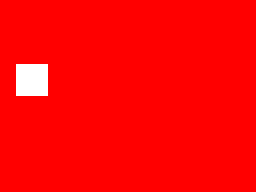
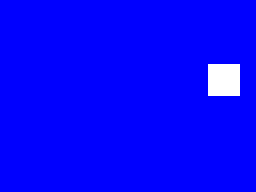
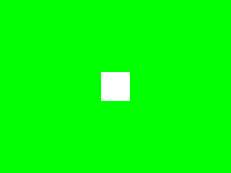
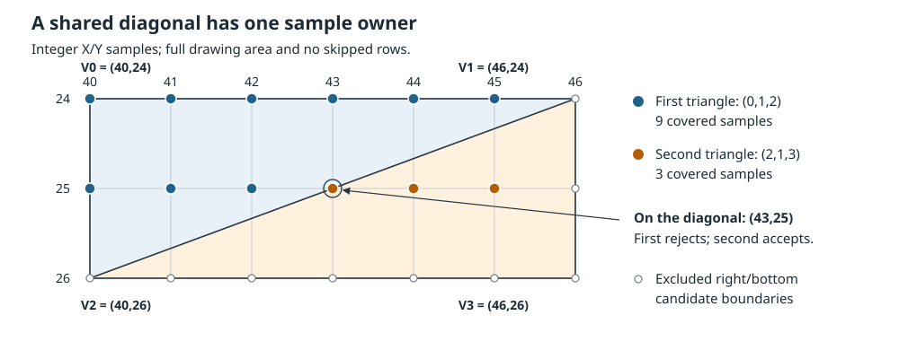
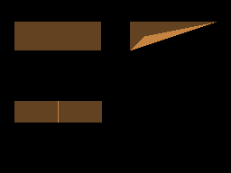
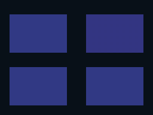
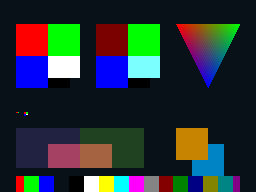

# GPU Drawing Engine {#sec-gpu}

## Outline {#sec-gpu-function-and-data-flow}

The GPU draws polygons, lines and rectangles into its 2 MiB video memory
(VRAM). Polygons are used for scaled or turned surfaces, rectangles for sprites
and tiles, and lines for outlines. The drawing commands give positions,
colours and texture coordinates; the drawing settings (drawing area, offset,
texture page, blending and mask bits) are kept in the GPU and apply to all
following commands.

Commands and their parameters are 32-bit words written to the GP0 port. The
GPU executes them in order. The CPU writes them through a 16-word FIFO; DMA
writes them through a separate 256-word buffer. A command may be split across
DMA bursts. The GP1 port takes control commands: reset, DMA direction, status
queries and display settings.

VRAM also holds textures and palettes. Commands fill VRAM, upload images to it,
copy within it and read images back through GPUREAD. These commands are part of
the same ordered command stream as the drawing commands.

The PCRTC shows a part of VRAM on the screen; see the [PCRTC chapter](pcrtc.md#sec-pcrtc).
For three-dimensional graphics, transform and project the vertices with the
GTE, then send the screen positions and colours to the GPU. Colours and
texture coordinates are interpolated linearly in screen space; a quadrilateral
is drawn as two triangles. The GPU draws in command order, so the program
sends overlapping polygons in the order in which they must appear.

## Example: drawing a rectangle {#sec-gpu-draw-one-colored-shape}

### Shape and colour {#sec-gpu-choose-the-geometry-and-its-color-source}

A triangle has three corners; a quadrilateral four, drawn as two triangles. A
rectangle has a position and a size. A line has two end points. The colour is
either one colour for the whole shape (flat), a colour per corner that is
interpolated (Gouraud), or a texture. See
@sec-gpu-choose-a-primitive-for-the-required-image.

This example draws an opaque quadrilateral of one colour, (124, 100, 160):

| Corner | Position |
|---|---|
| V0 | (40, 24) |
| V1 | (46, 24) |
| V2 | (40, 26) |
| V3 | (46, 26) |

The GPU draws the triangles (V0, V1, V2) and (V2, V1, V3). Together they cover
X = 40…45 on lines 24 and 25: twelve pixels. The right edge (X = 46) and the
bottom edge (Y = 26) are not drawn; see @sec-gpu-predict-shared-edge-and-joint-writes.

### Drawing area {#sec-gpu-select-the-drawing-destination}

The **drawing offset** is added to all positions; the **drawing area** limits
where pixels may be written. Here the offset is 0 and the drawing area
(0, 0)–(63, 31). Do not draw in the [BIOS VRAM area](memory.md#sec-memory-firmware-reservation-in-vram).

VRAM consists of 1024 lines of 1024 16-bit words. The GPU stores a colour with
5 bits per component:

```text
RGB5 = (124 >> 3, 100 >> 3, 160 >> 3) = (15, 12, 20)
word = 15 | (12 << 5) | (20 << 10) = 518FH
```

All twelve pixels receive `518FH`; the surrounding words are not changed.

### The command {#sec-gpu-encode-and-submit-the-packet}

Command `28H` draws an opaque quadrilateral of one colour. Its first word holds
the command in bits 31–24 and R, G and B in the three low bytes: `28A0647CH`.
Four words follow with the corners, X in bits 15–0 and Y in bits 31–16.

```lua
local gp0<const>: *word = 0x0801023c
local gp1<const>: *word = 0x08010240
*gp0 = 0xe1000400                    -- Drawing mode: no dithering.
*gp0 = 0xe3000000                    -- Drawing area top left (0, 0).
*gp0 = 0xe4000000 | 63 | (31 << 10) -- Drawing area bottom right (63, 31).
*gp0 = 0xe5000000                    -- Drawing offset (0, 0).
*gp0 = 0xe6000000                    -- No mask bits.
*gp0 = 0x28a0647c                    -- Quadrilateral, colour (124, 100, 160).
*gp0 = 40 | (24 << 16)              -- V0
*gp0 = 46 | (24 << 16)              -- V1
*gp0 = 40 | (26 << 16)              -- V2
*gp0 = 46 | (26 << 16)              -- V3
while (*gp1 & 0x04000000) == 0 do   -- Wait until the GPU is idle.
end
```

The CPU may send further commands while the GPU draws. The last loop waits
until the GPU has finished.

### Showing the result {#sec-gpu-select-the-completed-pixels-for-display}

To show the pixels, set the PCRTC to GX16, VRAM word 0, image width 1024 and
start position (0, 0); the pixel at (40, 24) then appears at (40, 24) on the
screen. The new setting takes effect at the next VBlank. See the
[PCRTC example](pcrtc.md#sec-pcrtc-31-set-a-256-192-window-on-circuit-1) and
[double buffering](#sec-gpu-render-successive-frames).

## Specifications {#sec-gpu-technical-specifications}

| Item | Specification |
|---|---|
| VRAM | 2 MiB: 1024 × 1024 16-bit words |
| GP0 — `0801023CH` | Write: commands; read: GPUREAD |
| GP1 — `08010240H` | Write: control commands; read: GPUSTAT |
| Command FIFO | 16 words |
| DMA buffer | 256 words |
| Coordinates | −1024 to 1023 (11 bits, signed) |
| Colours | R, G, B 8 bits each; stored as 5 bits each plus a mask bit |
| Largest triangle | 1024 × 512 pixels |
| Clock | 33,868,800 Hz; command times in half cycles |

A triangle wider than 1024 or higher than 512 pixels (after the offset is
added) is not drawn. For a quadrilateral, this applies to each triangle.

### Command time

Each command takes a number of **ticks**; two ticks are one system cycle. A
command of N ticks that starts at cycle C is finished at C + N/2 (rounded up).
The next command starts when the previous one has finished. The CPU continues
while the GPU draws.

Examples: filling 32 × 4 pixels takes 46 + (32/8 + 9) × 4 = 98 ticks (49
cycles); copying 3 × 5 pixels takes 2 × 3 × 5 = 30 ticks (15 cycles). The times
of all commands are given in their sections.

An image upload or readback command itself takes 1 tick; the data is then
transferred word by word.

## Ports {#sec-gpu-gp0-gpuread-gp1-and-gpustat}

| Address | Write | Read | After reset |
|---|---|---|---|
| `0801023CH` | GP0: command words | GPUREAD | `00000000H` |
| `08010240H` | GP1: control commands | GPUSTAT | `14922000H` |

### Access {#sec-gpu-access-and-ordering}

Access GP0 and GP1 with aligned 32-bit words; see the
[register access rules](memory.md#sec-memory-io-widths-and-read-side-effects).
An 8-bit read of GP0 is a full read and can take a word from a readback. A
64-bit access at GP0 writes GP0 and then GP1, not two GP0 words.

### GPUSTAT {#sec-gpu-gpustat-fields}

| Bits | Field |
| --- | --- |
| 31 | Displayed line odd/even |
| 30–29 | DMA direction (GP1(04h)) |
| 28 | DMA buffer empty: DMA may send |
| 27 | Readback data ready |
| 26 | GPU idle |
| 25 | DMA request |
| 24 | GPU interrupt request (GP0(1Fh)) |
| 23 | Display disabled (GP1(03h)) |
| 22 | Vertical interlace (GP1(08h) bit 5) |
| 21 | 24-bit display colour (GP1(08h) bit 4) |
| 20 | PAL (GP1(08h) bit 3) |
| 19 | Vertical resolution (GP1(08h) bit 2) |
| 18–17 | Horizontal resolution 1 (GP1(08h) bits 1–0) |
| 16 | Horizontal resolution 2 (GP1(08h) bit 6) |
| 15 | Texture page Y bit 9 (E1 bit 11) |
| 14 | 0 |
| 13 | Interlace field |
| 12 | Mask check (E6 bit 1) |
| 11 | Set mask bit (E6 bit 0) |
| 10–0 | Drawing mode (E1 bits 10–0) |

: {tbl-colwidths="[12,88]"}

Bit 25 is 0 with DMA direction 0, bit 28 with directions 1 and 2, and bit 27
with direction 3. Bit 13 is 1 unless interlace is on and the PCRTC field is 1.
Bit 31 is (display start Y + field) AND 1 with interlace and vertical
resolution on, otherwise (display start Y + half-line / 2) AND 1.

### Waiting {#sec-gpu-idle-dma-acceptance-and-cpu-admission-are-different-tests}

**Bit 26 (idle)** is 1 when no command is being executed, both FIFOs are
empty, no command is partly received and no readback is in progress.

**Bit 28** is 1 when the DMA buffer is empty, so that DMA can send the next
burst.

A **CPU write to GP0** waits while the command FIFO is full, the DMA buffer is
not empty or a DMA channel is sending to GP0. It does not wait for the GPU to be
idle. Writes to GP1 do not wait for GP0.

### GPUREAD {#sec-gpu-gpuread-and-status-do-not-return-the-same-result}

GPUREAD holds the result of the last status query or the last readback word.

| State | GP0 read returns |
|---|---|
| No readback data ready | The last value of GPUREAD |
| Readback data ready | The next two pixels (first pixel in bits 15–0) |
| Readback data ready, DMA reading | The last value of GPUREAD; nothing is taken |

When the number of pixels is odd, the last word has 0 in bits 31–16. After the
last word, the GPU continues with the following commands.

### Reset {#sec-gpu-reset-and-display-visibility}

| Setting | Value after reset |
|---|---|
| Drawing mode, texture window, drawing area, offset, mask setting | 0 |
| Display start | 0 |
| Display mode | `00000009H` |
| Horizontal display range | `00C60260H` |
| Vertical display range | `00044C23H` |
| VRAM Y extension | 0 |
| DMA direction, interrupt request | 0 |

Reset does not clear VRAM. When a program starts, the BIOS has already used
VRAM for its terminal; clear the areas the program uses.

## GP1 control commands {#sec-gpu-gp1-control-commands}

A GP1 command is written as one word to `08010240H`: the command in bits 31–24
and the parameter in bits 23–0. GP1 commands take effect at once; they do not
pass through the command FIFO and do not wait for drawing to finish.

| Command | Function |
|---|---|
| `00H` | Reset |
| `01H` | Clear command FIFO |
| `02H` | Clear interrupt request |
| `03H` | Display on/off |
| `04H` | DMA direction |
| `05H` | Display start |
| `06H` | Horizontal display range |
| `07H` | Vertical display range |
| `08H` | Display mode |
| `09H` | VRAM Y extension |
| `10H`–`1FH` | Status query |

### GP1(00h) — reset {#sec-gpu-gp100h-reset-gpu-command-and-register-state}

**Word:** `00000000H`.

Clears the command FIFO as GP1(01h) and sets the GPU settings to their reset
values (see [reset](#sec-gpu-reset-and-display-visibility)); the display is
switched off. GPUREAD, the VRAM Y extension, VRAM and the PCRTC are not changed.
The GPU bit in the interrupt controller is not cleared.

### GP1(01h) — clear command FIFO {#sec-gpu-gp101h-clear-the-gp0-stream}

**Word:** `01000000H`.

Empties the command FIFO and the DMA buffer, discards a partly received command
and stops a readback. A command being executed is completed. An image upload
that has received part of its pixels writes those pixels and ends. The drawing
settings are not changed.

### GP1(02h) — clear interrupt request {#sec-gpu-gp102h-acknowledge-the-gpu-request-latch}

**Word:** `02000000H`.

Clears GPUSTAT bit 24, so that the next GP0(1Fh) can request an interrupt.
Clear `IRQ_GPU` in the interrupt controller as well; see
[device and controller acknowledgement](irq.md#sec-irq-acknowledge-the-source-and-the-controller-separately).

### GP1(03h) — display on/off {#sec-gpu-gp103h-set-display-disable-state}

**Word:** `03000000H` (on) or `03000001H` (off). Sets GPUSTAT bit 23. The
PCRTC settings are not changed.

### GP1(04h) — DMA direction {#sec-gpu-gp104h-select-dma-direction-and-request-source}

**Word:** `04000000H` + direction.

| Direction | Function | DMA request when |
|---|---|---|
| 0 | Off | Never |
| 1 | FIFO | The DMA buffer is empty |
| 2 | CPU → GP0 | The DMA buffer is empty |
| 3 | GPUREAD → CPU | Readback data is ready |

The DMA channel itself is programmed separately; see the [DMA chapter](dma.md#sec-dma).

### GP1(05h) — display start {#sec-gpu-gp105h-set-the-gpu-display-start-word}

**Word:** `05000000H` + start. X = bits 9–1 × 2 (even), Y = bits 19–10 (9 or 10
bits, see GP1(09h)). This setting is used for GPUSTAT bit 31; the picture
shown is set in the PCRTC.

### GP1(06h) — horizontal display range {#sec-gpu-gp106h-retain-horizontal-display-range-state}

**Word:** `06000000H` + range (24 bits). Stored only; the picture shown is set
in the PCRTC.

### GP1(07h) — vertical display range {#sec-gpu-gp107h-set-vertical-display-range-state}

**Word:** `07000000H` + range. Bits 9–0: start; bits 19–10: end. Stored only.

### GP1(08h) — display mode {#sec-gpu-gp108h-set-gpu-display-mode-fields}

**Word:** `08000000H` + mode.

| Bits | Field | GPUSTAT |
| --- | --- | --- |
| 1–0 | Horizontal resolution 1 | 18–17 |
| 2 | Vertical resolution | 19 |
| 3 | PAL | 20 |
| 4 | 24-bit colour | 21 |
| 5 | Vertical interlace | 22 |
| 6 | Horizontal resolution 2 | 16 |
| 7 | — | — |

: {tbl-colwidths="[12,44,44]"}

These bits are reported in GPUSTAT. The screen mode itself is set in the PCRTC.

### GP1(09h) — VRAM Y extension {#sec-gpu-gp109h-select-the-vram-y-address-gate}

**Word:** `09000000H` (Y addresses 9 bits, 0–511) or `09000001H` (10 bits,
0–1023). Use `09000001H` to draw in the whole of VRAM. A drawing command uses
the setting in effect when it starts.

### Other values {#sec-gpu-opcode-boundaries-and-display-visibility}

Other command values have no effect.

## Status query {#sec-gpu-query-drawing-state-through-gpuread}

GP1 commands `10H`–`1FH` (all the same) put a setting in GPUREAD, selected by
bits 3–0 of the parameter. Read it from GP0.

| Bits 3–0 | GPUREAD |
|---|---|
| `02H` | Texture window (E2), 20 bits |
| `03H` | Drawing area top left (E3), 20 bits |
| `04H` | Drawing area bottom right (E4), 20 bits |
| `05H` | Drawing offset (E5), 22 bits |
| `07H` | `00000002H` |
| `08H` | `00000000H` |
| Others | Unchanged |

When readback data is ready, a GP0 read returns the readback data instead and
replaces the query result.

Example, with texture window `00010C62H` and a readback of the three pixels
`001FH`, `03E0H`, `7C00H`:

| Action | GP0 read returns |
|---|---|
| GP1 `1F345672H` (query 2) | `00010C62H` |
| GP1 `10000006H` (query 6: no effect) | `00010C62H` |
| Readback ready; GP1 `10000007H` | `03E0001FH` (readback data) |
| Read again | `00007C00H` |
| Read again | `00007C00H` (unchanged) |

## Double buffering {#sec-gpu-render-successive-frames}

Use two areas of VRAM: while the PCRTC shows one (the front buffer), the GPU
draws the next picture in the other (the back buffer). When the picture is
finished, select it in the PCRTC and wait for the next VBlank before drawing in
the old front buffer again.

| Step | What to do |
|---|---|
| Choose the areas | Two areas of VRAM that are not used for textures, palettes or the [BIOS](memory.md#sec-memory-firmware-reservation-in-vram). |
| Draw | Send all commands of the picture. |
| Wait for the GPU | Wait for GPU idle (GPUSTAT bit 26). |
| Select the picture | Write the PCRTC settings; see @sec-pcrtc-26-programmed-words-and-displayed-settings. |
| Wait for VBlank | Wait for a VBlank that occurs after the last write; see [below](#sec-memory-a-display-switch-selects-storage-it-does-not-save-it). |

### VRAM use {#sec-memory-shared-gpu-storage-and-display-publication}

All uses share the same VRAM: pictures, textures, palettes and the image the
PCRTC shows. The program decides which area serves which purpose.

| Use | When VRAM is read or written |
|---|---|
| Upload from RAM | The words are copied when they arrive at GP0 |
| Texture, palette, copy source | When the command is executed |
| Drawing | When the command is executed |
| PCRTC | Continuously, while the area is shown |
| Readback | The pixels are copied when the readback starts |

### Order of commands {#sec-memory-command-order-is-not-resource-allocation}

A drawing command reads its texture when it is executed, not when it is sent.
A texture may therefore be replaced by a later upload in the command stream;
commands sent before the upload still use the old texture.

DMA DONE means that the words have been delivered; a GP0(1Fh) marker that the
commands before it have been executed; GPU idle that all commands have been
executed. None of them means that a picture is on the screen.

### Switching the display {#sec-memory-a-display-switch-selects-storage-it-does-not-save-it}

Switching the PCRTC to another area changes which VRAM it reads; it does not
copy the picture. Finish drawing before switching, and do not draw in an area
while it is shown.

To wait for a VBlank that occurs after the switch:

1. Write 0 to the interrupt MASK.
2. Write the PCRTC settings.
3. Write 4 to ACK (clear a pending VBlank) and read the VBlank counter of the
   interrupt handler.
4. Write 4 to MASK and wait until the counter changes.

### Example: two pictures {#sec-memory-prepare-publish-and-reuse-two-surfaces}

This example fills two pictures, A and B, shows A, then B, draws A again while
B is shown, and shows A again. Both lie outside the BIOS VRAM area (here
(704, 720) to (1023, 971)).

| Picture | VRAM area | DISPFB1_LOW | First word |
|---|---|---|---|
| A | (0, 0)–(255, 191) | `000FA000H` | `00000H` |
| B | (0, 256)–(255, 447) | `000FA040H` | `40000H` |

DISPFB1_HIGH is 0. Both use GX16 with an image width of 1024. DISPLAY1_LOW =
`01800000H` and DISPLAY1_HIGH = `000BF3FFH` give a 256 × 192 picture.

#### Preparation {#sec-memory-prepare-the-storage-and-display-route}

```lua
bss vblank_sequence: word
function irq(flags)
    if (flags & 4) ~= 0 then
        *vblank_sequence = *vblank_sequence + 1
    end
    mem[0x08000004] = flags & 4
end
mem[0x08000008] = 0           -- Mask interrupts.
mem[0x080103d4] = 0x00000200  -- PCRTC reset.
mem[0x08010354] = 0           -- PMODE: display off.
mem[0x0801035c] = 0x000fa000  -- DISPFB1_LOW: picture A.
mem[0x08010360] = 0           -- DISPFB1_HIGH
mem[0x08010364] = 0x01800000  -- DISPLAY1_LOW
mem[0x08010368] = 0x000bf3ff  -- DISPLAY1_HIGH
mem[0x08010240] = 0x09000000  -- VRAM Y extension off.
```

Then fill the pictures with four fill commands to GP0 (`0801023CH`):

| Fill | Command and colour | Position | Size |
| --- | --- | --- | --- |
| A red | `020000FFH` | `00000000H` | `00C00100H` |
| White square on A | `02FFFFFFH` | `00400010H` | `00200020H` |
| B blue | `02FF0000H` | `01000000H` | `00C00100H` |
| White square on B | `02FFFFFFH` | `014000D0H` | `00200020H` |

To check, read back one pixel of each picture (`C0000000H`, position,
`00010001H`; wait for GPUSTAT bit 27; read GP0): A gives `0000001FH`, B
`00007C00H`. Then wait for GPU idle.

#### Showing A, then B {#sec-memory-publish-a-then-b}

```lua
mem[0x08010354] = 0x0000ff21  -- PMODE: circuit 1 on.
mem[0x08000004] = 4
local before = *vblank_sequence
mem[0x08000008] = 4
while *vblank_sequence == before do
    halt_until_irq
end
```

To show B:

```lua
mem[0x08000008] = 0
mem[0x0801035c] = 0x000fa040
mem[0x08000004] = 4
local before = *vblank_sequence
mem[0x08000008] = 4
while *vblank_sequence == before do
    halt_until_irq
end
```

While B is shown, redraw A green with GP0 `0200FF00H`, `00000000H`,
`00C00100H` and a white square `02FFFFFFH`, `00500070H`, `00200020H`, wait for
GPU idle, and show A again with DISPFB1_LOW = `000FA000H`.

#### Results {#sec-memory-what-each-phase-establishes}

| Pixel | After filling | After redrawing A |
| --- | --- | --- |
| A (0, 0) | `0000001FH` (red) | `000003E0H` (green) |
| B (0, 256) | `00007C00H` (blue) | `00007C00H` (blue) |

When A is shown again, the screen shows its new green contents.

#### Pictures {#sec-memory-ordinary-playback-pictures}

| A | B | A redrawn |
|---|---|---|
| {#fig-memory-display-a-red} | {#fig-memory-display-b-blue} | {#fig-memory-display-a-green} |
| Red; white square (16, 64)–(47, 95) | Blue; white square (208, 64)–(239, 95) | Green; white square (112, 80)–(143, 111) |

## CPU and DMA {#sec-gpu-hand-a-gp0-stream-between-cpu-and-dma}

### Sending by DMA {#sec-gpu-a-stalled-cpu-store-is-not-an-admitted-dma-block}

DMA writes go to the 256-word DMA buffer. At the end of each burst the words
pass on to the command FIFO. While a DMA channel is sending to GP0, CPU writes
to GP0 wait until the channel has finished.

### Bursts and commands {#sec-gpu-a-dma-block-boundary-is-not-a-gp0-packet-boundary}

A command may be split across DMA bursts; the GPU continues the command with
the next word. The end of a DMA transfer does not end a command or a polyline.
Commands need not be padded or aligned.

### Readback by DMA {#sec-gpu-keep-ownership-separate-from-ready-and-access-width}

While a DMA channel is reading GPUREAD, CPU reads of GP0 return the last value
and take no data, even when GPUSTAT bit 27 is set. Read readback data with
32-bit word reads only.

## VRAM layout {#sec-gpu-organize-local-memory-for-drawing-and-display}

VRAM holds 1024 lines of 1024 16-bit words (2 MiB). The word at (X, Y) is:

```text
word number = (1024 × Y + (X AND 3FFH)) AND FFFFFH
byte offset = 2 × word number
```

X wraps within the line. With the VRAM Y extension off (GP1(09h)), the Y
addresses of transfers, the drawing area, texture pages and palettes use 9
bits (0–511); with it on, 10 bits (0–1023). Thus (32, 512) is word `00000020H`
with the extension off and `00080020H` with it on.

A pixel word holds R in bits 4–0, G in bits 9–5, B in bits 14–10 and the mask
bit in bit 15.

Example: a 2 × 2 image at (32, 16):

| Position | Word | Byte offset | Contents |
|---|---|---|---|
| (32, 16) | `00004020H` | `00008040H` | `001FH` red |
| (33, 16) | `00004021H` | `00008042H` | `03E0H` green |
| (32, 17) | `00004420H` | `00008840H` | `7C00H` blue |
| (33, 17) | `00004421H` | `00008842H` | `FFFFH` white, mask bit set |

The second line begins 1024 words after the first. The GPU draws in this
linear layout; the PCRTC shows it with format GX16.

## Choosing a shape {#sec-gpu-choose-a-primitive-for-the-required-image}

| Image | Shape | Values |
|---|---|---|
| Area of one colour, square to the axes | Rectangle | Colour, position, size |
| Sprite or tile | Textured rectangle | Colour, position, U/V, size |
| Straight lines | Line or polyline | One colour, or a colour per end point |
| Three corners | Triangle | One colour or three; optional U/V per corner |
| Four corners | Quadrilateral | As triangle; drawn as two triangles |

Rectangles are 1 × 1, 8 × 8, 16 × 16 or a given size of up to 1023 × 511.

### Which pixels are drawn {#sec-gpu-a-small-area-with-explicit-sample-limits}

A rectangle at (40, 24) of 4 × 3 pixels covers X = 40…43 and Y = 24…26: twelve
pixels. The right edge (44) and the bottom edge (27) are not drawn. A
quadrilateral with corners (40, 24), (44, 24), (40, 27), (44, 27) covers the
same pixels, as two triangles that share the diagonal from corner 1 to corner 2:

| Triangle | Corners |
|---|---|
| First | 0, 1, 2 |
| Second | 2, 1, 3 |

Pixels on the diagonal are drawn by one of the two triangles. When the
corners are given such that the triangles overlap, pixels can be drawn twice.

### Colour and texture {#sec-gpu-color-and-texture-choices-are-independent-of-the-corner-count}

A Gouraud triangle interpolates the colours of its corners linearly across the
screen. In a quadrilateral, each of the two triangles is interpolated on its
own; the colour is not blended between all four corners.

Textured triangles and rectangles take their colours from VRAM. They can use
the texture colour as it is (raw) or multiplied by the given colour
(modulated). Lines have no texture.

A line from one end point to the other draws max(|dx|, |dy|) + 1 pixels,
including both end points. Two lines of a polyline therefore both draw their
common point.

## Coordinates and the drawing area {#sec-gpu-place-primitives-across-coordinate-boundaries}

Coordinates are 11-bit signed numbers (−1024 to 1023): only bits 10–0 of each
16-bit X and Y are used, so `03FFH` is 1023, `0400H` is −1024, and both `07E0H`
and `FFE0H` are −32. The drawing offset (E5) has X in bits 10–0 and Y in bits
21–11, with the same format.

The drawing offset is added to the coordinates; the result can then lie
outside −1024…1023. Each kind of shape handles this differently:

- **Triangles** are not drawn if they are wider than 1024 or higher than 512.
  If the smallest X (or Y) of the three corners is below −1024, 2048 is added
  to all X (or Y).
- **Rectangles**: the position plus offset is taken as an 11-bit signed number.
- **Lines**: each pixel position is taken as an 11-bit signed number.

Example: offset X = −1024, Y = 16 (E5 word `00008400H`), drawing area (0, 0)–
(1023, 511):

| Given | Plus offset | Triangle | Rectangle |
|---|---|---|---|
| (−32, 0) | (−1056, 16) | (992, 16) | (992, 16) |
| (32, 0) | (−992, 16) | (1056, 16) | (−992, 16) |
| (0, 32) | (−1024, 48) | (1024, 48) | |

The drawing area includes its right and bottom edge: (0, 0)–(1023, 511)
allows 0 ≤ X < 1024 and 0 ≤ Y < 512. X limits are 10 bits; Y limits 9 bits, or
10 bits with the VRAM Y extension on. If the left limit is greater than the
right limit (or top greater than bottom), nothing is drawn.

When vertical resolution and interlace are both on (GPUSTAT bits 19 and 22)
and drawing to the displayed field is off (E1 bit 10 = 0), lines of the
displayed field are not drawn.

## Triangle edges {#sec-gpu-predict-shared-edge-and-joint-writes}

A pixel (X, Y) belongs to a triangle when it lies inside all three edges. For
corners (x0, y0), (x1, y1), (x2, y2):

```text
A = (x2 − x0) × (y1 − y0) − (y2 − y0) × (x1 − x0)
s = +1 if A > 0, −1 if A < 0
```

For each edge v1→v2, v2→v0, v0→v1, from (ax, ay) to (bx, by):

```text
E(X, Y) = s × ((X − ax) × (by − ay) − (Y − ay) × (bx − ax))
stepX   = s × (by − ay)
stepY   = −s × (bx − ax)
minimum = 0 if stepX > 0, or stepX = 0 and stepY > 0; otherwise 1
```

The pixel is drawn when E ≥ minimum for all three edges. This draws pixels on
left and top edges and leaves out those on right and bottom edges, so that a
pixel on an edge shared by two triangles is drawn once. A triangle with A = 0
draws nothing. Both directions of the corners are drawn. Rectangles draw
their left and top edge and leave out their right and bottom edge.

Example: the quadrilateral (40, 24), (46, 24), (40, 26), (46, 26):

| Y | First triangle | Second triangle |
|---|---|---|
| 24 | X = 40…45 | — |
| 25 | X = 40…42 | X = 43…45 |

{#fig-gpu-shared-edge}

The pixel (43, 25) lies exactly on the diagonal and is drawn by the second
triangle only. With additive blending, each of the twelve pixels is written
once. If the fourth corner is moved to (41, 25), the triangles overlap and the
pixels (41, 25) and (42, 25) are drawn twice.

The polyline (40, 30) → (43, 30) → (46, 30) draws (43, 30) twice: once as the
end of the first line and once as the start of the second.

### Example {#sec-gpu-see-shared-edges-and-repeated-writes}

This picture uses additive blending with colour (96, 64, 32): one write gives
`110CH`, two writes `2218H` (bright).

{#fig-gpu-coverage-controls}

| Area | Shape | Result |
|---|---|---|
| Top left | Quadrilateral (16, 24), (112, 24), (16, 56), (112, 56) | Drawn once everywhere |
| Top right | Quadrilateral (144, 24), (240, 24), (144, 56), (160, 40) | Bright where the triangles overlap |
| Bottom left | 24 polylines X = 16 → 64 → 112, Y = 112…135 | Bright column at X = 64 |

#### Program {#sec-gpu-submit-the-coverage-examples}

With the drawing settings of the [programming example](#sec-gpu-program-a-complete-picture-in-blua):

```lua
rodata drawing_commands: word[] = {
    0x02000000, 0, 256 | (192 << 16),
    0x2a204060,
    16 | (24 << 16), 112 | (24 << 16),
    16 | (56 << 16), 112 | (56 << 16),
    0x2a204060,
    144 | (24 << 16), 240 | (24 << 16),
    144 | (56 << 16), 160 | (40 << 16),
}
*gp0 = 0xe1000420                 -- Additive blending, no dithering.
for index = 0, #drawing_commands - 1 do
    *gp0 = drawing_commands[index]
end
for y = 112, 135 do
    *gp0 = 0x4a204060
    *gp0 = 16 | (y << 16)
    *gp0 = 64 | (y << 16)
    *gp0 = 112 | (y << 16)
    *gp0 = 0x50005000             -- End of polyline.
end
```

## Interpolation {#sec-gpu-predict-interpolated-colors-and-texture-coordinates}

A Gouraud triangle interpolates R, G and B; a textured triangle U and V. Each
value is a linear function of the screen X and Y. There is no perspective
correction: the program chooses the vertices so that the texture looks right.

### Calculation {#sec-gpu-form-a-finite-plane-not-an-ideal-interpolator}

For corners (x0, y0), (x1, y1), (x2, y2) with values a0, a1, a2:

```text
D  = (x1 − x0) × (y2 − y0) − (x2 − x0) × (y1 − y0)
Nx = (a1 − a0) × (y2 − y1) − (a2 − a1) × (y1 − y0)
Ny = (x1 − x0) × (a2 − a1) − (x2 − x1) × (a1 − a0)
sx = 4096 × Nx / D, rounded towards 0, as a 20-bit signed number
sy = 4096 × Ny / D, rounded towards 0, as a 20-bit signed number
```

The steps are 20 bits wide; a larger step wraps around. The start value is
taken at one corner, chosen as follows:

| Condition | Corner |
|---|---|
| x1 ≤ x0 and x2 ≤ x1 | 2 |
| x1 ≤ x0 and x2 > x1 | 1 |
| x1 > x0 and x2 < x0 | 2 |
| x1 > x0 and x2 ≥ x0 | 0 |

```text
start      = (4096 × a + 2048 − x × sx − y × sy) AND FFFFFH     (a, x, y of that corner)
value(X,Y) = ((start + X × sx + Y × sy) >> 12) AND FFH
```

The value wraps around rather than being limited to 0–255.

### Example {#sec-gpu-a-half-count-that-the-quantized-slope-does-not-reach}

| Corner | X | Y | Value |
|---|---:|---:|---:|
| 0 | 0 | 0 | 10 |
| 1 | 7 | 0 | 250 |
| 2 | 0 | 6 | 11 |

D = 42; corner 0 is the start. sx = 140434 (`22492H`), sy = 682 (`002AAH`),
start = 43008 (`0A800H`).

| Pixel | Sum | Value |
|---|---:|---:|
| (0, 3) | 45054 | 10 |
| (1, 3) | 185488 | 45 |
| (2, 3) | 325922 | 79 |
| (3, 3) | 466356 | 113 |

The exact value at (0, 3) is 10.5; the rounded steps give 10.

With values (250, 10, 249) instead, sx = −140434 (`DDB6EH`), sy = −682
(`FFD56H`), start = `FA800H`, and (0, 3) gives 250.

## Lines {#sec-gpu-predict-line-samples-and-color-ramps}

If the first end point has a larger X than the second, the two end points are
exchanged together with their colours. With ΔX = x1 − x0, ΔY = y1 − y0 and
N = max(|ΔX|, |ΔY|), the line has N + 1 pixels, k = 0…N. A line with N = 0 draws
one pixel with the first colour.

Position, with S = 2^32^ (for N > 0):

```text
dX = (ΔX × S + sign(ΔX) × (N − 1)) / N        rounded towards 0
dY = (ΔY × S + sign(ΔY) × (N − 1)) / N        rounded towards 0
X(k) = floor((x0 × S + S/2 − 1024 + k × dX) / S)
Y(k) = floor((y0 × S + S/2 − b + k × dY) / S)     b = 1024 if dY < 0, else 0
```

Colour, for each of R, G, B:

```text
dC   = (C1 − C0) × 4096 / N                      rounded towards 0
C(k) = (C0 × 4096 + 2048 + k × dC) / 4096         rounded towards 0
```

Each pixel position is then taken as an 11-bit signed number and tested
against the drawing area. Lines are dithered when dithering is on (E1 bit 9),
for one colour as well as for a colour per end point.

Example: from (14, 5) with colour (20, 200, 40) to (10, 12) with
(220, 20, 180). The end points are exchanged; N = 7.

| k | Pixel | Colour | Word |
|---|---|---|---|
| 0 | (10, 12) | (220, 20, 180) | `585BH` |
| 1 | (11, 11) | (191, 46, 160) | `50B7H` |
| 2 | (11, 10) | (163, 71, 140) | `4514H` |
| 3 | (12, 9) | (134, 97, 120) | `3D90H` |
| 4 | (12, 8) | (106, 123, 100) | `31EDH` |
| 5 | (13, 7) | (77, 149, 80) | `2A49H` |
| 6 | (13, 6) | (49, 174, 60) | `1EA6H` |
| 7 | (14, 5) | (20, 200, 40) | `1722H` |

Pixels outside the drawing area are left out, but the colours of the others
stay the same.

For a vertical line the end points are not exchanged, so the direction can
change the rounding: (20, 20) with red 7 to (20, 26) with red 8 gives red 7 at
(20, 23); in the opposite direction red 8.

## Textures and palettes {#sec-gpu-locate-texture-texels-and-palette-colors}

U and V are 8-bit coordinates (0–255) within a texture page. The texture
window (E2) is applied to them first. The page and the colour depth are set by
the drawing mode (E1, or T1 in a textured polygon):

| Bits | Function |
|---|---|
| 3–0 | Page X, in units of 64 words |
| 4 | Page Y, in units of 256 lines |
| 11 | Page Y, in units of 512 lines |
| 8–7 | Colour depth |

| Depth | Texels per word | Word X | Texel |
|---|---|---|---|
| 0: 4-bit palette | 4 | page X + (U >> 2) | `(word >> (4 × (U AND 3))) AND 0FH` |
| 1: 8-bit palette | 2 | page X + (U >> 1) | `(word >> (8 × (U AND 1))) AND FFH` |
| 2, 3: 16-bit | 1 | page X + U | The whole word is the colour |

The word Y is page Y + V. X wraps within the VRAM line.

With a palette, the texel is an index into a palette (CLUT) in VRAM. The CLUT
value (in T0 of a textured command) gives its position: X = (CLUT AND 3FH) × 16,
Y = CLUT >> 6. A 4-bit palette has 16 entries, an 8-bit palette 256. An 8-bit
palette can wrap from X = 1023 to X = 0 on the same line.

### Example {#sec-gpu-a-packed-palette8-lookup-across-both-row-ends}

Page and depth `0000089FH` (page (960, 768), 8-bit palette), VRAM Y extension on,
no texture window, CLUT `E13FH` (palette at (1008, 900)). VRAM holds:

| Position | Word |
|---|---|
| (1023, 791) | `100FH` (indices) |
| (0, 791) | `1100H` (indices) |
| (1023, 900) | `001FH` (palette entry 15) |
| (0, 900) | `03E0H` (palette entry 16) |
| (1008, 900) | `7C00H` (palette entry 0) |
| (1, 900) | `0000H` (palette entry 17) |

With V = 23 (line 791):

| U | Word | Index | Colour |
|---|---|---|---|
| 126 | (1023, 791) | `0FH` | `001FH` |
| 127 | (1023, 791) | `10H` | `03E0H` |
| 128 | (0, 791) | `00H` | `7C00H` |
| 129 | (0, 791) | `11H` | `0000H` (transparent) |

Index 0 is an ordinary colour; only the colour word `0000H` is transparent.

With the VRAM Y extension off, the same values select page Y = 256 and palette
line 388.

The [programming example](#sec-gpu-program-a-complete-picture-in-blua) shows a
complete 4-bit palette texture.

### Texture window {#sec-gpu-replace-coordinate-bits-with-a-texture-window}

The texture window (E2) repeats a part of the texture. E2 holds the X mask
(bits 4–0), Y mask (9–5), X offset (14–10) and Y offset (19–15). For U and for
V:

```text
coordinate = (coordinate AND NOT(mask × 8)) OR ((offset AND mask) × 8)
```

Example: E2 = `00010C62H` gives X mask 2, Y mask 3, X offset 3, Y offset 2.
(U, V) = (6FH, 1FH) becomes (7FH, 17H).

## Textured rectangles {#sec-gpu-keep-a-clipped-or-flipped-rectangle-on-its-texture}

In a textured rectangle, U and V increase by 1 per pixel from the top-left
corner, or decrease by 1 when the rectangle is flipped (E1 bits 12 and 13):

```text
U = U0 ± (X − X0)
V = V0 ± (Y − Y0)
```

X0, Y0 is the corner given in the command, also when part of the rectangle lies
outside the drawing area. The texture window is applied afterwards. To show a
texture flipped, give U0 and V0 at the right or bottom edge of the texture.

Example: a rectangle at (10, 20) of 8 × 6 pixels, of which the drawing area
leaves X = 13…17 and Y = 22…25. U0 = 2, V0 = 1; texture window: X mask 1,
Y mask 3, Y offset 1. At (13, 22):

| Flip X | Flip Y | U, V | After the window |
|---|---|---|---|
| 0 | 0 | 5, 3 | 05H, 0BH |
| 1 | 0 | −1, 3 | F7H, 0BH |
| 0 | 1 | 5, −1 | 05H, EFH |
| 1 | 1 | −1, −1 | F7H, EFH |

Lines that are not drawn because of interlace still advance V.

## Texture colour and dithering {#sec-gpu-choose-texture-gain-and-dither-deliberately}

With a **raw** texture the texel colour is used as it is. With a **modulated**
texture each component is multiplied by the given colour, where 128 (`80H`)
leaves it unchanged:

```text
P = (T × C) >> 4          T = texture component (0–31), C = colour (0–255)
F = limit((P + d) >> 3, 0, 31)       d = dither value, or 0
```

A texel `0000H` is not drawn.

Example, texel `6208H` (8, 16, 24), no dithering:

| Colour | Result | Word |
|---|---|---|
| (128, 128, 128) | (8, 16, 24) | `6208H` |
| (64, 128, 192) | (4, 16, 31) | `7E04H` |
| (255, 255, 255) | (15, 31, 31) | `7FEFH` |

Colour 255 nearly doubles the texture, not leaves it unchanged.

Dithering adds a value d that depends on the screen position:

| Y AND 3 \ X AND 3 | 0 | 1 | 2 | 3 |
|---|---|---|---|---|
| 0 | −4 | 0 | −3 | +1 |
| 1 | +2 | −2 | +3 | −1 |
| 2 | −3 | +1 | −4 | 0 |
| 3 | +3 | −1 | +2 | −2 |

Dithering is used, when E1 bit 9 is set, for modulated textured polygons,
Gouraud polygons and all lines. It is not used for one-colour polygons, raw
textured polygons or rectangles. Without a texture, d is added to each colour
byte (limited to 0–255) before it is reduced to 5 bits.

Example, texel `3527H` (7, 9, 13), colour (124, 100, 160):

| Position | d | Result | Word |
|---|---|---|---|
| No dithering | 0 | (6, 7, 16) | `40E6H` |
| (18, 21) | +3 | (7, 7, 16) | `40E7H` |
| (16, 20) | −4 | (6, 6, 15) | `3CC6H` |

### Example: dithering {#sec-gpu-compare-polygon-dither-with-a-rectangle-control}

{#fig-gpu-dither-controls}

| Position | Shape | Dithering |
|---|---|---|
| Top left | Modulated textured quadrilateral | Off |
| Top right | Modulated textured quadrilateral | On |
| Bottom left | Modulated textured rectangle | Off |
| Bottom right | Modulated textured rectangle | On |

All four use texel `3527H` and colour (124, 100, 160). Only the top right is
dithered: rectangles are never dithered. Its first pixels hold:

| Y \ X | 144 | 145 | 146 | 147 |
|---|---|---|---|---|
| 24 | `3CC6H` | `40E6H` | `3CC6H` | `40E6H` |
| 25 | `40E7H` | `40C6H` | `40E7H` | `40C6H` |
| 26 | `3CC6H` | `40E6H` | `3CC6H` | `40E6H` |
| 27 | `40E7H` | `40C6H` | `40E7H` | `40C6H` |

With the drawing settings of the [programming example](#sec-gpu-program-a-complete-picture-in-blua):

```lua
rodata drawing_commands: word[] = {
    0x02181008, 0, 256 | (192 << 16),
    0x02684838, 640, 96 | (64 << 16),
    -- Quadrilateral, dithering off.
    0x2ca0647c,
    16 | (24 << 16), 0,
    112 | (24 << 16), 0x010a << 16,
    16 | (88 << 16), 0,
    112 | (88 << 16), 0,
    -- The same with dithering on (E1 bit 9).
    0xe100070a,
    0x2ca0647c,
    144 | (24 << 16), 0,
    240 | (24 << 16), 0x010a << 16,
    144 | (88 << 16), 0,
    240 | (88 << 16), 0,
    -- Rectangles, dithering off and on.
    0xe100050a,
    0x64a0647c, 16 | (112 << 16), 0, 96 | (64 << 16),
    0xe100070a,
    0x64a0647c, 144 | (112 << 16), 0, 96 | (64 << 16),
}
for index = 0, #drawing_commands - 1 do
    *gp0 = drawing_commands[index]
end
```

## Transparency, blending and mask bits {#sec-gpu-separate-texture-transparency-blending-and-destination-protection}

| Rule | Effect |
|---|---|
| Texel `0000H` | Not drawn |
| Semi-transparent command | Blends with the pixel in VRAM; with a texture only where bit 15 of the texel is 1 |
| Check mask (E6 bit 1) | Pixels whose bit 15 in VRAM is 1 are not overwritten |
| Set mask (E6 bit 0) | Bit 15 is set in every pixel written |

Blending, for each of R, G, B, with B the colour in VRAM and F the new colour
(5 bits each), selected by E1 bits 6–5:

| Selection | Result |
|---|---|
| 0 | (B + F) >> 1 |
| 1 | min(B + F, 31) |
| 2 | max(B − F, 0) |
| 3 | min(B + (F >> 2), 31) |

Example: VRAM `7445H` (5, 2, 29), new colour `1CE3H` (3, 7, 7):

| Selection | Result | Word |
|---|---|---|
| 0 | (4, 4, 18) | `4884H` |
| 1 | (8, 9, 31) | `7D28H` |
| 2 | (2, 0, 22) | `5802H` |
| 3 | (5, 3, 30) | `7865H` |

Raw textures over VRAM `7445H`, selection 0:

| Texel | Semi-transparent | Set mask | Result |
|---|---|---|---|
| `0000H` | Yes | 1 | `7445H` (not drawn) |
| `8000H` | Yes | 0 | `B822H` (blended black) |
| `8000H` | No | 0 | `8000H` (black) |
| `1CE3H` | Yes | 0 | `1CE3H` (bit 15 = 0: not blended) |
| `9CE3H` | No | 0 | `9CE3H` |
| `9CE3H` | Yes | 0 | `C884H` (blended) |
| `1CE3H` | Yes | 1 | `9CE3H` |

`8000H` is black, not transparent.

With check mask on, a pixel in VRAM with bit 15 = 1 (for example `F445H`) is
never overwritten. With both check mask and set mask on (E6 = 3), each pixel can
be drawn only once until the mask setting is changed.

Bit 15 of a pixel written is 1 with set mask; otherwise it is bit 15 of the
texel (textured), 0 (untextured), or bit 15 of the source (upload and copy).

## Fill, draw or transfer {#sec-gpu-choose-fill-drawing-or-a-raw-transfer}

| Operation | Use |
|---|---|
| Fill (02H) | Clear an area quickly |
| Rectangle (60H–7FH) | Draw with the drawing settings |
| Upload (A0H), copy (80H) | Move raw VRAM words |

They treat their size differently. For upload, copy and readback:

```text
W = ((width − 1) AND 3FFH) + 1
H = ((height − 1) AND 1FFH) + 1
```

| Width | Rectangle | Fill | Upload, copy, readback |
|---|---|---|---|
| 0 | Nothing | Nothing | 1024 |
| 1 | 1 | 16 | 1 |
| 16 | 16 | 16 | 16 |
| 1023 | 1023 | 1024 | 1023 |

Height 0 means nothing for fill and rectangle, 512 for transfers.

| Operation | Offset, drawing area | Mask bits | Interlace line skip |
|---|---|---|---|
| Fill | Not used | Not used | Used |
| Rectangle | Used | Used | Used |
| Upload, copy | Not used | Used | Not used |

Fill writes the colour with 5 bits per component and bit 15 = 0; its X position
is rounded down and its width up to a multiple of 16. Uploads and copies write
the words unchanged.

Example: (31, 20) and (31, 21) both hold `8010H`; odd lines are skipped:

| Operation | (31, 20) | (31, 21) |
|---|---|---|
| Red fill 1 × 2, check and set mask on | `001FH` | `8010H` |
| Red rectangle 1 × 2, check and set mask on | `8010H` | `8010H` |
| Upload `001FH`, `0000H`, check and set mask on | `8010H` | `8010H` |
| The same upload, set mask only | `801FH` | `8000H` |

The fill also writes X = 16…30 on line 20.

**Copying within a line.** When the destination lies a little to the right of
the source (`((target X − source X) AND 3FFH)` greater than 0 and less than W),
each line is copied from right to left, so that the copy is correct. Example:
3 words from X = 1022 to X = 1023: (`0011H`, `0022H`, `0033H`, `0044H`) at
X = 1022, 1023, 0, 1 become (`0011H`, `0011H`, `0022H`, `0033H`).

**Copying downward.** Lines are always copied from top to bottom. When the
destination lies below the source and overlaps it, lines already copied are
copied again:

| Y | Before (X = 1023, 0, 1) | After copying 3 × 3 from (1023, 510) to (1023, 511) |
|---|---|---|
| 510 | `0011H`, `0022H`, `0033H` | `0011H`, `0022H`, `0033H` |
| 511 | `0044H`, `0055H`, `0066H` | `0011H`, `0022H`, `0033H` |
| 0 | `0077H`, `0088H`, `0099H` | `0011H`, `0022H`, `0033H` |
| 1 | `00AAH`, `00BBH`, `00CCH` | `0011H`, `0022H`, `0033H` |

To move an area down, copy one line at a time from the bottom up, or use a
separate intermediate area.

Upload data is sent line by line, two pixels per word, the first in bits 15–0.
A 3 × 3 image takes five words; only the last word has an unused half.

## Programming example {#sec-gpu-program-a-complete-picture-in-blua}

This program draws one 256 × 192 picture with textured quadrilaterals, a
Gouraud triangle, blended and mask-protected rectangles and a palette texture,
reads three pixels back and draws them again.

### Ports and texture {#sec-gpu-ports-texture-and-command-storage}

```lua
module<entry>

local irq_ack<const>: *word = 0x08000004
local irq_mask<const>: *word = 0x08000008
local gp0<const>: *word = 0x0801023c
local gp1<const>: *word = 0x08010240
local pmode<const>: *word = 0x08010354
local framebuffer<const>: *word = 0x0801035c
local source<const>: *word = 0x08010360
local display_extent<const>: *word = 0x08010368
local pcrtc_csr<const>: *word = 0x080103d4

-- 4 × 4 texture, 16-bit colours.
rodata texels: u16[4][4] = {
	{ 0x001f, 0x001f, 0x03e0, 0x03e0 },
	{ 0x001f, 0x001f, 0x03e0, 0x03e0 },
	{ 0x7c00, 0x7c00, 0x7fff, 0x7fff },
	{ 0x7c00, 0x7c00, 0x8000, 0x0000 },
}
```

The last line contains black (`8000H`) and transparent (`0000H`).

### Commands {#sec-gpu-texture-uploads-and-drawing-packets}

```lua
-- Palette: entry 0 red, entry 3 transparent, entry 4 black.
rodata palette_colors: u16[16] = {
	0x001f, 0x03e0, 0x7c00, 0x0000, 0x8000, 0x7fff, 0x03ff, 0x7fe0,
	0x7c1f, 0x4210, 0x0010, 0x0200, 0x4000, 0x0210, 0x4200, 0x4010,
}
rodata palette_indices: u16[4] = { 0x3210, 0x7654, 0xba98, 0xfedc }

rodata drawing_commands: word[] = {
	-- Raw textured quadrilateral; T1 = 010AH: 16-bit, page (640, 0).
	0x2d808080,
	16 | (24 << 16), 0,
	80 | (24 << 16), 3 | (0x010a << 16),
	16 | (88 << 16), 3 << 8,
	80 | (88 << 16), 3 | (3 << 8),
	-- Modulated: red halved, green unchanged, blue × 1.5.
	0x2cc08040,
	96 | (24 << 16), 0,
	160 | (24 << 16), 3 | (0x010a << 16),
	96 | (88 << 16), 3 << 8,
	160 | (88 << 16), 3 | (3 << 8),
	-- Rectangle using the texture page set by the quadrilateral.
	0x65000000, 24 | (112 << 16), 0, 4 | (4 << 16),
	-- Gouraud triangle.
	0x300000ff, 176 | (24 << 16),
	0x0000ff00, 240 | (24 << 16),
	0x00ff0000, 208 | (88 << 16),
	-- Two rectangles, then an additive rectangle across both.
	0x60402020, 16 | (128 << 16), 64 | (40 << 16),
	0x60204020, 80 | (128 << 16), 64 | (40 << 16),
	0xe1000420,
	0x62202080, 48 | (144 << 16), 64 | (24 << 16),
	-- Set and check mask: the second rectangle cannot overwrite the first.
	0xe6000003,
	0x600080c0, 176 | (128 << 16), 32 | (32 << 16),
	0x60c08000, 192 | (144 << 16), 32 | (32 << 16),
	0xe6000000,
	-- 4-bit palette texture: page (704, 0), CLUT at (768, 256).
	0x2d000000,
	16 | (176 << 16), (16 << 8) | (0x4030 << 16),
	240 | (176 << 16), 15 | (16 << 8) | (0x000b << 16),
	16 | (192 << 16), 16 << 8,
	240 | (192 << 16), 15 | (16 << 8),
}
```

Each texel of the palette texture is a 4-bit index, the lowest bits first:
`3210H` selects entries 0, 1, 2 and 3.

### Readback storage {#sec-gpu-readback-storage-and-interrupts}

```lua
bss readback_words: word[2]

function irq(flags)
	*irq_ack = flags
end
```

### Settings and clearing {#sec-gpu-establish-the-drawing-and-display-domains}

```lua
*irq_mask = 0
*pcrtc_csr = 0x00000200             -- PCRTC and GPU reset.
*pmode = 0                          -- Display off.
*framebuffer = 0x000fa000           -- GX16, VRAM word 0, width 1024.
*source = 0
*display_extent = 0x000bf3ff        -- 256 × 192.
*gp1 = 0x09000000                   -- VRAM Y extension off.

*gp0 = 0xe1000400                   -- No dithering.
*gp0 = 0xe2000000                   -- No texture window.
*gp0 = 0xe3000000                   -- Drawing area (0, 0)…
*gp0 = 0xe40000ff | (191 << 10)     -- …(255, 191).
*gp0 = 0xe5000000                   -- Offset 0.
*gp0 = 0xe6000000                   -- No mask bits.
*gp0 = 0x02181008                   -- Fill (8, 16, 24): word 0C41H.
*gp0 = 0
*gp0 = 256 | (192 << 16)
```

### Uploads and drawing {#sec-gpu-upload-and-issue-the-stream-through-one-port}

```lua
-- Texture: 4 × 4 at (640, 0), eight words.
*gp0 = 0xa0000000
*gp0 = 640
*gp0 = 4 | (4 << 16)
local texture_words<const>: *word = texels
for index = 0, sizeof(u16[4][4]) // 4 - 1 do
	*gp0 = texture_words[index]
end
-- Palette: 16 × 1 at (768, 256).
*gp0 = 0xa0000000
*gp0 = 768 | (256 << 16)
*gp0 = 16 | (1 << 16)
local palette_words<const>: *word = palette_colors
for index = 0, sizeof(u16[16]) // 4 - 1 do
	*gp0 = palette_words[index]
end
-- Palette indices: 4 × 1 at (704, 16).
*gp0 = 0xa0000000
*gp0 = 704 | (16 << 16)
*gp0 = 4 | (1 << 16)
local index_words<const>: *word = palette_indices
for index = 0, sizeof(u16[4]) // 4 - 1 do
	*gp0 = index_words[index]
end
for index = 0, #drawing_commands - 1 do
	*gp0 = drawing_commands[index]
end
```

Every store goes to the same address, GP0.

### Readback {#sec-gpu-wait-for-readback-readiness-and-consume-its-full-count}

```lua
-- Read 3 pixels from (640, 0): two words.
*gp0 = 0xc0000000
*gp0 = 640
*gp0 = 3 | (1 << 16)
while (*gp1 & 0x08000000) == 0 do   -- Wait for readback data.
end
readback_words[0] = *gp0            -- 001F001FH
readback_words[1] = *gp0            -- 000003E0H
```

### Drawing the pixels read {#sec-gpu-use-the-returned-raw-representation-directly}

```lua
*gp0 = 0xa0000000
*gp0 = 16 | (112 << 16)
*gp0 = 3 | (1 << 16)
for index = 0, #readback_words - 1 do
	*gp0 = readback_words[index]
end
```

### Finishing {#sec-gpu-separate-the-marker-idle-and-display-hand-off}

```lua
*gp0 = 0x1f000000                   -- Interrupt request after all commands.
while (*gp1 & 0x01000000) == 0 do
end
*gp1 = 0x02000000                   -- Clear GPUSTAT bit 24.
*irq_ack = 0x00000040               -- Clear IRQ_GPU.
while (*gp1 & 0x04000000) == 0 do   -- Wait for GPU idle.
end
*pmode = 0x0000ff21                 -- Display on.
*irq_ack = 0xffffffff
*irq_mask = 0x00000004
while true do
	halt_until_irq
end
```

GPUSTAT bit 24 can be set before the GPU is idle, so the program waits for
both.

### Results {#sec-gpu-stored-word-results}

| Position | Word | Shows |
|---|---|---|
| (16, 24) | `001FH` | Raw red |
| (96, 24) | `000FH` | Red × ½ |
| (138, 68) | `7FEFH` | White modulated: red less, blue limited |
| (24, 112) | `001FH` | The rectangle uses the page of the quadrilateral |
| (26, 115) | `8000H` | Black texel |
| (27, 115) | `0C41H` | Transparent texel: background |
| (50, 150) | `3114H` | Additive over the first rectangle |
| (90, 150) | `2194H` | Additive over the second rectangle |
| (200, 150) | `8218H` | Protected by the mask bit |
| (220, 165) | `E200H` | Second rectangle, mask bit set |
| (16, 180) | `001FH` | Palette entry 0: red |
| (31, 180) | `03E0H` | Palette entry 1 |
| (46, 180) | `7C00H` | Palette entry 2 |
| (61, 180) | `0C41H` | Palette entry 3: transparent |
| (76, 180) | `8000H` | Palette entry 4: black |
| (91, 180) | `7FFFH` | Palette entry 5: white |

### Picture {#sec-gpu-gpu-output-plate}

{#fig-gpu-output-materials}

| Area | Contents |
|---|---|
| Quadrilateral (16, 24)–(80, 88) | Raw texture: red, green, blue, white, black and a transparent corner |
| Quadrilateral (96, 24)–(160, 88) | The same texture modulated |
| Rectangle (24, 112), 4 × 4 | The texture unscaled |
| Strip (16, 112), 3 × 1 | The three pixels read back |
| Triangle (176, 24), (240, 24), (208, 88) | Gouraud red, green, blue |
| Rectangles at (16, 128) and (80, 128), overlay at (48, 144) | Additive blending |
| Rectangles at (176, 128) and (192, 144) | The first protects the overlap |
| Strip (16, 176)–(240, 192) | The 16 palette colours |

## GP0 commands {#sec-gpu-frame-the-gp0-command-stream}

Bits 31–24 of the first word of a command select the command; the following
words are parameters of that command, whatever their contents.

### Command table {#sec-gpu-select-the-family-before-interpreting-option-bits}

| Command | Function |
|---|---|
| `02H` | Fill rectangle |
| `1FH` | Interrupt request |
| `20H`–`3FH` | Polygon |
| `40H`–`5FH` | Line, polyline |
| `60H`–`7FH` | Rectangle |
| `80H`–`9FH` | Copy within VRAM |
| `A0H`–`BFH` | Upload image to VRAM |
| `C0H`–`DFH` | Read image from VRAM |
| `E1H`–`E6H` | Drawing settings |

The low bits of the command select variants:

| Command | Bit 4 | Bit 3 | Bit 2 | Bit 1 | Bit 0 |
|---|---|---|---|---|---|
| Polygon | Gouraud | Quadrilateral | Texture | Semi-transparent | Raw texture |
| Line | Gouraud | Polyline | — | Semi-transparent | — |
| Rectangle | Size (with bit 3) | Size (with bit 4) | Texture | Semi-transparent | Raw texture |

Commands `00H`, `04H`–`1EH`, `E0H` and `E7H`–`EFH` are ignored. Commands `01H`,
`03H` and `F0H`–`FFH` are ignored and take 1 tick.

Colours have R in bits 7–0, G in 15–8 and B in 23–16. Positions have X in bits
10–0 and Y in bits 26–16, both signed 11-bit numbers.

### Command length {#sec-gpu-finish-the-current-packet-before-starting-another}

The GPU takes exactly the number of words a command needs. If a word is
missing, the next word is taken in its place. Image uploads take the number of
words given by their size.

A polyline continues until a terminator: a word with
`(word AND F000F000H) = 50005000H` at the place of the next vertex (for a
Gouraud polyline, at the place of its colour). Each new vertex draws a line
from the previous one at once.

Example, a Gouraud polyline followed by an E1 command:

| Word | Value | Meaning |
|---|---|---|
| 1 | `58000020H` | Gouraud polyline, colour (32, 0, 0) |
| 2 | `00180028H` | (40, 24) |
| 3 | `E10000FFH` | Colour (255, 0, 0): a parameter, not E1 |
| 4 | `0018002EH` | (46, 24) |
| 5 | `0000FF00H` | Colour (0, 255, 0) |
| 6 | `001A002EH` | (46, 26) |
| 7 | `5ABC5DEFH` | Terminator |
| 8 | `E1000000H` | E1 command |

## Polygons, one colour — GP0(20H–23H, 28H–2BH) {#sec-gpu-flat-untextured-polygons-gp020h23h28h2bh}

### Command {#sec-gpu-opcode-and-packet}

| Command | Shape | Blending | Words |
|---|---|---|---|
| `20H`, `21H` | Triangle | No | 4 |
| `22H`, `23H` | Triangle | Yes | 4 |
| `28H`, `29H` | Quadrilateral | No | 5 |
| `2AH`, `2BH` | Quadrilateral | Yes | 5 |

| Word | Triangle | Quadrilateral |
|---|---|---|
| 1 | Command + colour | Command + colour |
| 2 | P0 | P0 |
| 3 | P1 | P1 |
| 4 | P2 | P2 |
| 5 | — | P3 |

```text
colour = R | (G << 8) | (B << 16)
P      = (X AND 07FFH) | ((Y AND 07FFH) << 16)
```

### Drawing {#sec-gpu-drawing-state-and-geometry}

A quadrilateral is drawn as the triangles (0, 1, 2) and (2, 1, 3). The command
uses the drawing settings in effect when it is executed. These polygons are
not dithered. The positions are drawn as described under
[coordinates](#sec-gpu-place-primitives-across-coordinate-boundaries) and
[triangle edges](#sec-gpu-predict-shared-edge-and-joint-writes).

### Example {#sec-gpu-complete-packet-and-exact-result}

Drawing area (0, 0)–(63, 31), offset 0, VRAM `1882H` (2, 4, 6), additive blending
selected:

| Word | Value | Meaning |
|---|---|---|
| 1 | `28A0647CH` | Quadrilateral, colour (124, 100, 160) |
| 2 | `00180028H` | (40, 24) |
| 3 | `0018002EH` | (46, 24) |
| 4 | `001A0028H` | (40, 26) |
| 5 | `001A002EH` | (46, 26) |

The twelve pixels X = 40…45, Y = 24…25 become `518FH`. With command `2AH`
(blending), they become `6A11H` (17, 16, 26); with set mask on, `D18FH`.

### Time {#sec-gpu-command-cost}

Triangle 46 ticks, quadrilateral 82 ticks, plus per triangle (see
[command times](#sec-gpu-budget-command-work-separately-from-issuing-words)):

```text
p = (twice the area, with corners limited to the drawing area) >> 1
+ (p + 1) >> 1     with blending or mask check
÷ 2                when interlaced lines are skipped
```

| Command | Ticks | Cycles |
|---|---|---|
| Triangle | 46 + 6 = 52 | 26 |
| Quadrilateral | 82 + 6 + 6 = 94 | 47 |
| Quadrilateral, blended | 82 + 9 + 9 = 100 | 50 |

## Polygons, Gouraud — GP0(30H–33H, 38H–3BH) {#sec-gpu-gouraud-untextured-polygons-gp030h33h38h3bh}

| Command | Shape | Blending | Words |
|---|---|---|---|
| `30H`, `31H` | Triangle | No | 6 |
| `32H`, `33H` | Triangle | Yes | 6 |
| `38H`, `39H` | Quadrilateral | No | 8 |
| `3AH`, `3BH` | Quadrilateral | Yes | 8 |

```text
Triangle:      command + C0, P0, C1, P1, C2, P2
Quadrilateral: command + C0, P0, C1, P1, C2, P2, C3, P3
```

Bits 31–24 of C1–C3 are ignored. The colours are interpolated as described
under [interpolation](#sec-gpu-predict-interpolated-colors-and-texture-coordinates)
and dithered when dithering is on.

### Example {#sec-gpu-worked-six-word-triangle}

Drawing area (40, 24)–(44, 28), offset 0, no dithering:

| Word | Value | Meaning |
|---|---|---|
| 1 | `30C8280AH` | Triangle; C0 = (10, 40, 200) |
| 2 | `00180028H` | (40, 24) |
| 3 | `E12878FAH` | C1 = (250, 120, 40) |
| 4 | `0018002CH` | (44, 24) |
| 5 | `E250C832H` | C2 = (50, 200, 80) |
| 6 | `001C0028H` | (40, 28) |

| Colour | X step | Y step | Start |
|---|---|---|---|
| R | `3C000H` | `0A000H` | `BA800H` |
| G | `14000H` | `28000H` | `48800H` |
| B | `D8000H` | `E2000H` | `D8800H` |

Pixel (41, 25) gets colour (80, 100, 130), word `418AH`.

Time: 334 ticks + 8 = 342 ticks (171 cycles); with blending 346 ticks.

### Time {#sec-gpu-state-and-result-boundary}

Triangle 334 ticks, quadrilateral 370 ticks, plus the time per triangle.

## Textured polygons, one colour — GP0(24H–27H, 2CH–2FH) {#sec-gpu-flat-textured-polygons-gp024h27h2ch2fh}

### Command {#sec-gpu-opcode-and-complete-packet}

| Triangle | Quadrilateral | Texture | Blending |
|---|---|---|---|
| `24H` | `2CH` | Modulated | No |
| `25H` | `2DH` | Raw | No |
| `26H` | `2EH` | Modulated | Yes |
| `27H` | `2FH` | Raw | Yes |

| Word | Triangle (7) | Quadrilateral (9) |
|---|---|---|
| 1 | Command + colour | Command + colour |
| 2, 3 | P0, T0 | P0, T0 |
| 4, 5 | P1, T1 | P1, T1 |
| 6, 7 | P2, T2 | P2, T2 |
| 8, 9 | — | P3, T3 |

T holds U in bits 7–0 and V in bits 15–8. Bits 31–16 hold the CLUT in T0 and
the texture page in T1; they are ignored in T2 and T3.

### CLUT and texture page {#sec-gpu-t0-selects-the-palette-t1-changes-persistent-drawing-state}

CLUT (T0 bits 31–16): X = (CLUT AND 3FH) × 16, Y = CLUT >> 6.

Texture page (T1 bits 31–16):

| Bits | Function |
|---|---|
| 3–0 | Page X × 64 |
| 4 | Page Y + 256 |
| 6–5 | Blending selection |
| 8–7 | Colour depth |
| 11 | Page Y + 512 |

The texture page replaces these bits of the drawing mode (E1), which then stay
in effect for following commands:

```text
drawing mode = (drawing mode AND NOT 09FFH) | (page AND 09FFH)
```

Dithering, drawing to the displayed field and the rectangle flips (E1 bits 9,
10, 12, 13) are not changed.

### Example {#sec-gpu-worked-seven-word-triangle}

Drawing mode `3742H` (dithering, flips on), VRAM Y extension on, drawing area
(0, 0)–(63, 31), background `0C41H`. VRAM holds:

| Position | Word |
|---|---|
| (61, 773…776) | `1514H` |
| (62, 773…776) | `1716H` |
| (61, 772) | `1415H` |
| (4, 500) | `6208H` |
| (5, 500) | `E208H` |
| (6, 500) | `0000H` |
| (7, 500) | `8000H` |

| Word | Value | Meaning |
|---|---|---|
| 1 | `26C08040H` | Modulated, blended triangle; colour (64, 128, 192) |
| 2 | `00180028H` | (40, 24) |
| 3 | `7D3F05FAH` | U = 250, V = 5; CLUT (1008, 500) |
| 4 | `0018002CH` | (44, 24) |
| 5 | `08BF05FEH` | U = 254, V = 5; page (960, 768), 8-bit palette, additive |
| 6 | `001C0028H` | (40, 28) |
| 7 | `E10009FAH` | U = 250, V = 9 |

The drawing mode becomes `3EBFH`. On line 24:

| X | U, V | Index word | Index | Palette | Colour |
|---|---|---|---|---|---|
| 40 | 250, 5 | (61, 773) | 20 | (4, 500) | `6208H` |
| 41 | 251, 5 | (61, 773) | 21 | (5, 500) | `E208H` |
| 42 | 252, 5 | (62, 773) | 22 | (6, 500) | `0000H` |
| 43 | 253, 5 | (62, 773) | 23 | (7, 500) | `8000H` |

Page X 960 + 125 = 1085 wraps to 61; palette X 1008 + 20 wraps to 4.

| Y | X = 40 | X = 41 | X = 42 | X = 43 |
|---|---|---|---|---|
| 24 | `7DE3H` | `FE45H` | `0C41H` | `8C41H` |
| 25 | `7E04H` | `FE24H` | `0C41H` | — |
| 26 | `7DE3H` | `FE45H` | — | — |
| 27 | `7E04H` | — | — | — |

`6208H` (bit 15 = 0) is not blended; `E208H` is blended additively; `0000H` is
not drawn; `8000H` blends black and sets bit 15. With command `27H` (raw),
(40, 24) becomes `6208H` and (41, 24) `EE49H`.

### Following rectangle {#sec-gpu-a-later-rectangle-inherits-the-changed-page-and-preserved-flips}

A textured rectangle sent next, `66C08040H`, `00180030H`, `7D3F05FBH`,
`00020002H` (2 × 2 at (48, 24), U = 251, V = 5), uses page `3EBFH` with both flips:

| Y | X = 48 | X = 49 |
|---|---|---|
| 24 | `FE45H` | `7E04H` |
| 25 | `7E04H` | `FE45H` |

### Time {#sec-gpu-command-cost-1}

Triangle 226 ticks, quadrilateral 262 ticks, plus the time per triangle (see
[command times](#sec-gpu-budget-command-work-separately-from-issuing-words)).
The example: p = 8, doubled for the texture to 16, plus 8 for blending: 226 + 24
= 250 ticks (125 cycles).

## Textured polygons, Gouraud — GP0(34H–37H, 3CH–3FH) {#sec-gpu-gouraud-textured-polygons-gp034h37h3ch3fh}

### Command {#sec-gpu-opcode-and-complete-packet-1}

| Triangle | Quadrilateral | Texture | Blending |
|---|---|---|---|
| `34H` | `3CH` | Modulated | No |
| `35H` | `3DH` | Raw | No |
| `36H` | `3EH` | Modulated | Yes |
| `37H` | `3FH` | Raw | Yes |

```text
Triangle (9):       command + C0, P0, T0, C1, P1, T1, C2, P2, T2
Quadrilateral (12): command + C0, P0, T0, C1, P1, T1, C2, P2, T2, C3, P3, T3
```

The colour words are needed also with a raw texture.

### CLUT and texture page {#sec-gpu-clut-persistent-t1-state-and-retained-operands}

As for [textured polygons of one colour](#sec-gpu-t0-selects-the-palette-t1-changes-persistent-drawing-state):
T0 holds the CLUT and T1 (word 6) the texture page.

### Calculation {#sec-gpu-attribute-and-pixel-calculation}

R, G, B, U and V are interpolated as described under
[interpolation](#sec-gpu-predict-interpolated-colors-and-texture-coordinates);
the texture is looked up as under [textures](#sec-gpu-locate-texture-texels-and-palette-colors)
and modulated and dithered as under [texture colour](#sec-gpu-choose-texture-gain-and-dither-deliberately).
Blending follows [transparency](#sec-gpu-separate-texture-transparency-blending-and-destination-protection).

### Example {#sec-gpu-worked-nonconstant-nine-word-triangle}

Offset 0, drawing area (0, 0)–(255, 191), VRAM Y extension off, drawing mode
`3709H` (dithering on). VRAM: texture words at X = 192…200, Y = 5…23 all `2525H`;
palette word (229, 100) = `F194H` (20, 12, 28, bit 15 set); background `A505H`.

| Word | Value | Meaning |
|---|---|---|
| 1 | `36C08040H` | Triangle, modulated, blended; C0 = (64, 128, 192) |
| 2 | `00180028H` | (40, 24) |
| 3 | `190C0503H` | U = 3, V = 5; CLUT (192, 100) |
| 4 | `E18040C0H` | C1 = (192, 64, 128) |
| 5 | `0018002FH` | (47, 24) |
| 6 | `00A30711H` | U = 17, V = 7; page (192, 0), 8-bit palette, additive |
| 7 | `E240C080H` | C2 = (128, 192, 64) |
| 8 | `001E0028H` | (40, 30) |
| 9 | `BEEF1709H` | U = 9, V = 23 |

The drawing mode becomes `36A3H`.

| Value | X step | Y step | Start |
|---|---|---|---|
| R | `12492H` | `0AAAAH` | `65140H` |
| G | `F6DB7H` | `0AAAAH` | `EE378H` |
| B | `F6DB7H` | `EAAABH` | `2E360H` |
| U | `02000H` | `01000H` | `9B800H` |
| V | `00492H` | `03000H` | `B2130H` |

At (42, 26): colour (122, 131, 131), U, V = (9, 12); index `25H` from word
(196, 12); palette colour `F194H`; dither −4; texture colour (18, 11, 28); blended
additively with (5, 8, 9): `FE77H`. At (43, 26): `FE7AH`.

| Change | Result at (42, 26) |
|---|---|
| Command `34H` (not blended) | `F172H` |
| Command `37H` (raw) | `FE99H` |
| Palette colour `7194H` (bit 15 = 0) | `7172H` |

### Time {#sec-gpu-command-cost-2}

Triangle 496 ticks, quadrilateral 532 ticks, plus the time per triangle. The
example: p = 21, doubled for the texture to 42, plus 21 for blending: 63, total
559 ticks (280 cycles); with command `34H`, 538 ticks.

## Lines — GP0(40H–47H, 50H–57H) {#sec-gpu-finite-flat-and-gouraud-lines-gp040h47h50h57h}

| Command | Colour | Blending | Words |
|---|---|---|---|
| `40H`, `41H`, `44H`, `45H` | One | No | 3 |
| `42H`, `43H`, `46H`, `47H` | One | Yes | 3 |
| `50H`, `51H`, `54H`, `55H` | Gouraud | No | 4 |
| `52H`, `53H`, `56H`, `57H` | Gouraud | Yes | 4 |

```text
One colour: command + C0, P0, P1
Gouraud:    command + C0, P0, C1, P1
```

### Drawing {#sec-gpu-endpoint-order-samples-and-color-lifetime}

The line is drawn as described under [lines](#sec-gpu-predict-line-samples-and-color-ramps).

Example: drawing area (10, 7)–(14, 10), odd lines skipped, no dithering:

| Word | Value | Meaning |
|---|---|---|
| 1 | `5528C814H` | Gouraud line; C0 = (20, 200, 40) |
| 2 | `0005000EH` | (14, 5) |
| 3 | `E1B414DCH` | C1 = (220, 20, 180) |
| 4 | `000C000AH` | (10, 12) |

Only two pixels are written: (11, 10) = `4514H` and (12, 8) = `31EDH`.

### Dithering {#sec-gpu-flat-lines-also-dither}

Lines of one colour are also dithered. `450F0807H`, `00140010H`, `00140013H`
(colour (7, 8, 15), from (16, 20) to (19, 20)) with dithering on gives `0400H`,
`0420H`, `0400H`, `0821H`.

### Time {#sec-gpu-state-and-command-cost}

```text
W, H = width and height of the rectangle around the line, limited to the drawing area
H    = max(1, H >> 1) when interlaced lines are skipped
ticks = max(W, H)
```

The first example: 5 × 4, skipping gives 5 × 2: 5 ticks (3 cycles). Outside the
drawing area: 0 ticks.

## Polylines — GP0(48H–4FH, 58H–5FH) {#sec-gpu-flat-and-gouraud-polylines-gp048h4fh58h5fh}

| Command | Colour | Blending | First words | Words per point |
|---|---|---|---|---|
| `48H`, `49H`, `4CH`, `4DH` | One | No | 3 | 1 |
| `4AH`, `4BH`, `4EH`, `4FH` | One | Yes | 3 | 1 |
| `58H`, `59H`, `5CH`, `5DH` | Gouraud | No | 4 | 2 |
| `5AH`, `5BH`, `5EH`, `5FH` | Gouraud | Yes | 4 | 2 |

```text
One colour: command + C0, P0, P1, P2, P3, …, terminator
Gouraud:    command + C0, P0, C1, P1, C2, P2, …, terminator
```

Each point draws a line from the previous point at once.

### Terminator {#sec-gpu-terminate-at-the-right-field-boundary}

The terminator is a word with `(word AND F000F000H) = 50005000H`, at the place
of the next point (one colour) or of the next colour (Gouraud). See the
example under [command length](#sec-gpu-finish-the-current-packet-before-starting-another).

### Common points {#sec-gpu-count-the-joint-twice-when-blending}

Each line draws both its end points, so the point shared by two lines is drawn
twice. With additive blending:

| Word | Value | Meaning |
|---|---|---|
| 1 | `4A000020H` | Polyline, blended; colour (32, 0, 0) |
| 2 | `001E0028H` | (40, 30) |
| 3 | `001E002BH` | (43, 30) |
| 4 | `001E002EH` | (46, 30) |
| 5 | `5ABC5DEFH` | Terminator |

| X (Y = 30) | 40 | 41 | 42 | 43 | 44 | 45 | 46 |
|---|---|---|---|---|---|---|---|
| Result | `0004H` | `0004H` | `0004H` | `0008H` | `0004H` | `0004H` | `0004H` |

### Time {#sec-gpu-command-cost-3}

As lines; the first line takes 16 ticks more. The example: 20 ticks for the
first line, 4 for the second.

## Rectangles — GP0(60H–7FH) {#sec-gpu-drawing-rectangles-gp060h7fh}

| Size | Colour | Command | Blended | Words |
|---|---|---|---|---|
| Given | One colour | `60H`, `61H` | `62H`, `63H` | 3 |
| Given | Modulated texture | `64H` | `66H` | 4 |
| Given | Raw texture | `65H` | `67H` | 4 |
| 1 × 1 | One colour | `68H`, `69H` | `6AH`, `6BH` | 2 |
| 1 × 1 | Modulated texture | `6CH` | `6EH` | 3 |
| 1 × 1 | Raw texture | `6DH` | `6FH` | 3 |
| 8 × 8 | One colour | `70H`, `71H` | `72H`, `73H` | 2 |
| 8 × 8 | Modulated texture | `74H` | `76H` | 3 |
| 8 × 8 | Raw texture | `75H` | `77H` | 3 |
| 16 × 16 | One colour | `78H`, `79H` | `7AH`, `7BH` | 2 |
| 16 × 16 | Modulated texture | `7CH` | `7EH` | 3 |
| 16 × 16 | Raw texture | `7DH` | `7FH` | 3 |

```text
Given size, one colour: command + C0, P0, S
Given size, texture:    command + C0, P0, T0, S
Fixed size, one colour: command + C0, P0
Fixed size, texture:    command + C0, P0, T0
```

S holds the width in bits 9–0 (0–1023) and the height in bits 24–16 (0–511); 0
draws nothing. T0 holds U, V and the CLUT. The texture page and depth come from
the drawing mode (E1).

### Position and texture {#sec-gpu-placement-and-texture-lifetime}

The position plus the offset is taken as an 11-bit signed number. U and V
follow the rules under [textured rectangles](#sec-gpu-keep-a-clipped-or-flipped-rectangle-on-its-texture).
Rectangles are not dithered.

### Examples {#sec-gpu-complete-untextured-and-textured-packets}

Drawing area (13, 22)–(17, 25), odd lines skipped, background `6B5AH`.

`70A0647CH`, `0014000AH` (8 × 8 at (10, 20), colour (124, 100, 160)) writes `518FH`
at X = 13…17 on lines 22 and 24.

Textured: drawing mode page (64, 256), 8-bit palette, both flips; texture
window X mask 1, Y mask 3, Y offset 1. VRAM: (187, 495) = `A512H`, (187, 493) =
`3612H`, (133, 300) = `25ABH`, (22, 300) = `8000H`; other entries 0.

| Word | Value | Meaning |
|---|---|---|
| 1 | `64808080H` | Modulated, colour (128, 128, 128) |
| 2 | `0014000AH` | (10, 20) |
| 3 | `4B3E0102H` | U = 2, V = 1; CLUT (992, 300) |
| 4 | `00060008H` | 8 × 6 |

| Pixel | U, V | Index | Colour | Result |
|---|---|---|---|---|
| (13, 22) | F7H, EFH | `A5H` | `25ABH` | `25ABH` |
| (14, 22) | F6H, EFH | `12H` | `0000H` | `6B5AH` (not drawn) |
| (13, 24) | F7H, EDH | `36H` | `8000H` | `8000H` |

### Time {#sec-gpu-command-cost-4}

```text
ticks = 16 + q × H
```

with W, H the size limited to the drawing area (H halved when lines are
skipped) and q per line:

| Case | q |
|---|---|
| One colour | W |
| Texture | 2W (more for 16-bit textures and large rectangles, see [command times](#sec-gpu-budget-command-work-separately-from-issuing-words)) |
| Blending or mask check | + (W + 1) >> 1 |

The examples: 16 + 5 × 2 = 26 ticks and 16 + 10 × 2 = 36 ticks. An empty
rectangle takes 16 ticks.

## Fill — GP0(02H) {#sec-gpu-fill-raw-local-memory-gp002h}

| Word | Contents |
|---|---|
| 1 | `02000000H` + colour (R bits 7–0, G 15–8, B 23–16) |
| 2 | X bits 15–0, Y bits 31–16 |
| 3 | Width bits 15–0, height bits 31–16 |

### Calculation {#sec-gpu-decode-alignment-dimensions-and-color}

```text
X = X AND 3F0H                         (rounded down to 16)
Y = Y AND 1FFH (or 3FFH with the VRAM Y extension)
W = ((W AND 3FFH) + 15) AND NOT 0FH    (rounded up to 16)
H = H AND 1FFH
```

X wraps within the line and Y at the end of VRAM. Width or height 0 fills
nothing. The colour is stored with 5 bits per component and bit 15 = 0. Fill
does not use the drawing offset, drawing area, dithering, blending or mask
bits; it overwrites pixels with bit 15 set. Lines skipped for interlace are
not filled.

### Example {#sec-gpu-complete-nonaligned-fill-with-both-address-wraps}

VRAM Y extension off, odd lines skipped, VRAM `FFFFH`:

| Word | Value | Meaning |
|---|---|---|
| 1 | `024964F1H` | Colour (241, 100, 73) |
| 2 | `03FF03FFH` | (1023, 1023) |
| 3 | `00040011H` | 17 × 4 |

X becomes 1008, W 32 and Y 511. Lines 511, 0, 1, 2 at X = 1008…1023 and 0…15
are filled: lines 0 and 2 become `259EH`, lines 511 and 1 are skipped.

### Time {#sec-gpu-command-cost-not-stored-pixel-count}

```text
ticks = 46 + ((W >> 3) + 9) × H
```

The example: 46 + (4 + 9) × 4 = 98 ticks (49 cycles). Width 0 and height 4: 82
ticks. Height 0: 46 ticks.

## Upload — GP0(A0H–BFH) {#sec-gpu-raw-image-upload-gp0a0hbfh}

```text
command, position, size, data, data, …
W = ((width − 1) AND 3FFH) + 1          1 to 1024
H = ((height − 1) AND 1FFH) + 1         1 to 512
data words = (W × H + 1) >> 1
```

All commands `A0H`–`BFH` are the same. The data holds two pixels per word,
the first in bits 15–0, line after line without padding. With an odd number of
pixels, bits 31–16 of the last word are ignored.

| Size | W × H | Data words |
|---|---|---|
| `00030003H` | 3 × 3 | 5 |
| `00000000H` | 1024 × 512 | 262144 |
| `02010401H` | 1 × 1 | 1 |

### Addresses and mask bits {#sec-gpu-raw-addressing-and-mask-state}

X wraps within the line; Y wraps at 512 or 1024 lines. Upload uses the mask
bits (E6) but not the offset, drawing area, line skipping, blending or
dithering. `0000H` is an ordinary pixel here.

### Example {#sec-gpu-a-33-upload-across-both-address-boundaries}

VRAM Y extension off, E6 = 3 (check and set mask):

| Word | Value | Meaning |
|---|---|---|
| 1 | `BF123456H` | Upload |
| 2 | `01FF03FEH` | (1022, 511) |
| 3 | `00030003H` | 3 × 3 |
| 4 | `E1800000H` | Pixels `0000H`, `E180H` |
| 5 | `5ABC5DEFH` | Pixels `5DEFH`, `5ABCH` |
| 6 | `00008000H` | Pixels `8000H`, `0000H` |
| 7 | `A0007C00H` | Pixels `7C00H`, `A000H` |
| 8 | `E1001234H` | Pixel `1234H` |

| Pixel | Position | Data | Before | After |
|---|---|---|---|---|
| 0 | (1022, 511) | `0000H` | `001FH` | `8000H` |
| 1 | (1023, 511) | `E180H` | `03E0H` | `E180H` |
| 2 | (0, 511) | `5DEFH` | `8001H` | `8001H` (protected) |
| 3 | (1022, 0) | `5ABCH` | `1111H` | `DABCH` |
| 4 | (1023, 0) | `8000H` | `2222H` | `8000H` |
| 5 | (0, 0) | `0000H` | `8333H` | `8333H` (protected) |
| 6 | (1022, 1) | `7C00H` | `4444H` | `FC00H` |
| 7 | (1023, 1) | `A000H` | `8555H` | `8555H` (protected) |
| 8 | (0, 1) | `1234H` | `6666H` | `9234H` |

### Interrupted upload {#sec-gpu-an-interrupted-upload-retains-only-its-consumed-prefix}

GP1(01h) during an upload writes the pixels received so far and ends the
upload; the rest of the image is not written. Send a new upload for the rest.

### Time {#sec-gpu-supply-cost-is-separate-from-command-cost}

An upload takes 1 tick; the time to send the data words comes on top. Send
them with separate 32-bit stores to GP0, or by DMA.

## Readback — GP0(C0H–DFH) {#sec-gpu-read-raw-local-memory-gp0c0hdfh}

Readback returns VRAM words through GPUREAD.

### Command {#sec-gpu-three-word-request-and-normalized-dimensions}

| Word | Contents |
|---|---|
| 1 | Command `C0H`–`DFH` (all the same) |
| 2 | X bits 15–0, Y bits 31–16 |
| 3 | Width bits 15–0, height bits 31–16 |

```text
W = ((width − 1) AND 3FFH) + 1
H = ((height − 1) AND 1FFH) + 1
words to read = (W × H + 1) >> 1
```

X wraps within the line, Y at 512 or 1024 lines.

### Ready {#sec-gpu-execution-submission-and-ready-are-separate}

The command takes 1 tick, after all earlier commands have been executed.
Wait for GPUSTAT bit 27 before reading. Following commands are executed only
when all data has been read.

### Reading {#sec-gpu-read-ownership-latch-and-counted-release}

Read the data with 32-bit reads of GP0: two pixels per word, the first in bits
15–0, line after line without padding. With an odd number of pixels the last
word has 0 in bits 31–16. Read exactly the number of words; after the last
one, the GPU continues with the following commands. See [GPUREAD](#sec-gpu-gpuread-and-status-do-not-return-the-same-result).

### Example {#sec-gpu-complete-odd-33-readback-across-both-address-wraps}

VRAM Y extension off, GPUREAD `DEADBEEFH`:

| Y | X = 1023 | X = 0 | X = 1 |
|---|---|---|---|
| 511 | `0011H` | `8022H` | `0033H` |
| 0 | `0044H` | `8055H` | `0066H` |
| 1 | `0077H` | `8088H` | `0099H` |

Command `D9ABCDEFH`, `03FF03FFH` (Y 1023 becomes 511), `00030003H`. Before
bit 27 is set, GP0 reads `DEADBEEFH`. Then:

| Read | GPUREAD | Bit 27 after |
|---|---|---|
| 1 | `80220011H` | 1 |
| 2 | `00440033H` | 1 |
| 3 | `00668055H` | 1 |
| 4 | `80880077H` | 1 |
| 5 | `00000099H` | 0 |

After the last read, another read returns `00000099H` again.

### Following commands {#sec-gpu-a-queued-marker-waits-for-the-final-read}

A command sent after the readback, for example a GP0(1Fh) marker, is executed
only after the last word has been read.

### Stopping a readback {#sec-gpu-clearing-is-an-abort-not-counted-consumption}

GP1(01h) stops a readback; the unread data is discarded.

## Copy — GP0(80H–9FH) {#sec-gpu-raw-local-memory-copy-gp080h9fh}

```text
command, source position, destination position, size
W = ((width − 1) AND 3FFH) + 1
H = ((height − 1) AND 1FFH) + 1
```

All commands `80H`–`9FH` are the same. Size 0 copies 1024 × 512. X wraps within
the line; Y at 512 or 1024 lines. Copy uses the mask bits (E6) but not the
offset, drawing area, line skipping, blending or dithering.

### Direction {#sec-gpu-determine-traversal-before-relying-on-overlap}

Lines are copied from top to bottom. Within a line, the words are copied from
right to left when `0 < ((destination X − source X) AND 3FFH) < W`, otherwise from
left to right. Each word is read just before it is written.

Example: `9F123456H`, `001403FEH`, `001403FFH`, `00010003H` copies 3 × 1 from
(1022, 20) to (1023, 20), from right to left:

| X (Y = 20) | 1022 | 1023 | 0 | 1 |
|---|---|---|---|---|
| Before | `0011H` | `0022H` | `0033H` | `0044H` |
| After | `0011H` | `0011H` | `0022H` | `0033H` |

### Copying downward {#sec-gpu-a-downward-copy-reads-the-rows-it-just-wrote}

`80000000H`, `01FE03FFH`, `01FF03FFH`, `00030003H` (3 × 3 from (1023, 510) to
(1023, 511)) repeats the first line, as described under
[fill, draw or transfer](#sec-gpu-choose-fill-drawing-or-a-raw-transfer). With
check mask on and (0, 511) = `8055H`, that word is kept and copied into the
lines below it: lines 511, 0 and 1 become `0011H`, `8055H`, `0033H`.

### Time {#sec-gpu-command-cost-5}

```text
ticks = 2 × W × H
```

3 × 1: 6 ticks (3 cycles); 3 × 3: 18 ticks (9 cycles); size 0: 1,048,576 ticks.

## Drawing mode — GP0(E1H) {#sec-gpu-drawing-mode-gp0e1h}

`E1000000H` + parameter (bits 13–0):

| Bits | Function |
|---|---|
| 3–0 | Texture page X × 64 |
| 4 | Texture page Y + 256 |
| 6–5 | Blending: 0 = (B + F) / 2, 1 = B + F, 2 = B − F, 3 = B + F / 4 |
| 8–7 | Colour depth: 0 = 4-bit palette, 1 = 8-bit palette, 2, 3 = 16-bit |
| 9 | Dithering on |
| 10 | Draw to the displayed field (no interlace line skipping) |
| 11 | Texture page Y + 512 |
| 12 | Textured rectangles flipped in X |
| 13 | Textured rectangles flipped in Y |

Bits 6–5 select how blending is done; whether a pixel is blended depends on
the command and the texel. The page Y address uses the VRAM Y extension.

### When it takes effect {#sec-gpu-state-changes-at-parser-execution-not-admission}

E1 takes effect when it is executed, in command order: each drawing command
uses the drawing mode in effect when it is executed. A textured polygon also
changes the drawing mode with its T1 word (bits 8–0 and 11; see
[CLUT and texture page](#sec-gpu-t0-selects-the-palette-t1-changes-persistent-drawing-state)).
E1 takes 1 tick.

### Example {#sec-gpu-a-complete-e1-word-and-a-later-t1-overwrite}

`E1ABDBDFH` stores `1BDFH`: page (960, 768) with the VRAM Y extension on,
16-bit texture, subtraction, dithering on, X flip on. A later textured
polygon with T1 `E4A2078CH` (page bits `E4A2H`) makes the drawing mode
`(1BDFH AND NOT 09FFH) | (E4A2H AND 09FFH) = 12A2H`: page (128, 0), 8-bit
palette, addition; dithering and X flip stay on.

### GPUSTAT {#sec-gpu-check-only-the-status-bits-which-echo-draw-mode}

GPUSTAT bits 10–0 show drawing mode bits 10–0, and bit 15 shows bit 11:

| Drawing mode | GPUSTAT AND `000087FFH` |
|---|---|
| `1BDFH` | `000083DFH` |
| `12A2H` | `000002A2H` |

## Drawing settings — GP0(E2H–E6H) {#sec-gpu-texture-window-drawing-bounds-offset-and-masks-gp0e2he6h}

| Command | Bits | Function |
|---|---|---|
| `E2H` | 19–0 | Texture window: X mask 4–0, Y mask 9–5, X offset 14–10, Y offset 19–15 |
| `E3H` | 19–0 | Drawing area top left: X 9–0, Y 19–10 |
| `E4H` | 19–0 | Drawing area bottom right: X 9–0, Y 19–10 |
| `E5H` | 21–0 | Drawing offset: X 10–0, Y 21–11 (signed) |
| `E6H` | 1–0 | Bit 0: set mask bit; bit 1: check mask bit |

These take effect when executed, in command order, and take 1 tick each. All
are 0 after reset; note that a drawing area of (0, 0)–(0, 0) allows only one
pixel.

### Texture window {#sec-gpu-e2-replaces-texture-coordinate-bits}

See [texture window](#sec-gpu-replace-coordinate-bits-with-a-texture-window).
E2 = 0 leaves U and V unchanged.

### Drawing area and offset {#sec-gpu-e3e4-are-inclusive-limits-e5-is-a-signed-displacement}

The drawing area includes its right and bottom edge. Its Y values use the VRAM
Y extension in effect when a command is executed. See
[coordinates](#sec-gpu-place-primitives-across-coordinate-boundaries).

### Mask bits {#sec-gpu-e6-controls-a-destination-write-not-a-source-color}

See [transparency, blending and mask bits](#sec-gpu-separate-texture-transparency-blending-and-destination-protection).
GPUSTAT bits 11 and 12 show E6 bits 0 and 1.

### Example {#sec-gpu-program-concrete-state-then-preserve-its-lifetime}

VRAM Y extension off:

| Command | Stored | Setting |
|---|---|---|
| `E2F08061H` | `00008061H` | X mask 1, Y mask 3, X offset 0, Y offset 1 |
| `E3F8580DH` | `0008580DH` | Top left (13, 534), used as (13, 22) |
| `E4F86411H` | `00086411H` | Bottom right (17, 537), used as (17, 25) |
| `E5FFEFFEH` | `003FEFFEH` | Offset (−2, −3) |
| `E6FFFF03H` | `00000003H` | Check and set mask |

U, V = (ADH, 09H) becomes (A5H, 09H). The point (16, 27) is drawn at (14, 24).
Commands already executed keep these settings when the settings are changed
afterwards.

## Command times {#sec-gpu-budget-command-work-separately-from-issuing-words}

A command of N ticks that starts at cycle C is finished at C + (N + 1) >> 1;
the next command starts then. For the time calculations, positions plus
offset are used as ordinary sums.

**Polygons.**

| Part | Ticks |
|---|---|
| Triangle / quadrilateral | 46 / 82 |
| Gouraud | + 288 |
| Texture, one colour / Gouraud | + 180 / + 162 |

Plus, for each triangle (0 if it is too large or the drawing area is empty),
with the corners limited to the drawing area:

```text
p = |(x1 − x0) × (y2 − y0) − (x2 − x0) × (y1 − y0)| >> 1
p = 2p                    textured
p = p + ((p + 1) >> 1)    blending or mask check
p = p >> 1                interlace line skipping
```

Example: quadrilateral (38, 22), (46, 22), (38, 29), (46, 29), drawing area
(40, 24)–(43, 26): p = 3 per triangle, 82 + 3 + 3 = 88 ticks. Gouraud textured,
blended, with mask check: 532 + 9 + 9 = 550 ticks.

**Lines.** W, H = the rectangle around the line, limited to the drawing area;
with line skipping H = max(1, H >> 1); ticks = max(W, H). The first line of a
polyline takes 16 ticks more.

**Rectangles.** W, H = the size limited to the drawing area; empty: 16 ticks.

```text
ticks = 16 + q × H'      H' = H, or max(1, H >> 1) with line skipping
q = W + texture + ((W + 1) >> 1 with blending or mask check)
Q = (128 − (128 mod W)) / W
```

| Texture | Condition | Texture term |
|---|---|---|
| 4-bit palette | — | W |
| 8-bit palette | W > 128 | (W >> 2) × 8 |
| 8-bit palette | W × H > 2048 | (W >> 2) × 4 × Q |
| 8-bit palette | otherwise | W |
| 16-bit | W > 128 | (W >> 1) × 8 |
| 16-bit | W × H > 1024 | (W >> 2) × 8 × Q |
| 16-bit | otherwise | W |

The conditions are tested in this order, with H before line skipping.

| Texture | W × H | Ticks |
|---|---|---:|
| 8-bit palette | 64 × 32 | 4112 |
| 8-bit palette | 64 × 33 | 6352 |
| 16-bit | 64 × 16 | 2064 |
| 16-bit | 64 × 17 | 5456 |
| 8-bit palette | 128 × 1 | 272 |
| 8-bit palette | 129 × 1 | 401 |
| 16-bit | 129 × 1 | 657 |
| 4-bit palette | 129 × 1 | 274 |

**Other commands.**

| Command | Ticks |
|---|---|
| Fill | 46 + ((W >> 3) + 9) × H |
| Copy | 2 × W × H |
| Upload, readback | 1 |
| E1–E6, 1Fh, 01h, 03h, F0h–FFh | 1 |
| Ignored commands (00h, 04h–1Eh, E0h, E7h–EFh) | 0 |

GP1 commands take no GPU time.

## Timing example {#sec-gpu-count-a-complete-issue-and-fence-interval}

This routine fills a 32 × 4 area, sends an interrupt marker, waits for it,
clears it, waits for GPU idle and returns. It takes **113 cycles**: the CPU
sends and waits while the GPU fills.

### Registers {#sec-gpu-define-the-interval-and-initial-state}

| Register | Value |
|---|---|
| r0 | GP0 `0801023CH` |
| r1 | GP1 `08010240H` |
| r2 | Fill `020000FFH` |
| r3 | 0 |
| r4 | Size `00040020H` |
| r5 | Marker `1F000000H` |
| r6 | `01000000H` (GPUSTAT bit 24) |
| r7 | `02000000H` (GP1(02h)) |
| r8 | `08000004H` (IRQ ACK) |
| r9 | `00000040H` (IRQ_GPU) |
| r10 | `080C1000H` (result storage) |
| r11 | `04000000H` (GPUSTAT bit 26) |

### Program {#sec-gpu-specify-every-stored-instruction}

| No. | Instruction |
|---|---|
| 0–11 | LOADK r0–r11 |
| 12–14 | STORE_MEM_D r2, r3, r4 → [r0]: fill |
| 15 | STORE_MEM_D r5 → [r0]: marker |
| 16 | LOAD_MEM_D [r1] → r12 |
| 17 | BAND r13 = r12 AND r6 |
| 18 | EQ r13, r3: skip 19 if unequal |
| 19 | JMP 16 |
| 20 | STORE_MEM_D r12 → [r10] |
| 21 | STORE_MEM_D r7 → [r1] |
| 22 | STORE_MEM_D r9 → [r8] |
| 23 | LOAD_MEM_D [r1] → r12 |
| 24 | BAND r13 = r12 AND r11 |
| 25 | EQ r13, r3: skip 26 if unequal |
| 26 | JMP 23 |
| 27 | STORE_MEM_D r12 → [r10 + 4] |
| 28 | RET |

### Course {#sec-gpu-follow-issue-command-completion-and-readout}

| Cycle | Event |
|---|---|
| 24 | Constants loaded |
| 27, 30, 33 | Fill words sent; the fill starts at 33 |
| 36 | Marker sent |
| 39…75 | Five status reads: bit 24 still 0 |
| 82 | Fill finished (33 + 49); marker executed, bit 24 set |
| 83 | Marker finished |
| 84 | Sixth status read: bit 24 set |
| 91 | Status stored |
| 94, 97 | GP1(02h) and IRQ ACK written |
| 100 | Status read: GPU idle |
| 107 | Status stored |
| 113 | Return |

The stored status words are `15922000H` and `14922000H`.

| Work | Instructions | Cycles |
|---|---:|---:|
| Constants | 12 | 24 |
| Fill and marker | 4 | 12 |
| Five waiting loops | 20 | 45 |
| Last loop | 3 | 7 |
| Store, acknowledge | 3 | 9 |
| Idle test | 3 | 7 |
| Store | 1 | 3 |
| Return | 1 | 6 |
| **Total** | **47** | **113** |

## Programming example: DMA {#sec-gpu-move-a-raw-image-through-dma}

This example uploads a 9 × 9 image to (96, 64) by DMA and reads it back into
RAM by DMA.

| Transfer | GP1 | DMA route | Address |
|---|---|---|---|
| RAM → GP0 | `04000002H` | 1 TO_GPU | READ_ADDR |
| GPUREAD → RAM | `04000003H` | 2 FROM_GPU | WRITE_ADDR |

### Program {#sec-gpu-upload-read-back-and-release-the-ports}

```lua
module<entry>

data upload: word[44] = {
	0xa0000000, 0x00400060, 0x00090009, 0x00020001,
	0x00040003, 0x00060005, 0x00080007, 0x000a0009,
	0x000c000b, 0x000e000d, 0x0010000f, 0x00120011,
	0x00140013, 0x00160015, 0x00180017, 0x001a0019,
	0x001c001b, 0x001e001d, 0x0020001f, 0x00220021,
	0x00240023, 0x00260025, 0x00280027, 0x002a0029,
	0x002c002b, 0x002e002d, 0x0030002f, 0x00320031,
	0x00340033, 0x00360035, 0x00380037, 0x003a0039,
	0x003c003b, 0x003e003d, 0x0040003f, 0x00420041,
	0x00440043, 0x00460045, 0x00480047, 0x004a0049,
	0x004c004b, 0x004e004d, 0x0050004f, 0xffff0051,
}

bss returned: word[41]
local dma<const>: *word = 0x0800000c
local gp0<const>: *word = 0x0801023c
local gp1<const>: *word = 0x08010240
local irq_ack<const>: *word = 0x08000004
local irq_mask<const>: *word = 0x08000008

*irq_mask = 0
*gp1 = 0x00000000                  -- GPU reset (VRAM is not cleared).
*gp1 = 0x09000000                  -- VRAM Y extension off.
*gp0 = 0xe6000000                  -- No mask bits.
*gp1 = 0x04000002                  -- DMA direction: CPU → GP0.
dma[0] = upload                    -- READ_ADDR
dma[2] = 44                        -- TRANSFER_COUNT
dma[3] = 1                         -- TO_GPU
dma[5] = 1                         -- START
while (dma[4] & 2) == 0 do         -- DMA DONE
end
while (*gp1 & 0x04000000) == 0 do  -- GPU idle
end

*gp0 = 0xc0000000                  -- Readback (96, 64), 9 × 9.
*gp0 = 96 | (64 << 16)
*gp0 = 9 | (9 << 16)
*gp0 = 0x1f000000                  -- Marker after the readback.
while (*gp1 & 0x08000000) == 0 do  -- Readback data ready
end
*gp1 = 0x04000003                  -- DMA direction: GPUREAD → CPU.
dma[1] = returned                  -- WRITE_ADDR
dma[2] = 41
dma[3] = 2                         -- FROM_GPU
dma[5] = 1
while (dma[4] & 2) == 0 do
end
while (*gp1 & 0x01000000) == 0 do  -- Marker reached
end
*gp1 = 0x02000000
*irq_ack = 0x00000040
while (*gp1 & 0x04000000) == 0 do
end
*gp1 = 0x04000000                  -- DMA direction off.
```

The upload has 3 command words and 41 data words for 81 pixels (values 1 to
81); the last word has an unused upper half. The readback gives 41 words:
`returned[0]` = `00020001H`, `returned[4]` = `000A0009H`, `returned[39]` =
`0050004FH`, `returned[40]` = `00000051H`.

### Time {#sec-gpu-account-for-admitted-transfer-time}

| Transfer | Words | Cycles (2N + 1) |
|---|---:|---:|
| Upload | 44 | 89 |
| Readback | 41 | 83 |

### Completion {#sec-gpu-keep-completion-boundaries-separate}

DMA DONE means that DMA has delivered or collected all words. The GPU then
still executes the upload; wait for GPU idle before using the image. While the
DMA channel is busy, do not write to GP0 or read GPUREAD with the CPU.
