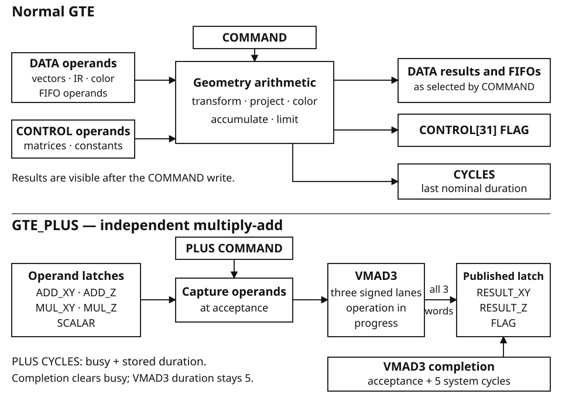
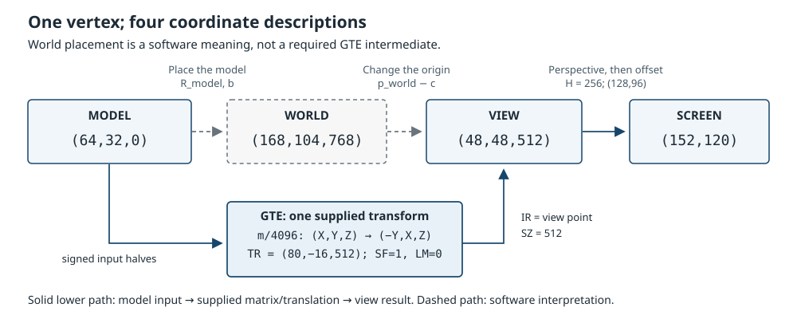
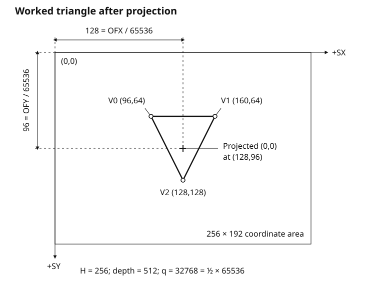
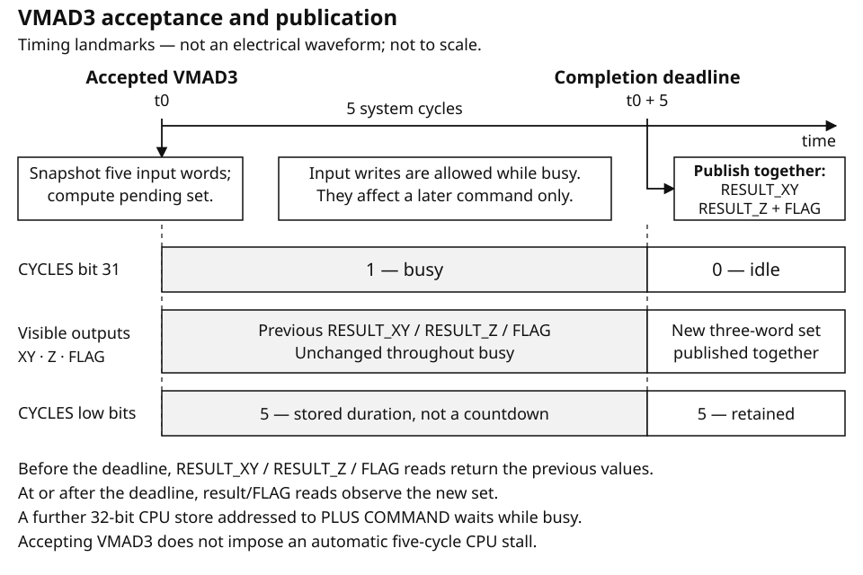

# Geometry Engine (GTE)

## Function and data flow

The Geometry Engine is a register-programmed integer arithmetic unit. It transforms and projects vectors, performs lighting and color calculations, computes doubled oriented screen area, and forms depth averages. Its normal command path operates on 32 data words, `D[0]`–`D[31]`, and 32 control words, `C[0]`–`C[31]`. GTE_PLUS provides a separate three-lane multiply-add path with ten words of its own.

Program vectors, matrices, coefficients, and colors, then write a command word. Normal results appear in the data registers and in the screen, depth, and color FIFOs. These FIFOs are register histories: arithmetic commands push results into them; they are not command queues. Software may also write their entries directly.

GTE is separate from GEO and GPU. A GTE command does not draw, write VRAM or a framebuffer, transfer GEO scratch memory, or submit a graphics packet. Software passes the arithmetic results onward as required.



## Technical specifications

GTE is a register-to-register integer arithmetic unit. Its storage holds the
operands, coefficients, intermediate values and recent results of geometry and
lighting calculations. It has no local vertex RAM, texture RAM or framebuffer.
The installed machine's 4 MiB main RAM and 2 MiB video RAM are separate resources;
they are not GTE memory. Software loads GTE operands and reads its results through
the register interface.

### Capacity and arithmetic

| Item | Specification |
|---|---|
| Installed CPU/system-cycle frequency | 33,868,800 Hz (33.8688 MHz) |
| Independent GTE core clock | No separate frequency is specified; PLUS completion uses system cycles. |
| Programming transfer width | One 32-bit register word at a four-byte-aligned address |
| Physical GTE/IO bus clock and pin width | Not specified. The programming word width is not an electrical bus specification. |
| GTE/IO arbitration and sustained bandwidth | No contended-transfer schedule or guaranteed transfer rate is specified. |
| Normal data register window | 32 words, D[0]–D[31]; 128 bytes of register address space |
| Normal control register window | 32 words, C[0]–C[31]; 128 bytes of register address space |
| Normal command/status | Separate 32-bit COMMAND and CYCLES words |
| PLUS register window | Ten 32-bit words; 40 bytes of register address space |

These window sizes describe register slots, not general-purpose memory capacity.
Some slots are aliases or derived read ports; others transform written words or
ignore writes. Their individual rules are specified in the register reference.

| Arithmetic resource | Capacity and representation |
|---|---|
| Input vectors | Three XYZ vectors, each with signed 16-bit components |
| Stored matrices | Three 3 × 3 matrices with signed 16-bit coefficients |
| Control vectors | Three XYZ vectors with signed 32-bit components |
| Main multiply-accumulate path | Three signed 44-bit accumulators, with shifted 32-bit visible MAC words and 16-bit clamped IR results |
| Screen history | Three packed SX/SY pairs; each component occupies a signed 16-bit halfword; projected coordinates clamp to −1024…1023 |
| Depth history | Four unsigned 16-bit depths |
| Color history | Three words, each containing 8-bit red, green, blue and CODE fields |
| PLUS multiply-add path | Three signed 16-bit lanes, a signed 16-bit scalar, a fixed 12-bit product shift, and saturated signed 16-bit results |

Normal commands provide vector transformation and projection, matrix/vector
arithmetic, lighting and color calculations, doubled oriented screen area, and depth
averages. There are 22 recognized normal functions. Multiplication, accumulation,
shift and saturation are integer operations; there is no floating-point arithmetic
mode. The normal path's 44-bit wrap and its IR/output clamps are distinct stages.
PLUS uses its own multiply-add rule and does not use the normal MAC accumulators,
SF/LM settings or result FIFOs.

### Completion and throughput

The two command interfaces have different completion guarantees:

| Path | Result visibility | Admission of subsequent work |
|---|---|---|
| Normal COMMAND | The command's results are visible when the command write completes | No GTE busy wait or command queue; the next normal command may use those results |
| PLUS VMAD3 | One result set becomes available five system cycles after acceptance | One pending command; another direct CPU command store waits for completion |
| Invalid PLUS command | Previous result values are preserved; ERROR and INVALID publish after one system cycle | Occupies the same single pending-command position |

The PLUS arithmetic admission ceiling is one VMAD3 command per five system
cycles: 6,773,760 commands per second at the installed frequency, with three lane
results per command. This is an arithmetic upper bound, not a sustained
application rate. Operand writes, command issue, result reads and other CPU work
must also fit in the program's cycle budget. The 32-bit register interface does
not by itself specify a bytes-per-second transfer guarantee.

Normal CYCLES values are not a throughput formula. They report nominal command
costs from 5 through 44, but do not impose an equivalent elapsed-time delay or
charge those counts to the CPU. Use the following timing rules when budgeting a
program rather than deriving a normal-command rate from CYCLES.

## Programming geometry

A useful geometry sequence starts with three questions: what coordinate units does the cartridge use, which transform converts those coordinates into projection coordinates, and where should the projected origin appear on the screen? Program those choices before submitting vertices. GTE retains them across commands, so a group of vertices can share one transform and projection setup.

A **vector** is an ordered triple `(X,Y,Z)`. For projection it describes a position. V0, V1, and V2 are three independent input vectors, not the three components of one vector. Their X and Y components share a word; Z occupies the low half of the next word. Every component is a signed 16-bit integer. The cartridge assigns its meaning: one coordinate unit might represent one unit of a model, or a chosen fraction of that unit. GTE does not convert physical units.

### Choose scales for an operation, not for the registerfile

The words do not all have twelve fractional bits. The factors in the selected operation determine their scales. A convenient projection convention is to store positions and translations in the same integer coordinate units, store matrix coefficients multiplied by 4096, and select `SF=1`. The command then removes twelve low bits from each accumulated matrix result. Without overflow or saturation, the resulting IR coordinates are the transformed positions rounded toward negative infinity.

| Quantity under this convention | Programmed representation | Representable range | Consumer |
|---|---|---|---|
| Input position X, Y, Z | Signed halfword; one raw count per coordinate unit | −32768–32767 coordinate units | RTPS, RTPT, or a selected MVMVA vector |
| Matrix coefficient | Signed halfword; coefficient × 4096 | −8 to `8−1/4096` | Matrix dot product; use `SF=1` to remove this factor |
| Translation X, Y, Z | Signed complete word; one raw count per coordinate unit | −2147483648–2147483647 coordinate units | Translation is multiplied by 4096 before the dot-product additions |
| H | Unsigned low halfword; unscaled projection numerator whose value sets screen magnification | 0–65535 | Projection numerator, compared with the new unsigned depth |
| OFX, OFY | Signed complete word; screen-coordinate offset × 65536 | −32768 to `32768−1/65536` screen units | Added before the final sixteen-bit screen shift |

These are representation ranges, not a promise that every combination produces an unsaturated result. The dot products wrap at 44 bits, visible MAC words wrap at 32 bits, and IR coordinates are limited to signed 16-bit results. Large representable translations can therefore overflow or saturate subsequent stages.

The identity matrix has `m00=m11=m22=4096` and all other coefficients zero. With `SF=1`, it leaves an input coordinate unchanged before translation. The coefficient 1 is `0x1000`, ½ is `0x0800`, −½ is the halfword `0xf800`, and −1 is `0xf000`.

Matrix coefficients are packed in row order, **two successive coefficients per word**; word boundaries do not coincide with row boundaries. The following examples show all five words for two transforms. Translation is separate.

| Control word | Identity | Mapping `(X,Y,Z)` to `(−Y,X,Z)` |
|---|---|---|
| C[0]: m00 low, m01 high | `0x00001000` | `0xf0000000` |
| C[1]: m02 low, m10 high | `0x00000000` | `0x10000000` |
| C[2]: m11 low, m12 high | `0x00001000` | `0x00000000` |
| C[3]: m20 low, m21 high | `0x00000000` | `0x00000000` |
| C[4]: m22 low | `0x00001000` | `0x00001000` |

For the second matrix, `SF=1`, zero translation, and `(X,Y,Z)=(64,32,512)` give `(−32,64,512)`. The negative coefficient is a signed halfword inside a packed word; it is not a negative floating-point value.

`SF=0` leaves the dot-product result unshifted. It does not change the input words into a different universal numeric format. In particular, projection depth always comes from `A_Z ASR 12`, independently of SF. Switching the Q12 identity above to `SF=0` multiplies its visible X/Y/Z results by 4096 before the IR limits, but does not multiply the depth FIFO result by 4096. It is not an integer-coordinate projection shortcut.

Select `LM=0` for the signed projection convention used here. It permits negative transformed X and Y. `LM=1` instead limits negative IR results to zero; projection would then use those zeroes in its screen calculation. The command's LM selection is a lower-limit choice, not a clipping enable.

## Coordinate spaces and the supplied transform

Before programming a transform, decide what a coordinate means. The triple
`(64,32,0)` does not identify a location by itself: it needs an origin, three
axis directions, and a unit. The same vertex can have different triples when
measured from an object's origin, from a level origin, and from a chosen viewing
position. These are different **coordinate spaces**, not different kinds of GTE
register.

### Choose the spaces in software

A useful division is:

| Space | What its coordinates describe | Who chooses it |
|---|---|---|
| **Model**, also called local | A vertex relative to the model's own origin and axes. An origin at a centre, corner, or hinge gives the same stored geometry a different placement rule. | The cartridge's geometry and transform code. |
| **World** | A position relative to a common origin and axes used to place objects together. Two models can have different local origins but share this reference. | The cartridge. World coordinates need not be sent to GTE. |
| **View** | A position relative to a chosen viewing origin, expressed along chosen viewing axes. These are the spatial coordinates to which perspective is applied. | The cartridge supplies the transform that produces them. |
| **Screen** | A two-component position after perspective, screen offset, rounding, and limiting. It is no longer a three-dimensional displacement. | The cartridge chooses H and offsets; GTE fixes the arithmetic and result limits. |

An intermediate world space is useful for reasoning about a scene, but it is not
a required hardware stage. The input can be model coordinates transformed
directly to view coordinates. Alternatively, software can supply vertices already
in view coordinates and program an identity transform. V0, V1, and V2 are three
input-vector slots; they do not mean model, world, and view.

For the examples below, choose one raw coordinate count per spatial unit, view
+X towards screen right, view +Y towards screen down, and view +Z farther in
front of the viewing origin. Also choose to display increasing screen X to the
right and increasing screen Y downward. These are **software conventions**. The
projection equations add the X and Y contributions without an implicit Y sign
change. If a model uses Y upward, its supplied transform must account for that
choice. The unit supplies neither a camera object nor a declaration of model or
world handedness. Positive depth is useful to its unsigned-depth projection
arithmetic; it is not a promise that a point is visible or inside a clipping
volume.

### Read the matrix as three dot products

Projection uses matrix 0, C[0]–C[4], and translation C[5]–C[7]. The matrix contains
nine signed 16-bit coefficients; the translation components are signed 32-bit
words. Use `m[r,c]` for the raw coefficient in row r and column c. The three
accumulations are:

```text
A_X = 4096*TRX + m[0,0]*X + m[0,1]*Y + m[0,2]*Z
A_Y = 4096*TRY + m[1,0]*X + m[1,1]*Y + m[1,2]*Z
A_Z = 4096*TRZ + m[2,0]*X + m[2,1]*Y + m[2,2]*Z
```

The **first row produces X**, the second Y, and the third Z. The products in a row
are not three successive transformations; they are contributions to one output
component.

For this section, select `SF=1` and `LM=0`, and interpret each matrix coefficient
as its raw value divided by 4096. Let this interpreted matrix be R, and let
t be the three translation words in the same spatial units as the input.
Ignoring rounding and limits for the moment, the equations read:

```text
[ X_view ]   [ R00 R01 R02 ] [ X_model ]   [ tX ]
[ Y_view ] = [ R10 R11 R12 ] [ Y_model ] + [ tY ]
[ Z_view ]   [ R20 R21 R22 ] [ Z_model ]   [ tZ ]
```

This is the **column-vector convention**: R multiplies the input column on its
left. It follows from the actual dot products, not from the order in which the
packed words are stored. Using row-vector formulas from another mathematics
library without transposing the coefficients would describe a different mapping.

Rows and columns give two complementary ways to understand the same matrix:

- A **row** says how input X, Y, and Z contribute to one output coordinate.
- A **column** says where one input-axis displacement goes. An input displacement
  `(d,0,0)` produces `d*(R00,R10,R20)`; `(0,d,0)` uses the second column, and
  `(0,0,d)` uses the third.

Thus the columns are the transformed input basis vectors. They need not be
perpendicular or of unit length: the programmed matrix can scale, mix, reflect,
or collapse axes as well as rotate them. GTE does not repair it into a rotation.
The input origin maps to t. A displacement between two points has no translation
term, since `(R*p2+t) - (R*p1+t) = R*(p2-p1)` in this ideal arithmetic. That is why
moving the origin and changing the basis are separate parts of an affine
transform. Small basis probes may themselves be rounded by the integer datapath;
use a suitable displacement when checking a fractional coefficient.

GTE executes one supplied transform per projected vertex. It does not receive a
model placement followed by a second, hidden camera transform. If software keeps
those transformations separately, it must supply their combined matrix and
translation, or do an earlier transformation explicitly. RTPT applies the same
programmed transform to its three input slots; it does not interpret them in
three spaces.

### A view origin is subtracted, not added

To make the sign unambiguous, define the following software convention. Let
`p_world = R_model*p_model + b`, where b is the model origin's world position.
Let c be the chosen viewing origin in world coordinates. Let R_view convert a
world-axis displacement into the chosen view axes. Then define:

```text
p_view = R_view * (p_world - c)
```

The subtraction is necessary because the viewing origin itself must have view
coordinates zero: substituting `p_world=c` gives zero. The view-only translation
is consequently `-R_view*c`, **not generally `-c`**. The latter works only when
R_view leaves that particular vector unchanged. For example, if R_view maps
`(X,Y,Z)` to `(-Y,X,Z)`, a viewing origin `(120,56,256)` requires view-only
translation `(56,-120,-256)`.

Substituting the model placement into the chosen view definition gives the
single transform that projection needs:

```text
p_view = (R_view*R_model)*p_model + R_view*(b-c)
```

This identifies the meaning of the supplied matrix and translation; it is not a
claim that multiplying separately quantized transforms is exact. Construction,
packing, and intermediate precision are separate programming steps. In
particular, copying a camera's world position into TR would implement the wrong
operation under this convention.

Consider one exact example. Choose:

```text
model-axis mapping: (X,Y,Z) -> (-Y,X,Z)
model world origin b = (200,40,768)
viewing origin c    = (120,56,256)
view axes          = world axes, so R_view is identity
```

The combined matrix therefore has rows `(0,-4096,0)`, `(4096,0,0)`, and
`(0,0,4096)` in raw coefficient units. Its translation is:

```text
t = b-c = (80,-16,512)
TRX = 0x00000050   TRY = 0xfffffff0   TRZ = 0x00000200
```

The following probes show both the origin and the basis. Their values are exact
with `SF=1`, `LM=0`; none reaches an arithmetic limit.

| Model coordinates | View coordinates | Meaning |
|---|---|---|
| `(0,0,0)` | `(80,-16,512)` | The model origin appears at the supplied translation. |
| `(64,0,0)` | `(80,48,512)` | Local +X adds 64 along view +Y: the first column is `(0,1,0)`. |
| `(0,64,0)` | `(16,-16,512)` | Local +Y subtracts 64 along view X: the second column is `(-1,0,0)`. |
| `(0,0,64)` | `(80,-16,576)` | Local +Z adds 64 along view +Z: the third column is `(0,0,1)`. |

For the actual vertex `(64,32,0)`, model placement gives world coordinates
`(-32+200,64+40,0+768) = (168,104,768)`. Subtracting c gives view coordinates
`(48,48,512)`. GTE obtains those same coordinates directly from the model input:

```text
A_X = 4096*80  + 0*64    - 4096*32 + 0*0 = 196608
A_Y = 4096*-16 + 4096*64 + 0*32    + 0*0 = 196608
A_Z = 4096*512 + 0*64    + 0*32    + 4096*0 = 2097152

(A_X,A_Y,A_Z) ASR 12 = (48,48,512)
```

Moving only the viewing origin by +32 along world X changes this point's view X
from 48 to 16. The scene moves the opposite way relative to that origin. No GTE
camera state changes: software updates the supplied translation.



### Screen placement is not spatial translation

The view-space origin and the projected screen origin answer different
questions. TR moves geometry before perspective. OFX and OFY place the
zero-X/zero-Y projection axis on the screen **after** perspective. They do not
change transformed coordinates or depth.

With q the unit's reciprocal-table quotient, the screen stage is:

```text
SX = clamp((OFX + IR1*q) ASR 16, -1024, 1023)
SY = clamp((OFY + IR2*q) ASR 16, -1024, 1023)
```

IR1 and IR2 are already limited spatial results. The quotient has 65536 counts
per unit ratio; it approximates `65536*H/depth`, but the specified reciprocal
calculation, not ideal division, determines the actual bits. Program an offset
of `(128,96)` as `OFX=0x00800000`, `OFY=0x00600000`. With H=256 and depth 512,
the quotient is exactly 32768. The example vertex `(48,48,512)` then becomes
`(128+24,96+24) = (152,120)` on the screen. The choice `(128,96)` is an example
projection centre, not a built-in display centre or a framebuffer address.

A second example exposes the difference between the two kinds of movement.
Take transformed X=64 at two depths, with H=256 and screen X offset 128. Compare
adding 32 spatial units through TRX with adding 16 screen units through OFX:

| Depth | Original SX | Add 32 to TRX | Add `16*65536` to OFX |
|---|---|---|---|
| 512, q=32768 | 160 | 176: a 16-unit screen move | 176: a 16-unit screen move |
| 1024, q=16384 | 144 | 152: an 8-unit screen move | 160: a 16-unit screen move |

The spatial shift is diminished by distance. The screen offset moves both by
the same amount. These exact cases are unsaturated; at the screen limits, a
further offset can leave an already limited result unchanged. Changing TRZ is
different again: it changes depth and therefore magnification, not just the
position of the projection axis. Use TR for placement in the chosen spatial
frame, and OFX/OFY for placement of that frame's projection on the drawing plane.

### Keep the coordinate convention within the datapath

A useful coordinate system must fit the arithmetic, not merely have convenient
names. Under the convention used here:

- Input components have signed 16-bit range `-32768..32767`. Choosing sixteen raw
  counts per game unit improves input resolution to 1/16 unit but reduces the
  corresponding range to `-2048..2047 15/16` game units. Positions and
  translations must use the same chosen spatial unit when R is an ordinary
  dimensionless orientation/scale matrix. A unit conversion can be included in
  R, but it must be deliberate.
- Coefficients have resolution 1/4096 and interpreted range
  `-8..8-1/4096`. There is no automatic normalization. If software rounds an
  ideal coefficient to the nearest Q12 integer and that rounded integer fits
  the signed halfword, each coefficient's error is at most 1/8192. Its contribution to a row's spatial error grows with
  the input magnitude: the coefficient-only error bound is
  `(|X|+|Y|+|Z|)/8192` counts before the final integer shift. Repeatedly changing coordinate frames also requires an
  explicit intermediate-precision policy.
- SF=1 discards twelve low accumulator bits by arithmetic shift, rounding
  towards negative infinity. A raw coefficient 2048 (`0x0800`, meaning 1/2)
  maps input X=3 to 1 and X=-3 to -2 in an otherwise zero X row. It does not
  preserve the fractional outputs +1.5 and -1.5. Neither the extra width of TR
  nor a later screen offset recovers those lost bits.
- Signed 32-bit translation words do not guarantee equally wide usable spatial
  output. The dot products accumulate with ordered signed 44-bit wrap, visible
  MAC words wrap to 32 bits, and the IR values are limited to signed 16 bits
  for LM=0. Projection uses the limited IR1/IR2, so a large translated X or Y
  can distort the projected position even when the input vertex fits. Keep
  large world positions in the cartridge's world representation and supply
  their appropriately computed view-relative transform rather than assuming
  GTE can retain a large unsaturated world-space intermediate.
- Projection depth comes from the retained Z accumulation shifted twelve bits,
  limited to `0..65535`; it is not read back from limited IR3. This depth rule
  does not change with SF. For positive H, ordinary non-overflow projection
  needs depth greater than H/2. A zero or negative spatial depth does not
  continue signed mathematical perspective behind the viewing origin: depth
  limiting and the divide-overflow path still produce results.

Finally, screen pairs are limited to `-1024..1023`, not to the cartridge's chosen
display rectangle. GTE does not turn any of these bounds into geometric
clipping. Software must decide which spatial geometry to process and what to do
with flagged or out-of-window results. Choosing origins near the geometry,
consistent units, and sufficient precision is part of supplying a meaningful
transform; it is not work performed by a hidden camera or normalization stage.

## Constructing and packing a transform

A transform is ready to program only when every output coordinate can be written
as a row equation. Start with the intended mapping, derive its nine coefficients
and three translation components, then encode and pack them. This separates a
mathematical mistake from a halfword-packing mistake. The register names C[n]
and D[n] below identify architectural words; the tables specify their contents,
not source-language store syntax.

This example constructs one model-to-view transform directly. It uses the
previous section's column vectors, one raw count per spatial unit, +X to the
right, +Y downward, and positive Z in front of the chosen viewing origin. It
does not require a world-space intermediate or a separately programmed camera.

### Define the turn, scale, and translation

Choose a software XY-plane angle convention in which a positive angle maps
`(1,0,0)` to `(cos(theta),sin(theta),0)`. Its equations are:

```text
X_rotated = cos(theta)*X - sin(theta)*Y
Y_rotated = sin(theta)*X + cos(theta)*Y
Z_rotated = Z
```

With Y displayed downward, this positive turn appears clockwise on the screen.
That observation follows from the chosen axes; it is not an angle convention
imposed by GTE. The unit has coefficient inputs, not sine, cosine, or angle
inputs. Software chooses the angle convention and obtains the coefficients.

Use the exact ratios `cos(theta)=3/5` and `sin(theta)=4/5`. Their squares sum
to one, so they specify a unit direction for the turned +X axis. They describe
an oblique turn of approximately 53.13 degrees, not a quarter-turn or an axis
swap.
Before this turn, enlarge local X by 5/4 and local Y by 5/2, leaving local Z
unchanged. Finally, place the transformed model origin at view position
`(40,-24,512)`.

The order matters: these are scales along the **local** axes before they turn.
Substitute the scaled components into the rotation equations:

```text
X_view = (3/5)*((5/4)*X) - (4/5)*((5/2)*Y) + 40
       = (3/4)*X - 2*Y + 40

Y_view = (4/5)*((5/4)*X) + (3/5)*((5/2)*Y) - 24
       = X + (3/2)*Y - 24

Z_view = Z + 512
```

These equations completely specify the transform. The two scaling operations
and the rotation were steps in deriving its coefficients; they are not three
commands that projection must secretly execute. In interpreted coefficient
units, the supplied matrix and translation are:

```text
    [ 3/4   -2    0 ]         [  40 ]
R = [  1    3/2   0 ]     t = [ -24 ]
    [  0     0    1 ]         [ 512 ]
```

The last matrix column multiplies input Z. It is **not** the translation column
of a two-dimensional homogeneous matrix. All three translation components have
separate registers. Translation is added after the linear mapping: it is neither
scaled nor turned again by these rows.

### Encode coefficients, then pack successive halves

Use `SF=1`. Multiply each interpreted coefficient by 4096 to obtain its signed
16-bit stored coefficient. This example's products are all exact integers:

| Row | Interpreted coefficients | Raw signed coefficients | Halfword bit patterns |
|---|---|---|---|
| X | `(3/4,-2,0)` | `(3072,-8192,0)` | `(0x0c00,0xe000,0x0000)` |
| Y | `(1,3/2,0)` | `(4096,6144,0)` | `(0x1000,0x1800,0x0000)` |
| Z | `(0,0,1)` | `(0,0,4096)` | `(0x0000,0x0000,0x1000)` |

For a negative coefficient, encode the signed value in sixteen-bit two's
complement. Here `-8192` becomes `65536-8192 = 57344 = 0xe000`. That halfword
represents −2 in this coefficient convention. It does not represent the
positive coefficient 14, and the packed word containing it is not a
floating-point number.

Pack coefficients in row order, **two consecutive coefficients per word**.
A word boundary need not be a row boundary:

| Control word | Low half, bits 15–0 | High half, bits 31–16 | Complete word to supply |
|---|---|---|---|
| C[0] | `m[0,0]=0x0c00` | `m[0,1]=0xe000` | `0xe0000c00` |
| C[1] | `m[0,2]=0x0000` | `m[1,0]=0x1000` | `0x10000000` |
| C[2] | `m[1,1]=0x1800` | `m[1,2]=0x0000` | `0x00001800` |
| C[3] | `m[2,0]=0x0000` | `m[2,1]=0x0000` | `0x00000000` |
| C[4] | `m[2,2]=0x1000` | Not another coefficient; supply zero here | `0x00001000` |

In particular, C[1] contains the **end of the X row and the start of the Y row**.
Putting each new row at the low half of a new word would not program this
matrix. For a low half a and high half b, the complete word consists of a's low
16 bits and b's low 16 bits shifted left 16 places. Keep each coefficient to
its own half; sign extension of a negative coefficient must not fill its
neighbour's bits.

The upper half of C[4] is not independent matrix storage. Its register write
retains and sign-extends the low signed halfword. With this positive final
coefficient, reading C[4] returns `0x00001000`.

The translations use **complete signed words** in the chosen spatial units:

| Control word | Meaning | Signed value | Complete raw word |
|---|---|---|---|
| C[5] | TRX | 40 | `0x00000028` |
| C[6] | TRY | −24 | `0xffffffe8` |
| C[7] | TRZ | 512 | `0x00000200` |

Do not multiply these values by 4096 before writing them. The row calculation
already multiplies TR by 4096 before adding the coefficient products. That puts
translation and products at the same accumulator scale; the selected twelve-bit
shift then removes the common factor.

Complete all five matrix words and all three translation words before issuing
geometry commands. Include the zero coefficients: matrix storage retains its
previous contents, so an omitted zero does not erase an old coefficient. A
batch of vertices using this transform can reuse the setup without reloading it
for every vertex.

For an arbitrary chosen angle or scale, the desired coefficients may not be
exact multiples of 1/4096. Software must choose its coefficient-rounding rule
and check the resulting signed-halfword range. Do this after deriving the
intended row coefficients; do not assume independently rounded trigonometric
terms and intermediate products produce the same stored matrix. The example
above deliberately has no coefficient-quantization error, making its packing
and row calculations independently checkable.

### Check the origin and basis before a complicated vertex

Use `LM=0` so signed transformed coordinates remain signed. Submitting the model
origin should return the translation. Submitting a known displacement along
each local axis then checks the columns without relying on the appearance of a
whole model. Use 64-unit probes here so the quarter- and half-unit coefficients
produce exact integer results:

| Local input | View output at SF=1, LM=0 | Displacement from the transformed origin |
|---|---|---|
| `(0,0,0)` | `(40,-24,512)` | `(0,0,0)` |
| `(64,0,0)` | `(88,40,512)` | `(48,64,0)` |
| `(0,64,0)` | `(-88,72,512)` | `(-128,96,0)` |
| `(0,0,64)` | `(40,-24,576)` | `(0,0,64)` |

The first XY displacement has length 80: a 64-unit local X probe was scaled by
5/4. The second has length 160: the same-length local Y probe was scaled by 5/2.
Their dot product is `48*(-128) + 64*96 = 0`, so the turned axes remain
perpendicular. These checks distinguish the intended unequal local scales from
a uniform scale or a transpose of the matrix.

Notice the negative transformed X of the local Y probe. It is expected, not an
invalid vertex: that axis points mostly towards negative view X. Selecting LM=1
would replace a negative IR1 with zero before screen projection, changing the
mapping being tested. A small one-count probe can also hide a fractional
coefficient through integer rounding; it is not a reliable substitute for the
64-unit probes in this example.

### Follow a nonzero vertex through the actual rows

Now submit local vertex `(64,16,0)`. Its V0 input words are D[0]=`0x00100040`
(X in the low half, Y in the high half) and D[1]=`0x00000000` (Z in the low
half). Applying the programmed raw rows gives:

```text
A_X = 4096*40 + 3072*64 - 8192*16 + 0*0
    = 163840 + 196608 - 131072 = 229376

A_Y = 4096*(-24) + 4096*64 + 6144*16 + 0*0
    = -98304 + 262144 + 98304 = 262144

A_Z = 4096*512 + 0*64 + 0*16 + 4096*0
    = 2097152
```

With `SF=1`, the shifted MAC values are `(56,64,512)`. They fit the IR limits,
so IR1, IR2, and IR3 retain those same values with LM=0. The new depth is 512.
No overflow or limiting has replaced the intended transform result.

To check screen placement as well, use H=256, OFX=`0x00800000` and
OFY=`0x00600000`, corresponding to projection offset `(128,96)`. Set DQA and DQB
to zero for this check; the final depth-cue calculation then gives IR0=0 without
introducing a separate depth-cue setup. RTPS with SF=1 and LM=0 has normal command
word `0x00080001`. At this depth its reciprocal-table quotient is exactly 32768:

```text
SX = (128*65536 + 56*32768) ASR 16 = 156
SY = ( 96*65536 + 64*32768) ASR 16 = 128
```

The newest packed screen pair, D[14], is therefore `0x0080009c`: X=156 in the
low signed half and Y=128 in the high signed half. FLAG is zero for this fully
specified case. These are values to compare with the command result, not a claim
that the command itself draws a point.

The origin and the two XY probes also produce a useful screen-space shape:

| Local point | Screen pair |
|---|---|
| Origin `(0,0,0)` | `(148,84)` |
| Local X probe `(64,0,0)` | `(172,116)` |
| Local Y probe `(0,64,0)` | `(84,132)` |

Joining those points would give a triangle whose two probe sides have lengths
40 and 80 screen units. Both lie at depth 512, so the common perspective factor
is exactly 1/2; the side directions and unequal lengths expose the programmed
turn and scale. Primitive construction and drawing remain software's next
hand-off.

Finally, check the extent of the actual input geometry, not only these sample
vertices. For the flat local box `-64<=X<=64`, `-64<=Y<=64`, `Z=0`, the row
extrema give view X in `-136..216`, view Y in `-184..136`, and depth exactly 512.
Under the same projection setup, its screen bounds are X=`60..236` and
Y=`4..164`. These values fit this datapath without IR, depth, divide, or screen
limiting. They do not define a GTE viewport or prove a larger model safe. The
chosen model extent, stored coefficients, translation, and projection setup must
be considered together.

<a id="composing-transforms"></a>

## Composing transforms

An object can be positioned relative to a parent whose own coordinates must be
transformed again. A model placement can likewise be followed by a world-to-view
mapping. Projection needs the resulting single transform, not a list of those
relationships. Composition determines its coefficients and translation. In
integer arithmetic it must also determine **where precision is discarded**.

### Derive the order and the translated origin

Write the local transform as `(B,b)` and the transform applied after it as
`(A,a)`. With column vectors:

```text
u = B*p + b
v = A*u + a
  = A*(B*p+b) + a
  = (A*B)*p + (A*b+a)
```

Thus the combined matrix is `A*B`, and its translation is `A*b+a`. The matrix
nearest the input acts first. Merely adding a and b would leave the local origin
unturned and unscaled by A. Multiplying `B*A` would reverse the linear operations.

For row r and column c, the combined coefficient is:

```text
C[r,c] = A[r,0]*B[0,c] + A[r,1]*B[1,c] + A[r,2]*B[2,c]
```

This is a row of A dotted with a **column** of B. Equivalently, transform each
of B's three columns by A, with zero translation. The three resulting vectors
are the three columns of C. Transforming b with translation a gives the combined
origin. These observations let MVMVA perform the products even though GTE has
no matrix/matrix command or destination-matrix register.

For view/model composition under the earlier convention, substitute
`A=R_view`, `a=-R_view*c`, `B=R_model`, and `b=model_world_origin`. The ideal
translation is then `R_view*(b-c)`. It is the model origin expressed relative
to the viewing origin and along the viewing axes, not the camera position
copied into TR.

### Work from the stored coefficients

Reuse the preceding section's parent linear mapping and translation:

```text
        [ 3072  -8192     0 ]
A_raw = [ 4096   6144     0 ]    a = (40,-24,512)
        [    0      0  4096 ]
```

The subscript `raw` means signed coefficient integers with 4096 counts per unit
coefficient. Introduce a local transform with the following stored values:

```text
        [ 4096     0      0 ]
B_raw = [    0  2458  -3277 ]    b = (5,-3,7)
        [    0  3277   2458 ]
```

Its YZ coefficients approximate a chosen software turn with cosine 3/5 and sine
4/5: nearest coefficient rounding gives 2458 and 3277. The stored fractions
`2458/4096` and `3277/4096`, not the ideal 3/5 and 4/5, are now the inputs to
composition. The hardware does not recognize the intended angle or correct the
rounded matrix into an exact rotation.

Choose this explicit storage policy for the combined transform:

- Accumulate each raw coefficient dot product before shifting. It has two
  factors of 4096, so shift twelve bits to produce one Q12 coefficient.
- Accumulate `4096*a + A_raw*b` before shifting. Shift twelve bits to produce
  an integer translation in the chosen spatial counts.
- Use arithmetic shifts, not rounding to nearest or truncation towards zero.
  Retain a signed16 matrix and signed32 translation only when the resulting
  values fit those representations and the preceding arithmetic has not wrapped.

For these small operands no wrap or limiting occurs. The nine unshifted matrix
sums are:

```text
A_raw*B_raw =
[ 12582912  -20135936   26845184 ]
[ 16777216   15101952  -20133888 ]
[        0   13422592   10067968 ]
```

For example, row 1, column 2 is
`4096*0 + 6144*(-3277) + 0*2458 = -20133888`. Dividing by 4096 gives −4915.5;
its arithmetic shift produces **−4916**, not −4915. Shifting every complete
coefficient sum gives:

```text
        [ 3072  -4916   6554 ]
C_raw = [ 4096   3687  -4916 ]
        [    0   3277   2458 ]
```

The translation calculation is separate:

```text
tX sum = 4096*40    + 3072*5 - 8192*(-3) + 0*7 = 203776
tY sum = 4096*(-24) + 4096*5 + 6144*(-3) + 0*7 = -96256
tZ sum = 4096*512   + 0*5    + 0*(-3)    + 4096*7 = 2125824

t = (203776,-96256,2125824) ASR 12 = (49,-24,519)
```

Before the shift the translated origin is `(49.75,-23.5,519)`. The chosen integer
TR representation loses those fractions now; this decision will affect later
vertices. It is not a screen-offset adjustment.

### Use MVMVA as three column products and one origin product

Keep A in matrix 0 and a in control vector 0 while computing the entire result.
Place B's columns, not its rows, into the input slots:

| Input slot | Signed components | Packed XY word | Packed Z word |
|---|---|---|---|
| V0 | `(4096,0,0)` | `0x00001000` | `0x00000000` |
| V1 | `(0,2458,3277)` | `0x099a0000` | `0x00000ccd` |
| V2 | `(0,-3277,2458)` | `0xf3330000` | `0x0000099a` |

These inputs are coefficient columns in Q12 units. The same vector slots can
hold positions in another command; their interpretation comes from the chosen
calculation. Here multiplying by another Q12 matrix and selecting SF=1 leaves
Q12 coefficient outputs, not integer spatial positions.

Select `mx=0`, `cv=3`, `SF=1`, and `LM=0`. Control-vector selector 3 supplies the
zero vector, excluding a from the column products. The three input selections
and results are:

| Vector selector | Normal command word | MAC1–MAC3 and IR1–IR3 | Destination in C |
|---|---|---|---|
| v=0 | `0x00086012` | `(3072,4096,0)` | Column 0 |
| v=1 | `0x0008e012` | `(-4916,3687,3277)` | Column 1 |
| v=2 | `0x00096012` | `(6554,-4916,2458)` | Column 2 |

Read and retain each column and its FLAG before the next command overwrites
MAC, IR, and FLAG. All three flags are zero here. LM=0 is important: a negative
coefficient is a legitimate result, not an intensity to clamp at zero. Do not
use cv=2 as another ordinary affine control-vector selection: its specified
two-pass calculation omits the CV and X contribution from the final result.

Next put b into V0: packed words `0xfffd0005` and `0x00000007`. Select
`mx=0`, `v=0`, **cv=0**, `SF=1`, `LM=0`, normal word `0x00080012`. This time the
initial term must include a. The result is `(49,-24,519)`, with FLAG zero.
Read it before reusing the arithmetic registers.

Reassemble the retained columns into **rows** before packing the destination
matrix. The complete result words are:

| Word | Value | Word | Value |
|---|---|---|---|
| C[0] | `0xeccc0c00` | C[5], TRX | `0x00000031` |
| C[1] | `0x1000199a` | C[6], TRY | `0xffffffe8` |
| C[2] | `0xeccc0e67` | C[7], TRZ | `0x00000207` |
| C[3] | `0x0ccd0000` | | |
| C[4] | `0x0000099a` | | |

Do not install the first result column over part of A while another product
still needs A. Complete the three columns and translated origin in software-owned
result storage, then install the finished matrix and translation. Also account
for the input slots: coefficient columns and b have replaced any vertices that
were previously loaded there. The original transforms and model vertices should
remain in their normal cartridge data, available for subsequent command groups.

MVMVA itself leaves its selected matrix/control-vector words unchanged. It
replaces MAC1–MAC3 and IR1–IR3 and starts a new FLAG; it does not push the screen,
depth, or color FIFOs or update IR0/MAC0. Installing the completed transform is
a separate set of writes. Keeping these roles explicit avoids mistaking a
computed column in IR for an already updated matrix registerfile.

### Composed and sequential integer transforms can disagree

The algebraic identity `A*(B*p+b)+a = (A*B)*p+(A*b+a)` is exact over real numbers.
The integer command sequences have different places to discard fractions.
Consider local vertex `(64,16,8)`.

If B and b are applied first with `SF=1`, `LM=0`, its complete row sums are
`(282624,824,100768)`. The resulting integer IR vector is `(69,0,24)`. The Y
coordinate's fraction and the Z coordinate's fraction have already been lost.
Applying A and a to that IR vector gives:

```text
X = (4096*40    + 3072*69 - 8192*0) ASR 12 = 91
Y = (4096*(-24) + 4096*69 + 6144*0) ASR 12 = 45
Z = (4096*512   + 4096*24) ASR 12 = 536
```

For this second command, MVMVA's v=3 selects the current signed IR vector;
with mx=0, cv=0, SF=1, LM=0 its normal word is `0x00098012`. It snapshots all
three input components before overwriting IR, so later rows do not accidentally
consume earlier rows' outputs. This makes the two-command sequence well-defined,
but does not restore the first command's lost fractions.

Now apply the stored C and t directly to the original vertex. Its row sums are
`(371088,183504,2197920)`, giving **`(90,44,536)`**, not `(91,45,536)`. This path
retains more of the vertex's local arithmetic until the final command, but it
has already rounded a matrix coefficient and both fractional translation
components during composition. Neither sequence has FLAG bits set in this case;
quantization does not require an overflow or saturation flag.

Retaining the stored A/B coefficient fractions and all intermediate translation
fractions in a wider software calculation, then rounding only the final vertex,
is a third policy. The differences are not universally in favour of one of the
two GTE sequences:

| Local vertex | B then A, integer IR between | Stored Q12 C and integer t | Stored A/B, fractions retained until final rounding |
|---|---|---|---|
| `(64,16,8)` | `(91,45,536)` | `(90,44,536)` | `(91,45,536)` |
| `(37,29,11)` | `(61,25,548)` | `(59,25,548)` | `(60,26,548)` |

Choose the policy appropriate to the cartridge's coordinate precision and use
it consistently. Precomposing once can avoid repeating two spatial transforms
for every vertex, but it is not a guarantee of bit-identical results to a
sequential integer path. Nor is recomputing a transform from its previously
rounded result equivalent to recomputing it from the original authored data.

### Apply the same rule to view/model transforms

For a concrete view/model check, reuse only A's **linear** part as the model
matrix, but choose model world origin `b_world=(116,28,600)` instead of the old
a. Let viewing origin `c=(100,20,40)` and choose view axes with mapping
`(X,Y,Z)->(-Y,X,Z)`. This is a specified software axis choice, not a GTE camera
mode. Its matrix is V. Then:

```text
b_world-c = (16,8,560)
t_view    = V*(b_world-c) = (-8,16,560)

             [ -4096  -6144     0 ]
(V*A)_raw =  [  3072  -8192     0 ]
             [     0      0  4096 ]
```

For example, `V*A`'s first row is the negative of A's second row; its second row
is A's first row. Local point `(64,16,0)` has world position `(132,116,600)`.
Subtracting c gives `(32,96,560)` and applying V gives `(-96,32,560)`. The
combined rows and t_view give the same result directly. These coefficients and
translations are exact under the selected representation, so no intermediate
rounding difference is hidden by this particular check.

For general non-exact view matrices, computing `V*(b_world-c)` before discarding
fractions can differ from separately rounding `-V*c` and `V*b_world` and adding
them. State that precision choice just as explicitly as for parent/local work.

Finally, respect the operand and result widths. A coefficient column fits the
signed16 vector input because each source coefficient has that representation;
a translation b does **not** necessarily fit, even though its own stored TR
components are signed32. The one-vector origin-product method above applies
when b fits the signed input components. Wider translations require an explicit
software calculation in the owning coordinate representation, not silent loss
to a vector halfword. Similarly, a composed coefficient can exceed signed16 even
when both source matrices fit. IR limiting cannot turn it into the intended
matrix. Visible MAC words can retain a wider shifted translation than IR, but
still have signed32 wrap and cannot recover discarded fraction or earlier
signed44 wrap. Plan intermediate widths and preserve each command's flags and
needed outputs before consuming them in the next stage.

## Perspective and geometric decisions

### From transformed coordinates to screen coordinates

RTPS processes V0. RTPT processes V0, V1, and V2 in that order. Each vertex produces a transformed IR vector, a new unsigned depth, and a packed screen pair. The screen calculation uses the **limited IR1 and IR2**, not an unlimited copy of the matrix results.

The new depth is `A_Z ASR 12`, limited to 0–65535. Projection obtains a quotient `q` from H and this depth. Its scale is 65536 per unit ratio, so a quotient of `0x00008000` represents a factor of ½. The reciprocal-table divide is specified later in this chapter; it must not be replaced by an assumption of exact mathematical division. For the depths used below, H=256 gives exactly `q=32768` at depth 512 and `q=16384` at depth 1024.

```text
SX = clamp((OFX + IR1*q) ASR 16, -1024, 1023)
SY = clamp((OFY + IR2*q) ASR 16, -1024, 1023)
```

H therefore controls how much transformed X and Y contribute at a given depth. OFX and OFY place the projected origin. For origin `(128,96)`, program OFX=`128×65536 = 0x00800000` and OFY=`96×65536 = 0x00600000`. At depth 512 with H=256, transformed `(64,32)` contributes `(32,16)` screen units, giving `(160,112)` after these offsets.

The offsets can contain fractional screen units: `0x00808000` represents 128½. The final arithmetic shift discards the fraction after the projected contribution is added. It rounds toward negative infinity, not toward zero: an offset of −½ (`0xffff8000`) with a zero projected contribution produces screen coordinate −1.

| Result | Scale and range | Where to read it |
|---|---|---|
| Transformed coordinates | Signed integer IR1–IR3, −32768–32767 with LM=0 | D[9]–D[11]; RTPT leaves the third vertex's values |
| Screen coordinates | Integer SX/SY, each limited to −1024–1023 | D[12]–D[14], oldest to newest; X low, Y high |
| Projection depth | Unsigned integer, 0–65535 | D[16]–D[19], oldest to newest |
| Depth-cue amount | Integer 0–4096, with 4096 representing a full cue in the `SF=1` color convention | IR0, D[8] |
| Scaled depth sum | Unsigned integer, 0–65535 | D[7], after AVSZ3 or AVSZ4 |

The screen FIFO holds three pairs. After RTPT, D[12], D[13], and D[14] correspond to V0, V1, and V2. The depth FIFO holds four depths; after RTPT, its newest three entries D[17]–D[19] correspond to those same vertices. D[16] retains the depth that preceded them. Reading the FIFOs does not consume entries. Another projection shifts their histories.

### Clip a crossing edge before projecting it

Choose a usable spatial range in software before treating projected screen
positions as a primitive. The numerical condition `H < 2*SZ3` avoids the divide-
overflow branch, but it is not a clipping volume. A cartridge can choose a nearer
working boundary with additional margin. Screen saturation also is not an
intersection calculation: it changes a coordinate without constructing the
missing geometric edge.

For an example, keep H=256 and choose the view-space near plane Z=256, retaining
points with Z greater than or equal to 256. These are software choices. Consider
one constant-color triangle, already transformed into view coordinates:

```text
A = (-64,-64,128)    outside the chosen near plane
B = ( 64,-64,512)    inside
C = (  0, 64,512)    inside
```

Projecting A unchanged would take the divide-overflow branch because 256 equals
twice its depth 128. Dropping the whole triangle would also discard its visible
portion. Software can instead intersect the crossing edges with the chosen
plane. For edge P→Q, linearly parameterized by `P+t*(Q-P)`, solve:

```text
t = (nearZ - P.Z)/(Q.Z - P.Z)
```

A crossing edge has endpoints on opposite sides; the required t lies in 0–1.
Here both edges from A have t=1/3. Their exact intersections are:

| Edge | View-space intersection |
|---|---|
| A→B | `(-64/3,-64,256)` |
| A→C | `(-128/3,-64/3,256)` |

Choose an explicit coordinate-rounding policy when supplying the new integer
vertices. Rounding these intersection components to the nearest integer gives
I_AB=`(-21,-64,256)` and I_AC=`(-43,-21,256)`. Both keep Z exactly on the chosen
plane. This rounding is software work, not a projection mode or an action of
FLAG. The retained polygon, in the original boundary order, is
`I_AB,B,C,I_AC`. Split it into two triangles with the same winding:
`(I_AB,B,C)` and `(I_AB,C,I_AC)`.

These vertices are **already view coordinates**. To project them directly,
program matrix0 as Q12 identity and translation zero; do not apply the original
model-to-view transform a second time. Use SF=1, LM=0, H=256, offsets(128,96)
and zero DQA/DQB. At Z=256 the quotient is 65536; at Z=512 it is 32768.

| View point | Packed XY input | Z input | Screen pair | Packed screen word |
|---|---|---|---|---|
| I_AB `(-21,-64,256)` | `0xffc0ffeb` | `0x00000100` | `(107,32)` | `0x0020006b` |
| B `(64,-64,512)` | `0xffc00040` | `0x00000200` | `(160,64)` | `0x004000a0` |
| C `(0,64,512)` | `0x00400000` | `0x00000200` | `(128,128)` | `0x00800080` |
| I_AC `(-43,-21,256)` | `0xffebffd5` | `0x00000100` | `(85,75)` | `0x004b0055` |

Two RTPT commands can process the displayed triples. Each finishes with FLAG=0.
The following NCLIP calculations give doubled areas 4416 and 3015, respectively,
so this particular rounding preserves the chosen positive winding. Submit two
drawing primitives, not the original triangle with its outside vertex silently
replaced by a limiting screen coordinate. Retain each triple before another
projection displaces its screen history.

This example uses one constant color, so it introduces no new per-vertex color
values. A primitive with varying attributes needs software to carry the chosen
attributes to the intersection vertices consistently with its interpolation
policy. GTE does not create those vertices or infer their associations. Multiple
planes require additional clipping steps and may produce more than one output
primitive. The example supplies one usable near-plane construction, not a new
hardware clipper or a promise that every rounded polygon remains nondegenerate.

### Area, depth, and the next decision

NCLIP evaluates the oriented screen area of the three screen FIFO entries:

```text
MAC0 = (SX1-SX0)*(SY2-SY0) - (SX2-SX0)*(SY1-SY0)
```

Without signed MAC0 overflow, the magnitude is twice the triangle's area in square screen-coordinate units. Swapping two vertices reverses the determinant's sign. An unoverflowed zero result means that these integer screen positions are collinear, including coincident positions. Choose which sign is front-facing according to the cartridge's vertex order and screen-coordinate convention. NCLIP itself neither removes a vertex nor clips or rejects a primitive.

AVSZ3 multiplies the sum of the newest three depths by signed ZSF3, then shifts right twelve bits and limits the result to 0–65535. It is a **scaled sum**, not a hardwired division by three. ZSF3=`0x0555` represents `1365/4096`, slightly less than ⅓; ZSF4=`0x0400` represents ¼ for AVSZ4. These operations produce a depth value for the cartridge's use; they do not submit, sort, or draw primitives.

Read results before another command overwrites them. NCLIP and AVSZ3 both write MAC0. Every recognized command also starts a new FLAG result, so inspect the projection flags before issuing NCLIP, then inspect the area before issuing AVSZ3. RTPT combines the flags from all three vertices; its final FLAG does not identify which vertex caused an event.

A flag is not a primitive-rejection signal. For example, `H >= 2×SZ3`, including zero depth, produces DIV and quotient `0x1ffff`; a screen overflow produces the limiting coordinate −1024 or 1023. Both still produce FIFO results. The cartridge decides how to handle such geometry. Saturated coordinates need not preserve the original triangle's area or orientation. ERROR is a summary, not a substitute for the individual flag fields; some saturation fields do not contribute to ERROR.

<a id="normals-light-directions-and-color-mixing"></a>

## Normals, light directions and color mixing

A position answers **where is the vertex?** A surface normal answers **which way
does the surface face?** Both are supplied as three signed halfwords, but the
lighting commands interpret the supplied vector as a direction, not as a position.
They do not read three triangle positions, construct edge vectors, take their cross
product, or normalize the result. Software must supply the normal it wants to use.
An outward-facing direction, a unit-length normal and a particular fixed-point
scale are software conventions, not properties enforced by the vector registers.

Choose the normal and light rows in a common coordinate frame. For example, when
rotating a model, rotate its normal directions too, or express the light directions
in the model's frame. A position's translation is not added to a normal direction.
Projection does not make either adjustment for a later lighting command. With
unit-length normals, a dot product can represent directional agreement; a longer
normal also increases the result's magnitude. The GTE does not remove that extra
factor. Likewise, a light row's magnitude may include the light's chosen strength;
the row need not have unit length.

### Keep a normal perpendicular after unequal scale

A normal represents a perpendicular direction, not just another position to send
through the model's matrix. For example, choose tangent `e=(1,1,0)` and normal
`n=(1,-1,0)`: their dot product is zero. If the model's linear transform doubles
X but leaves Y/Z unchanged, the transformed tangent is `(2,1,0)`. Simply applying
that same transform to n gives `(2,-1,0)`, whose dot product with the transformed
tangent is 3, not zero.

For an invertible linear transform R, software can preserve perpendicularity by
using the **inverse transpose**, `(R^-1)^T`, for normal directions. Its dot
product with an edge transformed by R is the original normal/edge dot product.
In the example it maps n to `(1/2,-1,0)`, which is perpendicular to `(2,1,0)`.
If the lighting convention needs unit length, choose its normalization after
this mapping; the inverse transpose preserves perpendicularity, not length.
For a pure rotation, its inverse transpose equals the rotation itself.

This is a software construction rule. GTE does not derive this matrix from the
position transform, invert a matrix, or normalize a direction automatically.
Software supplies the desired coefficients and normal, using MVMVA if a separate
matrix/vector product is required, then supplies the resulting direction to the
lighting calculation. A transform that collapses an axis has no ordinary inverse;
its surface/normal policy must also be chosen in software, not inferred from an
arithmetic saturation flag. Translation is not part of this direction transform.

### Three directional responses, then three color channels

The light matrix, C[8]–C[12], supplies three rows. Each row is dotted with the
supplied normal. A useful convention points the row toward the light source:
an outward normal facing that direction gives a positive dot product. If software
stores the direction in which light travels instead, it must reverse that sign
when constructing this setup. No light position, distance or attenuation is
inferred from the vertex position.

For Q12 coefficients and a Q12 normal, select SF=1 so that each dot product is
shifted right by twelve bits and remains Q12. LM=1 limits each resulting IR lane
to 0–32767. Thus a negative dot product contributes zero to the following color
matrix, with an IR saturation flag: this is a result clamp, not rejection of a
negative normal component or matrix coefficient. LM=0 instead permits results
down to −32768; negative directional responses can then subtract through the
color matrix. Neither mode normalizes or otherwise repairs the inputs.

The color matrix, C[16]–C[20], maps these three directional responses to red,
green and blue. **Its rows are output channels; its columns describe how each
directional response contributes to all three channels.** The color stage also
adds control vector 1, C[13]–C[15]. In the SF=1 convention, that vector is in the
same scale as the color-stage result. It can supply a constant ambient contribution
independent of normal direction. It is not a fourth dot product.

There are exactly three directional-response lanes in one light-matrix stage,
not a register describing a physical number of lamps. One convenient model uses
one directional light per row, but other software-defined bases are possible.
More independent light contributions require software work, such as combining
separately calculated contributions or using further passes and combining their
results. Summing directions before the LM=1 clamp does not generally equal summing
separately clamped light contributions. A triple lighting command processes three
normals with the same setup; it does not provide three additional lights per
normal, nor does it accumulate colors from earlier commands automatically.

### A warm light, a green light and a back-facing blue light

Use the following non-identity setup. All displayed matrix entries are **raw
signed coefficients**, with 4096 representing 1. The normal is the Q12 vector
`N=(2458,0,3277)`, approximately `(0.6,0,0.8)`. Quantization makes it only
approximately unit length; there is no subsequent normalization.

```text
                 light matrix L          color matrix K
                 [ 3072    0   2048 ]     [ 4096  1024     0 ]
                 [-2048    0   3072 ]     [ 2048  4096     0 ]
                 [    0    0  -4096 ]     [ 1024  2048  4096 ]

ambient A = (256,512,128)       base RGB = (160,96,192)
```

Light row 0 points along `(3/4,0,1/2)` and row 1 along `(-1/2,0,3/4)`;
their lengths include the chosen strength. Their color columns are respectively
`(1,1/2,1/4)` and `(1/4,1,1/2)`, giving warm and green-biased contributions.
Row 2 points along negative Z and contributes only blue. It faces away from this
normal and will be clamped out. Ambient contributes gains `(1/16,1/8,1/32)`
before the base-color multiplication.

Begin with zero color FIFO entries. Write the following complete set of operands,
then issue NCCS with SF=1, LM=1. The high half of each packed pair is the next
coefficient in row-major order; the final matrix coefficient occupies a signed
low halfword. Ambient entries are full signed words. RGBC holds unsigned RGB bytes
and CODE `0x34`.

| Destination | Address | Raw word |
|---|---|---|
| C[8], L00 / L01 | `0x080102e4` | `0x00000c00` |
| C[9], L02 / L10 | `0x080102e8` | `0xf8000800` |
| C[10], L11 / L12 | `0x080102ec` | `0x0c000000` |
| C[11], L20 / L21 | `0x080102f0` | `0x00000000` |
| C[12], L22 | `0x080102f4` | `0xfffff000` |
| C[13], ambient red | `0x080102f8` | `0x00000100` |
| C[14], ambient green | `0x080102fc` | `0x00000200` |
| C[15], ambient blue | `0x08010300` | `0x00000080` |
| C[16], K00 / K01 | `0x08010304` | `0x04001000` |
| C[17], K02 / K10 | `0x08010308` | `0x08000000` |
| C[18], K11 / K12 | `0x0801030c` | `0x00001000` |
| C[19], K20 / K21 | `0x08010310` | `0x08000400` |
| C[20], K22 | `0x08010314` | `0x00001000` |
| D[0], normal X / Y | `0x08010244` | `0x0000099a` |
| D[1], normal Z | `0x08010248` | `0x00000ccd` |
| D[6], RGBC | `0x0801025c` | `0x34c060a0` |
| COMMAND, NCCS | `0x08010344` | `0x0008041b` |

**First, form the three light responses.** Each row starts at zero and adds its
X, Y and Z products in that order. The table shows those cumulative sums, the
SF=1 arithmetic shift, and the subsequent LM=1 clamp. All accumulations in this
example fit without 44-bit overflow or visible-word wrap.

| Light row | After X | After Y | After Z | MAC after ASR 12 | IR |
|---|---:|---:|---:|---:|---:|
| 0 | 7550976 | 7550976 | 14262272 | 3482 | 3482 |
| 1 | −5033984 | −5033984 | 5032960 | 1228 | 1228 |
| 2 | 0 | 0 | −13422592 | −3277 | 0 |

The row-1 quotient is 1228.75, truncated by the arithmetic shift to 1228.
Row 2 leaves MAC3 negative but writes zero to IR3, setting IR3 saturation.
The next stage consumes **IR `(3482,1228,0)`**, not the unclamped MAC values.

**Next, mix the light responses and add ambient.** Each output row starts at
`4096×A[channel]`, then adds its products with light responses 0, 1 and 2,
in order. Shift by twelve and clamp again before applying the base color.

| Channel | Start | After response 0 | After response 1 | After response 2 | Gain |
|---|---:|---:|---:|---:|---:|
| Red | 1048576 | 15310848 | 16568320 | 16568320 | 4045 |
| Green | 2097152 | 9228288 | 14258176 | 14258176 | 3481 |
| Blue | 524288 | 4089856 | 6604800 | 6604800 | 1612 |

Blue's pre-shift result represents 1612.5 and becomes 1612. No color-stage IR
clamp is needed. The three gains are raw words `0x00000fcd`, `0x00000d99` and
`0x0000064c`. Red contains both the warm and green light responses; it is not
simply light row 0 copied into the red channel. The same distinction holds for
green and blue.

**Finally, use each gain on its base byte.** NCCS forms `16×byte×gain`, shifts
right by twelve, and writes MAC and clamped IR. The color FIFO then takes the
signed MAC result shifted right by four and limits it to a byte.

| Channel | `16×byte×gain` | MAC / IR | Raw MAC / IR word | Output byte |
|---|---:|---:|---|---:|
| Red | 10355200 | 2528 | `0x000009e0` | 158 |
| Green | 5346816 | 1305 | `0x00000519` | 81 |
| Blue | 4952064 | 1209 | `0x000004b9` | 75 |

Read RGB2, D[22] at `0x0801029c`, as **`0x344b519e`**: RGB `(158,81,75)`
and CODE `0x34`. With the stated initial FIFO, RGB0 and RGB1 remain zero.
MAC1–MAC3 and IR1–IR3 retain the final modulated values, not the light responses
or gains. FLAG is **`0x00400000`**, recording the earlier negative third light
response even though later IR3 is positive. IR3 saturation alone does not set
ERROR. This command produces a color word, not a drawn pixel.

Ambient can be checked independently: replace the supplied normal with `(0,0,0)`
and repeat. The light responses are all zero, but the color-stage gains remain
`(256,512,128)`. The resulting RGB is `(10,12,6)`, giving RGB2
`0x34060c0a`. A constant contribution survives because it entered through control
vector 1, not through a light row.

### Unit gain is not a unit output color

For the modulated calculation above, gain 4096 is unity because
`(16×byte×4096) ASR 12 = 16×byte`. The FIFO's final four-bit shift restores
the original byte. This is a **unit-gain convention**, not a universal color
encoding. An unmodulated command such as NCS sends the color-matrix MAC result
directly to the FIFO conversion: its useful output scale is byte×16, where
4080 produces 255. Feeding 4096 directly produces 256 before byte saturation,
not a preserved base color. With this example's unchanged matrices and normal,
NCS would emit `(252,217,100)` rather than `(158,81,75)` because it would divide
the gains `(4045,3481,1612)` directly by sixteen. Choose and label the color-stage
scale when constructing the setup; the registers do not distinguish a gain from
an unmodulated intensity.

<a id="choosing-a-color-calculation"></a>

## Choosing a color calculation

Choose a color command by **the values available at its input**, not merely by
whether its name mentions color or depth. A supplied normal, three directional
responses, three channel gains and an already calculated color can all occupy
three signed halfwords. They are not interchangeable stages of the calculation.
The machine does not tag the words with their intended meaning.

The following choices use the SF=1 conventions developed in
[Normals, light directions and color mixing](#normals-light-directions-and-color-mixing).
Light responses and modulation gains use 4096 as unity; an already calculated
color held in IR uses byte×16 for the final color conversion. The command entries
specify the exact arithmetic and other SF/LM settings.

| Values available | Required calculation | Choose |
|---|---|---|
| Supplied normal | Light matrix, then color matrix; emit its result without a base-color multiplication | NCS, or NCT for three normals |
| Supplied normal and a base RGB color | Both matrices, then apply the base color | NCCS, or NCCT for three normals |
| Supplied normal, base RGB, and a cue coefficient | Both matrices, base-color product and depth cue | NCDS, or NCDT for three normals |
| Directional responses already in IR1–IR3 | Color matrix and ambient, then base-color application | CC; CDP if depth cue is also required |
| Final channel gains already in IR1–IR3 | Base-color product and depth cue; do not apply either matrix again | DCPL |
| A finished RGB color in RGBC | Depth cue that byte color without matrix lighting or gain modulation | DPCS |
| A finished signed color vector in IR1–IR3 | Depth cue those values directly, using the same scale for source and far color | INTPL |
| Three finished byte colors in RGB0–RGB2 | Depth cue the three existing FIFO colors | DPCT |

NCS and NCT are **unmodulated**, not unlit: they still perform both matrices.
Use them when the color-matrix result is itself the desired output intensity in
byte×16 units. NCCS and NCCT instead interpret that result as channel gains
applied to RGBC. Changing only the RGB bytes of RGBC therefore changes the
modulated material color but not an NCS/NCT result. The CODE byte is copied to
the output in either case.

The cued paths also differ by their starting point. CDP does not mean “add cue
to the result of CC”: it starts by applying the color matrix and ambient to
current IR. DCPL omits that matrix, but it still multiplies current IR by the
RGBC bytes. DPCS does neither matrix lighting nor gain modulation. INTPL treats
current IR as the color itself, not as gains to apply to RGBC. Select the command
whose first stage matches the values actually retained.

### Two material tints under the same light setup

Use the non-identity light matrix, color matrix and ambient from the preceding
worked lighting example, with its original supplied normal restored. Its
color-stage gains are `(4045,3481,1612)`. Do not renormalize those inputs.
Suppose two surfaces use that same
orientation but different chosen base tints:

| Material | Base RGB | RGBC word, CODE `0x34` | Output RGB | RGB2 word |
|---|---|---|---|---|
| A | `(160,96,192)` | `0x34c060a0` | `(158,81,75)` | `0x344b519e` |
| B | `(64,192,160)` | `0x34a0c040` | `(63,163,62)` | `0x343ea33f` |

For material B, the three unshifted application products are
`(4142080,10693632,4126720)`. SF=1 changes these to MAC/IR `(1011,2610,1007)`;
the final four-bit shift gives `(63,163,62)`. The changed material is supplied
through RGBC, not by changing the normal to force a different lighting result.

For each material, write its RGBC word to D[6] at `0x0801025c`, then write
NCCS command `0x0008041b` to `0x08010344`. V0 still holds the same supplied
normal. The two commands each calculate the complete matrix-and-material path.
If NCS were used instead, neither base tint would be applied: both operations
would produce the preceding example's unmodulated RGB `(252,217,100)`.

A three-normal batch is appropriate only when its shared inputs are appropriate
for all three results. NCCT uses **one RGBC word for V0, V1 and V2**, not one
material word per vector. NCT and NCDT have the same shared-matrix constraint;
NCDT additionally uses one shared IR0 and far-color vector. Use separate commands
or group work by shared material when different base colors are required.

### Choose the fused cue path before discarding precision

For material A, now request a depth-cued color toward far RGB `(80,96,160)`.
The coefficient is supplied explicitly here; selecting it from depth is a
separate programming decision. With SF=1, program the far components as byte×16:

| Destination | Address | Raw word |
|---|---|---|
| D[6], restore material A | `0x0801025c` | `0x34c060a0` |
| D[8], IR0 = 2048 | `0x08010264` | `0x00000800` |
| C[21], far red = 1280 | `0x08010318` | `0x00000500` |
| C[22], far green = 1536 | `0x0801031c` | `0x00000600` |
| C[23], far blue = 2560 | `0x08010320` | `0x00000a00` |
| COMMAND, NCDS with SF=1, LM=1 | `0x08010344` | `0x00080413` |

The light and color matrices still produce gains `(4045,3481,1612)`. NCDS
sends their **unshifted** base-color products into the cue calculation; it does
not first push the NCCS byte result and then fetch it again. The products are
`(10355200,5346816,4952064)`. The signed, shifted cue differences are
`(−1249,230,1351)`, all within the temporary difference limits. The final
MAC/IR values are `(1903,1420,1884)`, and RGB2 becomes **`0x34755876`**,
or RGB `(118,88,117)`. FLAG remains `0x00400000` from the third light response;
none of these cue values adds a clamp flag.

Do not replace this path with an assumed byte-space average. In the red lane,
the unshifted product represents 2528.125 at byte×16 scale. Its difference from
far red 1280 becomes −1249 after the arithmetic shift. By contrast, copying
the earlier NCCS output word `0x344b519e` into RGBC and issuing DPCS
`0x00080410` starts from the already quantized red byte 158. Its red difference
is −1248 and its final red byte is 119, producing **`0x34755877`** instead.
Those are different programmed calculations. DPCS reads RGBC, not RGB2; that
copy is necessary if an existing RGB2 color is to become its input.

If the intended source really is an already finished color, choosing DPCS,
INTPL or DPCT is correct. INTPL avoids reducing a retained byte×16 IR color to
whole bytes before cueing, but it cannot recover fractions or clamps discarded
by an earlier command. No split path is automatically equivalent to a compound
command's intermediate precision.

### Keep the required stage alive

After NCCS, current IR contains the **modulated color**, not the earlier light
responses or channel gains. After NCDS it contains the final cued color.
Consequently, issuing CC or CDP immediately afterward applies the color matrix
to those final values again. Issuing DCPL uses them as new gains and multiplies
by RGBC again. Neither sequence means “continue where the previous compound
command left off.” A completed compound command does not expose all its earlier
stages as separate retained results.

When software already has the earlier stages, it can instead load the appropriate
IR values explicitly. For this setup:

| Available stage | Raw words for D[9], D[10], D[11] | Suitable continuation |
|---|---|---|
| Directional responses `(3482,1228,0)` | `0x00000d9a`, `0x000004cc`, `0x00000000` | CC for material A's uncued result; CDP for its cued result |
| Channel gains `(4045,3481,1612)` | `0x00000fcd`, `0x00000d99`, `0x0000064c` | DCPL for material A's cued result |

With the displayed matrix, base-color and cue operands, those continuations
produce the corresponding RGB words above. Each overwrites IR again. Retaining
values in software does not retain their old FLAG provenance: a new recognized
command starts a new flag calculation. In particular, preloaded responses or
gains do not recreate the earlier negative light-row event.

Manage the other inputs and histories separately:

- **Normal versus position slots.** V0–V2 retain their programmed words, but
  the same slots serve both purposes. Load normals before a normal-lighting
  command rather than assuming projected position words have become normals.
  These color calculations do not shift the screen or depth FIFOs.
- **Cue coefficient.** The listed cue commands consume current IR0 without
  updating it. Projection may replace it. RTPT leaves one final coefficient,
  from V2; NCDT does not select three coefficients from the depth FIFO. Program
  and preserve the coefficient required by the actual color calculation.
- **Color history.** Every calculated color pushes RGB0←old RGB1,
  RGB1←old RGB2, RGB2←new result. Starting with zero FIFO entries, material A,
  material B and then the cued material A leave precisely those three colors
  in RGB0, RGB1 and RGB2. Copy a result before further pushes replace it.
- **Three existing colors.** DPCT consumes the three original FIFO RGB colors
  in order and replaces them with three cued colors. All use the one current
  IR0 and far-color vector. Every new CODE comes from current RGBC, not from
  the consumed color's CODE.

Choose the stage and scale first, then the command, then the lifetime of the
operands and outputs. A similar-looking RGB result in one test is not evidence
that two command paths consume the same state or preserve the same precision.

<a id="interpolation-and-general-arithmetic"></a>

## Interpolation and general arithmetic

The arithmetic commands can operate on quantities other than colors or projected
positions. Their usefulness comes from the programmed scales, not from a
universal format attached to IR or MAC. Two practical examples are blending
signed motion samples and forming a triangle's perpendicular vector followed
by its squared-length components. Neither calculation asks GTE to draw anything,
but some of the commands still change the color history.

### Blend two signed motion samples

Suppose two motion samples use the same axes and the same integer coordinate
counts:

```text
a = (96,-48,32)
b = (-32,80,64)
wanted result = (3/4)*a + (1/4)*b
```

Choose Q12 scalar weights: 3/4 is raw 3072 (`0x0c00`) and 1/4 is raw 1024
(`0x0400`). Store a weight in signed IR0 and a vector in signed IR1–IR3. Select
`SF=1` to remove the weight's factor of 4096 and `LM=0` to retain signed results.
The weights add to one because software chose them that way; hardware does not
require a convex blend or normalize the weights.

Use GPF to establish the weighted first term, then GPL to add the second. For
these bounded operands, their relevant calculations are:

```text
GPF: new MAC_i = (IR0*IR_i) ASR 12
GPL: new MAC_i = (IR0*IR_i + 4096*old signed MAC_i) ASR 12
```

Both commands then clamp each signed MAC result into IR. The full command
contracts also specify signed44 and visible-word wrapping; none occurs in this
example. GPL's old value is the **visible signed MAC word**, not a hidden
unrounded product retained by GPF.

| Step | IR0 before command | IR1–IR3 before command | Normal command word | MAC1–MAC3 and IR1–IR3 afterwards |
|---|---|---|---|---|
| Establish first term with GPF | 3072 | `(96,-48,32)` | `0x0008003d` | `(72,-36,24)` |
| Add second term with GPL | 1024 | `(-32,80,64)` | `0x0008003e` | `(64,-16,40)` |

These are hardware register values and command words, not guest-language store
syntax. IR inputs consume signed low halfwords; for example −48 can be supplied
with complete raw word `0xffffffd0`, and −32 with `0xffffffe0`.

After GPF, load b and the second weight into IR, **without replacing the MAC
words**. Ordinary writes to the IR inputs do not erase the accumulated MAC
values. An intervening arithmetic command that uses MAC1–MAC3 would, however,
break this accumulation. The final row calculations are:

```text
X: (1024*(-32) + 4096*72)  ASR 12 = 64
Y: (1024*80    + 4096*(-36)) ASR 12 = -16
Z: (1024*64    + 4096*24)  ASR 12 = 40
```

All three signed results fit IR. In particular, negative Y is part of the
motion vector, not a color intensity to discard. LM=1 would not be the intended
output convention for this signed result.

### Account for the color pushes even when no color is wanted

GPF and GPL each push one RGB history entry. They take each **visible MAC**,
shift it right four bits, clamp the result to a byte, and copy the current
RGBC CODE byte. The lower RGB bytes of RGBC are not operands of this weighted
sum.

For an explicit trace, let RGBC be `0x5a332211`, so CODE is `0x5a`, and let the
initial color history be `(0x10010203,0x20040506,0x30070809)`:

| Point | MAC values | New RGB byte triple | RGB0, RGB1, RGB2 |
|---|---|---|---|
| After GPF | `(72,-36,24)` | `(4,0,1)` | `0x20040506`, `0x30070809`, `0x5a010004` |
| After GPL | `(64,-16,40)` | `(4,0,2)` | `0x30070809`, `0x5a010004`, `0x5a020004` |

The green byte is limited from a negative value in both commands. Each command's
FLAG is consequently `0x00100000`, green color saturation, even though its signed
MAC and IR vector results are correct. ERROR remains clear because color-channel
flags are not part of that summary. Do not mistake the packed RGB result for a
second representation from which the signed vector can be recovered: its
fraction, sign, and range have already been discarded for byte output.

If color history was needed for drawing, consume or retain those entries before
this calculation displaces them. Read a needed GPF FLAG before GPL starts a new
one. Choosing non-color operands does not disable either the push or CODE copy;
no command option in this sequence makes them vector-only arithmetic operations.

### Interpolate towards a retained far vector with INTPL

There is another way to form this particular blend. As an **alternative**
sequence, start again with a in IR1–IR3, store b in signed complete far-vector
words C[21]–C[23], and put 1024 in IR0. Do not start from the already blended IR
result left by GPL.

With `SF=1`, `LM=0`, and no arithmetic wrap, INTPL's two passes are:

```text
d_i   = clamp(far_i - input_i, -32768, 32767)
MAC_i = (4096*input_i + IR0*d_i) ASR 12
IR_i  = clamp(MAC_i, -32768, 32767)
```

The temporary signed difference clamp is part of the operation. It is forced
to the signed range even if the final result uses LM=1. Both passes use the
selected SF; switching to SF=0 is not the same interpolation at another output
format.

Here the differences are `(-128,128,32)`, all in range. INTPL command
`0x00080011` gives `(64,-16,40)`, the same exact result as the two-command blend
above. It also pushes `0x5a020004` and sets the same green color flag. Thus this
bounded calculation can use a retained target vector and one arithmetic command,
but it still has a color-history side effect. Reprogramming C[21]–C[23] for this
purpose also changes the far-vector controls used by later depth-cue color
commands.

The word “far” does not cause INTPL to fetch a scene endpoint, evaluate depth,
or select an interpolation weight. Software supplies three target components
and one signed IR0 scalar. For this convention IR0/4096 is the chosen weight;
it is not a hardwired half-way operation or a general unbounded scalar lerp.
Two qualifications matter:

- **Rounding occurs at different points.** For scalar a=5 and b=3 with the same
  weights, GPF first gives 3 from 3.75, then GPL gives 3 from `3+0.75`. INTPL instead evaluates `5+(1/4)*(-2)` before the final shift
  and gives 4. The exact blend is 4.5. An equivalent real-number formula does
  not guarantee identical integer command results.
- **Even legal endpoints can have an unrepresentable difference.** Set the
  current first component to −30000, its far component to 30000, and IR0 to
  4096, leaving the other components zero. Both endpoints fit signed16, but
  their difference 60000 is limited to 32767. INTPL therefore ends at
  `-30000+32767 = 2767`, not 30000. FLAG is `0x81000000`: IR1 saturation from
  the temporary difference and ERROR. The final 2767 is itself in range; the
  retained flag explains why the intended endpoint was not reached.

Choose INTPL when its actual difference range, precision, retained target, and
side effects match the calculation. Do not replace a weighted sum by an ideal
lerp formula without checking those stages.

### Form a perpendicular vector, then measure its squared length

Consider a triangle whose software has already formed two edges from the same
vertex:

```text
u = (12,-8,4)
v = (-4,20,8)
```

OP can form the algebraic cross product `u × v`. Put u in the **diagonal of
matrix 0**, and v in signed IR1–IR3. The needed diagonal fields are the low
halves of C[0], C[2], and C[4]. A scratch setup using complete words
`0x0000000c`, `0x0000fff8`, and `0x00000004` respectively supplies `(12,-8,4)`;
the other matrix coefficients are not OP operands.

These diagonal values are raw integer edge components, **not Q12 rotation
coefficients** in this calculation. Select `SF=0`, `LM=0`, normal OP word
`0x0000000c`. No factor of 4096 needs removing. The three results are:

```text
nX = uY*vZ - uZ*vY = (-8)*8 - 4*20       = -144
nY = uZ*vX - uX*vZ = 4*(-4) - 12*8       = -112
nZ = uX*vY - uY*vX = 12*20 - (-8)*(-4)   = 208
```

Both MAC and IR hold `(-144,-112,208)`; FLAG is zero. The result is perpendicular
to both supplied edges: its dot products with u and v are zero. Swapping the
edges reverses its sign. Software's edge order and coordinate convention must
therefore match its intended triangle orientation. OP has not fetched triangle
positions, formed the edges, chosen a front face, or normalized n.

If n is also needed for lighting or later geometry, retain it before the next
step. SQR can square the current three IR components independently. With
`SF=0`, `LM=0`, normal word `0x00000028`, it produces:

| Lane | Complete MAC result | Limited IR result |
|---|---|---|
| X squared | 20736 | 20736 |
| Y squared | 12544 | 12544 |
| Z squared | 43264 | 32767 |

The squares fit the visible MAC words, but the third does not fit IR. SQR sets
FLAG=`0x00400000`, IR3 saturation only; ERROR is clear. Sum the three **MAC**
results in software to obtain the squared length:

```text
n dot n = 20736 + 12544 + 43264 = 76544
```

Summing the limited IR values would instead give 66047. SQR does not produce a
sum, a square root, or a unit vector, and its output no longer retains n's signs.
If the edges use spatial units, n has squared-spatial units and these squared
components have fourth-power units. Producing a unit normal or a normal in a
chosen lighting scale is further software work, not an automatic interpretation
of IR.

OP and SQR do **not** push RGB history entries, unlike GPF, GPL, and INTPL. They
do replace MAC1–MAC3 and IR1–IR3 and start new FLAG results. The OP setup also
reuses fields of the projection matrix: supply the intended geometry transform
again from normal cartridge data before projecting more vertices. The command
itself does not install a separate normal matrix or preserve a hidden rotation.

Finally, SF is a shift choice, not a normalization request. Repeating OP with the
same raw integer edges but SF=1 gives `(-1,-1,0)` after its twelve-bit shift,
not a unit-length version of `(-144,-112,208)`. Match each multiply's input
scales and required output range before selecting SF. Do not discard a valid MAC
result merely because its narrower IR copy has been limited.

<a id="choosing-depth-cue-coefficients"></a>

## Choosing depth-cue coefficients

Depth cue changes a calculated color toward the programmed far color. Before
choosing its coefficient, choose **what distance law software wants**. A constant
blend, a blend linear in view depth and a projection-derived blend are different
operations. The GTE color commands consume current IR0; they do not search the
depth FIFO for a matching vertex or calculate a coefficient from a position.

In the SF=1 color convention, IR0=0 means no coefficient contribution and
IR0=4096 means a full coefficient contribution. These are statements about the
ordered cue arithmetic, not an unconditional promise of exact source/far RGB
endpoints. Temporary difference limits and discarded fractional bits still apply.

### Program IR0 directly for a chosen blend

For an explicitly chosen fraction f in 0–1, software can encode approximately
`4096×f` in IR0, choosing its integer rounding rule. The raw words for zero,
one half and one are `0x00000000`, `0x00000800` and `0x00001000`, written to
D[8] at `0x08010264`. No projection is required. The following cue command
consumes that coefficient and leaves IR0 unchanged.

The port actually holds a **signed low-halfword operand**. Direct writes are
not automatically restricted to 0–4096: negative values and values through
32767 remain representable, and the cue calculation consumes them as signed
coefficients. Such inputs can extrapolate before its intermediate and final
limits. The 0–4096 bound discussed below belongs to projection's IR0-producing
stage, not to a universal unsigned IR0 register format.

For example, a fade linear in depth from Z=256 to Z=768 would request half
strength at Z=512. Software can select IR0=2048 there. Within that interval,
the ideal coefficient is `4096×(Z−256)/(768−256)`; choose the actual integer
result in software and use the endpoint coefficients outside the interval.
This is not the law produced by a single DQA/DQB setup.

### Projection produces a reciprocal-depth law

RTPS, and the last vertex of RTPT, calculate:

```text
q   = the specified reciprocal-table projection factor
A   = DQB + DQA*q
u   = A ASR 12
IR0 = clamp(u,0,4096)
```

DQA is a signed 16-bit multiplier; DQB is a signed 32-bit offset added **before**
the twelve-bit shift. DQA is not a matrix coefficient with an independently
implied Q12 meaning. The post-sum shift here is always twelve bits, irrespective
of the projection command's SF setting. The full sum A is used for IR0 even if
the visible low-word MAC0 has overflowed; MAC0 overflow and the IR0 clamp have
separate flags.

Let Z denote the unsigned, limited projection depth SZ3, not a world-space
distance or Euclidean distance from a viewing position. In the valid divide
range, q approximates `65536×H/Z`. Therefore DQA/DQB describe a line in **q**,
and approximately a line in **1/Z**, not a line in Z. For a fade from coefficient
zero at near depth Zn to 4096 at far depth Zf, the ideal, unclamped fraction is:

```text
f(Z) = (1/Zn - 1/Z) / (1/Zn - 1/Zf)
```

This gives a useful first design, but the actual reciprocal-table outputs,
integer coefficients and arithmetic shifts determine the programmed result.
Changing H changes q, so coefficients chosen for one H must not be assumed to
give the same depth endpoints with another.

To fit desired raw IR0 counts kn and kf at calculated factors qn and qf, first
solve the ideal two-point equations:

```text
DQA = 4096*(kf-kn)/(qf-qn)
DQB = 4096*kn - DQA*qn
```

When the coefficient grows with distance, qf is smaller than qn and DQA is
negative. The solved values need not be representable integers. After choosing
an integer DQA, account for the output shift: obtaining count k **without an
IR0 clamp** requires `4096*k <= DQB+DQA*q < 4096*(k+1)`. This interval, rather
than equality to just its lower boundary, can make both endpoint counts attainable.

### Fit near 256 and far 768 with H=128

Retain the non-identity lighting setup, original normal and material A from the
preceding examples, and far RGB `(80,96,160)` from the color-selection example.
Only the coefficient-selection calculation changes. Choose H=128, zero
coefficient at projection depth 256, and full coefficient at depth 768.

The actual reciprocal calculation gives `qn=32768` and `qf=10923`. Thus:

```text
DQA = 16777216/(10923-32768)
    = -768.011719...              choose the integer -768
```

Simply anchoring that integer slope at zero near depth would give
`DQB=768×32768=25165824`, raw `0x01800000`. At depth 768, however,
`(25165824−768×10923) ASR 12 = 4095`, not 4096.

Use the endpoint intervals instead. For near count 0, DQB may be
25165824–25169919. For far count 4096, it may be 25166080–25170175.
Their overlap allows **DQB=25166080**, raw **`0x01800100`**. At the near
endpoint A=256 shifts to zero; at the far endpoint A=16777216 shifts to 4096.
Neither endpoint requires an IR0 clamp.

The resulting coefficient words are:

| Destination | Address | Raw word | Meaning |
|---|---|---|---|
| C[26], H | `0x0801032c` | `0x00000080` | Unsigned projection numerator 128 |
| C[27], DQA | `0x08010330` | `0xfffffd00` | Signed multiplier −768 |
| C[28], DQB | `0x08010334` | `0x01800100` | Signed pre-shift offset 25166080 |

To isolate the depth behavior, use matrix 0 identity, zero translation and zero
screen offsets. The five matrix-0 word contents C[0]–C[4], in order, are
`0x00001000`, `0x00000000`, `0x00001000`, `0x00000000`, `0x00001000`;
C[5]–C[7] and C[24]–C[25] are zero. These are architectural word contents,
not source-language store syntax. For each test position `(0,0,Z)`, D[0] is
zero and D[1] holds the displayed integer Z in its signed low halfword. Issue
RTPS `0x00080001` with SF=1, LM=0.

Read IR0 and any projection flags before the following color command. Replace
V0's position with the original supplied normal, retain IR0, and issue NCDS
`0x00080413` with the earlier material and far-color operands. This separates
the position that chooses the cue from the normal that chooses the lighting.

| Depth Z | Actual q | u before clamp | IR0 | Result RGB | RGB2 word |
|---|---:|---:|---:|---|---|
| 128 | 65536 | −6144 | 0 | `(158,81,75)` | `0x344b519e` |
| 256, near | 32768 | 0 | 0 | `(158,81,75)` | `0x344b519e` |
| 384 | 21845 | 2048 | 2048 | `(118,88,117)` | `0x34755876` |
| 512 | 16384 | 3072 | 3072 | `(99,92,138)` | `0x348a5c63` |
| 768, far | 10923 | 4096 | 4096 | `(79,95,160)` | `0x34a05f4f` |
| 1024 | 8192 | 4608 | 4096 | `(79,95,160)` | `0x34a05f4f` |

The q column is a calculated intermediate, not an additional readable register.
The rows were evaluated with the reciprocal algorithm, not ideal division.
For example, at Z=768 its normalized denominator is 49152, the seed-ROM index
is 128 and its seed byte is `0x54`. Refinement gives reciprocal 87381; the
rounded product with normalized numerator 8192 gives q=10923.

Half coefficient occurs at depth 384, not at the Z-linear midpoint 512. At
512 this setup already applies three quarters of the coefficient range.
Depths 128 and 1024 set projection FLAG `0x00001000` because u is strictly
outside 0–4096. The other displayed projections have FLAG zero, including both
chosen endpoints. These clamps do not set ERROR by themselves. The following
NCDS starts a new FLAG calculation, yielding the earlier light-row flag
`0x00400000`; it does not retain the projection flags.

### A full coefficient is not always an exact far-color byte

The calibrated far coefficient really is 4096, yet this NCDS example produces
`(79,95,160)`, not the programmed far RGB `(80,96,160)`. Its red unshifted
material product is 10355200. The cue difference calculation gives
`(4096×1280−10355200) ASR 12 = −1249`. At IR0=4096, the final shifted red
value is 1279, whose output byte is 79. Green likewise finishes at 1535,
giving byte 95. The discarded first-pass fractions cannot be recovered by a
full coefficient.

Larger differences can also hit the signed temporary-difference limits,
preventing a full coefficient from reaching the requested far value. Distinguish
three separate questions: did projection produce the desired IR0, did the cue
arithmetic reach the desired scaled value, and did the final byte conversion
produce the desired RGB? For DPCS with ordinary byte input and far byte×16
values, the differences are exact and in range, so SF=1 and IR0=4096 do reach
those far bytes. That narrower property must not be generalized to every cue
input path. Conversely, IR0=0 preserves the selected starting term at the final
cue sum, but still performs the temporary difference calculation and can still
set its flags.

### Check whether the requested fade fits the coefficient fields

DQA must fit −32768–32767, DQB must fit a signed 32-bit word, and distinct
desired endpoint counts require distinct q values. A narrower depth interval
can demand an unrepresentable slope. With the same H and near depth, moving
the far depth to 260 gives actual qf=32264 and an ideal integer-count fit of
about **DQA=−33288.13**, outside the signed-halfword range. Even the largest
negative representable slope changes the pre-shift sum by only
`32768×(32768−32264)=16515072`, insufficient to span the two unclamped endpoint
windows for counts 0 and 4096. Writing the low bits of the desired slope would
program a different signed value, not an approximation of that fade.

Choose attainable endpoints, a smaller coefficient span, or calculate IR0
directly when that is the intended law. Also keep the projection divide range
separate from the fade range: if `H >= 2×SZ3`, including zero depth, projection
uses q=`0x1ffff` and sets DIV and ERROR. Depth and IR0 saturation do not clip
geometry or make that projection an ordinary reciprocal sample. The fit above
uses only valid, unsaturated depths for its specified endpoints.

### Keep per-vertex coefficients associated with their vertices

RTPT computes IR0 only for V2. With depths `(256,384,768)`, the depth FIFO's
newest three entries retain those three depths, but IR0 retains only **4096**.
Replacing V0–V2 with three normals and issuing NCDT uses that one coefficient
for all three colors. For three copies of the supplied example normal, all
three outputs are `0x34a05f4f`; the batch does not recover coefficients
`(0,2048,4096)` from the depth history.

For different per-vertex coefficients, use individually associated projection
and color work, retain each separately obtained coefficient for later single
color commands, or calculate the coefficients explicitly in software. Program
each required IR0 before its color operation. Another projection may replace
IR0; none of the cue commands discussed here consumes and advances a hidden
coefficient FIFO. The batching choice must match the lifetime of the actual
coefficient, not merely the presence of three retained depths.

## Worked geometry sequences

### Project a triangle, test its orientation, and form a depth value

This sequence prepares the screen triangle `(96,64)`, `(160,64)`, `(128,128)`. It uses an identity transform, integer model coordinates, H=256, and projected origin `(128,96)`. All three depths are 512. The coordinates fit a 256×192 drawing area, but GTE itself has no drawing-area setting and does not draw the triangle.



The outline in the figure is the example coordinate area, not a GTE clipping window. Its arrows establish the screen-coordinate convention used in this drawing.

Start with reset-zero GTE state. Use the aligned 32-bit word writes below in the listed order. The complete transform setup includes explicit zero translation and zero depth-cue constants. For subsequent triangles sharing these settings, retain the controls and replace only the input vertices before the command.

| Step | Address / register | Raw word | Meaning |
|---|---|---|---|
| 1 | `0x080102c4` — C[0] | `0x00001000` | m00=4096, m01=0 |
| 2 | `0x080102c8` — C[1] | `0x00000000` | m02=0, m10=0 |
| 3 | `0x080102cc` — C[2] | `0x00001000` | m11=4096, m12=0 |
| 4 | `0x080102d0` — C[3] | `0x00000000` | m20=0, m21=0 |
| 5 | `0x080102d4` — C[4] | `0x00001000` | m22=4096 |
| 6 | `0x080102d8` — C[5] | `0x00000000` | TRX=0 |
| 7 | `0x080102dc` — C[6] | `0x00000000` | TRY=0 |
| 8 | `0x080102e0` — C[7] | `0x00000000` | TRZ=0 |
| 9 | `0x08010324` — C[24] | `0x00800000` | OFX=128 screen units |
| 10 | `0x08010328` — C[25] | `0x00600000` | OFY=96 screen units |
| 11 | `0x0801032c` — C[26] | `0x00000100` | H=256 |
| 12 | `0x08010330` — C[27] | `0x00000000` | DQA=0 |
| 13 | `0x08010334` — C[28] | `0x00000000` | DQB=0 |
| 14 | `0x08010338` — C[29] | `0x00000555` | ZSF3=1365 |

Pack the signed vertex coordinates next. The halfword for −64 is `0xffc0`.

| Step | Address / register | Raw word | Meaning |
|---|---|---|---|
| 15 | `0x08010244` — D[0] | `0xffc0ffc0` | V0.X=−64, V0.Y=−64 |
| 16 | `0x08010248` — D[1] | `0x00000200` | V0.Z=512 |
| 17 | `0x0801024c` — D[2] | `0xffc00040` | V1.X=64, V1.Y=−64 |
| 18 | `0x08010250` — D[3] | `0x00000200` | V1.Z=512 |
| 19 | `0x08010254` — D[4] | `0x00400000` | V2.X=0, V2.Y=64 |
| 20 | `0x08010258` — D[5] | `0x00000200` | V2.Z=512 |
| 21 | `0x08010344` — COMMAND | `0x00080030` | RTPT, SF=1, LM=0 |

The RTPT write completes the arithmetic. No CYCLES polling is required. Read FLAG at `0x08010340` now, before the next command. For this sequence it is zero. Each vertex has `q=32768`, so its screen displacement is half its transformed X/Y. The first result is therefore `(128−32,96−32)=(96,64)`, followed by `(160,64)` and `(128,128)`.

| Read immediately after RTPT | Address(es) | Raw result(s) |
|---|---|---|
| Screen FIFO, V0 then V1 then V2 | `0x08010274`, `0x08010278`, `0x0801027c` | `0x00400060`, `0x004000a0`, `0x00800080` |
| Depth FIFO, oldest to newest | `0x08010284`–`0x08010290` | `0x00000000`, `0x00000200`, `0x00000200`, `0x00000200` |
| IR1, IR2, IR3, from V2 | `0x08010268`–`0x08010270` | `0x00000000`, `0x00000040`, `0x00000200` |
| MAC1, MAC2, MAC3, from V2 | `0x080102a8`–`0x080102b0` | `0x00000000`, `0x00000040`, `0x00000200` |
| IR0; MAC0 | `0x08010264`; `0x080102a4` | `0x00000000`; `0x00000000` |
| Depth-average word; FLAG | `0x08010260`; `0x08010340` | `0x00000000`; `0x00000000` |
| CYCLES | `0x08010348` | `0x00000017` — nominal 23 |

RTPT preserves the input vertex words, RGBC, the color FIFO, the depth-average word, and C[0]–C[30]. It replaces IR0–IR3 and MAC0–MAC3 and pushes the screen and depth histories. D[15] reads the new D[14]; the packed IR aliases D[28]/D[29] reflect the new IR values. The three vertices have not been consumed from their input registers.

Continue with these commands and reads in order:

| Step | Operation | Raw word or result |
|---|---|---|
| 22 | Write `0x08010344` — COMMAND | `0x00000006` — NCLIP |
| 23 | Read `0x08010340` — FLAG | `0x00000000` |
| 24 | Read `0x080102a4` — MAC0 | `0x00001000` — doubled oriented area 4096 |
| 25 | Read `0x08010348` — CYCLES | `0x00000008` — nominal 8 |
| 26 | Write `0x08010344` — COMMAND | `0x0000002d` — AVSZ3 |
| 27 | Read `0x08010340` — FLAG | `0x00000000` |
| 28 | Read `0x08010260` — depth average | `0x000001ff` — 511 |
| 29 | Read `0x080102a4` — MAC0 | `0x001ffe00` — 2096640 |
| 30 | Read `0x08010348` — CYCLES | `0x00000005` — nominal 5 |

Neither NCLIP nor AVSZ3 uses SF or LM. NCLIP gives `(160−96)×(128−64) − (128−96)×(64−64) = 4096`, a positive doubled area. AVSZ3 gives `1365×(512+512+512) = 2096640`; the twelve-bit shift yields 511, not 512. This is the deliberate consequence of representing ⅓ by `1365/4096`, not an extra rounding stage.

NCLIP changes MAC0 and FLAG but preserves the screen and depth FIFOs, IR0–IR3, MAC1–MAC3, and D[7]. AVSZ3 then replaces MAC0 and D[7], again preserving those FIFOs and IR/MAC1–MAC3 results. Both preserve the programmed controls and input vertices. At the end, the screen words still contain the triangle, while MAC0 no longer contains its area. Retain the area decision before continuing.

## From projected vertices to a visible image

A projected vertex is still only a pair of numbers. Reading SXY2 does not place a pixel in graphics memory. The cartridge must pass the projected coordinates to a GPU drawing command, and PCRTC must read the part of graphics memory into which that command draws.

| Stage | Data supplied by the cartridge | Result | What does not happen automatically |
|---|---|---|---|
| GTE geometry | Three-dimensional vectors, transformation matrix, translation, projection numerator and screen offsets | Screen pairs, depth history, arithmetic flags | No polygon or pixel is drawn. |
| GTE color arithmetic, when used | Direction vectors, light/color matrices, input color and optional depth-cue parameters | Color FIFO entries | Colors are not attached to a GPU packet automatically. |
| GPU drawing | A drawing command containing screen coordinates and colors | Pixel values in graphics memory | GTE results are not fetched by the GPU. |
| PCRTC display | Framebuffer base, stride, storage format, source window and circuit enable | Display samples from that framebuffer | It does not execute geometry or create the image being read. |

The cartridge connects these stages with register reads and writes. Geometry, shading and drawing are separate choices: projecting a triangle does not select its color; producing a color does not select a texture or submit a triangle. The example below deliberately chooses a solid, untextured red triangle so that no texture state is needed.

### Continue the worked triangle

Continue immediately after **Project a triangle, test its orientation, and form a depth value**, before changing its transform or issuing another projection. Its retained screen words are:

| GTE word | Coordinate | Packed word |
|---|---|---|
| D[12] | (96, 64) | `0x00400060` |
| D[13] | (160, 64) | `0x004000a0` |
| D[14] | (128, 128) | `0x00800080` |

The following continuation starts from GPU and PCRTC reset state, with reset beam timing still running. No other producer writes the GPU command port. It uses graphics-memory base zero, a 1024-word row stride and the GX16 storage format. The displayed window is 256 × 192 pixels. These are example choices, not a claim that every framebuffer must have that size or stride.

All GPU command words in the following GP0 tables are aligned 32-bit CPU stores to **GP0 at `0x0801023c`**. Each table gives words in transmission order. Use ordinary CPU word stores; do not replace a complete command packet with a single floating-point store. Direct CPU stores wait for a free command FIFO slot when necessary. Preserve packet order and keep other writers off this port for the sequence.

### Set drawing state and clear the destination

The drawing area bounds include their final coordinate. Here they cover X=0–255 and Y=0–191. The GPU drawing offset is zero: GTE has already placed the triangle using its screen offsets of (128, 96).

| Order | GP0 word | Meaning |
|---:|---|---|
| 1 | `0xe1000400` | Draw mode: allow drawing to the displayed field; dithering off. No texture is used by this example. |
| 2 | `0xe3000000` | Drawing-area top-left = (0, 0). |
| 3 | `0xe402fcff` | Drawing-area bottom-right = (255, 191). |
| 4 | `0xe5000000` | Drawing offset = (0, 0). |
| 5 | `0xe6000000` | Do not test destination mask bits and do not force the mask bit on new pixels. |

Next send the complete three-word fill packet. This initializes the actual displayed storage; it does not rely on graphics-memory power-on contents.

| Order | GP0 word | Meaning |
|---:|---|---|
| 6 | `0x02000000` | Fill rectangle with black RGB. |
| 7 | `0x00000000` | Destination (0, 0). |
| 8 | `0x00c00100` | Width 256; height 192. |

### Submit the triangle

Opcode `0x20` selects a three-vertex polygon with one constant color, no texture and no semitransparency. The low 24 bits of its first word contain red, green and blue in successive low-to-high bytes. Therefore `0x200000ff` selects red (255, 0, 0).

| Order | GP0 word | Meaning |
|---:|---|---|
| 9 | `0x200000ff` | Solid red triangle command and color. |
| 10 | Read D[12]: `0x00400060` | First screen coordinate. |
| 11 | Read D[13]: `0x004000a0` | Second screen coordinate. |
| 12 | Read D[14]: `0x00800080` | Third screen coordinate. |

Here the GTE screen format already supplies the coordinate word required by this GPU packet. Copy the words, not their byte addresses. The color FIFO is not required for this constant-color example. A cartridge using GTE-produced colors would explicitly place those result bytes into its chosen drawing packet.

The earlier geometry sequence reported positive doubled area 4096 before AVSZ3, then finished with OTZ=511. Those values do not themselves accept, reject or sort this GPU polygon. The example submits it explicitly. In particular, NCLIP is an orientation calculation, not a clipping engine.

Read **GP1/status at `0x08010240`** until bit 26 is one to wait for the complete drawing command stream to become idle. Do this after the full triangle packet, not between its coordinate words: an incomplete packet is not idle. A status read is not an additional GP0 packet word.

### Select the framebuffer for display

Now perform these PCRTC word writes. The unchanged reset base/stride/format word is included to make the destination-to-display connection explicit. The source window begins at the same (0, 0) that was cleared and drawn above.

| Order | Address | Register | Word | Effect |
|---:|---|---|---|---|
| 1 | `0x0801035c` | DISPFB1_LOW | `0x000fa000` | Base zero; width 16 × 64 = 1024 words; GX16. |
| 2 | `0x08010360` | DISPFB1_HIGH | `0x00000000` | Source origin (0, 0). |
| 3 | `0x08010368` | DISPLAY1_HIGH | `0x000bf3ff` | Horizontal extent 1023 and vertical extent 191. With reset horizontal signal step 4, this selects 256 × 192 output pixels. |
| 4 | `0x08010354` | PMODE_LOW | `0x0000ff21` | Enable circuit 1 only and select its RGB directly. |

Retain the reset signal position, magnification and timing words. The source origin is a framebuffer coordinate, while DISPLAY's position is a signal coordinate; do not copy the GTE screen offset into DISPLAY. PCRTC converts its selected signal window to output coordinates, so the example image begins at output (0, 0).

At **VBlank entry**, the display latch takes the currently programmed settings together. Complete all four writes before that edge: separate stores are not an atomic configuration update, and an intervening VBlank entry can take an intermediate configuration. Reading back `0x0000ff21` immediately confirms the programmed word, not that the display has taken it. Let the next VBlank entry latch the configuration before expecting the new window. No PCRTC interrupt mask change is required for the latch itself. For the complete latch and beam contract, see **PCRTC Display Controller, Section 2.6**.

The observable result is a red triangle on a black 256 × 192 image, with vertices at (96, 64), (160, 64) and (128, 128). At the interior point (128, 96), the graphics-memory word is `0x001f`, which GX16 supplies as RGB (255, 0, 0). At (0, 0), the cleared word is `0x0000`, supplying black. With the selected direct-RGB composition, the samples' zero mask/alpha bit does not blend the red away.

The framebuffer stride is 1024 words even though the visible width is 256 pixels. Thus row y begins at local word address `1024 × y`, not `256 × y`; the center sample above is at word address 98432. The clearing command, GPU drawing coordinates and PCRTC source must agree on this organization. Changing only the displayed window width does not repack graphics memory.

<a id="complete-cartridge-program"></a>

## Complete cartridge program

The following BLua program joins the geometry, vertex-color, drawing and display
steps into a repeated frame loop. It draws the triangle first at `(96,64)`,
`(160,64)`, `(128,128)`, then alternates its X translation between 0 and 32 every
32 completed loop iterations. At depth 512 and H=256, that translation moves its
screen positions sixteen units horizontally. The display is 256×192.

### Author operands as fixed data

Require the GTE utility module before using its operand types. Their layouts
are chosen for direct whole-word transfer to the unit, not for allocation of
objects when a frame begins:

| Operand type | Bytes | Contents |
|---|---:|---|
| `gte_matrix` | 20 | Nine signed halfword coefficients in three rows, followed by one halfword of padding |
| `gte_vector` | 8 | Signed halfword X, Y, Z, then a padding halfword |
| `gte_transform` | 32 | One matrix, then three complete translation words |
| `gte_projection` | 20 | Complete words for OFX, OFY, H, DQA and DQB, in register order |

A `rodata` declaration places its initialized operands in cartridge ROM.
Nested braces initialize that fixed data; they are not an instruction to build
new tables inside the frame loop. The signed halfword initializers pack two
coefficients or coordinates into each transferred word. For example, the first
vertex `(-64,-64,512)` occupies `0xffc0ffc0` and `0x00000200`.
The padding halfword is not another coordinate or coefficient.

The program obtains a word view of each record and copies its words into the
applicable register span. These are actual scalar word transfers, not an atomic
matrix load or a new GTE command. No halfword write is sent to an IO register.
Program the complete transform before issuing projection; the GTE neither
fetches the ROM records itself nor remembers the address from which they came.
Only the changing TRX word is rewritten independently in the frame loop.

The three matrices are Q12 identities. Position and translation words use
integer spatial counts. The three vertex-lighting directions are deliberately
supplied orthogonal directions, not normals computed from this planar triangle.
They expose independent red, green and blue contributions so the GPU's color
interpolation is visible. This is a data-flow example, not a physically smooth
lighting model for a flat face.

`bss` supplies static writable words for the VBlank sequence, back-buffer index
and iteration count. In particular, the interrupt handler and display loop
address the same sequence word. After initialization only the system VBlank
source is unmasked; the handler acknowledges the delivered source before
advancing that sequence.

### Keep the drawing buffer separate from the displayed buffer

The two drawing destinations occupy VRAM rows 0–191 and 256–447. Each has a
256×192 drawing area, using the GPU's 1024-word row stride. The drawing offset
moves local triangle Y coordinates into the selected destination. The clear
uses that same destination's absolute Y position. The two areas do not overlap,
and both fit the installed video memory.

| Back-buffer index | Drawing origin Y | DISPFB1 low word | Displayed source |
|---:|---:|---|---|
| 0 | 0 | `0x000fa000` | 256×192 window starting at row 0 |
| 1 | 256 | `0x000fa040` | 256×192 window starting at row 256 |

The display source coordinates remain zero relative to the selected framebuffer
base. The program retains the reset timing's horizontal signal step and sets
DISPLAY1's extent for this 256×192 window. PMODE=`0x0000ff21` selects direct
output from reading circuit 1.

The program first requests PCRTC RESET, which resets the drawing/display state;
it does not use that as a GTE-reset operation. It explicitly initializes every
GTE control consumed by its chosen calculations. The unused far-color and
average-depth coefficients do not become inputs merely because their registers
exist. Three screen and three color pushes replace the histories consumed by
this program without a separate FIFO-clear sequence.

### Observe the hand-offs in the loop

1. Select and clear the back buffer, never the currently displayed area.
2. Load the three position records and issue RTPT. Retain the three screen
   words for this primitive. NCLIP then evaluates that projected triangle.
3. Select positive signed doubled area, excluding zero. MAC0 is read as raw
   bits, so the sign-bit test is explicit; an unsigned `>0` comparison would
   accept a negative signed area too. These fixed operands cannot overflow
   MAC0. A general scene still needs its own overflow and clipping policy.
4. Load the supplied lighting directions into the same vector slots. NCCT
   applies the shared base color and leaves RGB0=`0x000000a0`,
   RGB1=`0x00008000`, RGB2=`0x00400000`. Submit the three matching coordinates
   and colors as one six-word Gouraud triangle packet. No implicit GTE-to-GPU
   transfer performs this step.
5. After the complete packet has been submitted, wait for GPU idle. Only then
   program the finished buffer as the next display source.
6. Sample the VBlank sequence **after** those display writes, then wait for a
   different sequence value. The subsequent VBlank entry has latched the new
   source before the old front buffer is reused. If an edge occurs between the
   display writes and the sequence read, the program can wait an extra refresh;
   it does not infer that the earlier edge latched writes that had not happened.
7. Exchange the back-buffer index and start another iteration.

Masking the system interrupt would not stop the PCRTC configuration-latch edge.
This program instead waits for an observed later edge before reusing storage;
it does not treat several display writes as an atomic transaction. It also does
not infer GPU completion from GTE CYCLES, or display publication from GPU idle.
These are separate ownership conditions.

### Program listing

Read the following parts in order as one cartridge program. The last three
parts continue the same frame loop; they are not separate entry functions.

#### Register ports

```lua
module<entry>

local gte<const> = require('cartlib/gx/gte')

local irq_ack<const>: *word = 0x08000004
local irq_mask<const>: *word = 0x08000008
local gp0<const>: *word = 0x0801023c
local gp1<const>: *word = 0x08010240
local data<const>: *word[32] = gte.data
local control<const>: *word[32] = gte.control
local command<const>: *word = gte.command
local pmode<const>: *word = 0x08010354
local framebuffer<const>: *word = 0x0801035c
local source<const>: *word = 0x08010360
local display_extent<const>: *word = 0x08010368
local pcrtc_csr<const>: *word = 0x080103d4
```

#### Transform and projection operands

```lua
-- Fixed ROM operands. Matrix coefficients use the Q12 convention.
rodata model_to_view: gte_transform = {
  rotation = {
    rows = { { 4096, 0, 0 }, { 0, 4096, 0 }, { 0, 0, 4096 } },
    pad = 0,
  },
  translation = { 0, 0, 0 },
}

rodata projection: gte_projection = {
  offset_x = 128 << 16,
  offset_y = 96 << 16,
  h = 256,
  cue_gain = 0,
  cue_offset = 0,
}
```

#### Lighting operands

```lua
rodata light_directions: gte_matrix = {
  rows = { { 4096, 0, 0 }, { 0, 4096, 0 }, { 0, 0, 4096 } },
  pad = 0,
}
rodata light_colors: gte_matrix = {
  rows = { { 4096, 0, 0 }, { 0, 4096, 0 }, { 0, 0, 4096 } },
  pad = 0,
}
rodata ambient: word[3] = { 0, 0, 0 }
```

#### Vertices and interrupt-visible state

```lua
rodata triangle: gte_vector[3] = {
  { x = -64, y = -64, z = 512, pad = 0 },
  { x = 64, y = -64, z = 512, pad = 0 },
  { x = 0, y = 64, z = 512, pad = 0 },
}
-- Deliberately supplied vertex-lighting directions, not positions.
rodata normals: gte_vector[3] = {
  { x = 4096, y = 0, z = 0, pad = 0 },
  { x = 0, y = 4096, z = 0, pad = 0 },
  { x = 0, y = 0, z = 4096, pad = 0 },
}

bss vblank_sequence: word
bss back_buffer: word
bss frame_number: word

function irq(flags)
  *irq_ack = flags
  *vblank_sequence = *vblank_sequence + 1
end

*irq_mask = 0
*pcrtc_csr = 0x00000200
*source = 0x00000000
*display_extent = 0x000bf3ff
```

#### Initialize the operand registers

```lua
-- Copy raw words from the authored operands; MMIO never uses halfword stores.
local transform_words<const>: *word = model_to_view
for index = 0, sizeof(gte_transform) // 4 - 1 do
  control[gte.control_r11r12 + index] = transform_words[index]
end
local projection_words<const>: *word = projection
for index = 0, sizeof(gte_projection) // 4 - 1 do
  control[gte.control_ofx + index] = projection_words[index]
end
local direction_words<const>: *word = light_directions
local color_words<const>: *word = light_colors
for index = 0, sizeof(gte_matrix) // 4 - 1 do
  control[gte.control_l11l12 + index] = direction_words[index]
  control[gte.control_lr1lr2 + index] = color_words[index]
end
for channel = 0, #ambient - 1 do
  control[gte.control_rbk + channel] = ambient[channel]
end
local position_words<const>: *word = triangle
local normal_words<const>: *word = normals

*gp0 = 0xe1000400
*gp0 = 0xe6000000
*irq_ack = 0xffffffff
*irq_mask = 0x00000004
```

#### Begin a frame and project its triangle

```lua
while true do
  local base_y<const> = *back_buffer << 8
  *gp0 = 0xe3000000 | (base_y << 10)
  *gp0 = 0xe40000ff | ((base_y + 191) << 10)
  *gp0 = 0xe5000000 | (base_y << 11)
  *gp0 = 0x02000000
  *gp0 = base_y << 16
  *gp0 = 0x00c00100

  control[gte.control_trx] = ((*frame_number >> 5) & 1) << 5
  for index = 0, sizeof(gte_vector[3]) // 4 - 1 do
    data[gte.data_vxy0 + index] = position_words[index]
  end
  *command = gte.opcode_rtpt | gte.command_sf_shift_12
  local xy0<const> = data[gte.data_sxy0]
  local xy1<const> = data[gte.data_sxy1]
  local xy2<const> = data[gte.data_sxy2]
  *command = gte.opcode_nclip
  local doubled_area<const> = data[gte.data_mac0]
```

#### Calculate vertex colors and submit the primitive

```lua
  -- MAC0 is read as a raw word; select positive signed area, excluding zero.
  if doubled_area ~= 0 and (doubled_area & 0x80000000) == 0 then
    for index = 0, sizeof(gte_vector[3]) // 4 - 1 do
      data[gte.data_vxy0 + index] = normal_words[index]
    end
    data[gte.data_rgb] = 0x004080a0
    *command = gte.opcode_ncct | gte.command_sf_shift_12 | gte.command_lm_positive
    *gp0 = 0x30000000 | (data[gte.data_rgb0] & 0x00ffffff)
    *gp0 = xy0
    *gp0 = data[gte.data_rgb1] & 0x00ffffff
    *gp0 = xy1
    *gp0 = data[gte.data_rgb2] & 0x00ffffff
    *gp0 = xy2
  end
```

#### Publish the completed buffer and wait

```lua
  while (*gp1 & 0x04000000) == 0 do
  end
  *framebuffer = 0x000fa000 | (*back_buffer << 6)
  *pmode = 0x0000ff21
  local before<const> = *vblank_sequence
  while *vblank_sequence == before do
    halt_until_irq
  end
  *back_buffer = 1 - *back_buffer
  *frame_number = *frame_number + 1
end
```

## A further geometry sequence

### Translate before projection

Continue from the completed triangle sequence without resetting. Keep its identity matrix, H=256, screen origin `(128,96)`, and zero DQA/DQB. Change the translation to `(32,−16,512)` and project the new V0 `(64,32,512)`:

| Step | Address / register | Raw word | Meaning |
|---|---|---|---|
| 1 | `0x080102d8` — C[5] | `0x00000020` | TRX=32 |
| 2 | `0x080102dc` — C[6] | `0xfffffff0` | TRY=−16, signed complete word |
| 3 | `0x080102e0` — C[7] | `0x00000200` | TRZ=512 |
| 4 | `0x08010244` — D[0] | `0x00200040` | V0.X=64, V0.Y=32 |
| 5 | `0x08010248` — D[1] | `0x00000200` | V0.Z=512 |
| 6 | `0x08010344` — COMMAND | `0x00080001` | RTPS, SF=1, LM=0 |

The transformed position is `(64+32,32−16,512+512)=(96,16,1024)`. The new quotient is `16384`, a factor of ¼. Thus the screen result is `(128+96/4,96+16/4)=(152,100)`. Translation does not add a fixed number of screen units: its X/Y displacement is subject to perspective, while its Z displacement changes the denominator.

| Read immediately after RTPS | Raw result(s) |
|---|---|
| D[9], D[10], D[11] — IR1–IR3 | `0x00000060`, `0x00000010`, `0x00000400` |
| D[25], D[26], D[27] — MAC1–MAC3 | `0x00000060`, `0x00000010`, `0x00000400` |
| D[12], D[13], D[14] — screen history | `0x004000a0`, `0x00800080`, `0x00640098` |
| D[16], D[17], D[18], D[19] — depth history | `0x00000200`, `0x00000200`, `0x00000200`, `0x00000400` |
| D[8] — IR0; D[24] — MAC0 | `0x00000000`; `0x00000000` |
| D[7] — previous depth average | `0x000001ff`, unchanged |
| FLAG; CYCLES | `0x00000000`; `0x0000000f` — nominal 15 |

Only one new screen pair and one new depth were pushed. V1 and V2 remain programmed but were not processed by RTPS. The changed translation remains active for the next projection until the cartridge writes another translation.

<a id="diagnosing-numerical-results"></a>

## Diagnosing numerical results

A plausible screen coordinate is not proof that the intended transform survived.
Follow the calculation in order: input halves and coefficient units, retained
accumulator, visible MAC word, limited IR, depth and quotient, screen pair, then
cue coefficient. A later stage can hide an earlier limit, and a later command
replaces FLAG. Read the flag word belonging to the operation under investigation.

The cases below are independent. Begin each with matrix 0, translation,
OFX/OFY, H, DQA/DQB and V0 components explicitly zero, then apply the stated
changes. Other stored state is not an arithmetic input to these cases. Read the
listed results immediately after the command. All numbers describe register
contents or the signed arithmetic interpretation explicitly named; no case
requires a register to hold a floating-point value.

### An arithmetic shift is not rounding towards zero

Program C[0]=`0x00000800`, giving the X row coefficient 2048, and leave its
other coefficients zero. MVMVA word `0x00086012` selects matrix 0, V0, no
control vector, SF=1 and LM=0. Compare these two independent V0 inputs:

| X input | D[0] word, Y=0 | X product | Product ASR 12 | MAC1 and IR1 readback |
|---|---|---:|---:|---|
| 3 | `0x00000003` | 6144 | 1 | `0x00000001` |
| −3 | `0x0000fffd` | −6144 | −2 | `0xfffffffe` |

FLAG is zero in both cases. The negative result is not −1, and this difference
is not saturation. With coefficient 1/2 under the Q12 convention, the exact
results would be ±1.5; the fixed shift selects 1 and −2. Repeated transformations
that discard fractions can accumulate directional error even while every FLAG
is zero. Choose intermediate precision before assuming two algebraically
equivalent command sequences will produce identical integers.

### Visible-word wrap and accumulator overflow are different

First leave every matrix coefficient zero and program TRX=524288,
C[5]=`0x00080000`. Issue MVMVA `0x00000012`: matrix0, V0, translation, SF=0,
LM=0. The X accumulator is:

```text
4096*524288 = 2147483648 = 0x000080000000
```

This fits signed44. The visible MAC1 word nevertheless becomes `0x80000000`,
whose signed interpretation is −2147483648. IR1 clamps that signed value to
−32768, read as `0xffff8000`. FLAG is `0x81000000`: ERROR and IR1 saturation,
**without** either MAC1 signed44-overflow bit. Treating the visible word as a
positive 2147483648, or assuming an IR clamp implies accumulator overflow,
would diagnose the wrong stage.

Now change to a case with ordered signed44 overflow. Program C[0]=
`0xf0001000`, meaning first-row coefficients `(4096,−4096,0)`, TRX=
`0x7fffffff`, and V0 `(1,1,0)` using D[0]=`0x00010001`. Issue MVMVA
`0x00080012`, selecting SF=1, LM=0 and translation. Track the additions:

| Stage | Retained signed44 value | New condition |
|---|---:|---|
| `4096*TRX` | `2^43−4096` | None |
| Add `4096*1` | `−2^43` after wrap | MAC1 positive overflow |
| Add `−4096*1` | `2^43−4096` after wrap | MAC1 negative overflow |
| Add zero Z contribution | `2^43−4096` | No new condition |

The final mathematical contributions cancel, but the two intermediate wraps
have occurred. MAC1 is `0x7fffffff` after SF=1; IR1 is `0x00007fff`.
FLAG is **`0xc9000000`**: ERROR, both MAC1 overflow directions and IR1
saturation. Testing only the final row sum would lose both overflow events.
The flags are cumulative within this command, not an attempt to classify the
final word as exclusively positive-overflow or negative-overflow.

### A limited IR can resemble an ordinary screen result

Use diagonal coefficients `(8192,4096,4096)`: C[0]=`0x00002000`,
C[2]=C[4]=`0x00001000`, with the other matrix words zero. Set H=16 and V0
`(20000,0,512)`. Issue RTPS `0x00080001`, SF=1 and LM=0.

The transformed X is 40000, so MAC1=`0x00009c40`. IR1 becomes 32767,
`0x00007fff`, because its signed-halfword range is narrower. Depth512 gives
q=2048. Projection consequently uses **32767**, not 40000:

```text
SX = (32767*2048) ASR 16 = 1023
```

SXY2 is `0x000003ff`. FLAG is `0x81000000`, reporting IR1 saturation but
**not** screen-X saturation. The integer screen result is already at its upper
endpoint, yet that stage did not clamp: its input shifted to exactly 1023.
An endpoint coordinate therefore does not by itself identify which stage, if
any, limited the calculation. The unclamped intended X would project to 1250,
not 1023; the earlier IR limit has changed the geometry.

### MAC0 can look harmless after a screen overflow

Use the Q12 identity matrix, H=256, V0 `(32767,0,512)`, and OFX=
`0x7fffffff`; leave OFY, translation and cue constants zero. Issue RTPS
`0x00080001`. The quotient is 32768 and the full screen-X expression is:

```text
2147483647 + 32767*32768 = 3221192703
```

This exceeds signed32, setting MAC0 positive overflow. Its full fixed16 shift
also exceeds the screen range, so SX becomes 1023 and screen-X saturation is
set. Projection then calculates its final cue expression from zero DQA/DQB.
The final visible MAC0 is therefore **zero**, and IR0 is zero, but FLAG is
**`0x80014000`**: ERROR, MAC0 positive overflow and screen-X saturation.
Reading final MAC0 alone misses the earlier event. The full screen expression,
not its wrapped visible MAC0 word, supplied the screen shift.

### The reciprocal boundary still publishes coordinates

Use the Q12 identity matrix, H=256, zero offsets/translation/cue constants,
and V0.X=1, V0.Y=0. Issue RTPS `0x00080001` independently at each depth:

| V0.Z | New SZ3 | SXY2 | FLAG | Meaning |
|---:|---:|---|---|---|
| 129 | 129 | `0x00000001` | `0x00000000` | H is strictly less than twice depth. |
| 128 | 128 | `0x00000001` | `0x80020000` | Equality takes the divide-overflow path. |
| −1 | 0 | `0x00000001` | `0x80060000` | Depth clamps to zero; divide overflow also occurs. |

The screen pair is identical in these three cases. It does not establish that
the input was in front of a usable near plane. At equality and at zero depth,
q=`0x1ffff`; multiplication by X=1 followed by the fixed16 shift still gives
SX=1. The negative-depth case also has IR3=−1 with LM=0; it is depth limiting,
not a generic negative-IR rejection, that produces SZ3=0.

Every case pushes its result. None clips a triangle or prevents a subsequent
NCLIP or draw packet. Preserve this FLAG before issuing NCLIP: NCLIP starts
another flag calculation, and its area sign is a property of the already
rounded/limited screen points. Arithmetic success, a usable spatial primitive,
and a covered display pixel are three separate decisions.

## Command reference

Choose a command by the result required, not by its nominal cycle count. Normal commands publish their results during the `COMMAND` write at `0x08010344`; the listed count is then readable from `CYCLES` at `0x08010348`. It does not specify a separate completion delay or busy period. VMAD3 uses the separate PLUS command window and delayed-publication protocol described in its entry.

For normal commands, the function is in bits 5:0. Add `0x00080000` for SF=1 and `0x00000400` for LM=1 to the function word shown in each entry. SF=0 performs no main-result shift; SF=1 shifts that result right by 12. LM=0 permits negative IR results down to −32768; LM=1 clamps them at zero. Both modes have an upper IR limit of 32767. Exceptions and forced intermediate clamps are stated below. Only MVMVA consumes the matrix, vector, and control-vector selectors; those fields do not redirect the operands of another command.

Every recognized normal command replaces normal FLAG, clearing it before calculation. Intermediate stages contribute flags even when a later stage overwrites their results. Triple commands collect flags across all three vectors or colors. See [MAC, shift, and IR stages](#mac-shift-and-ir-stages) for the exact wrap, shift, clamp, and overflow tests, and [normal FLAG](#c31--normal-flag) for the summary mask. A color saturation flag, IR3 saturation flag, or IR0 saturation flag alone does not set ERROR.

The result lists below name stored registers. Other stored data and control words remain unchanged, apart from `COMMAND`, `CYCLES`, and FLAG. Derived register reads continue to follow their source registers. A color push shifts RGB0←old RGB1 and RGB1←old RGB2, then writes the new color to RGB2, occupying D[20]–D[22]. The new CODE byte always comes from RGBC, D[6]. A screen or depth push similarly updates the register history, not a queue of work awaiting execution.

### Geometry commands

#### RTPS — transform and project one vector

RTPS transforms V0 by the programmed rotation matrix and translation, projects its X/Y components, and appends one screen position and one depth to the histories. It also calculates IR0 for that vertex, ready for a subsequent depth-cue color calculation. Use it when processing positions individually. Use RTPT for a batch of the three vector slots, or MVMVA when only a matrix/vector result is required. RTPS neither clips a primitive nor submits drawing work; a saturated position is still published and pushed.

**Encoding and issue.** Write the command word to COMMAND, `0x08010344`:

```text
word = 0x00000001 | (SF << 19) | (LM << 10)
```

| Bits | RTPS interpretation |
|---|---|
| 5:0 | Function `000001` |
| 19 — SF | 0: no shift of the three transformed MAC results; 1: arithmetic right shift by 12 |
| 10 — LM | Lower IR1–IR3 limit: −32768 when 0, zero when 1; upper limit always 32767 |
| 18:17, 16:15, 14:13 | Matrix, vector and control-vector selector fields are ignored: operands remain matrix 0, V0 and translation C[5]–C[7] |
| 31:20, 12:11, 9:6 | Ignored for execution |

The four zero-filled option words are `0x00000001` (SF=0, LM=0), `0x00000401` (SF=0, LM=1), `0x00080001` (SF=1, LM=0), and `0x00080401` (SF=1, LM=1). Ignored bits remain in COMMAND readback; they do not select a different vertex or suppress a stage.

**Inputs and a useful scale convention.** The following **integer-position/Q12-matrix convention** is a software choice: vector and translation words count position units, matrix coefficients represent their signed raw value divided by 4096, and screen offsets represent screen units multiplied by 65536. H is an unscaled unsigned projection numerator: under this equal-scale XYZ convention, it controls screen magnification, not a scene-length unit. Uniformly rescaling XYZ and translation leaves the intended picture unchanged with the same H, subject to the integer rounding and limits below. A cartridge may choose one screen unit to mean one pixel. With SF=1 and no overflow or saturation, the transform preserves the position unit; SF=0 leaves twelve additional fractional bits in its MAC/IR inputs instead. The hardware does not select a coordinate system, camera or handedness.

All addresses below accept aligned 32-bit register accesses. D[n] is at `0x08010244 + 4n`; C[n] is at `0x080102c4 + 4n`. A signed halfword uses two's complement, with range −32768…32767; a signed word has range −2147483648…2147483647.

| INPUT | Fields and raw representation | Interpretation under the named convention |
|---|---|---|
| D[0] — V0 X/Y | Signed X in bits 15:0; signed Y in bits 31:16 | Integer position units |
| D[1] — V0 Z | Signed Z in bits 15:0; upper halfword is not a component | Integer position units; a read sign-extends Z |
| C[0] | Signed R11 low / R12 high | Each coefficient is raw / 4096 |
| C[1] | Signed R13 low / R21 high | Same |
| C[2] | Signed R22 low / R23 high | Same |
| C[3] | Signed R31 low / R32 high | Same |
| C[4] | Signed R33 low | Same; writing this register sign-extends its low halfword |
| C[5], C[6], C[7] — TRX, TRY, TRZ | Three signed complete words | Integer translation in the vector's position units, not Q12 coefficients |
| C[24], C[25] — OFX, OFY | Two signed complete words | Raw / 65536 screen units; added before the fixed 16-bit screen shift |
| C[26] — H | Unsigned low halfword, 0…65535 | Unscaled unsigned projection numerator; with equal-scale XYZ it controls magnification in screen units, not spatial/depth units. The register **reads sign-extended** after a write, but RTPS uses its unsigned low half |
| C[27] — DQA | Signed low halfword; sign-extended on write/read | Multiplies the unsigned projection quotient; if IR0 / 4096 is a normalized cue weight, DQA / 256 is its gain on the approximate H/depth ratio |
| C[28] — DQB | Signed complete word | Added before the fixed 12-bit IR0 shift; DQB / 16777216 is the corresponding normalized cue-weight offset |
| Old D[13], D[14], D[17]–D[19] | Existing screen/depth history words | Retained history entries, not further vertices to process |

The old IR values, old MAC values, V1/V2, RGBC and color histories are not arithmetic operands. In particular, loading V1 does not make RTPS process it.

**Register footprint and history lifetime.** Each command replaces the following results, whether or not it sets a flag:

| MODIFIED | Effect |
|---|---|
| D[9]–D[11] — IR1–IR3 | Clamped transformed components, read as sign-extended 16-bit values |
| D[25]–D[27] — MAC1–MAC3 | Shifted and word-wrapped transform results; not necessarily equal to IR |
| D[12]–D[14] — SXY0–SXY2 | `(old SXY1, old SXY2, new screen pair)`; old SXY0 is discarded |
| D[16]–D[19] — SZ0–SZ3 | `(old SZ1, old SZ2, old SZ3, new depth)`; old SZ0 is discarded |
| D[8] — IR0 | New depth-cue coefficient, 0…4096 |
| D[24] — MAC0 | Low word of the **depth-cue** expression, replacing both screen expressions |
| C[31] — FLAG | Cleared at command start, then accumulates conditions from every stage |
| COMMAND; CYCLES | Last raw command word; nominal duration `0x0000000f` |

D[15] reads the new SXY2; it is not a fourth retained screen position. D[28] and D[29] read a packed value derived from the new IR1–IR3, even though RTPS does not write a packed-color latch or push a color. Each derived channel is `clamp(IR ASR 7,0,31)`, packed red in bits 4:0, green in 9:5 and blue in 14:10.

**PRESERVED:** all other stored register state. This includes V0–V2, RGBC, OTZ, RGB0–RGB2, D[23], the D[28] input latch, the leading-sign source/count, all C[0]–C[30], and the complete PLUS register set. Reading the derived ports is not evidence that an RGB history entry changed. Save a needed FLAG or IR0 before issuing another normal command; save a needed screen/depth entry before subsequent pushes displace it.

**Ordered calculation.** The equations below use signed integer arithmetic. `ASR(x,k)` divides by `2^k` with negative results rounded toward minus infinity; it does not truncate negative fractions toward zero. `signed44(x)` means the signed two's-complement value of the low 44 bits, and `signed32(x)` means the signed value of the low 32 bits. `clamp(x,a,b)` limits x to the inclusive interval a…b. These are arithmetic definitions, not additional operands or programmable modes.

1. **Rotation and translation.** Obtain signed `(vx,vy,vz)` from V0. For each row i=1,2,3, start with `4096 × TR_i`, then add the X, Y and Z products **in that order**, wrapping to signed 44 bits after each addition:

   ```text
   A1 = signed44(signed44(signed44(4096×TRX + R11×vx) + R12×vy) + R13×vz)
   A2 = signed44(signed44(signed44(4096×TRY + R21×vx) + R22×vy) + R23×vz)
   A3 = signed44(signed44(signed44(4096×TRZ + R31×vx) + R32×vy) + R33×vz)
   ```

   The initial translation term also has signed-44 interpretation. Retain any positive or negative 44-bit overflow condition from an intermediate addition, even if a later addition brings the result back into range. The unshifted A values have 4096 raw counts per transformed position unit under the named convention.

2. **Visible MAC and IR results.** For each i, write `MAC_i = signed32(ASR(A_i,12×SF))`. This is a word wrap, not a signed-32 saturation. IR1 and IR2 are their respective signed MAC words clamped to `[L,32767]`, where `L=−32768` for LM=0 and `L=0` for LM=1. Each actual IR1/IR2 clamp sets its saturation flag.

   IR3's **value** is likewise `clamp(signed MAC3,L,32767)`, but its **flag** is exceptional: set IR3 saturation precisely when `ASR(A3,12)` lies outside **−32768…32767**, regardless of SF and LM. An SF=0 IR3 output can therefore clamp without setting this flag. An LM=1 negative IR3 can clamp to zero without setting it. Conversely, IR3 saturation can be reported from the fixed-12 test even when a wrapped SF=0 MAC3 happens to fit the output range.

3. **Fixed-12 depth.** Form `z = ASR(A3,12)` from the retained 44-bit result, **not** from IR3 or the visible MAC3 word. Push `SZ3 = clamp(z,0,65535)` with the depth-history shift specified above. A clamp sets the depth saturation flag. This shift and the unsigned depth range do not change with SF or LM. With SF=1 under the named convention, z has integer position units even when the transform contained a fractional result.

4. **Integer reciprocal projection.** Let `n=unsigned H` and `d=new SZ3`. The quotient q has 65536 counts per unit ratio. It approximates `65536×H/d`, but is produced by a seed-ROM refinement, **not exact rational division**. If `n >= 2×d`, including `d=0` and even `n=d=0`, set divide overflow and use `q=131071` (`0x1ffff`). Otherwise normalize the nonzero depth and calculate:

   ```text
   s          = number of leading zero bits in the 16-bit d
   r1         = (d << s) & 0x7fff
   r2         = T[(r1 + 0x40) >> 7] + 0x101
   r3         = ((low32(0x80 - r2×(r1 + 0x8000))) >> 8) & 0x1ffff
   reciprocal = (r2×r3 + 0x80) >> 8
   rawq       = (reciprocal×(n << s) + 0x8000) >> 16
   q          = min(rawq,131071)
   ```

   `low32` retains unsigned low 32 bits; its following shift is unsigned. The other shifts here act on nonnegative integers, and the final multiply retains its full product before shifting. T is the exact 257-byte table in [Appendix: reciprocal seed ROM](#appendix-reciprocal-seed-rom). It supplies a reciprocal seed for the normalized depth; the following products refine and rescale that seed. A `rawq` limit in this otherwise valid branch does **not** set divide overflow. For unsaturated positive depths, `H < 2×SZ3` avoids the divide-overflow branch; it is not a geometric clipping rule.

5. **Screen position.** Using the **clamped** signed IR1 and IR2, form the full expressions in X-then-Y order:

   ```text
   screenX = OFX + IR1×q
   sx      = clamp(ASR(screenX,16),−1024,1023)
   screenY = OFY + IR2×q
   sy      = clamp(ASR(screenY,16),−1024,1023)
   SXY2    = (sx & 0xffff) | ((sy & 0xffff) << 16)
   ```

   Each full expression is written through MAC0, testing signed-32 overflow and exposing its low word, but the screen shift consumes the **full expression**, not that low word. Under the SF=1 convention, `IR×q` and the offset both have 65536 raw counts per screen unit. Each out-of-range screen result sets its own saturation flag. Push the packed pair after shifting the old SXY1/SXY2 into SXY0/SXY1. Neither a flag nor a negative depth prevents this push.

6. **Single-vertex depth cue.** RTPS always performs the final-vertex calculation:

   ```text
   cue   = DQB + DQA×q
   MAC0  = low32(cue)
   IR0   = clamp(ASR(cue,12),0,4096)
   ```

   Test the full cue expression for signed-32 MAC0 overflow, and use that same full expression for the fixed-12 shift. Set IR0 saturation only if the shifted value is strictly below zero or above 4096. The final IR0 is a raw Q12 weight if software chooses to interpret it that way. With that interpretation, before quantization/clamping its weight is `DQB/16777216 + (DQA/256)×(q/65536)`. It is a function of the reciprocal quotient, not a linear function of the SZ3 word. SF and LM do not alter this stage. No color command is performed automatically.

**FLAG conditions.** RTPS starts a new FLAG word. Conditions are cumulative across all six stages, including the two MAC0 expressions subsequently overwritten by the cue expression; arithmetic continues after every condition.

| Bit(s) / mask | Set condition |
|---|---|
| 30, 29, 28 / `0x40000000`, `0x20000000`, `0x10000000` | Positive signed-44 overflow during the ordered row 1, 2 or 3 accumulation |
| 27, 26, 25 / `0x08000000`, `0x04000000`, `0x02000000` | Negative signed-44 overflow during the corresponding accumulation |
| 24 / `0x01000000`; 23 / `0x00800000` | Signed visible MAC1 or MAC2 lies outside the selected LM interval |
| 22 / `0x00400000` | `ASR(A3,12) < −32768` or `> 32767`; **not** a test of the selected IR3 clamp |
| 18 / `0x00040000` | Fixed-12 depth is below 0 or above 65535 |
| 17 / `0x00020000` | Unsigned `H >= 2×new SZ3` |
| 16 / `0x00010000`; 15 / `0x00008000` | Any full screen-X, screen-Y or cue expression exceeds 2147483647 or is below −2147483648 |
| 14 / `0x00004000`; 13 / `0x00002000` | Shifted screen X or Y is outside −1024…1023 |
| 12 / `0x00001000` | Fixed-12 cue result is outside 0…4096 |
| 31 / `0x80000000` — ERROR | Any condition in bits 30:23 or 18:13; equivalently, any bit selected by `0x7f87e000` |

The signed-44 interval is `−2^43…2^43−1`. Endpoints of all stated clamp intervals are legal and do not themselves set a flag. IR3 saturation alone and IR0 saturation alone do not set ERROR. RTPS does not set color-channel flags in bits 21:19; bits 11:0 remain zero. ERROR is an arithmetic summary, not a clipped-vertex or visibility classification.

**Worked transform with fractional offsets and an inexact reciprocal.** Program the following independent input state. The matrix is an exact quarter-turn in XY; its displayed positive-rotation direction depends on the software coordinate convention.

| Register(s) | Raw word(s) | Meaning |
|---|---|---|
| C[0]–C[4] | `0xf0000000`, `0x10000000`, `0x00000000`, `0x00000000`, `0x00001000` | Rows `(0,−4096,0)`, `(4096,0,0)`, `(0,0,4096)` |
| C[5]–C[7] | `0x0000000c`, `0xfffffff8`, `0x0000012c` | Translation `(12,−8,300)` |
| D[0], D[1] | `0xffd3001e`, `0x000002bc` | V0 `(30,−45,700)` |
| C[24], C[25] | `0x00804000`, `0x00608000` | Screen origin `(128.25,96.5)` |
| C[26] | `0x0000014d` | H=333 |
| C[27], C[28] | `0xffffff00`, `0x00800000` | DQA=−256; DQB=8388608 |
| D[12]–D[14] | `0x00020001`, `0x00040003`, `0x00060005` | Existing screen positions `(1,2)`, `(3,4)`, `(5,6)` |
| D[16]–D[19] | `0x0000006f`, `0x000000de`, `0x0000014d`, `0x000001bc` | Existing depths 111, 222, 333, 444 |
| COMMAND | `0x00080001` | RTPS, SF=1, LM=0 |

The rotation produces `(45,30,700)` before translation. The ordered accumulations finish at `(233472,90112,4096000)`, so MAC1–MAC3 and IR1–IR3 are `(57,22,1000)`. The new depth is 1000. The divide normalizes with `s=6`, `r1=31232`, table index 244, `T[244]=5`, `r2=262`, `r3=65572` and `reciprocal=67109`. Thus `rawq=(67109×21312+32768)>>16=21824`, with no divide overflow. Exact mathematical `65536×333/1000` is 21823.488; substituting it is not this datapath.

The screen expressions are `8404992+57×21824=9648960` and `6324224+22×21824=6804352`. Their fixed-16 shifts produce `(147,103)`. The cue expression is `8388608−256×21824=2801664`; its fixed-12 shift gives IR0=684, a normalized weight of 684/4096.

| Result | Raw readback |
|---|---|
| D[25]–D[27] — MAC1–MAC3 | `0x00000039`, `0x00000016`, `0x000003e8` |
| D[9]–D[11] — IR1–IR3 | `0x00000039`, `0x00000016`, `0x000003e8` |
| D[12]–D[14] — screen history | `0x00040003`, `0x00060005`, `0x00670093` |
| D[15] — newest-screen alias | `0x00670093` |
| D[16]–D[19] — depth history | `0x000000de`, `0x0000014d`, `0x000001bc`, `0x000003e8` |
| D[24] — MAC0; D[8] — IR0 | `0x002ac000`; `0x000002ac` |
| D[28], D[29] — derived packed reads | Both `0x00001c00`, from `(0,0,7)` after the three IR shifts |
| FLAG; CYCLES | `0x00000000`; `0x0000000f` |

**Boundary and option contrast.** Start each row below independently with an identity Q12 matrix (`C[0]=C[2]=C[4]=0x00001000`, C[1]/C[3]=0), zero translation, zero OFX/OFY and zero DQA/DQB. Load V0 `(−1,1,64)` using D[0]=`0x0001ffff`, D[1]=`0x00000040`; set H=128. The retained accumulations are `(−4096,4096,262144)` in every row. Depth remains 64 for **both** SF settings. Since `H=2×depth`, the equality takes the overflow branch and q is 131071, slightly less than a factor of two.

| Command / options | Signed MAC1–MAC3 | IR1–IR3 | New `(sx,sy)` / SXY2 word | FLAG |
|---|---|---|---|---|
| `0x00080001` / SF=1, LM=0 | `(−1,1,64)` | `(−1,1,64)` | `(−2,1)` / `0x0001fffe` | `0x80020000` — ERROR, divide |
| `0x00080401` / SF=1, LM=1 | `(−1,1,64)` | `(0,1,64)` | `(0,1)` / `0x00010000` | `0x81020000` — additionally IR1 |
| `0x00000001` / SF=0, LM=0 | `(−4096,4096,262144)` | `(−4096,4096,32767)` | `(−1024,1023)` / `0x03fffc00` | `0x80026000` — ERROR, divide, SX, SY |
| `0x00000401` / SF=0, LM=1 | `(−4096,4096,262144)` | `(0,4096,32767)` | `(0,1023)` / `0x03ff0000` | `0x81022000` — ERROR, IR1, divide, SY |

All four rows end with IR0=0 and MAC0=0. The first row's negative screen X rounds to −2 while positive Y truncates to 1; the quotient was not exactly two. The SF=0 rows clamp IR3 to 32767 **without** setting bit 22, because its flag test sees fixed-12 depth 64. SF=0 does not compensate the screen scale: its enlarged IR1/IR2 values are still multiplied by the same q and shifted by 16.

For the other IR3 asymmetry, change only V0.Z to −1 and use SF=1, LM=1. IR3 becomes zero, but its fixed-12 flag test sees −1, which is inside the signed range: IR3 saturation remains clear. SZ3 does clamp to zero, divide overflow still occurs, and FLAG becomes `0x81060000` (ERROR, IR1, depth saturation, divide). SXY2 remains `0x00010000`. A zero IR3 or a zero SZ3 must therefore not be taken as proof that the input was a usable visible vertex.

**Timing.** RTPS reports **15 nominal cycles** through CYCLES. All normal results are available when its COMMAND write completes; there is no separate RTPS busy period to poll and no fifteen-cycle result-read stall. An admitted direct CPU word-store instruction issuing that write has its ordinary **two-cycle instruction base cost**, not 2+15. Ordinary scalar word loads/stores for setup and readout also have their own two-cycle base costs, with address formation and other instructions budgeted separately. The nominal value is neither an elapsed-time deadline nor a guaranteed sustained RTPS rate, and it does not establish a separate physical GTE clock.

#### RTPT — transform and project three vectors

RTPT transforms and projects V0, V1 and V2 in that order with one shared matrix, translation and projection setup. It leaves their three projected screen positions together in SXY0–SXY2 and their three depths together in SZ1–SZ3. Use it to prepare a triangle for subsequent screen-area or depth-average calculations. It does not test winding, clip, reject, draw, or retain three depth-cue coefficients. Only V2 produces the final IR0.

Choose RTPS instead when software must inspect transformed components, preserve a separate FLAG, or use a depth-cue coefficient between individual vertices. A batch's final IR/MAC values describe V2, whereas its FLAG can describe any of the three vertices. RTPT does not make a vertex usable merely by returning a packed screen position.

**Encoding and issue.** Write COMMAND at `0x08010344`:

```text
word = 0x00000030 | (SF << 19) | (LM << 10)
```

| Bits | RTPT interpretation |
|---|---|
| 5:0 | Function `110000` |
| 19 — SF | 0: no main transform-result shift; 1: arithmetic right shift by 12 |
| 10 — LM | IR1–IR3 lower limit: −32768 when 0, zero when 1; upper limit always 32767 |
| 18:17, 16:15, 14:13 | Matrix/vector/control-vector selectors ignored; they cannot select another batch or transform |
| 31:20, 12:11, 9:6 | Ignored for execution |

The four option words with ignored bits zero are `0x00000030` (SF=0, LM=0), `0x00000430` (SF=0, LM=1), `0x00080030` (SF=1, LM=0), and `0x00080430` (SF=1, LM=1). One SF and LM setting applies to **every** vertex in the batch. Ignored bits remain readable as part of the last COMMAND word.

**Inputs and representation.** D[n] is at `0x08010244 + 4n`; C[n] is at `0x080102c4 + 4n`. Use aligned 32-bit register accesses. Signed halfwords range from −32768 to 32767 and signed complete words from −2147483648 to 2147483647, using two's complement; the halves of packed words are not floating-point fields. The upper halves of D[1], D[3] and D[5] are not extra components, and reads of those registers sign-extend Z.

| INPUT | Raw representation and use |
|---|---|
| D[0], D[1] — V0 | X signed low16 and Y signed high16 of D[0]; Z signed low16 of D[1] |
| D[2], D[3] — V1 | X signed low16 and Y signed high16 of D[2]; Z signed low16 of D[3] |
| D[4], D[5] — V2 | X signed low16 and Y signed high16 of D[4]; Z signed low16 of D[5] |
| C[0] — matrix 0 | Signed R11 low / R12 high |
| C[1] | Signed R13 low / R21 high |
| C[2] | Signed R22 low / R23 high |
| C[3] | Signed R31 low / R32 high |
| C[4] | Signed R33 low; writing this register sign-extends the low halfword |
| C[5]–C[7] — translation | Signed complete words TRX, TRY, TRZ, shared by all three vertices |
| C[24], C[25] — OFX, OFY | Signed complete screen-offset words |
| C[26] — H | Unsigned low16 projection numerator; although register readback is sign-extended after a write, the projection consumes an unsigned value |
| C[27] — DQA | Signed low16 cue gain, sign-extended on write/read; consumed only after projecting V2 |
| C[28] — DQB | Signed complete cue offset, consumed only after projecting V2 |
| Old D[19] — SZ3 | Retained history value that becomes final SZ0 |

Under the **integer-position/Q12-matrix convention**, all vector and translation components count the same position unit, matrix coefficients represent raw/4096, and SF=1 returns transformed integer-position components. OFX/OFY represent raw/65536 screen units; software may choose pixels for those screen units. H is an unscaled unsigned numerator controlling screen magnification under this convention, **not** a value required to share scene/depth units. Uniformly rescaling XYZ and translation leaves the intended picture unchanged with H held fixed, subject to integer rounding and range limits.

DQA multiplies the integer projection quotient, not SZ3. DQB is added before the fixed 12-bit cue shift. Interpreting IR0/4096 as a normalized weight gives gain DQA/256 on the numerical quotient q/65536 and offset DQB/16777216. These are useful software scales; the registers contain raw signed integers.

Old IR values, old MAC values, RGBC and RGB histories are not operands. The old screen history does not affect the three new screen positions. Initial SZ0–SZ2 are displaced; only the old SZ3 survives in the final depth history. All vertices share the same controls: the command offers no per-vertex matrix, H, offset or cue-constant change inside the batch.

**Ordered calculation.** The following sequence is performed for j=0, then j=1, then j=2. FLAG is cleared **once before j=0**, not between vertices. `ASR(x,k)` divides by `2^k`, rounding negative fractions toward minus infinity. `signed44` retains and interprets the low44 bits; `signed32` does the same for low32. `low32` is the unsigned low-word bit pattern. Clamp bounds are inclusive.

1. **Transform Vj.** For the current signed `(vx,vy,vz)`, accumulate each row in translation, X, Y, Z order, wrapping signed44 after each addition:

   ```text
   A1 = signed44(signed44(signed44(4096×TRX + R11×vx) + R12×vy) + R13×vz)
   A2 = signed44(signed44(signed44(4096×TRY + R21×vx) + R22×vy) + R23×vz)
   A3 = signed44(signed44(signed44(4096×TRZ + R31×vx) + R32×vy) + R33×vz)
   ```

   The initial translation term also has signed44 interpretation. Any signed44 overflow at an intermediate addition contributes its lane/direction flag even if later terms cancel it. Under the named convention A has 4096 counts per transformed position unit.

2. **Publish this vertex's transformed MAC/IR.** Write `MAC_i=signed32(ASR(A_i,12×SF))` for i=1…3. Clamp signed MAC1 and MAC2 to `[L,32767]` for IR1/IR2, where L is −32768 for LM=0 and zero for LM=1; actual clamps set their respective flags. IR3's value is the same selected-LM clamp of signed MAC3, but its saturation flag instead tests `ASR(A3,12)` against **−32768…32767**, independently of SF and LM. Thus SF=0 may clamp IR3 without its flag, and LM=1 may clamp a negative IR3 to zero without its flag. MAC word wrap itself is not signed32 saturation.

3. **Push this vertex's depth.** Calculate `d_j=clamp(ASR(A3,12),0,65535)`, setting depth saturation if a clamp occurs. Shift `(SZ0,SZ1,SZ2,SZ3)` to `(old SZ1,old SZ2,old SZ3,d_j)`. Use the retained A3, **not** clamped IR3 or the public MAC3 word. The depth shift remains exactly 12 for both SF settings and both LM settings.

4. **Obtain this vertex's projection quotient.** Use unsigned H and the just-produced d_j. If `H >= 2×d_j`, including zero depth, set divide overflow and use `q_j=131071` (`0x1ffff`). Otherwise apply the exact normalized-depth seed-ROM reciprocal refinement specified in [Reciprocal divide](#reciprocal-divide), then limit its rounded unsigned result to 131071. This valid-branch limiting does not set divide overflow. There are 65536 quotient counts per unit numerical ratio; `65536×H/d_j` is an approximation to the intent, **not** an interchangeable implementation of the prescribed divide. Each vertex obtains its own quotient from its own clamped depth, not from an average depth or the previous vertex's result.

5. **Push this vertex's screen pair.** With the current clamped signed IR1/IR2, calculate X then Y:

   ```text
   screenX = OFX + IR1×q_j
   sx_j    = clamp(ASR(screenX,16),−1024,1023)
   screenY = OFY + IR2×q_j
   sy_j    = clamp(ASR(screenY,16),−1024,1023)
   P_j     = (sx_j & 0xffff) | ((sy_j & 0xffff) << 16)
   (SXY0,SXY1,SXY2) = (old SXY1,old SXY2,P_j)
   ```

   Each full screen expression passes through MAC0: signed32 overflow contributes flags and its low32 bits become the visible word, but the fixed-16 screen shift uses the **full expression**. Screen X/Y clamps have separate flags. The pair is pushed even after overflow or saturation. Under SF=1 and the named convention, the offset and IR×q terms have 65536 counts per screen unit.

6. **Only after j=2, calculate the cue coefficient.** Neither j=0 nor j=1 performs this stage or replaces IR0. After V2:

   ```text
   cue  = DQB + DQA×q_2
   MAC0 = low32(cue)
   IR0  = clamp(ASR(cue,12),0,4096)
   ```

   The full cue expression supplies both the signed32 MAC0 overflow test and the fixed-12 IR0 calculation. A shifted value strictly outside 0…4096 sets IR0 saturation. SF and LM do not change this stage. RTPT has not retained the cue expressions or coefficients for V0 and V1, and has not applied a color operation to any vertex.

**Register footprint and exact FIFO trace.** Let initial screen words be `(A,B,C)`, initial unsigned depth words be `(a,b,c,d)`, and new screen/depth results be `(P0,z0)`, `(P1,z1)`, `(P2,z2)` for V0/V1/V2. The trace is:

| Point in command | SXY0, SXY1, SXY2 | SZ0, SZ1, SZ2, SZ3 | MAC1–MAC3 / IR1–IR3 | IR0 |
|---|---|---|---|---|
| Before V0 | A, B, C | a, b, c, d | Previous state | Previous state |
| After V0 | B, C, P0 | b, c, d, z0 | V0 results | Unchanged |
| After V1 | C, P0, P1 | c, d, z0, z1 | V1 results | Unchanged |
| After V2 | P0, P1, P2 | d, z0, z1, z2 | V2 results | Cue from V2 |

The intermediate rows specify calculation order and flag accumulation, not separate asynchronous result-publication events. All normal command results are available when the one COMMAND write completes.

| MODIFIED | Final state |
|---|---|
| D[12]–D[14] | V0/V1/V2 screen pairs in that order; all initial screen pairs displaced |
| D[16]–D[19] | Old SZ3, then V0/V1/V2 depths in that order |
| D[25]–D[27]; D[9]–D[11] | V2's shifted/wrapped MAC words; V2's clamped IR components |
| D[24]; D[8] | Low32 of V2 cue expression; V2 cue coefficient |
| C[31] | Combined conditions from all vertices and the one final cue stage |
| COMMAND; CYCLES | Last raw command word; nominal count `0x00000017` |

D[15] reads final SXY2, hence V2's screen pair, not an additional vertex. Reads of D[28]/D[29] derive from final IR1–IR3: clamp each `IR ASR 7` to 0…31 and pack the results into bits 4:0, 9:5 and 14:10. These derived read values may change without a color-history push or a write to the D[28] input latch.

**PRESERVED:** every other stored register word, including the three input vectors, RGBC, OTZ, RGB0–RGB2, D[23], the packed-input latch, leading-sign source/count, C[0]–C[30] and all PLUS state. There is no per-vertex FLAG or retained V0/V1 MAC/IR result. NCLIP can consume the three screen pairs next; AVSZ3 can consume SZ1–SZ3. Preserve the RTPT FLAG before either following command replaces it, and preserve the histories before later projection pushes displace them.

**FLAG conditions.** A condition from V0 remains set even if V1/V2 produce in-range results. The batch does not identify which vertex set a flag.

| Bit(s) / mask | RTPT condition |
|---|---|
| 30:28 / `0x40000000`, `0x20000000`, `0x10000000` | Positive signed44 overflow in row 1/2/3 of any vertex |
| 27:25 / `0x08000000`, `0x04000000`, `0x02000000` | Negative signed44 overflow in row 1/2/3 of any vertex |
| 24 / `0x01000000`; 23 / `0x00800000` | Any vertex's signed visible MAC1/MAC2 outside the selected IR clamp interval |
| 22 / `0x00400000` | Any vertex's full A3 ASR12 outside −32768…32767, regardless of selected SF/LM |
| 18 / `0x00040000` | Any fixed-12 depth below 0 or above 65535 |
| 17 / `0x00020000` | H is at least twice any vertex's newly clamped depth |
| 16 / `0x00010000`; 15 / `0x00008000` | Any full screen-X/screen-Y expression, or V2's cue expression, above 2147483647 or below −2147483648 |
| 14 / `0x00004000`; 13 / `0x00002000` | Any shifted screen X/Y outside −1024…1023 |
| 12 / `0x00001000` | **V2's** shifted cue value outside 0…4096 |
| 31 / `0x80000000` | Summary of bits selected by `0x7f87e000`: bits 30:23 and 18:13 |

Signed44 range is `−2^43…2^43−1`; equality at a clamp endpoint does not set a saturation flag. IR3 or IR0 saturation alone does not set ERROR. RTPT leaves color-channel flags 21:19 and low bits 11:0 clear. An SF=0 transform still uses fixed-12 depth and fixed-16 screen stages; it does not automatically restore the SF=1 screen scale. LM=1 can remove negative X/Y components before projection rather than merely changing a final sign flag.

**Worked mixed-depth triangle.** Use the integer-position/Q12-matrix convention, SF=1 and LM=0. Program the following state; no particular old MAC/IR, color or OTZ values are required.

| Register(s) | Raw word(s) | Decoded setup |
|---|---|---|
| C[0]–C[4] | `0xf0000000`, `0x10000000`, `0x00000000`, `0x00000000`, `0x00001000` | Rows `(0,−4096,0)`, `(4096,0,0)`, `(0,0,4096)` |
| C[5]–C[7] | `0x0000000c`, `0xfffffff8`, `0x0000012c` | Translation `(12,−8,300)` |
| D[0], D[1] | `0xffd3001e`, `0x00000064` | V0 `(30,−45,100)` |
| D[2], D[3] | `0xff88ff74`, `0x0000012c` | V1 `(−140,−120,300)` |
| D[4], D[5] | `0x00500096`, `0x000004b0` | V2 `(150,80,1200)` |
| C[24], C[25]; C[26] | `0x00804000`, `0x00608000`; `0x0000014d` | Offset `(128.25,96.5)`; H=333 |
| C[27], C[28] | `0xffffff00`, `0x00800000` | DQA=−256; DQB=8388608 |
| D[12]–D[14] | `0x00020001`, `0x00040003`, `0x00060005` | Old screen pairs `(1,2)`, `(3,4)`, `(5,6)` |
| D[16]–D[19] | `0x0000006f`, `0x000000de`, `0x0000014d`, `0x000001bc` | Old depths 111, 222, 333, 444 |
| COMMAND | `0x00080030` | RTPT, SF=1, LM=0 |

The quarter-turn followed by translation gives the three transformed vectors below. Every transform MAC and IR is in range; each depth satisfies `H < 2×depth`.

| Vertex | Unshifted `(A1,A2,A3)` | Transformed MAC/IR | New depth | Integer q | Full screen X / Y | Screen pair / raw word |
|---|---|---|---|---|---|---|
| V0 | `(233472,90112,1638400)` | `(57,22,400)` | 400 | 54559 | 11514855 / 7524522 | `(175,114)` / `0x007200af` |
| V1 | `(540672,−606208,2457600)` | `(132,−148,600)` | 600 | 36372 | 13206096 / 941168 | `(201,14)` / `0x000e00c9` |
| V2 | `(−278528,581632,6144000)` | `(−68,142,1500)` | 1500 | 14549 | 7415660 / 8390182 | `(113,128)` / `0x00800071` |

For example, V1 screen Y is `6324224−148×36372=941168`; ASR16 gives 14. Its negative transformed Y is retained with LM=0 rather than clamped away. The final cue is calculated only from q2: `8388608−256×14549=4664064`, and ASR12 gives IR0=1138. The analogous expressions for V0/V1 would be negative, but RTPT does **not** calculate or clamp them. They cannot set IR0 saturation.

| Final readback | Raw result |
|---|---|
| D[12]–D[14]; D[15] | `0x007200af`, `0x000e00c9`, `0x00800071`; alias `0x00800071` |
| D[16]–D[19] | `0x000001bc`, `0x00000190`, `0x00000258`, `0x000005dc` — depths 444, 400, 600, 1500 |
| D[25]–D[27]; D[9]–D[11] | Both groups `0xffffffbc`, `0x0000008e`, `0x000005dc` — V2 only |
| D[24]; D[8] | `0x00472b00`; `0x00000472` |
| D[28], D[29] | Both `0x00002c20`, derived from final five-bit components `(0,1,11)` |
| FLAG; CYCLES | `0x00000000`; `0x00000017` |

**Contrasts that expose batch lifetime.** Change only V0.Z to −200 (`D[1]=0xffffff38`) and issue the same command from the same initial histories. Its transformed depth is now 100; since `333 >= 2×100`, V0 sets divide overflow and uses q0=131071. Its screen pair is `(242,140)`, word `0x008c00f2`. The later two projections still produce their original results. Final FLAG is `0x80020000`, while final IR1–IR3, MAC1–MAC3, IR0 and MAC0 are **identical** to the all-in-range example. Final depth history is `(444,100,600,1500)`. Looking only at V2's final registers would miss V0's divide condition.

Alternatively, retain the original three vertices but select LM=1 with `0x00080430`. V1's negative Y and V2's negative X clamp to zero. The screen pairs become `(175,114)`, `(201,96)`, `(128,128)`; depths and quotients do not change. Final MAC is still `(−68,142,1500)`, but final IR is `(0,142,1500)` and FLAG is `0x81800000` (ERROR, IR1 and IR2 saturation). This is a changed projection, not a harmless sign-suppression option.

**Timing.** RTPT reports **23 nominal cycles**, readable as `0x00000017` from CYCLES. The three projections and final cue results are available when its one COMMAND write completes. There is no separate 23-cycle busy interval or compulsory result-read wait. An admitted direct CPU word-store instruction issuing RTPT has its ordinary **two-cycle base cost**, not 2+23; vector/control preparation and result loads consume their own instruction costs. The nominal count does not specify an elapsed-time deadline, a physical GTE clock, or a sustained triangle rate.

#### NCLIP — calculate doubled oriented screen area

NCLIP calculates the signed two-dimensional determinant of the three positions already in SXY0–SXY2. Use it after projecting a triangle when its screen-coordinate orientation or degeneracy is needed. Despite its name, it does **not** clip a primitive, decide visibility, reject vertices, or draw anything. It neither reads depth nor transforms a vector.

**Encoding.** Write `0x00000006` to COMMAND at `0x08010344`. Function bits 5:0 are `000110`; **all bits 31:6 are ignored**, including SF, LM and every matrix/vector/control selector. Thus `0x00080406` and even `0xffffffc6` perform the same calculation. Ignored bits remain in the last COMMAND readback word. There is no shifted-result or positive-only-area option.

**INPUT.** The three raw words are read without changing their history order:

| Register | Address | Fields consumed |
|---|---|---|
| D[12] — SXY0 | `0x08010274` | Signed X0 in bits 15:0; signed Y0 in bits 31:16 |
| D[13] — SXY1 | `0x08010278` | Signed X1 low; signed Y1 high |
| D[14] — SXY2 | `0x0801027c` | Signed X2 low; signed Y2 high |

Each coordinate is a two's-complement signed16 value, −32768…32767. A whole-word read of SXY preserves its unsigned raw bits; that does not make the individual coordinates unsigned. For example, `0x80007fff` means `(32767,−32768)`, not `(32767,32768)`. NCLIP always consumes these three screen-history words, not V0–V2 or a vector selected by command bits. D[15] is a read alias of SXY2, not a fourth input.

Direct writes to D[12]–D[14] program their complete raw words and can supply the full signed16 coordinate range. They do not invoke projection's −1024…1023 coordinate clamp. A write to the separate push port D[15] changes history before NCLIP; NCLIP itself performs no push.

**Calculation and scale.** Decode the six signed coordinates, then evaluate the complete determinant:

```text
area2 = X0×Y1 + X1×Y2 + X2×Y0
      − X0×Y2 − X1×Y0 − X2×Y1
```

Equivalently, `area2=(X1−X0)×(Y2−Y0)−(Y1−Y0)×(X2−X0)`. The result is **twice the triangle's oriented Euclidean area** in squared units of the supplied screen coordinates. If one coordinate unit means a pixel, area2 has squared-pixel units; it is not a normalized coefficient or a Q12 result. No SF shift, intermediate IR clamp or fixed-point rescaling occurs.

Use the full determinant to test signed32 overflow, then publish its low32 bits in MAC0. The calculation is not a succession of signed32-wrapped partial products. No arithmetic saturation repairs an overflowing determinant, and no separate area register retains an unwrapped result for software readback.

**MODIFIED and PRESERVED.**

| Modified register | Final effect |
|---|---|
| D[24] — MAC0, `0x080102a4` | Low32 bits of area2 |
| C[31] — FLAG, `0x08010340` | New overflow record; previous FLAG is cleared first |
| COMMAND; CYCLES | Last raw command word; nominal count `0x00000008` |

All other stored register state is preserved: MAC1–MAC3, IR0–IR3, all three screen words, all four depths, OTZ, RGB histories, vectors, coefficients, leading-sign ports and all PLUS state. The D[15] alias and IR-derived D[28]/D[29] reads therefore retain their previous values. There is no FIFO mutation or automatic hand-off to the GPU.

**FLAG.** Only the following bits can be set:

| Bit / mask | Condition on the **full** determinant |
|---|---|
| 16 / `0x00010000` — MAC0 positive overflow | area2 > 2147483647 |
| 15 / `0x00008000` — MAC0 negative overflow | area2 < −2147483648 |
| 31 / `0x80000000` — ERROR | Either overflow condition |

The signed32 endpoints themselves are in range. A negative in-range area and a zero area do not set any flag. SF/LM cannot change these conditions. Bits 30:17 and 14:0 remain clear.

Preserve a projection command's FLAG **before** issuing NCLIP: the new word does not retain projection overflow or saturation. Its area describes the stored, possibly quantized or saturated positions, not the original unclipped geometric triangle. A zero result can therefore reflect coincident projected points or lost precision as well as a geometrically collinear input.

**Winding is a software decision.** With no MAC0 overflow, interpret its raw word as signed32: positive, negative and zero represent the two possible orientations and degeneracy. Which orientation is front-facing depends on the cartridge's vertex order and coordinate convention. With X increasing right and Y down, a positive determinant appears clockwise on the displayed image; reversing Y reverses that visual convention. A nonzero area alone does not establish that a triangle is on-screen or in front of the viewpoint.

Raw word comparison with `>0` is not a signed test: an in-range negative result such as `0xffffec14` is still a positive unsigned readback number. For the chosen positive-winding convention, reject overflow first, then require a nonzero word with bit31 clear. For negative winding, require bit31 set after rejecting overflow. See [Diagnosing numerical results](#diagnosing-numerical-results) for the surrounding flag/result lifetime.

**Ordinary, reversed and degenerate cases.** Program the words directly below; retain the same register order when issuing `0x00000006`.

| Case | SXY0 | SXY1 | SXY2 | Full area2 | MAC0 | FLAG |
|---|---|---|---|---|---|---|
| Ordinary | `(10,20)` / `0x0014000a` | `(100,30)` / `0x001e0064` | `(40,80)` / `0x00500028` | 5100 | `0x000013ec` | `0x00000000` |
| Reverse last two | Same | `(40,80)` / `0x00500028` | `(100,30)` / `0x001e0064` | −5100 | `0xffffec14` | `0x00000000` |
| Collinear | Same | `(100,30)` / `0x001e0064` | `(55,25)` / `0x00190037` | 0 | `0x00000000` | `0x00000000` |

For the ordinary triangle, `(100−10)×(80−20)−(30−20)×(40−10)=90×60−10×30=5100`; its unsigned Euclidean area is 2550 square screen units. Swapping two vertices changes the determinant's sign, not its magnitude. The degenerate third point lies halfway along the first edge and gives `90×5−10×45=0`. None of these commands changes a screen word or consumes a history entry.

**Representable direct-screen overflow.** The full signed16 input range admits a determinant larger than signed32, even though projected outputs normally use a smaller range:

| Case | SXY0 | SXY1 | SXY2 |
|---|---|---|---|
| Positive overflow | `0x80008000` | `0x80007fff` | `0x7fff8000` |
| Reverse last two | `0x80008000` | `0x7fff8000` | `0x80007fff` |

| Case | Full area2 | Raw MAC0 | Signed32 MAC0 | FLAG |
|---|---:|---|---:|---|
| Positive overflow | 4294836225 | `0xfffe0001` | −131071 | `0x80010000` |
| Reverse last two | −4294836225 | `0x0001ffff` | 131071 | `0x80008000` |

The two perpendicular edge differences are 65535, so the positive determinant is `65535×65535`. Its low word has the **opposite signed interpretation** from the full area; the reverse case fails in the other direction. Checking only bit31 would therefore classify both incorrectly. Use the overflow flags, not an assumption that every screen word came unchanged from projection.

If every coordinate really remains within projection's −1024…1023 output interval, the absolute determinant is at most `2047²=4190209`, safely inside signed32. That arithmetic bound does not undo a previous screen clamp or establish geometric visibility.

**Timing.** NCLIP reports **8 nominal cycles** through CYCLES. Results are available when the normal COMMAND write completes, without a separate eight-cycle busy/readback wait. An admitted direct CPU word-store instruction issuing it has its ordinary **two-cycle base cost**, not 2+8; setup and result-transfer instructions are separate work. The nominal value is not a guaranteed command rate or a separate physical-clock specification.

#### MVMVA — selected matrix-vector calculation

MVMVA multiplies one selected signed three-component vector by one selected matrix and applies the selected control-vector rule. It returns three MAC words and three clamped IR components without projection or a color push. Use it for matrix/vector arithmetic, a transform without screen coordinates, or the column calculations used in [Composing transforms](#composing-transforms). Choose RTPS/RTPT when screen/depth histories are required, or a lighting/color command when its additional stages and RGB history output are required.

All selector encodings are representable. In particular, mx=3 is a defined synthetic matrix, and cv=2 is a two-pass operation whose first result is discarded but whose flags remain. Neither selection is an invalid-command condition or an ordinary substitute for the other selectors.

**Encoding.** Write COMMAND at `0x08010344`:

```text
word = 0x00000012 | (SF << 19) | (mx << 17)
     | (v << 15) | (cv << 13) | (LM << 10)
```

| Bits | MVMVA interpretation |
|---|---|
| 5:0 | Function `010010` |
| 19 — SF | 0: no MAC-result shift; 1: arithmetic right shift by 12 |
| 18:17 — mx | Matrix selector, 0…3 |
| 16:15 — v | Vector selector, 0…3 |
| 14:13 — cv | Control-vector selector, 0…3 |
| 10 — LM | Final IR lower bound: −32768 when 0, zero when 1; upper bound always 32767 |
| 31:20, 12:11, 9:6 | Ignored for execution; retained in the last COMMAND word |

For example, `0x00080012` selects SF=1, matrix 0, V0, translation/control 0 and LM=0. `0x00086012` selects the same matrix/vector with no control-vector addition. `0x0009e012` selects matrix 0 and current IR with no control-vector addition. Set LM by adding `0x00000400`; change SF by adding or removing `0x00080000`. The selector fields do not change meaning with SF or LM.

**Inputs and representations.** D[n] is at `0x08010244 + 4n`; C[n] is at `0x080102c4 + 4n`. Access registers as aligned 32-bit words. `lo` and `hi` below mean signed two's-complement halfwords, with range −32768…32767. A signed complete word has range −2147483648…2147483647.

| mx | Matrix consumed |
|---|---|
| 0 | C[0]–C[4], conventionally the rotation matrix |
| 1 | C[8]–C[12], conventionally the light-direction matrix |
| 2 | C[16]–C[20], conventionally the color matrix |
| 3 | Synthetic matrix from RGBC.R, signed IR0 and parts of C[1]/C[2], specified below |

For mx=0,1,2, let b=8×mx. The exact row-major packing is:

```text
           column 1       column 2       column 3
row 1      lo(C[b])       hi(C[b])       lo(C[b+1])
row 2      hi(C[b+1])     lo(C[b+2])     hi(C[b+2])
row 3      lo(C[b+3])     hi(C[b+3])     lo(C[b+4])
```

The upper half of the last matrix word is not a tenth coefficient. Writes to C[4], C[12] and C[20] sign-extend their low halfword, without changing the coefficient consumed.

| v | Signed `(x,y,z)` consumed |
|---|---|
| 0 | `(lo(D[0]),hi(D[0]),lo(D[1]))` — V0 |
| 1 | `(lo(D[2]),hi(D[2]),lo(D[3]))` — V1 |
| 2 | `(lo(D[4]),hi(D[4]),lo(D[5]))` — V2 |
| 3 | `(lo(D[9]),lo(D[10]),lo(D[11]))` — current IR1–IR3 |

All three vector components are sampled **before any row result is written**. Consequently v=3 uses one original IR vector, not the IR1 produced by row 1 followed by a mixture of old and new values. This remains true for the preliminary IR writes of cv=2. D[1]/D[3]/D[5] use only their signed low halves and read sign-extended.

| cv | Complete signed control words | Calculation rule |
|---|---|---|
| 0 | C[5], C[6], C[7] | Ordinary matrix plus control vector; conventionally translation |
| 1 | C[13], C[14], C[15] | Ordinary matrix plus control vector; conventionally background terms |
| 2 | C[21], C[22], C[23] | Special two-pass rule; these are the far-control words, **not** an ordinary retained addition |
| 3 | No control words consumed | Supply three zeros |

Matrix and control-vector selection are independent. For example, selecting matrix 1 does not select C[13]–C[15] automatically. Choosing cv=3 removes the control term without clearing any programmed register.

**Synthetic mx=3.** Let `r=D[6]&255`, `k=lo(D[8])`, `a=lo(C[1])` and `b=lo(C[2])`. The effective coefficients are:

```text
       [ −16×r    +16×r       k ]
M  =   [     a        a       a ]
       [     b        b       b ]
```

Only RGBC's unsigned red byte is used; its green, blue and CODE bytes do not participate. IR0 is a **signed** halfword here, even if it previously held a nonnegative depth-cue weight. C[1]/C[2] are from the first stored matrix regardless of the selected control vector: their low halves ordinarily hold R13 and R22. Their upper halves are not consumed by this synthetic matrix. The three rows therefore do not depend on new IR1/IR2 results. IR0, RGBC and those control words are preserved throughout MVMVA. This is a coefficient generator, not a stored fourth 3×3 matrix or an implicit lighting calculation.

**A useful scale convention.** With matrix coefficients representing raw/4096, choose SF=1 to preserve the selected vector's numerical scale. If a vector uses `2^f` raw counts per unit, ordinary control-vector words must use the same scale for the addition to have that interpretation. The accumulated expression has `4096×2^f` counts per output unit, and its fixed-12 shift returns to `2^f`. Thus integer positions plus integer translation produce integer-position results, while a Q12 matrix column multiplied with cv=3 produces another Q12 column, subject to rounding and limits.

SF=0 does not remove the coefficient scale: it leaves the products unshifted before word wrap and IR clamping. LM=1 discards negative final IR components; it is generally unsuitable when the signs of a transform or composed matrix must be retained. Neither option changes the input field widths or chooses a physical coordinate system. The synthetic matrix's coefficients have the raw values shown above; interpreting all of them as Q12 is a software convention, not an additional rescaling performed by mx=3.

**Ordered arithmetic.** `ASR(x,k)` divides by `2^k`, rounding negative fractions toward minus infinity. `signed44(x)` retains the signed interpretation of low44 bits; `signed32(x)` does the same for low32. A clamp includes its endpoints.

For cv=0,1,3, process rows i=1,2,3 in order. With selected control component c_i and selected coefficients m_i1, m_i2, m_i3:

```text
A_i = signed44(4096×c_i)
A_i = signed44(A_i + m_i1×x)
A_i = signed44(A_i + m_i2×y)
A_i = signed44(A_i + m_i3×z)
MAC_i = signed32(ASR(A_i,12×SF))
IR_i  = clamp(signed MAC_i,L,32767)
```

Here L=−32768 for LM=0 and L=0 for LM=1. Test every ordered signed44 addition for positive or negative overflow **before wrapping** and retain those conditions. An intermediate overflow is not cancelled by later terms. The public MAC word is a shifted/wrapped result, not a signed32 saturation. The IR clamp consumes that signed public word, not the original 44-bit accumulator.

MVMVA uses this ordinary IR rule for **all three lanes**. IR3 saturation tests the selected-SF, signed public MAC3 against the selected LM interval. It does **not** use RTPS/RTPT's exceptional fixed-12 IR3 flag test.

For **cv=2**, perform both passes for row 1 before proceeding to row 2, then both passes for row 3:

```text
-- First pass of row i: selected far-control component and X only.
F_i = signed44(4096×C[20+i])
F_i = signed44(F_i + m_i1×x)
MAC_i = signed32(ASR(F_i,12×SF))
IR_i  = clamp(signed MAC_i,−32768,32767)

-- Second pass of the same row: start again at zero; use Y then Z only.
B_i = signed44(0 + m_i2×y)
B_i = signed44(B_i + m_i3×z)
MAC_i = signed32(ASR(B_i,12×SF))
IR_i  = clamp(signed MAC_i,L,32767)
```

The first IR clamp **forces the signed lower bound −32768**, even when the command selects LM=1. Both passes use the command's selected SF; each accumulation and clamp contributes flags. The second pass overwrites both MAC and IR for that lane. Therefore the final values contain **only the Y/Z products**: the far-control and X terms are not present in the final sum. There is no rounding-preserving recombination of the two passes. With mx=3 and/or v=3, use the synthetic coefficients and the original sampled vector in both passes exactly as specified above.

**Register footprint.** MVMVA always replaces the same arithmetic result words, regardless of selectors:

| MODIFIED | Effect |
|---|---|
| D[25]–D[27] — MAC1–MAC3 | Final shifted/wrapped row results; second-pass results for cv=2 |
| D[9]–D[11] — IR1–IR3 | Corresponding final clamped components, read as sign-extended halfwords |
| C[31] — FLAG | Cleared before arithmetic; accumulates every row and both passes when cv=2 |
| COMMAND; CYCLES | Last raw command word; nominal duration `0x00000008` |

Reads of D[28]/D[29] derive from the new IR components: clamp each `IR ASR 7` to 0…31 and pack into bits 4:0, 9:5 and 14:10. MVMVA does not write the D[28] packed-input latch or push a color merely because those read values change.

**PRESERVED:** all other stored register state, including V0–V2, RGBC, OTZ, IR0, MAC0, all screen/depth/color histories, the packed-input latch, leading-sign source/count, C[0]–C[30] and all PLUS state. D[15]'s screen alias therefore continues to read the unchanged SXY2. With v=3, the original IR input is overwritten by the output; preserve it separately if needed for another calculation. The selected matrix/control words remain programmed for later commands.

**FLAG conditions.** Arithmetic continues after a condition. Flags from cv=2's discarded first pass remain visible even if every final MAC/IR is in range.

| Bit(s) / mask | Set condition |
|---|---|
| 30, 29, 28 / `0x40000000`, `0x20000000`, `0x10000000` | Positive overflow beyond `2^43−1` during ordered row 1/2/3 accumulation, in either pass |
| 27, 26, 25 / `0x08000000`, `0x04000000`, `0x02000000` | Negative overflow below `−2^43` during the corresponding accumulation |
| 24 / `0x01000000`; 23 / `0x00800000`; 22 / `0x00400000` | Row 1/2/3 signed public MAC lies outside its applicable IR interval; for cv=2 this includes the forced-LM=0 preliminary clamp |
| 31 / `0x80000000` — ERROR | Any of the six MAC overflow bits, IR1 saturation or IR2 saturation; IR3 saturation alone does not set ERROR |

There is no separate flag for signed32 word wrap. No screen, depth, divide, color, MAC0 or IR0 condition is generated; bits 21:0 remain zero. Exactly representable clamp endpoints do not set saturation. FLAG is an arithmetic record, not a validity check on the chosen matrix or coordinate convention.

**Worked ordinary matrix with fractional results.** Select matrix 0, V1 and control 0 with SF=1, LM=0:

| Input | Raw word(s) | Interpretation |
|---|---|---|
| C[0]–C[4] | `0x08001000`, `0xf800fc00`, `0x04001000`, `0xfc000400`, `0x00001000` | Rows `(4096,2048,−1024)`, `(−2048,4096,1024)`, `(1024,−1024,4096)` |
| C[5]–C[7] | `0x00000003`, `0xfffffffe`, `0x0000000a` | Control/translation `(3,−2,10)` |
| D[2], D[3] | `0xfff9000c`, `0x00000005` | V1 `(12,−7,5)` |
| COMMAND | `0x00088012` | SF=1, mx=0, v=1, cv=0, LM=0 |

The three ordered sums, with no signed44 overflow, are:

```text
A1 = 3×4096 + 4096×12 + 2048×(−7) − 1024×5 = 41984
A2 = −2×4096 − 2048×12 + 4096×(−7) + 1024×5 = −56320
A3 = 10×4096 + 1024×12 − 1024×(−7) + 4096×5 = 80896
```

The unrounded mathematical results are `(10.25,−13.75,19.75)`. ASR12 produces `(10,−14,19)`, not `(10,−13,19)`. Both MAC1–MAC3 and IR1–IR3 read `0x0000000a`, `0xfffffff2`, `0x00000013`. FLAG is zero and CYCLES is 8. The same operands expose the option differences:

| Command | Signed MAC1–MAC3 | Final IR1–IR3 | FLAG |
|---|---|---|---|
| `0x00088012` — SF1, LM0 | `(10,−14,19)` | `(10,−14,19)` | `0x00000000` |
| `0x00088412` — SF1, LM1 | `(10,−14,19)` | `(10,0,19)` | `0x80800000` — ERROR, IR2 |
| `0x00008012` — SF0, LM0 | `(41984,−56320,80896)` | `(32767,−32768,32767)` | `0x81c00000` — ERROR, IR1/2/3 |
| `0x00008412` — SF0, LM1 | `(41984,−56320,80896)` | `(32767,0,32767)` | `0x81c00000` |

**Worked synthetic matrix and current-IR input.** Program RGBC D[6]=`0x7faabb05`, IR0 D[8]=`0xffffff00` (−256), C[1]=`0x12340080` and C[2]=`0xabcdffc0`. Load IR1–IR3 with `(3,−4,5)` using `0x00000003`, `0xfffffffc`, `0x00000005`. Issue `0x0007e012`: SF=0, mx=3, v=3, cv=3, LM=0.

The synthetic rows are `(−80,80,−256)`, `(128,128,128)`, `(−64,−64,−64)`. The original vector is sampled once:

```text
A1 = −80×3 + 80×(−4) − 256×5 = −1840
A2 = 128×3 + 128×(−4) + 128×5 = 512
A3 = −64×3 − 64×(−4) − 64×5 = −256
```

MAC and IR both become `(−1840,512,−256)`, raw `0xfffff8d0`, `0x00000200`, `0xffffff00`; FLAG is zero. Row 2 did **not** use the new IR1=−1840. IR0, RGBC and C[1]/C[2] retain their programmed words; D[28]/D[29] read `0x00000080` from final packed components `(0,4,0)`, without an RGB push.

Keeping the operands but setting SF=1 (`0x000fe012`) gives MAC/IR `(−1,0,−1)` and FLAG zero. Keeping SF=0 but setting LM=1 (`0x0007e412`) retains MAC `(−1840,512,−256)`, clamps IR to `(0,512,0)` and gives FLAG `0x81400000` (ERROR, IR1 and IR3 saturation). There is no implicit Q12 conversion or unsigned interpretation of the negative IR0 coefficient.

**Worked cv=2: discarded data, retained flag.** Put the ordinary example's five matrix words in C[8]–C[12] instead, selecting matrix 1. Load V0 `(12,7,5)` using D[0]=`0x0007000c`, D[1]=`0x00000005`. Program C[21]/C[22]/C[23]=`0x00000000`, `0x00000000`, `0x00009c40` — far-control words `(0,0,40000)`. Issue `0x000a4412`: SF=1, mx=1, v=0, cv=2, LM=1.

| Row | First-pass unshifted F | First MAC / forced signed IR | Final Y/Z sum B | Final MAC / selected-LM IR |
|---|---|---|---|---|
| 1 | `0×4096+4096×12=49152` | 12 / 12 | `2048×7−1024×5=9216` | 2 / 2 |
| 2 | `0×4096−2048×12=−24576` | −6 / −6 | `4096×7+1024×5=33792` | 8 / 8 |
| 3 | `40000×4096+1024×12=163852288` | 40003 / 32767 | `−1024×7+4096×5=13312` | 3 / 3 |

The final MAC and IR read `(2,8,3)`, raw `0x00000002`, `0x00000008`, `0x00000003`. FLAG is **`0x00400000`**: first-pass IR3 saturated, but ERROR is clear because IR3 alone is not summarized. The preliminary −6 in row 2 is legal because that clamp forces LM=0, despite the command's LM=1. Nothing in the final three values reveals the discarded 40003. Selecting LM=0 instead (`0x000a4012`) gives the same final values and FLAG for these operands. This command did not add `(0,0,40000)` to a full matrix product.

**A signed44 boundary is not repaired by SF.** With matrix 0 as Q12 identity, V0 `(1,0,0)` and translation `(2147483647,0,0)`, row 1 starts at `2^43−4096`. Adding `4096×1` reaches `2^43`, sets positive row-1 overflow and wraps to `−2^43`. With SF=1, LM=0 (`0x00080012`), MAC1 reads `0x80000000`, IR1 reads `0xffff8000`, and FLAG is `0xc1000000` (ERROR, MAC1 positive overflow, IR1 saturation). With SF=0, LM=0 (`0x00000012`), low32 of that same wrapped accumulator is zero: MAC1 and IR1 both read zero, but FLAG is `0xc0000000`. Rows 2/3 remain zero in both cases. A small-looking public MAC word is not proof that ordered accumulation stayed in range.

**Timing.** Every MVMVA selector/option combination above reports **8 nominal cycles**, including the synthetic and two-pass cases. Normal results are available when the COMMAND write completes; there is no separate eight-cycle busy interval or compulsory readback wait. An admitted direct CPU word-store instruction issuing the command has its ordinary **two-cycle base cost**, not 2+8. Operand preparation, register transfers and other instructions have separate costs. The nominal value does not establish a physical GTE frequency or sustained matrix/vector throughput.

#### OP — cross-product components from the matrix diagonal

OP combines the three diagonal coefficients of matrix 0 with the current signed
IR vector. Its three expressions have the form of a cross product. Use it when
software has already supplied two vectors in those locations; it does not obtain
edges from triangle positions or calculate a unit normal. It does not use the
rest of the matrix, translation, or the V0–V2 input slots.

**Encoding.** Write normal COMMAND with:

```text
word = 0x0000000c | (SF << 19) | (LM << 10)
```

Bits 5:0 select function 001100. SF bit19 selects no shift or arithmetic shift12;
LM bit10 selects IR lower bound −32768 or zero, with upper bound 32767.
Matrix/vector/control-vector selectors in bits18:13 and all other option bits
are ignored. The four zero-filled words are 0000000c, 0000040c, 0008000c and
0008040c for SF/LM=0/0, 0/1, 1/0 and 1/1 respectively.

**Inputs.** Define d=(d1,d2,d3) from signed low halves of C[0], C[2], C[4], the
matrix0 diagonal. Define v=(v1,v2,v3) from signed low halves of D[9]–D[11]. Each
component ranges −32768…32767. These are raw signed operands: OP does not assume
that d is a Q12 rotation or that v is normalized. RGBC, IR0, other matrix fields,
translation, old MAC and all screen/depth/color histories are not operands.

**Ordered calculation.** Snapshot v before any IR output write, then compute:

```text
x1 = d2*v3 - d3*v2
x2 = d3*v1 - d1*v3
x3 = d1*v2 - d2*v1
MAC_i = signed32(x_i ASR (12*SF))
IR_i  = clamp(MAC_i, L, 32767)
L = -32768 when LM=0; 0 when LM=1
```

ASR rounds negative fractions towards minus infinity. MAC is the visible signed
word; IR is its separately limited copy. Each row uses the original snapshot,
not an IR component just written by a preceding row. OP supplies no signed44
MAC-overflow flags. In fact, the differences of these signed16 products fit
signed32; large valid results can nevertheless exceed the much narrower IR
range.

**Footprint and flags.** OP replaces MAC1–MAC3 (D[25]–D[27]), IR1–IR3
(D[9]–D[11]) and FLAG. It sets I1/I2/I3, masks 01000000/00800000/00400000,
when a shifted signed MAC lies strictly outside its selected clamp interval.
I1 or I2 also sets ERROR; I3 alone does not. It does not set MAC44, MAC0,
divide, depth, screen, IR0 or color flags. Clamp endpoints are legal.

All other stored GTE words are preserved, including IR0, MAC0, the diagonal
inputs, V0–V2, RGBC, and every FIFO. No RGB entry is pushed. D[28]/D[29] derived
packed reads can change because IR changed, without a color-history update.
COMMAND retains the issued word and CYCLES reports nominal6. Subsequent commands
replace FLAG and may replace MAC/IR; retain a needed cross product before SQR or
another arithmetic stage overwrites it.

**Worked signed cross product.** Put d=(12,−8,4) in the diagonal and
v=(−4,20,8) in IR. Complete scratch words C[0]=0000000c, C[2]=0000fff8,
C[4]=00000004 provide the diagonal; other coefficients are not consumed.
With SF=0, LM=0:

```text
x1 = (-8)*8 - 4*20 = -144
x2 = 4*(-4) - 12*8 = -112
x3 = 12*20 - (-8)*(-4) = 208
```

MAC and IR both become (−144,−112,208), FLAG=0. The result's dot product with
each supplied operand is zero. Swapping the operands changes its sign; software
chooses the edge ordering. SF=0 is appropriate here because both inputs are
integer edge components, not a Q12 weight multiplied by a coordinate.

| Options | Signed MAC | IR | FLAG |
|---|---|---|---|
| SF0, LM0 | (−144,−112,208) | Same | 00000000 |
| SF0, LM1 | (−144,−112,208) | (0,0,208) | 81800000 |
| SF1, LM0 | (−1,−1,0) | Same | 00000000 |

The last row is a twelve-bit shift, not normalization. The LM1 row is no longer
the signed perpendicular vector in IR even though MAC retains the signed terms.

For a range contrast, d=(−32768,−32768,−32768) and
v=(−32768,32767,32767) produce MAC=(0,2147450880,−2147450880) with SF0/LM0.
IR becomes (0,32767,−32768), FLAG=80c00000: ERROR and IR2/IR3 saturation,
not a MAC-overflow condition. Read MAC if those wider components are needed;
reading only the limited IR would change a later squared-length calculation.

**Timing.** Nominal duration is six cycles. Normal COMMAND arithmetic and
results complete with the mapped write; there is no six-cycle busy interval to
poll. CPU operand preparation, issuing store and result reads retain their own
ISA costs, as the complete work-interval budget explains. Nominal6 is not a
physical clock or sustained-throughput guarantee.

#### AVSZ3 — scale the newest three depths

Use AVSZ3 to form an unsigned depth quantity from SZ1, SZ2 and SZ3, for example
after projecting a triangle. It calculates a **scaled sum**, not an automatic
arithmetic mean. Choose ZSF3 to supply the intended normalization. AVSZ4 instead
includes SZ0 and uses ZSF4; neither command sorts, rejects or submits a primitive.

**Encoding and issue.** Write `0x0000002d` to normal COMMAND at `0x08010344`.
Bits 5:0 select function `101101`; bits 31:6 do not affect AVSZ3, including SF,
LM and the matrix/vector/control-vector selectors. Ignored bits remain in the
raw COMMAND readback. There is no selectable shift or signed output mode.

**Inputs and scale.** SZ1, SZ2 and SZ3 are the unsigned low halfwords of
D[17]–D[19], each 0–65535. ZSF3 is the signed low halfword of C[29],
−32768–32767. Its fixed denominator in the output calculation is 4096.
Thus ZSF3=4096 preserves the depth sum before output limiting, ZSF3=1365
approximately divides it by three, and a negative coefficient produces a
negative product unless the sum is zero. SZ0, D[16], is not an operand.

**Ordered calculation.** With exact integer intermediates:

```text
S    = unsigned SZ1 + unsigned SZ2 + unsigned SZ3
P    = signed ZSF3 * S
MAC0 = low 32 bits of P
u    = P ASR 12
OTZ  = clamp(u,0,65535)
```

The sum has range 0–196605. The full product P is retained for the fixed
twelve-bit arithmetic shift. MAC0's visible word wraps to its low 32 bits;
that word is **not** the input to the OTZ shift. No division, reciprocal-table
lookup, IR clamp, matrix calculation or FIFO push occurs.

**Flags.** AVSZ3 clears the previous normal FLAG before calculating. A full
product above 2147483647 sets MAC0-positive overflow and ERROR; below
−2147483648 sets MAC0-negative overflow and ERROR. Independently, u below zero
or above 65535 sets SZ/OTZ saturation and ERROR, and OTZ receives the corresponding
endpoint. Exactly representable endpoints do not set that saturation flag.
Input depth zero is allowed; AVSZ3 does not set DIV merely because a depth is zero.

**Written and preserved state.** AVSZ3 replaces OTZ at D[7], MAC0 at D[24]
and its retained full accumulator, normal FLAG at C[31], last COMMAND and normal
CYCLES. All other stored data/control words are preserved, including IR0–IR3,
MAC1–MAC3, all input vectors, RGBC, screen/depth/color histories, ZSF3 itself and
all PLUS state. Reading the depth entries does not consume them. Retain a needed
MAC0 or FLAG before another command replaces it.

**Timing.** Normal CYCLES reports `0x00000005`. Results are available when the
normal command write completes; this is not PLUS busy status or a five-cycle
CPU stall. Preparation, the CPU command store and result reads have their own
costs.

**Worked case: an approximate triangle mean.** Supply these word contents:

| Destination | Address | Raw word |
|---|---|---|
| D[16], older SZ0 | `0x08010284` | `0x0000ea60` |
| D[17], SZ1=1000 | `0x08010288` | `0x000003e8` |
| D[18], SZ2=2000 | `0x0801028c` | `0x000007d0` |
| D[19], SZ3=3000 | `0x08010290` | `0x00000bb8` |
| C[29], ZSF3=1365 | `0x08010338` | `0x00000555` |

Issue AVSZ3. S=6000 and P=8190000, so MAC0 reads `0x007cf830`.
The fixed shift gives 1999, and OTZ at `0x08010260` reads `0x000007cf`;
FLAG is zero. The exact arithmetic mean would be 2000, but `1365/4096`
is slightly less than one third. The older depth 60000 has no effect, and all
four depth words retain their original contents.

**Word-overflow boundary.** Replace SZ1–SZ3 with `(65535,4,0)` and ZSF3
with `0x00007fff` (32767), then issue again. S=65539 and the full product
is 2147516413, although visible MAC0 reads `0x80007ffd`, a negative signed
word. The full positive product shifts to 524295, so OTZ is **65535**, not zero.
FLAG is `0x80050000`: MAC0-positive overflow plus SZ/OTZ saturation and ERROR.
Using the wrapped MAC0 word for the output calculation would predict the wrong
endpoint.

A small negative product also follows the signed shift exactly: with depths
`(1,0,0)` and ZSF3=`0xffffffff` (−1), P=−1 and `P ASR 12=−1`, not zero.
MAC0 reads `0xffffffff`, OTZ is zero, and FLAG is `0x80040000` from the output
clamp alone. The coefficient's sign is arithmetic input, not an invalid setting.

#### AVSZ4 — scale all four depth-history entries

AVSZ4 forms a scaled sum of SZ0, SZ1, SZ2 and SZ3, then writes its unsigned16 limited result to OTZ. Use it when four retained depths belong to the primitive being processed, for example after projecting a quadrilateral's four vertices. Use AVSZ3 for only the newest three entries. Neither command sorts or draws a primitive, and AVSZ4 does not divide by four automatically.

**Encoding.** Write `0x0000002e` to COMMAND at `0x08010344`; function bits 5:0 are `101110`. All bits 31:6 are ignored, including SF, LM and every selector. `0x0008042e` and `0xffffffee` therefore perform the same arithmetic as `0x0000002e`. Ignored bits remain in COMMAND readback. The output shift is always 12; SF cannot change it.

**INPUT.**

| Register | Address | Consumed representation |
|---|---|---|
| D[16]–D[19] — SZ0–SZ3 | `0x08010284`, `0x08010288`, `0x0801028c`, `0x08010290` | Four unsigned low16 depths, each 0…65535 |
| C[30] — ZSF4 | `0x0801033c` | Signed low16 coefficient, −32768…32767 |

Depth-register writes retain only low16 and reads zero-extend them: writing `0xffffffff` supplies depth 65535, not −1. ZSF4 instead sign-extends its low halfword on write/read, and the datapath consumes that signed coefficient. C[29]'s ZSF3 value, IR values, screen positions, matrices and projection H are not operands.

SZ0 is the **oldest** retained depth and SZ3 the newest. AVSZ4 does not determine which primitive produced them. After RTPT alone, only SZ1–SZ3 hold that command's three new depths; SZ0 still holds the previously newest depth. A four-vertex sequence can use RTPT for the first three vertices and RTPS for the fourth, leaving all four depths together. The three-entry screen history then no longer retains the first screen position, so preserve coordinates needed for drawing separately. AVSZ4 consumes no history entry and performs no push.

**Ordered calculation and scale.** Decode the four unsigned depths and signed ZSF4, then calculate:

```text
sum     = SZ0 + SZ1 + SZ2 + SZ3
product = signed ZSF4 × sum
MAC0    = low32(product)
scaled  = ASR(product,12)
OTZ     = clamp(scaled,0,65535)
```

`ASR` divides by 4096 with negative fractions rounded toward minus infinity. Overflow tests and the OTZ calculation use the **full product**, not the signed interpretation of the public MAC0 word. Sum ranges from 0 to 262140; the signed16 coefficient can make the product exceed signed32 in either direction. MAC0 wraps to its low word rather than saturating. OTZ has a separate unsigned clamp.

Under an equal-scale depth convention, ZSF4 represents a numerical multiplier of raw/4096. Programming 1024 (`0x00000400`) produces the mean of four depths, rounded down to an integer. Programming 4096 instead produces their sum, subject to the OTZ clamp. Other values deliberately change the scale of the chosen depth key. No ordering-table address or geometric visibility decision is implied by the name OTZ.

**MODIFIED and PRESERVED.**

| Modified register | Final effect |
|---|---|
| D[24] — MAC0, `0x080102a4` | Low32 of the full signed product |
| D[7] — OTZ, `0x08010260` | Limited unsigned16 scaled result, read zero-extended |
| C[31] — FLAG | Previous flags cleared; new product/depth conditions recorded |
| COMMAND; CYCLES | Last raw command word; nominal duration `0x00000006` |

All other stored state is preserved: SZ0–SZ3 themselves, all screen/color histories, vectors, IR0–IR3, MAC1–MAC3, coefficients including ZSF4, leading-sign ports and all PLUS state. Screen/packed-color aliases retain their prior read values. Save a previous command's FLAG before AVSZ4 replaces it; save OTZ/MAC0 before a later command overwrites those results.

**FLAG.**

| Bit / mask | Set condition |
|---|---|
| 16 / `0x00010000` — MAC0 positive overflow | Full product > 2147483647 |
| 15 / `0x00008000` — MAC0 negative overflow | Full product < −2147483648 |
| 18 / `0x00040000` — depth saturation | Full product ASR12 < 0 or > 65535 |
| 31 / `0x80000000` — ERROR | Any of these three conditions |

Exactly in-range endpoints do not set a flag. A negative ZSF4 is not itself an error: with a zero sum its product is zero, OTZ is zero and FLAG is clear. With a positive sum, even a small negative product can set depth saturation after the arithmetic shift. No MAC1–MAC3, IR, color, screen or divide flags are generated.

**Four unequal depths.** Program SZ0–SZ3 with `0x0000012d`, `0x000002be`, `0x0000044f`, `0x000005e0` — depths 301, 702, 1103 and 1504 — and ZSF4=`0x00000400`. Issue `0x0000002e`.

The sum is 3610 and the full product is `1024×3610=3696640` (`0x00386800`). Dividing by 4096 gives 902.5, so OTZ becomes **902**, raw `0x00000386`, not 903. MAC0 reads `0x00386800`, FLAG reads zero and CYCLES reads 6. All four depths remain in their original slots. The oldest 301 participated; using only the newest three depths is a different command and calculation.

**Boundary and word-wrap cases.** Start each row independently with all four SZ entries set to `0x0000ffff`, hence sum=262140:

| Raw ZSF4 / signed value | Full product | Product ASR12 | MAC0 raw word | OTZ | FLAG |
|---|---|---|---|---|---|
| `0x00000400` / 1024 | 268431360 | 65535 | `0x0ffff000` | `0x0000ffff` | `0x00000000` |
| `0x00007fff` / 32767 | 8589541380 | 2097056 | `0xfffa0004` | `0x0000ffff` | `0x80050000` — ERROR, positive MAC0 overflow, depth saturation |
| `0xffff8000` / −32768 | −8589803520 | −2097120 | `0x00020000` | `0x00000000` | `0x80048000` — ERROR, negative MAC0 overflow, depth saturation |

The normalizing 1024 coefficient covers the full input-depth range without saturating OTZ. In the positive-overflow row, public MAC0 looks negative as signed32, but OTZ still saturates **upward**, using the full positive product. In the negative-overflow row, public MAC0 looks positive, but OTZ saturates **downward**. Reconstructing OTZ from the read MAC0 would be wrong in both cases.

For a small negative boundary, use depths `(0,0,0,1)` and ZSF4=`0xffffffff` (signed low16 −1). Product is −1, MAC0 reads `0xffffffff`, and ASR12 gives −1 rather than zero. OTZ clamps to zero and FLAG is `0x80040000`; no signed32 product overflow occurred.

**Timing.** AVSZ4 reports **6 nominal cycles**. Results are available when the normal COMMAND write completes; there is no separate six-cycle busy/readback interval. An admitted direct CPU word-store instruction issuing it has its ordinary **two-cycle base cost**, not 2+6. Preparation/readout costs are separate, and the nominal count is not a sustained-throughput or physical-clock guarantee.

### Lighting and color commands

The lighting/color family selects stages by command, not by the MVMVA selector bits. The light stage takes three dot products of a signed vector with matrix 1, C[8]–C[12]. The color stage combines those three intermediate values through matrix 2, C[16]–C[20], adding signed control vector 1, C[13]–C[15]. These are the actual programmable operations: there is no separate command field for a number of lights. A triple command processes three input vectors, not three successive lights.

For SF=1, Q12 matrix coefficients preserve the scale of their input vector at each matrix stage. In a modulated-color calculation, an intermediate value of 4096 is a unit gain: multiplying `RGB byte×16×4096` and shifting by 12 produces `RGB byte×16`, which the color FIFO's final four-bit shift converts back to a byte. By contrast, a command without color modulation sends its final matrix MAC results directly to that four-bit color conversion; program that result scale accordingly. The equations and intermediate clamps are in [Shared matrix and color stages](#shared-matrix-and-color-stages).

#### NCS — one supplied normal to an unmodulated color

NCS processes V0 through the light matrix and then the color matrix with ambient
addition, and pushes the resulting color. Choose it when those matrix results
already represent the desired output intensity. Unlike NCCS it does **not**
multiply by RGBC's base RGB bytes; unlike NCDS it does not depth-cue. NCT is the
corresponding three-input operation. No positions are projected or drawn.

**Encoding.** `word = 0x0000001e | (SF<<19) | (LM<<10)`. Function bits5:0 are
011110. SF bit19 chooses no shift or arithmetic shift12 at **both** matrix
stages. LM bit10 chooses IR lower bound −32768 or zero, upper bound32767.
Bits18:13 selectors and every remaining bit are ignored. Zero-filled option
words are 0000001e, 0000041e, 0008001e, 0008041e for SF/LM=0/0,0/1,1/0,1/1.

**Inputs.** V0 has signed X/Y halves in D[0] and signed Z low half in D[1].
Light matrix L is nine signed16 coefficients packed row-major in C[8]–C[12];
color matrix K is similarly packed in C[16]–C[20]. Ambient A is three signed32
words C[13]–C[15]. Only RGBC.CODE, its unsigned high byte in D[6], is used.
There is no translation, light position, automatic edge/normal calculation or
normalization. Old IR/MAC, IR0, V1/V2, RGBC's RGB bytes and histories are not
arithmetic operands.

**Ordered calculation.** Clear FLAG, then perform these stages:

1. Snapshot V0. For each row r of L, start accumulator at zero, add
   `L[r,0]*X`, then `L[r,1]*Y`, then `L[r,2]*Z`. Wrap signed44 after each
   addition, retaining every positive/negative overflow event. Shift by12 if
   SF1, otherwise not; expose the low signed32 result in MAC_(r+1), then clamp
   it into IR_(r+1) using LM. Complete the row accumulations from the snapshot
   before publishing the IR outputs.
2. Snapshot the three **limited** IR results. For each row r of K, start at
   `4096*A[r]` with signed44 interpretation, then add its X/Y/Z response
   products in that order, with the same ordered wraps, selected shift,
   signed32 visible MAC and selected-LM IR clamp. This overwrites the first
   stage's MAC/IR but retains its flags.
3. For each final signed MAC, arithmetic-shift4 and clamp to0…255. Shift
   `(RGB0,RGB1,RGB2)` to `(old RGB1,old RGB2,new color)`, packing red low,
   green next, blue next and **current RGBC.CODE** high.

ASR rounds negative fractions towards minus infinity. The final byte push
consumes MAC, not limited IR. With Q12 L, K and a Q12 input normal, SF1 keeps
Q12 intermediate responses; for unmodulated output, byte255 corresponds to
final MAC4080, not4096. The unit does not choose these scales for software.

**Footprint and flags.** Replaces MAC1–MAC3, IR1–IR3, RGB0–RGB2 and FLAG;
COMMAND/CYCLES retain the raw issue word and nominal14. All other stored words
are preserved, including V0–V2, IR0, MAC0, matrices/ambient/RGBC, OTZ, screen and
depth histories, packed-input latch, leading-sign words and PLUS state.
D[28]/D[29] derived reads reflect the new IR, without another color push.

Either matrix stage can set signed44 positive/negative lane flags
(30:28/27:25) and corresponding ERROR. An IR clamp sets bits24/23/22;
I1/I2 contribute to ERROR, I3 alone does not. Byte limiting sets R/G/B
bits21/20/19, not ERROR by itself. All conditions accumulate across both
stages; a later positive final IR does not erase an earlier clamp. NCS does
not set MAC0, depth, divide, screen or IR0 flags. Exact clamp endpoints are legal.
Read needed flags/results before subsequent commands replace them or shift RGB.

**Worked unmodulated result.** Reuse the warm/green/back-facing-light setup in
“Normals, light directions and color mixing”: N=(2458,0,3277), ambient
(256,512,128), and its nonidentity light/color matrices. Set CODE=`0x34`; the base
RGB bytes may be any values. With SF1/LM1, light MAC=(3482,1228,−3277), limited
IR=(3482,1228,0). The color rows then give:

| Row | Full sum | Final MAC/IR | Byte after ASR4 |
|---|---:|---:|---:|
| Red | 16568320 | 4045 | 252 |
| Green | 14258176 | 3481 | 217 |
| Blue | 6604800 | 1612 | 100 |

RGB2 is **3464d9fc**. FLAG=00400000 remembers the negative third light response,
although final IR3=1612; ERROR is clear. NCCS with the same setup and its stated
base color instead produces 344b519e because it includes material modulation.
NCS has intentionally omitted that stage.

Selecting LM0 for NCS retains the third light response −3277. The color-stage
blue MAC becomes −1665, so RGB2=3400d9fc and FLAG=00080000, a blue byte clamp.
Thus LM changes the inputs to the color mix, not just an output sign flag.

For an independent scale boundary, set V0 and both matrices to zero and ambient
to (4080,0,0), SF1/LM1. The ambient-only output is red255 with no flags. Changing
only ambient red to4096 still produces255 but sets R saturation00200000:
4096 ASR4 is256. A unit gain appropriate to a modulated command is not an
unsaturated maximum unmodulated color.

**Timing.** Nominal14, with normal results complete when COMMAND's mapped write
completes. There is no separate fourteen-cycle busy period. Issuing instructions,
operand transfers, preserving FLAG and reading RGB have their own CPU costs;
nominal duration is not sustained throughput or a physical-frequency promise.

#### NCT — light and color three normals without modulation

NCT runs the light matrix and color matrix for V0, V1 and V2, in that order,
and pushes three colors. Choose it when all three normals share the matrices
and ambient contribution and the color-matrix result is already in output
byte×16 units. RGBC's RGB bytes do not modulate that result. Use NCCT for a
shared base-color multiplication, NCDT for that multiplication plus cue, or
separate NCS commands when software must change the setup between normals.
Three normals do not mean three additional lights per normal.

**Encoding.** Write the word to normal COMMAND, `0x08010344`:

```text
word = 0x00000020 | (SF << 19) | (LM << 10)
```

Function bits 5:0 are `100000`. SF=0 selects no main-result shift; SF=1
selects ASR 12 **at each matrix stage**. LM=0 selects IR limits
−32768–32767; LM=1 selects 0–32767. Only those fields affect NCT; selectors
and all other command bits are ignored for execution and retained in raw
COMMAND readback. The four zero-filled words are `0x00000020`, `0x00000420`,
`0x00080020` and `0x00080420` for SF/LM combinations 0/0, 0/1, 1/0 and 1/1.

**Inputs.** V0, V1 and V2 occupy D[0]/D[1], D[2]/D[3] and D[4]/D[5].
Each XY word supplies signed low/high halfwords; Z is the signed low half
of the following word. The light matrix is the nine signed coefficients in
C[8]–C[12]; the color matrix is C[16]–C[20]. Signed full words C[13]–C[15]
are the color-stage offsets. D[6] supplies CODE only. IR0, far color and the
projection matrix are not operands. The normal direction, length and scaling
are supplied conventions; no normal is generated or normalized.

With Q12 matrices and SF=1, each matrix stage preserves its input scale.
For NCT's direct color output, arrange the final MAC values in byte×16 units;
a final value 4096 converts to 256 and saturates, rather than representing a
unit modulation gain. See [Normals, light directions and color mixing](#normals-light-directions-and-color-mixing).

**Ordered calculation.** Repeat the following complete sequence for V0, V1,
then V2. Each matrix reads a snapshot of its three inputs.

1. For each light row r, start at zero and add `L[r,0]×nx`, `L[r,1]×ny`,
   `L[r,2]×nz` in that order with signed-44 wrapping and cumulative overflow
   tests. Write visible `MAC[r+1]=signed32(ASR(sum,12×SF))`, then clamp it
   to the selected IR range. All three rows are calculated before their IR
   outputs replace the input state.
2. Snapshot those limited light responses. Each color row starts at
   `4096×offset[r]`, then adds the three color-coefficient products in order,
   using the same signed-44 accumulation, selected shift, signed32 visible
   word and selected IR clamp. This overwrites the light-stage MAC/IR values.
3. Convert each **signed visible MAC**, not its limited IR copy, by ASR 4 and
   clamp to 0–255. Pack R, G and B into bytes 0, 1 and 2, and current RGBC
   CODE into byte 3. Push RGB0←old RGB1, RGB1←old RGB2, RGB2←new color.

The exact signed-44 and visible-word definitions are in
[MAC, shift, and IR stages](#mac-shift-and-ir-stages). No base-color application
or depth-cue calculation intervenes between the color matrix and the push.

**State and flags.** NCT clears normal FLAG once at the start and accumulates
all three vectors' matrix-overflow, IR-limit and RGB-limit conditions. It does
not clear flags between vectors. MAC positive/negative overflow, IR1/IR2
saturation and their normal summary fields can set ERROR; IR3 or RGB saturation
alone does not. Flags from an overwritten light-stage result remain visible.

At completion, RGB0–RGB2 contain V0/V1/V2's new colors in order. MAC1–MAC3
and IR1–IR3 retain only V2's final color-matrix values. Normal FLAG, COMMAND
and CYCLES are replaced. All other stored state is preserved: the vector slots,
RGBC, matrices/offsets, IR0, MAC0, OTZ, screen/depth histories and PLUS state.
The derived packed-color read ports D[28]/D[29] reflect the changed IR values;
NCT does not write a separate packed-color result latch.

**Timing.** Normal CYCLES reports 30, raw `0x0000001e`. All three colors
are available when the normal command write completes. There is no busy poll
and no automatic 30-cycle CPU stall; operand transfers, issue and readout remain
separate CPU work.

**Worked case: three directions, not three materials.** Keep the preceding
non-identity light/color matrices and offsets, but supply these three normals:

| Slot | Signed normal | XY word | Z word |
|---|---|---|---|
| V0 | `(2458,0,3277)` | `0x0000099a` | `0x00000ccd` |
| V1 | `(−2458,0,−3277)` | `0x0000f666` | `0xfffff333` |
| V2 | `(4096,0,0)` | `0x00001000` | `0x00000000` |

Retain RGBC=`0x34c060a0` and issue `0x00080420` (SF=1, LM=1). The RGB
bytes `(160,96,192)` in that word are deliberately not applied. The matrix
stages and direct color conversion give:

| Input | Light MAC after shift | Limited light IR | Color MAC / IR | Output RGB |
|---|---|---|---|---|
| V0 | `(3482,1228,−3277)` | `(3482,1228,0)` | `(4045,3481,1612)` | `(252,217,100)` |
| V1 | `(−3482,−1229,3277)` | `(0,0,3277)` | `(256,512,3405)` | `(16,32,212)` |
| V2 | `(3072,−2048,0)` | `(3072,0,0)` | `(3328,2048,896)` | `(208,128,56)` |

RGB0–RGB2 therefore read **`0x3464d9fc`, `0x34d42010`, `0x343880d0`**.
Any three initial FIFO entries have been displaced. The final MAC/IR values
are `(3328,2048,896)`, not V0's or V1's results. FLAG is `0x81c00000`:
IR1, IR2 and IR3 saturation occurred across the light stages, and IR1/IR2
make ERROR set. No output byte saturated. V1's negative row-1 value is −1229,
not −1228, because the signed shift rounds toward negative infinity.

Changing only LM to zero, raw command `0x00080020`, preserves the negative
light responses instead of removing them. Final V2 MAC/IR becomes
`(2816,0,−128)` and RGB2 becomes `0x340000b0`. Across all three colors,
FLAG is `0x00380000`, reporting RGB clamps with ERROR clear. This is a
different signed-lighting calculation, not an alternative way to obtain the
LM=1 colors.

<a id="nccs--light-one-vector-and-modulate-the-base-color"></a>

#### NCCS — light one vector and modulate the base color

NCCS converts supplied V0 into three light responses, mixes those responses and ambient into three channel gains, then applies those gains to the RGB bytes of RGBC. It pushes one resulting color. Choose it when the color-matrix result is a **gain on a material color**. NCS omits the base-color multiplication; CC starts from light responses already in IR rather than from V0; NCDS adds depth cue; NCCT processes three supplied vectors. NCCS performs no projection, normalization, visibility test or drawing.

**Encoding.** Write `0x0000001b | (SF<<19) | (LM<<10)` to COMMAND at `0x08010344`. Function bits 5:0 are `011011`. SF selects no main-result shift when zero and ASR12 when one. LM selects final IR lower bound −32768 when zero or zero when one; the upper bound is 32767. Both options apply at **each** of the light, color-matrix and modulation stages, not once at the end.

The four option words are `0x0000001b`, `0x0000041b`, `0x0008001b`, `0x0008041b` for SF/LM `(0,0)`, `(0,1)`, `(1,0)`, `(1,1)`. Bits 18:13 containing matrix/vector/control selectors are ignored: they cannot redirect this command from V0 or the two prescribed matrices. Bits 31:20, 12:11 and 9:6 are also ignored for execution and retained in COMMAND readback.

**INPUT.** D[n] is at `0x08010244+4n`; C[n] is at `0x080102c4+4n`. Use aligned whole-word register accesses.

| Input | Raw representation |
|---|---|
| D[0], D[1] — V0 | Signed X low16 / Y high16 in D[0]; signed Z low16 in D[1] |
| C[8]–C[12] — L | Nine signed16 light-matrix coefficients |
| C[13]–C[15] — B | Three signed complete-word background/ambient components |
| C[16]–C[20] — K | Nine signed16 color-matrix coefficients |
| D[6] — RGBC | Unsigned R/G/B bytes in bits 7:0/15:8/23:16; CODE in 31:24 |
| Old D[21], D[22] | Existing RGB1/RGB2 words retained by the one color-history push |

For either matrix, with base b=8 for L or b=16 for K, rows are `(lo(C[b]),hi(C[b]),lo(C[b+1]))`, `(hi(C[b+1]),lo(C[b+2]),hi(C[b+2]))`, `(lo(C[b+3]),hi(C[b+3]),lo(C[b+4]))`, where every half is signed two's complement. C[b+4]'s upper half is not another coefficient. Signed16 range is −32768…32767; ambient words are signed32. D[1], C[12] and C[20] sign-extend their low half on write/read.

No value is taken from old IR1–IR3, IR0, far color, the geometric rotation/translation, H or screen offsets. V1/V2 are not processed. CODE is copied as a byte; it is not interpreted or applied as an extra color channel.

**Useful SF=1 lighting convention.** Supply normal components and L/K coefficients at 4096 counts per unit. L's outputs then remain Q12 directional responses. The color stage combines those responses with ambient B in Q12 gain units; gain4096 means unity. Modulation converts byte×gain to byte×16, and the color-output shift restores a byte. The unit neither normalizes V0 nor checks that the chosen rows represent normalized directions. Raw signed values outside that software convention still follow the arithmetic below.

**Ordered calculation.** `ASR(x,k)` divides by `2^k`, rounding negative fractions toward minus infinity. Each matrix row begins at its stated initial value, adds X/Y/Z terms in that order, and wraps signed44 after every addition. A signed44 overflow condition is retained even if later terms cancel it. After a stage's full row result A_i, write `MAC_i=signed32(ASR(A_i,12×SF))`, then clamp that signed word to `[Lmin,32767]` for IR_i, where Lmin is −32768 for LM=0 or zero for LM=1.

1. **Light responses.** Sample signed `(nx,ny,nz)` from V0. For each row i=1…3:

   ```text
   A_i = L_i1×nx + L_i2×ny + L_i3×nz
   response_i = clamp(signed32(ASR(wrapped44 A_i,12×SF)),Lmin,32767)
   ```

   Start each accumulation at zero. Finish the three rows from the original vector before publishing their IR results. These **clamped responses**, not their unclamped MAC words, become the next stage's inputs.

2. **Channel gains plus ambient.** Sample those three responses. For each color row i:

   ```text
   A_i = 4096×B_i + K_i1×response_1
                   + K_i2×response_2 + K_i3×response_3
   gain_i = clamp(signed32(ASR(wrapped44 A_i,12×SF)),Lmin,32767)
   ```

   Wrap the initial control term and each ordered addition signed44. Publish these MAC/IR results after evaluating the three rows from the same response vector.

3. **Material modulation.** For R/G/B independently, use its unsigned RGBC byte and the corresponding clamped gain:

   ```text
   product_i = signed44(16×base_byte_i×gain_i)
   MAC_i = signed32(ASR(product_i,12×SF))
   IR_i  = clamp(signed MAC_i,Lmin,32767)
   ```

   These are the command's final MAC/IR values. They replace the earlier responses and gains. With SF=1 and gain4096, MAC becomes `16×base_byte`; SF=0 does not preserve this unit-gain interpretation.

4. **Color conversion and push.** Calculate each byte as `clamp(ASR(signed MAC_i,4),0,255)`. This uses the **public MAC word, not clamped IR**. Shift RGB0←old RGB1 and RGB1←old RGB2, then write RGB2=`R | (G<<8) | (B<<16) | (RGBC.CODE<<24)`. The push occurs even after saturation.

**Footprint.** Modified words are MAC1–MAC3 (D[25]–D[27]), IR1–IR3 (D[9]–D[11]), RGB0–RGB2 (D[20]–D[22]), FLAG C[31], last COMMAND and CYCLES=`0x00000011`. The final newest color is RGB2. One old color is displaced; the old FIFO colors are not lighting operands.

Preserved stored state includes V0–V2, RGBC, OTZ, IR0, MAC0, every screen/depth entry, all C[0]–C[30], leading-sign ports, the packed-input latch and all PLUS state. D[15] still aliases unchanged SXY2. D[28]/D[29] derive from final IR, clamping each `IR ASR7` to 0…31 and packing those components into bits 4:0/9:5/14:10; a changed derived read is not another color push.

**FLAG.** Clear previous FLAG before the first matrix and accumulate conditions across all four stages. Signed44 positive/negative row overflow sets the corresponding MAC1/2/3 bits 30/29/28 or 27/26/25. An actual selected-LM IR clamp at **any** stage sets IR1/2/3 bits24/23/22. IR3 uses the ordinary selected-SF/LM clamp rule, not projection's special test. Final byte clamps set R/G/B bits21/20/19 (`0x00200000`, `0x00100000`, `0x00080000`). ERROR bit31 summarizes the MAC-overflow and IR1/IR2 bits; IR3 or color saturation alone does not set it. No depth, divide, screen, MAC0 or IR0 flags are generated. Legal endpoints do not set saturation.

**Non-identity worked lighting and material.** Program the following complete inputs. The normal is approximately `(0.6,0,0.8)` in Q12; one chosen light faces away from it.

| Register(s) | Raw words |
|---|---|
| C[8]–C[12] — L | `0x00000c00`, `0xf8000800`, `0x0c000000`, `0x00000000`, `0xfffff000` |
| C[13]–C[15] — ambient | `0x00000100`, `0x00000200`, `0x00000080` |
| C[16]–C[20] — K | `0x04001000`, `0x08000000`, `0x00001000`, `0x08000400`, `0x00001000` |
| D[0], D[1] — V0 | `0x0000099a`, `0x00000ccd` — `(2458,0,3277)` |
| D[6] — material and CODE | `0x34c060a0` — RGB `(160,96,192)`, CODE `0x34` |
| D[20]–D[22] — old FIFO | `0x11112222`, `0x33334444`, `0x55556666` |
| COMMAND | `0x0008041b` — SF=1, LM=1 |

L rows are `(3072,0,2048)`, `(−2048,0,3072)`, `(0,0,−4096)`. Their unshifted sums are `(14262272,5032960,−13422592)`, yielding MAC `(3482,1228,−3277)` and IR `(3482,1228,0)`. The last clamp sets IR3 saturation.

K rows are `(4096,1024,0)`, `(2048,4096,0)`, `(1024,2048,4096)`. With ambient `(256,512,128)`, their full sums become `(16568320,14258176,6604800)` and gains become `(4045,3481,1612)`. The blue sum represents 1612.5 and truncates to 1612.

Material products are `(10355200,5346816,4952064)`. Their fixed12 shifts give final MAC/IR `(2528,1305,1209)`, raw `0x000009e0`, `0x00000519`, `0x000004b9`. Fixed4 color conversion produces `(158,81,75)`.

Final FIFO is `0x33334444`, `0x55556666`, **`0x344b519e`**. FLAG is `0x00400000`, retaining the earlier negative light-response clamp even though final IR3 is positive; ERROR is clear. CYCLES reads 17. With the same setup but a zero normal, ambient survives: final RGB2 is `0x34060c0a` — RGB `(10,12,6)` — and FLAG is zero.

**Options change intermediate values, not just the final sign.** Restore the original normal/material before each row:

| SF/LM | Final signed MAC | Final IR | RGB2 | FLAG |
|---|---|---|---|---|
| 1/1 | `(2528,1305,1209)` | Same | `0x344b519e` | `0x00400000` |
| 1/0 | `(2528,1305,−1249)` | Same | `0x3400519e` | `0x00080000` — blue byte saturation only |
| 0/1 | `(83883520,50330112,100660224)` | `(32767,32767,32767)` | `0x34ffffff` | `0x81f80000` |
| 0/0 | `(83883520,50330112,−100663296)` | `(32767,32767,−32768)` | `0x3400ffff` | `0x81f80000` |

With LM=0 the back-facing negative response survives into color mixing; it is not replaced by the LM=1 blue gain. With SF=0, every matrix and modulation stage omits its shift, saturating IRs and final bytes in this setup. Neither setting is a substitute for choosing the input/output scales correctly.

**Timing.** NCCS reports **17 nominal cycles**. Results are available when the normal COMMAND write completes, without a separate seventeen-cycle busy/readback wait. An admitted direct CPU word-store instruction issuing it has the ordinary **two-cycle base cost**, not 2+17. Operand/readout costs are separate; nominal CYCLES is not sustained throughput or a physical-clock guarantee.

#### NCCT — three normals with one shared base color

NCCT processes V0, V1 and V2 through lighting, color mixing/ambient and RGBC
modulation, pushing one color per input. Use it for three supplied directions
that share matrices, ambient and material color. NCCS processes one input; NCT
omits base-color modulation; NCDT additionally depth-cues. NCCT does not project
positions or calculate the normals from a triangle.

**Encoding.** `word=0x0000003f | (SF<<19) | (LM<<10)`. Function bits5:0 are
111111. SF bit19 selects no shift or ASR12 at every matrix/application stage;
LM bit10 selects signed or nonnegative IR clamp, with upper bound32767.
All selector fields18:13 and other unused bits are ignored. The four zero-filled
option words are 0000003f,0000043f,0008003f,0008043f for SF/LM=0/0,0/1,1/0,1/1.
The one SF/LM choice applies to all three vectors.

**Inputs.** Each Vj uses signed X/Y halves of D[2j] and signed Z low half of
D[2j+1]. Light matrix L is nine signed16 coefficients in C[8]–C[12]; color
matrix K is nine signed16 coefficients in C[16]–C[20], both packed row-major.
Ambient A is signed32 C[13]–C[15]. D[6] supplies unsigned RGB bytes and CODE.
These controls are shared for the complete batch. IR0, far vector, projection
controls, translation and old MAC/IR/color entries are not arithmetic operands.

**Ordered calculation.** Clear FLAG once. For j=0,1,2, complete the following
sequence before starting the next input:

1. Snapshot Vj. For every L row, accumulate its X, then Y, then Z products,
   starting at zero. Interpret/wrap each accumulator as signed44 after every
   addition and retain every overflow condition. Publish
   `MAC=signed32(A ASR(12*SF))`; limit that signed word to IR range
   `[LM?0:-32768,32767]`.
2. Snapshot those limited IR responses. For every K row start with signed44
   `4096*ambient`, then add the three response products in order, using the
   same wraps/shift/word publication/selected-LM clamp. This overwrites light
   MAC/IR, not the already accumulated flags.
3. For each channel form `16*RGBC_byte*current signed IR`. Wrap signed44,
   record its signed44 overflow, apply the selected SF shift and signed32
   MAC publication, then clamp IR with LM. These are the final MAC/IR values
   for this input.
4. Arithmetic-shift each signed final MAC by4, clamp to byte0…255, and push
   packed RGB plus **current RGBC.CODE** into the RGB history.

ASR rounds negative fractions towards minus infinity. With the Q12 gain
convention and SF1, gain4096 preserves a base color byte because modulation
produces byte×16 before the push. SF0 changes all stages; it does not simply
relabel the same output. No per-input RGBC or matrix replacement occurs inside
the batch.

**Footprint and flags.** Final RGB0/1/2 correspond to V0/V1/V2; all three old
entries are displaced. Final MAC1–MAC3 and IR1–IR3 describe V2 only. FLAG combines
conditions from every stage of every input, with no vertex identifier.
COMMAND/CYCLES retain the raw issue and nominal39. All other stored words are
preserved, including V0–V2, RGBC and controls, IR0/MAC0, OTZ and all screen/depth
histories, packed-input and leading-sign state, and PLUS. Derived D[28]/D[29]
reads reflect V2's final IR; they are not another retained color.

Signed44 overflow in either matrix or application sets lane flags30:28/27:25
and ERROR. Any IR clamp sets I1/I2/I3 (24/23/22); I1/I2 also summarize into
ERROR, I3 alone does not. Byte limiting sets R/G/B bits21/20/19 without ERROR
by itself. Endpoints are legal; flags survive later in-range calculations.
No MAC0, depth, divide, screen or IR0 stage runs. Preserve a needed batch FLAG
before another command, and colors before later pushes displace them.

**Worked three-result lifetime.** Program L rows `(3072,0,2048)`,
`(−2048,0,3072)`, `(0,0,−4096)` and K rows `(4096,1024,0)`,
`(2048,4096,0)`, `(1024,2048,4096)`. Set ambient `(256,512,128)`
and RGBC=`0x34c060a0`. Supply
N0=(2458,0,3277), N1=(4096,0,0), N2=(0,0,0); their raw vector words are
0000099a/00000ccd, 00001000/00000000, and 00000000/00000000. With SF1/LM1:

| Input | Light IR | Color-matrix gains | Final modulated MAC/IR | Pushed word |
|---|---|---|---|---|
| V0 | (3482,1228,0) | (4045,3481,1612) | (2528,1305,1209) | 344b519e |
| V1 | (3072,0,0) | (3328,2048,896) | (2080,768,672) | 342a3082 |
| V2 | (0,0,0) | (256,512,128) | (160,192,96) | 34060c0a |

Starting with any RGB history `(A,B,C)`, the pushes leave `(B,C,color0)`, then
`(C,color0,color1)`, then the three listed colors. The zero final normal still
produces ambient-modulated RGB(10,12,6). Final MAC/IR therefore look entirely
in range, but FLAG is **80c00000**: V0's third light response was negative and
clamped, and V1's second response was negative and clamped. The latter sets
ERROR; the former alone would not. Final V2 registers do not reveal those earlier
conditions.

With the same inputs but LM0, RGB0/1/2 become
3400519e,3400006e,34060c0a. Negative light responses now subtract in K; blue
byte limits set FLAG=00080000. Final V2 MAC/IR are unchanged, yet the first two
colors differ. This option changes the per-vertex calculation, not just how a
batch flag is reported.

**Timing.** Nominal39, not three independently readable nominal17 NCCS issues.
All three results are complete at the one normal COMMAND write's completion;
there is no separate 39-cycle busy interval. Operand copies, issue, result reads
and preservation use their own ISA costs. Nominal duration is not a physical
clock or sustained triangle-rate guarantee.

#### NCDS — light, modulate and depth-cue one normal

NCDS takes one supplied normal through the light matrix and color matrix,
applies RGBC's base-color bytes, depth-cues the products using current IR0,
and pushes one color. Choose it for the complete single-normal cued path.
NCCS omits cue; CDP starts with directional responses already in IR; DCPL
starts with final channel gains. NCDT repeats the NCDS path for three normals
with one shared RGBC, IR0 and far-color vector.

**Encoding.** Write to normal COMMAND, `0x08010344`:

```text
word = 0x00000013 | (SF << 19) | (LM << 10)
```

Bits 5:0 select `010011`. SF=0 selects no main-result shift; SF=1 selects
ASR 12 at **both matrices and both cue passes**. LM=0 permits final/stage IR
−32768–32767; LM=1 permits 0–32767. The temporary cue-difference clamp always
permits −32768–32767, independently of LM. All other fields, including selectors,
are ignored for execution and retained in COMMAND readback. The zero-filled
option words are `0x00000013`, `0x00000413`, `0x00080013` and `0x00080413`
for SF/LM 0/0, 0/1, 1/0 and 1/1. SF=0 is not the same blend with extra precision.

**Inputs and representations.**

| Input | Representation and role |
|---|---|
| V0, D[0]/D[1] | Signed X/Y low/high halves, signed Z low half; supplied normal/vector |
| C[8]–C[12] | Nine signed16 light-matrix coefficients |
| C[16]–C[20] | Nine signed16 color-matrix coefficients |
| C[13]–C[15] | Signed32 color-stage offsets, added before the selected shift |
| RGBC, D[6] | Unsigned R/G/B bytes and CODE high byte |
| IR0, D[8] | Signed low-halfword cue coefficient; not automatically clamped on input |
| C[21]–C[23] | Signed32 far red/green/blue components |

With SF=1 and Q12 matrices/normal, the matrices can produce Q12 channel gains:
4096 is unit modulation gain. For ordinary color output the far vector is
byte×16, so target byte b is encoded as signed word `16×b`. These are chosen
scales; other representable signed inputs follow the same arithmetic and limits.
No position, depth FIFO entry, DQA or DQB is read. Software must supply the
coefficient belonging to this color; NCDS does not derive one from a depth.

**Ordered calculation.** Let `s=12×SF`, and let the selected IR clamp be
`I(q)=clamp(q,LM?0:−32768,32767)`.

1. Snapshot V0. Each light row starts at zero and accumulates its X, Y and Z
   products in order with signed-44 wrap and cumulative overflow tests. Write
   `MAC_i=signed32(ASR(sum_i,s))`, then `IR_i=I(MAC_i)`.
2. Snapshot those three limited light responses. Each color row starts at
   `4096×offset_i`, then accumulates its three matrix products in order under
   the same wrap/shift/IR rules. The resulting IR values are the channel gains.
3. Form all three unshifted products `P_i=16×RGBC.byte_i×signed IR_i`.
   **Do not first shift, clamp or push a separate base-color result.**
4. Compute all three temporary differences:

   ```text
   D_i = clamp(signed32(ASR(signed44(4096*far_i-P_i),s)), -32768,32767)
   ```

   Each difference updates MAC and flags; its clamp does not replace the IR
   register words. Signed-44 overflow is tested on the raw difference before
   wrapping. This pass permits a negative difference even with LM=1.
5. For each channel, form `P_i+signed IR0×D_i`, test/wrap that full sum to
   signed44, shift by s and expose its signed32 MAC word. Write selected-clamped
   IR from that MAC result. The original P terms, not shifted approximations
   of them, enter this final sum.
6. Take each final signed MAC ASR 4, clamp to 0–255, and push one RGB color
   with current RGBC CODE. The push shifts the previous RGB1/RGB2 into RGB0/RGB1.

The common wrap definitions are in [MAC, shift, and IR stages](#mac-shift-and-ir-stages).
The two cue passes are actual limited integer operations, not an ideal RGB
interpolation substituted after lighting.

**Written state and flags.** Final cued MAC1–MAC3 and IR1–IR3 replace the
matrix intermediates. RGB0–RGB2 shift once. FLAG is cleared at command start
and accumulates matrix overflow, matrix IR limits, temporary-difference limits,
final-result limits and output-byte limits. Even a temporary value later
overwritten can set a flag. Normal ERROR summarizes its specified fields:
IR3 and RGB saturation alone do not set it; IR1/IR2 saturation does.

COMMAND and CYCLES are replaced. All other stored state is preserved, including
IR0, MAC0, OTZ, all vector slots, RGBC, matrices/offsets/far color, screen/depth
histories and PLUS. D[28]/D[29]'s derived packed-color reads change with final
IR, but no separate packed-color result latch is written. Read needed final
values/FLAG before another normal command replaces them.

**Timing.** Normal CYCLES reports 19, raw `0x00000013`. Results are available
when the normal command write completes; no busy polling or automatic 19-cycle
CPU wait is implied.

**Worked case: cued material under non-identity lighting.** Use the matrices,
offsets and raw control packing from
[Normals, light directions and color mixing](#normals-light-directions-and-color-mixing).
Supply V0 XY=`0x0000099a`, Z=`0x00000ccd`, RGBC=`0x34c060a0`, IR0=`0x00000800`
and far words `(0x00000500,0x00000600,0x00000a00)`. Thus the supplied normal
is `(2458,0,3277)`, base RGB is `(160,96,192)`, and far RGB is `(80,96,160)`.
Issue `0x00080413` (SF=1, LM=1).

The limited light responses are `(3482,1228,0)` and the channel gains are
`(4045,3481,1612)`. The cue stages proceed as follows:

| Channel | Unshifted P | Shifted signed difference | Limited D | Final MAC / IR | Byte |
|---|---:|---:|---:|---:|---:|
| Red | 10355200 | −1249 | −1249 | 1903 | 118 |
| Green | 5346816 | 230 | 230 | 1420 | 88 |
| Blue | 4952064 | 1351 | 1351 | 1884 | 117 |

RGB2 reads **`0x34755876`**; final MAC/IR words are `0x0000076f`,
`0x0000058c`, `0x0000075c`. IR0 remains `0x00000800`. FLAG is
`0x00400000`, the earlier negative third light response; none of the cue or
byte values requires limiting. Copying NCCS's already reduced RGB bytes into
RGBC and then using DPCS would instead produce red 119, not 118, because it
changes the cue input's precision. See [Choosing a color calculation](#choosing-a-color-calculation).

**Zero-coefficient boundary.** Keep those operands, but set IR0=0 and far
red C[21]=`0x00010000` (65536); leave the other far components unchanged.
The red temporary difference shifts to 63007 and clamps to 32767. The final
sum still uses zero times that difference, so RGB2 is the uncued result
`0x344b519e`, while FLAG is **`0x81400000`**: IR1 saturation and ERROR,
plus the light-stage IR3 flag. IR0=0 did not bypass the difference pass.

Similarly, IR0=4096 is a full coefficient, not an unconditional far-byte
guarantee. With the original far vector this example produces `0x34a05f4f`,
RGB `(79,95,160)`, because the signed first-pass shift already discarded
fractions. Endpoint selection and this qualification are developed in
[Choosing depth-cue coefficients](#choosing-depth-cue-coefficients).

#### NCDT — light, modulate, and depth-cue three vectors

NCDT processes V0, V1 and V2 in order. Each supplied vector passes through the light matrix, color matrix plus ambient, base-color modulation and depth cue, then pushes one RGB result. Use it for three normals sharing **one** light/color setup, material RGBC, IR0 and far-color vector. NCDS performs one such calculation; NCCT omits depth cue; DPCT instead cues three already-finished FIFO colors without lighting or material gain calculation.

NCDT does not project positions or derive three cue coefficients from their depths. In particular, a preceding RTPT leaves only its final IR0; NCDT then uses that **same coefficient for all three colors**. Use separate appropriately programmed calculations when the vertices require different materials or cue weights.

**Encoding.** Write `0x00000016 | (SF<<19) | (LM<<10)` to COMMAND, `0x08010344`. Function bits 5:0 are `010110`. SF selects no main shift when zero or ASR12 when one; LM selects the final IR lower bound −32768 when zero or zero when one, with upper bound 32767. Both options apply at each light/color matrix stage and at the cue arithmetic stages; the temporary cue-difference clamp always forces LM=0.

The four words are `0x00000016`, `0x00000416`, `0x00080016`, `0x00080416` for SF/LM `(0,0)`, `(0,1)`, `(1,0)`, `(1,1)`. All selectors in bits 18:13 are ignored, as are bits 31:20,12:11,9:6. They cannot choose different normal slots, matrices or per-vertex cue inputs. Ignored bits remain in last COMMAND readback.

**INPUT.** D[n] is at `0x08010244+4n`; C[n] at `0x080102c4+4n`. Access whole aligned words.

| Input | Representation |
|---|---|
| D[0]/D[1], D[2]/D[3], D[4]/D[5] | V0/V1/V2: signed16 X low and Y high in the first word, Z signed low16 in the second |
| C[8]–C[12] — L | Nine signed16 light coefficients |
| C[13]–C[15] — B | Three signed32 ambient components |
| C[16]–C[20] — K | Nine signed16 color coefficients |
| D[6] — RGBC | R/G/B unsigned bytes at bits7:0/15:8/23:16; CODE at 31:24, shared by all outputs |
| D[8] — IR0 | Signed low16 cue coefficient, shared by all three calculations |
| C[21]–C[23] — F | Three signed complete far-color words |

With matrix base b=8 or16, rows are `(lo(C[b]),hi(C[b]),lo(C[b+1]))`, `(hi(C[b+1]),lo(C[b+2]),hi(C[b+2]))`, `(lo(C[b+3]),hi(C[b+3]),lo(C[b+4]))`, with signed halves. Signed16 range is −32768…32767, signed32 range −2147483648…2147483647. The upper half of each Z word or last matrix word supplies no extra component. IR0 is consumed as signed16 even when software normally treats 0…4096 as cue weights; NCDT does not clamp or replace IR0 itself.

In the useful SF=1 convention, normal and matrix coefficients use 4096 per unit; the first stage produces Q12 light responses and the color stage Q12 material gains. Ambient has the same gain scale. RGBC is byte color; far F is byte×16. IR0/4096 is the nominal interpolation weight. These scales are software choices, not runtime tags or normalization operations. Negative or larger-than-unit IR0 extrapolates through the same limited integer arithmetic.

**Ordered per-vector calculation.** Execute the entire sequence below for V0, then V1, then V2. Clear FLAG only before V0. `ASR` rounds negative fractions toward minus infinity; signed44/signed32 mean the signed interpretations of the retained low44/32 bits.

1. **Light responses.** Sample the current supplied normal `(nx,ny,nz)`. Each row starts at zero and adds `L_i1×nx`, `L_i2×ny`, `L_i3×nz` in that order, wrapping signed44 after each addition. Publish `MAC_i=signed32(ASR(A_i,12×SF))`; clamp that signed word into the selected LM interval for IR_i. Complete all three rows from the same normal before writing their IR outputs.

2. **Color gains and ambient.** Sample those clamped responses `(r1,r2,r3)`. Each row begins at signed44 `4096×B_i`, then adds `K_i1×r1`, `K_i2×r2`, `K_i3×r3`, in that order with signed44 wrap after each. Again publish selected-SF MAC and selected-LM IR. These clamped IR values are channel gains `g_i`, not final colors.

3. **Unshifted modulation source.** For each channel, form `source_i=16×RGBC.byte_i×g_i`. Keep this **unshifted product** for both following cue passes. NCDT does not first perform NCCS's shifted MAC/color push and then read a quantized color back.

4. **Signed cue differences.** For all three channels, calculate:

   ```text
   difference_full_i = signed44(4096×F_i − source_i)
   MAC_i = signed32(ASR(difference_full_i,12×SF))
   difference_i = clamp(signed MAC_i,−32768,32767)
   ```

   This clamp forces the signed interval even with LM=1, so cueing can move a channel downward. It contributes MAC/IR flags and writes temporary MAC words, but does **not** replace the IR register words with these differences.

5. **Final cue result.** Using signed IR0 and the limited differences:

   ```text
   final_full_i = signed44(source_i + IR0×difference_i)
   MAC_i = signed32(ASR(final_full_i,12×SF))
   IR_i = clamp(signed MAC_i,selected_lower_bound,32767)
   ```

   The selected lower bound is −32768 for LM=0 or zero for LM=1. Final IR now replaces the gains. Both cue passes use selected SF, including the difference pass; there is no final-only SF option.

6. **Push color.** Limit `ASR(signed public MAC_i,4)` to 0…255 for each channel, independently of final IR clamping. Push RGB0←old RGB1, RGB1←old RGB2, RGB2←new RGB with CODE copied from RGBC. Continue to the next normal without clearing flags.

Every signed44 stage retains its overflow conditions before wrapping. An IR or byte clamp does not stop later arithmetic or suppress the push. All three normals use the same preserved IR0 and far words.

**Footprint and lifetime.** MAC1–MAC3 (D[25]–D[27]) and IR1–IR3 (D[9]–D[11]) finish with **V2's final cued** values. RGB0–RGB2 (D[20]–D[22]) finish with the three new colors for V0/V1/V2 in that order. Initial RGB histories `(A,B,C)` evolve as `(B,C,P0)`, `(C,P0,P1)`, `(P0,P1,P2)`; no old color survives. FLAG combines every stage of every normal. COMMAND is the last raw word and CYCLES becomes `0x0000002c`.

Preserved stored state includes V0–V2, RGBC, IR0, MAC0, OTZ, screen/depth histories, leading-sign ports, packed-input latch, all C[0]–C[30] and all PLUS state. D[15] still reads unchanged SXY2; D[28]/D[29] derive from final IR by clamping each `IR ASR7` to 0…31 and packing bits 4:0/9:5/14:10. No separate light responses, gains, cue differences, per-normal flags or per-normal IR0 values are retained for software.

**FLAG.** Signed44 positive/negative overflow sets row1/2/3 MAC bits 30/29/28 or 27/26/25. Every actual selected-LM matrix/final IR clamp and forced-signed temporary-difference clamp sets the corresponding IR bit 24/23/22. Final RGB byte clamps set R/G/B bits 21/20/19. ERROR bit 31 summarizes the MAC-overflow and IR1/IR2 conditions; IR3/color saturation alone does not set it. No MAC0, screen, depth, divide or IR0 saturation flags are generated. Conditions from earlier normals remain even if V2 is in range; neither legal endpoints nor a negative value inside its applicable signed interval sets saturation.

**Worked shared-material batch.** Program these independent inputs and issue `0x00080416` (SF=1, LM=1):

| Registers | Raw words |
|---|---|
| C[8]–C[12] — L | `0x00000c00`, `0xf8000800`, `0x0c000000`, `0x00000000`, `0xfffff000` |
| C[13]–C[15] — ambient | `0x00000100`, `0x00000200`, `0x00000080` |
| C[16]–C[20] — K | `0x04001000`, `0x08000000`, `0x00001000`, `0x08000400`, `0x00001000` |
| D[0],D[1] — V0 | `0x0000099a`, `0x00000ccd` — `(2458,0,3277)` |
| D[2],D[3] — V1 | `0x10000000`, `0x00000000` — `(0,4096,0)` |
| D[4],D[5] — V2 | `0x00000000`, `0x00001000` — `(0,0,4096)` |
| D[6]; D[8] | `0x34c060a0` — RGB `(160,96,192)`, CODE34; `0x00000800` — IR0=2048 |
| C[21]–C[23] | `0x00000500`, `0x00000600`, `0x00000a00` — far `(1280,1536,2560)`, target bytes `(80,96,160)` |

The two matrices' rows decode respectively to `(3072,0,2048)`, `(−2048,0,3072)`, `(0,0,−4096)` and `(4096,1024,0)`, `(2048,4096,0)`, `(1024,2048,4096)`.

| Vector | Clamped light responses | Color-stage gains | Unshifted material source |
|---|---|---|---|
| V0 | `(3482,1228,0)` | `(4045,3481,1612)` | `(10355200,5346816,4952064)` |
| V1 | `(0,0,0)` | `(256,512,128)` | `(655360,786432,393216)` |
| V2 | `(2048,3072,0)` | `(3072,4608,2176)` | `(7864320,7077888,6684672)` |

V1 receives ambient despite having no positive directional response. V0/V2's negative third light responses set IR3 saturation. Cueing each source with the **shared** IR0 gives:

| Vector | Limited cue differences | Final MAC/IR | Output RGB / packed word |
|---|---|---|---|
| V0 | `(−1249,230,1351)` | `(1903,1420,1884)` | `(118,88,117)` / `0x34755876` |
| V1 | `(1120,1344,2464)` | `(720,864,1328)` | `(45,54,83)` / `0x3453362d` |
| V2 | `(−640,−192,928)` | `(1600,1632,2096)` | `(100,102,131)` / `0x34836664` |

For example, V2 red uses `(7864320+2048×(−640)) ASR12=1600`, then ASR4 gives 100. Final MAC/IR are V2's raw `0x00000640`, `0x00000660`, `0x00000830`; IR0 remains `0x00000800`. FLAG is `0x00400000`, ERROR clear; all final gains and colors can be positive while an earlier light clamp remains recorded.

**Weight and option contrasts.** Restore all operands before each command. With IR0=0 and SF=1/LM=1, the FIFO is `0x344b519e`, `0x34060c0a`, `0x34666c78`. With IR0=4096, it becomes `0x34a05f4f`, `0x34a06050`, `0x34a06050`. V0 does **not** reach exact far red/green bytes 80/96: its source fractions and the independently shifted difference lose precision, yielding 79/95. An endpoint promise based only on the ideal interpolation formula would be wrong even without cue clamps.

At IR0=2048, choosing LM=0 (`0x00080016`) preserves negative back-facing responses and produces `0x34285876`, `0x3453362d`, `0x34236664`, with FLAG zero. Choosing SF=0, LM=1 (`0x00000416`) omits the shift at every matrix and cue pass: all three colors become `0x34ff00ff`, FLAG=`0x81f80000`. These are different staged calculations, not alternative encodings of one byte-space blend.

**Timing.** NCDT reports **44 nominal cycles**. The complete three-color result is available when its one normal COMMAND write completes, without a separate forty-four-cycle busy/readback interval. An admitted direct CPU word-store instruction issuing it has the ordinary **two-cycle base cost**, not 2+44; setup/readout work is separate. No sustained rate or physical-clock guarantee follows from this nominal count.

#### CC — mix a supplied response vector and apply base color

CC begins with current IR1–IR3, applies the color matrix and ambient vector,
then modulates by RGBC and pushes one color. Use it when the response vector
has already been calculated or supplied. NCCS additionally obtains that response
from V0 and the light matrix. CC does **not** skip the color matrix and is not
merely a base-color multiply on already mixed gains. CDP uses the same starting
point but adds depth cueing.

**Encoding.** `word=0x0000001c | (SF<<19) | (LM<<10)`. Function bits5:0 are
011100. SF bit19 selects no shift or ASR12 at both arithmetic stages. LM bit10
sets the IR lower limit to−32768 or0, upper32767. Selector bits18:13 and other
unused bits are ignored. Zero-filled option words are 0000001c,0000041c,
0008001c,0008041c for SF/LM=0/0,0/1,1/0,1/1.

**Inputs.** Signed low halves of D[9]–D[11] supply the three responses. Color
matrix K is nine signed16 coefficients packed row-major in C[16]–C[20];
ambient A is signed32 C[13]–C[15]. D[6] supplies unsigned base RGB bytes and
CODE. V0–V2, the light/rotation matrices, translation, old MAC, IR0 and far
vector are not operands. The input IR vector is snapshotted before output
writes; its components need not be a unit normal or a position.

**Ordered calculation.** Clear FLAG and:

1. For each K row r, start with signed44 `4096*A[r]`, then add
   `K[r,0]*input1`, `K[r,1]*input2`, `K[r,2]*input3` in that order. Wrap
   signed44 after the initial term and every addition, retaining positive and
   negative overflow conditions. Publish `MAC=signed32(accumulator ASR(12*SF))`
   and clamp that signed word into IR range `[LM?0:-32768,32767]`. All row
   accumulations use the original input snapshot.
2. Form each `16*RGBC_byte*current signed IR`, wrap signed44 with its overflow
   test, apply the selected SF shift and visible signed32 word wrap, and clamp
   IR using selected LM. These overwrite the matrix-stage MAC/IR.
3. Shift each final signed MAC right4, clamp to0…255, and push packed RGB
   with **current RGBC.CODE**: old RGB1 becomes RGB0, old RGB2 becomes RGB1,
   and the new color becomes RGB2.

All right shifts are arithmetic, rounding negative fractions towards minus
infinity. The push reads MAC rather than limited IR. For Q12 K/gains and SF1,
unity gain4096 preserves a base byte; the final MAC is then byte×16.
SF0 applies neither twelve-bit shift and therefore needs deliberately chosen
input scales, not merely another label on the same result.

**Footprint and flags.** Replaces MAC1–MAC3, IR1–IR3, RGB0–RGB2 and FLAG.
COMMAND/CYCLES retain the issue word and nominal11. All other stored words are
preserved, including V0–V2, all controls and RGBC, IR0/MAC0, OTZ, screen/depth
histories, packed-input latch, leading-sign words and PLUS. D[28]/D[29] derived
reads reflect the new final IR, not an additional RGB push.

Ordered matrix overflow sets MAC lane positive/negative flags30:28/27:25 and
ERROR. Selected IR clamps at either arithmetic stage set I1/I2/I3 bits24/23/22;
I1/I2 summarize into ERROR, I3 alone does not. Byte limits set R/G/B bits21/20/19
without ERROR by themselves. Conditions accumulate even when later stages write
in-range results; exact endpoints are legal. No MAC0/depth/divide/screen/IR0
stage runs. Preserve a needed FLAG before another command starts one, and RGB
before subsequent pushes displace it.

**Worked preloaded responses.** Program K rows `(4096,1024,0)`,
`(2048,4096,0)`, `(1024,2048,4096)`, ambient `(256,512,128)` and
RGBC=`0x34c060a0`. Preload IR=(3482,1228,0): these are limited light
responses, not final gains. No light matrix or V0 setup is needed for CC.
With SF1/LM1:

| Channel | Color-row full sum | Gain in IR | Application full product | Final MAC/IR | Byte |
|---|---:|---:|---:|---:|---:|
| Red | 16568320 | 4045 | 10355200 | 2528 | 158 |
| Green | 14258176 | 3481 | 5346816 | 1305 | 81 |
| Blue | 6604800 | 1612 | 4952064 | 1209 | 75 |

RGB2 is **0x344b519e**, FLAG=0. NCCS's earlier negative light response does not
magically accompany these preloaded values: CC starts a new flag calculation
and never runs that light stage. Software must retain any earlier light flags
separately if they matter.

If IR is instead preloaded with the already mixed gains(4045,3481,1612), CC
applies K and ambient **again**, producing new gains(5171,6015,4491), then
RGB2=0x34d28cc9. This illustrates the command's actual starting boundary.

For a signed option contrast, preload IR=(0,−4096,0) with the same controls.
K produces (−768,−3584,−1920). With LM0 the final MAC is
(−480,−1344,−1440); the RGB push emits black and FLAG=00380000, three byte
limits with ERROR clear. With LM1 the K outputs first clamp to zero, final
MAC/IR are zero, the same black is emitted, and FLAG=81c00000 records all three
IR clamps plus ERROR. Identical packed color does not imply identical arithmetic.

**Timing.** Nominal11. Results are complete at the normal mapped COMMAND write's
completion; there is no additional eleven-cycle busy interval to poll. Transfer,
issue and readout instructions have their own CPU costs. The count is not an
elapsed-time deadline, physical clock or sustained-rate guarantee.

#### CDP — color-matrix, material and cue from current IR

CDP starts with the three signed values already in IR1–IR3. It applies the
color matrix and offsets, modulates RGBC, depth-cues the unshifted products
and pushes one color. Choose it when directional responses are already available
and the light matrix must not run again. NCDS adds that light stage and V0;
DCPL instead omits the color matrix because its input IR already contains
final channel gains. CC performs CDP's matrix/material calculation without cue.

**Encoding.** Write to normal COMMAND, `0x08010344`:

```text
word = 0x00000014 | (SF << 19) | (LM << 10)
```

Function bits 5:0 are `010100`. SF=1 selects ASR 12 at the color matrix
and at **both** cue passes; SF=0 selects no main-result shift at those stages.
LM=0 selects IR limits −32768–32767; LM=1 selects 0–32767. The temporary
cue difference always uses the signed −32768–32767 limits. All remaining
bits, including matrix/vector/control selectors, are ignored for execution
and retained in raw COMMAND readback. The four zero-filled option words are
`0x00000014`, `0x00000414`, `0x00080014`, `0x00080414` for SF/LM 0/0,
0/1, 1/0 and 1/1 respectively.

**Inputs and scale.** IR1–IR3, D[9]–D[11], supply signed low-halfword
inputs to the nine signed16 color coefficients C[16]–C[20]. The signed32
offset vector C[13]–C[15] is added by that matrix stage. RGBC at D[6]
supplies unsigned RGB bytes and CODE. Signed low-halfword IR0 at D[8] and
signed32 far components C[21]–C[23] supply cue operands. Direct IR0 inputs
are not automatically restricted to 0–4096.

Under the SF=1 convention, Q12 matrix coefficients preserve the input response
scale; program offsets in the resulting gain scale. A color-stage IR value
of 4096 is unit material gain. Program ordinary far-color components as byte×16.
These are software scale choices. The light matrix, V0–V2, projection depths,
DQA and DQB are not inputs. LM does not clamp the incoming signed IR values
before the matrix; it limits the matrix results.

**Ordered calculation.** Snapshot the original IR vector x. With `s=12×SF`:

1. For each color row r, start at `4096×offset_r` and add
   `K[r,0]×x1`, `K[r,1]×x2`, `K[r,2]×x3` in order, with signed-44 wrap
   and cumulative overflow tests. Shift by s, wrap to signed32 MAC, then
   apply the selected IR clamp. All three row inputs come from the original
   snapshot, not a partly overwritten IR vector.
2. Form all three unshifted material products
   `P_i=16×RGBC.byte_i×signed IR_i` using those limited matrix results.
3. For each channel, test/wrap the full difference `4096×far_i−P_i` to
   signed44, shift by s, expose signed32 MAC and clamp to −32768–32767.
   Retain these three signed temporary differences D. They update MAC and
   flags but do not replace the IR register words.
4. Form `P_i+signed IR0×D_i`, test/wrap to signed44, shift by s and expose
   signed32 MAC. Apply the selected IR clamp. Use P unshifted, without a
   separate color-application shift.
5. Convert final signed MAC by ASR 4 and limit to an RGB byte. Push one color
   into RGB2, shifting old RGB1/RGB2 into RGB0/RGB1, with CODE from current RGBC.

See [MAC, shift, and IR stages](#mac-shift-and-ir-stages) for the common wrap
definitions. A negative temporary difference is permitted even with LM=1.
SF=0 changes the matrix/cue scales and limited differences, not merely accuracy.

**State and flags.** CDP clears normal FLAG, then accumulates the color-matrix
overflow/IR limits, both cue passes' overflow/limits and RGB output limits.
The temporary-difference clamp is flagged even if IR0 is zero. IR1/IR2
saturation and signed44 overflow can set ERROR; IR3 or RGB saturation alone
does not. Final cued MAC1–MAC3 and IR1–IR3 replace the input responses, and
RGB0–RGB2 shift once. COMMAND and normal CYCLES are replaced.

All other stored state is preserved, including IR0, MAC0, OTZ, input vectors,
RGBC, light/color matrices, offsets/far color, screen/depth histories and PLUS.
The derived packed-color ports D[28]/D[29] reflect final IR. To process another
material from the same original responses, reload or otherwise supply those
responses again; the post-CDP IR values are already finished colors. CDP after
CC does not merely add cue: it applies the color matrix to CC's final IR again.

**Timing.** Normal CYCLES reports 13, raw `0x0000000d`. Results are available
when the normal command write completes, without a busy poll or an automatic
13-cycle CPU stall.

**Worked case: signed responses and a forced-signed cue difference.** Use
the non-identity color matrix and offsets from
[Normals, light directions and color mixing](#normals-light-directions-and-color-mixing),
but start directly from the following IR words; no normal or light transform
participates:

| Operand | Raw word(s) | Meaning |
|---|---|---|
| D[9]–D[11] | `0xfffffc00`, `0x00000800`, `0x00001000` | Responses `(−1024,2048,4096)` |
| D[6], RGBC | `0x34c060a0` | Base `(160,96,192)`, CODE `0x34` |
| D[8], IR0 | `0x00000800` | Coefficient 2048 |
| C[21]–C[23] | `0x00000500`, `0x00000600`, `0x00000a00` | Far RGB `(80,96,160)` in byte×16 |

Issue `0x00080414`, SF=1, LM=1. The ordered color-row accumulations finish
at `(−1048576,8388608,20447232)`. Shifting gives MAC
`(−256,2048,4992)`; selected limiting gives gains `(0,2048,4992)`.
The negative incoming first response was used in the row products; it was
the resulting red gain that clamped to zero.

| Channel | Unshifted P | Signed cue difference D | Final MAC / IR | Output byte |
|---|---:|---:|---:|---:|
| Red | 0 | 1280 | 640 | 40 |
| Green | 3145728 | 768 | 1152 | 72 |
| Blue | 15335424 | −1184 | 3152 | 197 |

RGB2 reads **`0x34c54828`**. Final MAC/IR words are `0x00000280`,
`0x00000480`, `0x00000c50`. FLAG is `0x81000000`: the earlier red
color-matrix IR clamp and ERROR, even though final red is positive. Blue's
negative difference was retained despite LM=1 and reduced its amplified
material term toward the lower far-blue value. IR0 remains 2048.

**LM boundary.** Reload the same original response words and change only
LM to zero, command `0x00080014`. The red matrix gain remains −256, producing
P=−655360 and signed difference 1440. Final red MAC is 560 and byte 35;
RGB2 is `0x34c54823` and FLAG is zero. The result differs before cue because
the matrix-stage clamp changed, not because the final cued color needed limiting.

### Interpolation and general arithmetic commands

The commands in this group can operate without a vector transform or light matrix. For the depth-cue commands, IR0 is consumed as a signed low-halfword value. A coefficient of 2048 represents one half only in the SF=1, correctly scaled, unclamped calculation; directly programmed negative or larger coefficients remain representable inputs. For SF=1, far-color components are signed 32-bit words in the same scale as the final IR/MAC color values, normally byte×16 for a color FIFO result. Intermediate shift truncation, the temporary difference clamp, and arithmetic wrap remain part of the result even at nominal endpoint coefficients.

#### DPCS — depth-cue a programmed RGB color

DPCS cues the finished RGB bytes in RGBC toward a programmed far color using current signed IR0, then pushes one RGB result. It performs neither matrix lighting nor base-color gain modulation. Use it when the source is already a byte color. INTPL starts from signed IR color components; DPCT consumes three existing FIFO colors; NCDS/NCDT retain the full modulation products of their lighting paths before cueing. DPCS does not read RGB2 automatically: copy a desired FIFO color into RGBC explicitly before using it as this command's source.

**Encoding.** Write `0x00000010 | (SF<<19) | (LM<<10)` to COMMAND at `0x08010344`. Function bits 5:0 are `010000`. SF selects no shift when zero or ASR12 when one, in **both** cue passes. LM selects final IR lower bound −32768 when zero or zero when one; upper bound is 32767. The temporary cue-difference clamp always permits negative values regardless of LM.

Option words are `0x00000010`, `0x00000410`, `0x00080010`, `0x00080410` for SF/LM `(0,0)`, `(0,1)`, `(1,0)`, `(1,1)`. Selectors bits 18:13 and bits 31:20,12:11,9:6 are ignored for execution and retained in COMMAND readback. They do not select a matrix, vector or FIFO source.

**INPUT.**

| Register | Address | Representation |
|---|---|---|
| D[6] — RGBC | `0x0801025c` | R/G/B unsigned bytes at 7:0/15:8/23:16; CODE at 31:24 |
| D[8] — IR0 | `0x08010264` | Signed low16 coefficient, −32768…32767, read sign-extended |
| C[21]–C[23] — far R/G/B | `0x08010318`, `0x0801031c`, `0x08010320` | Three complete signed32 words |
| Old D[21],D[22] | `0x08010298`, `0x0801029c` | Retained history words only, not source colors |

Use aligned whole-word accesses. Neither old IR1–IR3 nor a supplied normal, matrix, H, DQA/DQB or depth history is an arithmetic input. IR0 is consumed as programmed; DPCS does not derive it from depth, constrain it to 0…4096 or write it back.

**Useful SF=1 convention.** Program far components as target bytes×16 and IR0 as weight×4096. The source is converted internally from byte to byte×65536; dividing its cue result by 4096 produces byte×16 MAC units, and the final four-bit output shift produces bytes. With ordinary byte targets and IR0 in 0…4096, this supports interpolation between the source and far color. Larger/negative signed weights extrapolate through the same limited arithmetic; they are not rejected.

**Exact ordered calculation.** Sample IR0 and the three source bytes. For each channel i, form `source_i=65536×RGBC.byte_i`. `ASR` rounds negative fractions toward minus infinity; signed44/signed32 mean the signed interpretations of low44/low32 bits.

First calculate all three limited differences:

```text
wide_difference_i = 4096×far_i − source_i
wrapped_i = signed44(wide_difference_i)
MAC_i = signed32(ASR(wrapped_i,12×SF))
difference_i = clamp(signed MAC_i,−32768,32767)
```

The full difference is tested for signed44 overflow before wrap. This pass writes temporary MAC words and contributes IR saturation flags, but the limited differences are temporary operands, **not writes to IR1–IR3**. Its lower bound is always −32768, even when LM=1.

Then calculate each final channel:

```text
wide_final_i = source_i + signed IR0×difference_i
MAC_i = signed32(ASR(signed44(wide_final_i),12×SF))
IR_i  = clamp(signed MAC_i,LM ? 0 : −32768,32767)
byte_i = clamp(ASR(signed MAC_i,4),0,255)
```

Test the full final expression for signed44 overflow before wrapping. SF applies again here. The color byte comes from the **public MAC word**, not final clamped IR. A negative MAC can therefore set a color-byte flag even if LM=1 has already made its IR zero. Neither a clamp nor an overflow suppresses output.

Push RGB0←old RGB1, RGB1←old RGB2 and write RGB2 with the new R/G/B bytes and **RGBC's CODE**. CODE is copied, not interpolated. A second DPCS with unchanged RGBC repeats the same source calculation rather than cueing the previous RGB2 again.

**Footprint.** Modified words are MAC1–MAC3 D[25]–D[27], IR1–IR3 D[9]–D[11], RGB0–RGB2 D[20]–D[22], FLAG C[31], last COMMAND and CYCLES=`0x00000008`. Final MAC/IR contain the cued result, not the temporary differences. One color history entry is displaced.

All other stored state is preserved, including RGBC, IR0, MAC0, OTZ, V0–V2, screen/depth histories, far/control words C[0]–C[30], leading-sign ports, packed-input latch and all PLUS state. D[15] retains unchanged SXY2. D[28]/D[29] derive from final IR by clamping each `IR ASR7` to 0…31 and packing bits 4:0/9:5/14:10; this is not another RGB push.

**FLAG.** Start with a clear word and accumulate both passes and byte conversion. Signed44 positive/negative overflow sets the corresponding MAC1/2/3 bits 30/29/28 or 27/26/25. Temporary forced-signed or final selected-LM IR clamps set IR1/2/3 bits 24/23/22. Byte clamps set R/G/B bits 21/20/19. ERROR bit 31 summarizes MAC overflow and IR1/IR2 saturation, but not IR3 or color saturation alone. No IR0 saturation flag is generated, even for an extrapolating weight; MAC0/screen/depth/divide flags are also absent. Legal endpoints do not set saturation. IR0=0 does **not** skip the difference pass or its flags.

**Worked half cue with a downward blue correction.** Program RGBC=`0x56604020` — RGB `(32,64,96)`, CODE `0x56`; IR0=`0x00000800` (2048); far words C[21]–C[23]=`0x00000a00`, `0x00000800`, `0x00000400`, corresponding to target RGB `(160,128,64)`. Issue `0x00080410` (SF=1, LM=1).

| Channel | Source byte×65536 | Full difference | ASR12 limited difference | Final full expression | Final MAC/IR | Output byte |
|---|---|---|---|---|---|---|
| R | 2097152 | 8388608 | 2048 | 6291456 | 1536 | 96 |
| G | 4194304 | 4194304 | 1024 | 6291456 | 1536 | 96 |
| B | 6291456 | −2097152 | −512 | 5242880 | 1280 | 80 |

The temporary negative blue correction is allowed despite LM=1. No clamp occurs. Final MAC/IR read `0x00000600`, `0x00000600`, `0x00000500`; new RGB2 is **`0x56506060`**, FLAG is zero and CYCLES is 8. If initial FIFO words were `0x11112222`, `0x33334444`, `0x55556666`, they become `0x33334444`, `0x55556666`, `0x56506060`.

**Endpoints, extrapolation and options.** With the same source/far setup, independently initialize each row:

| Command / IR0 | Final signed MAC | RGB2 | FLAG |
|---|---|---|---|
| SF1/LM1, IR0=0 | `(512,1024,1536)` | `0x56604020` | `0x00000000` |
| SF1/LM1, IR0=4096 | `(2560,2048,1024)` | `0x564080a0` | `0x00000000` |
| SF1/LM1, IR0=8192 (`0x2000`) | `(4608,3072,512)` | `0x5620c0ff` | `0x00200000` — red byte saturation only |
| SF1/LM0, IR0=−4096 (`0xfffff000`) | `(−1536,0,2048)` | `0x56800000` | `0x00200000` |
| SF1/LM1, IR0=−4096 | Same MAC; IR1 becomes 0 | `0x56800000` | `0x81200000` — ERROR, IR1 and red byte saturation |
| SF0/LM1, IR0=2048 (`0x00000410`) | `(69203968,71301120,−60817408)` | `0x5600ffff` | `0x81f80000` |

The normal byte-target setup reaches exact source/far endpoints with SF=1 because source byte×16 and far words have integral differences and no clamp. Do not extend that guarantee to arbitrary signed far words or fused modulation paths that retain additional source fractions. SF=0 in the last row leaves both passes unshifted; it is not another representation of a half blend.

**Flags from a result that contributes zero.** Restore the main source, use IR0=0 and change only far red to 40000 (`C[21]=0x00009c40`). The temporary red difference becomes 39488, clamps to 32767 and sets IR1 saturation. Final color still equals the original RGBC, but FLAG is `0x81000000`. Changing far red instead to signed32 minimum (`0x80000000`) makes its full difference `−2^43−2097152`: signed44 wrap makes the temporary shifted value 2147483136, while negative MAC1 overflow and temporary IR1 saturation remain recorded. Final source color is again unchanged, with FLAG=`0x89000000`. Zero weight is not a bypass or a flag-clearing shortcut.

**Timing.** DPCS reports **8 nominal cycles**. Results are available when its normal COMMAND write completes, without a separate eight-cycle busy/readback interval. An admitted direct CPU word-store instruction issuing it has the ordinary **two-cycle base cost**, not 2+8; setup and result transfers are separate work. The nominal count does not establish physical frequency or sustained throughput.

#### INTPL — interpolate a supplied vector towards the far vector

INTPL starts from signed IR1–IR3, forms a limited difference towards the three
far-vector words, scales that difference by signed IR0, and pushes a color.
Use it when those actual difference limits and scales match the calculation.
It does not fetch positions, evaluate depth, select a half-way weight, or apply
RGBC's base RGB bytes. DPCS starts from byte color; DCPL starts from a modulated
product; INTPL starts from the supplied signed IR vector.

**Encoding.** `word=0x00000011 | (SF<<19) | (LM<<10)`. Function bits5:0 are
010001. SF bit19 selects no shift or ASR12 at **both** passes. LM bit10 sets
the final IR lower bound−32768 or0, upper32767. Selectors18:13 and every other
unused bit are ignored. The four zero-filled words are 00000011,00000411,
00080011,00080411 for SF/LM=0/0,0/1,1/0,1/1.

**Inputs.** D[9]–D[11] supply signed low16 starting components; D[8] supplies
signed low16 IR0. Far components C[21]–C[23] are signed32 complete words.
RGBC supplies only its unsigned high CODE byte. Other RGBC bytes, V0–V2,
matrices, translation, old MAC, screen/depth histories and projection controls
are not arithmetic inputs. Q12 weight interpretation is a software choice;
INTPL does not constrain its signed IR0 input to0…4096.

**Ordered calculation.** Clear FLAG. Snapshot each starting component a_i and
IR0, and form `in_i=4096*a_i`. Define the per-lane result stage as: test the
complete expression against signed44 range−2^43…2^43−1, record its positive/
negative overflow, wrap to signed44, shift by12 if SF1, expose its low signed32
word in MAC_i. Then:

```text
first_i = result_stage(4096*far_i - in_i)
d_i     = clamp(first_i, -32768,32767)       // forced signed clamp
final_i = result_stage(in_i + signed IR0*d_i)
IR_i    = clamp(final_i, LM?0:-32768,32767)
```

Calculate all three temporary differences before final results. The first-pass
clamps update flags but do not install their temporary values in the IR words.
The second pass overwrites MAC and installs final IR; earlier flags survive.
ASR rounds negative fractions towards minus infinity. The temporary signed32
word and clamp, not an unlimited far-minus-start value, feed the final product.

Finally, arithmetic-shift each signed **final MAC** by4 and clamp to0…255.
Shift RGB1→RGB0 and RGB2→RGB1, then put the new RGB bytes plus current RGBC.CODE
in RGB2. The push does not use final IR as its byte source.

With SF1 and no wrap, the first pass is limited `far-a`, and the final expression
is `a+(IR0/4096)*limited_difference` rounded down. That useful interpretation
must not be generalized to unrestricted endpoints, or to SF0 where both passes
have changed scale.

**Footprint and flags.** Replaces MAC1–MAC3, IR1–IR3, RGB0–RGB2 and FLAG.
COMMAND/CYCLES retain the issue word and nominal8. Preserves all other stored
words, including IR0, MAC0, input vectors, far/matrix/projection controls, RGBC,
OTZ, screen/depth histories, packed-input latch, leading-sign state and PLUS.
D[28]/D[29] derived reads follow final IR; they are not another color push.

Either expression can set MAC44 positive/negative lane flags30:28/27:25 and
ERROR. The temporary forced-signed or final selected-LM clamp can set I1/I2/I3
bits24/23/22. I1/I2 also set ERROR; I3 alone does not. Byte limiting sets
R/G/B bits21/20/19 without ERROR alone. Flags accumulate across both passes;
endpoints are legal. There are no MAC0/depth/divide/screen/IR0 flag stages.
Read needed FLAG and results before another command replaces or shifts them.

**Worked signed vector interpolation.** Reuse the motion samples in
“Interpolation and general arithmetic”: a=(96,−48,32), far=(−32,80,64),
IR0=1024, RGBC=0x5a332211, SF1/LM0. Differences are(−128,128,32), all legal.
The final full expressions are(262144,−65536,163840); after ASR12 both MAC and
IR are **(64,−16,40)**. RGB2=0x5a020004 and FLAG=00100000 because the negative
middle MAC is limited to green byte0. Signed vector arithmetic remains correct;
the color push has lost sign and precision.

For a full-weight boundary, start at−30000, far=30000, IR0=4096 in one lane,
other lanes zero. The difference60000 limits to32767, so the result is2767,
not the legal far endpoint30000. FLAG=81000000 identifies the temporary IR1
clamp even though the final result fits. A weight of4096 is not an unconditional
endpoint-selection instruction.

**Option contrast.** Independently start at(5,−3,2), far=(9,1,−2), IR0=1024,
CODE=0x5a:

| SF/LM | Difference after forced clamp | Final signed MAC | Final IR | FLAG |
|---|---|---|---|---|
| 1/0 | (4,4,−4) | (6,−2,1) | Same | 00100000 |
| 1/1 | (4,4,−4) | (6,−2,1) | (6,0,1) | 80900000 |
| 0/0 | (16384,16384,−16384) | (16797696,16764928,−16769024) | (32767,32767,−32768) | 81f80000 |
| 0/1 | (16384,16384,−16384) | Same | (32767,32767,0) | 81f80000 |

SF1 pushes CODE with black RGB; SF0 pushes 0x5a00ffff. The large SF0 results
are not a preserved version of the same interpolation with extra output
fractional bits: the difference also lacked its shift before multiplication.

**Timing.** Nominal8, with final normal results complete when the mapped
COMMAND write completes. There is no separate eight-cycle busy interval.
Preparation, issue, readout and preserving flags/FIFO entries have their own CPU
costs; nominal8 is not a physical-time or sustained-throughput guarantee.

#### DCPL — apply current gains and depth-cue the material

DCPL treats current IR1–IR3 as channel gains, multiplies them by RGBC's base
bytes and applies depth cue before pushing one color. No light or color matrix
is evaluated. Choose it when the final gains are already available. CDP still
applies the color matrix/offsets; NCDS also calculates directional responses
from V0. DPCS cues RGBC directly without gains, while INTPL treats IR itself
as the source color rather than multiplying it by RGBC.

**Encoding.** Write to normal COMMAND, `0x08010344`:

```text
word = 0x00000029 | (SF << 19) | (LM << 10)
```

Function bits 5:0 are `101001`. SF=1 shifts by twelve at **both** cue passes;
SF=0 does not shift their main results. LM selects the final IR range:
−32768–32767 for zero, 0–32767 for one. The temporary difference always has
signed limits −32768–32767. All other fields, including selectors, are ignored
for execution and retained in raw COMMAND readback. Zero-filled option words
are `0x00000029`, `0x00000429`, `0x00080029`, `0x00080429` for SF/LM
0/0, 0/1, 1/0, 1/1.

**Inputs and useful scale.** IR1–IR3, D[9]–D[11], are signed low-halfword
gains. RGBC, D[6], supplies unsigned base RGB bytes and CODE. IR0, D[8], is
a signed low-halfword coefficient, not an automatically limited unsigned
fraction. Far red/green/blue C[21]–C[23] are signed32 words. All matrices,
offset vector C[13]–C[15], vector slots and geometric histories are unused.

For SF=1, gain 4096 is unity: `16×byte×4096` shifts to `16×byte`, which
the final ASR 4 converts back to the base byte. Ordinary far colors therefore
use byte×16. These conventions do not restrict the signed input format:
negative gains and gains above unity participate directly. LM does not first
clamp the supplied gains. A zero coefficient affects the final cue sum, but
does not bypass its temporary difference calculation.

**Ordered calculation.** Read all three signed gains and form
`P_i=16×RGBC.byte_i×gain_i`. Keep those products unshifted. Let `s=12×SF`.

1. For all three channels, calculate the full difference `4096×far_i−P_i`.
   Test signed44 overflow, wrap to signed44, shift by s and expose its
   signed32 MAC word. Clamp that word to −32768–32767 to obtain temporary D_i.
   These clamps update flags but do not replace the IR register words.
2. For each channel, form the full sum `P_i+signed IR0×D_i`. Test/wrap to
   signed44, shift by s and expose signed32 MAC. Write its selected-clamped
   IR copy. The unshifted P term is used here, not a separately shifted,
   limited or byte-converted material result.
3. Convert each final signed MAC by ASR 4 and clamp to 0–255. Shift
   RGB0←old RGB1, RGB1←old RGB2, and write the new RGB2 with current RGBC CODE.

The wrap/shift definitions are in
[MAC, shift, and IR stages](#mac-shift-and-ir-stages). This is the cue
calculation's two-pass integer path, not an ideal blend applied after a
separately executed color multiplication. SF=0 changes both passes' scales
and their limited differences.

**State and flags.** DCPL replaces MAC1–MAC3 and IR1–IR3 with the final cued
values, shifts RGB0–RGB2 once, and replaces normal FLAG, COMMAND and CYCLES.
FLAG is cleared initially and accumulates signed44 overflow, temporary-difference
limits, selected final IR limits and output-byte limits. Temporary saturation
can be reported even if IR0 is zero. Signed44 overflow and IR1/IR2 saturation
can set ERROR; IR3 and RGB saturation alone do not.

All other stored state is preserved: IR0, MAC0, OTZ, RGBC, all vector and
control operands, screen/depth histories and PLUS. D[28]/D[29] derive their
packed-color reads from the new IR values, without a separate packed-result
write. Retain or reload gains when reusing them: post-DCPL IR contains finished
color values, not the original gain vector.

**Timing.** Normal CYCLES reports eight, raw `0x00000008`. Results are
available when the normal command write completes. No busy poll or automatic
eight-cycle CPU stall is added.

**Worked case: amplified, reduced and negative gains.** Program these word
contents; no matrix setup is needed:

| Destination | Raw word(s) | Interpretation |
|---|---|---|
| D[9]–D[11] | `0x00002000`, `0x00000800`, `0xfffffc00` | Gains `(2,1/2,−1/4)` in Q12 |
| D[6], RGBC | `0x3480a060` | Base `(96,160,128)`, CODE `0x34` |
| D[8], IR0 | `0x00000400` | Coefficient one quarter |
| C[21]–C[23] | `0x00000200`, `0x00000400`, `0x00000c00` | Far RGB `(32,64,192)` in byte×16 |

Issue `0x00080429`, SF=1, LM=1. The calculation is:

| Channel | Unshifted P | Signed D after first pass | Final MAC / IR | Byte |
|---|---:|---:|---:|---:|
| Red | 12582912 | −2560 | 2432 | 152 |
| Green | 5242880 | −256 | 1216 | 76 |
| Blue | −2097152 | 3584 | 384 | 24 |

RGB2 reads **`0x34184c98`**, final MAC/IR words are `0x00000980`,
`0x000004c0`, `0x00000180`, and FLAG is zero. Although the incoming blue
gain and starting product were negative, no input clamp removed them. Cue
brought the final blue value into positive range before the selected LM=1
output clamp. IR0 remains `0x00000400`.

**Zero-coefficient boundary.** Reload the original gain words, set IR0=0
and repeat the same command. Final MAC is `(3072,1280,−512)`, while final
IR is `(3072,1280,0)`. The pushed RGB is `(192,80,0)`, word
`0x340050c0`, and FLAG is **`0x00480000`**: IR3 saturation plus blue-byte
saturation, with ERROR clear. The byte conversion used the negative MAC,
not a silently prelimited input gain.

With the original gains reloaded and IR0=4096 instead, this particular example
reaches exact far RGB `(32,64,192)`, word `0x34c04020`, because its first-pass
differences are exact and unclamped. Fractional material products or limited
differences need not have that endpoint property; see
[Choosing depth-cue coefficients](#choosing-depth-cue-coefficients).

#### DPCT — depth-cue the three FIFO colors

DPCT cues the three existing colors in RGB0–RGB2 and replaces that FIFO with three new colors in the same source order. Each uses the same signed IR0, far color, SF and LM. Use it when the source colors are already finished byte colors. DPCS instead starts from RGBC's RGB bytes; NCDT starts from three normals and performs lighting/modulation before cueing. DPCT performs no lighting, projection or drawing, and does not obtain three different weights from depth.

**Encoding.** Write `0x0000002a | (SF<<19) | (LM<<10)` to COMMAND at `0x08010344`. Function bits 5:0 are `101010`. SF selects no shift or ASR12 in both cue passes. LM selects the final IR lower bound −32768 or zero, with upper bound 32767; the temporary difference clamp always forces the signed interval.

Option words are `0x0000002a`, `0x0000042a`, `0x0008002a`, `0x0008042a` for SF/LM `(0,0)`, `(0,1)`, `(1,0)`, `(1,1)`. Selectors bits 18:13 and bits 31:20,12:11,9:6 are ignored for execution and retained in COMMAND readback. They do not choose a different FIFO or input count.

**INPUT.** Use aligned whole-word accesses.

| Register | Address | Consumed fields |
|---|---|---|
| D[20]–D[22] — RGB0–RGB2 | `0x08010294`, `0x08010298`, `0x0801029c` | Three initial RGB byte triples; each word's R/G/B are bits 7:0/15:8/23:16 |
| D[6] — RGBC | `0x0801025c` | **Only CODE**, bits 31:24, used for every new output |
| D[8] — IR0 | `0x08010264` | Signed low16 weight, −32768…32767 |
| C[21]–C[23] — far R/G/B | `0x08010318`, `0x0801031c`, `0x08010320` | Three complete signed32 components |

The input FIFO's three CODE bytes are ignored. RGBC's RGB bytes are also ignored: this is not three repetitions of the same RGBC color. IR0 reads sign-extended and remains unchanged; it is not clamped to 0…4096 or recalculated between colors. Old IR1–IR3, normals, matrices, screen/depth histories and DQA/DQB are not operands.

Under the useful SF=1 convention, far components are target bytes×16 and IR0/4096 is the numerical cue weight. Each source byte is promoted to byte×65536 before the cue passes. The final MAC has byte×16 units before its four-bit byte conversion. These are software scales, not normalization or validity checks performed by the device.

**Consume and push in order.** Let initial FIFO words be A,B,C. Each of three iterations reads the **then-current RGB0**, cues its RGB fields, and pushes a new result:

| Iteration | Source read from RGB0 | FIFO after push |
|---|---|---|
| 0 | Original A | B, C, P(A) |
| 1 | Original B | C, P(A), P(B) |
| 2 | Original C | P(A), P(B), P(C) |

No newly produced color is cued again within this command. The trace describes ordered arithmetic/history updates during one normal command, not three separately published asynchronous operations. FLAG is cleared once before iteration 0 and accumulates through iteration 2.

**Per-color arithmetic.** Sample that iteration's three source bytes. For each channel, use `S_i=65536×source_byte_i`. `ASR` rounds negative fractions toward minus infinity. Test each full expression for signed44 overflow before taking its signed44 wrapped value; selected-SF results are then wrapped to signed32 public MAC words.

First calculate all three differences:

```text
MAC_i = signed32(ASR(signed44(4096×far_i − S_i),12×SF))
d_i   = clamp(signed MAC_i,−32768,32767)
```

The forced signed clamp permits negative corrections even with LM=1. Temporary MAC writes and clamp flags are real, but d_i is not written into the IR register words. Then calculate the final channel:

```text
MAC_i = signed32(ASR(signed44(S_i + signed IR0×d_i),12×SF))
IR_i  = clamp(signed MAC_i,LM ? 0 : −32768,32767)
byte_i = clamp(ASR(signed MAC_i,4),0,255)
```

The byte calculation uses **MAC, not clamped IR**. Push the three bytes together with RGBC's CODE. All colors execute both passes, even at zero weight; flags from a discarded or zero-weight difference remain. A negative or greater-than-unit IR0 extrapolates through the same limits rather than raising an input-validity exception.

Because LM affects only final IR here, not the MAC-based output or the next original FIFO source, changing LM alone does not change the three pushed RGB values. It can change final IR and the accumulated flags. SF changes both cue passes and therefore generally changes the colors.

**Footprint.** Modified: RGB0–RGB2 D[20]–D[22] (all three new outputs), MAC1–MAC3 D[25]–D[27] and IR1–IR3 D[9]–D[11] (final **third source's** cued values), FLAG C[31], last COMMAND and CYCLES=`0x00000011`. No old FIFO color or per-source FLAG remains separately accessible.

Preserved stored state includes RGBC, IR0, MAC0, OTZ, all vectors, screen/depth histories, all C[0]–C[30], leading-sign ports, the packed-input latch and all PLUS state. D[15] still reads unchanged SXY2. D[28]/D[29] derive from final IR by clamping each `IR ASR7` to 0…31 and packing bits 4:0/9:5/14:10; they do not hold three independent color results. Preserve the batch's FLAG before a later normal command replaces it.

**FLAG.** Positive/negative signed44 overflow sets MAC1/2/3 bits 30/29/28 or 27/26/25. Any temporary forced-signed or final selected-LM IR clamp sets bits 24/23/22. Byte clamps set R/G/B bits 21/20/19. ERROR bit 31 summarizes MAC overflow and IR1/IR2 saturation, not IR3 or color saturation alone. All three iterations contribute to the same word; final MAC/IR need not expose the input that caused a flag. No IR0, MAC0, depth, screen or divide flags are generated, and legal clamp endpoints do not set saturation.

**Worked three-source FIFO.** Program these inputs, then issue `0x0008042a` (SF=1, LM=1):

| Register(s) | Raw input | Meaning |
|---|---|---|
| D[20] | `0x11604020` | A: RGB `(32,64,96)`, old CODE `0x11` |
| D[21] | `0x224080a0` | B: RGB `(160,128,64)`, old CODE `0x22` |
| D[22] | `0x338010f0` | C: RGB `(240,16,128)`, old CODE `0x33` |
| D[6] | `0x7fabcdef` | Output CODE `0x7f`; RGB `(239,205,171)` deliberately irrelevant |
| D[8] | `0x00000800` | Shared weight 2048 |
| C[21]–C[23] | `0x00000500`, `0x00000600`, `0x00000a00` | Far `(1280,1536,2560)`, target bytes `(80,96,160)` |

For these integral source/far values, the SF=1 difference equals far minus source-byte×16:

| Source | Limited differences | Final MAC/IR | Output RGB / word |
|---|---|---|---|
| A | `(768,512,1024)` | `(896,1280,2048)` | `(56,80,128)` / `0x7f805038` |
| B | `(−1280,−512,1536)` | `(1920,1792,1792)` | `(120,112,112)` / `0x7f707078` |
| C | `(−2560,1280,512)` | `(2560,896,2304)` | `(160,56,144)` / `0x7f9038a0` |

For C red, `(240×65536+2048×(−2560)) ASR12=2560`, then ASR4 gives 160. Final FIFO is exactly the three output words above, with CODE `0x7f` in **all** entries. Final MAC/IR raw words are `0x00000a00`, `0x00000380`, `0x00000900`; IR0 and RGBC are unchanged. FLAG is zero; CYCLES reads 17.

**Endpoint, extrapolation and flag-lifetime contrasts.** Restore the original three FIFO words before every command; otherwise the next DPCT consumes the already-cued results.

- With SF=1, LM=1 and IR0=0, RGB bytes are unchanged but CODE is replaced: FIFO becomes `0x7f604020`, `0x7f4080a0`, `0x7f8010f0`.
- With IR0=4096, all three become `0x7fa06050`, the programmed byte target, with no flag in this ordinary setup.
- With IR0=8192, SF=1 and LM=1, outputs are `0x7fe08080`, `0x7fff4000`, `0x7fc0b000`. B's blue byte saturates and C's red MAC−1280 gives both IR1 and red-byte saturation: FLAG=`0x81280000`. With LM=0 the **same RGB words** are produced, but final IR1 retains −1280 and FLAG is only `0x00280000` (red/blue color clamps, ERROR clear).
- With SF=0, LM=1 and IR0=2048, outputs are `0x7fffffff`, `0x7fff0000`, `0x7fffff00`; FLAG=`0x81f80000`. Omitting both shifts is not an alternative encoding of the half cue.
- With SF=1, LM=1, IR0=0 and only far red changed to 35000 (`0x000088b8`), A's red difference 34488 clamps, while B/C's differences 32440/31160 fit. Final FIFO still has the original RGB bytes, but FLAG=`0x81000000` retains **A's** temporary IR1 clamp. Final C MAC/IR are in range.

**Timing.** DPCT reports **17 nominal cycles**. All three outputs are available when its one normal COMMAND write completes; there is no separate seventeen-cycle busy/readback interval. An admitted direct CPU word-store instruction issuing it has the ordinary **two-cycle base cost**, not 2+17. Setup/readout work is separate, and nominal CYCLES is not a guaranteed physical rate.

#### SQR — square the three current IR components

SQR independently squares signed IR1, IR2 and IR3. It is useful for component
energy or squared-length work after software has chosen the scales. It does not
sum the squares, calculate a square root, or normalize the original vector.
It does not use matrix coefficients or push a color.

**Encoding.** `word=0x00000028 | (SF<<19) | (LM<<10)`. Function bits5:0 are
101000. SF bit19 selects no shift or ASR12. LM bit10 selects the ordinary IR
lower bound−32768 or0, upper32767. Other bits, including selectors18:13, are
ignored. Zero-filled option words are 00000028,00000428,00080028,00080428
for SF/LM=0/0,0/1,1/0,1/1.

**Inputs and calculation.** Snapshot the signed low halves of D[9]–D[11]
into a1,a2,a3. For each lane:

```text
product_i = a_i*a_i
MAC_i     = signed32(product_i ASR(12*SF))
IR_i      = clamp(MAC_i, LM?0:-32768,32767)
```

Every row reads the snapshot, not a preceding squared output. Legal inputs are
−32768…32767, so their squares are0…1073741824. All are nonnegative signed32
values before either shift: visible-word publication cannot wrap in SQR, and
LM0 and LM1 produce the same values and flags. The selected IR upper limit can
still discard a large valid square. SQR supplies no signed44 overflow flags.

**Footprint and flags.** Replaces MAC1–MAC3, IR1–IR3 and FLAG;
COMMAND/CYCLES retain the issue and nominal5. An IR result strictly above32767
sets that lane's I1/I2/I3 mask01000000/00800000/00400000. I1 or I2 also sets
ERROR; I3 alone does not. No negative clamp is possible from these squares.
There are no MAC44, MAC0, RGB, depth, divide, screen or IR0 flag stages.

All other stored state is preserved, including IR0/MAC0, V0–V2, controls,
RGBC and every FIFO, OTZ, packed-input/leading-sign state and PLUS.
D[28]/D[29] derived packed reads can change with IR without a color push.
Retain an original signed vector before SQR if it is needed later: signs are
not recoverable from its squares. Read needed MAC/FLAG before later commands
replace them.

**Worked squared length.** Use the perpendicular vector from the practical
arithmetic lesson, IR=(−144,−112,208). With SF0/LM0, normal word00000028:

| Component | Exact square / MAC | IR copy |
|---|---:|---:|
| −144 | 20736 | 20736 |
| −112 | 12544 | 12544 |
| 208 | 43264 | 32767 |

FLAG=00400000. Software can sum the valid complete MAC results to76544, the
squared length in the selected component units. Summing limited IR instead
gives66047 and changes the calculation. ERROR being clear does not mean every
IR output is unmodified.

For a Q12 input vector(4096,−2048,1024), choose SF1 instead. Its full products
have two factors of4096; shifting twelve leaves Q12 squared components
(4096,1024,256), representing(1,1/4,1/16). Their software sum5376 represents
21/16. FLAG is zero. Neither the positive squared vector nor that scalar sum
is the original vector normalized.

**Range and option boundary.** Independently supply(181,182,−32768):

| SF | Signed MAC1–MAC3 | IR1–IR3, either LM | FLAG |
|---|---|---|---|
| 0 | (32761,33124,1073741824) | (32761,32767,32767) | 80c00000 |
| 1 | (7,8,262144) | (7,8,32767) | 00400000 |

181² fits IR and182² does not at SF0. At SF1 the first two fit, but the third
still exceeds the IR upper limit. Its MAC value262144 remains available.
The absence of MAC-overflow flags is correct, not evidence of a missing
signed32 wrap signal: all legal products fit the word.

**Timing.** Nominal5, with normal results complete at mapped COMMAND-write
completion. This is not the separately pending PLUS interface or a five-cycle
busy interval. Operand setup, issuing instruction and result readout have their
own ISA costs; nominal5 does not promise physical time or sustained throughput.

#### GPF — multiply three IR lanes by one scalar

GPF multiplies current IR1–IR3 by the common signed scalar IR0. Use it for
a fresh scalar/vector product when its color-FIFO side effect is acceptable.
It does not add old MAC values; use GPL when that accumulation is intended.
It is not a dot product: the three lanes remain independent and are not summed.
For an independent multiply-add path without a color push, consider PLUS VMAD3
with its separate operands, publication timing and result limits.

**Encoding.** Write to normal COMMAND, `0x08010344`:

```text
word = 0x0000003d | (SF << 19) | (LM << 10)
```

Bits 5:0 select `111101`. SF=0 retains the integer products; SF=1 applies
ASR 12. LM=0 selects IR limits −32768–32767; LM=1 selects 0–32767.
Selectors and all other bits are ignored for execution and retained in raw
COMMAND readback. The four zero-filled words are `0x0000003d`, `0x0000043d`,
`0x0008003d`, `0x0008043d` for SF/LM 0/0, 0/1, 1/0, 1/1. No option
suppresses the color push or selects a different scalar.

**Inputs and scale.** IR0 at D[8] and IR1–IR3 at D[9]–D[11] are signed
low-halfword operands, −32768–32767. IR0 is not restricted to a nonnegative
depth-cue fraction. RGBC at D[6] supplies CODE only: its RGB bytes do not
multiply the numeric result. No matrix, control vector, V slot, prior MAC,
far color or geometric FIFO is read.

For two Q12 operands, SF=1 yields a Q12 product. Alternatively, an integer
vector multiplied by a Q12 scalar returns integer-vector units under SF=1.
SF=0 retains the unshifted product scale; it does not make the limited IR
result wider. For direct color output, the visible MAC values must be in
byte×16 units, independently of any numeric scale assigned to IR.

**Ordered calculation.** Read signed IR0 and the three signed IR inputs.
For each lane i=1,2,3:

```text
P_i   = signed IR0 * signed IR_i
MAC_i = P_i ASR (12*SF)
IR_i  = clamp(MAC_i, LM?0:-32768, 32767)
byte_i = clamp(MAC_i ASR 4, 0, 255)
```

The MAC path uses signed44 arithmetic and a signed32 visible word as defined
in [MAC, shift, and IR stages](#mac-shift-and-ir-stages). Here every signed16
product already fits both widths, so wrapping changes none of these products
and GPF cannot generate MAC-overflow flags from its operands. Arithmetic shift
rounds negative fractions toward minus infinity: for example,
`2048×(−3) ASR 12 = −2`, not −1.

After the three numeric results, push the bytes as one color: RGB0←old RGB1,
RGB1←old RGB2, RGB2←new RGB with current RGBC CODE. Byte conversion uses
the **signed MAC**, not its selected-clamped IR copy. No previous MAC value
enters P, even if its stored bits were written immediately before GPF.

**State and flags.** GPF clears normal FLAG, writes MAC1–MAC3 and IR1–IR3,
pushes RGB0–RGB2 once, and replaces COMMAND/CYCLES. IR-limit and RGB-limit
flags accumulate. IR1 or IR2 saturation contributes to ERROR; IR3 and RGB
saturation alone do not. A numeric product can be acceptable for IR while
still setting a color saturation flag because the color interpretation has
a different range.

All other stored state is preserved, including the scalar IR0, MAC0, OTZ,
RGBC, all vectors/control words, screen/depth histories and PLUS. Derived
packed-color read ports D[28]/D[29] reflect the new IR values; no separate
packed-result latch is written. Retain numeric results before a later command
overwrites them, and account for the RGB push even when no color is wanted.

**Timing.** Normal CYCLES reports five, raw `0x00000005`. Results are
available when the normal command write completes, without PLUS-style busy
publication or an automatic five-cycle CPU wait. Operand preparation, issue
and readout still cost CPU work.

**Worked case: a signed Q12 vector product with an unwanted color clamp.**
Program these word contents:

| Operand | Raw word(s) | Interpretation |
|---|---|---|
| D[8], IR0 | `0x00000c00` | Q12 scalar 3/4 |
| D[9]–D[11] | `0x00001000`, `0xfffff800`, `0x00000400` | Q12 vector `(1,−1/2,1/4)` |
| D[6], RGBC | `0x5a7f2040` | CODE `0x5a`; RGB bytes ignored |

Issue `0x0008003d`, SF=1, LM=0. The three products and results are:

| Lane | Unshifted product P | Final MAC / IR | Q12 meaning | Byte before limit |
|---|---:|---:|---|---:|
| 1 | 12582912 | 3072 | 3/4 | 192 |
| 2 | −6291456 | −1536 | −3/8 | −96 |
| 3 | 3145728 | 768 | 3/16 | 48 |

MAC/IR words are `0x00000c00`, `0xfffffa00`, `0x00000300`. The
numeric vector is unsaturated, but the negative green-byte value clamps to
zero. RGB2 reads **`0x5a3000c0`** and FLAG is **`0x00100000`**, green
color saturation with ERROR clear. IR0 remains 3072. Seeding MAC1–MAC3
with `(123,456,789)` before issue does not change any result: GPF did not
accumulate those words.

**LM boundary.** Reload the original vector, retain scalar 3072 and issue
`0x0008043d`, LM=1. MAC remains `(3072,−1536,768)`, but IR becomes
`(3072,0,768)`. RGB2 is still `0x5a3000c0`; FLAG becomes `0x80900000`
from IR2 saturation, green-byte saturation and ERROR. The green color flag
remains because conversion used negative MAC2, not the zero IR2 copy.

**SF boundary.** Reload the same original inputs and issue `0x0000003d`,
SF=0, LM=0. MAC retains `(12582912,−6291456,3145728)`, while IR clamps
to `(32767,−32768,32767)`. RGB2 becomes `0x5aff00ff`; FLAG is
`0x81f80000`, all three IR-limit and RGB-limit fields plus ERROR. This
shows why a Q12 input convention must be paired with the chosen shift and
why neither IR saturation nor the color push can be omitted when budgeting
the command's effects.

#### GPL — add a scalar product to the visible MAC words

GPL adds signed IR0×IR1/2/3 products to the corresponding existing **public MAC1–MAC3 words**, with SF-dependent alignment. It publishes new MAC/IR values and pushes one RGB color. Use it for a three-lane multiply-accumulate when those retained MAC words are the intended accumulators. GPF omits the old-MAC term. GPL is not a matrix calculation, depth cue, or a way to retain all earlier hidden accumulator precision.

**Encoding.** Write `0x0000003e | (SF<<19) | (LM<<10)` to COMMAND, `0x08010344`. Function bits 5:0 are `111110`. SF=0 leaves the complete sum unshifted; SF=1 scales the old public MAC by 4096 before adding the product and shifts the resulting sum right 12. LM selects final IR lower bound −32768 when 0 or zero when 1, upper bound 32767.

Option words are `0x0000003e`, `0x0000043e`, `0x0008003e`, `0x0008043e` for SF/LM `(0,0)`, `(0,1)`, `(1,0)`, `(1,1)`. Selectors bits 18:13 and bits 31:20,12:11,9:6 are ignored for execution and retained in COMMAND readback; none selects a vector slot or matrix.

**INPUT.** Use aligned whole-word register accesses.

| Register | Address | Consumed representation |
|---|---|---|
| D[8] — IR0 | `0x08010264` | Signed low16 scalar, −32768…32767 |
| D[9]–D[11] — old IR1–IR3 | `0x08010268`, `0x0801026c`, `0x08010270` | Three signed low16 multiplicands |
| D[25]–D[27] — old MAC1–MAC3 | `0x080102a8`, `0x080102ac`, `0x080102b0` | Three complete signed32 public words |
| D[6] — RGBC | `0x0801025c` | Only CODE bits 31:24 for the new color; RGB bytes unused |
| Old RGB1/RGB2, D[21]/D[22] | `0x08010298`, `0x0801029c` | Retained color-history words, not arithmetic operands |

IR inputs read sign-extended halfwords. MAC inputs are the signed interpretations of their raw 32 words, not their unsigned readback magnitudes and not private unshifted values retained by a previous command. Software may explicitly preload D[25]–D[27]. MAC0, vectors, matrices, far colors, screen/depth histories and projection constants are not operands. IR0 is not restricted to the usual cue interval 0…4096.

**Exact arithmetic.** Process the three independent lanes in order. Capture each lane's old signed IR and public MAC before replacing that lane. `ASR` rounds negative fractions toward minus infinity; signed44/signed32 retain the signed low44/low32 bits:

```text
full_i = signed IR0×old signed IR_i
       + old signed MAC_i×(SF ? 4096 : 1)
wrapped_i = signed44(full_i)
MAC_i = signed32(ASR(wrapped_i,12×SF))
IR_i  = clamp(signed MAC_i,LM ? 0 : −32768,32767)
```

Test the **full sum** for signed44 positive/negative overflow before wrapping. Public MAC writes wrap to 32 bits rather than saturating. IR clamps consume that signed public word, not the wide value. Updating lane 1 cannot change lane 2/3's separate operands. IR0 remains unchanged.

Then convert each signed public MAC to a color byte with `clamp(ASR(MAC_i,4),0,255)`, independently of IR clamping. Push RGB0←old RGB1, RGB1←old RGB2, RGB2←new R/G/B plus RGBC.CODE. This color push is unavoidable even when GPL is being used for non-color arithmetic. A zero scalar does not skip readout, IR clamps, flags or the push.

**Scale choice.** With SF=1, use Q12 IR0 and a common unit for old MAC and IR multiplicands. Before overflow/clamping, the result is `old_MAC + ASR(IR0×IR,12)`. Multiplying old MAC by 4096 aligns the sum; it does not recover discarded fractional bits.

With SF=0, IR0 acts as an unscaled integer multiplier: `signed32(old_MAC+IR0×IR)`, subject to signed44 checking first. Keeping raw IR0=2048 does not keep a factor of one-half in this mode. The final byte converter always shifts by 4, so arbitrary arithmetic results still cause deterministic color saturation and history changes.

**Footprint and repeated use.** Modified: MAC1–MAC3 D[25]–D[27], IR1–IR3 D[9]–D[11], RGB0–RGB2 D[20]–D[22], FLAG C[31], last COMMAND and CYCLES=`0x00000005`. Final IR is the clamped accumulated result, **not the original multiplicand**. Repeatedly issuing GPL without reloading IR therefore does not add a fixed increment vector each time.

Preserved stored state includes IR0, RGBC, MAC0, OTZ, V0–V2, screen/depth histories, all C[0]–C[30], leading-sign ports, packed-input latch and all PLUS state. D[15] still reads unchanged SXY2. D[28]/D[29] derive from final IR by clamping each `IR ASR7` to 0…31 and packing bits 4:0/9:5/14:10; they do not preserve old multiplicands or old-MAC precision. Save any required FLAG before another recognized command replaces it.

**FLAG.** Clear old FLAG before calculation. A full lane sum above `2^43−1` or below `−2^43` sets its MAC1/2/3 positive bits 30/29/28 or negative bits 27/26/25. The final selected-LM IR clamps set bits 24/23/22; IR3 uses this ordinary rule, not projection's special test. Final byte clamps set R/G/B bits 21/20/19. ERROR bit 31 summarizes MAC overflow and IR1/IR2 clamps; IR3/color saturation alone does not set it. No MAC0, depth, screen, divide or IR0 flags are generated. Signed32 word wrap has no separate MAC overflow bit, and legal clamp endpoints do not set saturation.

**Worked signed increment with SF=1.** Program the following independent state and issue `0x0008003e` (SF=1, LM=0):

| Register(s) | Raw word(s) | Value |
|---|---|---|
| D[8] | `0x00000800` | Q12 scalar 2048, one-half |
| D[9]–D[11] | `0x00000140`, `0xffffff60`, `0x00000060` | Multiplicands `(320,−160,96)` |
| D[25]–D[27] | `0x00000320`, `0x00000280`, `0x00000460` | Old MAC `(800,640,1120)` |
| D[6] | `0x7fabcdef` | Output CODE `0x7f`; RGB bytes irrelevant |
| D[20]–D[22] | `0x11112222`, `0x33334444`, `0x55556666` | Old FIFO |

| Lane | Old MAC×4096 | IR0×IR | Full sum | New MAC/IR | Output byte |
|---|---|---|---|---|---|
| 1 / red | 3276800 | 655360 | 3932160 | 960 | 60 |
| 2 / green | 2621440 | −327680 | 2293760 | 560 | 35 |
| 3 / blue | 4587520 | 196608 | 4784128 | 1168 | 73 |

The negative input contribution lowers the second accumulated result without making its final value negative. Final MAC/IR read `0x000003c0`, `0x00000230`, `0x00000490`. FIFO becomes `0x33334444`, `0x55556666`, **`0x7f49233c`**; FLAG is zero, IR0 unchanged and CYCLES reads 5.

Issue GPL again **without** restoring IR: multiplicands are now `(960,560,1168)`, so new MAC/IR become `(1440,840,1752)` and RGB2=`0x7f6d345a`. If instead software restores original IR `(320,−160,96)` before that second command, MAC/IR become `(1120,480,1216)` and RGB2=`0x7f4c1e46`. This is operand lifetime, not a choice of accumulation mode.

Restore the original complete setup for each option comparison:

| Options / scalar | New signed MAC | New IR | RGB2 | FLAG |
|---|---|---|---|---|
| SF1/LM1, IR0=2048 | `(960,560,1168)` | Same | `0x7f49233c` | `0x00000000` |
| SF1/LM0, IR0=−2048 (`0xfffff800`) | `(640,720,1072)` | Same | `0x7f432d28` | `0x00000000` |
| SF0/LM0, IR0=2048 | `(656160,−327040,197728)` | `(32767,−32768,32767)` | `0x7fff00ff` | `0x81f80000` |
| SF0/LM1, IR0=2048 | Same MAC | `(32767,0,32767)` | `0x7fff00ff` | `0x81f80000` |

**Visible-word and signed44 boundaries.** Independently set MAC1=`0x7fffffff`, IR1=1, MAC2/MAC3/IR2/IR3=0 and CODE `0x7f`:

- With SF=0, LM=0 and IR0=1, full lane 1 sum is 2147483648, which fits signed44 but wraps to public MAC1=`0x80000000`. IR1 becomes −32768 and red byte clamps to 0; FLAG=`0x81200000` (ERROR, IR1 and red saturation). **No MAC1-positive44 overflow bit** is set.
- With SF=1, LM=0 and IR0=4096, rescaled old MAC1 is `2^43−4096`; adding 4096 crosses the signed44 limit. The wrapped/shifted public MAC1 is again `0x80000000`, IR1 again −32768, but FLAG=`0xc1200000` additionally records MAC1 positive overflow. RGB2 is `0x7f000000` in both cases.

The same public result can therefore have different overflow provenance. Neither case should be diagnosed from a raw MAC word alone.

**Timing.** GPL reports **5 nominal cycles**. Results and the color push are available when its normal COMMAND write completes, without a separate five-cycle busy/readback interval. An admitted direct CPU word-store instruction issuing it has the ordinary **two-cycle base cost**, not 2+5. Operand preparation/readout are additional work; the nominal count is not a sustained rate or physical-clock guarantee.

#### VMAD3 — timed vector multiply-add through PLUS

VMAD3 computes a vector plus a scalar multiple of another vector. It uses the
separate PLUS registerfile, pending calculation and published result set. Choose
it for this three-lane arithmetic without matrix/projection or a color push.
It is not issued through normal GTE COMMAND and does not use normal MAC, IR,
FLAG or FIFO state.

**Encoding and access.** Write an aligned **direct CPU word store** to PLUS
COMMAND at `0x080103a4`. Low bits7:0 must be `0x01`. Bits31:8 are ignored for
arithmetic and remain in accepted COMMAND readback. There is no SF or LM option:
normal GTE's bit19 and bit10 meanings do not apply here. A low byte other than01
is an invalid PLUS command, including values with low6 bits01 but bit6/7 set.

| PLUS index/address | Word | Representation/access |
|---|---|---|
| 0 / 08010384 | ADD_XY | Signed X low16, Y high16; raw-word read/write |
| 1 / 08010388 | ADD_Z | Signed Z low16, upper16 ignored by arithmetic; raw read/write |
| 2 / 0801038c | MUL_XY | Signed X low16, Y high16; raw read/write |
| 3 / 08010390 | MUL_Z | Signed Z low16, upper16 ignored; raw read/write |
| 4 / 08010394 | SCALAR | Shared signed low16, upper16 ignored; raw read/write |
| 5 / 08010398 | RESULT_XY | Published signed X/Y halves |
| 6 / 0801039c | RESULT_Z | Published signed Z low16; **upper16 zero**, even for negative Z |
| 7 / 080103a0 | FLAG | Published PLUS flags, not normal C[31] |
| 8 / 080103a4 | COMMAND | Last accepted raw word; direct CPU write admission interlocked |
| 9 / 080103a8 | CYCLES | Busy bit31 plus retained duration, not a countdown |

Writes to result/FLAG/CYCLES addresses do not change authoritative PLUS state;
they are not a way to clear or acknowledge a result. That lack of device write
effect is not a promise of a read-only bus fault. DMA cannot issue PLUS commands.
An arbitrary wider store is not a substitute for the direct word store's
admission protocol.

**Calculation and scales.** At acceptance, snapshot the five current operand
words, decode their signed components and calculate each lane:

```text
full_i    = 4096*ADD_i + MUL_i*signed SCALAR
shifted_i = full_i ASR 12
result_i  = clamp(shifted_i,-32768,32767)
```

ASR rounds negative fractions towards minus infinity. These legal signed16
operands keep the full sum within signed32. There is no normal signed44
accumulator, MAC publication, selected shift or selected lower limit. A useful
software convention uses A, M and result in the same integer coordinate counts
and scalar/4096 as a dimensionless weight. The signed scalar supports negative
weights too; it is not restricted to0…4096.

Pack the limited X/Y halves into pending RESULT_XY and Z's low half into pending
RESULT_Z. A shifted lane strictly above32767 sets its positive flag and ERROR;
a lane below−32768 sets its negative flag and ERROR. Exact integer endpoints
are legal. This comparison occurs **after** the shift, not against an ideal
fractional output.

| PLUS flag | Mask |
|---|---|
| ERROR | 80000000 |
| X+, Y+, Z+ saturation | 40000000, 20000000, 10000000 |
| X−, Y−, Z− saturation | 08000000, 04000000, 02000000 |
| Invalid command | 01000000 |

No other flag bits are set. Every VMAD3 starts a new **pending** flag result;
the readable FLAG still belongs to the previous published job until completion.

**Pending versus published footprint.** Accepted VMAD3 starts a five-system-cycle
interval and immediately exposes CYCLES=80000005. The input words and accepted
COMMAND remain readable. Until completion, result words and FLAG retain the
older published set. Input writes while busy prepare later work; they do not
alter the captured operands. There is one pending job, not a command FIFO.

At completion, the two results and PLUS FLAG publish together; CYCLES clears
busy and retains5. Any PLUS read, or an operand/COMMAND write, at or after the deadline
synchronizes that completion; a waiting CPU command store also receives the ready edge. There is
no completion interrupt or result-consumed acknowledgement. Individual result
reads are not one multiword snapshot: another publication between reads can mix
jobs. Retain every needed result and its flag before allowing the following job
to replace them. Three scalar word loads alone have a six-cycle CPU base cost,
longer than one pending five-cycle interval.

All normal GTE data/control words, MAC/IR/FLAG and color/screen/depth FIFOs are
preserved. No automatic writeback into ADD, a normal vector slot, or a drawing
packet occurs.

**Worked fractional displacement.** Supply these raw words:

```text
ADD_XY=0xffec000a   ADD_Z=0x0000001e       // A=(10,-20,30)
MUL_XY=0x0005fffd   MUL_Z=0x0000fff9       // M=(-3,5,-7)
SCALAR=0x00000800                         // one half
```

Full sums are(34816,−71680,108544). After ASR12 the result is(8,−18,26), not
(9,−17,27): each fractional result rounds towards negative infinity. Issue
00000001, or00080401 with ignored upper option bits, and after completion read
RESULT_XY=ffee0008, RESULT_Z=0000001a, FLAG=0. Rewriting ADD_XY while the job is
pending does not change this result.

For a rounding/clamp boundary, A=(32767,−32768,0), M=(1,−1,−1), scalar2048
produces fractional mathematical values(32767.5,−32768.5,−0.5). Their shifted
integers are(32767,−32769,−1), so only Y saturates. Published words are
80007fff/0000ffff and FLAG=84000000. The positive half-count beyond32767 did
not survive the shift; the negative half-count did cross the lower limit.
The larger saturation case in [Repeated PLUS work](#repeated-plus-work)
produces both X+ and Y−, FLAG=c4000000.

**Invalid command.** A low byte other than01 starts a one-cycle pending result,
CYCLES=80000001. It retains the previous published result words as its pending
output and publishes FLAG=81000000 at completion. It does not rerun VMAD3 with
a fallback opcode, reset inputs, clear results or change normal GTE FLAG.
Until that completion, the old published flag remains visible. Busy input and
command-admission rules still apply.

**CPU issue and timing.** A direct CPU command store attempted while busy is
blocked before acceptance. The old completion publishes and releases that
instruction, which can retry and issue the next job. This prevents pending-work
overwrite; it does not retain the old result for software.

For one concrete sequence with operands already supplied, two LOADK instructions
cost two cycles, the first command store accepts at cycle4, and an immediately
following store attempts at6 and blocks. The pending completion at9 releases
it; the retried store accepts at11, and RET finishes at13. The second job is
still busy until16. Those are ten charged CPU cycles, three elapsed wait cycles,
and an outstanding result at return—not two jobs fully prepared and consumed
in ten cycles. Preparation, polling/readout and result retention must be budgeted
as well; the repeated-work lesson counts a complete example. Five cycles is the
unit's pending arithmetic interval, not a physical-bandwidth or sustained-rate
promise.

<a id="budgeting-a-complete-geometry-work-interval"></a>

## Budgeting a complete geometry work interval

A command's CYCLES result is not the cost of getting operands to the unit,
preserving its results, or preparing a drawing packet. Budget a named piece of
actual CPU work, including its address setup and control flow. Keep the reported
GTE duration, charged CPU instructions, and waits for other devices separate.

The concrete interval below starts at the first instruction of an entered
scalar ISA function and ends after its return. It configures geometry and
lighting, transfers a triangle and three supplied lighting directions from ROM,
projects the triangle, tests its winding, calculates its colors, and constructs
a complete six-word Gouraud triangle packet in RAM. It also retains three FLAG
words and the oriented area in RAM. It does not submit that packet or wait for
a display edge.

**This budget applies to the specified scalar instruction schedule, not to
every BLua program that performs the same arithmetic.** Its operands match the
cartridge example, but unrolled transfers and the stated register allocation
define this separate work interval. Address calculations, loops or spills emitted
by another program must be included in that program's own budget.

### State the operands and setup assumptions

The function is already entered and its cartridge ROM workset is selected;
startup, cartridge selection and the caller's work are outside the interval. Reserve 40 bytes at the illustrative RAM output address for the six
packet words, three FLAG words and oriented area; this is not GTE-owned scratch
RAM. There are no pending interrupts, competing bus masters, PLUS operations,
or faults. No GTE matrix,
projection or lighting setup is assumed to be preloaded: this interval supplies
all of it.

The workset is stored in cartridge slot 0 ROM at `0x10001000`, not in the BIOS
ROM. It contains 38 whole words, 152 bytes:

| ROM word indices | Contents | Destination |
|---|---|---|
| 0–7 | Q12 identity rotation and zero translation | C[0]–C[7] |
| 8–12 | OFX=`0x00800000`, OFY=`0x00600000`, H=256, DQA=0, DQB=0 | C[24]–C[28] |
| 13–17 | Q12 identity light matrix | C[8]–C[12] |
| 18–22 | Q12 identity color matrix | C[16]–C[20] |
| 23–25 | Zero ambient vector | C[13]–C[15] |
| 26–31 | Positions `(-64,-64,512)`, `(64,-64,512)`, `(0,64,512)` | D[0]–D[5] |
| 32–37 | Supplied directions `(4096,0,0)`, `(0,4096,0)`, `(0,0,4096)` | D[0]–D[5], after geometry |

These directions deliberately produce different vertex colors; they are not
normals automatically derived from the planar triangle. RGBC is `0x004080a0`.
The selected normal commands are RTPT=`0x00080030`, NCLIP=`0x00000006`, and
NCCT=`0x0008043f`.

Twelve LOADK instructions establish all function constants:

| Registers | Values |
|---|---|
| r0–r3 | Cartridge-ROM workset address `0x10001000`; control base `0x080102c4`; data base `0x08010244`; RAM output address `0x080c1000` |
| r4–r7 | RTPT word; NCLIP word; NCCT word; RGBC word |
| r8–r11 | Packet tag `0x30000000`; RGB mask `0x00ffffff`; sign mask `0x80000000`; zero |

Every subsequent memory operation uses the scalar `LOAD_MEM_D` or
`STORE_MEM_D`, Word access, with address `base + 4*displacement`. For example,
ROM position word 26 is one displaced load from r0; its destination D[0] is
one displaced store through r2. The address addition belongs to that instruction;
there is no hidden separate ADD in this specified sequence. Conversely, these
counts must not be applied to compiled code that actually emits more address
arithmetic, loop tests, spills, or helper calls.

### Count the complete accepted-triangle path

The current scalar ISA charges two base cycles per displaced word load/store,
one per LOADK, BAND, BOR or EQ, and two for RET. The function's accepted path
executes:

| Work | Executed instructions | Charged CPU cycles |
|---|---:|---:|
| Load the twelve addresses/constants | 12 LOADK | 12 |
| Copy all 26 control words from ROM | 26 loads + 26 stores | 104 |
| Copy six position words from ROM | 6 loads + 6 stores | 24 |
| Issue RTPT; retain projection FLAG in RAM; read three screen pairs | 1 command store + 1 flag load/store pair + 3 loads | 12 |
| Issue NCLIP; retain area and its FLAG in RAM | 1 command store + 2 load/store pairs | 10 |
| Select nonzero positive raw area | 2 EQ + 1 BAND | 3 |
| Copy six supplied lighting-direction words from ROM | 6 loads + 6 stores | 24 |
| Supply RGBC | 1 store | 2 |
| Issue NCCT and retain its FLAG in RAM | 1 command store + 1 flag load/store pair | 6 |
| Read/mask three colors, add the first-word opcode, write six packet words | 3 loads + 3 BAND + 1 BOR + 6 stores | 22 |
| Return | 1 RET | 2 |
| **Complete interval** | **120 instructions** | **221 cycles** |

The area selection is real control flow, not a free assumption. An EQ test
rejects zero; BAND extracts the sign bit; a second EQ rejects negative area.
Each test is followed by a JMP to the return. For this positive-area input the
two JMPs are skipped rather than issued. The program has 122 stored
instructions, but only 120 execute on the accepted path. A rejected path has a
different budget and does not prepare the six packet words.

The three screen pairs are read once into r13–r15 before lighting replaces the
input vectors and arithmetic results. A temporary register carries each retained
FLAG into RAM; the oriented area is likewise retained before later arithmetic.
The color reads go to r19–r21, are masked to RGB24, and receive the Gouraud tag
only in the first packet word. No input transfer, result preservation, mask or
packet RAM store is omitted from the table.

An independent count is 100 scalar memory instructions at two cycles each,
12 LOADK at one cycle each, seven bitwise/comparison instructions at one cycle
each, and RET at two cycles: `200+12+7+2 = 221`. The resulting six RAM words are:

```text
0x300000a0  0x00400060
0x00008000  0x004000a0
0x00400000  0x00800080
```

The three retained FLAG words are zero and the retained doubled area is 4096.
Thus the timing measurement corresponds to the intended geometry/color packet,
not merely a loop that happened to consume 221 cycles.

RTPT, NCLIP and NCCT report nominal command counts 23, 8 and 39. Their sum, 70,
is **not** an additional wait to add to 221. Normal commands complete their arithmetic during the issuing
register write and publish the nominal count. Each issuing scalar store has already contributed its ordinary
two-cycle CPU base cost. The last CYCLES readback is 39; that does not make the
whole interval a 39-cycle lighting operation. These are CPU instruction charges, not a separate physical bus frequency
or a guarantee of sustained transfer bandwidth.

### Keep frame waits outside the fixed preparation number

This interval ends with a packet in RAM. Sending its words to GP0, establishing
GPU drawing state, clearing a buffer, waiting for GPU completion, publishing the
display source, servicing interrupts and observing a later VBlank are additional
work. None has been assigned an invented fixed cost here.

Separate the following when making a frame budget:

- **CPU issue work:** the actual instruction sequence used to read a prepared
  packet and submit it, including addresses, loops and stores. A RAM packet is
  not an automatic transfer to GPU.
- **GPU-completion observation:** a polling loop has a measured cost per issued
  iteration, multiplied by a state-dependent number of iterations. GPU work may
  already overlap earlier CPU work; its nominal drawing work cannot simply be
  added again as if it always began at the first poll.
- **Display-edge waiting:** time halted or polling for the required VBlank edge,
  plus the actual interrupt-handler and counter-check instructions. The wait
  depends on the scanout phase and on when the counter was sampled. It is not a
  constant that can be inferred from this GTE work unit.

Report charged CPU work and elapsed device/scheduler waits separately, then
construct the actual timeline if their overlap matters. The cartridge's compiled
loops, changing translation, GP0 traffic and frame-publication path require their
own trace; **221 is not their full-frame BLua budget**. This cold work unit also
includes control setup that a cartridge can retain across many triangles or
frames. Reuse changes the work interval and its count; it does not retroactively
turn a lower-bound transfer estimate into a measured program budget.

## Timing and bus programming

### Normal commands: nominal cost and CPU cost

A normal COMMAND write performs the complete arithmetic operation during that
write. A following data/control read sees its results without polling. Normal
CYCLES records the last nominal command count; it has no busy bit and does not
count down. For example, RTPS reports 15, MVMVA reports 8, and RTPT reports 23.
These values do not cause waits of 15, 8 or 23 system cycles.

An admitted direct CPU word-store instruction has a two-system-cycle base cost,
whether it writes an ordinary operand word or normal COMMAND. Normal execution
does not add the reported GTE CYCLES count to that cost. Address and operand
preparation, subsequent result loads, and other CPU instructions have their own
costs. Thus a nominal command count must not be added as an automatic CPU stall
or converted into a guaranteed command execution time.

An unrecognized normal function performs no arithmetic, leaves normal FLAG
unchanged and reports zero CYCLES. The raw command word is still retained for
COMMAND readback. Zero CYCLES does not mean that the issuing CPU instruction
itself was free.

<a id="plus-timed-publication-and-store-interlock"></a>

### PLUS: timed publication and store interlock

PLUS measures its completion interval in system cycles. At the installed
33,868,800 Hz frequency:

| Interval | Time |
|---|---:|
| One system cycle | Approximately 29.526 ns |
| VMAD3 completion interval: five cycles | Approximately 147.628 ns |
| Invalid-command completion interval: one cycle | Approximately 29.526 ns |

An accepted command takes all operands from the current PLUS input words and
forms one pending result set. Before its completion deadline, RESULT_XY,
RESULT_Z and PLUS FLAG retain the previously published values. PLUS CYCLES reads
`0x80000005` for pending VMAD3 or `0x80000001` for a pending invalid command. The
low 31 bits retain the nominal interval; they are not the remaining time.

At or after the deadline, a PLUS read, accepted input/command write, or CPU
command-store readiness check observes completion: both results and PLUS FLAG
publish together, and busy clears. CYCLES then reads `0x00000005` or
`0x00000001`. A CPU store already waiting on PLUS COMMAND is released at the
completion deadline. Normal GTE accesses do not wait for or synchronize PLUS.

PLUS inputs may be rewritten while busy. Such writes prepare later work; they
do not modify the operands already taken by the pending command. There is no
input queue. Write the intended inputs before issuing each command. A direct
32-bit CPU store to PLUS COMMAND waits if busy, then issues the new command;
this interlock governs command acceptance, not the readout of an old result.
Read any result that must be retained before the next completion replaces it.

DMA cannot issue PLUS commands. A DMA write to PLUS COMMAND is denied even when
the unit is idle and changes neither the command nor its operands or results.
This restriction does not specify the DMA channel's completion or fault policy.



### Register access and bus faults

Use aligned 32-bit word accesses to program the register windows. CPU word, U32,
F32 and F64 accesses require four-byte alignment; U16 requires two-byte
alignment. A CPU alignment rejection raises an address-error load or store
condition, records the bad address, and does not reach GTE.

At the mapped IO interface, halfword reads and writes, byte writes, and accesses
between word slots report `BUS_FAULT_UNALIGNED_IO`. Only a byte read at a
word-aligned address is supported; it returns the low eight bits of that
register's read value. A new mapped-memory bus fault raises the CPU
data-bus-error condition; a failed CPU load leaves its destination unchanged.
This is distinct from rejection by the CPU's initial alignment check.

F32 accesses interpret one raw word as floating-point bits; they do not select
floating-point GTE arithmetic. F64 accesses interpret two words, low word at A
followed by high word at A+4. They require four-byte, not eight-byte, alignment
and perform two ordered register-word accesses. A later fault does not undo an
earlier word's effects. Scalar-store readiness checks only A: an F64 store
starting at PLUS FLAG (`0x080103a0`) can reach PLUS COMMAND as its second word
without that address's store interlock. If PLUS is still busy and not due, that
command word is ignored, rather than waiting; if idle after synchronization, it
is accepted. Use a direct word store for the command protocol.

CPU word-sequence stores instead check every addressed IO word's readiness
before writing any sequence word. Once admitted, they write in increasing
four-byte addresses and stop at the first bus fault; earlier writes remain
effective. There is no GTE-specific user/supervisor or enable-bit prerequisite
in this mapped access protocol.

Saturation, arithmetic overflow and invalid commands use the flag behavior
described in the arithmetic and register sections; they are not alignment
faults. Writes documented as having no GTE effect do not become read-only bus
faults.

### Interrupts and reset

Neither normal completion nor PLUS completion signals a GTE interrupt. There
are no GTE interrupt-enable, pending or acknowledgement registers. PLUS
completion makes results visible and releases a waiting command store; it is
not an IRQ acknowledgement protocol.

Device reset clears all register words, accumulators and cycle counts to zero
and discards pending PLUS work. It also releases a CPU store waiting on PLUS
COMMAND. This release is not publication of the discarded result. There is no
separate mapped GTE reset register.

## Register reference

All addresses below are byte addresses. Each word occupies four bytes:

- `D[n] = 0x08010244 + 4n`, for `n=0`–`31`.
- `C[n] = 0x080102c4 + 4n`, for `n=0`–`31`.
- `PLUS[n] = 0x08010384 + 4n`, for `n=0`–`9`.

A register word is a raw 32-bit pattern. Signed interpretation occurs at the arithmetic input, not by changing the word's representation. In the tables, **low** means bits 15:0 and **high** means bits 31:16. Matrix rows and columns are numbered 0–2.

| Access notation | Read and mapped-write operation |
|---|---|
| RW | Read and write the complete word. |
| S16 | Writes sign-extend the low halfword; reads return that 32-bit word. |
| U16 | Writes keep only bits 15:0; reads return those bits with a zero upper halfword. |
| Push | Read the newest screen pair; write pushes a screen pair. |
| Derived | Read a computed word; see the entry for its write behavior. |
| Output | Read the result; a write has no GTE effect and does not fault as a read-only write. |

### Data words

<section class="register-entry">

#### D[0]–D[7] — vectors, input color, and depth average

<table class="bit-fields">
<thead><tr><th>Vector</th><th>31:16</th><th>15:0</th></tr></thead>
<tbody><tr><th>Field</th><td>Y, signed 16-bit</td><td>X, signed 16-bit</td></tr></tbody>
</table>

<table class="bit-fields">
<thead><tr><th>D[6]</th><th>31:24</th><th>23:16</th><th>15:8</th><th>7:0</th></tr></thead>
<tbody><tr><th>Field</th><td>CODE</td><td>Blue</td><td>Green</td><td>Red</td></tr></tbody>
</table>

| Word | Address | Function and fields | Access | Reset |
|---|---|---|---|---|
| D[0] | `0x08010244` | V0.X low / V0.Y high | RW | `0x00000000` |
| D[1] | `0x08010248` | V0.Z low; high is sign extension | S16 | `0x00000000` |
| D[2] | `0x0801024c` | V1.X low / V1.Y high | RW | `0x00000000` |
| D[3] | `0x08010250` | V1.Z low; high is sign extension | S16 | `0x00000000` |
| D[4] | `0x08010254` | V2.X low / V2.Y high | RW | `0x00000000` |
| D[5] | `0x08010258` | V2.Z low; high is sign extension | S16 | `0x00000000` |
| D[6] | `0x0801025c` | RGBC input: unsigned RGB bytes and CODE | RW | `0x00000000` |
| D[7] | `0x08010260` | Depth-average output, low unsigned 16-bit; high zero | U16 | `0x00000000` |

</section>

<section class="register-entry">

#### D[8]–D[15] — intermediate results and screen FIFO

<table class="bit-fields">
<thead><tr><th>IR</th><th>31:16</th><th>15:0</th></tr></thead>
<tbody><tr><th>Field</th><td>Sign extension</td><td>Signed intermediate result</td></tr></tbody>
</table>

<table class="bit-fields">
<thead><tr><th>Screen</th><th>31:16</th><th>15:0</th></tr></thead>
<tbody><tr><th>Field</th><td>SY, signed 16-bit</td><td>SX, signed 16-bit</td></tr></tbody>
</table>

| Word | Address | Function | Access | Reset |
|---|---|---|---|---|
| D[8] | `0x08010264` | IR0 | S16 | `0x00000000` |
| D[9] | `0x08010268` | IR1 | S16 | `0x00000000` |
| D[10] | `0x0801026c` | IR2 | S16 | `0x00000000` |
| D[11] | `0x08010270` | IR3 | S16 | `0x00000000` |
| D[12] | `0x08010274` | Screen FIFO pair SX0/SY0, oldest | RW | `0x00000000` |
| D[13] | `0x08010278` | Screen FIFO pair SX1/SY1 | RW | `0x00000000` |
| D[14] | `0x0801027c` | Screen FIFO pair SX2/SY2, newest | RW | `0x00000000` |
| D[15] | `0x08010280` | Screen read alias / push port | Push | `0x00000000` |

Reading D[15] returns D[14]. Writing a word `w` to D[15] performs `D[12]←old D[13]`, `D[13]←old D[14]`, `D[14]←w`. Writing D[12], D[13], or D[14] changes only that entry.

</section>

<section class="register-entry">

#### D[16]–D[23] — depth and color FIFOs

<table class="bit-fields">
<thead><tr><th>Depth</th><th>31:16</th><th>15:0</th></tr></thead>
<tbody><tr><th>Field</th><td>Zero</td><td>Unsigned depth</td></tr></tbody>
</table>

<table class="bit-fields">
<thead><tr><th>RGB</th><th>31:24</th><th>23:16</th><th>15:8</th><th>7:0</th></tr></thead>
<tbody><tr><th>Field</th><td>CODE</td><td>Blue</td><td>Green</td><td>Red</td></tr></tbody>
</table>

| Word | Address | Function | Access | Reset |
|---|---|---|---|---|
| D[16] | `0x08010284` | SZ0, oldest depth | U16 | `0x00000000` |
| D[17] | `0x08010288` | SZ1 | U16 | `0x00000000` |
| D[18] | `0x0801028c` | SZ2 | U16 | `0x00000000` |
| D[19] | `0x08010290` | SZ3, newest depth | U16 | `0x00000000` |
| D[20] | `0x08010294` | RGB0, oldest color | RW | `0x00000000` |
| D[21] | `0x08010298` | RGB1 | RW | `0x00000000` |
| D[22] | `0x0801029c` | RGB2, newest color | RW | `0x00000000` |
| D[23] | `0x080102a0` | Unassigned storage, bits 31:0 retained | RW | `0x00000000` |

Depth and color pushes are defined with the arithmetic stages below. Direct writes to these FIFO entries do not push the other entries.

</section>

<section class="register-entry">

#### D[24]–D[31] — MAC words, RGB5 conversion, and leading-sign count

<table class="bit-fields">
<thead><tr><th>RGB5</th><th>31:15</th><th>14:10</th><th>9:5</th><th>4:0</th></tr></thead>
<tbody><tr><th>Field</th><td>Zero</td><td>Blue</td><td>Green</td><td>Red</td></tr></tbody>
</table>

| Word | Address | Function and fields | Access | Reset |
|---|---|---|---|---|
| D[24] | `0x080102a4` | MAC0 visible word, bits 31:0 | RW | `0x00000000` |
| D[25] | `0x080102a8` | MAC1 visible word, bits 31:0 | RW | `0x00000000` |
| D[26] | `0x080102ac` | MAC2 visible word, bits 31:0 | RW | `0x00000000` |
| D[27] | `0x080102b0` | MAC3 visible word, bits 31:0 | RW | `0x00000000` |
| D[28] | `0x080102b4` | RGB5 input / packed IR output | Derived | `0x00000000` |
| D[29] | `0x080102b8` | Packed IR output alias | Derived | `0x00000000` |
| D[30] | `0x080102bc` | Leading-sign-bit source, bits 31:0 | RW | `0x00000000` |
| D[31] | `0x080102c0` | Leading-sign-bit count, bits 31:0 | Output | `0x00000000` |

Both D[28] and D[29] read `R | (G<<5) | (B<<10)`, where each channel is the corresponding signed IR1–IR3 value arithmetic-shifted right seven and clamped to 0–31. This read does not set flags. Writing D[28] takes bits 4:0, 9:5, and 14:10, multiplies each by 128, and writes IR1, IR2, and IR3 respectively; bits 31:15 do not contribute. Writing D[29] or D[31] has no GTE effect.

Writing D[30] also updates D[31] to the number of leading bits equal to bit 31: leading zeroes for a nonnegative source, or leading ones for a negative source. The result is 32 for both `0x00000000` and `0xffffffff`.

Direct MAC-word writes alter the visible words, not the full arithmetic accumulators. GPL explicitly uses these visible words as its old-MAC operands.

</section>

#### Conversion and leading-sign examples

Writing `0xfffffc1f` to D[28] supplies five-bit components `(31,0,31)`;
bits 31:15 are ignored. IR1–IR3 become `(3968,0,3968)`, each component
multiplied by 128. Both D[28] and D[29] then read `0x00007c1f`.

Now write IR1=`0xffffff80` (−128), IR2=`0x00000880` (2176) and
IR3=`0x00001000` (4096), without another D[28] write:

| Channel | Signed IR | IR ASR 7 | Limited five-bit value |
|---|---:|---:|---:|
| R | −128 | −1 | 0 |
| G | 2176 | 17 | 17 |
| B | 4096 | 32 | 31 |

Both packed ports now read `0x00007e20`, not the previously written color.
The reads derive from current IR; they neither change IR nor set FLAG, even
when conversion limits a channel. Retain a packed result before another
calculation changes its IR source. This conversion does not push the RGB FIFO.

The leading-sign ports can expose the headroom in a raw signed word without
issuing an arithmetic command:

| Write to D[30] at `0x080102bc` | Matching leading bits | Read D[31] at `0x080102c0` |
|---|---|---:|
| `0x00000000` | 32 zeroes | 32 |
| `0xffffffff` | 32 ones | 32 |
| `0x00000f00` | 20 zeroes | 20 |
| `0xfff00000` | 12 ones | 12 |
| `0x80000000` | One one | 1 |
| `0x7fffffff` | One zero | 1 |

The count includes the sign bit. For a nonzero signed32 source, count minus one
gives the number of successive doublings whose exact result still fits signed32;
zero remains zero. This is a software use of the count, not an automatic shift
or normalization operation. Neither port changes FLAG.

### Control words

For matrix selectors 0–2, nine signed 16-bit coefficients occupy five words in row-major order. The last coefficient is sign-extended on write. Each following three-word control vector contains signed 32-bit elements.

<div class="keep-together">

<table class="bit-fields">
<thead><tr><th>Matrix</th><th>31:16</th><th>15:0</th></tr></thead>
<tbody>
<tr><th>Base+0</th><td>m[0,1]</td><td>m[0,0]</td></tr>
<tr><th>Base+1</th><td>m[1,0]</td><td>m[0,2]</td></tr>
<tr><th>Base+2</th><td>m[1,2]</td><td>m[1,1]</td></tr>
<tr><th>Base+3</th><td>m[2,1]</td><td>m[2,0]</td></tr>
<tr><th>Base+4</th><td>Sign extension</td><td>m[2,2]</td></tr>
</tbody>
</table>

“Base +” in this layout counts control words, not bytes. The bases are C[0], C[8], and C[16].

</div>

<section class="register-entry">

#### C[0]–C[7] — rotation matrix and translation

| Word | Address | Function and fields | Access | Reset |
|---|---|---|---|---|
| C[0] | `0x080102c4` | Matrix 0: m[0,0] low / m[0,1] high | RW | `0x00000000` |
| C[1] | `0x080102c8` | Matrix 0: m[0,2] low / m[1,0] high | RW | `0x00000000` |
| C[2] | `0x080102cc` | Matrix 0: m[1,1] low / m[1,2] high | RW | `0x00000000` |
| C[3] | `0x080102d0` | Matrix 0: m[2,0] low / m[2,1] high | RW | `0x00000000` |
| C[4] | `0x080102d4` | Matrix 0: m[2,2] low | S16 | `0x00000000` |
| C[5] | `0x080102d8` | Control vector 0, X; signed bits 31:0 | RW | `0x00000000` |
| C[6] | `0x080102dc` | Control vector 0, Y; signed bits 31:0 | RW | `0x00000000` |
| C[7] | `0x080102e0` | Control vector 0, Z; signed bits 31:0 | RW | `0x00000000` |

Projection uses matrix 0 for rotation and control vector 0 for translation.

</section>

<section class="register-entry">

#### C[8]–C[15] — light matrix and control vector 1

| Word | Address | Function and fields | Access | Reset |
|---|---|---|---|---|
| C[8] | `0x080102e4` | Matrix 1: m[0,0] low / m[0,1] high | RW | `0x00000000` |
| C[9] | `0x080102e8` | Matrix 1: m[0,2] low / m[1,0] high | RW | `0x00000000` |
| C[10] | `0x080102ec` | Matrix 1: m[1,1] low / m[1,2] high | RW | `0x00000000` |
| C[11] | `0x080102f0` | Matrix 1: m[2,0] low / m[2,1] high | RW | `0x00000000` |
| C[12] | `0x080102f4` | Matrix 1: m[2,2] low | S16 | `0x00000000` |
| C[13] | `0x080102f8` | Control vector 1, X; signed bits 31:0 | RW | `0x00000000` |
| C[14] | `0x080102fc` | Control vector 1, Y; signed bits 31:0 | RW | `0x00000000` |
| C[15] | `0x08010300` | Control vector 1, Z; signed bits 31:0 | RW | `0x00000000` |

The lighting stage uses matrix 1. The color-matrix stage adds control vector 1.

</section>

<section class="register-entry">

#### C[16]–C[23] — color matrix and far-color vector

| Word | Address | Function and fields | Access | Reset |
|---|---|---|---|---|
| C[16] | `0x08010304` | Matrix 2: m[0,0] low / m[0,1] high | RW | `0x00000000` |
| C[17] | `0x08010308` | Matrix 2: m[0,2] low / m[1,0] high | RW | `0x00000000` |
| C[18] | `0x0801030c` | Matrix 2: m[1,1] low / m[1,2] high | RW | `0x00000000` |
| C[19] | `0x08010310` | Matrix 2: m[2,0] low / m[2,1] high | RW | `0x00000000` |
| C[20] | `0x08010314` | Matrix 2: m[2,2] low | S16 | `0x00000000` |
| C[21] | `0x08010318` | Control vector 2 / far red; signed bits 31:0 | RW | `0x00000000` |
| C[22] | `0x0801031c` | Control vector 2 / far green; signed bits 31:0 | RW | `0x00000000` |
| C[23] | `0x08010320` | Control vector 2 / far blue; signed bits 31:0 | RW | `0x00000000` |

</section>

<section class="register-entry">

#### C[24]–C[30] — projection and depth coefficients

<table class="bit-fields">
<thead><tr><th>Coeff.</th><th>31:16</th><th>15:0</th></tr></thead>
<tbody><tr><th>Field</th><td>Sign extension</td><td>Coefficient</td></tr></tbody>
</table>

| Word | Address | Function and fields | Access | Reset |
|---|---|---|---|---|
| C[24] | `0x08010324` | OFX, signed 32-bit screen X offset | RW | `0x00000000` |
| C[25] | `0x08010328` | OFY, signed 32-bit screen Y offset | RW | `0x00000000` |
| C[26] | `0x0801032c` | H, unsigned low 16-bit projection numerator | S16 | `0x00000000` |
| C[27] | `0x08010330` | DQA, signed low 16-bit depth-cue coefficient | S16 | `0x00000000` |
| C[28] | `0x08010334` | DQB, signed 32-bit depth-cue offset | RW | `0x00000000` |
| C[29] | `0x08010338` | ZSF3, signed low 16-bit depth scale | S16 | `0x00000000` |
| C[30] | `0x0801033c` | ZSF4, signed low 16-bit depth scale | S16 | `0x00000000` |

H has a deliberate read/datapath distinction: a write of `0x00008000` reads back as `0xffff8000`, but projection consumes the unsigned numerator 32768. OFX/OFY are added before the screen calculation's 16-bit right shift; DQB is added before the depth-cue calculation's 12-bit right shift.

</section>

<section class="register-entry">

<a id="c31--normal-flag"></a>

#### C[31] — normal FLAG

| Word | Address | Access | Reset |
|---|---|---|---|
| C[31] — FLAG | `0x08010340` | Read / masked write | `0x00000000` |

<table class="bit-fields">
<thead><tr><th>FLAG</th><th>31</th><th>30</th><th>29</th><th>28</th><th>27</th><th>26</th><th>25</th><th>24</th><th>23</th><th>22</th></tr></thead>
<tbody><tr><th>Field</th><td>ERROR</td><td>M1+</td><td>M2+</td><td>M3+</td><td>M1−</td><td>M2−</td><td>M3−</td><td>I1</td><td>I2</td><td>I3</td></tr></tbody>
</table>

<table class="bit-fields">
<thead><tr><th>FLAG</th><th>21</th><th>20</th><th>19</th><th>18</th><th>17</th><th>16</th><th>15</th><th>14</th><th>13</th><th>12</th><th>11:0</th></tr></thead>
<tbody><tr><th>Field</th><td>R</td><td>G</td><td>B</td><td>SZ</td><td>DIV</td><td>M0+</td><td>M0−</td><td>SX</td><td>SY</td><td>I0</td><td>Zero</td></tr></tbody>
</table>

M1–M3 indicate positive/negative 44-bit MAC overflow; I1–I3 indicate IR saturation. R/G/B indicate color-output saturation; SZ indicates depth or depth-average saturation; DIV indicates the projection divide overflow condition. M0+/M0− indicate signed 32-bit MAC0 overflow; SX/SY indicate screen-coordinate saturation; I0 indicates IR0 saturation. Exact arithmetic conditions are given with the stages below.

A write keeps `word & 0x7ffff000`, then sets ERROR if any bit selected by `0x7f87e000` is set. Bit 31 is therefore recomputed, not directly writable. Bits 11:0 read zero. This is not write-one-to-clear behavior.

Every recognized normal command clears FLAG before arithmetic and forms ERROR afterward. Triple operations accumulate flags across all three iterations. ERROR summarizes bits 30:23 and 18:13; IR3, color-channel, and IR0 saturation alone do not set ERROR. An unrecognized normal function leaves FLAG unchanged.

</section>

<section class="register-entry">

### Normal COMMAND and CYCLES

| Register | Address | Access | Reset |
|---|---|---|---|
| COMMAND | `0x08010344` | Write executes; read last raw command write | `0x00000000` |
| CYCLES | `0x08010348` | Read last nominal duration; write has no GTE effect | `0x00000000` |

<table class="bit-fields">
<thead><tr><th>COMMAND</th><th>31:20</th><th>19</th><th>18:17</th><th>16:15</th><th>14:13</th><th>12:11</th><th>10</th><th>9:6</th><th>5:0</th></tr></thead>
<tbody><tr><th>Field</th><td>Ignored</td><td>SF</td><td>mx</td><td>v</td><td>cv</td><td>Ignored</td><td>LM</td><td>Ignored</td><td>Function</td></tr></tbody>
</table>

<table class="bit-fields">
<thead><tr><th>CYCLES</th><th>31:0</th></tr></thead>
<tbody><tr><th>Field</th><td>Last normal-command nominal cycle count</td></tr></tbody>
</table>

Only MVMVA uses mx, v, and cv. SF selects a 12-bit result shift when one, or no shift when zero. LM selects the lower IR1–IR3 clamp bound: zero when one, −32768 when zero; the upper bound is always 32767. NCLIP, AVSZ3, and AVSZ4 use neither SF nor LM. Other bits are ignored for execution but remain in the COMMAND readback word.

An unknown function executes no arithmetic, leaves data/control and accumulator values unchanged, and sets normal CYCLES to zero. It still becomes the last COMMAND readback word.

</section>

### GTE_PLUS words

<section class="register-entry">

#### PLUS[0]–PLUS[4] — multiply-add operands

<table class="bit-fields">
<thead><tr><th>XY</th><th>31:16</th><th>15:0</th></tr></thead>
<tbody><tr><th>Field</th><td>Y, signed 16-bit</td><td>X, signed 16-bit</td></tr></tbody>
</table>

<table class="bit-fields">
<thead><tr><th>Z/scalar</th><th>31:16</th><th>15:0</th></tr></thead>
<tbody><tr><th>Field</th><td>Retained, ignored by VMAD3</td><td>Signed 16-bit operand</td></tr></tbody>
</table>

| Word / name | Address | Function | Access | Reset |
|---|---|---|---|---|
| PLUS[0] — ADD_XY | `0x08010384` | Addend X/Y | RW | `0x00000000` |
| PLUS[1] — ADD_Z | `0x08010388` | Addend Z | RW | `0x00000000` |
| PLUS[2] — MUL_XY | `0x0801038c` | Multiplicand X/Y | RW | `0x00000000` |
| PLUS[3] — MUL_Z | `0x08010390` | Multiplicand Z | RW | `0x00000000` |
| PLUS[4] — SCALAR | `0x08010394` | Shared scalar | RW | `0x00000000` |

</section>

<section class="register-entry">

#### PLUS[5]–PLUS[9] — published results and command status

| Word / name | Address | Access | Reset |
|---|---|---|---|
| PLUS[5] — RESULT_XY | `0x08010398` | Output | `0x00000000` |
| PLUS[6] — RESULT_Z | `0x0801039c` | Output | `0x00000000` |
| PLUS[7] — FLAG | `0x080103a0` | Output | `0x00000000` |
| PLUS[8] — COMMAND | `0x080103a4` | Read last accepted raw word; direct CPU word write starts when idle | `0x00000000` |
| PLUS[9] — CYCLES | `0x080103a8` | Output | `0x00000000` |

<table class="bit-fields">
<thead><tr><th>RESULT_XY</th><th>31:16</th><th>15:0</th></tr></thead>
<tbody><tr><th>Field</th><td>Result Y, signed 16-bit</td><td>Result X, signed 16-bit</td></tr></tbody>
</table>

<table class="bit-fields">
<thead><tr><th>RESULT_Z</th><th>31:16</th><th>15:0</th></tr></thead>
<tbody><tr><th>VMAD3</th><td>Zero</td><td>Result Z, signed 16-bit</td></tr></tbody>
</table>

<table class="bit-fields">
<thead><tr><th>COMMAND</th><th>31:8</th><th>7:0</th></tr></thead>
<tbody><tr><th>Field</th><td>Retained, ignored for selection</td><td>Function: 0x01 = VMAD3; all others invalid</td></tr></tbody>
</table>

<table class="bit-fields">
<thead><tr><th>CYCLES</th><th>31</th><th>30:0</th></tr></thead>
<tbody><tr><th>Field</th><td>Busy</td><td>Nominal duration: 5 for VMAD3; 1 for invalid command</td></tr></tbody>
</table>

Busy clears when the pending results and flag are published together. The nominal duration remains. RESULT_Z has a zero upper halfword even when its signed low-halfword result is negative.

</section>

<section class="register-entry">

#### PLUS FLAG fields

<table class="bit-fields">
<thead><tr><th>PLUS FLAG</th><th>31</th><th>30</th><th>29</th><th>28</th><th>27</th><th>26</th><th>25</th><th>24</th><th>23:0</th></tr></thead>
<tbody><tr><th>Field</th><td>ERROR</td><td>X+</td><td>Y+</td><td>Z+</td><td>X−</td><td>Y−</td><td>Z−</td><td>INVALID</td><td>Zero</td></tr></tbody>
</table>

These flags are independent of C[31]. A valid command starts with a pending flag word of zero; strict lane overflow or underflow sets the corresponding direction bit and ERROR. An invalid command publishes `0x81000000` (ERROR and INVALID) and preserves both previously published result words. It does not execute VMAD3 or raise an exception.

</section>

## Normal-command arithmetic

The following definitions specify the integer datapath. Multiplication and addition use mathematical integers except where a word wrap or explicit shift is specified. `s16lo` and `s16hi` interpret the low and high halfwords as signed; `u16lo` is the unsigned low halfword; `s32` interprets a complete word as signed. `U32(x)` keeps its low 32 bits as unsigned, while `W32(x)` keeps them as signed. `ASR(x,n)` divides by `2^n`, rounding toward negative infinity. `clamp(x,a,b)` limits x to the inclusive interval a–b.

Matrix rows r and columns c run from 0 to 2; MAC/IR lanes i run from 1 to 3. Row r produces lane `i=r+1`, writing MAC at D[25+r] and IR at D[9+r]. Control-vector and translation components `CV_r` and `TR_r` use X/Y/Z order. Lane-indexed color components use lane 1 for red, 2 for green, and 3 for blue.

<a id="mac-shift-and-ir-stages"></a>

### MAC, shift, and IR stages

The three main accumulators have the signed 44-bit range −2^43 to 2^43−1. Wrapping is not saturation:

```text
MIN44 = -0x80000000000       MAX44 = 0x7ffffffffff
W44(x) = x - 2^44  if x > MAX44
         x + 2^44  if x < MIN44
         x         otherwise
S(x)   = ASR(x,12) if SF=1; x if SF=0
```

`M_i(a,p,n)`, for lane i=1–3, retains the unshifted accumulator a and writes `D[24+i]=W32(S(a))`. It sets the lane's positive/negative MAC flags when p/n are true. Those flags also set ERROR. The return value is the signed visible MAC word, not a.

`M44_i(x)` first wraps x with W44 and then performs M_i, using `x>MAX44` and `x<MIN44` as its overflow conditions. Dot products instead use the following ordered accumulation; its flags cannot be replaced by checking only the final sum:

```text
A44(initial; b0,b1,b2):
  a = W44(initial)
  positive = (initial > MAX44); negative = (initial < MIN44)
  for b in b0,b1,b2, in that order:
    t = W44(a+b)
    positive |= (t<0 and a>=0 and b>=0)
    negative |= (t>=0 and a<0 and b<0)
    a = t
  deliver a and the accumulated positive/negative conditions to M_i
```

Thus cancellation after overflow does not erase its flag. The ordered wrap applies after the initial term and after each addend.

`I_i(q,LM)` clamps the signed visible MAC result q to −32768…32767 for LM=0 or 0…32767 for LM=1. A strictly out-of-range q sets that IR lane's saturation flag. Unless a stage explicitly says otherwise, this clamped value is written to D[9]–D[11]. The clamp consumes the shifted, 32-bit-wrapped word, not the full 44-bit value.

`M0(x)` retains full x and writes its low 32 bits to D[24]. It sets M0+ and ERROR for `x>2147483647`, or M0− and ERROR for `x<−2147483648`. Projection and depth-average calculations that follow M0 use full x, not the wrapped word.

<a id="operand-selection"></a>

### Operand selection

MVMVA's selectors have these complete encodings:

| Selector | 0 | 1 | 2 | 3 |
|---|---|---|---|---|
| mx | Matrix 0, C[0]–C[4] | Matrix 1, C[8]–C[12] | Matrix 2, C[16]–C[20] | Synthetic matrix below |
| v | V0, D[0]/D[1] | V1, D[2]/D[3] | V2, D[4]/D[5] | Current signed IR1–IR3 |
| cv | Signed C[5]–C[7] | Signed C[13]–C[15] | Signed C[21]–C[23] | (0,0,0) |

<div class="keep-together">

The synthetic matrix for mx=3 is defined, not rejected. With `r` the unsigned red byte of D[6], `a=s16lo(C[1])`, and `b=s16lo(C[2])`, it is:

```text
[ -16r   +16r   s16lo(D[8]) ]
[   a      a         a      ]
[   b      b         b      ]
```

</div>

For V0–V2, X and Y are the signed low/high halves of D[2v], and Z is the signed low half of D[2v+1]. IR0 is also signed at arithmetic inputs. RGBC color components are unsigned bytes.

<a id="shared-matrix-and-color-stages"></a>

### Shared matrix and color stages

The exact command calculations use these shared stages. Each stage uses the selected SF and LM, except for explicitly forced LM=0 clamps.

**Matrix stage.** Snapshot all three input components `(x,y,z)`. For each row r=0–2 of matrix m, let `i=r+1` and form `A44(4096×CV_r; m[r,0]×x, m[r,1]×y, m[r,2]×z)`. Write that lane's MAC through M_i and IR through I_i. All three row accumulations finish before any output IR is written. `L(v)` selects matrix 1, vector v, and a zero control vector. `K` selects matrix 2, the current IR vector, and control vector 1.

**MVMVA with cv=2.** This selection has a two-pass result. Snapshot x, y, and z. For each row r=0–2, let `i=r+1`. First compute `A44(4096×CV_r; m[r,0]×x,0,0)`, write MAC_i through M_i, and clamp IR_i with LM=0. Then compute `A44(0; m[r,1]×y,m[r,2]×z,0)`, overwriting that lane's MAC and IR using the selected LM. Flags from the first pass remain, but its control-vector and X contributions are absent from the final result. Other cv selections use the full matrix stage.

**Color application, CA.** For each lane, multiply the corresponding RGBC byte by 16 and by the current signed IR value. Pass that product through M44_i and I_i.

**Depth cue, DC(in).** Snapshot signed IR0 and use the signed far-color words C[21]–C[23]. First compute all three temporary differences, then all three final results:

```text
d_i  = I_i(M44_i(4096*far_i - in_i), LM=0)
IR_i = I_i(M44_i(in_i + IR0*d_i), selected LM)
```

The temporary differences update MAC and flags but not the IR register words. Both passes use the selected SF, including the first pass. The command's specified input scaling is part of the operation; do not substitute an unscaled color.

**Color FIFO push, P.** For each lane, take `ASR(s32(D[24+i]),4)` and clamp it to 0–255, setting the corresponding R/G/B saturation bit if outside that range. Shift D[20]←old D[21], D[21]←old D[22], then pack the new RGB bytes into D[22]. Its CODE byte always comes from current D[6], including DPCT; it never comes from the consumed FIFO color.

<a id="direct-arithmetic-functions"></a>

### Direct arithmetic functions

OP snapshots signed IR values `(u1,u2,u3)` and the signed rotation diagonal `(d1,d2,d3)=(m[0,0],m[1,1],m[2,2])` from matrix 0. Its three inputs to M_i are:

```text
lane 1: d2*u3 - d3*u2
lane 2: d3*u1 - d1*u3
lane 3: d1*u2 - d2*u1
```

SQR snapshots signed IR1–IR3 and supplies each square to M_i. OP and SQR do not supply MAC-overflow conditions; they still apply the selected shift, visible-word wrap, and IR clamp.

GPF supplies `IR0×IR_i` to M44_i. GPL instead supplies `IR0×IR_i + s32(D[24+i])×2^(12×SF)`. Both use signed IR operands, clamp the resulting IR values with LM, then perform P. GPL's old-MAC operand is the visible word, including a directly programmed MAC word.

<div class="keep-together">

NCLIP uses signed halves of the three screen FIFO words and performs:

```text
M0(sx0*sy1 + sx1*sy2 + sx2*sy0
 - sx0*sy2 - sx1*sy0 - sx2*sy1)
```

</div>

It does not push a FIFO. AVSZ3 and AVSZ4 multiply their unsigned depth sum by signed ZSF3 or ZSF4 respectively. For the full product x, they perform M0(x) and write `D[7]=clamp(ASR(x,12),0,65535)`. A depth clamp sets SZ and ERROR. This output uses full x, not the wrapped MAC0 word.

<a id="projection-stage-rtv-last"></a>

## Projection stage RT(v, last)

RTPS projects V0 with `last=true`. RTPT projects V0, V1, and V2 in order, setting last only for V2. The following sequence applies to each vector.

### Rotation, intermediate results, and depth

For each rotation row r=0–2, let `i=r+1` and accumulate `A44(4096×TR_r; m[r,0]×vx,m[r,1]×vy,m[r,2]×vz)` with matrix 0 and translation C[5]–C[7], then write lane i through M_i. IR1 and IR2 use the normal selected-LM clamp of the visible MAC result.

IR3 has a different flag test. Its output is the visible signed MAC3 clamped according to LM, but its saturation flag tests `ASR(full MAC3,12)` against −32768…32767, independently of SF and LM. Consequently an LM=1 clamp of a negative value need not set I3; with SF=0, IR3 can clamp while its fixed-12 flag test remains in range.

Push depth `clamp(ASR(full MAC3,12),0,65535)`: D[16]←old D[17], D[17]←old D[18], D[18]←old D[19], D[19]←new depth. An out-of-range depth sets SZ and ERROR. The depth shift is always 12, regardless of SF.

<a id="reciprocal-divide"></a>

### Reciprocal divide

The projection factor q is produced by the seed-ROM calculation below, not by substituting a general H/SZ division. Let `n=u16lo(C[26])` and `d=u16lo(D[19])`. If `n>=2d`, including d=0, set DIV and ERROR and use `q=0x1ffff`.

<div class="keep-together">

Otherwise d is nonzero. `CLZ16(d)` counts leading zeroes in its 16-bit representation, and T is the exact byte table in the appendix:

```text
s          = CLZ16(d)
r1         = (d << s) & 0x7fff
r2         = T[(r1 + 0x40) >> 7] + 0x101
r3         = (U32(0x80 - r2*(r1 + 0x8000)) >> 8) & 0x1ffff
reciprocal = (r2*r3 + 0x80) >> 8
rawq       = (reciprocal*(n << s) + 0x8000) >> 16
q          = min(rawq,0x1ffff)
```

</div>

The shift after U32 is unsigned; the other divide shifts act on nonnegative integers. The final multiply uses the full integer product before shifting. A rawq clamp in this valid branch does not set DIV.

<div class="keep-together">

### Screen coordinates and last-vertex depth cue

Shift the screen FIFO's older entries, then calculate X and Y in this order:

```text
D[12] = old D[13]; D[13] = old D[14]
M0(OFX + signed IR1*q)
sx = clamp(ASR(full MAC0,16),-1024,1023)
M0(OFY + signed IR2*q)
sy = clamp(ASR(full MAC0,16),-1024,1023)
D[14] = (sx & 0xffff) | ((sy & 0xffff) << 16)
```

</div>

An out-of-range coordinate sets SX or SY and ERROR. Saturated coordinates are still pushed; projection does not reject or clip the vertex.

Only for the last vertex, calculate `M0(DQB+DQA×q)` and then `IR0=clamp(ASR(full MAC0,12),0,4096)`. A strict IR0 clamp sets I0. DQA is signed low 16-bit; DQB is signed 32-bit. Thus RTPT computes IR0 only for its third vertex, and its final visible MAC0 word is that last depth-cue result, not a screen-coordinate product.

<a id="gte_plus-multiply-add"></a>

## GTE_PLUS multiply-add

VMAD3 selects three signed addends, three signed multiplicands, and one signed scalar from PLUS[0]–PLUS[4]. For each lane i:

```text
t_i      = ASR(4096*addend_i + multiplicand_i*scalar,12)
result_i = clamp(t_i,-32768,32767)
```

There is no rounding bias, intermediate saturation, or 44-bit MAC stage. The pre-shift expression fits the signed 32-bit range for these operands. A strict `t_i>32767` sets the lane's positive flag; a strict `t_i<−32768` sets its negative flag. Either also sets PLUS ERROR.

The accepted command retains its full raw word, but selection uses only bits 7:0. VMAD3 is `0x01`; all other values are invalid. PLUS does not decode the normal SF, LM, or matrix/vector selectors. Its result, flag, and cycle words are independent of every normal GTE result and FIFO.

## PLUS programming example

<div class="keep-together">

### Three-lane multiply-add with delayed publication

Start from device reset. Use signed integers scaled by 4096: addend (1,2,3), multiplicand (2,1,−1), and scalar 1/2. Perform the following aligned 32-bit writes in order:

| Order | Address | Register | Raw word |
|---:|---|---|---|
| 1 | `0x08010384` | PLUS ADD_XY | `0x20001000` |
| 2 | `0x08010388` | PLUS ADD_Z | `0x00003000` |
| 3 | `0x0801038c` | PLUS MUL_XY | `0x10002000` |
| 4 | `0x08010390` | PLUS MUL_Z | `0x0000f000` |
| 5 | `0x08010394` | PLUS SCALAR | `0x00000800` |
| 6 | `0x080103a4` | PLUS COMMAND — VMAD3 | `0x00000001` |

</div>

<div class="keep-together">

The lane integers are (8192,10240,10240), representing (2,2.5,2.5). Before the five-cycle completion deadline, PLUS CYCLES at `0x080103a8` is `0x80000005`; the result and flag words still read their reset values. At publication:

| Address | Register | Raw result |
|---|---|---|
| `0x08010398` | RESULT_XY | `0x28002000` |
| `0x0801039c` | RESULT_Z | `0x00002800` |
| `0x080103a0` | FLAG | `0x00000000` |
| `0x080103a8` | CYCLES | `0x00000005` |

</div>

Software can poll busy until it clears, or issue the next direct CPU word store to PLUS COMMAND and let the store interlock wait. No GTE interrupt is generated. The normal GTE words and flags remain unchanged.

<a id="repeated-plus-work"></a>

## Repeated PLUS work

PLUS is useful when the calculation is simply a vector plus a scaled vector,
without projection, a matrix transform or a color FIFO push. For example, use a
chosen fraction of a displacement to update a position. With integer-coordinate
addend A and multiplicand M, and scalar s scaled by 4096, VMAD3 calculates each
lane as:

```text
result = clamp((4096*A + M*s) ASR 12, -32768, 32767)
```

The three lanes share s. There is no SF or LM selection. A, M and the result
can share the chosen coordinate unit; only s is a dimensionless Q12 fraction
in this example. The numbers are supplied operands, not a built-in motion model.

### Prepare three independent calculations

Use the following work items. The first adds half a displacement. The second
subtracts a quarter of a different displacement. The third deliberately exceeds
the coordinate limits in opposite directions so that its result and flag must
be retained together.

| Work | Addend A | Multiplicand M | Signed scalar s | Result |
|---|---|---|---:|---|
| 1 | `(120,−48,256)` | `(24,16,−32)` | 2048, one half | `(132,−40,240)` |
| 2 | `(−96,80,512)` | `(−20,12,8)` | −1024, negative one quarter | `(−91,77,510)` |
| 3 | `(32760,−32760,1024)` | `(32,−32,−2048)` | 2048, one half | `(32767,−32768,0)` |

These are the complete raw operand words. X occupies the low half of each XY
word and Y the high half. ADD_Z, MUL_Z and SCALAR consume signed low halves;
their supplied upper halves are zero here. The table describes architectural
word contents, not a source-language array or store syntax.

| PLUS word | Address | Work 1 | Work 2 | Work 3 |
|---|---|---|---|---|
| ADD_XY | `0x08010384` | `0xffd00078` | `0x0050ffa0` | `0x80087ff8` |
| ADD_Z | `0x08010388` | `0x00000100` | `0x00000200` | `0x00000400` |
| MUL_XY | `0x0801038c` | `0x00100018` | `0x000cffec` | `0xffe00020` |
| MUL_Z | `0x08010390` | `0x0000ffe0` | `0x00000008` | `0x0000f800` |
| SCALAR | `0x08010394` | `0x00000800` | `0x0000fc00` | `0x00000800` |

After supplying an item's five operands, issue it with an aligned CPU word store
of `0x00000001` directly to PLUS COMMAND at `0x080103a4`. An accepted command
takes the current five words for one pending calculation. Its publication
deadline is five system cycles after acceptance.

The first two results are exact in the chosen integer units. Work 3's full
sums are `(134250496,−134250496,0)`, shifting to `(32776,−32776,0)` before
the signed-halfword clamp. It sets positive-X saturation, negative-Y saturation
and PLUS ERROR. Ordinary negative results, such as work 1's Y=−40, do not
themselves set saturation flags.

| Work | RESULT_XY at `0x08010398` | RESULT_Z at `0x0801039c` | PLUS FLAG at `0x080103a0` |
|---|---|---|---|
| 1 | `0xffd80084` | `0x000000f0` | `0x00000000` |
| 2 | `0x004dffa5` | `0x000001fe` | `0x00000000` |
| 3 | `0x80007fff` | `0x00000000` | `0xc4000000` |

RESULT_Z's upper half is zero. Decode its low half as signed when consuming a
negative Z result. These outputs and PLUS FLAG are independent of normal GTE
MAC, IR, FLAG and FIFO state.

### Separate current inputs, pending work and published results

There is one writable input set, one pending calculation and one published
result set. They are not a queue of jobs or a history of completed vectors.
While work 1 is pending, its published result ports still contain the previous
result, initially zero. Rewriting ADD_XY for work 2 changes the input word for
later work; it does not change work 1's already taken operands.

At completion, RESULT_XY, RESULT_Z and PLUS FLAG publish together. PLUS CYCLES,
at `0x080103a8`, changes from `0x80000005` to `0x00000005`. The low bits are
the retained interval, **not a countdown**. Until publication, PLUS FLAG also
belongs to the older published result. A zero result or a zero flag is not a
completion indication for the current job.

Atomic publication is not a multi-read snapshot. If software reads RESULT_XY,
then another job publishes, then software reads RESULT_Z and FLAG, it can
associate words from different jobs. Completion does not wait for readout, and
there is no result-consumed acknowledgement. Retain every required result word
and its flag **before the following job can replace them**.

A straightforward repeated-work order is:

1. Program work 1's operands and issue work 1.
2. Program work 2's operands while work 1 is pending. Ensure work 1 has completed,
   then copy its RESULT_XY, RESULT_Z and FLAG to CPU-owned storage.
3. Issue work 2 only after those three words have been retained.
4. Program work 3's operands while work 2 is pending; complete and retain work 2.
5. Issue work 3, wait for its completion, then retain its two results and flag.

There is no need to reload unchanged operands, but every changed operand must
be ready before its command is accepted. Writing next-job inputs while busy
does not itself issue that job.

### Use the command interlock or poll for the purpose intended

A direct CPU word store to COMMAND waits if a previous job is still pending.
When that completion becomes due, the old result is published and the waiting
store can resume to issue the new job. This prevents overwriting pending work;
it does **not** retain the completed result for software. DMA cannot issue this
command, and an arbitrary wider store is not a substitute for the direct word
store's admission protocol.

Use the interlock when the next command is the required synchronization point.
Use a CYCLES poll when software needs the current result without issuing another
command: read until bit 31 is clear, then read the results while no later job
can publish. PLUS generates no completion interrupt. Independent CPU work can
cover the pending interval instead, provided the resulting schedule establishes
the same result lifetime.

Do not issue work n+1 and then assume there is enough time to copy all of work
n. Three direct word loads for XY, Z and FLAG have a six-system-cycle base cost
in this CPU, longer than VMAD3's five-cycle pending interval. Starting those
loads immediately after the new issue can therefore cross its publication
deadline. Copying before the next issue avoids relying on such a narrow window.

A direct-store interlock also is not an instruction that advances an abstract
five-cycle arithmetic counter for free. In a separate CPU sequence with operands
already prepared, two constant/address loads took two cycles, the first command
was accepted at cycle 4, and the immediately following command-store attempt
blocked at cycle 6. Completion at cycle 9 released it; the retried store accepted
the second command at cycle 11. The second deadline was cycle 16. The executed
blocked attempt, wait and retry are distinct from the unit's five-cycle interval.

### Budget preparation and readout, not just arithmetic

For the three displayed work items, one deliberately straightforward CPU
instruction sequence preloaded all operand words, addresses, command word and
poll threshold. It then used the read-before-next-issue order above and copied
each result triple to RAM. All accesses below were direct word operations.

| Phase | Observed system-cycle position |
|---|---|
| Initial CPU value/address preparation | Finished at 19 |
| Work 1's five operand stores | Finished at 29 |
| Work 1 command accepted | 31; completion due at 36 |
| Work 2's operand stores | Completed at 33, 35, 37, 39 and 41 |
| Work 1 result/flag loads and RAM copies | Cycles 41–53 |
| Work 2 command accepted | 55; completion due at 60 |
| Work 3's operand stores | Completed at 57, 59, 61, 63 and 65 |
| Work 2 result/flag loads and RAM copies | Cycles 65–77 |
| Work 3 command accepted | 79; completion due at 84 |
| Final CYCLES reads | Busy at 81; ready at 85 |
| Work 3 result/flag loads and RAM copies | Cycles 86–98 |
| CPU return completed | 100 |

The first two stores preparing work 2 occur while work 1 is pending, yet work 1
still produces `(132,−40,240)`. In this schedule the next PLUS access after its
cycle-36 deadline occurs at cycle 37 and observes its completion. The same
pattern applies to work 2 at cycles 60 and 61. Because five operand stores cost
ten CPU cycles here, those preparations already cover the pending intervals;
only the final item needs the explicit completion poll.

The executed sequence's 100 cycles comprise 19 constant/address-load cycles,
30 operand-store cycles, 6 command-store cycles, 18 result-load cycles,
18 RAM-copy-store cycles, 7 final polling/test/branch cycles and 2 return cycles.
The nine retained RAM words are exactly the three result triples listed above.
This is a measured instruction sequence, not a claim that every source-language
loop has this lowering or that this is the fastest possible schedule. Computing
operands, loading them from other storage, preserving fewer outputs, reusing
constants or doing useful independent work changes the budget.

Five cycles remains the arithmetic interval for one three-lane job. It is not
a measured sustained rate for preparing, issuing, preserving and using a stream
of vectors. Count the actual hand-offs required by the program, and keep the
published result's lifetime separate from the next command's readiness.

<section class="keep-together">

<a id="appendix-reciprocal-seed-rom"></a>

## Appendix: reciprocal seed ROM

T contains 257 unsigned bytes. These are hexadecimal table indices, not mapped addresses. Each row gives sixteen consecutive values; the singleton index 100 follows the 00–FF range.

| Index | +0 | +1 | +2 | +3 | +4 | +5 | +6 | +7 | +8 | +9 | +a | +b | +c | +d | +e | +f |
|---|---|---|---|---|---|---|---|---|---|---|---|---|---|---|---|---|
| `00` | `ff` | `fd` | `fb` | `f9` | `f7` | `f5` | `f3` | `f1` | `ef` | `ee` | `ec` | `ea` | `e8` | `e6` | `e4` | `e3` |
| `10` | `e1` | `df` | `dd` | `dc` | `da` | `d8` | `d6` | `d5` | `d3` | `d1` | `d0` | `ce` | `cd` | `cb` | `c9` | `c8` |
| `20` | `c6` | `c5` | `c3` | `c1` | `c0` | `be` | `bd` | `bb` | `ba` | `b8` | `b7` | `b5` | `b4` | `b2` | `b1` | `b0` |
| `30` | `ae` | `ad` | `ab` | `aa` | `a9` | `a7` | `a6` | `a4` | `a3` | `a2` | `a0` | `9f` | `9e` | `9c` | `9b` | `9a` |
| `40` | `99` | `97` | `96` | `95` | `94` | `92` | `91` | `90` | `8f` | `8d` | `8c` | `8b` | `8a` | `89` | `87` | `86` |
| `50` | `85` | `84` | `83` | `82` | `81` | `7f` | `7e` | `7d` | `7c` | `7b` | `7a` | `79` | `78` | `77` | `75` | `74` |
| `60` | `73` | `72` | `71` | `70` | `6f` | `6e` | `6d` | `6c` | `6b` | `6a` | `69` | `68` | `67` | `66` | `65` | `64` |
| `70` | `63` | `62` | `61` | `60` | `5f` | `5e` | `5d` | `5d` | `5c` | `5b` | `5a` | `59` | `58` | `57` | `56` | `55` |
| `80` | `54` | `53` | `53` | `52` | `51` | `50` | `4f` | `4e` | `4d` | `4d` | `4c` | `4b` | `4a` | `49` | `48` | `48` |
| `90` | `47` | `46` | `45` | `44` | `43` | `43` | `42` | `41` | `40` | `3f` | `3f` | `3e` | `3d` | `3c` | `3c` | `3b` |
| `a0` | `3a` | `39` | `39` | `38` | `37` | `36` | `36` | `35` | `34` | `33` | `33` | `32` | `31` | `31` | `30` | `2f` |
| `b0` | `2e` | `2e` | `2d` | `2c` | `2c` | `2b` | `2a` | `2a` | `29` | `28` | `28` | `27` | `26` | `26` | `25` | `24` |
| `c0` | `24` | `23` | `22` | `22` | `21` | `20` | `20` | `1f` | `1e` | `1e` | `1d` | `1d` | `1c` | `1b` | `1b` | `1a` |
| `d0` | `19` | `19` | `18` | `18` | `17` | `16` | `16` | `15` | `15` | `14` | `14` | `13` | `12` | `12` | `11` | `11` |
| `e0` | `10` | `0f` | `0f` | `0e` | `0e` | `0d` | `0d` | `0c` | `0c` | `0b` | `0a` | `0a` | `09` | `09` | `08` | `08` |
| `f0` | `07` | `07` | `06` | `06` | `05` | `05` | `04` | `04` | `03` | `03` | `02` | `02` | `01` | `01` | `00` | `00` |

| Index | Value |
|---|---|
| `100` | `00` |

</section>
