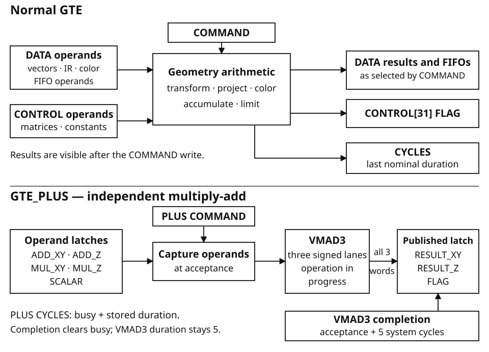
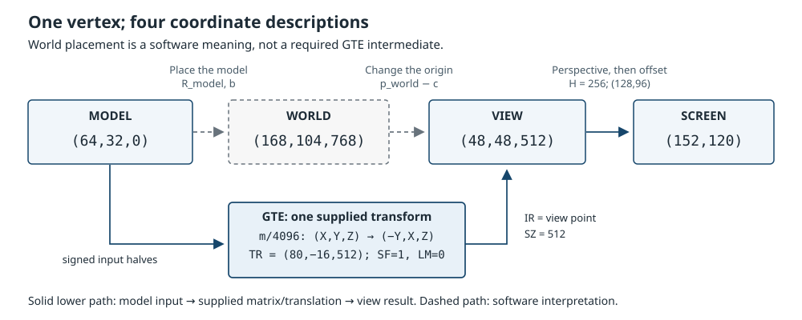
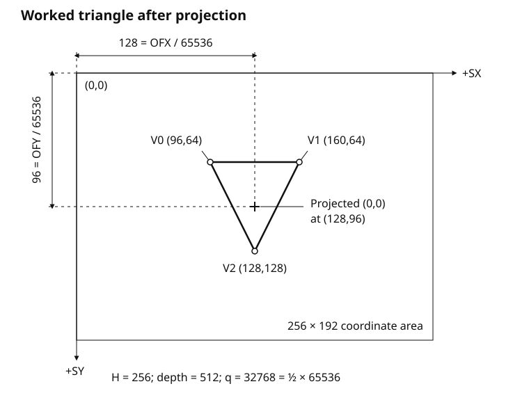
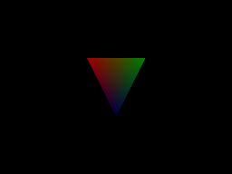
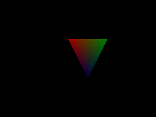
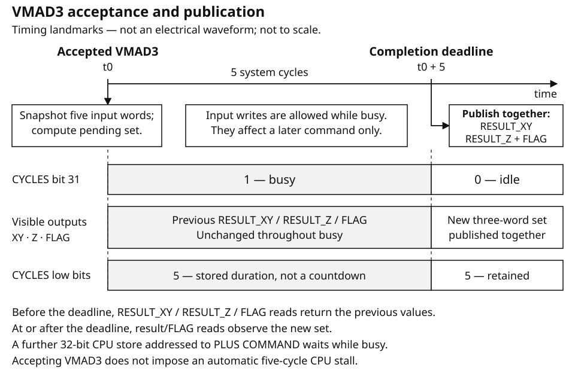
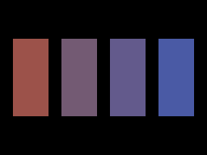
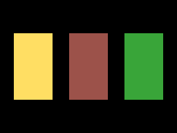
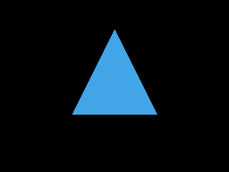

# Geometry Engine (GTE) {#sec-gte}

## Outline {#sec-gte-function-and-data-flow}

The Geometry Engine (GTE) performs the calculations for three-dimensional
graphics. It transforms and projects vertices onto the screen, calculates
lighting and depth-cued colours, tests which way a triangle faces, and
averages depths for sorting. All calculations are integer calculations with
programmable scale factors.

To project a polygon, load the transform and the vertices, write a projection
command, and read the screen coordinates and depths. The program then builds
GPU commands from these results. Clipping, sorting and drawing remain tasks of
the program.

A second unit, GTE PLUS, performs three multiply-adds at once.

## From a vertex to a screen position {#sec-gte-from-a-vertex-to-a-screen-position}

In this example +X points right, +Y down and +Z forward from the viewpoint.
The vertex V = (64, 32, 512) lies 64 units to the right, 32 down and 512 in
front of the viewpoint.

### The transform {#sec-gte-transform-into-the-viewing-coordinates}

A vertex of a model is given in the model's own coordinates. A matrix and a
translation convert it into view coordinates. Here V is already in view
coordinates, so the matrix is the identity and the translation 0.

### Perspective {#sec-gte-depth-determines-the-projected-displacement}

Perspective multiplies X and Y by H / Z, where H is the projection distance. A
larger H enlarges the picture; a larger depth makes it smaller. With H = 256 and
Z = 512:

```text
factor   = 256 / 512 = 1/2
(X, Y) × 1/2 = (32, 16)
```

The depth is kept for later use.

### Screen offset {#sec-gte-place-the-projected-origin-on-the-screen}

The offset OFX, OFY places the centre of projection on the screen. With offset
(128, 96):

```text
screen position = (128, 96) + (32, 16) = (160, 112)
```

The offset is added after perspective; it does not move the vertex in space.

| Stage | Value |
|---|---|
| Vertex | (64, 32, 512) |
| After the transform | (64, 32, 512) |
| Perspective, H = 256 | (32, 16) |
| Plus offset (128, 96) | (160, 112); depth 512 |

## Number formats {#sec-gte-programming-geometry}

D[n] is data register n and C[n] control register n. The input vectors V0, V1
and V2 each hold X, Y and Z as signed 16-bit numbers: X and Y in one word, Z
in the low half of the next.

### Scales {#sec-gte-choose-scales-for-an-operation-not-for-the-registerfile}

The usual convention is: positions and translations in whole units, matrix
values × 4096, and `SF = 1` in the command, which divides the results by 4096.

| Value | Format | Range |
|---|---|---|
| Vertex X, Y, Z | Signed 16 bits | −32768 to 32767 |
| Matrix value | Signed 16 bits, × 4096 | −8 to 8 − 1/4096 |
| Translation X, Y, Z | Signed 32 bits | −2^31^ to 2^31^ − 1 |
| H | Unsigned 16 bits | 0 to 65535 |
| OFX, OFY | Signed 32 bits, × 65536 | −32768 to 32768 − 1/65536 |

In matrix values, 1 is `1000H`, ½ is `0800H`, −½ is `F800H` and −1 is `F000H`.
The identity matrix has 4096 on the diagonal and 0 elsewhere.

`LM = 0` allows negative results; `LM = 1` limits them to 0. Use LM = 0 for
coordinates.

Intermediate results are 44 bits wide; the MAC registers hold 32 bits and the
IR registers 16 bits. Choose the coordinate range so that all stages fit.

## Programming example: one vertex {#sec-gte-a-first-projection-in-blua}

```lua
local data<const>: *word = 0x08010244
local control<const>: *word = 0x080102c4
local command<const>: *word = 0x08010344
control[0] = 0x00001000               -- C[0]: m00 = 1.0
control[2] = 0x00001000               -- C[2]: m11 = 1.0
control[4] = 0x00001000               -- C[4]: m22 = 1.0
control[24] = 128 << 16               -- OFX = 128
control[25] = 96 << 16                -- OFY = 96
control[26] = 256                     -- H = 256
data[0] = 0x00200040                  -- V0: X = 64, Y = 32
data[1] = 512                         -- V0: Z = 512
*command = 0x00080001                 -- RTPS, SF = 1, LM = 0
local flags<const> = control[31]      -- FLAG = 0
local screen<const> = data[14]        -- SXY2 = 007000A0H: (160, 112)
local depth<const> = data[19]         -- SZ3 = 512
```

RTPS takes 15 cycles. The read of FLAG waits until RTPS has finished. The
translation and the other matrix values are 0 after reset.

## Specifications {#sec-gte-technical-specifications}

| Item | Specification |
|---|---|
| Data registers | 32 words, D[0]–D[31] |
| Control registers | 32 words, C[0]–C[31] |
| Command registers | COMMAND, CYCLES |
| Commands | 22 |
| Input vectors | 3 × (X, Y, Z), 16 bits |
| Matrices | 3 (rotation, light, colour), 3 × 3 × 16 bits |
| Control vectors | 3 (translation, background colour, far colour), 3 × 32 bits |
| Accumulators | 3 × 44 bits; MAC 32 bits, IR 16 bits |
| Screen FIFO | 3 X/Y pairs, −1024 to 1023 |
| Depth FIFO | 4 × 16 bits |
| Colour FIFO | 3 × (R, G, B, CODE) |
| Command time | 5–44 cycles (33,868,800 Hz) |
| GTE PLUS | 10 words; 3 multiply-adds in 5 cycles |

{#fig-gte-overview}

The control registers hold the matrices and settings, which stay the same for
many commands. The data registers hold the vectors, the results and three
FIFOs, which keep the last few screen positions, depths and colours. A command
that processes three vertices leaves all three results in the FIFOs.

### Arithmetic {#sec-gte-capacity-and-arithmetic}

All calculations are integer multiplications and additions, followed by a
shift and a limit. Each command and its arithmetic are described in the
[command reference](#sec-gte-command-reference); the stages are described
under [arithmetic](#sec-gte-normal-command-arithmetic).

### Command time {#sec-gte-completion-and-throughput}

A command takes 5 to 44 cycles; see the [command table](#sec-gte-normal-commands-nominal-cost-and-cpu-cost).
The CPU continues while the GTE calculates. If the CPU reads a GTE register
or writes another command before the command has finished, the CPU waits
until it has finished. Writes of input values do not wait, so the next vertex
can be loaded during a command.

GTE PLUS takes 5 cycles per command, up to 6,773,760 commands per second. It
works independently of the main unit.

## Coordinate systems {#sec-gte-coordinate-spaces-and-the-supplied-transform}

### Model, world, view and screen {#sec-gte-choose-the-spaces-in-software}

| Space | Coordinates relative to |
|---|---|
| Model | The model's own origin and axes |
| World | The common origin of the scene |
| View | The viewpoint, along the viewing axes |
| Screen | The screen, after perspective |

The GTE converts from the input coordinates to view coordinates with one
matrix and one translation, then projects. World coordinates are a concept of
the program; the program combines the model placement and the viewpoint into
the one transform the GTE uses.

The GTE makes no assumption about axis directions. In this chapter +X is
right, +Y down and +Z forward, so that screen X increases to the right and
screen Y downward. A model with Y upward needs a matrix that turns Y around.

### The matrix {#sec-gte-read-the-matrix-as-three-dot-products}

The projection commands use the rotation matrix (C[0]–C[4]) and the
translation TR (C[5]–C[7]):

```text
X' = 4096 × TRX + m00 × X + m01 × Y + m02 × Z
Y' = 4096 × TRY + m10 × X + m11 × Y + m12 × Z
Z' = 4096 × TRZ + m20 × X + m21 × Y + m22 × Z
```

With SF = 1 the results are divided by 4096. In matrix form, with R the matrix
values divided by 4096:

```text
[ X' ]   [ R00 R01 R02 ] [ X ]   [ TRX ]
[ Y' ] = [ R10 R11 R12 ] [ Y ] + [ TRY ]
[ Z' ]   [ R20 R21 R22 ] [ Z ]   [ TRZ ]
```

The vector is a column on the right of the matrix. Each row gives one output
coordinate. Each column gives the direction in which one input axis is
mapped: the input (d, 0, 0) gives d × (R00, R10, R20). The matrix may rotate,
scale, mirror or shear; the GTE does not check it.

The GTE applies one matrix and one translation per vertex. A model placement
and a view must be combined into one transform; see
[combining transforms](#sec-gte-composing-transforms).

### The viewpoint {#sec-gte-a-view-origin-is-subtracted-not-added}

Let a model be placed in the world with matrix R_model and position b, and let
the viewpoint be at c with view matrix R_view. Then

```text
view = R_view × (world − c)
     = (R_view × R_model) × model + R_view × (b − c)
```

The translation is R_view × (b − c): the viewpoint is subtracted, and the
result is turned by the view matrix. Writing the viewpoint position into TR
gives the wrong result.

Example: a model turned by (X, Y, Z) → (−Y, X, Z), placed at b = (200, 40, 768),
with the viewpoint at c = (120, 56, 256) and R_view the identity. The matrix
rows are (0, −4096, 0), (4096, 0, 0), (0, 0, 4096), and the translation is
b − c = (80, −16, 512): TRX = `00000050H`, TRY = `FFFFFFF0H`,
TRZ = `00000200H`.

| Model point | View point |
|---|---|
| (0, 0, 0) | (80, −16, 512) |
| (64, 0, 0) | (80, 48, 512) |
| (0, 64, 0) | (16, −16, 512) |
| (0, 0, 64) | (80, −16, 576) |
| (64, 32, 0) | (48, 48, 512) |

{#fig-gte-coordinate-spaces}

### Screen offset and translation {#sec-gte-screen-placement-is-not-spatial-translation}

TR moves the geometry before perspective; OFX and OFY move the picture after
perspective. With q the projection factor (65536 = 1):

```text
SX = limit((OFX + IR1 × q) >> 16, −1024, 1023)
SY = limit((OFY + IR2 × q) >> 16, −1024, 1023)
```

With H = 256, depth 512 gives q = 32768, and the view point (48, 48, 512)
appears at (152, 120) with offset (128, 96).

A change in TR moves near objects further across the screen than far ones; a
change in OFX moves everything by the same amount. With H = 256, offset 128 and
X = 64:

| Depth | SX | TRX + 32 | OFX + 16 |
|---|---|---|---|
| 512 (q = 32768) | 160 | 176 | 176 |
| 1024 (q = 16384) | 144 | 152 | 160 |

### Range and precision {#sec-gte-keep-the-coordinate-convention-within-the-datapath}

- Vertex values are 16 bits. Using 16 counts per unit gives 1/16 unit
  resolution but a range of only −2048 to 2047 units.
- Matrix values have a resolution of 1/4096 and a range of −8 to 8. Rounding a
  value to the nearest 1/4096 gives an error of at most 1/8192 per value.
- The shift by 12 rounds towards −∞: ½ × 3 gives 1, ½ × (−3) gives −2.
- IR1–IR3 are limited to 16 bits. A large translation can therefore distort the
  projection even when the vertex itself fits. Keep large world positions in
  the program and give the GTE positions relative to the viewpoint.
- The depth is calculated from the full Z sum (shifted by 12, whatever SF),
  limited to 0–65535. Projection needs a depth greater than H / 2.
- Screen coordinates are limited to −1024 to 1023.

With SF = 0, the results are not shifted, but the depth is still shifted by 12.

The GTE does not clip. The program decides which geometry to project and what
to do with results that were limited.

## Building a transform {#sec-gte-constructing-and-packing-a-transform}

### Matrix layout {#sec-gte-read-the-packed-matrix-words}

The matrix values are stored row by row, two values per word:

| Register | Bits 15–0 | Bits 31–16 | Identity | (X,Y,Z) → (−Y,X,Z) |
|---|---|---|---|---|
| C[0] | m00 | m01 | `00001000H` | `F0000000H` |
| C[1] | m02 | m10 | `00000000H` | `10000000H` |
| C[2] | m11 | m12 | `00001000H` | `00000000H` |
| C[3] | m20 | m21 | `00000000H` | `00000000H` |
| C[4] | m22 | — | `00001000H` | `00001000H` |

C[1] holds the end of row 0 and the start of row 1.

### Example: turn, scale and move {#sec-gte-define-the-turn-scale-and-translation}

A model is scaled along its X axis by 5/4 and along its Y axis by 5/2, turned
in the XY plane with cos θ = 3/5 and sin θ = 4/5, and placed at (40, −24, 512):

```text
X' = 3/5 × (5/4 × X) − 4/5 × (5/2 × Y) + 40 = 3/4 X − 2 Y + 40
Y' = 4/5 × (5/4 × X) + 3/5 × (5/2 × Y) − 24 = X + 3/2 Y − 24
Z' = Z + 512
```

With +Y downward, this turn appears clockwise on the screen.

### Encoding {#sec-gte-encode-coefficients-then-pack-successive-halves}

| Row | Values | × 4096 | 16-bit |
|---|---|---|---|
| X | 3/4, −2, 0 | 3072, −8192, 0 | `0C00H`, `E000H`, `0000H` |
| Y | 1, 3/2, 0 | 4096, 6144, 0 | `1000H`, `1800H`, `0000H` |
| Z | 0, 0, 1 | 0, 0, 4096 | `0000H`, `0000H`, `1000H` |

| Register | Value | Register | Value |
|---|---|---|---|
| C[0] | `E0000C00H` | C[5] TRX | `00000028H` (40) |
| C[1] | `10000000H` | C[6] TRY | `FFFFFFE8H` (−24) |
| C[2] | `00001800H` | C[7] TRZ | `00000200H` (512) |
| C[3] | `00000000H` | | |
| C[4] | `00001000H` | | |

The translation is written in whole units; the GTE multiplies it by 4096
itself. Write all eight registers, the zeros included. The same transform
can then be used for any number of vertices.

Values that are not exact multiples of 1/4096 must be rounded by the
program.

### Checking the transform {#sec-gte-check-the-origin-and-basis-before-a-complicated-vertex}

Transform the origin and a point on each axis:

| Model point | View point |
|---|---|
| (0, 0, 0) | (40, −24, 512) |
| (64, 0, 0) | (88, 40, 512) |
| (0, 64, 0) | (−88, 72, 512) |
| (0, 0, 64) | (40, −24, 576) |

The X axis has become 80 long (64 × 5/4), the Y axis 160 (64 × 5/2), and the
two are at right angles (48 × −128 + 64 × 96 = 0). Use LM = 0, since view X is
negative here, and test points far enough out that rounding does not hide
the fractions.

### Example vertex {#sec-gte-follow-a-nonzero-vertex-through-the-actual-rows}

The model point (64, 16, 0) (D[0] = `00100040H`, D[1] = 0) gives:

```text
X' = (4096×40 + 3072×64 − 8192×16) >> 12 = 56
Y' = (4096×(−24) + 4096×64 + 6144×16) >> 12 = 64
Z' = (4096×512) >> 12 = 512
```

With H = 256, offset (128, 96) and DQA = DQB = 0, RTPS (`00080001H`) gives
SX = 128 + 28 = 156 and SY = 96 + 32 = 128: D[14] = `0080009CH`, FLAG = 0.

| Model point | Screen |
|---|---|
| (0, 0, 0) | (148, 84) |
| (64, 0, 0) | (172, 116) |
| (0, 64, 0) | (84, 132) |

The square −64 ≤ X, Y ≤ 64 at Z = 0 covers view X −136 to 216 and view Y −184
to 136, and screen X 60 to 236 and Y 4 to 164: all within the limits.

## Combining transforms {#sec-gte-composing-transforms}

### Order {#sec-gte-derive-the-order-and-the-translated-origin}

A transform (B, b) followed by (A, a) gives:

```text
A × (B × p + b) + a = (A × B) × p + (A × b + a)
```

The combined matrix is A × B and the combined translation A × b + a. Element
(r, c) of A × B is row r of A times column c of B. The GTE has no
matrix-times-matrix command, but MVMVA can calculate one column at a time.

### Example {#sec-gte-work-from-the-stored-coefficients}

A (from the previous example) and a local transform B:

```text
    [ 3072  -8192     0 ]                  [ 4096     0      0 ]
A = [ 4096   6144     0 ]  a = (40,-24,512)  B = [    0  2458  -3277 ]  b = (5,-3,7)
    [    0      0  4096 ]                  [    0  3277   2458 ]
```

B turns around X with cos ≈ 2458/4096 and sin ≈ 3277/4096. Each element of
A × B is a sum of products of two values × 4096; shifting it right by 12 gives a
value × 4096 again:

```text
        [ 3072  -4916   6554 ]
A × B = [ 4096   3687  -4916 ]        A × b + a = (49, -24, 519)
        [    0   3277   2458 ]
```

The exact values include fractions (−4915.5 becomes −4916; the translation is
(49.75, −23.5, 519)). These are lost when stored.

### Calculating it with MVMVA {#sec-gte-use-mvmva-as-three-column-products-and-one-origin-product}

Keep A in the rotation matrix and a in TR. Load the columns of B into V0–V2:

| Input | Column of B | XY word | Z word |
|---|---|---|---|
| V0 | (4096, 0, 0) | `00001000H` | `00000000H` |
| V1 | (0, 2458, 3277) | `099A0000H` | `00000CCDH` |
| V2 | (0, −3277, 2458) | `F3330000H` | `0000099AH` |

MVMVA with mx = 0, cv = 3 (no translation), SF = 1, LM = 0 gives the columns of
A × B:

| Input | Command | Result (IR1–IR3) |
|---|---|---|
| V0 | `00086012H` | (3072, 4096, 0) |
| V1 | `0008E012H` | (−4916, 3687, 3277) |
| V2 | `00096012H` | (6554, −4916, 2458) |

Then load b into V0 (`FFFD0005H`, `00000007H`) and use MVMVA with cv = 0
(`00080012H`): the result is (49, −24, 519). Read each result before the next
command. Store the results in memory and write them to the matrix registers
only when all four have been calculated, since the calculation needs A.

| Register | Value | Register | Value |
|---|---|---|---|
| C[0] | `ECCC0C00H` | C[5] | `00000031H` |
| C[1] | `1000199AH` | C[6] | `FFFFFFE8H` |
| C[2] | `ECCC0E67H` | C[7] | `00000207H` |
| C[3] | `0CCD0000H` | | |
| C[4] | `0000099AH` | | |

Do not use cv = 2 for this: see MVMVA.

### Rounding {#sec-gte-composed-and-sequential-integer-transforms-can-disagree}

Applying B and then A to a vertex rounds after each step; applying the
combined transform rounds the matrix values once. The results can differ by
one unit:

| Model point | B, then A | Combined | Exact until the end |
|---|---|---|---|
| (64, 16, 8) | (91, 45, 536) | (90, 44, 536) | (91, 45, 536) |
| (37, 29, 11) | (61, 25, 548) | (59, 25, 548) | (60, 26, 548) |

To apply A to the result of a first MVMVA, use MVMVA with v = 3 (the IR
registers as input): `00098012H`. A transform that is updated every frame
should be recalculated from the original values, so that rounding errors do not
build up.

### View and model {#sec-gte-apply-the-same-rule-to-viewmodel-transforms}

With the model matrix A (without a), model position b = (116, 28, 600),
viewpoint c = (100, 20, 40) and view matrix V: (X, Y, Z) → (−Y, X, Z):

```text
b − c = (16, 8, 560)
V × (b − c) = (−8, 16, 560)

        [ -4096  -6144     0 ]
V × A = [  3072  -8192     0 ]
        [     0      0  4096 ]
```

The model point (64, 16, 0) gives view point (−96, 32, 560).

The input vectors are 16 bits wide, so b can be calculated with MVMVA only if
it fits in 16 bits. A combined matrix value can exceed the 16-bit range even
when both matrices fit; check this in the program.

## Perspective {#sec-gte-perspective-and-geometric-decisions}

### Projection {#sec-gte-from-transformed-coordinates-to-screen-coordinates}

RTPS projects V0; RTPT projects V0, V1 and V2. Each vertex gives IR1–IR3, a
depth and a screen position. The depth is limited to 0–65535. The projection
factor q is H / depth × 65536, calculated with a reciprocal table (see
[reciprocal divide](#sec-gte-reciprocal-divide)). With H = 256, depth 512 gives
q = 32768 and depth 1024 gives q = 16384.

The offsets may include a fraction: `00808000H` is 128½. The final shift
rounds towards −∞, so an offset of −½ gives −1.

| Result | Range | Register |
|---|---|---|
| View coordinates | −32768 to 32767 (LM = 0) | IR1–IR3, D[9]–D[11] (last vertex) |
| Screen coordinates | −1024 to 1023 | SXY0–SXY2, D[12]–D[14], oldest first |
| Depth | 0 to 65535 | SZ0–SZ3, D[16]–D[19], oldest first |
| Depth cue | 0 to 4096 | IR0, D[8] |
| Depth average | 0 to 65535 | OTZ, D[7] |

After RTPT, D[12]–D[14] and D[17]–D[19] hold the results of V0, V1 and V2.
Reading the FIFOs does not change them; the next projection moves them on.

### Clipping at the near plane {#sec-gte-clip-a-crossing-edge-before-projecting-it}

The GTE does not clip. A vertex with depth of H / 2 or less gives a divide
overflow (DIV in FLAG), and screen coordinates outside −1024 to 1023 are
limited; neither gives a correct picture. Clip such polygons in the program
before projection.

Example, H = 256, near plane Z = 256, triangle in view coordinates:

```text
A = (-64, -64, 128)   in front of the near plane
B = ( 64, -64, 512)
C = (  0,  64, 512)
```

The edges A–B and A–C cross the plane at t = (256 − A.Z) / (B.Z − A.Z) = 1/3:

| Edge | Crossing | Rounded |
|---|---|---|
| A–B | (−64/3, −64, 256) | (−21, −64, 256) |
| A–C | (−128/3, −64/3, 256) | (−43, −21, 256) |

The remaining shape I_AB, B, C, I_AC is drawn as two triangles, (I_AB, B, C)
and (I_AB, C, I_AC). These points are already view coordinates: project them
with the identity matrix and TR = 0.

| Point | XY word | Z word | Screen | Screen word |
|---|---|---|---|---|
| I_AB | `FFC0FFEBH` | `00000100H` | (107, 32) | `0020006BH` |
| B | `FFC00040H` | `00000200H` | (160, 64) | `004000A0H` |
| C | `00400000H` | `00000200H` | (128, 128) | `00800080H` |
| I_AC | `FFEBFFD5H` | `00000100H` | (85, 75) | `004B0055H` |

NCLIP gives 4416 and 3015 for the two triangles: both face the same way. For
polygons with colours or texture coordinates, the program calculates these at
the new points as well.

### Facing and depth {#sec-gte-area-depth-and-the-next-decision}

NCLIP calculates twice the area of the triangle in the screen FIFO, with sign:

```text
MAC0 = (SX1 − SX0) × (SY2 − SY0) − (SX2 − SX0) × (SY1 − SY0)
```

The sign shows which way the triangle faces; 0 means that the points lie on
one line. Which sign is the front depends on the vertex order chosen by the
program.

AVSZ3 multiplies the sum of the last three depths by ZSF3 and shifts it right
by 12; AVSZ4 does the same for four depths with ZSF4. ZSF3 = `0555H`
(≈ 1/3) and ZSF4 = `0400H` (1/4) give the average depth, for use in sorting.

Each command replaces FLAG and MAC0: read FLAG after RTPT before NCLIP, and
MAC0 after NCLIP before AVSZ3. FLAG after RTPT covers all three vertices.

FLAG reports events, but the results are written anyway: a divide overflow
gives q = `1FFFFH`, and a limited screen coordinate is −1024 or 1023. The
program decides what to do with such a polygon.

## Lighting {#sec-gte-normals-light-directions-and-color-mixing}

The lighting commands calculate the colour of a surface from its normal: a
vector that shows which way the surface faces. The program supplies the normal
in V0 (and V1, V2 for the triple commands); the GTE does not calculate it from
the vertices and does not normalize it. The normal and the light directions
must be given in the same coordinate system: when a model is turned, turn its
normals as well, or give the light directions in model coordinates.

### Normals and unequal scaling {#sec-gte-keep-a-normal-perpendicular-after-unequal-scale}

When a model is scaled unequally, a normal transformed with the model's matrix
is no longer perpendicular to the surface. For a normal use the inverse
transpose of the matrix, (R^−1^)^T^. For a pure rotation this is the matrix
itself. The program calculates it; the GTE can apply it with MVMVA.

Example: R doubles X. The edge (1, 1, 0) becomes (2, 1, 0). The normal (1, −1, 0)
transformed with R would be (2, −1, 0), which is not perpendicular to (2, 1, 0);
with the inverse transpose it becomes (½, −1, 0), which is.

### Light matrix and colour matrix {#sec-gte-three-directional-responses-then-three-color-channels}

Lighting takes two steps:

1. **Light matrix** (C[8]–C[12]): each of its three rows is the direction of
   a light, pointing towards the light, with the light's strength as its
   length. Each row is multiplied by the normal. With LM = 1, negative results
   (surfaces turned away from the light) become 0.
2. **Colour matrix** (C[16]–C[20]): converts the three light results into red,
   green and blue. Each column gives the colour of one light. The background
   colour BK (C[13]–C[15]) is added: light that reaches every surface.

Three lights can be calculated in one command. More lights require further
commands, with the results added by the program.

### Example {#sec-gte-a-warm-light-a-green-light-and-a-back-facing-blue-light}

Normal N = (2458, 0, 3277), about (0.6, 0, 0.8). All matrix values × 4096:

```text
     light matrix L            colour matrix K
     [ 3072    0   2048 ]      [ 4096  1024     0 ]
     [-2048    0   3072 ]      [ 2048  4096     0 ]
     [    0    0  -4096 ]      [ 1024  2048  4096 ]

background BK = (256, 512, 128)      base colour = (160, 96, 192)
```

Light 0 is warm (colour 1, ½, ¼), light 1 greenish (¼, 1, ½), light 2 blue;
light 2 shines from behind and does not reach this surface.

| Register | Address | Value |
|---|---|---|
| C[8] L00 / L01 | `080102E4H` | `00000C00H` |
| C[9] L02 / L10 | `080102E8H` | `F8000800H` |
| C[10] L11 / L12 | `080102ECH` | `0C000000H` |
| C[11] L20 / L21 | `080102F0H` | `00000000H` |
| C[12] L22 | `080102F4H` | `FFFFF000H` |
| C[13] RBK | `080102F8H` | `00000100H` |
| C[14] GBK | `080102FCH` | `00000200H` |
| C[15] BBK | `08010300H` | `00000080H` |
| C[16] K00 / K01 | `08010304H` | `04001000H` |
| C[17] K02 / K10 | `08010308H` | `08000000H` |
| C[18] K11 / K12 | `0801030CH` | `00001000H` |
| C[19] K20 / K21 | `08010310H` | `08000400H` |
| C[20] K22 | `08010314H` | `00001000H` |
| D[0] normal X / Y | `08010244H` | `0000099AH` |
| D[1] normal Z | `08010248H` | `00000CCDH` |
| D[6] RGBC | `0801025CH` | `34C060A0H` |
| COMMAND: NCCS, SF = 1, LM = 1 | `08010344H` | `0008041BH` |

Step 1, light matrix (shifted right by 12, negative values to 0):

| Light | Result | IR |
|---|---:|---:|
| 0 | 3482 | 3482 |
| 1 | 1228 | 1228 |
| 2 | −3277 | 0 |

Step 2, colour matrix plus background: red 4045, green 3481, blue 1612 (4096
is full intensity).

Step 3, base colour: each component is base × gain / 4096:

| Colour | Calculation | Result |
|---|---|---:|
| Red | 160 × 4045 / 4096 | 158 |
| Green | 96 × 3481 / 4096 | 81 |
| Blue | 192 × 1612 / 4096 | 75 |

RGB2 (D[22]) becomes `344B519EH`: colour (158, 81, 75) with CODE `34H`. FLAG is
`00400000H` because the result of light 2 was limited to 0.

With normal (0, 0, 0) only the background remains: (10, 12, 6), RGB2 =
`34060C0AH`.

### Colour scale {#sec-gte-select-the-color-stage-scale}

In NCCS the colour-matrix result is a gain, with 4096 meaning 1. In NCS, which
applies no base colour, the result is the colour itself, with 16 meaning 1
(4080 gives 255). The same setting therefore gives (252, 217, 100) with NCS.
Choose the matrix scale to suit the command.

## Choosing a colour command {#sec-gte-choosing-a-color-calculation}

| Input | Calculation | Command |
|---|---|---|
| Normal | Light and colour matrix | NCS (NCT for 3 normals) |
| Normal, base colour | Light and colour matrix, × base colour | NCCS (NCCT) |
| Normal, base colour, IR0 | As NCCS, then depth cue | NCDS (NCDT) |
| Light results in IR1–IR3 | Colour matrix, × base colour | CC |
| Light results in IR1–IR3, IR0 | Colour matrix, × base colour, depth cue | CDP |
| Gains in IR1–IR3, IR0 | × base colour, depth cue | DCPL |
| Colour in RGBC, IR0 | Depth cue | DPCS |
| Colour in IR1–IR3, IR0 | Depth cue | INTPL |
| Three colours in RGB0–RGB2, IR0 | Depth cue | DPCT |

The base colour is the RGB of RGBC; the CODE byte of RGBC is copied to every
colour result.

### Example: two materials {#sec-gte-two-material-tints-under-the-same-light-setup}

With the lights of the previous example:

| Material | Base colour | RGBC | Result | RGB2 |
|---|---|---|---|---|
| A | (160, 96, 192) | `34C060A0H` | (158, 81, 75) | `344B519EH` |
| B | (64, 192, 160) | `34A0C040H` | (63, 163, 62) | `343EA33FH` |

NCCT uses one base colour for all three normals. For different materials, use
separate commands.

### Depth cue in one command {#sec-gte-choose-the-fused-cue-path-before-discarding-precision}

To fade material A halfway (IR0 = 2048) towards the far colour (80, 96, 160):

| Register | Address | Value |
|---|---|---|
| D[6] RGBC | `0801025CH` | `34C060A0H` |
| D[8] IR0 = 2048 | `08010264H` | `00000800H` |
| C[21] RFC = 80 × 16 | `08010318H` | `00000500H` |
| C[22] GFC = 96 × 16 | `0801031CH` | `00000600H` |
| C[23] BFC = 160 × 16 | `08010320H` | `00000A00H` |
| COMMAND: NCDS, SF = 1, LM = 1 | `08010344H` | `00080413H` |

RGB2 becomes `34755876H`: (118, 88, 117). Doing the same in two steps, NCCS
followed by DPCS on its result, gives `34755877H`, since the colour is rounded
to whole values in between.

### Partial results {#sec-gte-keep-the-required-stage-alive}

After NCCS, IR1–IR3 hold the final colour, not the light results or gains. To
continue from an earlier step, load the values into IR1–IR3 yourself:

| Values | D[9], D[10], D[11] | Then |
|---|---|---|
| Light results (3482, 1228, 0) | `00000D9AH`, `000004CCH`, `00000000H` | CC, or CDP with depth cue |
| Gains (4045, 3481, 1612) | `00000FCDH`, `00000D99H`, `0000064CH` | DCPL |

Also note:

- V0–V2 hold either positions or normals; load the normals before a lighting
  command.
- The depth-cue commands use IR0 as it is. A projection command changes IR0;
  after RTPT it holds the value for V2.
- Each colour result moves the colour FIFO on: RGB0 ← RGB1, RGB1 ← RGB2,
  RGB2 ← new colour.
- DPCT uses one IR0 and one far colour for all three colours.

## Vector arithmetic {#sec-gte-interpolation-and-general-arithmetic}

Several commands are also useful for general vector arithmetic.

### Weighted sum {#sec-gte-blend-two-signed-motion-samples}

To calculate ¾ a + ¼ b, with a = (96, −48, 32) and b = (−32, 80, 64):

```text
GPF: MAC = (IR0 × IR) >> 12
GPL: MAC = (IR0 × IR + 4096 × MAC) >> 12
```

| Step | IR0 | IR1–IR3 | Command | Result |
|---|---|---|---|---|
| GPF | 3072 (¾) | (96, −48, 32) | `0008003DH` | (72, −36, 24) |
| GPL | 1024 (¼) | (−32, 80, 64) | `0008003EH` | (64, −16, 40) |

Writing IR0–IR3 between the two commands does not change MAC1–MAC3.

### Colour FIFO {#sec-gte-account-for-the-color-pushes-even-when-no-color-is-wanted}

GPF and GPL, like the colour commands, put MAC / 16 (limited to 0–255) into the
colour FIFO with the CODE of RGBC. In the example above, the negative green
value is limited to 0 and FLAG is `00100000H`. Save colours that are still
needed before using these commands.

### INTPL {#sec-gte-interpolate-towards-a-retained-far-vector-with-intpl}

INTPL calculates the same weighted sum in one command, from IR1–IR3 towards
the far colour C[21]–C[23]:

```text
MAC = (4096 × IR + IR0 × limit16(FC − IR)) >> 12
```

With a in IR1–IR3, b in C[21]–C[23] and IR0 = 1024, INTPL (`00080011H`) gives
(64, −16, 40). Changing C[21]–C[23] also changes the far colour of the other
depth-cue commands.

The results can differ by rounding: for a = 5, b = 3 GPF + GPL give 3, INTPL 4
(exact 4.5). The difference FC − IR is limited to 16 bits: from −30000 to
30000 with IR0 = 4096, INTPL reaches 2767, not 30000, and sets FLAG to
`81000000H`.

### Cross product and squares {#sec-gte-form-a-perpendicular-vector-then-measure-its-squared-length}

OP calculates the cross product of the rotation matrix diagonal (m00, m11, m22)
and IR1–IR3. For u = (12, −8, 4) and v = (−4, 20, 8): write `0000000CH` to C[0],
`0000FFF8H` to C[2] and `00000004H` to C[4], v to IR1–IR3, and give OP with
SF = 0, LM = 0 (`0000000CH`):

```text
X = uY × vZ − uZ × vY = −144
Y = uZ × vX − uX × vZ = −112
Z = uX × vY − uY × vX =  208
```

SQR (SF = 0, `00000028H`) then squares IR1–IR3: MAC = 20736, 12544, 43264.
IR3 is limited to 32767 (FLAG `00400000H`); add the MAC values for the length
squared: 76544.

OP and SQR do not use the colour FIFO. OP uses the rotation matrix: load the
transform again before the next projection.

## Depth cue {#sec-gte-choosing-depth-cue-coefficients}

Depth cue moves a colour towards the far colour (C[21]–C[23]) by the factor in
IR0: 0 leaves the colour unchanged, 4096 gives the far colour. The depth-cue
commands use IR0 as it is; IR0 is set by the program or by a projection
command.

### Setting IR0 directly {#sec-gte-program-ir0-directly-for-a-chosen-blend}

Write 4096 × f to IR0 (D[8], `08010264H`): `00000000H` for none, `00000800H`
for half, `00001000H` for full. IR0 is a signed 16-bit value; values outside
0–4096 extrapolate. For a fade that is linear in depth, for instance from
Z = 256 to Z = 768, the program calculates IR0 = 4096 × (Z − 256) / 512 itself.

### IR0 from projection {#sec-gte-projection-produces-a-reciprocal-depth-law}

RTPS, and RTPT for the last vertex, set:

```text
IR0 = limit((DQB + DQA × q) >> 12, 0, 4096)
```

DQA is a signed 16-bit value and DQB a signed 32-bit value. The shift is always
12, whatever SF. Since q is proportional to 1/Z, this fade is linear in 1/Z,
not in Z. To fade from 0 at depth Zn to 4096 at Zf:

```text
DQA = 4096 × (kf − kn) / (qf − qn)
DQB = 4096 × kn − DQA × qn
```

with kn = 0, kf = 4096 and qn, qf the projection factors at Zn and Zf. The
factors depend on H.

### Example: fade from depth 256 to 768 {#sec-gte-fit-near-256-and-far-768-with-h128}

With H = 128: qn = 32768, qf = 10923, so DQA = −768.01, rounded to −768.
DQB = 768 × 32768 = 25165824 would give 4095 at depth 768; DQB = 25166080
(`01800100H`) gives exactly 0 at 256 and 4096 at 768.

| Register | Address | Value |
|---|---|---|
| C[26] H | `0801032CH` | `00000080H` (128) |
| C[27] DQA | `08010330H` | `FFFFFD00H` (−768) |
| C[28] DQB | `08010334H` | `01800100H` |

Projecting (0, 0, Z) with RTPS, then lighting material A of the lighting
example with NCDS towards far colour (80, 96, 160):

| Z | q | IR0 | Colour | RGB2 |
|---|---:|---:|---|---|
| 128 | 65536 | 0 (limited) | (158, 81, 75) | `344B519EH` |
| 256 | 32768 | 0 | (158, 81, 75) | `344B519EH` |
| 384 | 21845 | 2048 | (118, 88, 117) | `34755876H` |
| 512 | 16384 | 3072 | (99, 92, 138) | `348A5C63H` |
| 768 | 10923 | 4096 | (79, 95, 160) | `34A05F4FH` |
| 1024 | 8192 | 4096 (limited) | (79, 95, 160) | `34A05F4FH` |

Half is reached at depth 384, not 512. At depths 128 and 1024 FLAG is
`00001000H` (IR0 limited).

### The far colour {#sec-gte-a-full-coefficient-is-not-always-an-exact-far-color-byte}

With IR0 = 4096, NCDS above gives (79, 95, 160) instead of (80, 96, 160): the
difference is calculated with 12-bit shifts, and the fraction lost there is
not recovered. DPCS with a colour from RGBC reaches the far colour exactly.

### Limits {#sec-gte-check-whether-the-requested-fade-fits-the-coefficient-fields}

DQA must fit in 16 bits. A fade over a short depth range can need a larger
value: with H = 128, a fade from 256 to 260 would need DQA ≈ −33288, which does
not fit. Then choose a longer range or calculate IR0 in the program.

### Three vertices {#sec-gte-keep-per-vertex-coefficients-associated-with-their-vertices}

RTPT sets IR0 for V2 only, and NCDT uses this one IR0 for all three colours.
For a separate depth cue per vertex, use RTPS and NCDS per vertex, or set IR0
before each colour command.

## Programming example: a triangle {#sec-gte-worked-geometry-sequences}

### Projecting, facing and depth {#sec-gte-project-a-triangle-test-its-orientation-and-form-a-depth-value}

This example projects a triangle to (96, 64), (160, 64), (128, 128) on a
256 × 192 screen, with the identity matrix, H = 256 and offset (128, 96).

{#fig-gte-projection}

| Step | Address | Register | Value | Meaning |
|---|---|---|---|---|
| 1 | `080102C4H` | C[0] | `00001000H` | m00 = 1.0 |
| 2 | `080102C8H` | C[1] | `00000000H` | |
| 3 | `080102CCH` | C[2] | `00001000H` | m11 = 1.0 |
| 4 | `080102D0H` | C[3] | `00000000H` | |
| 5 | `080102D4H` | C[4] | `00001000H` | m22 = 1.0 |
| 6 | `080102D8H` | C[5] | `00000000H` | TRX = 0 |
| 7 | `080102DCH` | C[6] | `00000000H` | TRY = 0 |
| 8 | `080102E0H` | C[7] | `00000000H` | TRZ = 0 |
| 9 | `08010324H` | C[24] | `00800000H` | OFX = 128 |
| 10 | `08010328H` | C[25] | `00600000H` | OFY = 96 |
| 11 | `0801032CH` | C[26] | `00000100H` | H = 256 |
| 12 | `08010330H` | C[27] | `00000000H` | DQA = 0 |
| 13 | `08010334H` | C[28] | `00000000H` | DQB = 0 |
| 14 | `08010338H` | C[29] | `00000555H` | ZSF3 = 1365 |
| 15 | `08010244H` | D[0] | `FFC0FFC0H` | V0 = (−64, −64, |
| 16 | `08010248H` | D[1] | `00000200H` | 512) |
| 17 | `0801024CH` | D[2] | `FFC00040H` | V1 = (64, −64, |
| 18 | `08010250H` | D[3] | `00000200H` | 512) |
| 19 | `08010254H` | D[4] | `00400000H` | V2 = (0, 64, |
| 20 | `08010258H` | D[5] | `00000200H` | 512) |
| 21 | `08010344H` | COMMAND | `00080030H` | RTPT, SF = 1, LM = 0 |

Results after RTPT (23 cycles):

| Register | Address | Value |
|---|---|---|
| SXY0–SXY2 | `08010274H`–`0801027CH` | `00400060H`, `004000A0H`, `00800080H` |
| SZ0–SZ3 | `08010284H`–`08010290H` | 0, 512, 512, 512 |
| IR1–IR3 (V2) | `08010268H`–`08010270H` | 0, 64, 512 |
| FLAG | `08010340H` | 0 |

Then:

| Step | Command | Result |
|---|---|---|
| 22 | NCLIP (`00000006H`) | MAC0 = 4096 (8 cycles) |
| 23 | AVSZ3 (`0000002DH`) | OTZ = 511, MAC0 = 2096640 (5 cycles) |

AVSZ3 gives 1365 × 1536 >> 12 = 511, since 1365/4096 is slightly less than 1/3.
Read MAC0 after NCLIP before AVSZ3 replaces it.

## Drawing the result {#sec-gte-from-projected-vertices-to-a-visible-image}

The GTE only calculates. To draw the triangle, the program sends the screen
coordinates (and colours) to the GPU; to show it, it selects the image in the
PCRTC.

### Continuing the example {#sec-gte-continue-the-worked-triangle}

The screen FIFO now holds:

| Register | Point | Value |
|---|---|---|
| D[12] | (96, 64) | `00400060H` |
| D[13] | (160, 64) | `004000A0H` |
| D[14] | (128, 128) | `00800080H` |

The image is GX16 at VRAM word 0, 1024 pixels wide, 256 × 192 shown. All GPU
words are written to GP0 at `0801023CH`.

### Drawing settings and clearing {#sec-gte-set-drawing-state-and-clear-the-destination}

| Order | GP0 | Meaning |
|---:|---|---|
| 1 | `E1000400H` | Drawing mode: draw to the displayed area, no dithering |
| 2 | `E3000000H` | Drawing area top left (0, 0) |
| 3 | `E402FCFFH` | Drawing area bottom right (255, 191) |
| 4 | `E5000000H` | Drawing offset (0, 0) |
| 5 | `E6000000H` | No mask bits |
| 6 | `02000000H` | Fill rectangle, black |
| 7 | `00000000H` | at (0, 0) |
| 8 | `00C00100H` | 256 × 192 |

The drawing offset is 0, since the GTE offset has already placed the triangle.

### Drawing the triangle {#sec-gte-submit-the-triangle}

| Order | GP0 | Meaning |
|---:|---|---|
| 9 | `200000FFH` | Triangle, one colour: red |
| 10 | D[12] | First point |
| 11 | D[13] | Second point |
| 12 | D[14] | Third point |

The GTE screen format is the GPU coordinate format, so the words are copied
unchanged. Then wait until bit 26 of GPUSTAT (`08010240H`) is 1.

### Showing the image {#sec-gte-select-the-framebuffer-for-display}

| Order | Address | Register | Value | Meaning |
|---:|---|---|---|---|
| 1 | `0801035CH` | DISPFB1_LOW | `000FA000H` | VRAM word 0, width 1024, GX16 |
| 2 | `08010360H` | DISPFB1_HIGH | `00000000H` | Start (0, 0) |
| 3 | `08010368H` | DISPLAY1_HIGH | `000BF3FFH` | 256 × 192 |
| 4 | `08010354H` | PMODE_LOW | `0000FF21H` | Circuit 1 on |

From the next VBlank, the screen shows a red triangle on black, with corners
(96, 64), (160, 64) and (128, 128). The PCRTC settings take effect at VBlank;
see @sec-pcrtc-26-programmed-words-and-displayed-settings.

## Programming example: animation {#sec-gte-hardware-frame-sequence}

This example draws the triangle every frame with three vertex colours and
moves it 16 pixels to the right and back every 32 frames. It draws into one of
two images while the other is shown.

### Settings {#sec-gte-pack-and-transfer-the-operands}

| Registers | Values |
|---|---|
| Rotation matrix C[0]–C[4] | `00001000H`, `00000000H`, `00001000H`, `00000000H`, `00001000H` |
| Translation C[5]–C[7] | 0, 0, 0 |
| Light matrix C[8]–C[12] | Identity, as C[0]–C[4] |
| Background colour C[13]–C[15] | 0, 0, 0 |
| Colour matrix C[16]–C[20] | Identity, as C[0]–C[4] |
| C[24]–C[28] | `00800000H`, `00600000H`, `00000100H`, 0, 0 |
| Vertices D[0]–D[5] | `FFC0FFC0H`, `00000200H`, `FFC00040H`, `00000200H`, `00400000H`, `00000200H` |
| Normals D[0]–D[5] (after RTPT) | `00001000H`, 0, `10000000H`, 0, 0, `00001000H` |
| Base colour D[6] | `004080A0H` |

The three normals point along X, Y and Z, so that each vertex gets one of the
three colours.

### Two images {#sec-gte-keep-the-drawing-buffer-separate-from-the-displayed-buffer}

| Image | VRAM lines | DISPFB1_LOW |
|---:|---|---|
| 0 | 0–191 | `000FA000H` |
| 1 | 256–447 | `000FA040H` |

### Each frame {#sec-gte-observe-the-hand-offs-in-the-loop}

1. Clear the image that is not shown.
2. Load the vertices and give RTPT. Keep the three screen words.
3. Give NCLIP. Draw the triangle only if MAC0 is positive (bit 31 = 0, not 0).
4. Load the normals and give NCCT. The colours are RGB0 = `000000A0H`,
   RGB1 = `00008000H`, RGB2 = `00400000H`.
5. Send a shaded triangle with the three points and colours to the GPU, and
   wait until the GPU is idle.
6. Select the new image in the PCRTC and wait for the next VBlank.
7. Change to the other image.

### Commands {#sec-gte-frame-register-and-packet-order}

Before the loop: mask interrupts, write RESET (`00000200H`) to the PCRTC CSR
(`080103D4H`), set DISPFB1_HIGH to 0 and DISPLAY1_HIGH to `000BF3FFH`, load
the GTE settings, send GP0 `E1000400H` and `E6000000H`, clear the interrupt
flags and enable VBlank (`00000004H` to `08000008H`).

Each frame, with b the image (0 or 1) and y = 256 × b, send to GP0:

| Order | GP0 | Meaning |
|---:|---|---|
| 1 | `0xe3000000 \| (y << 10)` | Drawing area top left (0, y) |
| 2 | `0xe40000ff \| ((y + 191) << 10)` | Drawing area bottom right (255, y + 191) |
| 3 | `0xe5000000 \| (y << 11)` | Drawing offset (0, y) |
| 4 | `02000000H` | Fill, black |
| 5 | `y << 16` | at (0, y) |
| 6 | `00C00100H` | 256 × 192 |

Write TRX = `((frame >> 5) & 1) << 5`, load the vertices and give RTPT
(`00080030H`). Keep D[12]–D[14]. Give NCLIP (`00000006H`). If MAC0 is
positive, load the normals and base colour, give NCCT (`0008043FH`) and send:

| Order | GP0 |
|---:|---|
| 1 | `0x30000000 \| (D[20] & 0x00ffffff)` |
| 2 | First screen word |
| 3 | `D[21] & 0x00ffffff` |
| 4 | Second screen word |
| 5 | `D[22] & 0x00ffffff` |
| 6 | Third screen word |

Wait for GPUSTAT bit 26. With interrupts masked, write
`0x000fa000 | (b << 6)` to DISPFB1_LOW and `0000FF21H` to PMODE_LOW, clear the
VBlank flag, enable VBlank and wait for the next VBlank. Then change b.

### Result {#sec-gte-output-plate-ncct-vertex-colour-triangle}

| TRX = 0 | TRX = 32 |
| :---: | :---: |
| {#fig-gte-output-initial} | {#fig-gte-output-translated} |
| Corners (96, 64), (160, 64), (128, 128) | Corners (112, 64), (176, 64), (144, 128) |

The GTE gives the corners and their colours; the GPU fills in the triangle.

## Example: translation {#sec-gte-a-further-geometry-sequence}

### Translation before projection {#sec-gte-translate-before-projection}

Continuing from the triangle example, set TR = (32, −16, 512) and project
V0 = (64, 32, 512):

| Step | Address | Register | Value |
|---|---|---|---|
| 1 | `080102D8H` | C[5] TRX | `00000020H` |
| 2 | `080102DCH` | C[6] TRY | `FFFFFFF0H` |
| 3 | `080102E0H` | C[7] TRZ | `00000200H` |
| 4 | `08010244H` | D[0] | `00200040H` |
| 5 | `08010248H` | D[1] | `00000200H` |
| 6 | `08010344H` | COMMAND | `00080001H` (RTPS) |

The view point is (96, 16, 1024), q = 16384 (¼), and the screen point
(128 + 24, 96 + 4) = (152, 100): SXY2 = `00640098H`. The screen and depth FIFOs
move on by one entry; SZ3 = 1024.

## Checking results {#sec-gte-diagnosing-numerical-results}

FLAG (C[31]) shows which stages of a command limited or overflowed a value.
Each command clears FLAG at its start, so read it before the next command. A
result at a limit does not by itself show which stage limited it; FLAG does.

Each example below starts with all registers 0.

### Rounding {#sec-gte-an-arithmetic-shift-is-not-rounding-towards-zero}

m00 = ½ (`00000800H`), MVMVA `00086012H`:

| X | Result | FLAG |
|---:|---:|---|
| 3 | 1 | 0 |
| −3 | −2 | 0 |

The shift rounds towards −∞. Repeated transforms lose fractions without any
FLAG bit.

### MAC and accumulator {#sec-gte-visible-word-wrap-and-accumulator-overflow-are-different}

TRX = 524288 (`00080000H`), MVMVA `00000012H` (SF = 0): the sum 2^31^ fits the
44-bit accumulator, but MAC1 (32 bits) reads `80000000H` and IR1 is limited to
−32768. FLAG = `81000000H` (IR1 limited), without an accumulator overflow bit.

m00 = 1, m01 = −1 (C[0] = `F0001000H`), TRX = `7FFFFFFFH`, V0 = (1, 1, 0),
MVMVA `00080012H`: the accumulator overflows upward, then downward. The final
value is correct, but FLAG = `C9000000H` records both overflows.

### Limited IR {#sec-gte-a-limited-ir-can-resemble-an-ordinary-screen-result}

m00 = 2, H = 16, V0 = (20000, 0, 512), RTPS: X' = 40000 is limited to 32767 in
IR1, and the projection uses 32767: SX = 1023. FLAG = `81000000H` (IR1
limited), not a screen limit. Without the limit, SX would be 1250.

### MAC0 {#sec-gte-mac0-can-look-harmless-after-a-screen-overflow}

Identity, H = 256, V0 = (32767, 0, 512), OFX = `7FFFFFFFH`, RTPS: the screen
calculation overflows 32 bits and SX is limited to 1023. MAC0 is afterwards
overwritten by the depth-cue calculation and reads 0, but FLAG = `80014000H`
records the overflow and the screen limit.

### Divide overflow {#sec-gte-the-reciprocal-boundary-still-publishes-coordinates}

Identity, H = 256, V0 = (1, 0, Z), RTPS:

| Z | SZ3 | SXY2 | FLAG |
|---:|---:|---|---|
| 129 | 129 | `00000001H` | `00000000H` |
| 128 | 128 | `00000001H` | `80020000H` (divide overflow) |
| −1 | 0 | `00000001H` | `80060000H` (depth limited, divide overflow) |

The screen result is the same in all three cases; only FLAG shows that the
vertex was too close.

## Command reference {#sec-gte-command-reference}

A command is started by writing its command word to COMMAND (`08010344H`).
Bits 5–0 select the command. For most commands, bit 19 (SF) and bit 10 (LM)
select the shift and lower limit:

| Bit | Name | 0 | 1 |
|---|---|---|---|
| 19 | SF | Results not shifted | Results shifted right by 12 |
| 10 | LM | IR1–IR3 limited to −32768…32767 | IR1–IR3 limited to 0…32767 |

Add `00080000H` for SF = 1 and `00000400H` for LM = 1 to the command code.
Bits 18–13 are used only by MVMVA. Unused bits are ignored.

Every command clears FLAG (C[31]) at its start; FLAG then records every limit
and overflow of all stages of the command, also of values that are later
overwritten. The stages and limits are described under
[arithmetic](#sec-gte-mac-shift-and-ir-stages), and the FLAG bits under
[FLAG](#sec-gte-c31-normal-flag).

A colour result moves the colour FIFO on (RGB0 ← RGB1, RGB1 ← RGB2) and is
written to RGB2, with the CODE byte of RGBC. Registers that a command does not
list as output keep their values.

In the formulas, `>>` is an arithmetic shift (rounding towards −∞) and
`limit(x, a, b)` limits x to a…b.

### Geometry commands {#sec-gte-geometry-commands}

#### RTPS — transform and project one vertex {#sec-gte-rtps-transform-and-project-one-vector}

| | |
|---|---|
| Command | `00000001H` (+ SF, LM) |
| Input | V0; rotation matrix, TR, OFX, OFY, H, DQA, DQB |
| Output | IR1–IR3, MAC1–MAC3, SXY0–SXY2, SZ0–SZ3, IR0, MAC0 |
| Cycles | 15 |

Calculation:

```text
MACi = (4096 × TRi + Ri1 × VX + Ri2 × VY + Ri3 × VZ) >> (12 × SF)     i = 1, 2, 3
IRi  = limit(MACi)
SZ3  = limit(Z' >> 12, 0, 65535)         Z' = the full sum of row 3
q    = H / SZ3 × 65536 (reciprocal divide; 1FFFFH if H ≥ 2 × SZ3)
SX2  = limit((OFX + IR1 × q) >> 16, −1024, 1023)
SY2  = limit((OFY + IR2 × q) >> 16, −1024, 1023)
MAC0 = DQB + DQA × q
IR0  = limit(MAC0 >> 12, 0, 4096)
```

The sums are 44 bits wide. The depth is always shifted by 12, whatever SF, and
is calculated from the full sum, not from IR3. The IR3 flag (bit 22) is set
when Z' >> 12 is outside −32768…32767, whatever SF and LM. The screen FIFO and
depth FIFO move on by one entry. MAC0 holds the depth-cue value afterwards, not
the screen values.

| SF, LM | Command |
|---|---|
| 0, 0 | `00000001H` |
| 0, 1 | `00000401H` |
| 1, 0 | `00080001H` |
| 1, 1 | `00080401H` |

Use SF = 1 with the usual number formats. With SF = 0 the IR values are 4096
times larger, but the screen calculation is not adjusted.

Example:

| Register | Value | Meaning |
|---|---|---|
| C[0]–C[4] | `F0000000H`, `10000000H`, 0, 0, `00001000H` | Rows (0, −1, 0), (1, 0, 0), (0, 0, 1) |
| C[5]–C[7] | `0000000CH`, `FFFFFFF8H`, `0000012CH` | TR = (12, −8, 300) |
| D[0], D[1] | `FFD3001EH`, `000002BCH` | V0 = (30, −45, 700) |
| C[24], C[25] | `00804000H`, `00608000H` | Offset (128.25, 96.5) |
| C[26] | `0000014DH` | H = 333 |
| C[27], C[28] | `FFFFFF00H`, `00800000H` | DQA = −256, DQB = 8388608 |
| COMMAND | `00080001H` | RTPS, SF = 1, LM = 0 |

Result: IR1–IR3 = (57, 22, 1000), SZ3 = 1000, q = 21824, SXY2 = `00670093H`
(147, 103), IR0 = 684, MAC0 = `002AC000H`, FLAG = 0. (Exact division would give
q = 21823.488; the reciprocal divide gives 21824.)

With the identity matrix, V0 = (−1, 1, 64) and H = 128 (so H = 2 × depth: divide
overflow):

| Command | IR1–IR3 | SXY2 | FLAG |
|---|---|---|---|
| `00080001H` | (−1, 1, 64) | (−2, 1) | `80020000H` |
| `00080401H` | (0, 1, 64) | (0, 1) | `81020000H` |
| `00000001H` | (−4096, 4096, 32767) | (−1024, 1023) | `80026000H` |
| `00000401H` | (0, 4096, 32767) | (0, 1023) | `81022000H` |

#### RTPT — transform and project three vertices {#sec-gte-rtpt-transform-and-project-three-vectors}

| | |
|---|---|
| Command | `00000030H` (+ SF, LM) |
| Input | V0, V1, V2; as RTPS |
| Output | As RTPS |
| Cycles | 23 |

RTPT performs the RTPS calculation for V0, V1 and V2 in turn. Afterwards
SXY0–SXY2 hold the screen positions of V0, V1 and V2, SZ1–SZ3 their depths and
SZ0 the previous SZ3. IR1–IR3 and MAC1–MAC3 hold the values of V2. IR0 and
MAC0 are calculated for V2 only. FLAG covers all three vertices.

Example, with the matrix, TR, offset, H, DQA and DQB of the RTPS example:

| Vertex | Input | IR1–IR3 | Depth | q | Screen | Word |
|---|---|---|---|---|---|---|
| V0 | (30, −45, 100) | (57, 22, 400) | 400 | 54559 | (175, 114) | `007200AFH` |
| V1 | (−140, −120, 300) | (132, −148, 600) | 600 | 36372 | (201, 14) | `000E00C9H` |
| V2 | (150, 80, 1200) | (−68, 142, 1500) | 1500 | 14549 | (113, 128) | `00800071H` |

IR0 = 1138 (from V2), FLAG = 0. With V0.Z = −200 the depth of V0 becomes 100,
which gives a divide overflow: FLAG = `80020000H`, while IR and MAC are the same
as before. With LM = 1 the negative values of V1 and V2 become 0, the screen
positions change to (201, 96) and (128, 128), and FLAG = `81800000H`.

#### NCLIP — triangle area {#sec-gte-nclip-calculate-doubled-oriented-screen-area}

| | |
|---|---|
| Command | `00000006H` (SF, LM and bits 31–6 are ignored) |
| Input | SXY0, SXY1, SXY2 |
| Output | MAC0 |
| Cycles | 8 |

```text
MAC0 = SX0 × SY1 + SX1 × SY2 + SX2 × SY0 − SX0 × SY2 − SX1 × SY0 − SX2 × SY1
```

MAC0 is twice the area of the triangle, positive or negative depending on the
direction of the corners. With X to the right and Y down, positive means
clockwise on the screen. FLAG bits 16 and 15 are set when the result does not
fit in 32 bits; with screen coordinates of −1024…1023 this cannot happen.

Test the sign of MAC0 as a signed number: bit 31.

| SXY0 | SXY1 | SXY2 | MAC0 |
|---|---|---|---|
| (10, 20) | (100, 30) | (40, 80) | 5100 (`000013ECH`) |
| (10, 20) | (40, 80) | (100, 30) | −5100 (`FFFFEC14H`) |
| (10, 20) | (100, 30) | (55, 25) | 0 |

#### MVMVA — matrix times vector {#sec-gte-mvmva-selected-matrix-vector-calculation}

| | |
|---|---|
| Command | `00000012H` + SF + LM + mx × `00020000H` + v × `00008000H` + cv × `00002000H` |
| Input | Selected matrix, vector and control vector |
| Output | IR1–IR3, MAC1–MAC3 |
| Cycles | 8 |

| mx (bits 18–17) | Matrix | v (bits 16–15) | Vector | cv (bits 14–13) | Control vector |
|---|---|---|---|---|---|
| 0 | Rotation (C[0]–C[4]) | 0 | V0 | 0 | TR (C[5]–C[7]) |
| 1 | Light (C[8]–C[12]) | 1 | V1 | 1 | BK (C[13]–C[15]) |
| 2 | Colour (C[16]–C[20]) | 2 | V2 | 2 | FC (C[21]–C[23]), see below |
| 3 | See below | 3 | IR1–IR3 | 3 | None (0) |

```text
MACi = (4096 × CVi + Mi1 × X + Mi2 × Y + Mi3 × Z) >> (12 × SF)
IRi  = limit(MACi)
```

The vector is read before any result is written, so v = 3 uses the original
IR1–IR3 for all three rows. All three IR flags use the normal rule.

Examples: `00080012H` is rotation matrix, V0 and TR; `00086012H` the same
without TR; `0009E012H` rotation matrix times IR1–IR3, without TR.

**mx = 3** uses the matrix

```text
[ −16 × R   16 × R   IR0 ]
[   C1L      C1L     C1L ]       R = red byte of RGBC
[   C2L      C2L     C2L ]       C1L, C2L = bits 15–0 of C[1], C[2]
```

**cv = 2** does not add FC. Each row is calculated in two parts: first
FC and the X term (with IR limited to −32768…32767 whatever LM), then the Y and
Z terms without FC. The second part replaces the first, so the result holds
only the Y and Z terms; FLAG includes both parts.

Example: rows (1, ½, −¼), (−½, 1, ¼), (¼, −¼, 1)
(C[0]–C[4] = `08001000H`, `F800FC00H`, `04001000H`, `FC000400H`, `00001000H`),
TR = (3, −2, 10), V1 = (12, −7, 5) (D[2] = `FFF9000CH`, D[3] = 5):

| Command | MAC1–MAC3 | IR1–IR3 | FLAG |
|---|---|---|---|
| `00088012H` (SF 1, LM 0) | (10, −14, 19) | (10, −14, 19) | 0 |
| `00088412H` (SF 1, LM 1) | (10, −14, 19) | (10, 0, 19) | `80800000H` |
| `00008012H` (SF 0, LM 0) | (41984, −56320, 80896) | (32767, −32768, 32767) | `81C00000H` |

The exact result would be (10.25, −13.75, 19.75).

#### OP — cross product {#sec-gte-op-cross-product-components-from-the-matrix-diagonal}

| | |
|---|---|
| Command | `0000000CH` (+ SF, LM) |
| Input | D = (m00, m11, m22) of the rotation matrix; IR1–IR3 |
| Output | IR1–IR3, MAC1–MAC3 |
| Cycles | 6 |

```text
MAC1 = (D2 × IR3 − D3 × IR2) >> (12 × SF)
MAC2 = (D3 × IR1 − D1 × IR3) >> (12 × SF)
MAC3 = (D1 × IR2 − D2 × IR1) >> (12 × SF)
IRi  = limit(MACi)
```

Only the diagonal of the matrix is used. Example: D = (12, −8, 4), IR = (−4, 20, 8):

| Command | MAC1–MAC3 | IR1–IR3 | FLAG |
|---|---|---|---|
| `0000000CH` (SF 0, LM 0) | (−144, −112, 208) | (−144, −112, 208) | 0 |
| `0000040CH` (SF 0, LM 1) | (−144, −112, 208) | (0, 0, 208) | `81800000H` |
| `0008000CH` (SF 1, LM 0) | (−1, −1, 0) | (−1, −1, 0) | 0 |

#### AVSZ3 — average of three depths {#sec-gte-avsz3-scale-the-newest-three-depths}

| | |
|---|---|
| Command | `0000002DH` (bits 31–6 ignored) |
| Input | SZ1, SZ2, SZ3; ZSF3 (C[29]) |
| Output | OTZ (D[7]), MAC0 |
| Cycles | 5 |

```text
MAC0 = ZSF3 × (SZ1 + SZ2 + SZ3)
OTZ  = limit(MAC0 >> 12, 0, 65535)
```

ZSF3 = 1365 (`0555H`) gives approximately the average. OTZ is calculated from
the full product, also when MAC0 overflows 32 bits.

| SZ1, SZ2, SZ3 | ZSF3 | MAC0 | OTZ | FLAG |
|---|---|---|---|---|
| 1000, 2000, 3000 | 1365 | `007CF830H` | 1999 | 0 |
| 65535, 4, 0 | 32767 | `80007FFDH` | 65535 | `80050000H` |
| 1, 0, 0 | −1 | `FFFFFFFFH` | 0 | `80040000H` |

#### AVSZ4 — average of four depths {#sec-gte-avsz4-scale-all-four-depth-history-entries}

| | |
|---|---|
| Command | `0000002EH` (bits 31–6 ignored) |
| Input | SZ0–SZ3; ZSF4 (C[30]) |
| Output | OTZ (D[7]), MAC0 |
| Cycles | 6 |

```text
MAC0 = ZSF4 × (SZ0 + SZ1 + SZ2 + SZ3)
OTZ  = limit(MAC0 >> 12, 0, 65535)
```

ZSF4 = 1024 (`0400H`) gives the average. For a quadrilateral, project three
vertices with RTPT and the fourth with RTPS; the screen FIFO then no longer
holds the first point, so save it beforehand.

| SZ0–SZ3 | ZSF4 | MAC0 | OTZ | FLAG |
|---|---|---|---|---|
| 301, 702, 1103, 1504 | 1024 | `00386800H` | 902 | 0 |
| 65535 × 4 | 1024 | `0FFFF000H` | 65535 | 0 |
| 65535 × 4 | 32767 | `FFFA0004H` | 65535 | `80050000H` |
| 65535 × 4 | −32768 | `00020000H` | 0 | `80048000H` |

### Lighting and colour commands {#sec-gte-lighting-and-color-commands}

The lighting commands use the light matrix L (C[8]–C[12]), the background
colour BK (C[13]–C[15]) and the colour matrix LCM (C[16]–C[20]). The stages are:

```text
Light:      IRi = limit((Li1 × NX + Li2 × NY + Li3 × NZ) >> (12 × SF))
Colour:     IRi = limit((4096 × BKi + LCMi1 × IR1 + LCMi2 × IR2 + LCMi3 × IR3) >> (12 × SF))
Base colour: IRi = limit((16 × Ci × IRi) >> (12 × SF))      C = R, G, B of RGBC
Depth cue:  see DPCS
Output:     colour = limit(MACi >> 4, 0, 255), with the CODE of RGBC
```

Each stage writes MAC1–MAC3 and IR1–IR3, and the next stage uses the limited
IR values. The output uses MAC, not IR. LM applies to every stage. FLAG
records the limits of all stages, including the IR3 limit of the light stage
when a light faces away.

| Command | Light | Colour | Base colour | Depth cue | Vectors | Cycles |
|---|:---:|:---:|:---:|:---:|---|---:|
| NCS | ✓ | ✓ | | | V0 | 14 |
| NCT | ✓ | ✓ | | | V0–V2 | 30 |
| NCCS | ✓ | ✓ | ✓ | | V0 | 17 |
| NCCT | ✓ | ✓ | ✓ | | V0–V2 | 39 |
| NCDS | ✓ | ✓ | ✓ | ✓ | V0 | 19 |
| NCDT | ✓ | ✓ | ✓ | ✓ | V0–V2 | 44 |
| CC | | ✓ | ✓ | | IR1–IR3 | 11 |
| CDP | | ✓ | ✓ | ✓ | IR1–IR3 | 13 |

The examples below use the lighting example of
[light matrix and colour matrix](#sec-gte-a-warm-light-a-green-light-and-a-back-facing-blue-light):
normal (2458, 0, 3277), BK = (256, 512, 128), RGBC = `34C060A0H`.

#### NCS — light one normal {#sec-gte-ncs-one-supplied-normal-to-an-unmodulated-color}

| | |
|---|---|
| Command | `0000001EH` (+ SF, LM) |
| Input | V0; L, BK, LCM; CODE of RGBC |
| Output | IR1–IR3, MAC1–MAC3, RGB0–RGB2 |
| Cycles | 14 |

Light and colour matrix; the result is the colour itself (4080 = 255).

| Command | Final MAC | RGB2 | FLAG |
|---|---|---|---|
| `0008041EH` (SF 1, LM 1) | (4045, 3481, 1612) | `3464D9FCH` | `00400000H` |
| `0008001EH` (SF 1, LM 0) | (4045, 3481, −1665) | `3400D9FCH` | `00080000H` |

With LM = 0 the back-facing light subtracts its colour. A colour result of
4096 gives 256, which is limited to 255 and sets the colour flag.

#### NCT — light three normals {#sec-gte-nct-light-and-color-three-normals-without-modulation}

| | |
|---|---|
| Command | `00000020H` (+ SF, LM) |
| Input | V0, V1, V2; as NCS |
| Output | IR1–IR3, MAC1–MAC3 (of V2), RGB0–RGB2 |
| Cycles | 30 |

NCS for V0, V1 and V2. RGB0–RGB2 then hold their three colours.

| Vector | Normal | Light IR | Colour | RGB |
|---|---|---|---|---|
| V0 | (2458, 0, 3277) | (3482, 1228, 0) | (4045, 3481, 1612) | `3464D9FCH` |
| V1 | (−2458, 0, −3277) | (0, 0, 3277) | (256, 512, 3405) | `34D42010H` |
| V2 | (4096, 0, 0) | (3072, 0, 0) | (3328, 2048, 896) | `343880D0H` |

Command `00080420H`; FLAG = `81C00000H`: across the three vectors, light results
were limited in IR1, IR2 and IR3. With LM = 0 (`00080020H`), RGB2 is
`340000B0H` and FLAG `00380000H`.

#### NCCS — light one normal with base colour {#sec-gte-nccs-light-one-vector-and-modulate-the-base-color}

| | |
|---|---|
| Command | `0000001BH` (+ SF, LM) |
| Input | V0; L, BK, LCM; RGBC |
| Output | IR1–IR3, MAC1–MAC3, RGB0–RGB2 |
| Cycles | 17 |

Light and colour matrix, then multiplied by the base colour of RGBC. With
SF = 1, a colour-matrix result of 4096 leaves the base colour unchanged.

| SF, LM | Command | Final MAC | RGB2 | FLAG |
|---|---|---|---|---|
| 1, 1 | `0008041BH` | (2528, 1305, 1209) | `344B519EH` | `00400000H` |
| 1, 0 | `0008001BH` | (2528, 1305, −1249) | `3400519EH` | `00080000H` |
| 0, 1 | `0000041BH` | (83883520, 50330112, 100660224) | `34FFFFFFH` | `81F80000H` |

With normal (0, 0, 0) only the background remains: RGB2 = `34060C0AH`.

#### NCCT — light three normals with base colour {#sec-gte-ncct-three-normals-with-one-shared-base-color}

| | |
|---|---|
| Command | `0000003FH` (+ SF, LM) |
| Input | V0, V1, V2; as NCCS |
| Output | IR1–IR3, MAC1–MAC3 (of V2), RGB0–RGB2 |
| Cycles | 39 |

NCCS for V0, V1 and V2, with one base colour for all three.

| Vector | Normal | Colour-matrix result | RGB |
|---|---|---|---|
| V0 | (2458, 0, 3277) | (4045, 3481, 1612) | `344B519EH` |
| V1 | (4096, 0, 0) | (3328, 2048, 896) | `342A3082H` |
| V2 | (0, 0, 0) | (256, 512, 128) | `34060C0AH` |

Command `0008043FH`; FLAG = `80C00000H`, from the limited light results of V0
and V1, although the final values of V2 are within range.

#### NCDS — light one normal with base colour and depth cue {#sec-gte-ncds-light-modulate-and-depth-cue-one-normal}

| | |
|---|---|
| Command | `00000013H` (+ SF, LM) |
| Input | V0; L, BK, LCM; RGBC; IR0; FC (C[21]–C[23]) |
| Output | IR1–IR3, MAC1–MAC3, RGB0–RGB2 |
| Cycles | 19 |

Light and colour matrix, then:

```text
P    = 16 × C × IR                                  C = R, G, B of RGBC
D    = limit16((4096 × FC − P) >> (12 × SF))          always −32768…32767
MAC  = (P + IR0 × D) >> (12 × SF)
IR   = limit(MAC)
```

P is used without shifting, so no precision is lost before the depth cue. The
far colour FC is given × 16 (byte × 16).

Example: lighting example, IR0 = 2048 (`00000800H`), FC = (80, 96, 160) × 16
(`00000500H`, `00000600H`, `00000A00H`), command `00080413H`:

| Colour | P | D | Final | Byte |
|---|---:|---:|---:|---:|
| Red | 10355200 | −1249 | 1903 | 118 |
| Green | 5346816 | 230 | 1420 | 88 |
| Blue | 4952064 | 1351 | 1884 | 117 |

RGB2 = `34755876H`, FLAG = `00400000H`. With IR0 = 4096 the result is
`34A05F4FH` (79, 95, 160). The difference D is calculated and limited also
when IR0 = 0: with FC red = 65536 and IR0 = 0 the colour is unchanged, but
FLAG = `81400000H`.

#### NCDT — light three normals with base colour and depth cue {#sec-gte-ncdt-light-modulate-and-depth-cue-three-vectors}

| | |
|---|---|
| Command | `00000016H` (+ SF, LM) |
| Input | V0, V1, V2; as NCDS |
| Output | IR1–IR3, MAC1–MAC3 (of V2), RGB0–RGB2 |
| Cycles | 44 |

NCDS for V0, V1 and V2, with one base colour, one IR0 and one far colour for
all three.

Example with the NCDS settings and command `00080416H`:

| Vector | Normal | Colour-matrix result | RGB |
|---|---|---|---|
| V0 | (2458, 0, 3277) | (4045, 3481, 1612) | `34755876H` |
| V1 | (0, 4096, 0) | (256, 512, 128) | `3453362DH` |
| V2 | (0, 0, 4096) | (3072, 4608, 2176) | `34836664H` |

FLAG = `00400000H`.

| IR0 | RGB0, RGB1, RGB2 |
|---:|---|
| 0 | `344B519EH`, `34060C0AH`, `34666C78H` |
| 4096 | `34A05F4FH`, `34A06050H`, `34A06050H` |

#### CC — colour matrix with base colour {#sec-gte-cc-mix-a-supplied-response-vector-and-apply-base-color}

| | |
|---|---|
| Command | `0000001CH` (+ SF, LM) |
| Input | IR1–IR3 (light results); BK, LCM; RGBC |
| Output | IR1–IR3, MAC1–MAC3, RGB0–RGB2 |
| Cycles | 11 |

As NCCS, but starting from light results already in IR1–IR3; no light
matrix. Example: IR = (3482, 1228, 0), BK and LCM of the lighting example,
RGBC = `34C060A0H`, command `0008041CH`: RGB2 = `344B519EH`, FLAG = 0.

CC applies the colour matrix. Loading the final gains (4045, 3481, 1612) into IR
instead gives the colour matrix twice: RGB2 = `34D28CC9H`. For gains, use DCPL.

#### CDP — colour matrix with base colour and depth cue {#sec-gte-cdp-color-matrix-material-and-cue-from-current-ir}

| | |
|---|---|
| Command | `00000014H` (+ SF, LM) |
| Input | IR1–IR3 (light results); BK, LCM; RGBC; IR0; FC |
| Output | IR1–IR3, MAC1–MAC3, RGB0–RGB2 |
| Cycles | 13 |

As NCDS, starting from light results in IR1–IR3.

Example: IR = (−1024, 2048, 4096), BK and LCM of the lighting example,
RGBC = `34C060A0H`, IR0 = 2048, FC = (80, 96, 160) × 16:

| Command | Colour-matrix result | RGB2 | FLAG |
|---|---|---|---|
| `00080414H` (LM 1) | (0, 2048, 4992) | `34C54828H` | `81000000H` |
| `00080014H` (LM 0) | (−256, 2048, 4992) | `34C54823H` | 0 |

### Depth-cue and arithmetic commands {#sec-gte-interpolation-and-general-arithmetic-commands}

These commands use no matrix. The depth-cue commands calculate:

```text
D   = limit16((4096 × FC − S) >> (12 × SF))      always −32768…32767
MAC = (S + IR0 × D) >> (12 × SF)
IR  = limit(MAC)
colour = limit(MAC >> 4, 0, 255), with the CODE of RGBC
```

with S the start value of the command. IR0 is a signed 16-bit value; values
outside 0–4096 extrapolate.

| Command | Start value S | Cycles |
|---|---|---:|
| DPCS | 65536 × RGB of RGBC | 8 |
| DPCT | 65536 × RGB of RGB0 (three times) | 17 |
| INTPL | 4096 × IR1–IR3 | 8 |
| DCPL | 16 × RGB of RGBC × IR1–IR3 | 8 |

#### DPCS — depth cue of one colour {#sec-gte-dpcs-depth-cue-a-programmed-rgb-color}

| | |
|---|---|
| Command | `00000010H` (+ SF, LM) |
| Input | RGBC; IR0; FC |
| Output | IR1–IR3, MAC1–MAC3, RGB0–RGB2 |
| Cycles | 8 |

DPCS uses the colour in RGBC, not RGB2. To use a FIFO colour, copy it to RGBC.

Example: RGBC = `56604020H` (32, 64, 96), IR0 = 2048, FC = (160, 128, 64) × 16
(`00000A00H`, `00000800H`, `00000400H`), command `00080410H`: RGB2 =
`56506060H` (96, 96, 80), FLAG = 0.

| IR0 | Command | RGB2 | FLAG |
|---:|---|---|---|
| 0 | `00080410H` | `56604020H` | 0 |
| 4096 | `00080410H` | `564080A0H` | 0 |
| 8192 | `00080410H` | `5620C0FFH` | `00200000H` |
| −4096 | `00080010H` | `56800000H` | `00200000H` |

With SF = 1, IR0 = 0 and 4096 give exactly the start colour and the far colour.

#### INTPL — depth cue of a vector {#sec-gte-intpl-interpolate-a-supplied-vector-towards-the-far-vector}

| | |
|---|---|
| Command | `00000011H` (+ SF, LM) |
| Input | IR1–IR3; IR0; FC; CODE of RGBC |
| Output | IR1–IR3, MAC1–MAC3, RGB0–RGB2 |
| Cycles | 8 |

See [INTPL](#sec-gte-interpolate-towards-a-retained-far-vector-with-intpl) for
an example.

| SF, LM | Start | FC | IR0 | Final MAC | Final IR | FLAG |
|---|---|---|---:|---|---|---|
| 1, 0 | (5, −3, 2) | (9, 1, −2) | 1024 | (6, −2, 1) | (6, −2, 1) | `00100000H` |
| 1, 1 | (5, −3, 2) | (9, 1, −2) | 1024 | (6, −2, 1) | (6, 0, 1) | `80900000H` |

#### DCPL — base colour and depth cue from gains {#sec-gte-dcpl-apply-current-gains-and-depth-cue-the-material}

| | |
|---|---|
| Command | `00000029H` (+ SF, LM) |
| Input | IR1–IR3 (gains); RGBC; IR0; FC |
| Output | IR1–IR3, MAC1–MAC3, RGB0–RGB2 |
| Cycles | 8 |

Multiplies the base colour by the gains in IR1–IR3 and applies the depth cue,
as the last stage of NCDS.

Example: IR = (2, ½, −¼) × 4096 (`00002000H`, `00000800H`, `FFFFFC00H`),
RGBC = `3480A060H` (96, 160, 128), IR0 = 1024, FC = (32, 64, 192) × 16
(`00000200H`, `00000400H`, `00000C00H`), command `00080429H`:

| Colour | P | D | Final | Byte |
|---|---:|---:|---:|---:|
| Red | 12582912 | −2560 | 2432 | 152 |
| Green | 5242880 | −256 | 1216 | 76 |
| Blue | −2097152 | 3584 | 384 | 24 |

RGB2 = `34184C98H`, FLAG = 0. With IR0 = 0: RGB2 = `340050C0H`, FLAG =
`00480000H` (the negative blue gain). With IR0 = 4096: RGB2 = `34C04020H`, the
far colour.

#### DPCT — depth cue of three colours {#sec-gte-dpct-depth-cue-the-three-fifo-colors}

| | |
|---|---|
| Command | `0000002AH` (+ SF, LM) |
| Input | RGB0, RGB1, RGB2; IR0; FC; CODE of RGBC |
| Output | IR1–IR3, MAC1–MAC3 (of the third colour), RGB0–RGB2 |
| Cycles | 17 |

DPCS three times, each time on RGB0. Afterwards RGB0–RGB2 hold the three
results in the original order. All three get the CODE of RGBC; the RGB of RGBC
is not used.

Example: RGB0–RGB2 = `11604020H`, `224080A0H`, `338010F0H`, RGBC =
`7FABCDEFH`, IR0 = 2048, FC = (80, 96, 160) × 16, command `0008042AH`:

| Colour | RGB | Result |
|---|---|---|
| RGB0 | (32, 64, 96) | `7F805038H` (56, 80, 128) |
| RGB1 | (160, 128, 64) | `7F707078H` (120, 112, 112) |
| RGB2 | (240, 16, 128) | `7F9038A0H` (160, 56, 144) |

With IR0 = 0 only the CODE changes; with IR0 = 4096 all three become
`7FA06050H`.

#### SQR — squares {#sec-gte-sqr-square-the-three-current-ir-components}

| | |
|---|---|
| Command | `00000028H` (+ SF, LM) |
| Input | IR1–IR3 |
| Output | IR1–IR3, MAC1–MAC3 |
| Cycles | 5 |

```text
MACi = IRi × IRi >> (12 × SF)
IRi  = limit(MACi)
```

The squares always fit in MAC. Example: IR = (181, 182, −32768):

| SF | MAC1–MAC3 | IR1–IR3 | FLAG |
|---|---|---|---|
| 0 | (32761, 33124, 1073741824) | (32761, 32767, 32767) | `80C00000H` |
| 1 | (7, 8, 262144) | (7, 8, 32767) | `00400000H` |

#### GPF — vector times scalar {#sec-gte-gpf-multiply-three-ir-lanes-by-one-scalar}

| | |
|---|---|
| Command | `0000003DH` (+ SF, LM) |
| Input | IR0, IR1–IR3; CODE of RGBC |
| Output | IR1–IR3, MAC1–MAC3, RGB0–RGB2 |
| Cycles | 5 |

```text
MACi = IR0 × IRi >> (12 × SF)
IRi  = limit(MACi)
colour = limit(MACi >> 4, 0, 255)
```

Example: IR0 = ¾ (`00000C00H`), IR = (1, −½, ¼) × 4096, RGBC = `5A7F2040H`:

| Command | MAC1–MAC3 | IR1–IR3 | RGB2 | FLAG |
|---|---|---|---|---|
| `0008003DH` (SF 1, LM 0) | (3072, −1536, 768) | (3072, −1536, 768) | `5A3000C0H` | `00100000H` |
| `0008043DH` (SF 1, LM 1) | (3072, −1536, 768) | (3072, 0, 768) | `5A3000C0H` | `80900000H` |

#### GPL — vector times scalar plus MAC {#sec-gte-gpl-add-a-scalar-product-to-the-visible-mac-words}

| | |
|---|---|
| Command | `0000003EH` (+ SF, LM) |
| Input | IR0, IR1–IR3, MAC1–MAC3; CODE of RGBC |
| Output | IR1–IR3, MAC1–MAC3, RGB0–RGB2 |
| Cycles | 5 |

```text
MACi = (IR0 × IRi + MACi × 4096^SF) >> (12 × SF)
IRi  = limit(MACi)
colour = limit(MACi >> 4, 0, 255)
```

MAC1–MAC3 can be written directly before GPL. After GPL, IR1–IR3 hold the
result, not the original vector: reload IR1–IR3 before the next GPL to add
the same vector again.

Example: IR0 = ½ (`00000800H`), IR = (320, −160, 96), MAC = (800, 640, 1120),
RGBC = `7FABCDEFH`, command `0008003EH`: MAC = IR = (960, 560, 1168), RGB2 =
`7F49233CH`, FLAG = 0.

#### VMAD3 — GTE PLUS multiply-add {#sec-gte-vmad3-timed-vector-multiply-add-through-plus}

| | |
|---|---|
| Command | `00000001H` to PLUS COMMAND (`080103A4H`); bits 31–8 are ignored |
| Input | ADD_XY, ADD_Z, MUL_XY, MUL_Z, SCALAR |
| Output | RESULT_XY, RESULT_Z, PLUS FLAG |
| Cycles | 5 |

```text
RESULTi = limit16((4096 × ADDi + MULi × SCALAR) >> 12)
```

GTE PLUS works separately from the main GTE: it uses its own registers and
does not change the main registers. It has no SF or LM. The operands are taken
when the command is written; new operands may then be loaded at once. The
results appear 5 cycles later. A second command written before that waits
until the first is finished. A command written by DMA is ignored.

| Index | Address | Register | Contents |
|---|---|---|---|
| 0 | `08010384H` | ADD_XY | A: X bits 15–0, Y bits 31–16 |
| 1 | `08010388H` | ADD_Z | A: Z bits 15–0 |
| 2 | `0801038CH` | MUL_XY | M: X bits 15–0, Y bits 31–16 |
| 3 | `08010390H` | MUL_Z | M: Z bits 15–0 |
| 4 | `08010394H` | SCALAR | Bits 15–0 |
| 5 | `08010398H` | RESULT_XY | X bits 15–0, Y bits 31–16 (R) |
| 6 | `0801039CH` | RESULT_Z | Z bits 15–0, bits 31–16 = 0 (R) |
| 7 | `080103A0H` | FLAG | See below (R) |
| 8 | `080103A4H` | COMMAND | Command |
| 9 | `080103A8H` | CYCLES | Bit 31 = busy; bits 30–0 = duration (R) |

Writes to the read-only registers are ignored.

| PLUS FLAG | Bit |
|---|---|
| ERROR | `80000000H` |
| X, Y, Z above 32767 | `40000000H`, `20000000H`, `10000000H` |
| X, Y, Z below −32768 | `08000000H`, `04000000H`, `02000000H` |
| Invalid command | `01000000H` |

A command other than `01H` in bits 7–0 takes 1 cycle, leaves the results
unchanged and sets FLAG to `81000000H`.

Example: A = (10, −20, 30) (`FFEC000AH`, `0000001EH`), M = (−3, 5, −7)
(`0005FFFDH`, `0000FFF9H`), SCALAR = ½ (`00000800H`): RESULT_XY = `FFEE0008H`,
RESULT_Z = `0000001AH` (8, −18, 26), FLAG = 0. The exact values would be
(8.5, −17.5, 26.5); the shift rounds towards −∞.

A = (32767, −32768, 0), M = (1, −1, −1), SCALAR = ½: the result is
(32767, −32768, −1) with FLAG = `84000000H` (Y below the limit).

## Timing example {#sec-gte-budgeting-a-complete-geometry-work-interval}

This example counts the cycles of a routine that prepares one triangle of the
animation example, from setting all GTE registers to writing a shaded-triangle
command (six words) to RAM.

### Conditions {#sec-gte-state-the-operands-and-setup-assumptions}

The settings and vertices are in cartridge ROM at `10001000H`, 38 words:

| Words | Contents | To |
|---|---|---|
| 0–7 | Identity matrix, TR = 0 | C[0]–C[7] |
| 8–12 | OFX, OFY, H = 256, DQA = 0, DQB = 0 | C[24]–C[28] |
| 13–17 | Identity light matrix | C[8]–C[12] |
| 18–22 | Identity colour matrix | C[16]–C[20] |
| 23–25 | BK = 0 | C[13]–C[15] |
| 26–31 | Vertices | D[0]–D[5] |
| 32–37 | Normals | D[0]–D[5] |

Twelve LOADK instructions load the addresses and constants into registers; all
memory accesses are LOAD_MEM_D / STORE_MEM_D with a displacement.

### Count {#sec-gte-count-the-complete-accepted-triangle-path}

| Work | Instructions | Cycles |
|---|---:|---:|
| Constants | 12 LOADK | 24 |
| 26 control registers from ROM | 26 loads + 26 stores | 156 |
| 6 vertex words from ROM | 6 + 6 | 36 |
| RTPT; save FLAG; read 3 screen words | 1 store + 1 load/store + 3 loads | 18 |
| NCLIP; save MAC0 and FLAG | 1 store + 2 load/store | 15 |
| Test MAC0 positive | 2 EQ + 1 BAND | 6 |
| 6 normal words from ROM | 6 + 6 | 36 |
| RGBC | 1 store | 3 |
| NCCT; save FLAG | 1 store + 1 load/store | 9 |
| Build and store 6 command words | 3 loads + 3 BAND + 1 BOR + 6 stores | 35 |
| Return | 1 RET | 6 |
| **Total** | **120** | **344** |

The CPU also waits for RTPT (23 − 3 = 20 cycles), NCLIP (5) and NCCT (36),
since each is followed at once by a read of its result: 61 cycles. The
routine therefore takes **405 cycles**. Doing other work between a command and
the read of its result reduces the waiting.

The six words in RAM are:

```text
0x300000a0  0x00400060
0x00008000  0x004000a0
0x00400000  0x00800080
```

### Other time {#sec-gte-keep-frame-waits-outside-the-fixed-preparation-number}

Sending the command to the GPU, the GPU's drawing time and the wait for VBlank
come on top of this. Registers that do not change between triangles need not
be loaded for every triangle.

## Timing {#sec-gte-timing-and-bus-programming}

### Command times {#sec-gte-normal-commands-nominal-cost-and-cpu-cost}

| Command | Code | Cycles | Command | Code | Cycles |
|---|---|---:|---|---|---:|
| RTPS | `01H` | 15 | NCDS | `13H` | 19 |
| RTPT | `30H` | 23 | NCDT | `16H` | 44 |
| NCLIP | `06H` | 8 | CC | `1CH` | 11 |
| MVMVA | `12H` | 8 | CDP | `14H` | 13 |
| OP | `0CH` | 6 | DPCS | `10H` | 8 |
| AVSZ3 | `2DH` | 5 | DPCT | `2AH` | 17 |
| AVSZ4 | `2EH` | 6 | INTPL | `11H` | 8 |
| NCS | `1EH` | 14 | DCPL | `29H` | 8 |
| NCT | `20H` | 30 | SQR | `28H` | 5 |
| NCCS | `1BH` | 17 | GPF | `3DH` | 5 |
| NCCT | `3FH` | 39 | GPL | `3EH` | 5 |

Each command takes a fixed number of cycles, which can be read from CYCLES
afterwards. The CPU continues while the GTE calculates. If the CPU reads a GTE
register or writes the next command before the command has finished, the CPU
waits until it has finished. Writes to input registers do not wait.

Example: after RTPT, the CPU executes 7 cycles of other instructions and then
reads SXY0; it waits 16 cycles.

An unknown command code does nothing: FLAG is unchanged and CYCLES becomes 0.

### GTE PLUS {#sec-gte-plus-timed-publication-and-store-interlock}

VMAD3 takes 5 cycles (about 148 ns); an invalid command 1 cycle. During this
time CYCLES bit 31 is 1, and RESULT_XY, RESULT_Z and FLAG keep the previous
results. The new results appear together at the end. A further command written
by the CPU waits until then. The main GTE does not wait for GTE PLUS.

The GTE registers cannot be reached by DMA.

{#fig-gte-plus-timing}

### Register access {#sec-gte-register-access-and-bus-faults}

Access the registers with aligned 32-bit words; see the
[register access rules](memory.md#sec-memory-io-widths-and-read-side-effects).
Write GTE PLUS commands with a single 32-bit store; an F64 store that reaches
PLUS COMMAND as its second word does not wait and is ignored while GTE PLUS is
busy.

### Interrupts and reset {#sec-gte-interrupts-and-reset}

The GTE has no interrupt. Reset sets all GTE registers to 0 and cancels a GTE
PLUS command in progress.

## Registers {#sec-gte-register-reference}

| Registers | Address |
|---|---|
| D[n], n = 0–31 | `08010244H` + 4n |
| C[n], n = 0–31 | `080102C4H` + 4n |
| PLUS[n], n = 0–9 | `08010384H` + 4n |

All registers are 0 after reset.

| Access | Meaning |
|---|---|
| R/W | Read and write |
| S16 | Bits 15–0 are stored; reads return them sign-extended |
| U16 | Bits 15–0 are stored; reads return them with bits 31–16 = 0 |
| R | Read only; writes are ignored |

### Data registers {#sec-gte-data-words}

#### D[0]–D[7] {#sec-gte-d0d7-vectors-input-color-and-depth-average}

| Register | Address | Name | Contents | Access |
|---|---|---|---|---|
| D[0] | `08010244H` | VXY0 | V0: X bits 15–0, Y bits 31–16 | R/W |
| D[1] | `08010248H` | VZ0 | V0: Z | S16 |
| D[2] | `0801024CH` | VXY1 | V1: X, Y | R/W |
| D[3] | `08010250H` | VZ1 | V1: Z | S16 |
| D[4] | `08010254H` | VXY2 | V2: X, Y | R/W |
| D[5] | `08010258H` | VZ2 | V2: Z | S16 |
| D[6] | `0801025CH` | RGBC | R bits 7–0, G 15–8, B 23–16, CODE 31–24 | R/W |
| D[7] | `08010260H` | OTZ | Depth average | U16 |

#### D[8]–D[15] {#sec-gte-d8d15-intermediate-results-and-screen-fifo}

| Register | Address | Name | Contents | Access |
|---|---|---|---|---|
| D[8] | `08010264H` | IR0 | Depth cue factor | S16 |
| D[9] | `08010268H` | IR1 | Result 1 | S16 |
| D[10] | `0801026CH` | IR2 | Result 2 | S16 |
| D[11] | `08010270H` | IR3 | Result 3 | S16 |
| D[12] | `08010274H` | SXY0 | Screen FIFO, oldest: X bits 15–0, Y bits 31–16 | R/W |
| D[13] | `08010278H` | SXY1 | Screen FIFO | R/W |
| D[14] | `0801027CH` | SXY2 | Screen FIFO, newest | R/W |
| D[15] | `08010280H` | SXYP | Reads SXY2; a write moves the FIFO on and writes SXY2 | R/W |

#### D[16]–D[23] {#sec-gte-d16d23-depth-and-color-fifos}

| Register | Address | Name | Contents | Access |
|---|---|---|---|---|
| D[16] | `08010284H` | SZ0 | Depth FIFO, oldest | U16 |
| D[17] | `08010288H` | SZ1 | Depth FIFO | U16 |
| D[18] | `0801028CH` | SZ2 | Depth FIFO | U16 |
| D[19] | `08010290H` | SZ3 | Depth FIFO, newest | U16 |
| D[20] | `08010294H` | RGB0 | Colour FIFO, oldest; format as RGBC | R/W |
| D[21] | `08010298H` | RGB1 | Colour FIFO | R/W |
| D[22] | `0801029CH` | RGB2 | Colour FIFO, newest | R/W |
| D[23] | `080102A0H` | — | Reserved | R/W |

Writing a FIFO register directly changes only that register.

#### D[24]–D[31] {#sec-gte-d24d31-mac-words-rgb5-conversion-and-leading-sign-count}

| Register | Address | Name | Contents | Access |
|---|---|---|---|---|
| D[24] | `080102A4H` | MAC0 | 32 bits | R/W |
| D[25] | `080102A8H` | MAC1 | 32 bits | R/W |
| D[26] | `080102ACH` | MAC2 | 32 bits | R/W |
| D[27] | `080102B0H` | MAC3 | 32 bits | R/W |
| D[28] | `080102B4H` | IRGB | Write: sets IR1–IR3 from a 5-bit colour; read: as ORGB | R/W |
| D[29] | `080102B8H` | ORGB | IR1–IR3 as a 5-bit colour | R |
| D[30] | `080102BCH` | LZCS | Value to count | R/W |
| D[31] | `080102C0H` | LZCR | Number of leading bits equal to bit 31 of LZCS | R |

ORGB is R | G << 5 | B << 10, with each component limit(IR >> 7, 0, 31).
Writing IRGB sets IR1, IR2, IR3 to bits 4–0, 9–5, 14–10 × 128.

#### Examples {#sec-gte-conversion-and-leading-sign-examples}

Writing `00007C1FH` to IRGB sets IR = (3968, 0, 3968). With
IR = (−128, 2176, 4096), ORGB reads `00007E20H` (0, 17, 31).

| LZCS | LZCR |
|---|---:|
| `00000000H` | 32 |
| `FFFFFFFFH` | 32 |
| `00000F00H` | 20 |
| `FFF00000H` | 12 |
| `80000000H` | 1 |
| `7FFFFFFFH` | 1 |

### Control registers {#sec-gte-control-words}

Each matrix occupies five registers, two values per register:

| Register | Bits 15–0 | Bits 31–16 |
|---|---|---|
| Base + 0 | m00 | m01 |
| Base + 1 | m02 | m10 |
| Base + 2 | m11 | m12 |
| Base + 3 | m20 | m21 |
| Base + 4 | m22 (S16) | — |

#### C[0]–C[7] {#sec-gte-c0c7-rotation-matrix-and-translation}

| Register | Address | Name | Contents |
|---|---|---|---|
| C[0]–C[4] | `080102C4H`–`080102D4H` | RT | Rotation matrix |
| C[5] | `080102D8H` | TRX | Translation X (32 bits) |
| C[6] | `080102DCH` | TRY | Translation Y |
| C[7] | `080102E0H` | TRZ | Translation Z |

#### C[8]–C[15] {#sec-gte-c8c15-light-matrix-and-control-vector-1}

| Register | Address | Name | Contents |
|---|---|---|---|
| C[8]–C[12] | `080102E4H`–`080102F4H` | L | Light matrix |
| C[13] | `080102F8H` | RBK | Background colour red (32 bits) |
| C[14] | `080102FCH` | GBK | Background colour green |
| C[15] | `08010300H` | BBK | Background colour blue |

#### C[16]–C[23] {#sec-gte-c16c23-color-matrix-and-far-color-vector}

| Register | Address | Name | Contents |
|---|---|---|---|
| C[16]–C[20] | `08010304H`–`08010314H` | LCM | Colour matrix |
| C[21] | `08010318H` | RFC | Far colour red (32 bits) |
| C[22] | `0801031CH` | GFC | Far colour green |
| C[23] | `08010320H` | BFC | Far colour blue |

#### C[24]–C[30] {#sec-gte-c24c30-projection-and-depth-coefficients}

| Register | Address | Name | Contents | Access |
|---|---|---|---|---|
| C[24] | `08010324H` | OFX | Screen offset X × 65536 | R/W |
| C[25] | `08010328H` | OFY | Screen offset Y × 65536 | R/W |
| C[26] | `0801032CH` | H | Projection distance, unsigned | S16 |
| C[27] | `08010330H` | DQA | Depth cue factor | S16 |
| C[28] | `08010334H` | DQB | Depth cue offset (32 bits) | R/W |
| C[29] | `08010338H` | ZSF3 | AVSZ3 factor | S16 |
| C[30] | `0801033CH` | ZSF4 | AVSZ4 factor | S16 |

H reads back sign-extended (`00008000H` reads `FFFF8000H`) but is used as an
unsigned value (32768).

#### C[31] FLAG {#sec-gte-c31-normal-flag}

| Bit | Name | Set when |
|---|---|---|
| 31 | ERROR | Any of bits 30–23 or 18–13 is set |
| 30, 29, 28 | M1+, M2+, M3+ | Accumulator 1, 2, 3 above 2^43^ − 1 |
| 27, 26, 25 | M1−, M2−, M3− | Accumulator 1, 2, 3 below −2^43^ |
| 24, 23, 22 | I1, I2, I3 | IR1, IR2, IR3 limited |
| 21, 20, 19 | R, G, B | Colour component limited to 0–255 |
| 18 | SZ | Depth or OTZ limited to 0–65535 |
| 17 | DIV | Divide overflow (H ≥ 2 × SZ3) |
| 16, 15 | M0+, M0− | MAC0 above 2^31^ − 1 or below −2^31^ |
| 14, 13 | SX, SY | Screen X or Y limited to −1024…1023 |
| 12 | I0 | IR0 limited to 0–4096 |
| 11–0 | — | 0 |

I3, R, G, B and I0 do not set ERROR. FLAG is cleared at the start of each
command. A write stores bits 30–12 and sets ERROR from them.

### COMMAND and CYCLES {#sec-gte-normal-command-and-cycles}

| Register | Address | Contents |
|---|---|---|
| COMMAND | `08010344H` | Write: start a command; read: the last command written |
| CYCLES | `08010348H` | Duration of the last command (R) |

| Bits | Field |
|---|---|
| 19 | SF |
| 18–17 | mx (MVMVA) |
| 16–15 | v (MVMVA) |
| 14–13 | cv (MVMVA) |
| 10 | LM |
| 5–0 | Command code |

### GTE PLUS registers {#sec-gte-gte_plus-words}

The GTE PLUS registers are listed with [VMAD3](#sec-gte-vmad3-timed-vector-multiply-add-through-plus).

#### Operands {#sec-gte-plus0plus4-multiply-add-operands}

ADD_XY, MUL_XY: X bits 15–0, Y bits 31–16. ADD_Z, MUL_Z, SCALAR: bits 15–0;
bits 31–16 are stored but not used.

#### Results {#sec-gte-plus5plus9-published-results-and-command-status}

RESULT_XY: X bits 15–0, Y bits 31–16. RESULT_Z: Z bits 15–0, bits 31–16 = 0.
COMMAND: bits 7–0 = command (`01H` = VMAD3). CYCLES: bit 31 = busy, bits 30–0 =
duration (5 for VMAD3, 1 for an invalid command).

#### PLUS FLAG {#sec-gte-plus-flag-fields}

| Bit | Name |
|---|---|
| 31 | ERROR |
| 30, 29, 28 | X+, Y+, Z+ |
| 27, 26, 25 | X−, Y−, Z− |
| 24 | INVALID |
| 23–0 | 0 |

## Arithmetic {#sec-gte-normal-command-arithmetic}

This section gives the exact integer calculation of the commands. `>>` is an
arithmetic shift (rounding towards −∞); `limit(x, a, b)` limits x to a…b.

### Accumulator, MAC and IR {#sec-gte-mac-shift-and-ir-stages}

The three accumulators are 44 bits wide (−2^43^ to 2^43^ − 1). A sum is
calculated term by term; a result outside this range wraps around and sets
the M+ or M− flag of its row. A flag set by an intermediate sum stays set,
even if later terms bring the sum back into range.

The accumulator is shifted right by 12 when SF = 1 and written to MAC as a
32-bit value (the upper bits are lost, without a flag). IR is MAC limited to
−32768…32767 (LM = 0) or 0…32767 (LM = 1); a limit sets the I flag of the row.

MAC0 is 32 bits wide; M0+ and M0− are set when a result does not fit. The
following calculation (screen position, OTZ) uses the full value, not the
32-bit MAC0.

### Operands {#sec-gte-operand-selection}

Vector X and Y are bits 15–0 and 31–16 of the first register, Z is bits 15–0 of
the second; all are signed. IR0–IR3 are signed. The colour bytes of RGBC are
unsigned. The MVMVA selectors are given with [MVMVA](#sec-gte-mvmva-selected-matrix-vector-calculation).

### Stages {#sec-gte-shared-matrix-and-color-stages}

**Matrix.** For each row r of the matrix: start the accumulator at
4096 × control vector r, add the products of row r with X, Y and Z, and write
MAC and IR. The input is read before any result is written.

**Base colour.** For each colour: accumulator = 16 × colour byte × IR; write MAC
and IR.

**Depth cue** with start value S, for each colour:

```text
D   = limit((4096 × FC − S) >> (12 × SF), −32768, 32767)
MAC = (S + IR0 × D) >> (12 × SF)
IR  = limit(MAC)
```

D is written to MAC but not to IR. Both steps use SF.

**Colour output.** colour = limit(MAC >> 4, 0, 255) for each colour; a limit
sets R, G or B. The FIFO moves on and RGB2 receives the colour with the CODE
of RGBC.

### Other commands {#sec-gte-direct-arithmetic-functions}

See OP, SQR, GPF, GPL, NCLIP, AVSZ3 and AVSZ4 in the command reference. OP and
SQR set no M flags.

## Projection {#sec-gte-projection-stage-rtv-last}

RTPS projects V0; RTPT projects V0, V1 and V2. The depth cue is calculated for
the last vertex only.

### Transform and depth {#sec-gte-rotation-intermediate-results-and-depth}

Rows 1–3 are calculated with the rotation matrix and TR as under
[stages](#sec-gte-shared-matrix-and-color-stages). The I3 flag is set when the
row-3 accumulator shifted right by 12 lies outside −32768…32767, whatever SF
and LM. The depth is limit(accumulator 3 >> 12, 0, 65535), also whatever SF;
SZ is set when it is limited. The depth FIFO moves on and SZ3 receives the
depth.

### Reciprocal divide {#sec-gte-reciprocal-divide}

With n = H (unsigned) and d = SZ3: if n ≥ 2d, DIV is set and q = `1FFFFH`.
Otherwise:

```text
s          = number of leading zero bits of d (16 bits)
r1         = (d << s) & 0x7fff
r2         = T[(r1 + 0x40) >> 7] + 0x101
r3         = (((0x80 − r2 × (r1 + 0x8000)) & 0xffffffff) >> 8) & 0x1ffff
reciprocal = (r2 × r3 + 0x80) >> 8
q          = min((reciprocal × (n << s) + 0x8000) >> 16, 0x1ffff)
```

T is the table in the [appendix](#sec-gte-appendix-reciprocal-seed-rom). The
result is close to 65536 × H / d but not always equal to it.

### Screen position and depth cue {#sec-gte-screen-coordinates-and-last-vertex-depth-cue}

```text
MAC0 = OFX + IR1 × q          SX = limit(MAC0 >> 16, −1024, 1023)
MAC0 = OFY + IR2 × q          SY = limit(MAC0 >> 16, −1024, 1023)
```

The screen FIFO moves on and SXY2 receives (SX, SY). For the last vertex:

```text
MAC0 = DQB + DQA × q          IR0 = limit(MAC0 >> 12, 0, 4096)
```

## GTE PLUS {#sec-gte-gte_plus-multiply-add}

See [VMAD3](#sec-gte-vmad3-timed-vector-multiply-add-through-plus).

### Example {#sec-gte-plus-programming-example}

#### Multiply-add {#sec-gte-three-lane-multiply-add-with-delayed-publication}

A = (1, 2, 3), M = (2, 1, −1) and SCALAR = ½, all × 4096:

| Order | Address | Register | Value |
|---:|---|---|---|
| 1 | `08010384H` | ADD_XY | `20001000H` |
| 2 | `08010388H` | ADD_Z | `00003000H` |
| 3 | `0801038CH` | MUL_XY | `10002000H` |
| 4 | `08010390H` | MUL_Z | `0000F000H` |
| 5 | `08010394H` | SCALAR | `00000800H` |
| 6 | `080103A4H` | COMMAND | `00000001H` |

During the first 5 cycles, CYCLES reads `80000005H` and the result registers
still hold their previous values. Then:

| Register | Value |
|---|---|
| RESULT_XY | `28002000H` (2, 2.5) |
| RESULT_Z | `00002800H` (2.5) |
| FLAG | `00000000H` |
| CYCLES | `00000005H` |

## Programming example: GTE PLUS series {#sec-gte-repeated-plus-work}

### Three calculations {#sec-gte-prepare-three-independent-calculations}

| No. | A | M | SCALAR | Result |
|---|---|---|---:|---|
| 1 | (120, −48, 256) | (24, 16, −32) | 2048 (½) | (132, −40, 240) |
| 2 | (−96, 80, 512) | (−20, 12, 8) | −1024 (−¼) | (−91, 77, 510) |
| 3 | (32760, −32760, 1024) | (32, −32, −2048) | 2048 (½) | (32767, −32768, 0) |

| Register | No. 1 | No. 2 | No. 3 |
|---|---|---|---|
| ADD_XY | `FFD00078H` | `0050FFA0H` | `80087FF8H` |
| ADD_Z | `00000100H` | `00000200H` | `00000400H` |
| MUL_XY | `00100018H` | `000CFFECH` | `FFE00020H` |
| MUL_Z | `0000FFE0H` | `00000008H` | `0000F800H` |
| SCALAR | `00000800H` | `0000FC00H` | `00000800H` |

| No. | RESULT_XY | RESULT_Z | FLAG |
|---|---|---|---|
| 1 | `FFD80084H` | `000000F0H` | 0 |
| 2 | `004DFFA5H` | `000001FEH` | 0 |
| 3 | `80007FFFH` | `00000000H` | `C4000000H` |

Calculation 3 exceeds the limits in X and Y.

### Order {#sec-gte-separate-current-inputs-pending-work-and-published-results}

GTE PLUS has one set of input registers, one calculation in progress and one
set of results. The results of a calculation replace those of the previous one.
A suitable order is:

1. Load the operands of no. 1 and write the command.
2. Load the operands of no. 2. Read and save the results of no. 1.
3. Write the command for no. 2.
4. Continue in the same way; after the last command, wait until CYCLES bit 31
   is 0 and read the results.

### Waiting {#sec-gte-use-the-command-interlock-or-poll-for-the-purpose-intended}

A command written while GTE PLUS is busy waits until the previous command has
finished, but the results of the previous command are then replaced 5 cycles
later. Read the results before writing the next command: reading the three
result registers takes 9 cycles, longer than one calculation.

### Time {#sec-gte-budget-preparation-and-readout-not-just-arithmetic}

| Work | Cycles |
|---|---:|
| 19 LOADK | 38 |
| 15 operand stores | 45 |
| 3 command stores | 9 |
| 9 result loads | 27 |
| 9 result stores to RAM | 27 |
| Waiting for the last result, tests and jumps | 12 |
| Return | 3 |
| **Total** | **161** |

Loading the next operands (15 cycles) takes longer than a calculation, so only
the last calculation needs to be waited for.

## Programming example: depth cue {#sec-gte-depth-cued-color-four-equal-swatches}

Four rectangles show the colour of the lighting example at depths 256, 384, 512
and 768, with the fade of [the depth-cue example](#sec-gte-fit-near-256-and-far-768-with-h128).

### Settings {#sec-gte-fixed-register-operands}

| Registers | Values |
|---|---|
| C[0]–C[4] | `00001000H`, `00000000H`, `00001000H`, `00000000H`, `00001000H` |
| C[5]–C[7] | 0, 0, 0 |
| C[8]–C[12] | `00000C00H`, `F8000800H`, `0C000000H`, `00000000H`, `0000F000H` |
| C[13]–C[15] | `00000100H`, `00000200H`, `00000080H` |
| C[16]–C[20] | `04001000H`, `08000000H`, `00001000H`, `08000400H`, `00001000H` |
| C[21]–C[23] | `00000500H`, `00000600H`, `00000A00H` |
| C[24]–C[25] | 0, 0 |
| C[26]–C[28] | `00000080H`, `FFFFFD00H`, `01800100H` |
| D[6] | `34C060A0H` |

For each depth Z:

1. Load (0, 0, Z) into V0 and give RTPS (`00080001H`). This sets IR0.
2. Load the normal (`0000099AH`, `00000CCDH`) into V0.
3. Give NCDS (`00080413H`) and read RGB2.

| Z | IR0 | RGB2 | Colour |
|---:|---:|---|---|
| 256 | 0 | `344B519EH` | (158, 81, 75) |
| 384 | 2048 | `34755876H` | (118, 88, 117) |
| 512 | 3072 | `348A5C63H` | (99, 92, 138) |
| 768 | 4096 | `34A05F4FH` | (79, 95, 160) |

### Drawing the colours {#sec-gte-displaying-the-retained-color-in-gx16}

Each rectangle is a GPU command `0x60000000 | (RGB2 & 0x00ffffff)`: the CODE
byte is replaced by the rectangle command. In GX16 each colour component keeps
5 bits, so the colours on the screen differ slightly from the GTE results:

| Z | GX16 | On screen |
|---:|---:|---|
| 256 | `A553H` | (156, 82, 74) |
| 384 | `B96EH` | (115, 90, 115) |
| 512 | `C56CH` | (99, 90, 140) |
| 768 | `D169H` | (74, 90, 165) |

{#fig-gte-depth-cue}

*Four 44 × 96 rectangles at X = 16, 76, 136 and 196, Y = 48: depth 256, 384,
512 and 768 from left to right.*

### GPU commands {#sec-gte-display-and-readback-sequence}

Display settings: DISPFB1_LOW = `000FA000H`, DISPFB1_HIGH = 0, DISPLAY1_LOW =
`018252A8H`, DISPLAY1_HIGH = `000BF3FFH`. GP0: `E1000400H`, `E2000000H`,
`E3000000H`, `E402FCFFH`, `E5000000H`, `E6000001H`; clear with `60000000H`,
`00000000H`, `00C00100H`; each rectangle: colour command, position (X, 48),
size `0060002CH`. Wait for GPU idle, then write PMODE_LOW = `0000FF21H`.

### Lighting and materials {#sec-gte-lighting-reference-and-material-tints}

A second picture shows the lighting example with NCS and with NCCS for two
materials:

| Command | RGBC | RGB2 | Colour | GX16 | On screen |
|---|---|---|---|---|---|
| NCS `0008041EH` | `34C060A0H` | `3464D9FCH` | (252, 217, 100) | `B37FH` | (255, 222, 99) |
| NCCS `0008041BH` | `34C060A0H` | `344B519EH` | (158, 81, 75) | `A553H` | (156, 82, 74) |
| NCCS `0008041BH` | `34A0C040H` | `343EA33FH` | (63, 163, 62) | `9E87H` | (57, 165, 57) |

FLAG is `00400000H` after each command (the back-facing light).

The picture is drawn in VRAM lines 256–447 (drawing area GP0 `E3040000H`,
`E406FCFFH`, offset `E5080000H`) and shown with DISPFB1_LOW = `000FA040H`.
Three 56 × 96 rectangles lie at X = 20, 100 and 180, Y = 48.

{#fig-gte-material}

## Programming example: near-plane clipping {#sec-gte-near-plane-clipping-actual-output}

The triangle A, B, C is clipped at Z = 256 as described under
[clipping at the near plane](#sec-gte-clip-a-crossing-edge-before-projecting-it).
The crossing points are D = A + (B − A) / 3 and E = A + (C − A) / 3; the
remaining shape D, B, C, E is drawn as the triangles DBC and DCE.

| Point | View (X, Y, Z) | Screen |
|---|---|---|
| A | (0, −32, 128) | (128, 32) |
| B | (96, 64, 512) | (176, 128) |
| C | (−96, 64, 512) | (80, 128) |
| D | (32, 0, 256) | (160, 96) |
| E | (−32, 0, 256) | (96, 96) |

| RTPT | FLAG | NCLIP MAC0 |
|---|---|---:|
| ABC | `80020000H` | 9216 |
| DBC | 0 | 3072 |
| DCE | 0 | 2048 |

A gives a divide overflow (H = 2 × Z), but still a screen position. Settings:
identity matrix, TR = 0, C[24]–C[28] = `00800000H`, `00600000H`, `00000100H`,
0, 0; RTPT `00080030H`, NCLIP `00000006H`.

### Result {#sec-gte-displaying-the-result}

Both pictures draw the triangles with GP0 command `20E0A040H` (colour
(64, 160, 224)), as in the depth-cue example, in VRAM lines 0–191 and
256–447.

| Triangle ABC | Clipped DBC and DCE |
| --- | --- |
| {#fig-gte-near-original} | {#fig-gte-near-clipped} |

The top edge of the clipped shape runs from E (96, 96) to D (160, 96).

## Appendix: reciprocal table {#sec-gte-appendix-reciprocal-seed-rom}

The table T used by the reciprocal divide has 257 entries (index 00H–100H).

| Index | +0H | +1H | +2H | +3H | +4H | +5H | +6H | +7H | +8H | +9H | +AH | +BH | +CH | +DH | +EH | +FH |
|---|---|---|---|---|---|---|---|---|---|---|---|---|---|---|---|---|
| `00H` | `FFH` | `FDH` | `FBH` | `F9H` | `F7H` | `F5H` | `F3H` | `F1H` | `EFH` | `EEH` | `ECH` | `EAH` | `E8H` | `E6H` | `E4H` | `E3H` |
| `10H` | `E1H` | `DFH` | `DDH` | `DCH` | `DAH` | `D8H` | `D6H` | `D5H` | `D3H` | `D1H` | `D0H` | `CEH` | `CDH` | `CBH` | `C9H` | `C8H` |
| `20H` | `C6H` | `C5H` | `C3H` | `C1H` | `C0H` | `BEH` | `BDH` | `BBH` | `BAH` | `B8H` | `B7H` | `B5H` | `B4H` | `B2H` | `B1H` | `B0H` |
| `30H` | `AEH` | `ADH` | `ABH` | `AAH` | `A9H` | `A7H` | `A6H` | `A4H` | `A3H` | `A2H` | `A0H` | `9FH` | `9EH` | `9CH` | `9BH` | `9AH` |
| `40H` | `99H` | `97H` | `96H` | `95H` | `94H` | `92H` | `91H` | `90H` | `8FH` | `8DH` | `8CH` | `8BH` | `8AH` | `89H` | `87H` | `86H` |
| `50H` | `85H` | `84H` | `83H` | `82H` | `81H` | `7FH` | `7EH` | `7DH` | `7CH` | `7BH` | `7AH` | `79H` | `78H` | `77H` | `75H` | `74H` |
| `60H` | `73H` | `72H` | `71H` | `70H` | `6FH` | `6EH` | `6DH` | `6CH` | `6BH` | `6AH` | `69H` | `68H` | `67H` | `66H` | `65H` | `64H` |
| `70H` | `63H` | `62H` | `61H` | `60H` | `5FH` | `5EH` | `5DH` | `5DH` | `5CH` | `5BH` | `5AH` | `59H` | `58H` | `57H` | `56H` | `55H` |
| `80H` | `54H` | `53H` | `53H` | `52H` | `51H` | `50H` | `4FH` | `4EH` | `4DH` | `4DH` | `4CH` | `4BH` | `4AH` | `49H` | `48H` | `48H` |
| `90H` | `47H` | `46H` | `45H` | `44H` | `43H` | `43H` | `42H` | `41H` | `40H` | `3FH` | `3FH` | `3EH` | `3DH` | `3CH` | `3CH` | `3BH` |
| `A0H` | `3AH` | `39H` | `39H` | `38H` | `37H` | `36H` | `36H` | `35H` | `34H` | `33H` | `33H` | `32H` | `31H` | `31H` | `30H` | `2FH` |
| `B0H` | `2EH` | `2EH` | `2DH` | `2CH` | `2CH` | `2BH` | `2AH` | `2AH` | `29H` | `28H` | `28H` | `27H` | `26H` | `26H` | `25H` | `24H` |
| `C0H` | `24H` | `23H` | `22H` | `22H` | `21H` | `20H` | `20H` | `1FH` | `1EH` | `1EH` | `1DH` | `1DH` | `1CH` | `1BH` | `1BH` | `1AH` |
| `D0H` | `19H` | `19H` | `18H` | `18H` | `17H` | `16H` | `16H` | `15H` | `15H` | `14H` | `14H` | `13H` | `12H` | `12H` | `11H` | `11H` |
| `E0H` | `10H` | `0FH` | `0FH` | `0EH` | `0EH` | `0DH` | `0DH` | `0CH` | `0CH` | `0BH` | `0AH` | `0AH` | `09H` | `09H` | `08H` | `08H` |
| `F0H` | `07H` | `07H` | `06H` | `06H` | `05H` | `05H` | `04H` | `04H` | `03H` | `03H` | `02H` | `02H` | `01H` | `01H` | `00H` | `00H` |

| Index | Value |
|---|---|
| `100H` | `00H` |
