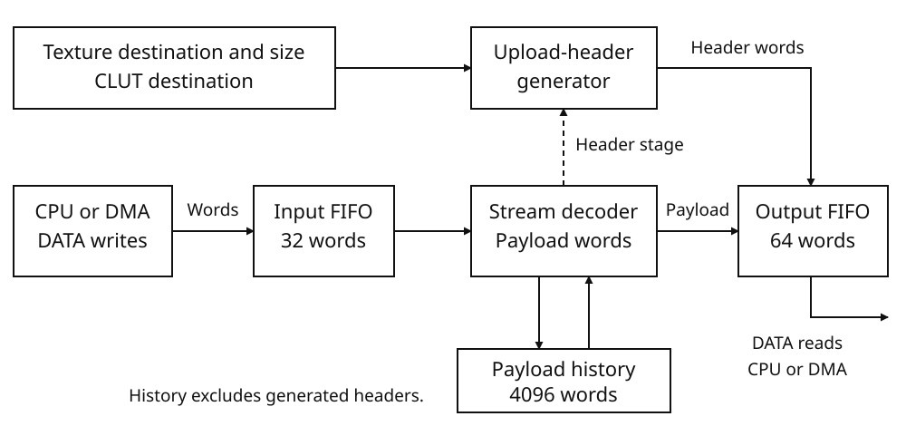

# Image decompression unit

## Function and resources

The image decompression unit expands compressed texture and palette data into
GPU upload packets. A program supplies the compressed stream and VRAM
destination fields; IMGDEC produces a texture-upload header and decoded words,
followed by a CLUT upload when palette data is present. This permits compressed
image data in ROM to be uploaded through DMA with little CPU involvement.

The DATA port has separate input and output FIFOs. CPU writes or an input DMA
channel feed compressed words into it. CPU reads or an output DMA channel
remove the generated packets. Route the output to GPU GP0 for an upload, or to
RAM for later use. The GPU performs the resulting VRAM writes.

Input and output DMA can remain armed while decoding proceeds. The shared DMA
controller serves one block at a time. Request lines regulate FIFO flow: missing input
holds decoding, and a full output FIFO holds the next output batch. If the
output remains blocked, input can fill in turn. A direct DATA-to-GP0 DMA block
starts when both IMGDEC output and GPU write requests permit it.

The programming interface, compressed input, decoded payload, and output
packets use 32-bit words. Input and output counts are word counts, not byte
counts. Decoded payload words and generated packet-header words are distinct:
only the former contribute to DECODED_WORD_COUNT.

For DMA input from ROM or main RAM, serialize each compressed word in
little-endian byte order: `31444D49H` occupies bytes `49 4D 44 31` at increasing
addresses. This is data-word order, not
[CPU instruction byte order](cpu.md#instruction-words-and-execution-resources);
see [Memory — Addresses and data sizes](memory.md#addresses-and-data-sizes).

| Resource | Capacity or basis |
|---|---|
| Register word | 32 bits |
| Input FIFO | 32 words |
| Output FIFO | 64 words |
| Decompression history | 4096 decoded payload words |
| System-cycle timebase | 33,868,800 cycles per second |
| Output-word charge | 2 system cycles per output word, including generated headers |

Each generated word, including packet headers, costs two system cycles.
Budget source transport, output DMA and GPU processing separately. IMGDEC DONE
indicates that the complete output stream has been read; wait for GPU completion
before using the uploaded image.



Compressed words select literals, repeated values, zeros or copies from
payload history. Generated GPU headers bypass that history. DATA reads drain
the resulting packet stream for RAM storage or GPU processing.

## Starting a transfer

1. Prepare the complete compressed word stream and determine both its input
   count and the generated output count. Output includes packet headers as
   well as decoded payload; the stream and output layouts below give those counts.
2. While IMGDEC is inactive, program INPUT_WORD_COUNT, TEXTURE_DESTINATION,
   TEXTURE_SIZE and CLUT_DESTINATION. The destination words are GP0 packet fields,
   not input-memory pointers.
3. Provide both an input producer and an output consumer. For the two-channel
   DMA route, arm the output transfer, arm the input transfer, then write
   CONTROL with START set. The BLua programming sequence uses request-gated DMA
   for both sides; it does not wait for all output to be produced before draining it.
4. Distinguish input DMA completion, output transfer and IMGDEC's terminal
   result. Inspect STATUS to separate DONE from FORMAT_FAULT and read exactly
   the expected output count. Completion is not a reason to make speculative
   extra DATA reads.

## Programming IMGDEC in BLua

### Decode the worked stream into RAM

The following nineteen-word stream produces twenty decoded payload words and
six header words, for twenty-six output words. With IMGDEC and both DMA channels
idle, arm output before starting the input and decoder. The fragments assume
exclusive use of those units and the interrupt mask. Array indices address
consecutive hardware registers.

```lua
rodata stream: word[19] = {
    0x31444d49, 12, 8, 1, 0x11112222, 0x33334444,
    0x40000001, 0x55556666, 0x80001003, 0xc0000003,
    7, 0, 0x03e0001f, 0x7fff7c00, 0x42104210,
    0x001f001f, 0x03e003e0, 0x7c007c00, 0x7fff7fff,
}
bss ram_output: word[26]
local dma0<const>: *word = 0x0800000c
local dma1<const>: *word = 0x080103e4
local decoder<const>: *word = 0x080103fc
local irq_ack<const>: *word = 0x08000004
local irq_mask<const>: *word = 0x08000008

*irq_mask = 0
*irq_ack = 0x00000181
-- IMGDEC input count and raw GP0 texture/CLUT fields.
decoder[0] = 19
decoder[1] = 0x00400040
decoder[2] = 0x00060004
decoder[3] = 0x00800040
-- Output: fixed DATA -> incrementing RAM, IMGDEC_READ/FORCE.
dma1[0] = 0x08010414
dma1[1] = ram_output
dma1[2] = 26
dma1[3] = 0x00003c1a
dma1[5] = 1
-- Input: incrementing ROM -> fixed DATA, FORCE/IMGDEC_WRITE.
dma0[0] = stream
dma0[1] = 0x08010414
dma0[2] = 19
dma0[3] = 0x00003d41
dma0[5] = 1
decoder[4] = 1
while (dma0[4] & 1) ~= 0 or (dma1[4] & 1) ~= 0 do
end
while (decoder[5] & 1) ~= 0 do
end
*irq_ack = 0x00000181
```

After successful bus accesses, `ram_output` contains the 26 packet words in
[the worked expansion](#worked-stream-19-input-words-26-output-words).
IMGDEC STATUS is `02H`, INPUT_WORDS_RECEIVED is 19 and DECODED_WORD_COUNT is 20.
Both DMA counts are zero and both DMA statuses are DONE. The three separate
pending interrupt bits are raised even though delivery is masked.

For this valid stream, both DMA channels complete normally. For a general
loader, also monitor IMGDEC STATUS while waiting: FORMAT_FAULT withdraws its
requests and can leave a channel BUSY. Stop or recover that transfer before
reusing its resources. Inspect bus faults as well as decoder status.
[DMA, Completion and interrupts](dma.md#completion-and-interrupts) gives the
interrupt-driven completion sequence.

<div class="keep-together">

## Register reference

IMGDEC occupies nine consecutive 32-bit registers, beginning at
`0x080103FC`. Adjacent registers are four bytes apart. All reset values in the
table are complete 32-bit words. R denotes read-only; R/W denotes read/write.
The five configuration registers share the inactive-only write condition
described below.

| Address | Name | Access | Bits | Reset | Function |
|---|---|---|---|---|---|
| `0x080103FC` | INPUT_WORD_COUNT | R/W, configuration | 31:0 | `0x00000000` | Total number of compressed input words to submit for the stream. |
| `0x08010400` | TEXTURE_DESTINATION | R/W, configuration | 31:0 | `0x00000000` | Raw destination word placed in the texture upload header. |
| `0x08010404` | TEXTURE_SIZE | R/W, configuration | 31:0 | `0x00000000` | Raw size word placed in the texture upload header. |
| `0x08010408` | CLUT_DESTINATION | R/W, configuration | 31:0 | `0x00000000` | Raw destination word placed in the CLUT upload header, when present. |
| `0x0801040C` | CONTROL | R/W, configuration | START at 0; retained bits 31:1 | `0x00000000` | Starts a new stream when written with START set. |
| `0x08010410` | STATUS | R | Defined fields 4:0; zero 31:5 | `0x00000000` | Activity, terminal result, and input/output request state. |
| `0x08010414` | DATA | R/W, data port | 31:0 | `0x00000000` | Writes submit compressed input; reads obtain output through the shared data latch. |
| `0x08010418` | INPUT_WORDS_RECEIVED | R | 31:0 | `0x00000000` | Live count of submitted DATA writes, not words consumed by decompression. |
| `0x0801041C` | DECODED_WORD_COUNT | R | 31:0 | `0x00000000` | Live count of decoded payload words produced; excludes generated headers. |

</div>

Writes to STATUS, INPUT_WORDS_RECEIVED, or DECODED_WORD_COUNT raise
`BUS_FAULT_READ_ONLY`; they do not acknowledge or clear those registers.

<a id="programming-words-and-write-admission"></a>

### Configuration writes

INPUT_WORD_COUNT, TEXTURE_DESTINATION, TEXTURE_SIZE, and CLUT_DESTINATION
retain the complete words written to them. Reads return those retained words.
IMGDEC forwards the destination and texture-size words unchanged into the
corresponding output headers; it does not normalize them on write or readback.
The destination and size words are packet fields, not addresses from which
IMGDEC fetches input.

Program all four words before START. Configuration and CONTROL accept writes
while IMGDEC is inactive and no system pause is requested. A CPU write made
while this condition is false waits until it can proceed. To restart after a
fault, wait for the stopped state and issue a new START; writing START during
active decoding waits rather than aborting the stream.

The programming words remain in their registers during the stream. The input
count governs input submission and completion checks; destination and size
words supply the headers as those headers are produced.

### CONTROL — `0x0801040C`

| Bits | Mask | Field | Write behavior and readback |
|---|---|---|---|
| 0 | `0x00000001` | START | A written 1 starts a new stream and is cleared as part of that start. A written 0 does not start a stream. |
| 31:1 | `0xFFFFFFFE` | Retained, no defined decoding function | Retained exactly as written, including when START is written as 1. |

An accepted CONTROL write retains its whole word before START is acted upon.
Starting clears only bit 0 of CONTROL; bits 31:1 are not cleared or interpreted
as additional controls. CONTROL readback therefore shows the retained word
with START cleared after a start, not necessarily an all-zero word.

START initializes a fresh stream and replaces STATUS with BUSY before input
processing and request-state evaluation. It does not clear the four programming
words. Do not require BUSY to be observable after an invalid start: with
INPUT_WORD_COUNT equal to zero, the new stream immediately reports FORMAT_FAULT
because its required input header cannot be supplied.

### STATUS — `0x08010410`

| Bit(s) | Mask | Field | Meaning when set |
|---|---|---|---|
| 0 | `0x00000001` | BUSY | A stream is active. |
| 1 | `0x00000002` | DONE | The stream has completed successfully, including the required output reads. |
| 2 | `0x00000004` | INPUT_REQUEST | The input DMA-request condition is asserted. |
| 3 | `0x00000008` | OUTPUT_REQUEST | The output DMA-request condition is asserted. |
| 4 | `0x00000010` | FORMAT_FAULT | The stream stopped with a format fault. |
| 31:5 | `0xFFFFFFE0` | Unused | Zero. |

START replaces the previous status word with BUSY. Request-state evaluation
then updates INPUT_REQUEST and OUTPUT_REQUEST without changing the other
fields. These request fields describe the DMA request conditions, not merely
whether one DATA access could proceed.

A successful terminal stop replaces the status word with DONE; a format-fault
stop replaces it with FORMAT_FAULT. These are replacement results, not bits
accumulated alongside the previous BUSY or request fields. STATUS is not a
write-one-to-clear register. See Data transfer and completion for the precise
request predicates, output-drain requirement, and interrupt handling.

### Progress registers

INPUT_WORDS_RECEIVED reports how many input DATA writes have been submitted.
It is not an input-FIFO occupancy count and does not measure how much of the
compressed stream has already been decoded.

DECODED_WORD_COUNT reports produced payload words across the texture and CLUT
payloads. Generated upload headers do not increment it. Reading output through
DATA does not turn this value into a count of words remaining in the output
FIFO. Both progress counts are 32-bit counts and begin again at zero for a new
stream.


## Data transfer and completion

DATA is a bidirectional word port with one retained data latch.
Writes supply compressed input; reads remove generated output.
The input FIFO holds 32 words and the output FIFO holds 64 words.
DATA reads return generated output, not the submitted input stream.
DATA writes do not add words directly to the output FIFO.

For a CPU DATA write to proceed, all of the following must hold:

- A job is active and no system pause is requested.
- INPUT_WORDS_RECEIVED is less than INPUT_WORD_COUNT.
- At least one input FIFO word is free.
- DMA does not own the DATA write port.

A blocked CPU write waits and retries; it does not submit a word or advance input progress.
A new CPU write needs one free FIFO word. DMA input uses the separate
block-request threshold and programmed transfer count; pace it through that
request line.

Every DATA write that executes replaces the retained DATA word.
It enters the input FIFO if space remains and increments INPUT_WORDS_RECEIVED modulo 2^32.
The count advances even if the FIFO is full and the word cannot be enqueued.
INPUT_WORDS_RECEIVED counts submitted writes, not compressed words already consumed by decoding.
Do not use unrequested DMA writes to probe readiness.

A CPU DATA read removes one output FIFO word when available, retains that word in DATA,
and advances the internal output-read count modulo 2^32.
If DMA owns the DATA read port, a CPU read returns the retained word immediately:
it neither removes output nor performs the completion or scheduling checks below.
Without that ownership, an empty output FIFO also returns the retained word,
but the read still performs those checks.
Consequently, a repeated DATA value is not evidence that another output word was generated.

DECODED_WORD_COUNT counts decoded payload words, modulo 2^32.
It advances when a payload word enters the output FIFO and history, not when software reads it.
Generated output-header words do not contribute to this register.
It is neither the number of DATA reads performed nor the total generated packet length.

#### DMA requests and block boundaries

IMGDEC input uses DMA request selector 5; IMGDEC output uses selector 6.
INPUT_REQUEST and OUTPUT_REQUEST report the corresponding request predicates.
Both predicates are false while the unit is inactive or a system pause is requested.
Their thresholds use a 16-word block quantum:

| Request | Remaining count | Assertion condition while active and no system pause is requested |
|---|---|---|
| Input, selector 5 | INPUT_WORD_COUNT minus INPUT_WORDS_RECEIVED | Remaining is nonzero and input FIFO free words are at least `min(remaining, 16)` |
| Output, selector 6 | Expected total output words minus words already read | Remaining is nonzero and queued output words are at least `min(remaining, 16)` |

Both remaining-count subtractions are modulo 2^32.
A tail shorter than 16 words uses its exact remaining length as the threshold.
The output threshold is not merely “one word available.”
Similarly, INPUT_REQUEST can be clear even when a CPU DATA write has enough space to proceed.
Request bits describe block readiness, not a separate one-word CPU readiness flag.
IMGDEC releases a waiting CPU DATA write when the input request is asserted
and DMA does not own the DATA write port.
This release condition differs from the one-free-word test for a new CPU write:
an already waiting write is not released merely because one FIFO slot becomes free.

Each DMA word still performs its DATA latch, FIFO and counter operation.
An input DMA write without BLOCK_END then returns without scheduling more decoding
or recomputing the IMGDEC requests.
The block-ending input write performs those operations after submitting its word.
An output DMA read without BLOCK_END likewise returns after its DATA operation,
without testing completion, scheduling more decoding or recomputing the requests.
The block-ending output read performs those operations after removing its word.
CPU DATA accesses perform the corresponding scheduling and request-update work immediately,
except for the read-port ownership case described above.

#### Successful completion and stopped output

Finishing payload generation alone does not set DONE.
After each CPU DATA read, and after each block-ending DMA DATA read,
completion is tested against the output-read count, including any word just removed.
Success requires that count to equal the entire expected output, including headers.
At that point the output stage must be complete, the decoder must be at its token state,
INPUT_WORDS_RECEIVED must equal INPUT_WORD_COUNT, and the input FIFO must be empty.
For DMA output, this completion check occurs only at BLOCK_END.

A successful stop replaces STATUS with DONE; a format-error stop replaces it with FORMAT_FAULT.
Both stops end active processing, cancel the pending decode batch, withdraw
both DMA requests and raise the IMGDEC interrupt. Waiting configuration writes
can then proceed when the system-pause condition also permits them.
Neither stop empties the FIFOs nor clears DATA or the programming registers.
FORMAT_FAULT can therefore leave a generated output prefix in the output FIFO.
With output request 6 withdrawn, an armed DMA channel can remain BUSY waiting
for more output. Inspect and recover that channel separately.
CPU reads may remove retained output when DMA does not own the read port.

**Caution — read exactly the known output count.** After a drained successful
stream, an extra CPU DATA read without a DMA read-port owner returns the last
word and repeats the completion check. It can raise IRQ_IMGDEC again without
producing or consuming a new word. Poll STATUS rather than making extra DATA reads for completion. After FORMAT_FAULT, an empty read does not
by itself satisfy successful-completion conditions.

### Interrupts and fault recovery

IMGDEC raises central interrupt bit 7, `00000080H`, for both DONE and FORMAT_FAULT.
The interrupt bit does not distinguish success from failure; inspect STATUS.
The central interrupt registers are FLAGS at `08000000H`, ACK at `08000004H`,
and MASK at `08000008H`.
Raising an interrupt ORs its bit into FLAGS independently of MASK.
The interrupt line is asserted when `FLAGS & MASK` is nonzero.
MASK does not clear pending flags.

Write `00000080H` to ACK to clear the pending IMGDEC flag; ACK reads as zero.
ACK clears only the bits written as ones.
A shared handler must acknowledge only the interrupt sources it services.
DMA channel 0 uses bit 0 and DMA channel 1 uses bit 8; these are distinct from IMGDEC bit 7.
Neither a new IMGDEC START nor an IMGDEC unit reset acknowledges the central pending flag.

If completion is awaited with interrupts, test the owned completion predicate in a loop.
An accepted interrupt records a CPU event when no HALT wait is latched.
A subsequent `halt_until_irq` consumes that event instead of sleeping;
otherwise it establishes the HALT wait.
This permits the predicate to be rechecked even when an interrupt is accepted between its test and HALT.
Recheck IMGDEC STATUS after waking, since another interrupt source can also
wake the CPU.

All five IMGDEC configuration registers accept writes only while inactive and no system pause is requested.
There is no active-job ABORT or restart command through CONTROL.
A CPU CONTROL write during an active job waits; setting START does not bypass this gate.
A DMA configuration write presented while the gate is closed is not stored and does not start a job.
After a stopped job, program the next job and issue a new START when this gate is open.
START discards the previous FIFOs, DATA word, progress, run state and available history
before beginning the new stream; it clears only CONTROL bit 0 and replaces STATUS with BUSY.
Handle any pending central IRQ separately.

### Reset and system pause

An IMGDEC unit reset cancels scheduled decoding and deasserts both IMGDEC DMA requests.
It makes the unit inactive, empties both FIFOs, clears available history and resets all stream progress.
It clears DATA, the four programming words, CONTROL and STATUS, and removes the system-pause request.
The decoder returns to the initial magic-word phase and texture-header output stage;
run, repeat, back-reference distance and scheduled-word state are cleared.
History availability is reset; no history word remains valid for a new stream.
The central interrupt flag is not acknowledged by this unit reset.

System pause preserves the active stream and FIFO contents. On a pause
request, IMGDEC withdraws both DMA requests and holds new CPU DATA writes,
configuration writes and output batches. A batch already in progress completes
at its normal edge, after which the unit is quiescent. Either FIFO can still
contain words, and STATUS can still indicate an active stream.

On resume, decoding and request generation continue. A waiting configuration
write still requires the stream to become inactive before it proceeds.


## Work timing and transfer budget

All word counts in this section refer to 32-bit words.
IMGDEC charges **two system cycles per output word**, including packet headers.
A three-word texture or CLUT header therefore costs six cycles.
Stream-header and token parsing do not carry a separate per-input-word charge.
Compressed input length alone does not determine the output-work budget.

### Output batches

IMGDEC processes one output batch at a time. A batch of `N` words starting
at cycle `A` completes at:

`A + 2 × N`

The entire batch enters the output FIFO at that edge. No word from it is
available during the intervening cycles.
An output header is always a three-word batch and requires three free FIFO slots.
A payload batch contains the smallest of:

- the words remaining in the current run;
- the payload words remaining in the current texture or CLUT stage;
- the free output FIFO slots;
- 16 words;
- for a literal run, the input words currently available.

A new batch waits for any required header, token or repeat word.
Input starvation therefore adds waiting time rather than a fixed parsing charge.
A full output FIFO prevents a new batch; a header also waits if fewer than three
slots are free. Draining the output can therefore be necessary for further work.
Any next batch is timed from the preceding batch's completion edge. Input or
output waiting does not create a backlog that later emits at a faster rate.

### Installed output-work rate

The installed system timebase is **33,868,800 cycles/s**.
At two cycles per word, uninterrupted IMGDEC output work corresponds to:

- **16,934,400 32-bit output words/s**;
- **67,737,600 output bytes/s**.

These are output rates with sufficient input, free FIFO space and uninterrupted
operation. Headers consume the same budget as payload. For a complete upload,
add DMA transport and any waiting for input or GPU readiness, as in the following
example.

### Controlled ROM-to-RAM transfer

The following timeline starts with both DMA channels already armed for 16-word
blocks before START at cycle 0. Input comes from cartridge ROM; output goes to
ordinary RAM. Only these two channels and IMGDEC perform work. No CPU instruction,
configuration, startup or interrupt-handler time is included.

The stream contains **19 input words** and declares texture count `T = 12` and
CLUT count `C = 8`. The output contains 20 payload words plus two three-word
headers: **26 output words**. Thus IMGDEC charges `26 × 2 = 52` output-work cycles.
The input count includes stream headers and tokens; it is not the decoded count.

For these transfers, each ROM input block costs `4 + 8 × N` cycles and each RAM
output block costs `1 + N` cycles. Each new block incurs its setup charge.
The 19-word input splits into 16 and 3 words, costing 132 and 28 cycles.
The 26-word output splits into 16 and 10 words, costing 17 and 11 cycles.
The input and output costs overlap decoding where their request conditions
permit.

| Cycle | Event | Input received | Payload decoded | Output queued | Output read |
|---:|---|---:|---:|---:|---:|
| 132 | First 16-word input block ends | 16 | 0 | 0 | 0 |
| 138 | Three-word texture header published | 16 | 0 | 3 | 0 |
| 142 | Two literal payload words published | 16 | 2 | 5 | 0 |
| 146 | Two repeat payload words published | 16 | 4 | 7 | 0 |
| 154 | Four back-reference payload words published | 16 | 8 | 11 | 0 |
| 160 | Three-word input tail ends; input DMA DONE | 19 | 8 | 11 | 0 |
| 162 | Four zero payload words published | 19 | 12 | 15 | 0 |
| 168 | Three-word CLUT header published; 16-word output block admitted | 19 | 12 | 18 | 0 |
| 184 | Eight literal CLUT payload words published | 19 | 20 | 26 | 0 |
| 185 | First 16-word output block ends | 19 | 20 | 10 | 16 |
| 196 | Ten-word output tail ends; IMGDEC and output DMA DONE | 19 | 20 | 0 | 26 |

The first header is due at `132 + 6 = 138`; subsequent batch charges are
4, 4, 8, 8, 6 and 16 cycles, placing the last output batch at cycle 184.
The input tail ends independently at `132 + 28 = 160`.
At cycle 162 only 15 output words are queued, below the first 16-word block size.
The CLUT header raises that total to 18 at cycle 168, admitting the output block.
That block ends at `168 + 17 = 185`; its ten-word tail ends at `185 + 11 = 196`.

The **52 charged output-work cycles** and **196-cycle controlled timeline** describe
separate quantities. Input transfer, output transfer and decoding overlap;
adding their individual budgets would count overlapping time more than once.
The timeline ends with output in RAM. Add CPU setup and result handling; a
direct GPU upload also requires GPU processing and PCRTC display timing.


## Compressed word stream

IMGDEC consumes a stream of 32-bit words. The stream contains a three-word header followed by tokens and their input data. All lengths in this section count words, not bytes. A decoded payload word is one word produced by a token; it is not necessarily one pixel or one color entry.

### Stream header

| Input word | Meaning |
|---|---|
| 0 | Magic: exactly `0x31444d49`. |
| 1 | `T`: number of decoded texture payload words. |
| 2 | `C`: number of decoded CLUT payload words. |

The configured input-word count includes these three words, every token, every literal data word, and every repeat-value word. It is separate from both the decoded payload count and the generated output count. There is no end token.

Header words are consumed in order. The decoder can wait between header words for more input. A wrong magic word causes `FORMAT_FAULT` immediately. `T` and `C` are accepted as raw count words; they are not checked against the programmed texture size.

### Token layouts

Bits 31:30 select the token kind. The remaining bits have the following layouts; every bit shown is part of a field.

| Kind | Bits 31:30 | Bits 29:0 | Following input words |
|---|---|---|---|
| Literal | `00` | Length minus 1 | Exactly `L` literal words. |
| Repeat | `01` | Length minus 1 | One word: the value to repeat. |
| Back-reference | `10` | Bits 29:12: length minus 3; bits 11:0: distance minus 1 | None. |
| Zero | `11` | Length minus 1 | None. |

| Field | Decoding | Encoded field range | Decoded range |
|---|---|---|---|
| Literal, repeat, or zero length `L` | `(token & 0x3fffffff) + 1` | `0x00000000`–`0x3fffffff` | 1–1,073,741,824 words. |
| Back-reference length `L` | `((token >> 12) & 0x3ffff) + 3` | `0x00000`–`0x3ffff` | 3–262,146 words. |
| Back-reference distance `D` | `(token & 0x00000fff) + 1` | `0x000`–`0xfff` | 1–4096 words. |

The right shift in the table extracts bits from the unsigned token word.

A literal token copies its next `L` input words into the decoded payload. A repeat token first consumes its one value word, then emits that value `L` times. A zero token emits `L` words of `0x00000000`. Repeat and zero emission consume no further input words. A missing repeat value is not an implicit zero value: the decoder waits for that word, or faults when the declared input is exhausted.

A token may span the texture/CLUT boundary. Do not insert a new token merely because texture payload ends: any remaining words of the current run continue as CLUT payload after the generated CLUT header.

### History and overlapping back-references

The history holds the most recent 4096 decoded payload words. A fresh stream starts with zero valid history words; output from a preceding stream is unavailable. Every payload word, including a repeated, zero, or back-referenced word, is added to history. Generated GP0 header words are not added.

A back-reference distance must not exceed the number of currently valid history words. This is checked when its token is consumed, before any word of that back-reference is emitted. Distance 1 selects the most recently decoded payload word; distance 4096 is usable only after history contains 4096 valid words.

For each back-reference word, IMGDEC reads the word `D` positions behind the current history write position, emits it, and advances history. The next word uses the updated position. Consequently, a back-reference can read words emitted earlier by the same run. A distance-1 run repeats the last payload word; a run longer than its distance repeats the corresponding preceding sequence. The history position wraps modulo 4096, and the valid history count remains at 4096 once full.

Texture and CLUT payload share this history. Neither the history nor a partially completed run is reset when IMGDEC inserts the CLUT header.

## Generated GP0 output

IMGDEC queues GP0 command and payload words in its output FIFO. Producing these words is not itself a direct VRAM write. The destination and texture-size settings are raw downstream GP0 words: IMGDEC forwards them unchanged. In particular, a destination setting is not an IMGDEC RAM address, and no byte or pixel coordinates are implied by the example destination words below.

### Packet words

| Packet | Word 0 | Word 1 | Word 2 | Following words |
|---|---|---|---|---|
| Texture; always present | `0xa0000000` | Programmed texture destination word | Programmed texture size word | `T` decoded payload words. |
| CLUT; present only if `C != 0` | `0xa0000000` | Programmed CLUT destination word | `0x00010010` | `C` decoded payload words. |

The command word is the GP0 CPU-to-VRAM command. The CLUT size word is fixed: `0x00010010`, the GP0 4-bit CLUT size word. IMGDEC does not select a different size word from `C`.

Each three-word header is queued together and requires at least three free output FIFO words. Header production does not consume a token and does not increment the decoded payload count. Texture payload ends when that count equals `T`. If `C` is nonzero, the CLUT header follows and decoding continues until the count equals `T + C`, with 32-bit wraparound. If `C` is zero, no CLUT header or payload is generated.

Even when `T` is zero, the texture header is generated. Thus `T = 0, C = 0` produces a three-word texture packet with no IMGDEC payload. If `T = 0, C != 0`, the texture header is followed by the CLUT header and CLUT payload.

### Three different word counts

| Quantity | What it counts |
|---|---|
| Input-word count | Compressed header, tokens, literal words, and repeat-value words supplied to IMGDEC. |
| Decoded payload count | Only words emitted by literal, repeat, back-reference, and zero runs. |
| Expected output-word count | Decoded payload plus the generated GP0 headers. |

The expected output-word count is calculated as:

`T + 3 + (C == 0 ? 0 : C + 3)`, modulo `2^32`.

The combined CLUT endpoint `T + C`, decoded count increments, and subtraction of decoded count from a stage endpoint also use modulo-`2^32` arithmetic. Count overflow is not saturated or rejected. Do not replace this arithmetic with an assumed nonwrapping image-size calculation.

### Size words and count mismatches

The downstream GP0 size interpretation is distinct from IMGDEC's `T` and `C` counters:

| GP0 dimension | Size-word interpretation | Range |
|---|---|---|
| Width | `(((size & 0x0000ffff) - 1) & 0x3ff) + 1` | 1–1024. |
| Height | `((((size >> 16) & 0x0000ffff) - 1) & 0x1ff) + 1` | 1–512. |

For example, `0x00060004` describes GP0 dimensions 4 × 6, `0x00010010` describes 16 × 1, and raw size word zero describes 1024 × 512, not an empty transfer. IMGDEC does not use these dimension calculations when accepting its payload counts.

`T` controls IMGDEC's texture payload endpoint, independently of the texture-size word. Likewise, `C` controls the CLUT payload endpoint while the emitted CLUT size word remains fixed. The value 16 in `0x00010010` is not a declaration of 16 compressed-stream payload words. An accepted stream can therefore have payload counts that do not agree with its downstream transfer description. IMGDEC acceptance is not a packet-size consistency check; cartridge software must supply a stream appropriate for the downstream GP0 transfer. No pixel packing, color-channel interpretation, or destination-coordinate interpretation is defined by this compressed-stream format.

## Worked stream: 19 input words, 26 output words

Use these programmed words:

| Setting | Value |
|---|---|
| Input-word count | `19` (`0x00000013`) |
| Texture destination | `0x00400040` |
| Texture size | `0x00060004` |
| CLUT destination | `0x00800040` |

The following complete stream uses all four token kinds. `A`, `B`, and `R` below are names for raw words, not pixel values.

| Input index | Word | Meaning |
|---|---|---|
| 0 | `0x31444d49` | Magic. |
| 1 | `0x0000000c` | `T = 12`. |
| 2 | `0x00000008` | `C = 8`. |
| 3 | `0x00000001` | Literal length 2. |
| 4 | `0x11112222` | `A`. |
| 5 | `0x33334444` | `B`. |
| 6 | `0x40000001` | Repeat length 2. |
| 7 | `0x55556666` | Repeat value `R`. |
| 8 | `0x80001003` | Back-reference length 4, distance 4. |
| 9 | `0xc0000003` | Zero length 4. |
| 10 | `0x00000007` | Literal length 8. |
| 11 | `0x00000000` | CLUT payload word 0. |
| 12 | `0x03e0001f` | CLUT payload word 1. |
| 13 | `0x7fff7c00` | CLUT payload word 2. |
| 14 | `0x42104210` | CLUT payload word 3. |
| 15 | `0x001f001f` | CLUT payload word 4. |
| 16 | `0x03e003e0` | CLUT payload word 5. |
| 17 | `0x7c007c00` | CLUT payload word 6. |
| 18 | `0x7fff7fff` | CLUT payload word 7. |

After the first two tokens, history is `A, B, R, R`. Token `0x80001003` has length `1 + 3 = 4` and distance `3 + 1 = 4`, reproducing those four words. The zero run completes the texture payload:

`A, B, R, R, A, B, R, R, 0, 0, 0, 0`.

The final literal supplies the eight CLUT payload words. The input has 3 header words, 5 token words, 10 literal words, and 1 repeat-value word: 19 words. It produces 20 decoded payload words and 6 generated header words: 26 output words.

| Output index | Word | Role |
|---|---|---|
| 0 | `0xa0000000` | Texture command. |
| 1 | `0x00400040` | Texture destination. |
| 2 | `0x00060004` | Texture size. |
| 3 | `0x11112222` | Texture payload 0. |
| 4 | `0x33334444` | Texture payload 1. |
| 5 | `0x55556666` | Texture payload 2. |
| 6 | `0x55556666` | Texture payload 3. |
| 7 | `0x11112222` | Texture payload 4. |
| 8 | `0x33334444` | Texture payload 5. |
| 9 | `0x55556666` | Texture payload 6. |
| 10 | `0x55556666` | Texture payload 7. |
| 11 | `0x00000000` | Texture payload 8. |
| 12 | `0x00000000` | Texture payload 9. |
| 13 | `0x00000000` | Texture payload 10. |
| 14 | `0x00000000` | Texture payload 11. |
| 15 | `0xa0000000` | CLUT command. |
| 16 | `0x00800040` | CLUT destination. |
| 17 | `0x00010010` | Fixed CLUT size. |
| 18 | `0x00000000` | CLUT payload 0. |
| 19 | `0x03e0001f` | CLUT payload 1. |
| 20 | `0x7fff7c00` | CLUT payload 2. |
| 21 | `0x42104210` | CLUT payload 3. |
| 22 | `0x001f001f` | CLUT payload 4. |
| 23 | `0x03e003e0` | CLUT payload 5. |
| 24 | `0x7c007c00` | CLUT payload 6. |
| 25 | `0x7fff7fff` | CLUT payload 7. |

## Worked stream: overlapping history across the CLUT header

Program input count 10, texture destination `0x00200040`, texture size `0x00010010`, and CLUT destination `0x00300060`.

| Input index | Word | Meaning |
|---|---|---|
| 0 | `0x31444d49` | Magic. |
| 1 | `0x00000008` | `T = 8`. |
| 2 | `0x00000008` | `C = 8`. |
| 3 | `0x00000001` | Literal length 2. |
| 4 | `0x11223344` | `A`. |
| 5 | `0xaabbccdd` | `B`. |
| 6 | `0x40000001` | Repeat length 2. |
| 7 | `0x55667788` | Repeat value `R`. |
| 8 | `0xc0000000` | Zero length 1. |
| 9 | `0x80008004` | Back-reference length 11, distance 5. |

Before the back-reference, history is `A, B, R, R, 0`. The token's length is `8 + 3 = 11` and its distance is `4 + 1 = 5`. Its first three words complete texture payload. Its remaining eight words follow the CLUT header, without another token.

| Decoded index | Payload word | Source | Stage |
|---|---|---|---|
| 0 | `A` | Literal. | Texture. |
| 1 | `B` | Literal. | Texture. |
| 2 | `R` | Repeat. | Texture. |
| 3 | `R` | Repeat. | Texture. |
| 4 | `0` | Zero. | Texture. |
| 5 | `A` | Back-reference to decoded index 0. | Texture. |
| 6 | `B` | Back-reference to decoded index 1. | Texture. |
| 7 | `R` | Back-reference to decoded index 2. | Texture. |
| 8 | `R` | Back-reference to decoded index 3. | CLUT. |
| 9 | `0` | Back-reference to decoded index 4. | CLUT. |
| 10 | `A` | Back-reference to decoded index 5, emitted by this run. | CLUT. |
| 11 | `B` | Back-reference to decoded index 6, emitted by this run. | CLUT. |
| 12 | `R` | Back-reference to decoded index 7, emitted by this run. | CLUT. |
| 13 | `R` | Back-reference to decoded index 8, emitted by this run. | CLUT. |
| 14 | `0` | Back-reference to decoded index 9, emitted by this run. | CLUT. |
| 15 | `A` | Back-reference to decoded index 10, emitted by this run. | CLUT. |

The generated output is 22 words:

| Output indices | Words, in order |
|---|---|
| 0–2 | `0xa0000000`, `0x00200040`, `0x00010010` |
| 3–10 | `0x11223344`, `0xaabbccdd`, `0x55667788`, `0x55667788`, `0x00000000`, `0x11223344`, `0xaabbccdd`, `0x55667788` |
| 11–13 | `0xa0000000`, `0x00300060`, `0x00010010` |
| 14–21 | `0x55667788`, `0x00000000`, `0x11223344`, `0xaabbccdd`, `0x55667788`, `0x55667788`, `0x00000000`, `0x11223344` |

The inserted three-word header does not increase the back-reference distance: distance counts decoded payload history, not output FIFO positions.

## Completion, malformed input, and partial output

### Exact end of stream

A stream is complete only when all four conditions hold:

1. Both required payload stages are complete.
2. The decoder is between tokens, with no unfinished run or pending repeat value.
3. The input words received equal the configured input-word count.
4. The input FIFO is empty.

Finishing the requested payload is therefore insufficient if input remains or the last run has not ended exactly. Conversely, an empty-payload stream requires no token.

Stream completion is also distinct from `DONE`: queued output must be read. The DATA-read completion check requires the output-words-read count to equal the expected output-word count as well as the complete-stream conditions above. A DMA read before the end of its block does not perform that check. Merely producing the last output word does not invoke `DONE`.

### Waiting versus exhaustion

An empty input FIFO alone is not an exhaustion fault. When the decoder requires more input, exhaustion is recognized by equality between received input words and the configured input-word count. If they are not equal, this check does not declare exhaustion. It is an equality test, not a greater-than-or-equal test; counters use modulo-`2^32` arithmetic.

The decoder may wait for a missing header word, token, repeat value, or literal data. Once a repeat, zero, or back-reference run is prepared, its emission needs no further compressed input. A literal can emit an available prefix before it needs to wait or fault for more literal words.

### Ordering and output backpressure

After header parsing, IMGDEC advances any finished payload stage before selecting further work. It then observes output space in this order:

1. If the output FIFO is full, it returns before inspecting a malformed tail.
2. If a generated header is pending, it waits for three free words, then emits that header without preparing a token.
3. If all output stages are complete, it checks the exact completion conditions. Queued input or an unfinished token/run causes `FORMAT_FAULT`. If the input FIFO is empty and the decoder is between tokens but the received count has not reached the configured count, it waits for the remaining input rather than declaring exhaustion.
4. Otherwise, it prepares or continues payload work.

A payload group emits at most 16 words. Its length is also limited by the current run's remaining length, the current payload stage's remaining count, and free output FIFO space. A literal group is additionally limited by the available input words. When no payload word can be selected, the input-exhaustion check is invoked. Only consuming the entire current run returns the decoder to the between-tokens state.

These rules have two important consequences. An invalid first payload token can fault after the texture header has already been queued. An overlong final run is not rejected before output: it emits up to the payload endpoint, then faults because the run is unfinished. Output backpressure can postpone the malformed-tail check.

### Fault causes

| Condition | Point of detection | Partial effect |
|---|---|---|
| Magic is not `0x31444d49`. | On consuming the first header word. | No generated header or payload from this stream has been emitted. |
| Declared input ends within the three-word header. | After available header words have been consumed and another is required. | No generated header or payload has been emitted. |
| Declared input ends while a token is required. | On finding no token word available. | Earlier headers and payload remain. |
| Declared input ends before a repeat value. | After consuming its repeat token, before emitting that run. | Earlier output remains; that repeat run emits no value word. |
| Declared input ends within a literal. | After any available literal prefix has been emitted. | That prefix and earlier output remain. |
| Back-reference distance exceeds valid history. | On consuming the back-reference token. | No word of that back-reference is emitted; earlier output remains. |
| A run extends beyond the final payload endpoint. | After emitting up to that endpoint, when the completed-output stage finds an unfinished run. | Payload up to the endpoint remains, not the excess requested words. |
| Input FIFO is nonempty after all required payload is complete. | At the completed-output stage, after the output-space check. | Earlier headers and payload remain; a trailing token need not be consumed. |

A fault terminates decoding without rolling back the output. Queued output remains readable through DATA after stop, and decoded/input counters and the current run/history state are retained. Actual output pops still update the DATA latch and output-words-read count; an empty output FIFO leaves the latch unchanged. CPU reads while DMA owns the read port return the latch without popping output.

### Compact fault and empty-stream examples

For each row, start a fresh stream, configure the input count to the exact listed length, supply all listed input, and allow normal decoding with adequate FIFO space. In the three malformed cases, wait for the fault before reading the retained output. In the valid empty-payload case, read the three known output words to obtain DONE; do not wait for a fault. `D` and `S` denote the programmed raw texture destination and size words.

| Input words, in order | Result |
|---|---|
| `0x31444d49`, `0x00000003`, `0x00000000`, `0x80000000` | The first back-reference has length 3 and distance 1, but history is empty. `FORMAT_FAULT`; decoded count 0. Three output words remain: `0xa0000000`, `D`, `S`. |
| `0x31444d49`, `0x00000002`, `0x00000000`, `0xc0000002` | Zero run length 3 exceeds final target 2. Two zeros are emitted, leaving one run word outstanding. `FORMAT_FAULT`; decoded count 2. Five output words remain: `0xa0000000`, `D`, `S`, `0x00000000`, `0x00000000`. |
| `0x31444d49`, `0x00000002`, `0x00000000`, `0x00000001`, `0x12345678` | Literal length 2 has only one data word. That word is emitted before exhaustion faults. Decoded count 1; four output words remain: `0xa0000000`, `D`, `S`, `0x12345678`. |
| `0x31444d49`, `0x00000000`, `0x00000000` | Valid empty-payload stream. Its only output is `0xa0000000`, `D`, `S`. No token is required; `DONE` still requires output-read completion. |


## Use the output packets

### Forward the same packets to GP0

Own GP0 as well as both DMA channels. There must be no partial packet or unread
readback. Before starting, wait for GPUSTAT bit 26 (`04000000H`) at
`08010240H`, write `e6000000H` to GP0 to disable both mask-protection modes,
and write `04000002H` to GP1 to select CPU_TO_GP0 DMA direction. Wait for GPU
idle again before arming the transfer.

Repeat the configuration and start sequence above, changing only these output
operands:

| Register | RAM receipt | Direct upload |
|---|---|---|
| DMA1 WRITE_ADDR, `080103e8H` | `ram_output` | `0801023cH` (GP0) |
| DMA1 CONTROL, `080103f0H` | `00003c1aH` | `00003c58H` |

The direct control word selects fixed DATA and GP0 addresses, IMGDEC_READ and
GX_WRITE requests, and sixteen-word blocks. Keep count 26. It waits for both
request lines; decoder output readiness alone cannot make GP0 ready. After
both DMA completions and IMGDEC DONE, wait separately for GPU idle. GPU processing continues after the transfer; PCRTC displays the completed
source according to its own latch timing.

### Inspect a fault, then start a fresh stream

Use CPU input with neither DMA channel armed. Leave the three destination/size
words from the worked stream in place, and configure only the new input count.
This first back-reference requests history that does not yet exist.

```lua
bss fault_header: word[3]
rodata fault_stream: word[4] = { 0x31444d49, 3, 0, 0x80000000 }
decoder[0] = 4
decoder[4] = 1
for index = 0, 3 do
    decoder[6] = fault_stream[index]
end
while (decoder[5] & 1) ~= 0 do
end
for index = 0, 2 do
    fault_header[index] = decoder[6]
end
*irq_ack = 0x00000080
```

STATUS is `10H` (FORMAT_FAULT), received count is 4 and decoded count is zero.
The three retained output words are `a0000000H`, `00400040H`, `00060004H`.
They are a generated header, not a complete GPU packet: do not forward this
prefix to GP0. A decoder fault neither cancels an admitted DMA block nor
removes GP0 words already accepted downstream.

A fresh START discards the faulted stream state. A minimum valid input is
`31444d49H, 0, 0`: three header words with no token. Set INPUT_WORD_COUNT to 3,
TEXTURE_DESTINATION to `00200020H` and TEXTURE_SIZE to zero, then START and
supply those three words. Wait for OUTPUT_REQUEST and read exactly three DATA
words into RAM. They are `a0000000H, 00200020H, 0`; their final read completes
the stream with STATUS=`02H`, received count 3 and decoded count zero.
Acknowledge bit `80H` separately. Keep this output in RAM: raw GP0 size zero
means 1024 × 512, not an empty rectangle, so the header alone is not a complete
GPU upload.

### Display the uploaded indexed patch

For the pictured result, use the successful direct-to-GP0 upload, not either
fault/recovery prefix. Before that upload, prepare this disjoint framebuffer
window with ordered word writes. CSR RESET supplies zero texture window and
drawing offset; the following GP0 words select drawing state and fill the
background. Wait for that fill to reach GPU idle before arming the upload.

| Order | Port address | Words written in order |
|---:|---|---|
| 1 | PCRTC CSR, `080103d4H` | `00000200H` |
| 2 | PCRTC PMODE, `08010354H` | `00000000H` (disable output) |
| 3 | PCRTC DISPFB1, `0801035cH` | `000fa000H` |
| 4 | PCRTC source origin, `08010360H` | `00000100H` |
| 5 | PCRTC display extent, `08010368H` | `000bf3ffH` |
| 6 | GP0, `0801023cH` | `e1000400H`, `e3000100H`, `e402fdffH`, `02181008H`, `00000100H`, `00c00100H` |

The 256 × 192 source window begins at VRAM X=256. It is disjoint from the
texture at (64,64) and CLUT at (64,128). After the upload and GPU-idle wait,
send this purple underlay and palette4 textured quad:

```lua
rodata picture_commands: word[12] = {
    0x60602040, 320 | (72 << 16), 120 | (40 << 16),
    0x2d000000,
    320 | (72 << 16), 0x20044000,
    440 | (72 << 16), 0x0001400f,
    320 | (112 << 16), 0x00004500,
    440 | (112 << 16), 0x0000450f,
}
local gp0<const>: *word = 0x0801023c
local gp1<const>: *word = 0x08010240
local pmode<const>: *word = 0x08010354
for index = 0, #picture_commands - 1 do
    *gp0 = picture_commands[index]
end
*gp1 = 0x02000000
*irq_ack = 0x00000040
*gp0 = 0x1f000000
while (*gp1 & 0x01000000) == 0 do
end
while (*gp1 & 0x04000000) == 0 do
end
*gp1 = 0x02000000
*irq_ack = 0x00000040
*pmode = 0x0000ff21
```

The marker, GPU idle and PCRTC display latch are separate boundaries. The
PMODE write enables the prepared composition for display latching; it is not
itself a displayed-frame acknowledgement.

### Read back the uploaded words

With exclusive GP0 ownership and no DMA read owner, send each following header
as three ordered GP0 writes. Wait for GPUSTAT bit 27 (`08000000H`) before reading
the transaction's data at `0801023cH`. Drain its full count before sending the
next header.

| Storage | GP0 header words, in order | Expected DATA reads |
|---|---|---|
| Texture | `c0000000H`, `00400040H`, `00060004H` | 12 words, equal to `ram_output[3..14]` |
| CLUT | `c0000000H`, `00800040H`, `00010010H` | 8 words, equal to `ram_output[18..25]` |

Each returned word contains two raw storage halfwords, first in bits 15:0.
The last read clears READY. Readback returns the stored halfwords independently of display selection.
GPU idle alone reports no pixel values.
See [GPU](gpu.md) for complete upload, drawing and readback rules.

<a id="imgdec-indexed-output"></a>

### From compressed words to a displayed patch


The six source rows make the token kinds visible:

| Source Y (V) | Token kind | 16 nibble indices | Output colour meaning, left to right |
| --- | --- | --- | --- |
| 64 | Literal | `2222111144443333` | Red, purple, blue, green |
| 65 | Repeat | `6666555566665555` | Gray, white, gray, white |
| 66 | Back-reference | `2222111144443333` | Red, purple, blue, green |
| 67 | Back-reference | `6666555566665555` | Gray, white, gray, white |
| 68 | Zero | `0000000000000000` | Purple throughout |
| 69 | Zero | `0000000000000000` | Purple throughout |

Indices `2`–`6` select red, green, blue, white and gray. CLUT entries `0` and
`1` both contain `0000H`; these zero texels leave the purple `3088H` underlay
unchanged, rather than writing black.

IMGDEC supplies **4 × 6 halfwords** of texture plus the CLUT upload. Palette4
reads four low-nibble-first indices per halfword: **16 × 6 texels**. The GPU
draws the **120 × 40** patch; PCRTC maps it to screen **(64,72)**.

For UV endpoints `(0,64)` through `(15,69)`, the outermost columns and rows
occupy four displayed pixels each; interior columns and rows occupy eight.
The scaling is not uniformly eightfold.
