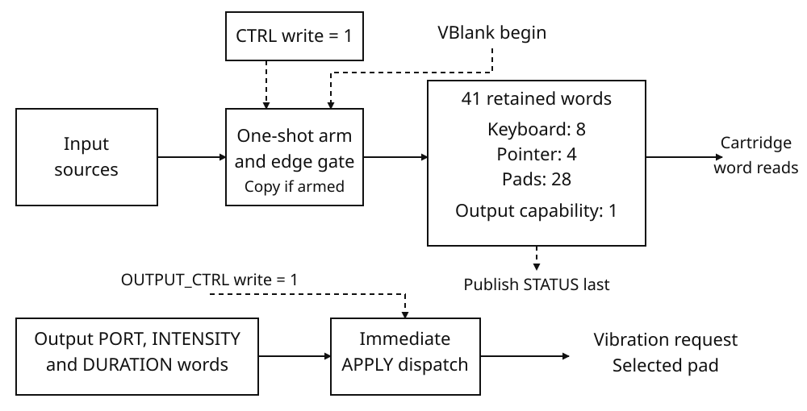

# Input controller

## Function and resources

The input controller presents keyboard, pointer and pad input as a sampled register file. A cartridge requests a sample, waits for its sequence number to change, and reads the resulting snapshot. Input reads do not consume events or request further samples.

ARM requests one capture at the display controller's VBlank-begin edge; it does
not immediately read the devices. An accepted capture publishes the new data
and sequence, then consumes that request. Arm again for another sample. The
display edge, not the CPU's register-read rate or entry into an interrupt
handler, determines this publication point.

The controller provides eight keyboard words, a pointer button word with three pointer data words, and four pad records. Each pad record contains a button word, two pairs of stick-axis words and two trigger words. A separate output port accepts vibration requests for a selected pad; its capability word is sampled with the input data.

The register block occupies 47 consecutive 32-bit words, from byte address `08000064H` through `0800011CH`. Use aligned, whole-word accesses.

| Resource | Capacity or condition |
|---|---|
| Register word | 32 bits |
| Mapped register block | 47 words, 188 bytes |
| Sampled data | 41 words, 164 bytes: 8 keyboard + 4 pointer + 28 pad + 1 capability |
| Keyboard bitmap | 256 HID usage bits |
| Pad records | 4 pads; 7 words, 28 bytes per pad |
| Sample sequence | 32 bits, incrementing modulo 2³² |
| Sample publication | A pending ARM request accepted at VBlank begin |

The display timing controller determines the VBlank edge; see [PCRTC](pcrtc.md). Interrupt delivery is described in [Interrupt controller](irq.md). These conditions do not specify an independent input frequency or transfer bandwidth.



The armed capture path and output request path are separate. Solid arrows
carry sample words or request operands; dashed arrows show control or
publication order. The capability word is sampled input, not output
acknowledgement. The drawing omits reset paths.

## Raw input representations

### Keyboard usage bitmap

The keyboard occupies eight words: 256 bits indexed by USB HID keyboard/keypad usage on page `07H`. A set bit means that usage is pressed. The bitmap identifies key usages; this table does not define character or text-composition input.

For usage `u`, select word `u >> 5` and bit `u & 31`. Its word is at the keyboard bitmap base plus `4 × (u >> 5)` bytes. The mask within that word is `1 << (u & 31)`.

For example, `KeyA` is usage `04H`: word 0, bit 4, mask `00000010H`. This is not pad A. Pad A is bit 0 of a pad's buttons word, with mask `00000001H`.

The following names have established usage mappings. The table does not assign names or text semantics to every other bit in the bitmap. Usage IDs in this table are decimal.

| Key names | Usage IDs |
| --- | --- |
| `KeyA` … `KeyZ` | 4 … 29, consecutive |
| `Digit1` … `Digit9`, `Digit0` | 30 … 38, 39 |
| `Enter`, `Escape`, `Backspace`, `Tab`, `Space` | 40, 41, 42, 43, 44 |
| `Minus`, `Equal`, `BracketLeft`, `BracketRight`, `Backslash` | 45, 46, 47, 48, 49 |
| `Semicolon`, `Quote`, `Backquote`, `Comma`, `Period`, `Slash` | 51, 52, 53, 54, 55, 56 |
| `CapsLock` | 57 |
| `F1` … `F12` | 58 … 69, consecutive |
| `PrintScreen`, `ScrollLock`, `Pause` | 70, 71, 72 |
| `Insert`, `Home`, `PageUp`, `Delete`, `End`, `PageDown` | 73, 74, 75, 76, 77, 78 |
| `ArrowRight`, `ArrowLeft`, `ArrowDown`, `ArrowUp` | 79, 80, 81, 82 |
| `NumLock`, `NumpadDivide`, `NumpadMultiply`, `NumpadSubtract`, `NumpadAdd`, `NumpadEnter` | 83, 84, 85, 86, 87, 88 |
| `Numpad1` … `Numpad9`, `Numpad0` | 89 … 97, 98 |
| `NumpadDecimal`, `IntlBackslash`, `ContextMenu`, `Power`, `NumpadEqual` | 99, 100, 101, 102, 103 |
| `F13` … `F24` | 104 … 115, consecutive |
| `IntlRo`, `IntlYen` | 135, 137 |
| `Lang1`, `Lang2` | 144, 145 |
| `ControlLeft`, `ShiftLeft`, `AltLeft`, `MetaLeft` | 224, 225, 226, 227 |
| `ControlRight`, `ShiftRight`, `AltRight`, `MetaRight` | 228, 229, 230, 231 |

### Pad records

There are four raw pad records, indexed 0 through 3. Each record occupies 28 bytes: one buttons word followed by six signed 16.16 axis words. Offsets below are bytes from that pad's base.

| Offset | Word | Axis index |
| --- | --- | --- |
| `+00H` | Buttons | — |
| `+04H` | Left X | 0 |
| `+08H` | Left Y | 1 |
| `+0CH` | Right X | 2 |
| `+10H` | Right Y | 3 |
| `+14H` | Left trigger | 4 |
| `+18H` | Right trigger | 5 |

The buttons word uses these bit positions. The table makes no claim about unlisted bits.

| Bit | Button | Bit | Button |
| --- | --- | --- | --- |
| 0 | A | 9 | Start |
| 1 | B | 10 | Left stick |
| 2 | X | 11 | Right stick |
| 3 | Y | 12 | Up |
| 4 | Left bumper | 13 | Down |
| 5 | Right bumper | 14 | Left |
| 6 | Left trigger | 15 | Right |
| 7 | Right trigger | 16 | Home |
| 8 | Select | 17 | Touchpad |

Trigger button bits and trigger axis words are separate fields. Do not infer a common actuation threshold, continuous trigger update rate, calibration, dead zone or saturation rule from their representation. Neutral words alone do not identify whether a pad is connected.

### Pointer words

The pointer has a buttons word, X, Y and wheel, in that order. Its button positions are:

| Bit | Button |
| --- | --- |
| 0 | Primary |
| 1 | Aux |
| 2 | Secondary |
| 3 | Back |
| 4 | Forward |

The table makes no claim about unlisted button bits. X and Y are retained signed 16.16 pointer-space positions, not movement deltas. Do not assume that one coordinate unit is one display pixel, or that the interface defines a common origin, clipping range or display transform.

The wheel values supplied by the input sources use signed 16.16 poll deltas, not an absolute wheel position. Reading the retained wheel word does not consume or clear it. Neither a common physical wheel unit nor preservation of all wheel movement across skipped samples is established by this interface.

### Signed 16.16 values

Interpret a signed 16.16 word as a signed 32-bit integer divided by 65536.

| Raw word | Numeric value |
| --- | --- |
| `00000000H` | 0 |
| `00010000H` | +1 |
| `FFFF0000H` | −1 |

The representation has a quantum of `1/65536` and a mathematical range of −32768 through `32767 + 65535/65536`. This is the representable word range, not a promised operating range for a stick, trigger or pointer. The latch copies the supplied words without normalization, calibration, dead-zone processing or masking.

### Retained levels and software edges

Keyboard and button words describe sampled levels. They are not an event queue. A cartridge can compare a current mask with its own previous mask:

- pressed: `current & ~previous`;
- released: `previous & ~current`.

These expressions detect transitions between the samples the cartridge actually observes. They cannot recover a press and release that both occurred between those samples. A pointer movement delta likewise requires subtraction of retained positions; X and Y themselves are not movement-delta registers.

The existing cartridge-library input tick system is a separate sampling owner: its construction arms a sample, and each frame update advances its input state and arms again. Do not run an independent raw sampling owner alongside it. Its player numbering is also separate: library player 1 selects raw pad 0. Library action mappings and edge state do not change the raw keyboard or pad bit layouts above.

## Sampling and snapshot reads

The sampling path is one-shot. Write the complete word `00000001H` (ARM) to `IO_INP_CTRL` to leave one sample request pending. At an accepted VBlank-begin edge, the controller latches the keyboard, pointer, all four pad records and output-capability word as one snapshot. It then increments `IO_INP_STATUS` modulo 2³². The accepted sample clears the pending request; it does not clear the retained ARM word in `IO_INP_CTRL`.

Use this order to obtain a new snapshot:

1. Read and retain `IO_INP_STATUS`.
2. Write ARM to `IO_INP_CTRL`.
3. Read `IO_INP_STATUS` until it differs from the retained value.
4. Read the required snapshot words before requesting another sample.

The sequence change is the sample-completion indication. The retained value of `IO_INP_CTRL` is not a pending-request indicator. Once published, the snapshot remains unchanged until another sample is accepted or the controller is reset. Reading any input register neither samples the controls nor acknowledges, clears or consumes the snapshot. There is no cartridge-visible queue of individual key, button or pointer events; transitions between accepted samples are not preserved as separate events.

Repeated ARM writes before an accepted sample leave one pending request, not several. An unarmed VBlank does not latch a snapshot or advance `IO_INP_STATUS`. All sampled register words retain their raw bits; the latch does not clear unnamed bits or clamp sampled data.

## Register map

All addresses below are byte addresses. `R` denotes a read-only word; `R/W` denotes a readable word with write behavior. Command words must be written in full, rather than treated as independently writable control bits. Every listed word has reset value `00000000H`.

### Sampling control

| Address | Register | Access | Bits and use | Reset |
|---|---|---|---|---|
| `08000064H` | `IO_INP_CTRL` | R/W | 31:0: exact command word; ARM = `00000001H`, RESET = `00000002H` | `00000000H` |
| `08000068H` | `IO_INP_STATUS` | R | 31:0: accepted-sample sequence, modulo 2³² | `00000000H` |

### Keyboard and pointer snapshot

| Address | Register | Access | Bits and use | Reset |
|---|---|---|---|---|
| `0800006CH`–`08000088H`, stride 4 | `IO_INP_KEYS[0..7]` | R | 31:0 of each word: keyboard bitmap | All `00000000H` |
| `0800008CH` | `IO_INP_POINTER_BUTTONS` | R | 31:0: pointer button word | `00000000H` |
| `08000090H` | `IO_INP_POINTER_X` | R | 31:0: pointer X word | `00000000H` |
| `08000094H` | `IO_INP_POINTER_Y` | R | 31:0: pointer Y word | `00000000H` |
| `08000098H` | `IO_INP_POINTER_WHEEL` | R | 31:0: pointer wheel word | `00000000H` |

### Pad snapshot records

`IO_INP_PADS` contains four records. Each record occupies seven words, or `1CH` bytes.

| Pad index | Record base |
|---|---|
| 0 | `0800009CH` |
| 1 | `080000B8H` |
| 2 | `080000D4H` |
| 3 | `080000F0H` |

The following offsets apply to each record base.

| Offset | Register field | Access | Bits and use | Reset |
|---|---|---|---|---|
| `+00H` | Buttons | R | 31:0: pad button word | `00000000H` |
| `+04H` | Left X | R | 31:0: left-stick X word | `00000000H` |
| `+08H` | Left Y | R | 31:0: left-stick Y word | `00000000H` |
| `+0CH` | Right X | R | 31:0: right-stick X word | `00000000H` |
| `+10H` | Right Y | R | 31:0: right-stick Y word | `00000000H` |
| `+14H` | Left trigger | R | 31:0: left-trigger word | `00000000H` |
| `+18H` | Right trigger | R | 31:0: right-trigger word | `00000000H` |

### Pad output port

| Address | Register | Access | Bits and use | Reset |
|---|---|---|---|---|
| `0800010CH` | `IO_INP_OUTPUT_PORT` | R/W | 1:0: selected pad index; 31:2 retained | `00000000H` |
| `08000110H` | `IO_INP_OUTPUT_INTENSITY_Q16` | R/W | 31:0: raw intensity word | `00000000H` |
| `08000114H` | `IO_INP_OUTPUT_DURATION_MS` | R/W | 31:0: unsigned duration in milliseconds | `00000000H` |
| `08000118H` | `IO_INP_OUTPUT_STATUS` | R | 3:0: sampled vibration-capability bits for pads 3 through 0; 31:4 retain supplied bits | `00000000H` |
| `0800011CH` | `IO_INP_OUTPUT_CTRL` | R/W | 31:0: exact command word; APPLY = `00000001H`; reads zero after a command write | `00000000H` |

## Control words and reset

`IO_INP_CTRL` recognizes complete words, not combinable flags.

| Written word | Effect |
|---|---|
| `00000000H` | Retains zero in CTRL; does not arm, reset or cancel a pending request |
| `00000001H` | Arms one sample; leaves CTRL equal to `00000001H` |
| `00000002H` | Resets the sampling register file and sequence; CTRL becomes zero |
| `00000003H` | Retains `00000003H`; does not combine ARM and RESET and does not cancel a pending request |
| Any other word | Retains the complete word; leaves the pending request, sequence and other register state unchanged |

RESET takes effect on the control write. It clears any pending sample, sets `IO_INP_STATUS` to zero and zeroes the keyboard, pointer and pad words. It also zeroes the output port, intensity, duration and capability words. A console input-controller reset additionally sets `IO_INP_OUTPUT_CTRL` to zero.

An accepted sample does not replace the output parameter words. ARM itself does not sample immediately, increment the sequence or clear the existing snapshot. Unrecognized control words cause no input-specific fault.

## VBlank ordering, interrupts and access faults

Sampling occurs on the display timing controller's VBlank-begin edge, not its VBlank-end edge. At VBlank begin, display presentation is followed by input sampling, then the central VBlank interrupt is raised. An armed sample's data and new `IO_INP_STATUS` are therefore published before that edge raises `IRQ_VBLANK` (`00000004H`). This ordering does not specify a fixed delay before the cartridge's interrupt handler runs.

There is no separate input-complete interrupt. VBlank pending state is coalesced, not a count of completed samples, so test the sample sequence even when using VBlank interrupts. A cartridge that waits with HALT must first enable an owned VBlank interrupt route, and must recheck `IO_INP_STATUS` after waking. An interrupt source that is merely pending but masked does not guarantee a wakeup.

The input controller has no separate sampling clock or defined physical polling rate. Its sample edge follows the programmed display timing; no independent key-to-sample latency or sample-to-handler latency is specified here.

The snapshot words, `IO_INP_STATUS` and `IO_INP_OUTPUT_STATUS` are read-only. A mapped whole-word write to one of these words raises the shared bus fault `BUS_FAULT_READ_ONLY` (code 3), without changing the word. The controller defines no separate input fault register. General alignment and access-size rules are those of the memory interface.

## Pad output commands

The output port uses three retained parameter words and one command word. Write the selected pad to `IO_INP_OUTPUT_PORT`, the requested intensity to `IO_INP_OUTPUT_INTENSITY_Q16`, and the requested duration to `IO_INP_OUTPUT_DURATION_MS`. These parameter writes alone do not request output. Write the complete word `00000001H` (APPLY) to `IO_INP_OUTPUT_CTRL` after preparing the parameters.

APPLY uses the parameters present at that write. The selected pad is `IO_INP_OUTPUT_PORT & 3`, so only the low two bits select pads 0 through 3. The upper bits remain stored and readable; they do not select additional pads.

The command is dispatched on the APPLY write, without waiting for ARM or a VBlank edge. There is no output command queue. Each exact APPLY write issues a request with the current parameters. APPLY does not alter those parameters or the sampled capability word.

`IO_INP_OUTPUT_CTRL` tests the entire command word. A word such as `00000003H`, `00000101H` or `80000001H` is not APPLY, even though bit 0 is set. Other command words issue no request. After a command write completes, the control word reads zero; that zero is not an output-completion indication.

### Intensity and duration

The normal intensity interval is `00000000H` through `00010000H`, inclusive. In this interval the intensity is the raw word divided by 65536: zero at `00000000H`, one-half at `00008000H`, and unit intensity at `00010000H`, with a step of 1/65536. These are request values, not a guarantee of a particular physical vibration strength.

The intensity register retains all 32 bits. The controller does not clamp, mask or reject words above the normal interval; this chapter assigns no exact output behavior to those words.

`IO_INP_OUTPUT_DURATION_MS` holds an unsigned 32-bit millisecond duration operand. The controller retains and uses the complete word without scaling, truncation or range clamping. It does not turn this word into a readable elapsed-time or remaining-time counter, and it does not decrement the register while an effect is active. A requested duration is not a guarantee of physical actuator timing.

For example, the following ordered writes request pad 0 at half intensity for 100 milliseconds. The last write is the command; the preceding writes only prepare its operands.

| Order | Register | Written word |
|---|---|---|
| 1 | `IO_INP_OUTPUT_PORT` | `00000000H` |
| 2 | `IO_INP_OUTPUT_INTENSITY_Q16` | `00008000H` |
| 3 | `IO_INP_OUTPUT_DURATION_MS` | `00000064H` |
| 4 | `IO_INP_OUTPUT_CTRL` | `00000001H` |

### Capability and completion

`IO_INP_OUTPUT_STATUS` contains sampled vibration-capability bits, one per pad in bits 0 through 3. It is refreshed with the other input words when an armed sample is accepted. Until then it retains the previous snapshot's value; after reset it is zero until a new sample is accepted. The complete supplied word is retained, including bits above bit 3.

APPLY neither checks nor updates this word. A set capability bit is not an acknowledgement that a request was accepted or completed, and it is not a report that a motor is currently active. The output port provides no busy bit, completion bit, error result or output-complete interrupt.

Input RESET zeroes the output parameters and capability word without issuing a stop or cancellation command for an earlier request. Do not use a register reset as an output-stop operation.

## Complete input sampling program

This complete program starts at a fresh cartridge entry through the installed BIOS. It assumes zero-initialized cartridge BSS and exclusive ownership of the raw input latch, the central VBlank interrupt handler and the central interrupt mask. It is not an initialization sequence for an arbitrary resumed cartridge or a cartridge sharing those resources.

The constant module named `results` declares the cartridge's retained observations. It contains 51 words (204 bytes): ten observation/history words, eight keyboard words, four pointer words, 28 pad words and one rumble-support word. The module's BSS declaration owns this storage; no fixed storage address is assumed.

### Retained result module

```lua
module<const>

struct input_manual_result
	completed_samples: word
	previous_sequence: word
	sample_sequence: word
	key_a: word
	key_pressed: word
	key_released: word
	press_count: word
	release_count: word
	last_press: word
	last_release: word
	keyboard: word[8]
	pointer_buttons: word
	pointer_x: word
	pointer_y: word
	pointer_wheel: word
	pads: word[28]
	rumble_support: word
end

bss result: input_manual_result

return { result = result }
```

### Cartridge entry

The next two parts are consecutive halves of one entry module. Join them without adding or deleting lines; they are not separate modules.

#### Part 1 — Establish the owned interrupt route and wait for a sample

```lua
module<entry>

local state<const> = require('results')
local result<const>: *input_manual_result = state.result
local irq_ack<const>: *word = 0x08000004
local irq_mask<const>: *word = 0x08000008
local control<const>: *word = 0x08000064
local status<const>: *word = 0x08000068
local keys<const>: *word = 0x0800006c
local pointer<const>: *word = 0x0800008c
local pads<const>: *word = 0x0800009c
local output_status<const>: *word = 0x08000118

function irq(flags)
	*irq_ack = flags & 0x00000004
end

-- This isolated cartridge owns the input latch and central VBlank IRQ route.
*irq_mask = 0
*control = 2
*irq_ack = 0x00000004
*irq_mask = 0x00000004
local previous_key = 0

while true do
	local before<const> = *status
	*control = 1
	while *status == before do
		halt_until_irq
	end

```

#### Part 2 — Copy the retained snapshot and derive KeyA edges

```lua
	-- Do not re-arm until every word of this retained snapshot has been read.
	for index = 0, 7 do
		result.keyboard[index] = keys[index]
	end
	result.pointer_buttons = pointer[0]
	result.pointer_x = pointer[1]
	result.pointer_y = pointer[2]
	result.pointer_wheel = pointer[3]
	for index = 0, 27 do
		result.pads[index] = pads[index]
	end
	result.rumble_support = *output_status
	result.previous_sequence = before
	result.sample_sequence = *status

	-- HID usage 04H occupies bit 4 of keyboard word 0. These are software edges.
	local current<const> = result.keyboard[0] & 0x00000010
	result.key_a = current
	result.key_pressed = current & ~previous_key
	result.key_released = previous_key & ~current
	if result.key_pressed ~= 0 then
		result.press_count = result.press_count + 1
		result.last_press = result.key_pressed
	end
	if result.key_released ~= 0 then
		result.release_count = result.release_count + 1
		result.last_release = result.key_released
	end
	previous_key = current
	result.completed_samples = result.completed_samples + 1
end
```

The handler acknowledges only its owned VBlank bit. Initialization masks central interrupts, resets INPUT with the full word `00000002H`, acknowledges a stale VBlank and then enables the VBlank mask. No direct coprocessor-register access is needed at this fresh BIOS entry.

Each iteration saves the previous sample sequence, arms one sample and waits until the sequence changes. The interrupt permits the wait to resume; the changed sequence is the completion condition. The program does not use control-register readback as an armed or busy indication.

After completion, the program copies every snapshot word before re-arming. Because this program is the only sampling owner and the arm has been consumed, no further armed latch can interleave the copy. It publishes the before/after sequence observations together after the copy. `completed_samples` increases only after the copy and the software-edge updates are complete. The loop continues indefinitely; it does not promise a fixed sample count or a physical input-latency bound.

### Worked KeyA transition sequence

The selected raw keyboard mask is `00000010H`, not the pad A mask `00000001H`. With `previous_key` initially zero, four completed samples with KeyA levels `0`, `10H`, `10H`, `0` produce:

| Sample | KeyA level | Pressed mask | Released mask | Press count | Release count |
| --- | --- | --- | --- | --- | --- |
| 1 | `0` | `0` | `0` | 0 | 0 |
| 2 | `10H` | `10H` | `0` | 1 | 0 |
| 3 | `10H` | `0` | `0` | 1 | 0 |
| 4 | `0` | `0` | `10H` | 1 | 1 |

After the fourth completed sample, `key_a` and `key_pressed` are zero, `key_released` is `10H`, both counters are 1, and both `last_press` and `last_release` retain `10H`. On a later unchanged released sample, the current edge masks become zero while those last-edge masks and counters remain retained. The raw arrays retain the words copied at the latest completed sample, and that completion's two sequence observations differ. These are calculated expectations for the stated sample levels, not a promise that all physical transitions will be observed.

For the project layout, build commands and retained-result check, see [Check raw input and software edges](../programming/getting-started.md#check-raw-input-and-software-edges).
