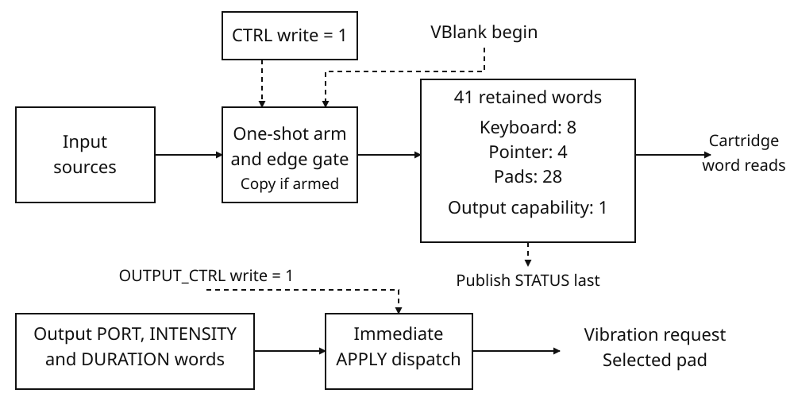

# Input controller {#sec-input}

## Outline {#sec-input-function-and-resources}

The input controller reads the keyboard, a pointing device and four game
pads, and drives the vibration motors of the pads.

The program requests a reading by writing ARM. At the start of the next
vertical blanking interval (VBlank), the controller copies the state of all
keys, buttons and axes into its registers and increments its sample counter.
The registers then keep this state until the next requested reading, so the
program can read them at any time during its update.

| Item | Specification |
|---|---|
| Registers | 47 words at `08000064H`–`0800011CH` |
| Keyboard | 256 keys (USB HID usage page 07H), 8 words |
| Pointer | 5 buttons, X, Y, wheel |
| Game pads | 4; 18 buttons, 2 sticks and 2 triggers each |
| Vibration | 1 output port, pad selectable |
| Sampling | Once per requested VBlank |

{#fig-input-flow}

## Reading the controls {#sec-input-sampling-and-snapshot-reads}

1. Read `IO_INP_STATUS` and keep the value.
2. Write `00000001H` (ARM) to `IO_INP_CTRL`.
3. Wait until `IO_INP_STATUS` changes.
4. Read the key, button and axis registers.

Each ARM produces one reading. Writing ARM several times before the next
VBlank still produces one reading. Without ARM, the registers do not change at
VBlank.

A key pressed and released between two readings is not seen.

## Using the readings {#sec-input-from-a-snapshot-to-game-controls}

| Value | Meaning |
|---|---|
| Key and button bits | 1 = pressed |
| Stick X, Y | −1 (left, up) to +1 (right, down), 0 at centre |
| Trigger | 0 (released) to 1 (fully pressed) |
| Pointer X, Y | Position on the displayed picture, in pixels |
| Pointer wheel | Scroll steps; positive is downward |

A stick X value of +0.5 means half travel to the right. A game that moves a
character 4 pixels per frame at full travel moves it 2 pixels for this value.

### Detecting presses and releases {#sec-input-retained-levels-and-software-edges}

The registers give the current state of each key, not events. To detect
presses and releases, keep the previous reading and compare:

- pressed: `current & ~previous`
- released: `previous & ~current`

Use the first reading as `previous`, so that a key that is already held at
start-up is not counted as a new press.

### Example {#sec-input-worked-keya-transition-sequence}

The A key is bit 4 (`00000010H`) of the first keyboard word.

| Reading | A key | Pressed | Released |
| --- | --- | --- | --- |
| 1 | `0` | `0` | `0` |
| 2 | `10H` | `10H` | `0` |
| 3 | `10H` | `0` | `0` |
| 4 | `0` | `0` | `10H` |

## Programming example {#sec-input-sample-input-in-blua}

The following example reads the A key and the X axis of pad 0's left stick.

```lua
local control<const>: *word = 0x08000064
local status<const>: *word = 0x08000068
local keys<const>: *word = 0x0800006c
local pad0<const>: *word = 0x0800009c

local before<const> = *status
*control = 1                                        -- ARM
while *status == before do end
local key_a_down<const> = (keys[0] & 0x00000010) ~= 0
local left_x<const> = pad0[1] / 65536.0             -- −1.0 to +1.0
```

Instead of polling, the program can wait with HALT for the VBlank interrupt
and then test `IO_INP_STATUS`.

## Data formats {#sec-input-raw-input-representations}

### Keyboard {#sec-input-keyboard-usage-bitmap}

The eight keyboard words hold one bit per USB HID key code (usage page
`07H`). Key code u is bit `u & 31` of word `u >> 5`.

| Keys | Key codes (decimal) |
| --- | --- |
| `KeyA` … `KeyZ` | 4 … 29 |
| `Digit1` … `Digit9`, `Digit0` | 30 … 38, 39 |
| `Enter`, `Escape`, `Backspace`, `Tab`, `Space` | 40, 41, 42, 43, 44 |
| `Minus`, `Equal`, `BracketLeft`, `BracketRight`, `Backslash` | 45, 46, 47, 48, 49 |
| `Semicolon`, `Quote`, `Backquote`, `Comma`, `Period`, `Slash` | 51, 52, 53, 54, 55, 56 |
| `CapsLock` | 57 |
| `F1` … `F12` | 58 … 69 |
| `PrintScreen`, `ScrollLock`, `Pause` | 70, 71, 72 |
| `Insert`, `Home`, `PageUp`, `Delete`, `End`, `PageDown` | 73, 74, 75, 76, 77, 78 |
| `ArrowRight`, `ArrowLeft`, `ArrowDown`, `ArrowUp` | 79, 80, 81, 82 |
| `NumLock`, `NumpadDivide`, `NumpadMultiply`, `NumpadSubtract`, `NumpadAdd`, `NumpadEnter` | 83, 84, 85, 86, 87, 88 |
| `Numpad1` … `Numpad9`, `Numpad0` | 89 … 97, 98 |
| `NumpadDecimal`, `IntlBackslash`, `ContextMenu`, `Power`, `NumpadEqual` | 99, 100, 101, 102, 103 |
| `F13` … `F24` | 104 … 115 |
| `IntlRo`, `IntlYen` | 135, 137 |
| `Lang1`, `Lang2` | 144, 145 |
| `ControlLeft`, `ShiftLeft`, `AltLeft`, `MetaLeft` | 224, 225, 226, 227 |
| `ControlRight`, `ShiftRight`, `AltRight`, `MetaRight` | 228, 229, 230, 231 |

### Game pads {#sec-input-pad-records}

Each pad has seven words: the buttons, then six axes.

| Offset | Word |
| --- | --- |
| `+00H` | Buttons |
| `+04H` | Left stick X |
| `+08H` | Left stick Y |
| `+0CH` | Right stick X |
| `+10H` | Right stick Y |
| `+14H` | Left trigger |
| `+18H` | Right trigger |

| Bit | Button | Bit | Button |
| --- | --- | --- | --- |
| 0 | A | 9 | Start |
| 1 | B | 10 | Left stick |
| 2 | X | 11 | Right stick |
| 3 | Y | 12 | Up |
| 4 | Left bumper | 13 | Down |
| 5 | Right bumper | 14 | Left |
| 6 | Left trigger | 15 | Right |
| 7 | Right trigger | 16 | Home |
| 8 | Select | 17 | Touchpad |

A trigger has both a button bit and an axis. On a pad with digital triggers
the axis is only 0 or 1. Released buttons and centred axes do not show
whether a pad is connected. Dead zones and calibration are left to the program.

### Pointer {#sec-input-pointer-words}

The pointer has four words: buttons, X, Y and wheel.

| Bit | Button |
| --- | --- |
| 0 | Primary |
| 1 | Aux |
| 2 | Secondary |
| 3 | Back |
| 4 | Forward |

X and Y give the position on the displayed picture. The top-left pixel is
(0, 0); X increases to the right and Y downward. The position stays within the
picture.

The wheel word gives the scroll movement since the pointing device last
reported, in steps (one step = `00010000H`); positive is downward. Wheel
movement between two readings that are not collected is lost.

### Fixed-point values {#sec-input-signed-1616-values}

Axes, pointer positions and the wheel are signed 16.16 fixed-point numbers:
the word as a signed 32-bit integer, divided by 65536. In BLua, `w / 65536.0`
gives the value as a float.

| Word | Value |
| --- | --- |
| `00000000H` | 0 |
| `00008000H` | +0.5 |
| `00010000H` | +1 |
| `FFFF0000H` | −1 |
| `FFFF8000H` | −0.5 |

## Vibration {#sec-input-pad-output-commands}

Set the pad number, the intensity and the duration, then write APPLY. The
vibration starts at once; it does not wait for VBlank.

### Intensity and duration {#sec-input-intensity-and-duration}

Intensity is an unsigned 16.16 number from 0 (`00000000H`) to full
(`00010000H`). Larger values give full intensity. Duration is in milliseconds.
APPLY with intensity 0 or duration 0 stops the vibration. A new APPLY for the
same pad replaces the previous one.

Example: pad 0, half intensity, 100 ms.

| Order | Register | Value |
|---|---|---|
| 1 | `IO_INP_OUTPUT_PORT` | `00000000H` |
| 2 | `IO_INP_OUTPUT_INTENSITY_Q16` | `00008000H` |
| 3 | `IO_INP_OUTPUT_DURATION_MS` | `00000064H` |
| 4 | `IO_INP_OUTPUT_CTRL` | `00000001H` |

### Registers {#sec-input-preparing-and-submitting-the-request}

The pad is selected by bits 1–0 of `IO_INP_OUTPUT_PORT`. The three parameter
registers keep their values, so a second pad can be driven by changing only
the port and writing APPLY again. APPLY is the exact value `00000001H`; other
values have no effect. `IO_INP_OUTPUT_CTRL` reads 0 after a write.

### Vibration capability {#sec-input-capability-and-completion}

Bits 3–0 of `IO_INP_OUTPUT_STATUS` show which pads can vibrate (bit 0 for
pad 0). The bits are updated with each reading. There is no status or
interrupt for the end of a vibration.

## Registers {#sec-input-register-map}

All registers are 32-bit words and are 0 after reset.

### Sampling control {#sec-input-sampling-control}

| Address | Register | Access | Contents |
|---|---|---|---|
| `08000064H` | `IO_INP_CTRL` | R/W | Command: ARM = `00000001H`, RESET = `00000002H` |
| `08000068H` | `IO_INP_STATUS` | R | Sample counter |

: {tbl-colwidths="[18,30,10,42]"}

### Keyboard and pointer {#sec-input-keyboard-and-pointer-snapshot}

| Address | Register | Access | Contents |
|---|---|---|---|
| `0800006CH`–`08000088H` | `IO_INP_KEYS[0..7]` | R | Keyboard bits |
| `0800008CH` | `IO_INP_POINTER_BUTTONS` | R | Pointer buttons |
| `08000090H` | `IO_INP_POINTER_X` | R | Pointer X |
| `08000094H` | `IO_INP_POINTER_Y` | R | Pointer Y |
| `08000098H` | `IO_INP_POINTER_WHEEL` | R | Pointer wheel |

: {tbl-colwidths="[18,30,10,42]"}

### Game pads {#sec-input-pad-snapshot-records}

| Pad | Address |
|---|---|
| 0 | `0800009CH` |
| 1 | `080000B8H` |
| 2 | `080000D4H` |
| 3 | `080000F0H` |

Each pad occupies seven words; see [game pads](#sec-input-pad-records).

### Vibration {#sec-input-pad-output-port}

| Address | Register | Access | Contents |
|---|---|---|---|
| `0800010CH` | `IO_INP_OUTPUT_PORT` | R/W | Pad number (bits 1–0) |
| `08000110H` | `IO_INP_OUTPUT_INTENSITY_Q16` | R/W | Intensity |
| `08000114H` | `IO_INP_OUTPUT_DURATION_MS` | R/W | Duration in ms |
| `08000118H` | `IO_INP_OUTPUT_STATUS` | R | Vibration capability (bits 3–0) |
| `0800011CH` | `IO_INP_OUTPUT_CTRL` | W (reads 0) | Command: APPLY = `00000001H` |

: {tbl-colwidths="[18,30,10,42]"}

## Commands {#sec-input-control-words-and-reset}

`IO_INP_CTRL` takes complete command values; the bits cannot be combined.

| Value | Command |
|---|---|
| `00000001H` | ARM: take a reading at the next VBlank |
| `00000002H` | RESET: clear all input and vibration registers and the sample counter |
| Other values | No effect |

RESET does not stop a vibration in progress. To stop it, write APPLY with
duration 0.

## VBlank and the interrupt {#sec-input-vblank-ordering-interrupts-and-access-faults}

At the start of VBlank the reading is taken before the VBlank interrupt is
requested, so an interrupt handler can read the new values. There is no
separate interrupt for the input controller. A VBlank can occur without a
reading, so test `IO_INP_STATUS`.

The input controller also tests the monitor request line at each VBlank; see
[supervisor mode and the monitor](system.md#sec-system-privilege-and-supervisor-entry).

Writing a read-only register causes a READ_ONLY bus fault.

### After startup and after the monitor {#sec-input-bios-handoff-and-supervisor-sampling}

The BIOS reads the controls during startup, so `IO_INP_STATUS` is not 0 when
the program starts. The BIOS monitor also takes readings, and the registers
are not restored when the program resumes. Take a new reading before using
the controls after startup and after a return from the monitor.
