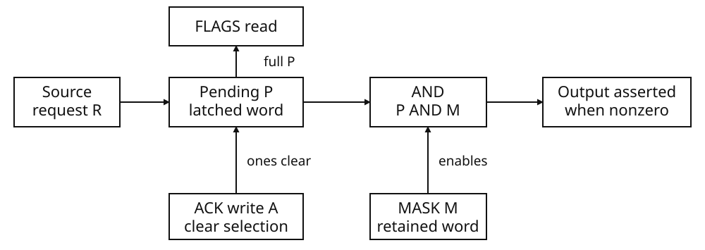

# Interrupt controller {#sec-irq}

The interrupt controller lets a program respond to events from the devices
while the CPU is busy with other work or halted. It collects the interrupt
requests of all devices and passes them to the CPU as one interrupt line.

The controller has three registers. FLAGS holds one pending bit per source.
MASK selects which pending bits may interrupt the CPU. ACK clears pending
bits. A request sets its pending bit whether or not it is enabled in MASK, and
the bit stays set until the program clears it. A source that requests again
while its bit is still set leaves just the one bit set.

## Specifications {#sec-irq-irq-specifications}

| Item | Specification |
|---|---|
| Interrupt sources | 11 (bits 0–10) |
| Registers | FLAGS, ACK, MASK (32 bits each) |
| Interrupt line | 1, to the CPU's maskable interrupt input |
| Priority | None; the program selects the order of service |

{#fig-irq-pending}

## Function {#sec-irq-latching-masking-and-acknowledgement}

The interrupt line is active while at least one bit is set in both FLAGS and
MASK:

```text
Request:      FLAGS ← FLAGS OR request
Write ACK:    FLAGS ← FLAGS AND NOT value
Write MASK:   MASK  ← value

Interrupt line active when (FLAGS AND MASK) ≠ 0
```

A write to MASK replaces the whole mask. Enabling a source whose bit is
already pending activates the line at once. Disabling a source leaves its
pending bit set, so it is not lost.

A write to ACK clears the bits written as 1 and leaves the others. Writing 0
changes nothing. Reading FLAGS changes nothing.

### Example {#sec-irq-worked-operation-trace}

The table follows the GPU source (`00000040H`) and the VBlank source
(`00000004H`). Each row shows the state after the operation.

| Operation | FLAGS | MASK | Line |
| --- | --- | --- | --- |
| Reset | `00000000H` | `00000000H` | Inactive |
| GPU requests | `00000040H` | `00000000H` | Inactive |
| GPU requests again | `00000040H` | `00000000H` | Inactive |
| Write MASK = `00000044H` | `00000040H` | `00000044H` | Active |
| VBlank requests | `00000044H` | `00000044H` | Active |
| Write ACK = `00000040H` | `00000004H` | `00000044H` | Active |
| Write MASK = `00000040H` | `00000004H` | `00000040H` | Inactive |
| Write MASK = `00000004H` | `00000004H` | `00000004H` | Active |
| Write ACK = `00000004H` | `00000000H` | `00000004H` | Inactive |

The second GPU request does not add a second bit. Disabling VBlank in MASK
leaves it pending; it interrupts again as soon as it is re-enabled.

## Interrupting the CPU {#sec-irq-cpu-delivery-and-waiting}

### Interrupt entry {#sec-irq-from-pending-requests-to-irqflags}

The CPU accepts an interrupt when the interrupt line is active and its
interrupt enable bit `STATUS.IEc` is 1. All sources share one interrupt
entry; there is no vector per source.

In user mode, the CPU enters the IRQ function named in the header of the
running program, which is the program started by the most recent `EXEC`. In
supervisor mode it enters the IRQ function of the system ROM. The function
receives no arguments.

When VBlank is among the enabled pending sources, the BIOS performs its own
VBlank work before it enters the cartridge's IRQ function. It does not clear
the VBlank bit.

The standard BLua entry reads FLAGS and, if it is not zero, calls the
program's function `irq(flags)` with the complete FLAGS word. `flags` can
therefore contain pending bits that are disabled in MASK. When `irq` returns,
the entry ends the interrupt with RFE. A program with its own entry routine
must read FLAGS and execute RFE itself.

Interrupt entry and RFE do not clear any pending bit. The handler must write
ACK for the sources it has serviced. A source left pending and enabled
interrupts again after RFE.

### CPU state during the handler {#sec-irq-cpu-state-on-entry-and-return}

The handler runs in supervisor mode with interrupts disabled, so interrupts
do not nest. RFE returns to the interrupted program and restores its mode and
interrupt enable. In `irq(flags)`, simply return; do not execute RFE from the
callback. The CPU's exception registers and RFE are described under
[[CPU execution control](cpu.md#sec-cpu-cp0-and-execution-control)]{.content-visible when-format="html"}[Book II, §12.13]{.content-visible when-format="pdf"}.

### Waiting for an interrupt {#sec-irq-wait-for-service-not-merely-for-a-wake-up}

The statement `halt_until_irq` executes the CPU's HALT instruction. HALT stops
the CPU until an interrupt is accepted; the devices continue to run. If an
interrupt was accepted after the last HALT, the next HALT returns at once.
This prevents an interrupt that arrives just before HALT from being missed.
Several interrupts may end the same HALT, and an interrupt from another
source ends it as well.

Therefore wait for a condition that the handler sets, not for HALT itself.
A counter in BSS that the handler increments works well:

```lua
bss service_count: word
```

In `irq(flags)`, after servicing the device:

```lua
*service_count = *service_count + 1
```

In the program:

```lua
local before<const> = *service_count
-- Start the operation that will raise the interrupt.
while *service_count == before do
    halt_until_irq
end
```

The source must be enabled in MASK and `STATUS.IEc` must be 1; otherwise the
interrupt is not accepted and HALT does not return.

## Interrupt timing {#sec-irq-timing-and-service-cost}

A MASK write takes effect at once: an enabled pending source is accepted
before the next instruction, provided `STATUS.IEc` is 1. The time from a
device request to the first instruction of the handler depends on how long
the request is held back by MASK, by `STATUS.IEc` and by the handler of an
earlier interrupt. Instruction times for the entry routine and the handler
are given in the [CPU chapter](cpu.md#sec-cpu-cycle-accounting-and-execution-boundaries).

## Device and controller acknowledgement {#sec-irq-acknowledge-the-source-and-the-controller-separately}

Many devices keep their own interrupt bit in addition to the bit in FLAGS.
Such a device requests an interrupt only when its own bit changes from 0 to 1.
The handler must then clear both: the device's bit, so that the device can
request again, and the controller's bit, so that the line goes inactive.

The GPU is an example:

- GP0 command `1F000000H` sets the GPU's interrupt bit GPUSTAT24 and requests
  FLAGS bit 6. If GPUSTAT24 is already set, the command has no effect.
- GP1 command `02000000H` clears GPUSTAT24.
- Writing `00000040H` to ACK clears FLAGS bit 6.

### Example: clearing only the controller {#sec-irq-controller-clear-alone-does-not-re-arm-the-gpu}

| Operation | GPUSTAT24 | FLAGS bit 6 |
|---|---|---|
| GP0 `1F000000H` | 1 | 1 |
| Write ACK = `00000040H` | 1 | 0 |
| GP0 `1F000000H` | 1 | 0 |
| GP1 `02000000H` | 0 | 0 |
| GP0 `1F000000H` | 1 | 1 |

The second marker is not reported because GPUSTAT24 was still set. The
interrupt rules of each device are given in its chapter.

### Requests during the handler {#sec-irq-a-pending-bit-cannot-count-arrivals-during-service}

A request that arrives after the handler has read FLAGS but before it writes
ACK is cleared together with the first. A request that arrives after the ACK
write sets the bit again and causes another interrupt. Clear a source before
servicing it if no request may go unserviced, and keep a count in the device
or in software if the number of events matters.

### Installing the handler {#sec-irq-install-the-cartridge-handler}

Define `function irq(flags)` before enabling any source in MASK. The handler
tests the bits it services, services each device, and writes only those bits
to ACK. Writing `flags` back to ACK unchanged would also clear sources that
another part of the program is waiting for.

## Programming example: GPU marker {#sec-irq-program-and-service-a-gpu-marker}

### Conditions {#sec-irq-starting-conditions}

The program has started normally, so `STATUS.IEc` is 1. No other part of the
program uses the GPU or the interrupt registers.

```lua
bss gpu_services: word
local irq_flags<const>: *word = 0x08000000
local irq_ack<const>: *word = 0x08000004
local irq_mask<const>: *word = 0x08000008
local gp0<const>: *word = 0x0801023c
local gp1<const>: *word = 0x08010240

function irq(flags)
    if (flags & 0x00000040) ~= 0 then
        *gp1 = 0x02000000           -- Clear GPUSTAT24.
        *irq_ack = 0x00000040       -- Clear FLAGS bit 6.
        *gpu_services = *gpu_services + 1
    end
end
```

Enable the GPU source, send a marker and wait for it to be serviced:

```lua
*irq_mask = 0
*gp1 = 0x02000000                   -- Clear GPUSTAT24.
*irq_ack = 0x00000040               -- Clear FLAGS bit 6.
*irq_mask = 0x00000040              -- Enable the GPU source.
*gp0 = 0x1f000000                   -- Marker.
while *gpu_services == 0 do
    halt_until_irq
end
*irq_mask = 0
```

The interrupt occurs when the GPU executes the marker, that is, after all
commands sent before it. If VBlank is pending at that moment, `flags` is
`00000044H`; the handler clears only bit 6 and VBlank stays pending.

## Registers {#sec-irq-register-reference}

| Address | Name | Access | Reset value |
|---|---|---|---|
| `08000000H` | `IO_IRQ_FLAGS` | R | `00000000H` |
| `08000004H` | `IO_IRQ_ACK` | W (reads 0) | `00000000H` |
| `08000008H` | `IO_IRQ_MASK` | R/W | `00000000H` |

Access the registers with aligned 32-bit word reads and writes.

### IO_IRQ_FLAGS {#sec-irq-io_irq_flags-pending-requests}

Bit n = 1: source n has a pending request. Writing FLAGS causes a bus fault
(READ_ONLY, code 3).

### IO_IRQ_ACK {#sec-irq-io_irq_ack-selective-pending-clear}

Writing 1 to bit n clears the pending bit of source n. Bits written as 0 are
unchanged. Reads return 0.

### IO_IRQ_MASK {#sec-irq-io_irq_mask-delivery-enables}

Bit n = 1: source n may interrupt the CPU. A write replaces the whole mask;
to enable an additional source, write the old mask OR the new bit.

### Reset {#sec-irq-controller-reset}

Reset clears FLAGS and MASK.

### Interrupt sources {#sec-irq-named-source-bits}

The same bit numbers apply to FLAGS, ACK and MASK.

| Bit | Value | Name | Source |
|---|---|---|---|
| 0 | `00000001H` | `IRQ_DMA0_DONE` | DMA channel 0 done |
| 1 | `00000002H` | `IRQ_GX_PCRTC` | PCRTC event |
| 2 | `00000004H` | `IRQ_VBLANK` | Vertical blanking |
| 3 | `00000008H` | `IRQ_GEO_DONE` | GEO done |
| 4 | `00000010H` | `IRQ_GEO_ERROR` | GEO error |
| 5 | `00000020H` | `IRQ_APU` | APU |
| 6 | `00000040H` | `IRQ_GPU` | GPU marker |
| 7 | `00000080H` | `IRQ_IMGDEC` | Image decoder |
| 8 | `00000100H` | `IRQ_DMA1_DONE` | DMA channel 1 done |
| 9 | `00000200H` | `IRQ_CARTRIDGE_SLOT0` | Cartridge slot 0 |
| 10 | `00000400H` | `IRQ_CARTRIDGE_SLOT1` | Cartridge slot 1 |

Bits 31–11 have no source. MASK stores them as written. Cartridge interrupts
are described in Book III.

### Access rules {#sec-irq-register-access-and-faults}

| Access | Result |
|---|---|
| 32-bit read or write at a register address | Normal register access |
| 8-bit read at a register address | Bits 7–0 of the register |
| Any other 8-bit or 16-bit access | Bus fault (UNALIGNED_IO, code 2) |
| Write to FLAGS | Bus fault (READ_ONLY, code 3) |

Bus faults are reported as described under
[bus-fault status](memory.md#sec-memory-bus-fault-status-and-cpu-exceptions).
