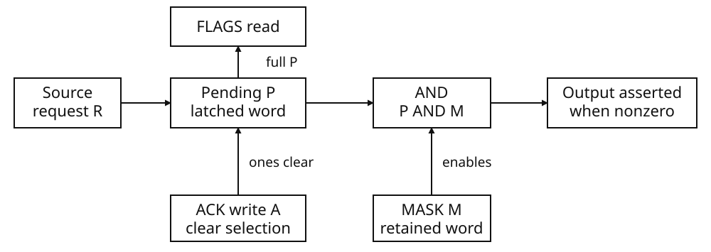

# Interrupt controller

Interrupts let a cartridge service device completion and video events while
the CPU performs other work or waits in HALT. The controller records each
pending source in FLAGS and combines FLAGS with MASK to assert the CPU's
maskable interrupt line. Each source has one pending bit, so repeated arrivals
can coalesce before service.

Sources include DMA completion, PCRTC events, VBlank, GEO completion/errors,
APU events, GPU markers, IMGDEC events and the two cartridge sockets. Program a
source's local event controls, install its service routine, then enable its
MASK bit. The source chapter defines any local acknowledgement or re-arming.

The CPU accepts the line when current interrupt enable `STATUS.IEc` is set.
All enabled sources share an IRQ entry; software reads FLAGS, services the
selected sources and acknowledges them. The controller and CPU entry protocol
are specified below.

### IRQ specifications

| Resource | Specification |
|---|---|
| Register interface | Three 32-bit word ports, four-byte spacing; 12 bytes of address space |
| Pending storage | One 32-bit pending word, not an event queue |
| Delivery selection | One 32-bit enable word, reset to zero |
| Named source bits | Eleven, bits 0–10; the remaining word bits are not removed by controller operations |

These register-address bytes are not a payload RAM capacity. The full
address/access/reset and named-source tables appear in the register reference.



FLAGS reads the full pending word. The diagram ends at the controller output;
the CPU interrupt-enable gate is separate.

<section class="keep-together">

### Latching, masking and acknowledgement

Let **P** be the pending word, **M** the mask, **R** a raised-bit word and **A** an accepted ACK word. All bitwise operations below are 32-bit operations:

```text
Raise R:       P ← P OR R         M is unchanged
Write MASK W:  M ← W              P is unchanged
Write ACK A:   P ← P AND NOT A    M is unchanged

Interrupt indication asserted ⇔ (P AND M) ≠ 0
```

</section>

Raising a bit latches it regardless of MASK. Raising it again while it remains pending leaves the same bit set; the controller does not record how many times it was raised. This is coalescing, not a backlog of events.

MASK selects which pending bits can assert the output. Each MASK write replaces the previous mask rather than adding to it. Consequently, enabling an already-pending bit can assert the output without another raise, while disabling it leaves its pending state intact.

ACK clears exactly the pending bits selected by its written ones. Written zeros preserve the corresponding pending bits, so writing `00000000H` changes nothing. Reading FLAGS also changes nothing. An ACK need not clear every pending bit: the output remains asserted whenever another bit remains set in both P and M. The same equation applies to unnamed bits retained in those words.

An accepted ACK or MASK write changes the controller state before that write completes. This is the register-write visibility edge; it does not specify CPU interrupt delivery, a priority order, or a fixed interrupt-entry delay.

### Worked operation trace

The following sequence uses `IRQ_GPU` (`00000040H`) and `IRQ_VBLANK` (`00000004H`) only as bit names. “Raise” means that the indicated word is presented to the controller; no device trigger is implied. Each row shows state after the operation.

| Operation | P | M | Indication |
| --- | --- | --- | --- |
| Reset | `00000000H` | `00000000H` | Clear |
| Raise `00000040H` | `00000040H` | `00000000H` | Clear |
| Raise `00000040H` again | `00000040H` | `00000000H` | Clear |
| Write MASK `00000044H` | `00000040H` | `00000044H` | Asserted |
| Raise `00000004H` | `00000044H` | `00000044H` | Asserted |
| Write ACK `00000040H` | `00000004H` | `00000044H` | Asserted |
| Write MASK `00000040H` | `00000004H` | `00000040H` | Clear |
| Write ACK `00000000H` | `00000004H` | `00000040H` | Clear |
| Write MASK `00000004H` | `00000004H` | `00000004H` | Asserted |
| Write ACK `00000004H` | `00000000H` | `00000004H` | Clear |

The repeated GPU raise coalesces into one pending bit. The first ACK clears GPU but leaves VBlank pending and enabled. Replacing MASK with `00000040H` hides VBlank without clearing it; enabling VBlank again exposes that same pending bit. Only the final ACK clears it.

## CPU delivery and waiting

### From pending requests to `irq(flags)`

A maskable interrupt is accepted only when both conditions hold:

- At least one bit is set in `IO_IRQ_FLAGS & IO_IRQ_MASK`.
- The CPU's current interrupt-enable bit, `STATUS.IEc`, is set.

Masking a source does not discard its pending request. Source requests accumulate in `IO_IRQ_FLAGS` independently of `IO_IRQ_MASK`; repeated requests for an already-pending source retain one bit, not a count.

The CPU does not choose the highest-priority source or take one vector per pending bit. An accepted maskable interrupt takes the shared IRQ entry for the current execution context: the active program's entry in user mode, or the system entry in non-user mode. Software determines which pending sources to service.

The CPU enters the IRQ function whose absolute function-record address is in
the selected ROM header. It supplies no function arguments. That entry routine
runs as the exception frame and is responsible for reading source state and
executing RFE when service is complete.

The standard BLua IRQ entry reads the **complete `IO_IRQ_FLAGS` word** and, when
it is nonzero, calls `irq(flags)`. This argument reflects the later FLAGS read;
it can include masked pending bits as well as the bit that enabled delivery.
The callback returns normally to the entry routine, which executes RFE. A
separately authored IRQ entry can dispatch differently, but must perform its
own source reads and exception return.

Neither exception entry nor ordinary interrupt return acknowledges a source. Software must write the appropriate bits to `IO_IRQ_ACK`. Writing one clears the corresponding pending bit; writing zero leaves it unchanged. A source left pending and enabled can request delivery again once `IEc` is restored.

> **Caution — delivery is not source selection.** Do not assume that every bit supplied to `irq(flags)` was enabled, or that the CPU has already acknowledged any of them.

### CPU state on entry and return

The relevant CP0 registers are `STATUS` (register 12), `CAUSE` (13), and `EPC` (14). In `STATUS`, bit 0 is current interrupt enable and bit 1 selects current user mode. Cartridge entry begins with `STATUS = 00000003H`: user mode, interrupts enabled. System entry uses `00000001H`: non-user mode, interrupts enabled.

On accepted IRQ entry, the CPU records the interrupted PC in `EPC`, writes `00000400H` to `CAUSE`, and shifts the six low mode-stack bits left by two:

```text
STATUS := (STATUS & ~0000003fH) | ((STATUS << 2) & 0000003fH)
```

Both current bits become zero. The handler therefore executes in non-user mode with maskable interrupts disabled; entry does not establish automatic priority-based nesting.

For a cartridge beginning at `00000003H`, the complete worked sequence is:

```text
Before IRQ:       STATUS = 00000003H  user mode; IEc = 1
After IRQ entry:  STATUS = 0000000cH  non-user mode; IEc = 0
After RFE:        STATUS = 00000003H  user mode; IEc = 1
```

`RFE` returns to the address in `EPC` and restores the low four status bits as follows:

```text
STATUS := (STATUS & ~0000000fH) | ((STATUS >> 2) & 0000000fH)
```

`RFE` is an exception-return instruction, not a general procedure return. It requires non-user mode and an exception to return from. User-mode execution takes the coprocessor-unusable exception; execution without an exception to return from hard-halts.

Privilege also matters for CP0 access. In user mode, `MFC0` and `MTC0` take the coprocessor-unusable exception. In non-user mode, `MFC0` can read these three registers; `MTC0` replaces `STATUS` or `EPC`, but does not change `CAUSE`. Writing `STATUS` replaces the whole word, not just `IEc`.

### Wait for service, not merely for a wake-up

`halt_until_irq` is a statement that executes the CPU's `HALT` instruction. It is not a function call. HALT and controller acknowledgement are separate operations.

An accepted interrupt can leave a one-bit accepted-event indication when the CPU was not already waiting. If this indication is present, the next HALT consumes it and continues without establishing a wait. Otherwise HALT waits for interrupt acceptance. This closes the ordinary interval between checking software state and executing HALT, but it does **not** make HALT an event counter: several accepted interrupts can collapse into the same retained indication.

Use an explicit software predicate. For example, reserve a mutable service sequence in BSS, whose initial value is zero:

```lua
bss service_count: word
```

In the selected service path of `irq(flags)`, complete that source's work and required acknowledgement, then advance the sequence:

```lua
*service_count = *service_count + 1
```

The caller snapshots the sequence **before** starting the operation that will request this service, then waits for it to change:

```lua
local before<const> = *service_count
-- Start the operation that will request the selected service here.
while *service_count == before do
    halt_until_irq
end
```

These are fragments of a source-specific protocol, not a replacement IRQ handler. Only the selected completed service advances this counter. Other interrupts may wake the caller without satisfying its predicate, and the selected handler may already have completed before HALT executes. The loop handles both cases. The software counter records completed services; it cannot reconstruct source requests that already coalesced in a controller pending bit.

> **Caution — a pending bit alone need not wake HALT.** Maskable acceptance still requires a matching mask bit and `IEc = 1`. Do not wait for a source while disabling its delivery and expect its raw pending bit to suffice.

Device timers continue to progress during HALT; parked CPU instructions do not execute. No fixed request-to-handler latency or guaranteed acceptance boundary after every source instruction is specified here.

## Timing and service cost

Interrupt service instructions use the 33.8688 MHz system timebase:
33,868,800 cycles per second, approximately 29.525699 ns per cycle. A service
interval includes time pending, exception entry, source dispatch, handler work
and exception return.

There is no delayed-enable instruction after a MASK write. An already-pending
request is eligible at the next CPU execution boundary that satisfies both
gates; an NMI or another CPU hold can still prevent maskable acceptance.

ACK and MASK change controller state on their accepted word writes. A pending
enabled bit can therefore assert the line as a result of a MASK write, without
another source request. CPU acceptance also requires IEc; assertion of the
controller output and execution of a cartridge handler are not the same edge.

| Instruction | ISA base cost, system cycles |
|---|---|
| `HALT` | 1 |
| `MFC0` | 1 |
| `MTC0` | 1 |
| `RFE` | 1 |
| `LOAD_MEM`, including the IRQ entry's FLAGS read | 2 |

Add these costs to the executed entry and handler instructions when budgeting
service. Device timing continues during HALT and while a request is masked.
Request-to-handler time therefore depends on those waits as well as on the
instruction sequence. The example below accounts for the entry instructions
separately from the handler.

### Worked IRQ entry cost

Consider an IRQ entry that reads FLAGS and compares it directly with an
immediate zero constant. Its instruction-base charge is as follows:

| Entry operation | Nonzero FLAGS path | Zero FLAGS path |
|---|---|---|
| Load FLAGS address | 1 | 1 |
| Read FLAGS word | 2 | 2 |
| Compare with zero | 1 | 1 |
| Branch past the call | Skipped | 1 |
| Load the `irq` function | 1 | — |
| Move FLAGS into its argument | 1 | — |
| Call `irq(flags)` | 2 | — |
| `RFE` | 1 | 1 |
| **Entry-sequence total, cycles** | **9** | **6** |

Handler execution, including its own return instruction, is extra. If the
entry instead loads zero into a register before comparing, add one cycle to
each path: 10 and 7 cycles. The actual entry instructions determine this
budget; it is not a fixed interrupt-entry charge or a request-to-service delay. In particular, it does
not include time spent pending behind a closed MASK or disabled IEc.

## Acknowledge the source and the controller separately

Controller ACK removes a pending bit. It is not a command to the unit that
raised that bit. The GPU provides a concrete example of the distinction:

- GP0 word `1f000000H` is an in-order interrupt marker. When it executes with
  GPUSTAT24 clear, it sets that local bit and raises controller bit 6.
- GP1 word `02000000H` clears GPUSTAT24. It does not clear controller bit 6.
- Writing `00000040H` to IO_IRQ_ACK clears controller bit 6. It does not clear
  GPUSTAT24.

The marker's low 24 bits do not select an interrupt number. A marker while
GPUSTAT24 remains set does not raise another GPU request. Nor does GPU idle
alone raise an interrupt.

### Controller clear alone does not re-arm the GPU

Start with both GPU-local and controller pending bits clear. Keep delivery
masked while following this sequence:

| Ordered operation | GPUSTAT24 | FLAGS bit 6 | Meaning |
|---|---|---|---|
| Execute first GP0 marker | 1 | 1 | Both latches record the request |
| Write ACK=`00000040H` | 1 | 0 | Controller cleared; GPU still latched |
| Execute another GP0 marker | 1 | 0 | No new request while the GPU latch stays set |
| Write GP1=`02000000H` | 0 | 0 | GPU re-armed |
| Execute a further GP0 marker | 1 | 1 | A new independent request is recorded |

The opposite partial acknowledgement is different: clearing only GPUSTAT24
leaves controller bit 6 pending. A new marker can then raise bit 6 again, but
OR-ing it into an already-set pending bit still leaves just one pending bit.
The programming example below demonstrates that coalescence before enabling
delivery.

Follow the local acknowledgement sequence of each source. The
[GPU command reference](gpu.md) defines marker ordering and GPU completion;
[PCRTC](pcrtc.md) defines display publication. A marker service establishes that
the marker was reached, while the display has its own publication edge.

### A pending bit cannot count arrivals during service

For one selected source, let P be its pending bit. A raise sets P to 1; ACK
sets P to 0. The order matters:

| Operation order | Final P |
|---|---|
| Raise, then ACK | 0 |
| ACK, then raise | 1 |
| Raise, raise, then ACK | 0 |

Consequently a flags read followed later by an acknowledgement is not an
atomic read-and-consume transaction. A second request that arrives before
that clear can coalesce with the first and be removed by the same clear.
A request after the clear becomes pending again. No acknowledgement order can
turn this one-bit latch into a count of all source events.

Keep a software service count distinct from a source-event count. Several
requests can coalesce into one service; no software counter recovers arrivals
already lost in the pending latch.

<a id="choose-one-cartridge-dispatch-route"></a>

### Install the cartridge handler

For the standard BLua entry sequence, define `function irq(flags)` before
enabling interrupt delivery. The handler selects the sources it supports,
services their local state, and clears their controller bits. Clear only the
supported subset: `flags & 00000040H` clears GPU pending while preserving other
sources supplied in the same full FLAGS argument.

Prepare each source's service state before enabling its MASK bit. The following
example supplies the global callback and performs both GPU and controller
acknowledgement.

## Program and service a GPU marker

### Starting conditions

Use ordinary BIOS cartridge entry with the inherited beam running and CPU
interrupt enable set. Own GP0, the GPU interrupt handler and MASK exclusively;
no unfinished packet, readback or DMA transfer may remain. This example leaves
VBlank pending but masked so that the full handler argument can be distinguished
from the enabled subset.

```lua
bss gpu_services: word
bss delivered_flags: word
local irq_flags<const>: *word = 0x08000000
local irq_ack<const>: *word = 0x08000004
local irq_mask<const>: *word = 0x08000008
local gp0<const>: *word = 0x0801023c
local gp1<const>: *word = 0x08010240

function irq(flags)
    if (flags & 0x00000040) ~= 0 then
        *delivered_flags = flags
        *gp1 = 0x02000000
        *irq_ack = 0x00000040
        *gpu_services = *gpu_services + 1
    end
end

*irq_mask = 0
while (*gp1 & 0x04000000) == 0 do
end
*gp1 = 0x02000000
*irq_ack = 0xfffffffb       -- Clear stale requests except VBlank.
while (*irq_flags & 4) == 0 do
end

*gp0 = 0x1f000000          -- First masked GPU request.
while (*gp1 & 0x01000000) == 0 do
end
*gp1 = 0x02000000          -- Re-arm GPU; central pending is still set.
*irq_ack = 0               -- No pending bit is cleared.
*gp0 = 0x1f000000          -- A second request coalesces into bit 6.
while (*gp1 & 0x01000000) == 0 do
end

*irq_mask = 0x00000040
while *gpu_services == 0 do
    halt_until_irq
end
*gp0 = 0x1f000000          -- The handler cleared both required latches.
while *gpu_services == 1 do
    halt_until_irq
end
*irq_mask = 0
```

Under the stated ownership conditions, the ordered states are as follows.
GPU24 is shown as a masked word. Rows are operation boundaries, not
equal-duration time slots or atomic multi-register samples.

| Operation | FLAGS | MASK | GPU24 | Completed GPU services |
|---|---|---|---|---:|
| VBlank pending, before a marker | `04` | `00` | `00000000` | 0 |
| First marker executes | `44` | `00` | `01000000` | 0 |
| GPU-local clear only | `44` | `00` | `00000000` | 0 |
| Second marker executes | `44` | `00` | `01000000` | 0 |
| First handler, before acknowledgement | `44` | `40` | `01000000` | 0 |
| First service complete | `04` | `40` | `00000000` | 1 |
| Third marker serviced | `04` | `40` | `00000000` | 2 |
| Delivery masked again | `04` | `00` | `00000000` | 2 |

Both services receive `44H`, although the enabled subset is only `40H`.
The handler clears GPU only, so disabled VBlank remains pending. ACK always
reads zero. The two service increments count these controlled services after
re-arming; they do not count all possible source arrivals or establish an
interrupt-latency bound.

## Register reference

Use four-byte-aligned, 32-bit word accesses. The three addresses name separate
operations: a pending-word read, a selective clear and an enable-word replacement.

| Address | Name | Access | Bits | Reset |
|---|---|---|---|---|
| `08000000H` | `IO_IRQ_FLAGS` | Read only | 31:0 pending requests | `00000000H` |
| `08000004H` | `IO_IRQ_ACK` | Read zero / write-one-to-clear | 31:0 pending-bit clear selection | `00000000H` |
| `08000008H` | `IO_IRQ_MASK` | Read/write | 31:0 delivery enables | `00000000H` |

### IO_IRQ_FLAGS — pending requests

Each set bit records a pending request. Reading the word leaves every bit
unchanged. A source request sets its pending bit even when the corresponding
MASK bit is zero. Another request while the bit is already set does not add a
second entry or increment a count.

FLAGS is not the enabled subset. For example, FLAGS=`00000044H` and
MASK=`00000040H` means that both bit 2 and bit 6 are pending, but only bit 6 enables
the controller output. Writing FLAGS does not acknowledge it; the write is
rejected with READ_ONLY bus fault 3.

### IO_IRQ_ACK — selective pending clear

A written one clears the corresponding pending bit; a written zero preserves
it. The operation is:

```text
pending := pending AND NOT written_word
```

The clear takes effect on the accepted register write. It does not replace
MASK, clear a source unit's local status, or record the word that was written.
ACK reads `00000000H` after reset and after each accepted write.

With FLAGS=`00000044H`, writing ACK=`00000040H` leaves FLAGS=`00000004H`.
Writing ACK=`00000000H` changes nothing. Writing ACK=`ffffffffH` clears every
pending bit, including disabled ones; it is not selective service of the source
that caused an interrupt.

### IO_IRQ_MASK — delivery enables

A set bit enables that pending bit to contribute to the output line. A clear
bit excludes it from the output line without erasing it. Reading MASK returns
the current enable word. An accepted write replaces all 32 bits immediately;
it is not a set-bits command.

For example, replacing MASK=`00000040H` with `00000004H` disables bit 6 and enables
bit 2. To keep both enabled the replacement word must be `00000044H`. MASK=0
closes delivery from this controller; it neither clears pending requests nor
acknowledges their producers. Enabling an already-pending bit can assert the
output without waiting for another source request.

### Named source bits

The same bit position is used in FLAGS, ACK and MASK. The names identify the
source; they do not make all source units use the same request or re-arm rule.

| Bit | Mask | Source name |
|---|---|---|
| 0 | `00000001H` | `IRQ_DMA0_DONE` |
| 1 | `00000002H` | `IRQ_GX_PCRTC` |
| 2 | `00000004H` | `IRQ_VBLANK` |
| 3 | `00000008H` | `IRQ_GEO_DONE` |
| 4 | `00000010H` | `IRQ_GEO_ERROR` |
| 5 | `00000020H` | `IRQ_APU` |
| 6 | `00000040H` | `IRQ_GPU` |
| 7 | `00000080H` | `IRQ_IMGDEC` |
| 8 | `00000100H` | `IRQ_DMA1_DONE` |
| 9 | `00000200H` | `IRQ_CARTRIDGE_SLOT0` |
| 10 | `00000400H` | `IRQ_CARTRIDGE_SLOT1` |

Bits 31:11 are unnamed, not hardwired-zero fields. MASK retains their written
values, and the controller's pending, clear and output equations operate on
the complete 32-bit words. This does not assign a cartridge-programmable request
source to an unnamed bit. Cartridge-source device programming belongs to Book III.

<section class="keep-together">

## Register access, faults and reset

The following rules concern the three controller words. A word access still
obeys the read-only rule for FLAGS.

| Mapped data access | Address condition | Result |
|---|---|---|
| Register-word or U32 read/write | Four-byte aligned | One complete register operation |
| U8 read | At a register's word address | Full register read, returning bits 7:0 |
| U8 read | Word offset 1,2 or 3 | UNALIGNED_IO bus fault 2; no register operation |
| U8 write | Any controller byte address | UNALIGNED_IO bus fault 2; no register operation |
| U16 read/write | Even controller address | UNALIGNED_IO bus fault 2; no register operation |
| Word write to FLAGS | At `08000000H` | READ_ONLY bus fault 3; pending unchanged |

</section>

CPU alignment rejection precedes these mapped-access rules. See
[Memory — Bus-fault status and CPU exceptions](memory.md#bus-fault-status-and-cpu-exceptions)
for the shared report and exception behavior. Clear that report through its
BUS_FAULT_ACK port; IRQ_ACK clears controller pending bits only.

F32 transfers one word's bits. F64 transfers the low word at A and the high word
at A+4, stopping if the first access faults. Thus an F64 store starting at FLAGS
faults before ACK is reached. Starting at ACK instead performs a pending clear
followed by a MASK replacement; it is not a combined controller operation.
Use separate word stores when those are the operations intended.

Reset clears pending and MASK and returns ACK readback to zero. Writing MASK=0
alone does not reproduce reset: pending requests remain. Writing ACK with all
ones alone does not reproduce reset either: the enable word remains unchanged.
Source-unit reset and re-arming remain that unit's separate operations.
