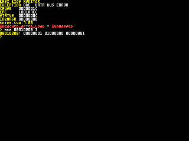
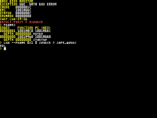

# Memory and program storage

The CPU uses one byte-addressed map for system ROM, main RAM, cartridge storage
and device registers. Main RAM holds writable program data and transfer
buffers. ROM supplies read-only bytes. Device registers provide word ports
whose reads and writes can consume results, change configuration or start work.

GPU local memory and APU sample RAM have separate access paths. Use GPU image
and readback commands for local memory, and APU transfer ports for sample RAM.
Before placing cartridge buffers in main RAM, reserve the I/O area, GEO scratch
and the installed firmware's static storage as specified below.

## Addresses and data sizes

BMSX uses 32-bit unsigned byte addresses. Each address identifies one byte; the address space runs from `0x00000000` through `0xffffffff`, inclusive. A 32-bit word occupies four consecutive bytes. For 16-bit and 32-bit values in main RAM, byte order is little-endian: the least significant byte is at the lowest address.

All capacities in this section are byte counts: 1 KiB is 1024 bytes and 1 MiB is 1048576 bytes. A range written `[start, end)` includes `start` but excludes `end`; its last byte is at `end - 1`. The tables use inclusive starts and exclusive ends. `0x100000000` denotes the exclusive end of the address space, not an address that a program can supply.

## Installed memory and address windows

BMSX has **4 MiB of main RAM**, occupying `[0x08000000, 0x08400000)` before I/O mapping and reservation restrictions; its last byte is `0x083fffff`. The main-RAM address window is larger than the installed memory. Similarly, the system-ROM window is an address-space allocation, not the byte length of the installed firmware. Cartridge windows describe the cartridge bus, not how much ROM or RAM a cartridge contains.

| Address-space region | Start, inclusive | End, exclusive | Window size or status |
|---|---|---|---|
| System ROM | `0x00000000` | `0x01000000` | 16 MiB window; firmware image length is separate |
| Unmapped gap | `0x01000000` | `0x08000000` | No mapped storage |
| Main RAM | `0x08000000` | `0x10000000` | 128 MiB window; 4 MiB installed at its beginning |
| Cartridge ROM | `0x10000000` | `0x30000000` | 512 MiB window; installed media capacity is not specified by this window |
| Cartridge RAM | `0x30000000` | `0x30f00000` | 15 MiB window; does not imply 15 MiB is present |
| Cartridge MMIO | `0x30f00000` | `0x31000000` | 1 MiB window |
| Unmapped upper range | `0x31000000` | `0x100000000` | Outside the cartridge bus and other declared windows |

The cartridge bus begins at `0x10000000` and ends just before `0x31000000`; the system's main-RAM window ends at that cartridge-bus start. Within the main-RAM window, `[0x08400000, 0x10000000)` has no installed main-RAM backing. It is not an extension or mirror of the installed 4 MiB.

The I/O-slot aperture contains 16656 four-byte slots: 66624 bytes in
`[0x08000000, 0x08010440)`. The reservation and allocation boundaries below
remain separate from that decoded aperture.

GPU VRAM is a separate **2 MiB** capacity and is not included in the 4 MiB main-RAM total.

## I/O register-bank directory

The following directory covers the complete I/O aperture in address order. Each word position occupies four bytes; its address is the first byte of that word. The end column is exclusive. Counts include status, snapshot and result words as well as control words: they are **addressed word positions**, not counts of independently writable registers. Access permissions, read side effects, command admission and reset values belong to the individual register descriptions linked in the last column, not to a whole directory range.

### Lower register banks and reserved slots

| First word address | Exclusive end | 32-bit word positions | Unit and subbank |
|---|---|---|---|
| `0x08000000` | `0x0800000c` | 3 | [IRQ](irq.md#register-reference) — pending flags, acknowledgement and mask |
| `0x0800000c` | `0x08000024` | 6 | [DMA](dma.md#register-reference) — channel 0 |
| `0x08000024` | `0x08000064` | 16 | [GEO](geo.md#register-reference) — operands, command, control, progress and fault |
| `0x08000064` | `0x08000120` | 47 | [Input](input.md#register-map) — sampling, keyboard, pointer, four pads and output port |
| `0x08000120` | `0x08000174` | 21 | [APU](apu.md#register-reference) — command-staging parameters |
| `0x08000174` | `0x0800017c` | 2 | [APU](apu.md#register-reference) — CMD and STATUS |
| `0x0800017c` | `0x0800018c` | 4 | [APU](apu.md#register-reference) — retained end-event words |
| `0x0800018c` | `0x08000194` | 2 | [APU](apu.md#register-reference) — selected source and active-slot mask |
| `0x08000194` | `0x080001e8` | 21 | [APU](apu.md#register-reference) — live selected-slot parameter window |
| `0x080001e8` | `0x080001f4` | 3 | [APU](apu.md#register-reference) — sample-transfer address, data and control |
| `0x080001f4` | `0x08000200` | 3 | [APU](apu.md#register-reference) — command-queue occupancy, free space and capacity |
| `0x08000200` | `0x08000204` | 1 | [APU](apu.md#register-reference) — sample sequence |
| `0x08000204` | `0x08000208` | 1 | Reserved retained word |
| `0x08000208` | `0x08010208` | 16384 | Reserved retained-slot range |

### Upper register banks

| First word address | Exclusive end | 32-bit word positions | Unit and subbank |
|---|---|---|---|
| `0x08010208` | `0x08010218` | 4 | [Memory bus fault](#bus-fault-status-and-cpu-exceptions) — code, address, access and acknowledgement |
| `0x08010218` | `0x08010224` | 3 | [APU](apu.md#register-reference) — fault code, detail and acknowledgement |
| `0x08010224` | `0x08010228` | 1 | [GEO](geo.md#register-reference) — fault acknowledgement |
| `0x08010228` | `0x08010230` | 2 | [SYSTEM](system.md#system-time-and-frame-timing) — elapsed milliseconds and frame interval |
| `0x08010230` | `0x08010238` | 2 | [SYSTEM](system.md#diagnostic-text-output) — diagnostic character and line flush |
| `0x08010238` | `0x0801023c` | 1 | [SYSTEM](system.md#system-time-and-frame-timing) — cycles per frame |
| `0x0801023c` | `0x08010244` | 2 | [GPU](gpu.md#gp0-gpuread-gp1-and-gpustat) — GP0/GPUREAD and GP1/GPUSTAT |
| `0x08010244` | `0x080102c4` | 32 | [GTE](gte.md#register-reference) — data words D[0]–D[31] |
| `0x080102c4` | `0x08010344` | 32 | [GTE](gte.md#register-reference) — control words C[0]–C[31] |
| `0x08010344` | `0x0801034c` | 2 | [GTE](gte.md#normal-command-and-cycles) — normal COMMAND and CYCLES |
| `0x0801034c` | `0x08010354` | 2 | [SYSTEM](system.md) — CONTROL and STATUS |
| `0x08010354` | `0x08010384` | 12 | [PCRTC](pcrtc.md) — composition words, PMODE through BGCOLOR |
| `0x08010384` | `0x080103ac` | 10 | [GTE PLUS](gte.md#register-reference) — operands, results, flags, command and cycles |
| `0x080103ac` | `0x080103e4` | 14 | [PCRTC](pcrtc.md) — beam timing, CSR events and IMR masks |
| `0x080103e4` | `0x080103fc` | 6 | [DMA](dma.md#register-reference) — channel 1 |
| `0x080103fc` | `0x08010420` | 9 | [IMGDEC](imgdec.md#register-reference) — configuration, status, data and progress |
| `0x08010420` | `0x08010428` | 2 | [Cartridge controller](../book3/cartridge.md#cartridge-controller) — socket selection and status |
| `0x08010428` | `0x08010440` | 6 | [SYSTEM](system.md#supervisor-fault-registers) — retained supervisor fault report |

These ranges partition all 16656 word positions without gaps or overlaps. A unit need not occupy one contiguous bank: DMA channel 1 is separate from channel 0; GEO and APU have separate upper fault-acknowledgement banks; GTE PLUS separates PCRTC's composition and timing banks; and SYSTEM has timing, diagnostic, control and fault-report banks. The reserved retained slots are part of the decoded aperture, not an additional device or a payload-transfer protocol.

### Reserved retained words and decoder boundary

Of the 16656 positions, **16385 are reserved retained words** in
`[0x08000204, 0x08010208)`. An aligned word read returns the stored raw word;
an accepted aligned word write replaces it. These words reset to zero and have
no command, FIFO, automatic address increment or transfer-completion behavior.
They remain reserved: retention does not make them cartridge RAM or grant a
scratch-buffer allocation. Do not apply this read/write description to other
directory rows; their unit-specific permissions and side effects still apply.

I/O decoding and the I/O reservation have different limits. Addresses in
`[0x08010440, 0x08040000)` reach installed main-RAM bytes rather than register
slots, but remain within the reserved 256 KiB. They are not additional
registers or newly available cartridge storage.

For byte, halfword and word bus transfers, the **complete transfer** must fit
inside the decoded I/O aperture for its I/O width rules to apply. A transfer
crossing that end uses main-RAM backing for its complete width; it is not split
between a final register and RAM. These examples describe mapped-bus transfers,
not permission to bypass ordinary CPU instruction alignment:

| Mapped transfer | Selected path |
|---|---|
| U32 at `0x0801043c` | Last complete I/O slot: supervisor fault DOMAIN |
| U32 at `0x0801043e` | Four main-RAM bytes spanning the decoder boundary |
| U16 at `0x0801043f` | Two main-RAM bytes spanning the decoder boundary |
| U32 at `0x08010440` | Main-RAM backing within the reservation |

Ordinary CPU U16 and U32 instructions reject the two unaligned examples before
reaching the mapped bus. The [scalar-access rules](#scalar-memory-accesses)
separate that CPU alignment check from I/O decoding. F64 instead consists of
two word transfers: an aligned F64 access at `0x0801043c` reaches the last I/O
slot first and RAM at `0x08010440` second, subject to the ordered fault rules.

## Reserved and cartridge storage in main RAM

The installed main RAM occupies `0x08000000` through `0x083fffff`, a total of 4 MiB. This is a physical storage extent, not a cartridge allocation range. It includes the I/O reservation, GEO scratch storage, and the system's static storage as well as the cartridge program's static storage.

Subtracting the 256 KiB I/O reservation and 512 KiB GEO scratch reservation
leaves **3.25 MiB** in `[0x080c0000, 0x08400000)` before accounting for system
and cartridge static storage. The installed firmware occupies the beginning
of this span. Its actual DATA/BSS footprint, rather than 3.25 MiB alone,
determines where cartridge placement can begin.

The following ranges use an exclusive end: the end address is the first byte outside the range.

| Use | Start | Exclusive end | Size |
|---|---|---|---|
| Declared I/O reservation | `0x08000000` | `0x08040000` | 256 KiB |
| GEO scratch reservation | `0x08040000` | `0x080c0000` | 512 KiB |
| System static storage | `0x080c0000` | Actual end of system BSS | Specified by the system executable image |
| Cartridge static storage, compact layout below | Actual end of system BSS | Actual end of cartridge BSS | Specified by the cartridge executable image |

The implemented I/O register aperture ends at `0x08010440`, before the end of the declared I/O reservation. This smaller aperture does not make the remainder of the reservation available for cartridge variables or buffers. Likewise, the GEO scratch reservation is not cartridge static storage.

`0x080c0000` is the start of **system DATA**, not a universal cartridge RAM base.
The installed firmware's BSS follows its DATA. Account for their actual occupied
extent in the matching BIOS image, rather than assuming a fixed cartridge base.
The image's declared BSS address and byte count identify that span; their sum
is its exclusive end. These are linking information, not a request to allocate
or clear memory when the image is selected.

The following compact layout places cartridge DATA at the system BSS end and
cartridge BSS immediately after that DATA. This adjacency is a layout choice,
**not a hardware requirement**. Another cartridge placement can use different
unreserved RAM addresses; its records, code and startup initialization must all
use that chosen placement without overwriting firmware storage.

| Section in the compact layout, in address order | Run address |
|---|---|
| System DATA | `0x080c0000` |
| System BSS | End of system DATA |
| Cartridge DATA | Exported actual end of system BSS |
| Cartridge BSS | End of cartridge DATA |

Each end in this table is exclusive and includes the section's alignment padding. The compiler aligns static objects to their type alignment and rounds section sizes to multiples of four bytes.

Choosing a static layout is not a hardware allocation service. Neither the
installed RAM extent nor the end of cartridge BSS defines a free arena, stack
reservation, or byte-addressed heap. Use the actual installed system image
when calculating firmware occupancy.

<a id="firmware-reservation-in-vram"></a>

## Firmware reservation in VRAM

The 2 MiB VRAM is shared GPU storage, arranged as 1024 rows of 1024 **16-bit words**. Each row spans 2048 bytes. A drawing destination, texture source or display source selects storage within that same memory; it does not create a separate CPU byte-address allocation.

The firmware uses VRAM both for the full terminal drawing surface and for its system texture atlas, which supplies terminal glyphs. Preserve the **bounding rectangle covering both**, rather than reserve only the currently visible text or the atlas alone. This VRAM reservation is separate from the I/O, GEO scratch and static-storage reservations in main RAM.

<a id="handoff-is-not-release"></a>

### Handoff is not release

Clearing terminal text or status, or selecting a smaller active terminal viewport, does not shrink the queried full-layout reservation. Cartridge handoff does not release it either. The BIOS monitor later uses the same terminal coordinates and uploads the system atlas again before drawing its output.

Keep the complete queried region out of cartridge allocations. The query does not install hardware write protection or grant permission to overwrite that region, and it does not establish that every coordinate outside it is free.

For the limits of later device-context restoration, see [System control and timing — Device boundaries during supervisor service](system.md#device-boundaries-during-supervisor-service). Restoring device context does not restore overwritten VRAM pixels.

<a id="query-the-linked-firmware"></a>

### Query the firmware reservation

The named BIOS function `gpu/system_vram_region` takes no arguments and returns
two packed words describing the installed firmware's VRAM rectangle.

The first return word contains x in its low half and y in its high half. The second contains width and height, not right and bottom coordinates. The returned rectangle is `[x, x + width) × [y, y + height)`.

Here x and width count **16-bit VRAM words** across a row; y and height count
**rows**. Reserve that rectangle in the cartridge's VRAM layout. The query
reports the terminal and atlas extent; uploading and synchronizing those bytes
remain separate operations.

Call it through `require`; do not substitute a numerical function address or treat its name as an asset identifier.

```lua
local system_vram_region<const> = require('gpu/system_vram_region')
local system_origin<const>, system_size<const> = system_vram_region()
local x<const> = system_origin & 0x0000ffff
local y<const> = system_origin >> 16
local width<const> = system_size & 0x0000ffff
local height<const> = system_size >> 16
```

### Current-firmware example

For the current firmware image's terminal layout and packed atlas, the rectangles are:

| Use | x range, in 16-bit words | y range, in rows |
|---|---|---|
| Full terminal, 320 × 240 | `[704, 1024)` | `[720, 960)` |
| Actual system atlas, 216 × 12 | `[768, 984)` | `[960, 972)` |
| Returned bounding rectangle, 320 × 252 | `[704, 1024)` | `[720, 972)` |

For those dimensions, the returned origin word is `0x02d002c0` and the size word is `0x00fc0140`. These numbers are a **current-firmware example**, not universal constants for cartridge code. The atlas's configured maximum is 256 × 64, but its actual packed extent need not fill that maximum; consume the query result instead.

The 320 × 252 bounding rectangle covers 80640 16-bit words, or 161280 bytes of storage footprint. Its row stride is nevertheless **1024 words**, or 2048 bytes: it is a rectangle within VRAM, not a contiguous CPU byte-address allocation. The bounding rectangle also includes space outside the exact terminal-plus-atlas union; the query does not identify internal holes for reuse.

## ROM contents, RAM sections, and startup

<div class="keep-together">

ROM stores program instructions, read-only data and the initial contents of
writable data. During execution, mutable static objects occupy main RAM.
The following section names distinguish their storage and initialization rules.

| Section | Contents in the ROM image | Address used during execution |
|---|---|---|
| TEXT | Executable code | Instruction byte address in ROM |
| RODATA | Read-only data bytes | Read-only byte address in ROM |
| DATA | Initializer bytes | DATA run address in main RAM, after startup copies the initializers |
| BSS | No section byte payload | BSS address in main RAM, after startup clears the section |

</div>

DATA consequently has two distinct addresses:

- Its **load address** identifies the initializer bytes in the ROM image.
- Its **run address** identifies the writable storage in main RAM.

Instructions access a DATA object's RAM run address. Startup reads the
initializer at its ROM load address and copies it to that run address.
RODATA is used in place in ROM. BSS reserves a RAM address range, whose initial
zero contents are written by startup; the ROM needs only its address and size.

### When initialization occurs

<div class="keep-together">

A program's startup routine establishes its static storage before entering
application code. The standard BLua startup sequence is:

| Order | Operation |
|---|---|
| 1 | Copy the complete DATA section from its ROM load address to its RAM run address. |
| 2 | Write zero throughout the BSS section in RAM. |
| 3 | Run static module initialization. |
| 4 | Call the program's entry function. |

</div>

The DATA copy and BSS clear use four-byte word accesses over their complete
padded byte counts. System startup initializes the firmware sections; cartridge
startup initializes the cartridge program's sections. System startup also
removes the temporary boot-primitive bindings after module initialization.

EXEC starts the addressed function. DATA initialization and BSS clearing occur
only when the instructions performing them execute. Therefore the ROM startup
address must select the initialization routine when that initialization is
required. Entering another function leaves the sections as they stand.
Re-entering startup repeats the copy and clear, replacing the program's
writable static contents with their initial values.

## Reset and cartridge startup

### From reset to the system program

At reset the CPU selects system ROM and enters the startup function specified
in its ROM header. The call stack and transient execution state are cleared,
there are no supplied arguments, and Status starts at `00000001H`: supervisor
mode with current interrupt enable set.

The firmware startup routine initializes system DATA and BSS, runs module
initializers, then enters the BIOS boot program. That program selects an
executable cartridge and performs the handoff described below.

<a id="rom-header-fields"></a>

<div class="keep-together">

### ROM header fields

The ROM header begins at the ROM base. Provide at least its first **60 bytes**,
through offset `0x3b`, for CPU program selection. All offsets in the following
table are byte offsets from that base. Header words are unsigned 32-bit
little-endian. The CPU uses the program and vector fields; BIOS also checks the
identification and startup fields when selecting a cartridge.

| Byte offset | Field | CPU program selection | BIOS cartridge selection |
| --- | --- | --- | --- |
| `0x00` | Magic | Not read. | Requires `0x58534d42`; bytes `42 4d 53 58` spell `BMSX`. |
| `0x04` | Header size | Not read. | Requires at least 60 bytes. |
| `0x08`–`0x1f` | Other prefix words | Not read. | Not read. |
| `0x20` | BLua32 image offset | Byte offset relative to the ROM base; zero means no executable image. | Requires a nonzero word. |
| `0x24` | Declared image byte count | Not read. | Not read. |
| `0x28` | Startup function | Absolute function-record address. | Requires a nonzero word; supplies the EXEC target unchanged. |
| `0x2c` | IRQ function | Absolute function-record address. | Not read. |
| `0x30` | Exception function | Absolute function-record address. | Not read. |
| `0x34`, `0x38` | Declared static-layout token words | Not read. | Not read. |

</div>

System ROM begins at `00000000H` and has execution-domain ID −1. Either
cartridge socket uses ROM base `10000000H`, with domain ID 0 or 1 selecting the
socket. Add the program-offset word to this base and retain the low 32 bits to
obtain the BLua32 program-header address. The result must address installed ROM.
The startup and vector fields are already absolute function-record addresses.

All 60 prefix bytes must be present in ROM. A zero program offset marks a ROM
without a CPU program; an absent prefix likewise provides no program. System ROM
must supply the reset program. CPU selection uses the fields shown in its
column; identification checks belong to BIOS cartridge selection. The exception
address's use follows the exception-routing rules, including the system route
for synchronous cartridge faults.

<div class="keep-together">

### BLua32 executable image

The BLua32 program header occupies **96 bytes** in ROM. Its offsets are relative
to the program-header address obtained above. The CPU uses these six unsigned
32-bit little-endian fields to establish the program's constants and name banks:

| Image byte offset | Field | Unit and interpretation |
| --- | --- | --- |
| `0x18` | Constant-table address | Absolute machine byte address in installed ROM. |
| `0x1c` | Constant count | Number of 16-byte constant records. |
| `0x20` | Global-name-table address | Absolute machine byte address in installed ROM. |
| `0x24` | Global-name count | Number of 8-byte name records. |
| `0x28` | System-global-name-table address | Absolute machine byte address in installed ROM. |
| `0x2c` | System-global-name count | Number of 8-byte name records. |

</div>

The other four-byte header slots describe the program's sections. They retain
the following format; CPU program selection does not use them to locate the
constant or name tables.

| Image byte offset | Descriptive field |
| --- | --- |
| `0x00` | Magic; declared constant `0x32334c42`. |
| `0x04` | Version; declared constant 1. |
| `0x08`, `0x0c` | Image byte count; flags. |
| `0x10`, `0x14` | Function-table address; function count. |
| `0x30`, `0x34` | String address; string byte count. |
| `0x38`, `0x3c` | RODATA address; RODATA byte count. |
| `0x40`, `0x44`, `0x48` | DATA load address; DATA byte count; DATA run address. |
| `0x4c`, `0x50` | BSS address; BSS byte count. |
| `0x54`, `0x58` | TEXT address; TEXT byte count. |
| `0x5c` | Reserved. |

Provide the complete 96-byte header, including its descriptive slots. The CPU
reads the explicit constant/name addresses and counts. Magic, version,
function-table enumeration, section order and declared section extents do not
alter those reads or bound instruction fetching. DATA and BSS are initialized
by the startup instructions.

Table addresses are **absolute machine byte addresses**. Tables and their text
must occupy installed ROM; their placement is independent of table order and
of the declared image extent. Cartridge ROM reads select the program's
execution socket, while system-ROM addresses select system ROM. A zero table
count leaves its address unused.

#### Constant and name records

Constant record `i` begins at `constantTableAddress + 16i`, with zero-based `i`. The tag is a four-byte unsigned little-endian word at record offset `0x00`:

| Tag | Value | Payload consumed |
| --- | --- | --- |
| 0 | Nil | None. |
| 1 | False | None. |
| 2 | True | None. |
| 3 | Number | Eight-byte IEEE-754 binary64, little-endian, at `0x04`–`0x0b`. |
| 4 | String | Absolute ROM text byte address at `0x04`; text byte count at `0x08`, both u32 little-endian. |

Constant indices select records in table order. Tags 0–2 encode their value
without a payload; bytes `0x0c`–`0x0f` are unused. A record with another tag is
invalid and prevents program activation.

Both name tables use the same layout. Name record `i` begins at `tableAddress + 8i`:

| Record byte offset | Field |
| --- | --- |
| `0x00` | Absolute ROM text byte address, u32 little-endian. |
| `0x04` | Text byte count, u32 little-endian. |

Text lengths count **bytes**, not codepoints. Reads consume the specified span, not a NUL-terminated sequence. A zero byte within the span is part of the text. A zero byte count produces empty text without reading the address.

Constant text and names use complete, shortest-form UTF-8 encodings of Unicode
scalar values. Invalid leading or continuation bytes, truncated sequences,
overlong encodings, surrogate values D800H–DFFFH and values above 10FFFFH make
image activation fail. An initial `EF BB BF` encodes the ordinary character
U+FEFF; it is retained rather than removed as a byte-order marker. A string
beginning with U+FEFF therefore differs from the string without that character.

The two name tables establish separate ordinary-global and system-global
namespaces. Within each namespace an existing name retains its value and a new
name begins nil. A name-table index selects that name's slot; initial values
are established by executed instructions.

#### Function and upvalue records

A function address identifies a **32-byte function record**, not its first instruction. Record fields consumed below are unsigned 32-bit little-endian words:

| Record byte offset | Field | Interpretation |
| --- | --- | --- |
| `0x00` | Code address | Absolute machine byte address of the initial instruction. |
| `0x04` | Declared code byte count | Not read. |
| `0x08` | Parameter count | Number of fixed parameter slots. |
| `0x0c` | Maximum stack | Number of register-value slots, not bytes or a RAM address. |
| `0x10` | Flags | Bit 0 VARARG; bit 1 STATIC. |
| `0x14` | Upvalue-table address | Absolute machine byte address. |
| `0x18` | Upvalue count | Number of four-byte descriptors. |
| `0x1c` | Reserved | Not read. |

VARARG retains arguments beyond the fixed parameters. STATIC permits direct entry through EXEC; the closure-construction rules are described in [CPU — Closures and captured variables](cpu.md#closures-and-captured-variables). The immediate-address form of `CLOSURE` encodes a function-record address in **16-byte units**; its register-address form supplies the full address. Function-record reads themselves do not impose a 16-byte alignment check. The declared code byte count does not bound instruction fetches.

Upvalue descriptor `i` is a four-byte unsigned little-endian word at
`upvalueTableAddress + 4i`. Bit 31 set captures a parent-frame register; bit 31
clear captures a parent-closure upvalue. Bits 0–30 contain the zero-based index.
Function and upvalue records use ordinary mapped-bus reads and may therefore
occupy mapped memory. Constant and name-table records and their text require ROM.

Function-record words are little-endian; [instruction words are big-endian](cpu.md#instruction-words-and-execution-resources). Neither a function-record address nor a record's code address is relative to the image header.

<div class="keep-together">

### Optional BIOS diagnostic directory

The ROM word at byte offset `0x3c` supplies a **ROM-relative byte offset** to
an optional diagnostic directory. Zero means absent. This word extends beyond
the CPU's 60-byte boot prefix: it is consumed by BIOS source reporting and
selected-frame evaluation, not by instruction execution or image activation.
Without the directory, executable code and ordinary boot remain usable, but
those BIOS services cannot recover its source locations or named frame scopes.

All directory words are unsigned 32-bit little-endian. The header occupies
**76 bytes**. Table offsets below are relative to the directory base; a
count is a number of records, not a byte count.

| Header byte offset | Field |
| --- | --- |
| `0x00`, `0x04` | Source-range count; range-table offset |
| `0x08`, `0x0c` | File count; file-table offset |
| `0x10`, `0x14` | Line-offset count; line-offset-table offset |
| `0x18`, `0x1c` | Path-byte-table offset; path byte count |
| `0x20`, `0x24` | Scope-function count; function-table offset |
| `0x28`, `0x2c` | Scope-frame count; frame-table offset |
| `0x30`, `0x34` | Binding count; binding-table offset |
| `0x38`, `0x3c` | Interval count; interval-table offset |
| `0x40`, `0x44` | Scope-name byte count; name-byte-table offset |
| `0x48` | Static-global binding count; these occupy the first binding records |

</div>

#### Source locations

| Record | Bytes | Four-byte fields, in increasing byte-offset order |
| --- | ---: | --- |
| Range | 12 | Absolute PC start; packed line/file; column |
| File | 20 | Directory-relative display-path offset; path byte count; ROM-relative source offset; source byte count; first line-offset index |
| Line offset | 4 | UTF-8 byte offset from the file's source start |

Range records are sorted by PC. Lookup selects the last record whose start is
not greater than the PC. The packed location holds the one-based line in bits
31:16 and the zero-based file index in bits 15:0; `FFFFFFFFH` marks no source.
Column is one-based. Include a no-source record at PC zero and another at the
text end so addresses outside mapped source do not inherit its final location.

Each file's line-offset sequence starts at zero and includes an end-of-source
sentinel. For line *L*, BIOS reads offsets at `first + L - 1` and `first + L`;
it strips terminal CR/LF bytes from the displayed line. Paths and source spans
use explicit byte counts, not NUL termination. Source bytes may occupy their
ordinary ROM location; they need not be duplicated inside the directory.

<div class="keep-together">

#### Named frame scopes

Scope functions are sorted by their absolute function-record address. BIOS
matches that address, computes instruction-word position
`(PC - codeAddress) >> 2`, and selects a frame at the requested inline depth
whose active interval contains that word. These are source scopes for BIOS
evaluation, not additional CPU call frames or instruction-fetch bounds.

| Record | Bytes | Four-byte fields, in increasing byte-offset order |
| --- | ---: | --- |
| Scope function | 16 | Absolute function-record address; absolute code address; first frame index; frame count |
| Scope frame | 28 | Inline depth; directory-relative name offset; name byte count; first active-interval index; active-interval count; first binding index; binding count |
| Binding | 32 | Directory-relative name offset; name byte count; flags; location; first visible-interval index; visible-interval count; first live-interval index; live-interval count |
| Interval | 8 | First instruction-word position; exclusive end position |

</div>

Interval lists are sorted nonoverlapping half-open ranges in instruction-word
positions relative to the function's code address. Names use UTF-8 byte spans.
A frame's visible bindings overlay the initial static-global bindings; later
same-named bindings shadow earlier ones even when their value is unavailable.
Visibility and availability are separate: the visible interval selects the
name, while the live interval determines whether its stored value is available.

Binding flags are bit 0 UPVALUE, bit 1 CONST, bit 2 ADDRESS and bit 3 TYPE.
Without ADDRESS or TYPE, location identifies a register or, with UPVALUE, an
upvalue slot. ADDRESS selects a raw static-storage address and remains available
without a live interval. TYPE describes a type rather than a readable value.
`FFFFFFFFH` is the no-location word. CONST marks a binding that evaluation must
not reassign; it does not freeze a Table's fields.

This directory is distinct from private development symbols or a cartridge
resource directory. Neither is required to locate this BIOS-consumed format:
its address comes directly from the ROM header word.

### BIOS cartridge selection

The BIOS scans cartridge slot 0 before slot 1, considering slots whose presence bits are set in the sampled cartridge-status word. For each candidate it selects that slot and checks:

- ROM magic is `0x58534d42`;
- the header-size word is at least 60;
- the executable-image-offset word is nonzero;
- the startup-function word is nonzero.

The first candidate passing all four checks supplies the startup-function
address. The CPU then applies the function-record and program rules described
above.

The boot screen updates at VBlank. BIOS hands over when an executable cartridge
is ready and its boot-frame counter has reached at least 50. A change between
the missing, invalid and ready cartridge states resets that counter; changing
the selected card while its classification remains ready does not by itself
reset it. At handoff BIOS clears and flushes terminal status, masks central IRQ
delivery, and writes the selected startup-function address to CP0 EXEC.

### EXEC and cartridge entry

A startup function address identifies a **function record**, not the address of its first instruction. EXEC reads the target record and requires its STATIC flag. An unreadable record or one without that flag causes a hard halt.

Successful EXEC clears the active call stack, selects the target executable image and execution domain, establishes its entry status, clears CPU halt, wait, blocked-write and yield state, and pushes the selected static function with no arguments. A successful `EXEC` of a cartridge image sets CPU status to IE and user mode (bits 0 and 1) before starting the selected static function—not at a later entry-function call. The BIOS's zero IRQ-mask write must not be confused with clearing the CPU interrupt-enable bit.

The standard cartridge startup routine then performs:

1. Copy the cartridge image's DATA initializer bytes from their load address to their RAM run address.
2. Zero the cartridge image's BSS.
3. Run static module initialization.
4. Call the cartridge entry function with no arguments.

EXEC enters exactly the selected static function. Choose the startup routine
when section initialization is required; entering another function skips that
sequence. Re-entering startup repeats the DATA copy and BSS clear. Initialize
all cartridge-owned storage whose contents the program requires.

<a id="taking-ownership-after-the-bios"></a>

### Taking ownership after the BIOS

At normal BIOS handoff, video timing is running and the display contains BIOS
drawing. Cartridge code may retain that display or establish its own drawing
and display configuration. Program each unit before use; its reset-value table
applies to reset, while its inherited boot state follows the rules here.
[System timing](system.md#system-time-and-frame-timing) describes the live
readouts, and [CPU control](cpu.md#cp0-and-execution-control) describes entry
privilege and interrupt enable.

The BIOS writes zero to the central interrupt mask before handoff. This masks delivery; it does not clear pending flags or clear CPU interrupt enable, which is set at cartridge entry. Enabling a pending source can make it deliverable without another event. Choose one dispatch owner, install the first source's handler and prepare that source before enabling its delivery. Acknowledge local source state and central pending state as required by the unit; they are separate responsibilities. See [Interrupt controller — Choose one cartridge dispatch route](irq.md#choose-one-cartridge-dispatch-route) and [Acknowledge the source and the controller separately](irq.md#acknowledge-the-source-and-the-controller-separately). The GPU marker example's [Starting conditions](irq.md#starting-conditions) show this ordering for its chosen configuration, not a universal device-reset recipe.

Execution handoff also does not release the [Firmware reservation in VRAM](#firmware-reservation-in-vram); see [Handoff is not release](#handoff-is-not-release). Later supervisor service preserves selected device context, not overwritten VRAM pixels. Its boundaries are described in [System control and timing — Device boundaries during supervisor service](system.md#device-boundaries-during-supervisor-service).

INPUT likewise carries BIOS sampling state into cartridge entry rather than
starting from its reset words. Follow
[BIOS handoff and supervisor sampling](input.md#bios-handoff-and-supervisor-sampling)
to establish a fresh cartridge sample, including after supervisor return.

<a id="normal-boot-live-work"></a>

#### Firmware work at normal boot handoff

On the normal reset-to-cartridge boot path, BIOS has supplied its final GPU
command batch and reached that batch's completion marker. Firmware DMA and
VBlank handlers have stopped submitting work. The following unit state is then
available to the cartridge. Entry through another EXEC route must establish its
own device state.

| Surface | Firmware work at cartridge entry |
| --- | --- |
| DMA0 and DMA1 | No outstanding firmware transfer or admitted transfer block. DMA0's final transfer has finished; this boot path never starts DMA1. |
| GP0 input and readback | No active firmware writer, unfinished firmware packet, or outstanding firmware VRAM-to-CPU readback. |
| GEO | No outstanding firmware geometry job. |
| IMGDEC | No outstanding firmware decode, input, or output job. |
| APU | No queued firmware command, active playback slot, or outstanding sample-transfer batch. This does not imply that the APU clock or output activity has stopped. |

Submitted BIOS drawing may still be pending after its final marker, although
the firmware has stopped producing commands. Before changing resources used by
that work, use the GPU completion protocol. Display publication remains a
separate PCRTC event. EXEC leaves the device registers and submitted work in
place.

## Typed byte storage and address views

Use byte-addressed storage for the records, command words and sample bytes that
hardware consumes. BLua's `bss`, `data` and `rodata` declarations provide linked
storage addresses; a local typed view supplies an access layout for an existing
address. Neither a local value nor an ordinary Table is a device buffer.

The complete declaration, initializer, type-size, alignment, array and struct
rules are in [Book II — Typed storage, layouts, and address views](blua-programs.md#typed-storage-layouts-and-address-views).
That reference also defines `sizeof`, `offsetof`, address-of and zero-based typed
indexing. The memory rules in this chapter determine what happens when the
resulting address reaches RAM, ROM or an I/O port.

For example, a word view of an existing DMA register bank accesses consecutive
four-byte ports. It does not reserve a DMA channel or alter the port layout:

```lua
local dma0<const>: *word = 0x0800000c
local remaining = dma0[2]
```

The read reaches TRANSFER_COUNT at `08000014H`. By contrast, `dma0 + 2` is the
byte address `0800000EH`, not that third port. Use an indexed typed access or an
explicit byte offset that preserves the device's required alignment.

A storage address still carries the region's ownership and lifetime rules.
Keep cartridge objects outside the reserved main-RAM ranges, use ROM as a
read-only byte source, and keep a device's input bytes unchanged until its
completion condition releases them. The [record-copy example](#worked-example-prepare-and-copy-two-records)
below applies typed layouts to exact bytes; [DMA buffer lifetime](#dma-buffer-lifetime)
and the following unit-specific sections cover asynchronous use.

## Language execution storage and byte RAM

Function calls use language value slots. A frame's register area follows its variable-argument area in the active thread's slot stack. The function record's maximum-stack value is a **slot count**, not a RAM address or byte count. These slots have no cartridge-addressable byte-RAM base; do not place an assumed stack at the top of main RAM.

Language values use a shared allocation budget, described under
[CPU — Language allocation and lifetime](cpu.md#language-allocation-and-lifetime).
That budget does not describe a mapped byte-RAM heap or report free RAM bytes.
Mapped DATA/BSS placement and the language budget are separate constraints:
placing a static byte buffer neither allocates a language Table nor yields a
byte address for the CPU's value slots.

### Values are not byte buffers

A language value can hold a Number, text, a Table, a function or a Thread.
Copying a Table or function value preserves its identity; it does not copy its
contents into main RAM. A device needs the numeric address of storage containing
its prescribed bytes, not the Table that the program uses to organize them.

Use typed static storage and scalar writes to construct that byte layout.
Loads return numeric scalars under the selected access format; they do not
reconstruct arbitrary language values from words. Integer stores retain the
specified low bits, while floating stores encode floating-point bits. The
[scalar memory rules](#scalar-memory-accesses) give the alignment, conversion
and partial-access behavior.

### Function arguments, results and BIOS calls

Passing an address to a function passes its numeric value. It neither copies
the pointed-to bytes nor extends their lifetime. A callee can establish a typed
view of that address before accessing it, as in the example below. Ordinary
calls use value slots, not a cartridge-addressable byte stack.

Use [CPU — Calling and returning values](cpu.md#calling-and-returning-values)
for argument/result placement and closure capture, and
[BLua source semantics](blua-programs.md#blua-source-semantics) for source-level
varargs and result expansion. Named static BIOS targets and installed global
library values are distinct call routes; see
[Named BIOS function imports](blua-programs.md#named-bios-function-imports).
Calling either kind of BIOS function is an ordinary call, not EXEC or a
privilege transition. Its documented memory and device requirements still apply.

### Text, codepoints and UTF-8 bytes

A String holds Unicode text, not the numeric address of encoded bytes.
`#text` counts codepoints; a byte count for DMA or a hardware record counts bytes.
For example, U+00E9 is one codepoint but occupies two bytes in UTF-8. U+0000
is an ordinary character rather than a String terminator.

The BIOS bridge `string.from_utf8(address, byte_count)` reads UTF-8 from byte
memory. Supply a complete, well-formed encoded span; it is not a malformed-input
validator, and continuation reads for an incomplete final sequence can extend
past the supplied count. A zero byte within a valid span becomes U+0000.
The call reads the supplied storage; it does not give a String a byte address or
turn that source into a retained DMA buffer.

A static `string` field instead stores an image constant reference. Its address
locates that reference, not inline UTF-8. Likewise, `string.pack` produces a
String value rather than an addressed hardware buffer. Use explicit byte
storage when supplying a device's payload. [BIOS String operations](bios-string.md)
defines the text operations, conversions and their full argument contracts.

<a id="complete-blua-call-and-text-program"></a>

### Worked values, byte storage and text

After normal BIOS entry, typed storage supplies the destination bytes; passing
its address to a function does not allocate a new destination:

```lua
bss written: word[2]
local write_pair = function(address, first, second)
    local destination<const>: *word = address
    destination[0] = first
    destination[1] = second
    return first + second, 2
end
local sum, count = write_pair(written, 17, 25)
```

`sum` is 42, `count` is 2, and the two stored words are 17 and 25.
The function's address view and the declared array select the same storage.
Neither a Table nor a String can be substituted for its byte address.

Text uses a different route:

```lua
rodata utf8_bytes: u8[8] = { 0x41, 0xc3, 0xa9, 0, 0xf0, 0x9f, 0x99, 0x82 }
local text = string.from_utf8(utf8_bytes, #utf8_bytes)
local count = #text
local zero = string.byte(text, 3)
local face = string.byte(text, 4)
```

Eight bytes decode to four codepoints: `0041H`, `00E9H`, `0000H`, `1F642H`.
`count` is 4, `zero` is 0 and `face` is `1F642H`. Embedded zero does not
terminate the String; the supplementary codepoint counts as one. Conversely,
`'\xc3\xa9'` contains two codepoints rather than decoding two UTF-8 bytes.
Use [BIOS String operations](bios-string.md) for explicit text/byte conversion,
and [CPU calls](cpu.md#calls-closures-globals-and-tables) for argument/result
counts, captures and language-value identity.

## Execution addresses and instruction reads

### Function records and instruction addresses

A function address points to a **function record**, not to the first
instruction. The record's `CODE_ADDRESS` word supplies the instruction
address. These two addresses are not interchangeable.

The record and the instructions also use different byte orders:

| Item | Representation |
| --- | --- |
| Function record's `CODE_ADDRESS` word | 32-bit little-endian |
| Instruction word | Four bytes, big-endian |

Reading a function record therefore does not use the byte order used to
decode its instructions.

### Execution domains and cartridge sockets

<div class="keep-together">

BMSX has three execution domains:

| Domain ID | Execution image |
| --- | --- |
| −1 | System |
| 0 | Cartridge socket 0 |
| 1 | Cartridge socket 1 |

</div>

For cartridge execution, the active image binds instruction reads to its
cartridge socket. Domain identifiers are not RAM addresses and do not
allocate isolated RAM.

### Instruction alignment and read faults

Before instruction decoding, the PC is checked for four-byte alignment. An
unaligned PC raises an address-error-load exception at that instruction
address.

An ordinary instruction occupies one four-byte word. A `WIDE`-prefixed
instruction occupies two words: the prefix at PC and its body at PC + 4.
Instruction reads use the memory map and the big-endian instruction
representation described above.

A fault during an instruction read raises an instruction-bus-error
exception. For a `WIDE` instruction, a fault while reading either word is
attributed to the original instruction PC—the prefix address—not the body
address.

### Selected instruction base charges

The CPU/system timebase is **33,868,800 cycles per second**. The following
are selected instruction base charges, not a complete timing table:

| Instruction | Base charge |
| --- | --- |
| Scalar `LOAD_MEM` and `STORE_MEM` | 2 cycles |
| Scalar displaced forms `LOAD_MEM_D` and `STORE_MEM_D` | 2 cycles |
| `ADD`, `SUB`, `MUL` | 1 cycle |
| `WIDE` prefix | 0 cycles |

A `WIDE` instruction uses its body's base charge; the prefix does not add
another base charge. These charges do not specify the cost of a source
expression, total program execution time, or sustained memory bandwidth.

Use [CPU — Cycle accounting and execution boundaries](cpu.md#cycle-accounting-and-execution-boundaries) for admission, retries and additional instruction work, and its [Memory instruction reference](cpu.md#memory-instruction-reference) for the complete transfer-instruction table. [DMA — Transfer timing and sharing the bus](dma.md#transfer-timing-and-sharing-the-bus) supplies endpoint rates, block and tail budgets, contention and GPU transport examples; CPU instruction charges are not DMA transfer rates.

## Scalar memory accesses

The rules in this section apply to ordinary scalar `LOAD_MEM` and `STORE_MEM` instructions with the access kinds listed below. Addresses are unsigned 32-bit byte addresses. I/O registers occupy four-byte slots.

### Width and alignment

| Access kind | Kind ID | Width | Required address alignment |
|---|---:|---:|---:|
| Word | 0 | 4 bytes | 4 bytes |
| U8 | 1 | 1 byte | 1 byte |
| U16LE | 2 | 2 bytes | 2 bytes |
| U32LE | 3 | 4 bytes | 4 bytes |
| F32LE | 4 | 4 bytes | 4 bytes |
| F64LE | 5 | 8 bytes | **4 bytes**, not 8 |

The CPU checks alignment before making the mapped access. A misaligned ordinary load enters a synchronous address-error-load exception; a misaligned ordinary store enters a synchronous address-error-store exception. For stores, this check also precedes the write-readiness check. Thus an ordinary misaligned U32 access raises an address error before it can reach any I/O width or slot-alignment check.

### System-ROM data accesses

The declared system-ROM window is `0x00000000` through `0x00ffffff` (16 MiB). When the full width of a mapped scalar read fits this window, bytes beyond the installed ROM image are returned as zero. A U16 or U32 read that straddles the installed image's end is zero-filled only for its missing bytes.

Scalar writes to the system-ROM window do not modify ROM. They report `BUS_FAULT_UNMAPPED`, **not** `BUS_FAULT_READ_ONLY`. The CPU alignment check still comes first. These are system-ROM data-access rules, not cartridge-ROM or instruction-fetch rules.

### I/O widths and read side effects

The following I/O rules concern accesses whose entire byte range lies inside the I/O aperture, after the CPU alignment check has passed. They do not define accesses that cross the aperture's end.

| Access | I/O behavior |
|---|---|
| U8 read at a four-byte-aligned slot address | Reads the complete slot, then returns its low eight bits. |
| U8 read at another byte address | Reports `BUS_FAULT_UNALIGNED_IO`; the slot is not read. |
| U8 write, including at a slot-aligned address | Reports `BUS_FAULT_UNALIGNED_IO`; the slot is not written. |
| U16 read or write | Reports `BUS_FAULT_UNALIGNED_IO`; the slot is not accessed. |
| Aligned Word or U32 access | Uses the complete four-byte slot, subject to that register's access rules. |
| Aligned F32 access | Uses the U32 access path and reinterprets one word, with the F32 access flag. It is not a separate floating-point register protocol. |
| Aligned F64 access | Performs two ordered four-byte accesses as described below, with the F64 access flag on each. |

A byte read is therefore not necessarily a side-effect-free way to inspect part of a register. If reading a slot has side effects, an aligned U8 read performs the complete slot read and its side effects before selecting the low eight bits. Byte and halfword writes are not substitutes for word writes to I/O commands.

### Eight-byte accesses and partial completion

An F64 access first accesses the low word at the starting address, then the high word at that address plus four. A new fault on the first word stops the access before the second word is attempted. A fault on the second word reports that second byte address, unless an older pending fault already occupies the fault latch.

These two accesses are not an atomic eight-byte transaction. If an F64 store successfully writes the low word and then faults on the high word, the low-word write is not undone. An F64 read returns zero at the mapped-access level if either word faults; the ordinary CPU load does not commit that zero to its destination register.

An aligned store also checks whether the mapped write is ready. If it is not ready, the store waits and performs no write on that pass. This is distinct from reporting a bus fault.

An unmapped scalar access reports `BUS_FAULT_UNMAPPED`. The unmapped U8, U16 and U32 read paths return zero, while the unmapped write paths perform no target write. Rejected I/O U8 and U16 reads likewise return zero. These returned zeros are not successful results of faulting ordinary CPU loads: the CPU exception check described below occurs before the destination register is assigned.

## Bus-fault status and CPU exceptions

The bus-fault latch records the first pending fault. Its retained status and the CPU's response to a new fault are separate mechanisms: a later fault can cause a synchronous CPU exception without replacing the older recorded fault.

### Register reference

These four registers use byte addresses. The access labels describe aligned Word/U32 accesses; they do not grant byte or halfword writes.

| Byte address | Register | Word access and contents | System reset / ACK value |
|---|---|---|---|
| `0x08010208` | `IO_SYS_BUS_FAULT_CODE` | Read-only. Numerical code of the first pending fault. | `0x00000000` (`BUS_FAULT_NONE`) |
| `0x0801020c` | `IO_SYS_BUS_FAULT_ADDR` | Read-only. Byte address supplied by the first pending fault. | `0x00000000` |
| `0x08010210` | `IO_SYS_BUS_FAULT_ACCESS` | Read-only. Access flags supplied by the first pending fault. | `0x00000000` |
| `0x08010214` | `IO_SYS_BUS_FAULT_ACK` | Reads as zero. A zero word write does not acknowledge; **any nonzero word write** clears the latch. | `0x00000000` |

System reset and a nonzero ACK clear all three report words. CODE, ADDR and
ACCESS each retain a complete 32-bit word: CODE is an enumerated code, ADDR is a
byte address and ACCESS is a flags word.

Reading the status registers does not acknowledge a fault. An aligned Word/U32 write to CODE, ADDR or ACCESS reports `BUS_FAULT_READ_ONLY` before writing the destination slot. If no fault is already pending, that rejected write becomes the pending fault, recording its destination address and write access flags. Otherwise, the older recorded fault remains.

### CODE values

| Name | Word value | Meaning |
|---|---|---|
| `BUS_FAULT_NONE` | `0x00000000` | No pending fault. |
| `BUS_FAULT_UNMAPPED` | `0x00000001` | Unmapped access. |
| `BUS_FAULT_UNALIGNED_IO` | `0x00000002` | Rejected I/O width or slot alignment, as specified above. |
| `BUS_FAULT_READ_ONLY` | `0x00000003` | Rejected write to a read-only register. |

### ACCESS flags

The ACCESS word combines a direction flag with an access-kind flag by bitwise OR.

| Direction flag | Bit | Mask |
|---|---:|---|
| `BUS_FAULT_ACCESS_READ` | 0 | `0x00000001` |
| `BUS_FAULT_ACCESS_WRITE` | 1 | `0x00000002` |

| Access-kind flag | Bit | Mask | Read ACCESS word | Write ACCESS word |
|---|---:|---|---|---|
| `BUS_FAULT_ACCESS_U8` | 8 | `0x00000100` | `0x00000101` | `0x00000102` |
| `BUS_FAULT_ACCESS_U16` | 9 | `0x00000200` | `0x00000201` | `0x00000202` |
| `BUS_FAULT_ACCESS_U32` | 10 | `0x00000400` | `0x00000401` | `0x00000402` |
| `BUS_FAULT_ACCESS_WORD` | 11 | `0x00000800` | `0x00000801` | `0x00000802` |
| `BUS_FAULT_ACCESS_F32` | 12 | `0x00001000` | `0x00001001` | `0x00001002` |
| `BUS_FAULT_ACCESS_F64` | 13 | `0x00002000` | `0x00002001` | `0x00002002` |

Word and U32 have different ACCESS flags even though both access four bytes. These flags are also distinct from the kind IDs in the scalar-access table.

### Capture, subsequent faults and acknowledgment

The first fault immediately records CODE, ADDR and ACCESS. These words retain
that fault until acknowledgement, including when later accesses fault.

An aligned nonzero word write to ACK clears CODE to BUS_FAULT_NONE and clears
ADDR and ACCESS. ACK reads zero. Any nonzero value performs the clear; a zero
write leaves the report unchanged. Read and save a required report before
acknowledging it.

### Synchronous CPU exception entry

A new fault during a CPU scalar load enters DataBusError before the destination
register is written. A new fault during a ready CPU scalar store enters the
same exception; any earlier effects of a multiword access remain.

Each new CPU bus fault enters this exception even when an older report still
occupies CODE/ADDR/ACCESS. A pending report by itself leaves successful accesses
unaffected. Device-master faults update the report without vectoring the CPU.
Clearing the report acknowledges those diagnostics; exception return is a
separate CPU operation.

The CPU cause-code field occupies bits 6:2, selected by `CPU_CAUSE_CODE_MASK = 0x0000007c`.

| Ordinary-access condition | CPU cause code | Encoded cause-field value |
|---|---:|---|
| Misaligned load | 4 | `0x00000010` |
| Misaligned store | 5 | `0x00000014` |
| New bus fault during the mapped access | 7 | `0x0000001c` |

These CPU cause codes are not the values 1–3 in `IO_SYS_BUS_FAULT_CODE`. They are not IRQ bits either: IRQ and NMI are independently represented by bits 10 and 16. Acknowledging the fault record and entering a CPU exception are distinct operations.

## Installed response to a memory exception

A synchronous memory exception enters the **system exception entry**, even when the faulting instruction belongs to a cartridge. This differs from a maskable IRQ, whose entry is selected according to the interrupted mode. Declaring a cartridge `exception` function does not install it as the handler for this memory-fault route.

The system exception entry calls the BIOS exception function, which enters the BIOS monitor. Acknowledging the Memory fault record is not exception return: it clears the retained report but does not repair an address or advance the faulting instruction. Likewise, returning from an exception does not itself acknowledge that record.

### Inspect an actual unmapped load

This cartridge fragment deliberately accesses unmapped storage. Its Word view addresses `0x01000000`, the first byte of the unmapped gap after the system-ROM window. Startup initially clears `reached_after_load`; the attempted load faults before its result can be assigned there.

```lua
module<entry>

bss reached_after_load: word
local unmapped<const>: *word = 0x01000000

-- This unmapped load enters the BIOS monitor before the assignment completes.
*reached_after_load = *unmapped

while true do
	halt_until_irq
end
```

This load produces a data bus error, displayed as **DBE**. The CPU cause field is `0x0000001c` (code 7); the Memory fault CODE is instead `0x00000001` (unmapped). These are different reports, not two encodings to write to the same register. DBE does not establish a new CP0 bad-address value. Inspect the Memory ADDR word for this bus fault's address.

At the BIOS monitor prompt, type the following command and press Enter. Its address is hexadecimal, and the count selects three consecutive 32-bit words:

```text
MEM 08010208 3
```

The displayed result is:

```text
08010208: 00000001 01000000 00000801
```

| Displayed word | Meaning for this load |
|---|---|
| `00000001` | Memory CODE: unmapped access |
| `01000000` | Memory ADDR: the invalid byte address |
| `00000801` | Memory ACCESS: read direction and Word access kind |

<div class="keep-together">



**Unmapped-load output.** The BIOS reports DBE, the faulting source statement and its EPC; the `MEM` line shows the three Memory report words. EPC is the instruction's address in this program, not a constant to copy into another cartridge.

</div>

### Clearing a report is not repairing the program

The monitor's `FAULT` command displays its saved fault report when one is retained. `FAULT CLEAR` discards that saved BIOS report; it does not write `IO_SYS_BUS_FAULT_ACK`, clear the Memory CODE/ADDR/ACCESS words, or resume the cartridge.

`CONT` returns using the saved EPC without advancing it. In the program above, the invalid address is unchanged, so `CONT` retries the load and enters the monitor again with another DBE. The first Memory fault remains latched. Clearing either report does not turn an unmapped address into usable storage.

CP0 reads and writes require non-user mode; attempting them from ordinary cartridge user mode causes the coprocessor-unusable exception. Do not attempt to repair this example by reading or replacing CP0 fields in ordinary cartridge code. The example demonstrates inspection and an unchanged-instruction retry, not a cartridge recovery handler or a successful recovery.

<a id="repair-a-word-load-and-retry"></a>

### Repair a word load and retry

The preceding constant-address probe remains faulty after its report is cleared. This example instead makes the address a mutable local pointer, so you can repair the operand of the stopped read. Include the [BIOS diagnostic directory](#optional-bios-diagnostic-directory) for source and frame-scope lookup. Frame evaluation needs the correct source scope and an available, mutable live binding; it cannot recover arbitrary optimized-out locals.

```lua
module<entry>

struct memory_recovery_result
	first: word
	second: word
	fault_before_ack: word
	fault_after_ack: word
	completed: word
end

data source_address: word = 0x01000000
data safe_words: word[2] = { 0x12345678, 0x9abcdef0 }
bss result: memory_recovery_result

local source: *word = *source_address
local fault_code<const>: *word = 0x08010208
local fault_ack<const>: *word = 0x08010214

result.first = *source
source = source + sizeof(word)
result.second = *source
result.fault_before_ack = *fault_code
*fault_ack = 1
result.fault_after_ack = *fault_code
result.completed = 1
print('RECOVERED')
print(string.format('WORDS %08X %08X', result.first, result.second))
print(string.format('FAULT %08X -> %08X', result.fault_before_ack, result.fault_after_ack))

while true do
	halt_until_irq
end
```

`source` first receives the invalid address stored in `source_address`. The first read faults before assigning `result.first`. `safe_words`, by contrast, names the address of two DATA words in main RAM. Repair the existing `source` binding to that address: changing the `source_address` word alone would leave the stopped read’s already loaded pointer unchanged. Do not change EPC; the same read must be retried with the repaired operand.

At the monitor, inspect `FRAMES`. Each physical frame row gives its index,
function-record address and PC. Following `DEPTH` rows list the installed
source-scope names active at that frame's suspension PC, including inlined
functions. Choose the physical index from the preceding frame row and the
depth from the matching source-scope row. Missing diagnostic information is
reported instead of supplying a guessed scope. A binding must also be live and
mutable at that PC to be assigned.

In the supplied sample, the source frame is physical index `00000001`, depth
`00000000`, and its PC matches the fault EPC. Both selectors are displayed as
eight hexadecimal digits without a prefix; bare command selectors are decimal,
so use `0x` when copying them. Other programs or builds need not use this pair.
For the supplied sample, the sequence is:

```text
FRAMES
LUA --FRAME 0x00000001 0x00000000 source = safe_words
CONT
```

The single `LUA` assignment changes the selected frame's live pointer; it does not redeclare a typed local or change the `safe_words` address binding. It returns to the prompt without resuming execution or acknowledging Memory's report. A success banner is not required.

<div class="keep-together">



**Repair before retry.** The monitor after `FRAMES` and `source = safe_words`, still at the prompt before `CONT`; this is not a completed-recovery screen.

</div>

`CONT` retries the saved instruction. The first read now succeeds; the program advances `source` by `sizeof(word)` (four bytes) and reads the second word. The old Memory CODE can remain `1` throughout both successful reads: a pending report does not make a valid address invalid. Only afterward does the program save that old code, write `1` to ACK, and read the cleared code.

The successful run produces these diagnostic lines, not newly drawn text in the monitor image:

```text
RECOVERED
WORDS 12345678 9ABCDEF0
FAULT 00000001 -> 00000000
```

`REBOOT` is a restart request, not this repair or a saved-EPC continuation. With the cartridge unchanged, its bad initial pointer is encountered again. See [System control and timing — Reset requests](system.md#reset-requests).

For a programming example of privileged CP0 reads inside an ordinary cartridge IRQ callback, see [CPU — Read CP0 in a cartridge IRQ](cpu.md#cp0-in-cartridge-irq). The callback returns normally, allowing the standard IRQ entry to perform RFE and resume the interrupted cartridge code.

## Worked example: prepare and copy two records

This sequence prepares bytes without submitting a device job. Start after
normal cartridge DATA/BSS initialization. The declared objects supply the source and destination addresses.

```lua
module<entry>
struct memory_sample
    tag: u8
    value: word
    samples: u16[2]
end
rodata inputs: memory_sample[2] = {
    { tag = 0x11, value = 0x12345678, samples = { 0x1122, 0x3344 } },
    { tag = 0x22, value = 0x9abcdef0, samples = { 0x5566, 0x7788 } },
}
data counter: word = 0x12345678
bss output: memory_sample[2]
local source<const>: *memory_sample = inputs
local destination<const>: *memory_sample = output

for index = 0, #inputs - 1 do
    destination[index].tag = source[index].tag
    destination[index].value = source[index].value
    destination[index].samples[0] = source[index].samples[0]
    destination[index].samples[1] = source[index].samples[1]
end
*counter = *counter + #inputs
```

### Record indexing is not byte arithmetic

| Part of `memory_sample` | Byte offset | Bytes |
| --- | ---: | ---: |
| `tag` | 0 | 1 |
| Padding | 1 | 3 |
| `value` | 4 | 4 |
| `samples` | 8 | 4 |

Record alignment is 4 and record size is 12 bytes. Each two-record array
occupies 24 bytes. Typed indices start at zero: `&source[1]` is 12 bytes after
`inputs`, `&source[0].value` is 4 bytes after it, and
`&source[1].samples[1]` is 22 bytes after it. Advancing a byte view by one
would instead select the next byte, here padding, not the next record.

### Resulting bytes

BSS supplies initial zero output bytes. The copy writes scalar fields rather
than assigning whole records, so their three padding bytes remain zero.

| Output byte offset | Word | Contents |
| ---: | --- | --- |
| 0 | `00000011H` | First tag and three zero padding bytes |
| 4 | `12345678H` | First value |
| 8 | `33441122H` | First record's two samples |
| 12 | `00000022H` | Second tag and three zero padding bytes |
| 16 | `9ABCDEF0H` | Second value |
| 20 | `77885566H` | Second record's two samples |

The final counter is `1234567AH`: `#inputs` counts **two records**, not bytes.
No interrupt, rendering or buffer-release event follows this CPU copy. A
hardware-facing use must still satisfy the receiving unit's address, layout,
count, completion and lifetime rules.

## DMA buffer lifetime

DMA uses byte addresses but counts transfers in **32-bit words**. Starting a transfer does not copy its source into a private payload buffer. Source storage, destination storage and the channel's programmed words therefore have different lifetimes. The rules below describe aligned, backed main-RAM copies and the stated DMA-to-GPU example, not every hardware buffer.

### Attribute a bus fault before START

The shared record contains CODE (`0x08010208`), ADDR (`0x0801020c`) and ACCESS (`0x08010210`); ACCESS identifies direction and access kind, not a channel or bus master. Read them with aligned Word/U32 MMIO accesses from ordinary cartridge code, not privileged CP0 accesses; reads do not acknowledge them.

To associate the report with one transfer, first arrange exclusive reporting
for that interval: other DMA work, CPU accesses, interrupt handlers and BIOS
service must neither introduce a bus fault nor acknowledge one. The report has
no channel or bus-master identifier.

**Before START**, read CODE and preserve any older nonzero report's CODE/ADDR/ACCESS in owned storage. Write aligned Word/U32 `1` to ACK (`0x08010214`), then read CODE to establish a zero baseline. Start the prepared operation and wait for its real completion predicate. Read CODE again; if nonzero, preserve CODE/ADDR/ACCESS before another ACK. Under the stated assumption, this is the first reported fault since clearing and belongs to the assessed operation.

If the old report must remain latched, preserve it in place and treat later
transfer faults as unattributed: the report cannot record another fault until
cleared. Also check the destination unit's status, since a device can refuse an
unready port write without raising a bus fault.

### Prepare, start, wait, check, reuse

1. **Prepare the storage.** Fill the source and reserve sufficient destination
   bytes at known program-storage addresses. Use nonoverlapping ranges for an
   ordinary copy. A count of 20 transfers 20 words, or 80 bytes. Keep the source
   stable through its last DMA read and wait for the final destination write
   before consuming the completed buffer.

2. **Program an idle channel completely.** Set its read address, write address, count, increment choices, request selectors and block length before START. An increment advances its address by four bytes per word; a fixed address advances by zero. The programmed block-length field specifies 1 through 16 words, and the last block uses only the remaining count. Both selected requests must be asserted before a block is admitted. `FORCE` is always asserted; `DISABLED` is never asserted. For a device port, choose its real request selectors rather than use FORCE to send words while the port is not ready.

3. **Start once and preserve the live inputs.** An accepted START with a nonzero count sets BUSY; START while BUSY is ignored, not queued as a second transfer. A zero count finishes immediately, before testing requests. Admission retains one block's addresses, remaining count, control and length, but not its source words. At block service, each source word is read and immediately written to the destination before proceeding to the next word. Bytes changed after START can therefore affect later reads; START is not a source-buffer snapshot.

   Leave the channel's programmed address/count/control words alone through completion. Writes to those words are not automatically rejected while BUSY: an already admitted block uses its captured configuration, and its later address/count writeback can overwrite changes made meanwhile. Reprogramming a busy channel is not a way to revise that admitted block safely.

4. **Wait for completion, then check the outcome.** Finish follows the final mapped transfer accesses, replaces channel status with DONE (`2`), and clears BUSY by that replacement. It also raises the channel's DMA interrupt. Wait for channel status or service its completion IRQ rather than assuming a transfer delay.

   Check the fault report using the procedure above. DMA advances after a
   faulting access: an unmapped source can supply zero, and an unmapped or
   read-only destination can reject the write. An unready I/O write can also be
   discarded without retry. Use the correct device requests and verify the
   destination's applicable completion/status condition.

5. **Reuse according to the completed operation.** Once DMA has finished its source reads, that transfer no longer needs the source bytes; once its final RAM writes have completed, the RAM destination can be inspected as the completed transfer's output. A receiving device may still have work to do. DMA transport completion does not establish GPU-job completion or permission to reuse a live display surface.

### Overlap is not a buffered move

For backed RAM, reads observe the current four little-endian bytes and writes immediately update their destination bytes. There is no block-sized source snapshot or special overlap-copy behavior. For example, start with RAM words `[1, 2, 3, 4, 5]` and copy a four-word block from *base* to *base + 4*, with both addresses incrementing. The access order produces `[1, 1, 1, 1, 1]`: each write changes the next source word before it is read.

### DMA programming example

The [DMA chapter's BLua sequence](dma.md#worked-blua-program) prepares 20 source words and performs two nonoverlapping RAM copies using declared storage addresses. It programs both channels before either START and uses 16-word and four-word blocks. The two completed destination copies retain the words to inspect.

The following GP0 sequence sends a five-word ROM stream, waits for DMA DONE,
then separately waits for a GPU marker and GPU idle. These are distinct
completion conditions; the order of software reads does not establish a
universal ordering of DMA and device completion.

## Device-specific buffer lifetimes

### GEO addressed-buffer lifetime

GEO captures a job's configuration, not its source data. Prepare the buffers before launch, keep them stable during work, and check the terminal state before consuming output or reusing storage. Follow the [GEO launch procedure](geo.md#launching-and-observing-a-job) for operation-specific programming and observation.

1. **Prepare the job.** Wait for a nonbusy unit, then populate the descriptors
   and source records and reserve separate output buffers. XFORM2 vertex and
   AABB destinations must occupy writable RAM outside reserved storage. Program
   SRC0, SRC1, SRC2, DST0, DST1, COUNT, PARAM0, PARAM1 and all three strides
   before writing CMD.

2. **Know what launch captures.** An accepted, supported nonzero command captures those register words, without reading source bytes. With nonzero `COUNT`, GEO becomes `BUSY` and schedules service. `OVERLAP2D_PASS` writes its summary at launch, before the count test; even a zero-count launch is not necessarily free of buffer writes. Never submit `CMD` while `BUSY`: it neither waits nor queues. It discards the running job, rejects the new command, resets `PROCESSED` to zero, publishes `REJECTED` with `REJECT_BUSY`, and raises the ERROR interrupt.

3. **Preserve live inputs.** `XFORM2_BATCH` reads each record during processing. A valid empty record with `flags = 0` and `vertexCount = 0` succeeds without reading a matrix or vertices. For a nonempty record that passes its checks, GEO reads the selected matrix during that record and each local vertex immediately before its corresponding output x/y writes. `SAT2_BATCH` reads pair, descriptor, and vertex words during processing; `OVERLAP2D_PASS` likewise reads candidate, instance, shape, and vertex data during processing. Changing these bytes after `CMD` can change pending work. Leave inputs and outputs unmodified until work stops; separate outputs do not establish arbitrary in-place or aliasing safety.

4. **Check the actual terminal state.** `PROCESSED` advances after successful records. Successful completion latches `DONE` without a fault and raises the DONE interrupt. An execution fault stops the job, retains the completed-record count, latches `DONE|ERROR` and `FAULT`, and raises ERROR. `DONE` alone does not prove whole-batch success: inspect `ERROR`, `FAULT`, and `PROCESSED`.

5. **Classify output before reuse.** Faults do not roll back issued writes. Completed-record counts do not describe every retained partial write or launch-time summary. `ERROR` or `REJECTED` suppresses later commands until local fault acknowledgement. Any nonzero `FAULT_ACK` clears `ERROR`, `REJECTED`, and `FAULT`, preserving `DONE`, `BUSY`, and `PROCESSED`; it does not resume discarded work. This local acknowledgement is distinct from interrupt acknowledgement. Use the [completion/fault procedure](geo.md#completion-faults-and-recovery) before consuming results or reusing buffers.

### GTE PLUS operand-register lifetime

GTE PLUS uses an operand/result register bank, not a main-RAM source-address and length interface. Its five writable operand words are `ADD_XY`, `ADD_Z`, `MUL_XY`, `MUL_Z`, and `SCALAR`. This differs from an addressed RAM payload whose contents may be read as work progresses.

An accepted, supported `VMAD3` command computes pending XY, Z, and flag results from the current operand words. Later writes to those five operand registers replace their register contents, but do not change that pending result. They can prepare operands for subsequent work; they do not submit another command. Until completion, result reads still see the previously published values. The pending XY, Z, and flag results publish together at completion, when `BUSY` clears.

Submit `COMMAND` through the CPU. CPU command submission is interlocked while a command remains pending, rather than starting overlapping work. DMA cannot issue PLUS `COMMAND`. Follow [GTE timed VMAD3](gte.md#vmad3--timed-vector-multiply-add-through-plus) for the command sequence and completion procedure; do not substitute a guessed delay for completion observation.

### IMGDEC input and output have separate lifetimes

IMGDEC accepts supplied stream words through DATA, not a cartridge source-buffer pointer. An admitted CPU DATA write copies that word into its input storage; the decoder does not retain the original CPU-visible storage location. Texture and CLUT destination words become output command headers, not addresses that IMGDEC itself dereferences.

DMA programming and block admission capture addresses, not the source contents. Keep the source words unchanged until their last DMA read, including repeated reads from a fixed source address. For a whole buffer with no other reader, input DMA completion ends that source transfer's need for the buffer: reuse need not wait for decoder completion or output drainage. This does not certify successful decoding; misprogrammed input writes can be counted without entering the FIFO.

Output is another word stream. An output DMA count must include the **three-word texture header** and, when CLUT data is present, its **three-word CLUT header**, as well as both payloads. Input words received count submissions, not consumption; decoded words count payload, not headers. Neither progress count is completion. Require normal IMGDEC DONE, not merely an IRQ: faults also raise that interrupt. When output DMA captures into RAM, also require that DMA transfer's completion before treating the destination as completed output; the final source DATA read precedes its destination write. Neither completion establishes downstream GPU execution or visible display completion.

Do not poll DATA for freshness. An empty read returns the retained DATA latch, which input writes also change. A CPU read while DMA owns the DATA read port likewise returns that latch without popping output. OUTPUT_REQUEST describes a block threshold, not permission for an arbitrary number of reads. Extra DATA reads after successful termination are not harmless polling: they can raise the completion interrupt again.

A format fault stops processing but can leave queued partial output and words already delivered. CONTROL has no ABORT operation. A new START or IMGDEC reset discards queued internal output; it does not cancel a separately admitted DMA transfer or retract prior output. Restarting IMGDEC is therefore not an all-or-nothing recovery of an arbitrary partial output stream.

Use the [IMGDEC chapter](imgdec.md) and its [BLua programming sequence](imgdec.md#programming-imgdec-in-blua) for stream layout and transfer programming.

### APU sample storage and lifetime

Sampled voices read installed ROM or the APU's 512 KiB private sample RAM, not CPU main RAM. Main RAM can hold upload staging or a download destination, but it is not a direct voice source. The private source address `0x40000000` names APU storage; it is not a CPU pointer. The transfer address instead names an offset within that private RAM.

For a supported nonzero command, an accepted CMD write captures the staging parameters into the command queue, not the sample bytes. Later staging writes do not change that queued entry. PLAY binds its source when the command executes; cartridge selection is taken at that binding, not when CMD is queued. The voice retains a source view and reads backing bytes during playback rather than taking a complete payload snapshot. Preserve those bytes for every remaining playback, loop, seek, or queued use. Do not expect live-byte changes to be immediately reread. Selected-slot source-window writes are individually live: each can rebind an active voice using its current full description, not an atomic staged replacement. A failed rebind can stop that voice and fault without releasing other source references.

Keep upload completion separate from playback lifetime. A DMA upload first delivers words to the transfer FIFO; private-RAM writes can remain pending after DMA DONE. After the intended DMA upload completes, with no competing transfer writer, read APU STATUS and wait for TRANSFER_BUSY, bit 10 (`0x400`), to clear before starting a voice over the uploaded bytes. Keep the operation's DMA and fault checks: a clear bit alone does not prove correct data. CPU DATA writes in MANUAL_WRITE commit immediately. Do not change the transfer address while an upload commit is pending. A download may continue prefetching after its DMA completes; select transfer STOP to cancel that work and clear its FIFO before reprogramming. This does not undo committed writes or stop voices.

A paused voice retains its source, and a looping voice continues reading it.
STOP enters the command queue. A fading STOP keeps the source in use until
natural source end or fade completion, whichever comes first. An executed
no-fade STOP clears the resident voice without SLOT_ENDED.

Release sample bytes only after every voice and queued PLAY using them has
finished. SLOT_ENDED identifies one ended slot; another slot can still read the
same source. Upload DMA completion releases the upload buffer, while playback
has its separate source lifetime.

Fault acknowledgment clears the fault report, not the voices or command and transfer queues. Reset is destructive: it clears playback, queues, and private sample RAM rather than completing or preserving their contents. See the [APU chapter](apu.md) for source binding and playback, and its [complete raw-port download](apu.md#apu-download-budget) for transfer completion and surplus-prefetch control.

## Shared GPU storage and display publication

Treat RAM staging, GP0 command words, shared GPU local memory, and the PCRTC display selection as different lifetimes. Uploading a picture does not allocate a texture, and selecting a framebuffer does not copy its pixels. Textures, palettes, drawing destinations, copy sources, and display sources can address the same storage. The cartridge must choose regions and order their uses; neither GP0 port readiness nor a VBlank event locks or releases those regions.

| Data or role | What is retained or accessed | Relevant boundary |
|---|---|---|
| RAM staging source | DMA reads RAM words as the transfer progresses; GP0 receives copied words. | Completion of the RAM reads ends that source use, not later GPU or display uses. |
| Upload payload | The upload retains payload words consumed by image assembly. | The upload uses those words, not a later reread of the original RAM source. |
| Texture, CLUT, copy source | Commands read shared VRAM when their ordered memory operation executes. | Queueing a command does not preserve a private copy of these pixels. |
| Drawing destination | Writes update shared VRAM; masking and blending can read its current contents. | Destination addresses do not establish exclusive ownership. |
| PCRTC source | Retained display configuration selects addresses in shared VRAM. | Configuration publication is not a selected-surface pixel snapshot. |
| Readback result | READY readback holds copied result pixels. | GP0 reads drain that result; the final read returns the readback port to IDLE. |

### Command order is not resource allocation

A queued drawing command retains its packet and drawing-context words, not texture or CLUT bytes. A VRAM-to-VRAM copy likewise reads its source from shared memory when executed. Preserve the contents required by earlier uses in the ordered command stream. A later, correctly ordered upload can change the contents for later uses; queue-time capture does not give earlier commands their own texture image. This ordering is not a promise that arbitrary source/destination aliasing or texture feedback is safe.

DMA completion, a GP0 interrupt marker, GPU IDLE, and readback readiness answer different questions. DMA DONE follows the channel's mapped accesses; it does not itself establish successful GPU delivery, completed drawing, or display publication. The GP0 interrupt marker raises its retained request when reached in command order, but is not a display fence. GPU IDLE requires empty input, no incomplete command or upload, no pending command timing, and an idle readback port. It does not certify a particular frame's pixels or display publication.

Readback becomes active at its ordered command boundary and blocks further GP0 parsing until drained. READY means its pixels have been copied into readback storage, not that a DMA destination in RAM has already been filled. Draining GP0 and finishing any downstream DMA RAM writes are separate steps. See [GPU](gpu.md) and [DMA](dma.md) for their command and transfer interfaces.

### A display switch selects storage; it does not save it

PCRTC has programmed and retained presentation configuration, not two private pixel banks. Ordinary display configuration writes stage new words. At VBlank begin, presentation configuration is latched and the frame's command boundary is selected before the system VBlank interrupt is raised. The separate PCRTC VSINT interrupt is not this publication acknowledgement. Beam-timing writes can restart live timing immediately; do not treat them as ordinary deferred display-source switches.

Before composing the selected source, commands through the published boundary are processed. Normally that boundary is the executed-command count; an active readback instead supplies its fence boundary. This is not an exact historical pixel version: later commands already applied to shared memory are not undone. Neither the boundary nor VBlank supplies an all-VRAM release, an atomic framebuffer snapshot, or a physical pixel-fetch deadline.

With a fixed format, pitch, geometry, and source offsets, switching to a disjoint region changes the selected addresses. It does not prove that every other reader has stopped using the old region. If the old region is later selected again, it supplies its then-current contents, not pixels saved by the earlier switch. See [PCRTC](pcrtc.md) for source-address selection.

A fresh-after-write observation needs more than an already-pending VBlank flag. Under a sole cartridge IRQ/counter owner, no earlier in-flight callback, and no other configuration, mask, or counter writer: set IRQ MASK to 0 before the final display write; after that write, write ACK = 4 and capture the VBlank callback counter while still masked; set MASK to 4 and wait for the counter to change. The accepted event then follows the final write. This does not make multiple register writes atomic or free any resource. Reset and context operations are additional configuration-publication boundaries, not ordinary VBlank switches.

### Prepare, publish and reuse two surfaces

This programming sequence prepares two fixed surfaces, selects A, selects B, rebuilds A while B is selected, and selects A again. It uses ordinary fresh BIOS cartridge entry with CPU interrupts enabled. It is the sole GP0 producer and owns the VBlank handler, IRQ mask and callback counter; there is no earlier in-flight callback, supervisor/context takeover, or competing writer. Only circuit 1 is enabled, and no other texture, CLUT, copy or readback operation uses either region. These are the conditions of this example, not an allocation or general surface-release service.

The callable BIOS function `gpu/system_vram_region` reports the installed system reservation. For the reservation example above it returns origin `02D002C0H`, or `(704,720)`, and size `00FC0140H`, or `(320,252)`: the bounding region `[704,1024) × [720,972)`. Both chosen surfaces exclude that reservation and each other. These are the current installed BIOS values, not immutable hardware dimensions or proof that every other address is free.

| Surface | GX16 source region | DISPFB1.low | Word base |
|---|---|---|---|
| A | `[0,256) × [0,192)` | `000FA000H` | `00000H` |
| B | `[0,256) × [256,448)` | `000FA040H` | `40000H` |

`DISPFB1.high` stays zero. Both low words select GX16, PSM 31, and FBW 16: a row stride of 1024 sixteen-bit words, or 2048 bytes. Each surface contains 49,152 source words, or 98,304 bytes of pixels, across those rows; it is not one contiguous CPU allocation. Changing FBP from `00H` to `40H` changes the word base from zero to `40000H`, equivalent to `(0,256)` in this layout.

The program resets PCRTC with CSR `00000200H`; that is not a VRAM clear. It holds PMODE at zero during preparation. `DISPLAY1.low = 01800000H` supplies zero signal origin and magnification 4 horizontally, 1 vertically; `DISPLAY1.high = 000BF3FFH` supplies a 1024 × 192 signal extent. With the reset horizontal signal step of 4 and progressive mode, the source footprint is exactly 256 × 192 at zero phase. PMODE `0000FF21H` then enables only circuit 1. Pitch, format, source offsets and geometry remain unchanged throughout the switches.

#### Prepare the storage and display route

The following fragments form one ordered sequence under the ownership
assumptions above. A final write to a display register is not a drawing fence.
First define the VBlank callback and disable delivery during preparation:

```lua
bss vblank_sequence: word
function irq(flags)
    if (flags & 4) ~= 0 then
        *vblank_sequence = *vblank_sequence + 1
    end
    mem[0x08000004] = flags & 4
end
mem[0x08000008] = 0
mem[0x080103d4] = 0x00000200  -- PCRTC reset; not a VRAM clear
mem[0x08010354] = 0           -- PMODE: no read circuit
mem[0x0801035c] = 0x000fa000  -- DISPFB1 low: surface A
mem[0x08010360] = 0           -- DISPFB1 high: zero source offsets
mem[0x08010364] = 0x01800000  -- DISPLAY1 low
mem[0x08010368] = 0x000bf3ff  -- DISPLAY1 high
mem[0x08010240] = 0x09000000  -- Close the VRAM Y-address extension gate
```

Send the following **four three-word GP0 fill commands**, in row order, to the
fixed port `0801023CH`. Each cell is one raw word:

| Fill | Command/color | Position | Extent |
| --- | --- | --- | --- |
| Red A | `020000FFH` | `00000000H` | `00C00100H` |
| White marker on A | `02FFFFFFH` | `00400010H` | `00200020H` |
| Blue B | `02FF0000H` | `01000000H` | `00C00100H` |
| White marker on B | `02FFFFFFH` | `014000D0H` | `00200020H` |

For example, the first command is exactly:

```lua
mem[0x0801023c] = 0x020000ff
mem[0x0801023c] = 0x00000000
mem[0x0801023c] = 0x00c00100
```

After all four fills, issue a one-pixel readback from each surface origin:
GP0 words `C0000000H`, position (`00000000H` for A, `01000000H` for B),
`00010001H`. For each request, wait until GPUSTAT at `08010240H` has
`08000000H` set, then read one word from GPUREAD at `0801023CH`. The words
are `0000001FH` and `00007C00H`. Drain each result before the next request;
then wait separately for GPUSTAT IDLE, bit `04000000H`.

#### Publish A, then B

Enable circuit 1, discard stale VBlank pending **after** the final display
write, and wait for a newly serviced callback:

```lua
mem[0x08010354] = 0x0000ff21
mem[0x08000004] = 4
local before = *vblank_sequence
mem[0x08000008] = 4
while *vblank_sequence == before do
    halt_until_irq
end
```

A is now selected at the new publication edge. To publish B, use the same
mask/write/ACK/sample/enable/wait order:

```lua
mem[0x08000008] = 0
mem[0x0801035c] = 0x000fa040
mem[0x08000004] = 4
local before = *vblank_sequence
mem[0x08000008] = 4
while *vblank_sequence == before do
    halt_until_irq
end
```

With B selected, rebuild only A using GP0 triples
`0200FF00H, 00000000H, 00C00100H` and
`02FFFFFFH, 00500070H, 00200020H`. Read back both origins again and drain
the results before waiting for GPU IDLE. Repeat the publication sequence with
`DISPFB1.low = 000FA000H` to select A's new contents.

#### What each phase establishes

GP0 readback follows the fills in command order. A one-pixel request consumes
one whole GPUREAD word: the pixel is in the low half and the unused high half
is zero. Waiting for IDLE after draining the readbacks is separate from
waiting for VBlank publication. There is no DMA transfer in this sequence.

Masking delivery before the display write and acknowledging afterward prevents
an old pending VBlank from satisfying the callback-counter wait. Under the
stated sole-owner conditions, the changed counter observes a fresh post-write
VBlank. It does not measure exact pixel-fetch timing or a fixed latency.

| Origin sampled | Initial preparation | After rebuilding A |
| --- | --- | --- |
| A `(0,0)` | `0000001FH` (red) | `000003E0H` (green) |
| B `(0,256)` | `00007C00H` (blue) | `00007C00H` (unchanged blue) |

The framebuffer words select A/B/A: `000FA000H`, `000FA040H`,
`000FA000H`. The final selection reads A's **current green contents**, not a
saved copy of its earlier red image. It does not release other users of that
storage or grant permission to overwrite the BIOS reservation.

#### Ordinary playback pictures

| A prepared and selected | B selected | A rebuilt and selected again |
|---|---|---|
|  |  |  |
| Red background; white marker `[16,48) × [64,96)`. | Blue background; white marker `[208,240) × [64,96)`. | Green background; white marker `[112,144) × [80,112)`. |

The resulting 256 × 192 pictures are shown above. Each contains 1024 white marker pixels and 48,128 background pixels. They demonstrate this controlled selection and reuse, not physical pixel-fetch timing, arbitrary alias safety, or ownership of other regions.
