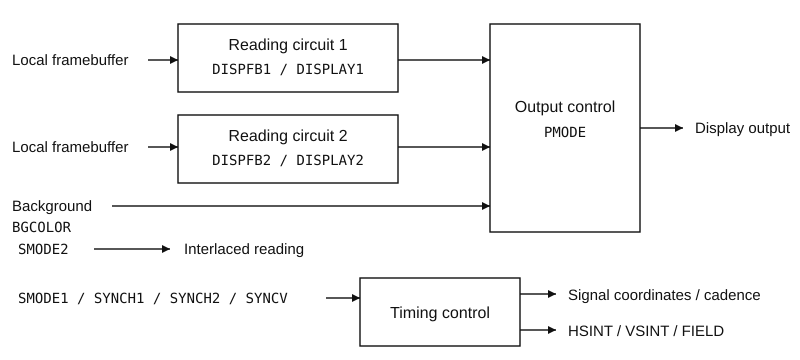
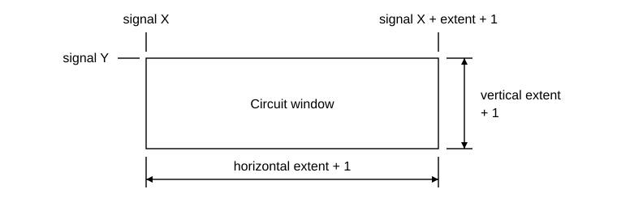
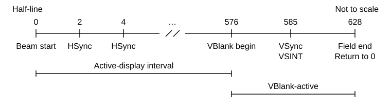

# PCRTC Display Controller

## 1. OUTLINE

The PCRTC reads display images through two independent reading circuits and controls
their output geometry, background, display timing, and display-event interrupts. A
cartridge programs framebuffer selection and display windows, enables the required
circuits, and acknowledges the events it uses.

Each reading circuit has its own framebuffer selection, source position, signal
position, magnification, and window size. Output control selects the enabled circuits
and their composition settings.



PCRTC register words occupy four bytes. The composition registers start at `08010354H`;
the timing and status registers start at `080103ACH`. Use the individual addresses in
Section 4: the intervening addresses are not PCRTC registers.

## 2. FUNCTION

### 2.1. Framebuffer reading and display windows

For each circuit, set `DISPFB` to select the framebuffer and source origin. `FBP` is
the base field and `FBW` is the width field:

```text
Framebuffer base B = FBP × 4096 local-memory words
Framebuffer width W = FBW × 64 pixels
Source origin       = (source X, source Y)
```

A local-memory word is **16 bits, or two bytes**; a PCRTC register word is **32 bits,
or four bytes**. One FBP unit therefore covers 8192 bytes. The two word units are not
interchangeable.

<section class="keep-together">

Set `DISPLAY` to place and size the circuit in signal coordinates. Both magnification
fields and both extent fields use encoded-plus-one values:

```text
X magnification = encoded X magnification + 1
Y magnification = encoded Y magnification + 1
Horizontal span = horizontal extent + 1 signal units
Vertical height = vertical extent + 1
```

</section>



The horizontal interval includes its starting coordinate and excludes its ending
coordinate. Before conversion to output pixels, each horizontal boundary is rounded
upward to a signal-step boundary. `SMODE1_LOW[24:21]` sets the horizontal signal step.

With two circuits enabled, the output origin uses the minimum enabled signal X and
signal Y, and the output bounds cover both circuits. Pixel output requires the
**latched** timing to run, a nonzero latched horizontal signal step, and at least one
latched circuit enable.

### 2.2. Interlaced reading

Set `SMODE2_LOW.INT` to select interlaced traversal. Interlaced output advances by two
rows; non-interlaced output advances by one. `FFMD` selects frame mode only while `INT`
is set.

For interlaced, non-frame operation:

```text
Source row stride = 2
Source row phase  = (display signal Y XOR FIELD) AND 1
```

In other modes, the source row stride is one and its phase is zero. Read `CSR_LOW.FIELD`
for the current field value. VSync updates this value as described in Section 2.7.

### 2.3. Local-memory samples

Local memory holds `00200000H` bytes, or `00100000H` sixteen-bit words. Within each word,
the low byte comes first. The storage selector determines both pixel packing and the
address layout in Section 2.4.

In the table, `L` is the word at the mapped pixel address and `H` is the following
word. RGB and alpha samples are eight-bit values.

| Selector | Format | Circuits | RGB packing | Sample alpha |
|---:|---|---|---|---|
| 0 | CT32 | 1, 2 | R = L[7:0]; G = L[15:8]; B = H[7:0] | H[15:8] |
| 1 | CT24 | 1, 2 | Same RGB placement as CT32; H[15:8] is ignored | 128 |
| 2 | CT16 | 1, 2 | R = L[4:0]; G = L[9:5]; B = L[14:10]; expand each component | 128 if L[15] = 1; otherwise 0 |
| 10 | CT16S | 1, 2 | Same packing as CT16; different address layout | 128 if L[15] = 1; otherwise 0 |
| 18 | GPU24 | 1 only | Three packed bytes per pixel; see below | 128 |
| 31 | GX16 | 1, 2 | Same packing as CT16; linear address layout | 128 if L[15] = 1; otherwise 0 |

Expand each five-bit RGB component `c` as follows:

```text
Eight-bit component = (c << 3) | (c >> 2)
```

GPU24 obtains two words through the CT16 address layout. For framebuffer coordinate
`(x, y)`, fetch `L` at `((3 × x) >> 1, y)` and `H` at
`(((3 × x) >> 1) + 1, y)`:

| Pixel X | R | G | B |
|---|---|---|---|
| Even | L[7:0] | L[15:8] | H[7:0] |
| Odd | L[15:8] | H[7:0] | H[15:8] |

Every unlisted selector, and selector 18 on circuit 2, supplies **zero RGBA samples**.
It neither disables the circuit nor raises a format fault. The circuit still performs
its selected PMODE operation inside its window. For example, copying zero RGB blacks
that area, whereas blending with zero source alpha preserves the prior RGB. Alpha
selection still applies as specified in Section 2.5.

### 2.4. Local-memory address layout

The following formulas map framebuffer sample coordinates `(x, y)`, including the
programmed source origin, to local-memory word addresses. They do not produce CPU byte
addresses. All arithmetic is integer arithmetic; `&`, `|`, `<<`, and `>>` denote bitwise
AND, OR, left shift, and unsigned right shift. The coordinates are nonnegative.

```text
B = FBP << 12
P = FBW
W = P × 64
M = 000FFFFFH
```

Every word fetch wraps with mask `M`, including CT32/CT24's second word. The base and
pixel offset are added before this wrap. All nine FBP bits remain representable; a
base beyond one installed-memory period aliases through the same mask.

<section class="keep-together">

#### CT32 and CT24

These formats use 64 × 32-pixel pages:

```text
page   = (y >> 5) × P + (x >> 6)
px     = x & 63
py     = y & 31
bx     = px >> 3
by     = py >> 3

block  = (bx & 1) | ((by & 1) << 1)
       | ((bx & 2) << 1) | ((by & 2) << 2) | ((bx & 4) << 2)
column = (px & 1) | ((py & 1) << 1)
       | ((px & 6) << 1) | ((py & 6) << 3)

A = (B + (page << 12) + (block << 7) + (column << 1)) & M
```

Fetch `L` at `A` and `H` at `(A + 1) & M`.

</section>

#### CT16 and CT16S

These formats use 64 × 64-pixel pages and share their column calculation:

```text
page   = (y >> 6) × P + (x >> 6)
px     = x & 63
py     = y & 63
bx     = px >> 4
by     = py >> 3

column = ((px & 1) << 1) | ((px & 2) << 2)
       | ((px & 4) << 2) | ((px & 8) >> 3)
       | ((py & 1) << 2) | ((py & 2) << 4) | ((py & 4) << 4)
```

Select the block calculation for the programmed format:

```text
CT16:
block = ((bx & 1) << 1) | (by & 1) | ((bx & 2) << 2)
      | ((by & 2) << 1) | ((by & 4) << 2)

CT16S:
block = (by & 1) | ((bx & 1) << 1) | (by & 4)
      | ((by & 2) << 2) | ((bx & 2) << 3)

A = (B + (page << 12) + (block << 7) + column) & M
```

#### GX16 and GPU24

GX16 uses linear word addressing:

```text
A = (B + y × W + x) & M
```

GPU24 uses the CT16 calculation twice, at the two word coordinates in Section 2.3.

**Zero-width setting:** FBW = 0 is not a disable setting. It supplies a zero row stride
for GX16 and zero pages per row for the page-based formats. The remaining coordinate
terms and address wrap still operate; no width fault is raised.

### 2.5. Output composition

Composition begins with the background, applies circuit 2, then applies circuit 1.
Background R, G, and B come from `BGCOLOR_LOW[7:0]`, `[15:8]`, and `[23:16]`; background
alpha is zero. A disabled circuit performs no operation.

**Window limits:** each table below applies only inside that enabled circuit's display
window and selected field rows. Outside its window, the circuit leaves the prior values
unchanged. The two windows need not overlap.

<section class="keep-together">

Circuit 2 selects the background or its own RGB using SLBG. AMOD determines whether it
also supplies alpha:

| SLBG | AMOD | RGB after circuit 2 | Alpha after circuit 2 |
|---:|---:|---|---|
| 0 | 0 | Circuit-2 RGB | Background alpha 0 |
| 0 | 1 | Circuit-2 RGB | Circuit-2 sample alpha |
| 1 | 0 | Background RGB | Background alpha 0 |
| 1 | 1 | Background RGB | Circuit-2 sample alpha |

</section>

For circuit 1, let `C1` be one source RGB component, `A1` its original sample alpha,
and `D` and `Ad` the prior RGB component and alpha at that pixel. The prior values come
from the background and any circuit-2 operation at that pixel.

| MMOD | ALP | Circuit-1 RGB action | Alpha, AMOD = 0 | Alpha, AMOD = 1 |
|---:|---|---|---|---|
| 0 | Ignored | Blend C1 over D with coefficient `min(2 × A1, 255)` | Select A1 | Preserve Ad |
| 1 | 0 | Preserve D | Select A1 | Preserve Ad |
| 1 | 1–254 | Blend C1 over D with coefficient ALP | Select A1 | Preserve Ad |
| 1 | 255 | Select C1 | Select A1 | Preserve Ad |

The RGB blend is computed independently for R, G, and B:

```text
MMOD = 0:  a = min(2 × A1, 255)
MMOD = 1:  a = ALP

N = C1 × a + D × (255 - a) + 127
Output component = integer quotient of N / 255
```

The `+127` rounds the nonnegative weighted result to nearest. Inputs and coefficient
are 0–255, so the RGB result is also 0–255 without further saturation. Source alpha is
doubled and saturated only when deriving the MMOD = 0 **RGB coefficient**. ALP is used
directly, not doubled. Output alpha is selected by AMOD, never blended by this equation.

In particular, a sample alpha of 128 gives coefficient 255 under MMOD = 0: circuit 1
supplies full source RGB, but AMOD = 0 still selects alpha **128**, not 255. This applies
to CT24, GPU24, and sixteen-bit samples whose bit 15 is set. With AMOD = 1, a pixel can
receive circuit-1 RGB while retaining background alpha zero if circuit 2 supplies no
alpha there.

### 2.6. Programmed words and displayed settings

Configuration registers retain complete written words. Readback returns the programmed
word immediately; it does not report whether that word has reached the display latch.

```text
Write a changed configuration word
                │
                ├──► Programmed word changes ──► Read returns the new word
                │
                └──► Wait for VBlank BEGIN
                                      │
                                      ▼
                      Display latch takes all 22 configuration words
                                      │
                                      ▼
                         Display uses the latched settings
```

The display latch takes all 22 configuration words together on **VBlank entry**, at the
end of the active-display interval. It does not wait for VBlank exit or field end. This
latch precedes the system VBlank interrupt request and is independent of the PCRTC
event masks.

Do not use immediate register readback as confirmation of display visibility. A VBlank
entry between separate store instructions can take an intermediate configuration;
those instructions do not form an atomic multiword update.

Writing an unchanged configuration word has no effect. A changed write to either
`SMODE1` word or any `SYNCH1`, `SYNCH2`, or `SYNCV` word also recalculates timing and
**restarts the beam immediately**. The display latch does not defer that restart.
Neither `SMODE2` word restarts the beam. Live beam timing is distinct from latched
display timing: stopping the beam does not itself blank an already-latched display.
PCRTC reset is the exception to waiting for VBlank entry: it installs the reset display
settings immediately.

### 2.7. Beam timing

The timing reference clock is **13,500,000 Hz**. The `SMODE1`, `SYNCH1`, `SYNCH2`, and
`SYNCV` fields define the half-line period and vertical landmarks:

```text
H = HFP + HBP + HS + HF + HB
D = RC × (divider field + 1)
U = 1 when SMODE1_HIGH[4] = 0; otherwise 2

Half-line period = (H × D) / (2 × 13,500,000 × LC) seconds

Active-display half-lines = VDP × U
VSync half-line           = (VDP + VFP + VFPE) × U
Vertical sum              = VFP + VFPE + VBP + VBPE + VDP + VS
Total half-lines          = Vertical sum × U
```

Timing runs only when PRST and SINT are both zero and the half-line numerator,
denominator, and total half-lines are all nonzero. A stopped live beam generates no
timing events; displayed output still uses its latched timing. VBlank entry is at the
active-display boundary, VSync at its computed landmark, and field end at total
half-lines.

A beam restart begins at half-line zero, with VBlank inactive. The first HSync event
point follows at half-line two. Restarting does not acknowledge CSR events or change
FIELD. Event timing continues from the beam epoch, not from the time an event is
observed.

<section class="keep-together">

At reset, H = 3456, D = 8, LC = 32, and U = 1. The half-line period is therefore
`27648 / 864000000` seconds. The reset beam sequence is:



</section>

The reset vertical counts are VDP = 576, VFP = 4, VFPE = 5, VBP = 33, VBPE = 5, and
VS = 5. VBlank is inactive below half-line 576 and active for the remainder of the field.

At VSync, nonzero CMOD together with odd VFP toggles FIELD; otherwise FIELD becomes one.
Reset VFP is even: reset FIELD is zero, and the first VSync sets it to one. VSync also
raises VSINT.

### 2.8. Events and interrupts

Normal operation generates **HSINT and VSINT only**. SIGNAL, FINISH, and EDWINT are
retained event positions, but have no normal event producer. They remain clear after
reset during normal operation; they are not hardwired-zero bits. A pending bit in any
of the five positions obeys the same acknowledgement and masking rules. The names
SIGNAL, FINISH, and EDWINT do not indicate drawing-completion events.

```text
Event raised ──► Is its CSR bit already set?
                    │                   │
                   yes                 no
                    │                   ▼
              No new request       Set CSR event bit
                                        │
                              Is its IMR mask zero?
                                   │          │
                                  yes         no
                                   │          │
                             Request IRQ   Keep pending
```

A mask value of one prevents an interrupt request; it does not clear the event.
Unmasking an already pending event requests the PCRTC interrupt immediately. Acknowledge
an event by writing one to its CSR bit; writing zero leaves that event unchanged.

The PCRTC interrupt request is `IRQ_GX_PCRTC`, interrupt-controller mask bit
`00000002H`. PCRTC acknowledgement and masking do not replace interrupt-controller
acknowledgement or CPU interrupt control.

HSync event points start at half-line 2 and repeat every two half-lines. While HSINT is
pending, later HSync points do not generate another interrupt request. Acknowledge HSINT
to enable the first HSync point strictly after the current half-line; elapsed points are
not replayed. VSINT is raised by VSync (Section 2.7); VBlank entry itself is the
display-latch edge.

### 2.9. RESET and FLUSH

`CSR_LOW.FLUSH` and `CSR_LOW.RESET` are write-one actions, not retained settings. Event
acknowledgements in the same write are processed first. RESET takes priority if both
action bits are one.

Both actions drop queued DMA ingress and GP0 FIFO input, discard partial command and
polyline input state, and clear pending command-completion timing. Both terminate
readback and handle a partial image upload as described below. **Neither action is a
general cancel or undo of accepted drawing.**

| Readback condition | Effect on accepted command work |
|---|---|
| No active readback; next uncompleted command is not a readback | Retain accepted raster and upload work |
| Readback accepted but not yet activated | Remove that readback and subsequent work; retain preceding commands |
| Readback pending, with its command still retained | Remove that readback and subsequent work; retain preceding commands |
| Readback submitted or data ready; other non-idle readback conditions | Clear the retained command work |

A still-retained in-progress raster or upload command is marked complete as pending
completion timing is cleared; this does not undo its memory writes. Input queued after
an active readback is discarded, not executed past that readback. The readback port
returns to idle, loses its dimensions and cursor, and drops its DMA request. A canceled
completion cannot later make that readback ready again.

<section class="keep-together">

A partial CPU-to-local-memory image upload is treated according to its accepted input:

| Accepted image input | Effect |
|---|---|
| No upload words | No upload action |
| Three-word header only | Discard the header |
| Header and at least one payload word | Retain an upload of the accepted pixel prefix |

</section>

If `n` payload words have been accepted, the prefix contains
`min(width × height, 2 × n)` pixels. They are processed in row order under the accepted
upload's retained mask-bit controls. With mask checking enabled, destination bit 15 = 1
suppresses that pixel's write. On a write, mask-setting mode forces bit 15; otherwise
source bit 15 is retained. The missing rectangle remainder is not filled. FLUSH or RESET
can therefore commit a partial upload rather than cancel it, but does not guarantee a
write for every prefix pixel. Here the count is in input command words, not local-memory
word addresses.

FLUSH leaves the PCRTC and GPU draw/display settings unchanged. RESET restores the
PCRTC configuration, CSR, and IMR, sets FIELD to zero, restarts the beam, and installs
reset display settings immediately. Both reading circuits are disabled.

RESET also clears the GP0/GP1 command words, drawing mode, texture window, drawing-area
corners, drawing offset, mask-bit mode, and display start. It restores display mode,
status, and horizontal/vertical display-range defaults, and disables readback DMA mode.
The programmed VRAM Y-address extension is retained and carried into displayed settings.
Neither action performs a local-memory clear or restores earlier contents. Accepted
drawing and upload data can still change local memory.

<section class="keep-together">

### 2.10. Bus access

Use aligned 32-bit register-word loads and stores at the listed addresses. These
accesses are available in either CPU mode and stores do not wait on a PCRTC ready
signal. Subword access is not a byte-lane update:

| CPU data access | Address condition | PCRTC result |
|---|---|---|
| Register-word or U32 load/store | Four-byte aligned | Read/write one complete register word |
| U8 load | Four-byte aligned | Read the complete word, return bits 7:0 |
| U8 load | Word offset 1, 2, or 3 | UNALIGNED_IO bus fault; no register access |
| U8 store | Any PCRTC byte address | UNALIGNED_IO bus fault; no register access |
| U16 load/store | Even address, including four-byte aligned | UNALIGNED_IO bus fault; no register access |
| U16 load/store | Odd address | CPU address exception before register access |
| Register-word, U32, F32, or F64 load/store | Not four-byte aligned | CPU address exception before register access |

</section>

F32 transfers one word's bits. F64 transfers the low word at address A followed by the
high word at A + 4; it requires four-byte, not eight-byte, alignment. If the first
access faults, the second is not attempted. Both word accesses occur within one CPU
instruction.

Multiword stores likewise perform successive word writes and stop at the first bus
fault. Earlier writes remain effective. The two PCRTC address ranges do not become
contiguous through a multiword instruction. Writes to `CSR_HIGH` and `IMR_HIGH` are
accepted but ignored; they do not raise READ_ONLY faults.

<section class="keep-together">

### 2.11. Faults

Access faults are **synchronous CPU exceptions**, not PCRTC events. They do not set CSR
pending bits or request `IRQ_GX_PCRTC`.

| Fault | CPU action |
|---|---|
| Misalignment rejected by the CPU | Address-error-load, CAUSE `00000010H`, or address-error-store, CAUSE `00000014H`; BAD_ADDRESS records the attempted address |
| Rejected subword I/O access | UNALIGNED_IO bus fault, code 2; CPU data-bus-error, CAUSE `0000001CH` |

</section>

CPU alignment rejection occurs before the bus access and does not enter a bus-fault
latch record. A faulting load does not overwrite its destination. The access rules in
Section 2.10 apply equally to absolute and displacement-form data accesses.

The system bus retains the first fault's code, address, and access description until
acknowledged. Later faults still advance the fault sequence but do not replace those
latched details. These system words are separate from PCRTC:

| Address | System bus word | Operation |
|---|---|---|
| `08010208H` | BUS_FAULT_CODE | First fault code; zero means no latched fault |
| `0801020CH` | BUS_FAULT_ADDR | First fault address |
| `08010210H` | BUS_FAULT_ACCESS | First fault access description |
| `08010214H` | BUS_FAULT_ACK | A nonzero write clears code, address, and access |

The three detail words reset to zero. Fault codes are NONE = 0, UNMAPPED = 1,
UNALIGNED_IO = 2, and READ_ONLY = 3. ACCESS combines READ bit 0 or WRITE bit 1 with the
access kind: U8 bit 8, U16 bit 9, U32 bit 10, register-word bit 11, F32 bit 12, or F64
bit 13.

Storage selectors and framebuffer address wrap have the deterministic behavior in
Sections 2.3–2.4; they are not format, width, or framebuffer-address exceptions.

## 3. SETTING EXAMPLE

### 3.1. Set a 256 × 192 window on circuit 1

**Starting condition:** PCRTC reset configuration and reset timing. Both reading
circuits are disabled. Circuit 1's framebuffer base is word address 0, its width is
1024, and its format selection is GX16. Its reset signal position is (680, 37), with X
magnification 4 and Y magnification 1.

1. Set the source origin to (32, 16) in `DISPFB1_HIGH`.
2. Set the display extents for a 256 × 192 output window. The horizontal span is `256 ×
4 = 1024` signal units, so write horizontal extent 1023 and vertical extent 191.
3. Enable circuit 1 last with the PMODE word shown below. Leave circuit 2 disabled.

<section class="keep-together">

The table gives raw address/value word writes, in order.

| Order | Address | Register | Write value | Setting |
|---:|---|---|---|---|
| 1 | `08010360H` | `DISPFB1_HIGH` | `00008020H` | Source X = 32; source Y = 16 |
| 2 | `08010368H` | `DISPLAY1_HIGH` | `000BF3FFH` | Horizontal extent = 1023; vertical extent = 191 |
| 3 | `08010354H` | `PMODE_LOW` | `0000FF21H` | EN1 = 1; EN2 = 0; MMOD = 1; AMOD = 0; SLBG = 0; ALP = 255 |

</section>

All three writes change their reset values. None restarts the beam. Other framebuffer,
signal-position, magnification, and timing words remain at their reset values.

<section class="keep-together">

After the display latch takes these settings, circuit 1 has the following geometry:

| Quantity | Result |
|---|---|
| Framebuffer base | Local-memory word address 0 |
| Framebuffer width | `16 × 64 = 1024` |
| Storage selection | GX16 |
| Source origin | `(32, 16)` |
| Horizontal signal interval | `[680, 1704)` |
| Reset horizontal signal step | 4 |
| Converted horizontal boundaries | `680 / 4 = 170`; `1704 / 4 = 426` |
| Output origin | `(0, 0)` |
| Output dimensions | **256 × 192** |
| Traversal | Non-interlaced |

</section>

The PMODE word selects circuit-1 RGB directly. Output alpha is the original GX16 sample
alpha, 0 or 128 from bit 15; it is not forced to 255 by ALP = 255.

Read back the three programmed words to check the settings. The display uses them at
VBlank entry when the latch takes the new configuration, as shown in Section 2.6.

### 3.2. Acknowledge stale HSINT and unmask only HSINT

**Starting condition:** no particular event-pending state is required. This sequence
replaces the PCRTC event masks and acknowledges HSINT only.

| Order | Address | Register | Write value | Result |
|---:|---|---|---|---|
| 1 | `080103DCH` | `IMR_LOW` | `00007F00H` | Mask all five PCRTC events |
| 2 | `080103D4H` | `CSR_LOW` | `00000004H` | Acknowledge HSINT; do not request RESET or FLUSH |
| 3 | `080103DCH` | `IMR_LOW` | `00007B00H` | Unmask HSINT; keep the other four events masked |

```text
Mask all events ──► Acknowledge HSINT ──► Unmask HSINT
  00007F00H           00000004H            00007B00H
```

`7F00H = 6000H | 1F00H`. The final word clears IMR bit 10 only, giving `7B00H = 6000H |
1B00H`. CSR bit 2 is acknowledged by `00000004H`.

**Completion:** IMR reads `00007B00H`. FIELD and the other four CSR event bits are
unchanged by step 2. HSINT need not remain clear: if it becomes pending between steps 2
and 3, unmasking it requests an interrupt immediately. Otherwise, a newly raised HSINT
requests an interrupt while this mask remains installed.

If step 2 clears a pending HSINT while timing runs, the next HSync event point is after
the current half-line. Masked events remain pending until acknowledged; a later unmask
can therefore request an interrupt immediately.

## 4. REGISTER REFERENCE

`R/W` below means that the complete configuration word is retained and returned on read.
In its layout, `R` marks retained bits with no named operational field. These bits are
not a must-zero requirement. CSR and IMR instead use the per-bit access rules in their
entries.

<section class="register-entry">

### 4.1. PMODE — Circuit enables and output control

| Address | Name | Purpose | Access | Reset |
|---|---|---|---|---|
| `08010354H` | `PMODE_LOW` | Circuit enables and output controls | R/W | `00000000H` |
| `08010358H` | `PMODE_HIGH` | Retained high word | R/W | `00000000H` |

<table class="bit-fields">
<thead><tr><th>LOW</th><th>31:16</th><th>15:8</th><th>7</th><th>6</th><th>5</th><th>4:2</th><th>1</th><th>0</th></tr></thead>
<tbody><tr><th>Field</th><td>R</td><td>ALP</td><td>SLBG</td><td>AMOD</td><td>MMOD</td><td>R</td><td>EN2</td><td>EN1</td></tr></tbody>
</table>

<table class="bit-fields">
<thead><tr><th>HIGH</th><th>31:0</th></tr></thead>
<tbody><tr><th>Field</th><td>R</td></tr></tbody>
</table>

| Field | Setting |
|---|---|
| EN1, EN2 | 0: disable the corresponding reading circuit; 1: enable it |
| MMOD | 0: derive the circuit-1 RGB coefficient from sample alpha; 1: use ALP |
| AMOD | 0: circuit 1 selects its sample alpha; 1: circuit 2 supplies alpha and circuit 1 preserves prior alpha |
| SLBG | 0: circuit 2 supplies RGB; 1: retain background RGB at the circuit-2 stage |
| ALP | Eight-bit circuit-1 RGB coefficient, 0–255, used directly when MMOD = 1 |

These actions apply only inside the enabled circuit's window. Section 2.5 gives the
complete operation tables, coefficient and rounding equation, and alpha selection.
Program `DISPFB` and `DISPLAY` before enabling a circuit. The setting in Section 3.1
supplies a complete PMODE word for that example.

</section>

<section class="register-entry">

### 4.2. DISPFB1 — Circuit 1 framebuffer

| Address | Name | Purpose | Access | Reset |
|---|---|---|---|---|
| `0801035CH` | `DISPFB1_LOW` | Framebuffer base, width, and storage selection | R/W | `000FA000H` |
| `08010360H` | `DISPFB1_HIGH` | Framebuffer source origin | R/W | `00000000H` |

<table class="bit-fields">
<thead><tr><th>LOW</th><th>31:20</th><th>19:15</th><th>14:9</th><th>8:0</th></tr></thead>
<tbody><tr><th>Field</th><td>R</td><td>Storage</td><td>Width</td><td>Base</td></tr></tbody>
</table>

<table class="bit-fields">
<thead><tr><th>HIGH</th><th>31:22</th><th>21:11</th><th>10:0</th></tr></thead>
<tbody><tr><th>Field</th><td>R</td><td>Source Y</td><td>Source X</td></tr></tbody>
</table>

Base (`FBP`) is in groups of 4096 sixteen-bit local-memory words; width (`FBW`) is in
groups of 64 framebuffer pixels. Source X and source Y specify the source origin.
Packing and address calculations are in Sections 2.3–2.4, including FBW = 0 and wrap.

| Storage selector | Circuit 1 format |
|---:|---|
| 0 | CT32 |
| 1 | CT24 |
| 2 | CT16 |
| 10 | CT16S |
| 18 | GPU24 |
| 31 | GX16 |
| Other | Zero RGBA sample; circuit remains enabled |

</section>

<section class="register-entry">

### 4.3. DISPLAY1 — Circuit 1 signal window

| Address | Name | Purpose | Access | Reset |
|---|---|---|---|---|
| `08010364H` | `DISPLAY1_LOW` | Signal origin and magnification | R/W | `018252A8H` |
| `08010368H` | `DISPLAY1_HIGH` | Signal-window extents | R/W | `000EF4FFH` |

<table class="bit-fields">
<thead><tr><th>LOW</th><th>31:29</th><th>28:27</th><th>26:23</th><th>22:12</th><th>11:0</th></tr></thead>
<tbody><tr><th>Field</th><td>R</td><td>Y mag</td><td>X mag</td><td>Signal Y</td><td>Signal X</td></tr></tbody>
</table>

<table class="bit-fields">
<thead><tr><th>HIGH</th><th>31:23</th><th>22:12</th><th>11:0</th></tr></thead>
<tbody><tr><th>Field</th><td>R</td><td>Vertical extent</td><td>Horizontal extent</td></tr></tbody>
</table>

| Field | Actual setting |
|---|---|
| X magnification | Encoded value + 1; range 1–16 |
| Y magnification | Encoded value + 1; range 1–4 |
| Horizontal extent | Signal span = encoded value + 1 |
| Vertical extent | Height = encoded value + 1 |

Set signal X/Y for the window origin. Horizontal extents use signal units, not final
output-pixel counts; apply the signal-step boundary conversion in Section 2.1.

</section>

<section class="register-entry">

### 4.4. DISPFB2 — Circuit 2 framebuffer

| Address | Name | Purpose | Access | Reset |
|---|---|---|---|---|
| `0801036CH` | `DISPFB2_LOW` | Framebuffer base, width, and storage selection | R/W | `000FA000H` |
| `08010370H` | `DISPFB2_HIGH` | Framebuffer source origin | R/W | `00000000H` |

<table class="bit-fields">
<thead><tr><th>LOW</th><th>31:20</th><th>19:15</th><th>14:9</th><th>8:0</th></tr></thead>
<tbody><tr><th>Field</th><td>R</td><td>Storage</td><td>Width</td><td>Base</td></tr></tbody>
</table>

<table class="bit-fields">
<thead><tr><th>HIGH</th><th>31:22</th><th>21:11</th><th>10:0</th></tr></thead>
<tbody><tr><th>Field</th><td>R</td><td>Source Y</td><td>Source X</td></tr></tbody>
</table>

Base (`FBP`) is in groups of 4096 sixteen-bit local-memory words; width (`FBW`) is in
groups of 64 framebuffer pixels. Circuit 2 has its own source X/Y origin. Packing and
address calculations are in Sections 2.3–2.4, including FBW = 0 and wrap.

| Storage selector | Circuit 2 format |
|---:|---|
| 0 | CT32 |
| 1 | CT24 |
| 2 | CT16 |
| 10 | CT16S |
| 31 | GX16 |
| 18 or other | Zero RGBA sample; circuit remains enabled |

</section>

<section class="register-entry">

### 4.5. DISPLAY2 — Circuit 2 signal window

| Address | Name | Purpose | Access | Reset |
|---|---|---|---|---|
| `08010374H` | `DISPLAY2_LOW` | Signal origin and magnification | R/W | `018252A8H` |
| `08010378H` | `DISPLAY2_HIGH` | Signal-window extents | R/W | `000EF4FFH` |

<table class="bit-fields">
<thead><tr><th>LOW</th><th>31:29</th><th>28:27</th><th>26:23</th><th>22:12</th><th>11:0</th></tr></thead>
<tbody><tr><th>Field</th><td>R</td><td>Y mag</td><td>X mag</td><td>Signal Y</td><td>Signal X</td></tr></tbody>
</table>

<table class="bit-fields">
<thead><tr><th>HIGH</th><th>31:23</th><th>22:12</th><th>11:0</th></tr></thead>
<tbody><tr><th>Field</th><td>R</td><td>Vertical extent</td><td>Horizontal extent</td></tr></tbody>
</table>

The encoded-plus-one rules are the same as for circuit 1: X magnification is 1–16, Y
magnification is 1–4, and each extent specifies one less than the corresponding span or
height. Program this window independently; enabled circuit windows jointly determine the
output bounds.

</section>

<section class="register-entry">

### 4.6. BGCOLOR — Background color

| Address | Name | Purpose | Access | Reset |
|---|---|---|---|---|
| `0801037CH` | `BGCOLOR_LOW` | Background color input | R/W | `00000000H` |
| `08010380H` | `BGCOLOR_HIGH` | Retained high word | R/W | `00000000H` |

<table class="bit-fields">
<thead><tr><th>LOW</th><th>31:24</th><th>23:0</th></tr></thead>
<tbody><tr><th>Field</th><td>R</td><td>Background color</td></tr></tbody>
</table>

<table class="bit-fields">
<thead><tr><th>HIGH</th><th>31:0</th></tr></thead>
<tbody><tr><th>Field</th><td>R</td></tr></tbody>
</table>

Write R in bits 7–0, G in bits 15–8, and B in bits 23–16. Background alpha is zero.
PMODE controls composition with the enabled circuits as described in Section 2.5.

</section>

<section class="register-entry">

### 4.7. SMODE1 — Timing factors and signal step

| Address | Name | Purpose | Access | Reset |
|---|---|---|---|---|
| `080103ACH` | `SMODE1_LOW` | Timing factors, run controls, and horizontal signal step | R/W | `40806504H` |
| `080103B0H` | `SMODE1_HIGH` | Vertical-unit selection | R/W | `00000007H` |

<table class="bit-fields">
<thead><tr><th>LOW</th><th>31:25</th><th>24:21</th><th>20:18</th><th>17</th><th>16</th><th>15</th><th>14:13</th><th>12</th><th>11:10</th><th>9:3</th><th>2:0</th></tr></thead>
<tbody><tr><th>Field</th><td>R</td><td>Step X</td><td>R</td><td>SINT</td><td>PRST</td><td>R</td><td>CMOD</td><td>R</td><td>Divider</td><td>LC</td><td>RC</td></tr></tbody>
</table>

<table class="bit-fields">
<thead><tr><th>HIGH</th><th>31:5</th><th>4</th><th>3:0</th></tr></thead>
<tbody><tr><th>Field</th><td>R</td><td>U</td><td>R</td></tr></tbody>
</table>

RC, LC, and the divider field set the half-line period through the equations in Section
2.7. Step X is the number of horizontal signal units per output pixel. A latched Step X
of zero prevents pixel output.

| Divider field | Multiplier used with RC |
|---:|---:|
| 0 | 1 |
| 1 | 2 |
| 2 | 3 |
| 3 | 4 |

| High-word bit 4 | Vertical multiplier U |
|---:|---:|
| 0 | 1 |
| 1 | 2 |

Timing runs only when PRST and SINT are both zero and the calculated half-line
numerator, denominator, and total half-lines are all nonzero. Setting either run-control
bit stops timing. CMOD participates in FIELD updates at VSync: nonzero CMOD and odd VFP
select toggling; otherwise VSync sets FIELD to one.

**Timing-write caution:** changing either word restarts the beam, even when the changed
bits are retained bits. A restart does not acknowledge CSR events or assign FIELD.

</section>

<section class="register-entry">

### 4.8. SMODE2 — Interlaced traversal

| Address | Name | Purpose | Access | Reset |
|---|---|---|---|---|
| `080103B4H` | `SMODE2_LOW` | Interlace and frame-mode controls | R/W | `00000000H` |
| `080103B8H` | `SMODE2_HIGH` | Retained high word | R/W | `00000000H` |

<table class="bit-fields">
<thead><tr><th>LOW</th><th>31:2</th><th>1</th><th>0</th></tr></thead>
<tbody><tr><th>Field</th><td>R</td><td>FFMD</td><td>INT</td></tr></tbody>
</table>

<table class="bit-fields">
<thead><tr><th>HIGH</th><th>31:0</th></tr></thead>
<tbody><tr><th>Field</th><td>R</td></tr></tbody>
</table>

| INT | FFMD | Traversal |
|---:|---:|---|
| 0 | Either | Non-interlaced; FFMD does not select frame mode |
| 1 | 0 | Interlaced, non-frame mode |
| 1 | 1 | Interlaced, frame mode |

Use the source stride and phase rules in Section 2.2. Writes to these words follow the
display-latch rule without restarting the beam.

</section>

<section class="register-entry">

### 4.9. SYNCH1 — Horizontal timing counts

| Address | Name | Purpose | Access | Reset |
|---|---|---|---|---|
| `080103BCH` | `SYNCH1_LOW` | HFP and HBP counts | R/W | `1FC83030H` |
| `080103C0H` | `SYNCH1_HIGH` | HS count | R/W | `0007F5C2H` |

<table class="bit-fields">
<thead><tr><th>LOW</th><th>31:22</th><th>21:11</th><th>10:0</th></tr></thead>
<tbody><tr><th>Field</th><td>R</td><td>HBP</td><td>HFP</td></tr></tbody>
</table>

<table class="bit-fields">
<thead><tr><th>HIGH</th><th>31:27</th><th>26:11</th><th>10:0</th></tr></thead>
<tbody><tr><th>Field</th><td>R</td><td>HS</td><td>R</td></tr></tbody>
</table>

HFP, HBP, and HS contribute horizontal timing counts to H. Their time scale is set by
RC, LC, and the divider, not by the output-pixel magnification fields. A changed write
to either word recalculates timing and restarts the beam.

</section>

<section class="register-entry">

### 4.10. SYNCH2 — Additional horizontal timing counts

| Address | Name | Purpose | Access | Reset |
|---|---|---|---|---|
| `080103C4H` | `SYNCH2_LOW` | HF and HB counts | R/W | `003484BCH` |
| `080103C8H` | `SYNCH2_HIGH` | Retained timing high word | R/W | `00000000H` |

<table class="bit-fields">
<thead><tr><th>LOW</th><th>31:27</th><th>26:11</th><th>10:0</th></tr></thead>
<tbody><tr><th>Field</th><td>R</td><td>HB</td><td>HF</td></tr></tbody>
</table>

<table class="bit-fields">
<thead><tr><th>HIGH</th><th>31:0</th></tr></thead>
<tbody><tr><th>Field</th><td>R</td></tr></tbody>
</table>

HF and HB complete the horizontal sum H. **Changing `SYNCH2_HIGH` also restarts the
beam**, although its bits have no named timing field. Writing its current value does not
restart it.

</section>

<section class="register-entry">

### 4.11. SYNCV — Vertical timing and beam phases

| Address | Name | Purpose | Access | Reset |
|---|---|---|---|---|
| `080103CCH` | `SYNCV_LOW` | VFP, VFPE, and VBP counts | R/W | `02101404H` |
| `080103D0H` | `SYNCV_HIGH` | VBPE, VDP, and VS counts | R/W | `00A90005H` |

<table class="bit-fields">
<thead><tr><th>LOW</th><th>31:20</th><th>19:10</th><th>9:0</th></tr></thead>
<tbody><tr><th>Field</th><td>VBP</td><td>VFPE</td><td>VFP</td></tr></tbody>
</table>

<table class="bit-fields">
<thead><tr><th>HIGH</th><th>31:21</th><th>20:10</th><th>9:0</th></tr></thead>
<tbody><tr><th>Field</th><td>VS</td><td>VDP</td><td>VBPE</td></tr></tbody>
</table>

These fields count vertical units. Multiplying by U converts them to half-lines. VDP
sets the active-display interval. VFP and VFPE offset VSync from its end; all six fields
determine field length. A changed write to either word restarts the beam.

Section 2.7 gives the half-line equations, reset timing landmarks, and FIELD update
rule. Section 2.6 specifies the VBlank-entry display latch. These counts are not
output-pixel extents.

</section>

<section class="register-entry">

### 4.12. CSR — Event acknowledgement, field status, and actions

| Address | Name | Purpose | Access | Reset |
|---|---|---|---|---|
| `080103D4H` | `CSR_LOW` | Event status, acknowledgements, FIELD, FLUSH, and RESET | Read; W1C events; write actions | `551B4000H` |
| `080103D8H` | `CSR_HIGH` | Zero high word | Read zero; writes have no action | `00000000H` |

<table class="bit-fields">
<thead><tr><th>LOW</th><th>31:14</th><th>13</th><th>12:10</th><th>9</th><th>8</th><th>7:5</th><th>4</th><th>3</th><th>2</th><th>1</th><th>0</th></tr></thead>
<tbody><tr><th>Field</th><td>—</td><td>FIELD</td><td>—</td><td>RESET</td><td>FLUSH</td><td>—</td><td>EDWINT</td><td>VSINT</td><td>HSINT</td><td>FINISH</td><td>SIGNAL</td></tr></tbody>
</table>

<table class="bit-fields">
<thead><tr><th>HIGH</th><th>31:0</th></tr></thead>
<tbody><tr><th>Field</th><td>Read zero; writes have no action</td></tr></tbody>
</table>

| Bits | Field | Access and operation |
|---|---|---|
| 0 | SIGNAL | Read pending status; write one to clear |
| 1 | FINISH | Read pending status; write one to clear |
| 2 | HSINT | Read pending status; write one to clear |
| 3 | VSINT | Read pending status; write one to clear |
| 4 | EDWINT | Read pending status; write one to clear |
| 8 | FLUSH | Write one to request a flush action; does not latch |
| 9 | RESET | Write one to request reset; does not latch |
| 13 | FIELD | Read-only field status; CSR writes do not assign it |

Write zero to event bits that must remain unchanged. Do not acknowledge events by
writing back a complete CSR read value: every event bit written as one is cleared. Use
an explicit acknowledgement mask, as in Section 3.2.

Only HSINT and VSINT are normally generated. SIGNAL, FINISH, and EDWINT remain retained,
W1C and maskable positions, not hardwired-zero fields; see Section 2.8. CSR writes do
not assign the unnamed positions.

RESET takes priority over FLUSH. Both clear queued input and terminate readback; they
can retain accepted drawing and commit a partial image upload. RESET restores PCRTC
registers and installs reset display settings immediately; its GPU register effects
are bounded as listed in Section 2.9. FLUSH does not reset the display. Section 2.9 also
gives the accepted-work and upload rules.

</section>

<section class="register-entry">

### 4.13. IMR — PCRTC event masks

| Address | Name | Purpose | Access | Reset |
|---|---|---|---|---|
| `080103DCH` | `IMR_LOW` | Five event masks and fixed read bits | R/W masks; fixed bits as below | `00007F00H` |
| `080103E0H` | `IMR_HIGH` | Zero high word | Read zero; writes have no action | `00000000H` |

<table class="bit-fields">
<thead><tr><th>LOW</th><th>31:15</th><th>14:13</th><th>12</th><th>11</th><th>10</th><th>9</th><th>8</th><th>7:0</th></tr></thead>
<tbody><tr><th>Field</th><td>Zero</td><td>Ones</td><td>EDWINT</td><td>VSINT</td><td>HSINT</td><td>FINISH</td><td>SIGNAL</td><td>Zero</td></tr></tbody>
</table>

<table class="bit-fields">
<thead><tr><th>HIGH</th><th>31:0</th></tr></thead>
<tbody><tr><th>Field</th><td>Read zero; writes have no action</td></tr></tbody>
</table>

| Mask bit | Corresponding CSR event | 0 | 1 |
|---:|---|---|---|
| 8 | SIGNAL, bit 0 | Unmask | Mask |
| 9 | FINISH, bit 1 | Unmask | Mask |
| 10 | HSINT, bit 2 | Unmask | Mask |
| 11 | VSINT, bit 3 | Unmask | Mask |
| 12 | EDWINT, bit 4 | Unmask | Mask |

Writes retain mask bits 8–12, force bits 13–14 to one, and clear all other bits. Thus
bits 13–14 always read one; bits 31–15 and 7–0 read zero. Reset masks all five events.

A mask write does not acknowledge CSR. Check pending-event handling when unmasking: any
already pending event whose mask becomes zero can request the interrupt immediately. Use
the mask–acknowledge–unmask sequence in Section 3.2 when enabling HSINT.

</section>
