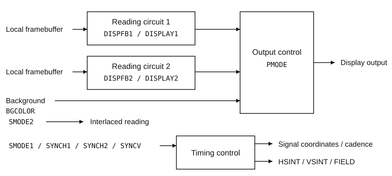
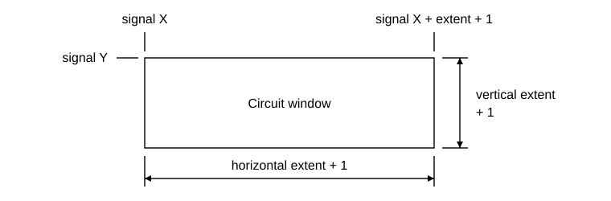
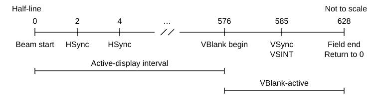
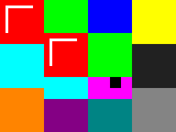
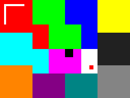
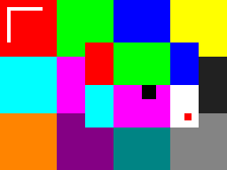

# PCRTC Display Controller {#sec-pcrtc}

## Outline {#sec-pcrtc-1-outline}

The PCRTC (programmable CRT controller) produces the picture on the screen
from images in VRAM. The GPU draws the images; the PCRTC reads them out and
sends them to the screen.

The PCRTC has two read-out circuits. Each circuit reads its own part of VRAM
and shows it in its own window on the screen, with its own magnification. The
output of the two circuits is mixed over a background colour.

For each circuit, **DISPFB** gives the image in VRAM and the position in it
where reading starts, and **DISPLAY** gives the window on the screen and the
magnification. **PMODE** switches the circuits on and selects how they are
mixed. The timing registers set the screen timing and the display interrupts.

{#fig-pcrtc-overview}

## Technical specifications {#sec-pcrtc-11-technical-specifications}

| Item | Specification |
|---|---|
| VRAM | 2 MiB: 1,048,576 16-bit words, low byte first |
| Read-out circuits | 2, each with its own image, start position and window |
| Registers | 26 words, at `08010354H`–`08010380H` and `080103ACH`–`080103E0H` |
| Image formats | CT32, CT24, CT16, CT16S, GPU24 (circuit 1 only), GX16 |
| Timing clock | 13,500,000 Hz |
| Pixel step | 0–15 signal units per output pixel |
| Window | Width 1–4096 signal units, height 1–2048 lines |
| Magnification | X 1–16, Y 1–4 |
| Interrupt | IRQ_GX_PCRTC (HSINT, VSINT) |

Both circuits are switched off at reset. Complete settings for common screen
sizes are given in @sec-pcrtc-33-select-a-display-geometry-and-its-timing.

## Function {#sec-pcrtc-2-function}

### Framebuffer reading and display windows {#sec-pcrtc-21-framebuffer-reading-and-display-windows}

Three settings determine what a circuit shows: the **start position** in the
image (which pixels are read), the **window** (where they appear on the
screen) and the **magnification** (how many signal units one image pixel
takes). The **pixel step** in SMODE1 then sets how many signal units make one
output pixel.

#### The image {#sec-pcrtc-choose-the-stored-source}

Take a 256 × 192 view of a GX16 image that starts at VRAM word 0 and is 1024
pixels wide, starting at image position (32, 16). The pixels shown are
(32, 16) to (287, 207).

The image width is the width of the image in VRAM, not of the window: each
image line is 1024 words further on, although only 256 pixels of it are
shown. GX16 has one 16-bit word per pixel; the other formats are described in
@sec-pcrtc-23-local-memory-samples and @sec-pcrtc-24-local-memory-address-layout.

DISPFB holds:

```text
Image base   = FBP × 4096 words
Image width  = FBW × 64 pixels
Start        = (source X, source Y)
```

A VRAM word is 16 bits; one FBP unit is 8192 bytes. For this example: FBP = 0,
FBW = 16, format 31 (GX16).

#### The window {#sec-pcrtc-relate-source-pixels-to-the-output-window}

With the reset timing, choose signal position (680, 37), X magnification 4 and
Y magnification 1. X magnification 4 means that an image pixel is 4 signal
units wide. The reset pixel step is also 4, so each image pixel gives one
output pixel.

For 256 pixels the window must be 256 × 4 = 1024 signal units wide: from
signal X 680 to 1704. Divided by the pixel step, these are output columns 170
to 426: 256 pixels. The window is 192 lines high from signal Y 37.

{#fig-pcrtc-window}

The output picture begins at the top-left corner of the enabled windows. With
only circuit 1 on, output pixel (0, 0) shows image pixel (32, 16) and
(255, 191) shows (287, 207). With both circuits on, the picture covers both
windows, and the window positions place the circuits relative to each other;
see @sec-pcrtc-5-source-origin-and-display-window-position.

#### Register values {#sec-pcrtc-encode-the-source-and-window}

Magnifications, width and height are stored as the value minus 1:

```text
X magnification = field + 1
Y magnification = field + 1
Window width    = field + 1 signal units
Window height   = field + 1 lines
```

For this example:

| Register | Fields | Value |
|---|---|---|
| DISPFB1_LOW | FBP = 0; FBW = 16; format 31 (GX16) | `000FA000H` |
| DISPFB1_HIGH | Source X = 32; source Y = 16 | `00008020H` |
| DISPLAY1_LOW | Signal X = 680; signal Y = 37; X mag. field 3; Y mag. field 0 | `018252A8H` |
| DISPLAY1_HIGH | Width field 1023; height field 191 | `000BF3FFH` |

For other windows, round the left and right signal boundaries up to a
multiple of the pixel step (SMODE1_LOW bits 24–21) before converting them to
output pixels. A case with different pixel step and magnification is worked
out in @sec-pcrtc-6-horizontal-source-sampling.

A picture appears only when the timing runs, the pixel step is not 0 and at
least one circuit is switched on.

### Set a 256 × 192 window on circuit 1 {#sec-pcrtc-31-set-a-256-192-window-on-circuit-1}

Starting from the reset settings (circuit 1: VRAM word 0, width 1024, GX16,
signal position (680, 37), X magnification 4, Y magnification 1), write:

| Order | Address | Register | Value | Setting |
|---:|---|---|---|---|
| 1 | `08010360H` | `DISPFB1_HIGH` | `00008020H` | Start (32, 16) |
| 2 | `08010368H` | `DISPLAY1_HIGH` | `000BF3FFH` | 1024 signal units × 192 lines |
| 3 | `08010354H` | `PMODE_LOW` | `0000FF21H` | Circuit 1 on, circuit 2 off; ALP = 255 |

Switch the circuit on last. From the next VBlank, the screen shows the
256 × 192 view described above.

The output alpha is the alpha of the GX16 pixel (0 or 128, from bit 15); ALP
does not change it.

A complete program with two images is given in
[Prepare, publish and reuse two surfaces](gpu.md#sec-memory-prepare-publish-and-reuse-two-surfaces).

### When settings take effect {#sec-pcrtc-26-programmed-words-and-displayed-settings}

The display registers can be written at any time and read back at once, but
the PCRTC takes them over for display only at the **start of VBlank**, all 22
together. Write a complete new setting before the VBlank at which it is to
take effect. If VBlank begins while the program is still writing, the
registers written so far take effect.

To know that a new setting is on the screen, wait for the next VBlank after
the last write. A VBlank interrupt that was already pending does not count;
clear it before waiting. See the
[display-switch sequence](gpu.md#sec-memory-a-display-switch-selects-storage-it-does-not-save-it).

Finish drawing an image before it is selected for display. The PCRTC reads
the image from VRAM while it is shown: do not draw over an image that is on
the screen. Writing a register with its current value has no effect.

**Timing registers take effect at once.** Writing a new value to SMODE1,
SYNCH1, SYNCH2 or SYNCV restarts the screen timing immediately. SMODE2 does
not restart it. A PCRTC RESET takes effect at once as well.

#### The circuits and the BIOS monitor {#sec-pcrtc-firmware-use-of-the-two-circuits}

Programs normally show their picture with circuit 1. While the BIOS monitor
is active, it shows the program's circuit-1 picture through circuit 2 and
uses circuit 1 for its own terminal. The display registers of both circuits
are restored when the program resumes; the timing registers, CSR and IMR are
not. See [device state during the monitor](system.md#sec-system-device-boundaries-during-supervisor-service)
and the [BIOS VRAM area](memory.md#sec-memory-firmware-reservation-in-vram).

### Interlaced display {#sec-pcrtc-22-interlaced-reading}

`SMODE2_LOW.INT` selects interlaced display: each field shows every second
line. `FFMD` selects frame mode; it has effect only when INT is set. CSR_LOW
FIELD gives the current field (0 or 1); it changes at VSync, as described in
@sec-pcrtc-27-beam-timing.

In interlaced field mode (`INT = 1`, `FFMD = 0`) a circuit reads every second
image line:

```text
Line step  = 2
First line = (signal Y XOR FIELD) AND 1
```

In the other modes it reads every line.

#### Lines read {#sec-pcrtc-output-rows-and-source-rows}

For an enabled circuit, let:

```text
S = signal Y of the circuit
D = S − lowest signal Y of the enabled circuits
H = height
M = Y magnification
B = source Y
n = output line − D
```

The circuit covers output lines `D` to `D + H − 1` (n = 0 to H − 1). In
non-interlaced display, all these lines are shown; in interlaced display,
only the lines whose output line number has the parity of FIELD. The image
line read for line n is (`div` is integer division):

| Mode | Image line |
|---|---|
| Non-interlaced (`INT=0`) | `B + (n div M)` |
| Interlaced field mode (`INT=1`, `FFMD=0`) | `B + 2 × (n div (2M)) + ((S XOR F) AND 1)` |
| Interlaced frame mode (`INT=1`, `FFMD=1`) | `B + (n div (2M))` |

The image line is converted to a VRAM address as described in
@sec-pcrtc-24-local-memory-address-layout.

#### Example {#sec-pcrtc-worked-row-selection}

A circuit at signal Y 7, source Y 20, Y magnification 2 and height 8; the other
enabled circuit starts at signal Y 5. Then D = 2 and the circuit covers output
lines 2 to 9.

| Mode | FIELD | Output lines | Image lines |
|---|---:|---|---|
| Non-interlaced | — | 2, 3, 4, 5, 6, 7, 8, 9 | 20, 20, 21, 21, 22, 22, 23, 23 |
| Interlaced, field mode | 0 | 2, 4, 6, 8 | 21, 21, 23, 23 |
| Interlaced, field mode | 1 | 3, 5, 7, 9 | 20, 20, 22, 22 |
| Interlaced, frame mode | 0 | 2, 4, 6, 8 | 20, 20, 21, 21 |
| Interlaced, frame mode | 1 | 3, 5, 7, 9 | 20, 20, 21, 21 |

Because signal Y 7 is odd, field 0 reads the odd image lines in field mode.

### Mixing {#sec-pcrtc-25-output-composition}

The output is built up from the background, then circuit 2, then circuit 1.
The background colour is BGCOLOR_LOW (R bits 7–0, G 15–8, B 23–16), with
alpha 0. Each circuit acts only inside its own window; a circuit that is off
has no effect. The colour and alpha of each image format are given in
@sec-pcrtc-23-local-memory-samples.

Circuit 2:

| SLBG | AMOD | Colour after circuit 2 | Alpha after circuit 2 |
|---:|---:|---|---|
| 0 | 0 | Circuit 2 | 0 |
| 0 | 1 | Circuit 2 | Circuit 2 |
| 1 | 0 | Background | 0 |
| 1 | 1 | Background | Circuit 2 |

Circuit 1, with C1 and A1 its colour and alpha, and D the colour so far:

| MMOD | ALP | Colour | Alpha (AMOD = 0) | Alpha (AMOD = 1) |
|---:|---|---|---|---|
| 0 | — | Mix C1 and D with factor `min(2 × A1, 255)` | A1 | Unchanged |
| 1 | 0 | D | A1 | Unchanged |
| 1 | 1–254 | Mix C1 and D with factor ALP | A1 | Unchanged |
| 1 | 255 | C1 | A1 | Unchanged |

Mixing, for R, G and B separately, with factor a:

```text
result = (C1 × a + D × (255 − a) + 127) div 255
```

A pixel alpha of 128 thus gives factor 255 with MMOD = 0 (circuit 1 colour
only), while the output alpha stays 128.

### Screen timing {#sec-pcrtc-27-beam-timing}

The timing clock is **13,500,000 Hz**. SMODE1, SYNCH1, SYNCH2 and SYNCV give
the length of a half-line and the vertical positions:

```text
H = HFP + HBP + HS + HF + HB
D = RC × (divider + 1)
U = 1 if SMODE1_HIGH bit 4 = 0, otherwise 2

Half-line = (H × D) / (2 × 13,500,000 × LC) seconds

Active display = VDP × U half-lines
VSync          = (VDP + VFP + VFPE) × U half-lines
Field          = (VFP + VFPE + VBP + VBPE + VDP + VS) × U half-lines
```

The timing runs when PRST and SINT are both 0 and the values above are not
zero. VBlank begins at the end of the active display. After a restart the
timing begins at half-line 0; the first HSync follows at half-line 2.

At reset, H = 3456, D = 8, LC = 32 and U = 1, giving a half-line of
27648 / 864,000,000 s = 32 µs.

{#fig-pcrtc-reset-timing}

The reset vertical values are VDP = 576, VFP = 4, VFPE = 5, VBP = 33, VBPE = 5
and VS = 5.

| Event | Half-line | Time | System cycle |
|---|---:|---:|---:|
| First HSync | 2 | 64 µs | 2168 |
| VBlank begins; display settings taken over | 576 | 18.432 ms | 624,270 |
| VSync; VSINT | 585 | 18.720 ms | 634,024 |
| End of field | 628 | 20.096 ms | 680,628 |

This is about 49.76 fields per second. HSync occurs every two half-lines.

At VSync, FIELD changes between 0 and 1 when CMOD is not 0 and VFP is odd;
otherwise FIELD is set to 1. With the reset values, FIELD is 0 at reset and 1
after the first VSync.

### Events and interrupts {#sec-pcrtc-28-events-and-interrupts}

The PCRTC produces the events HSINT (at each HSync) and VSINT (at each
VSync). CSR has three further event bits, SIGNAL, FINISH and EDWINT, which
stay 0 in normal operation.

An event sets its CSR bit. If its IMR mask bit is 0, it also requests
IRQ_GX_PCRTC (interrupt controller bit 1, `00000002H`). An event whose CSR
bit is already set requests nothing. Enabling the mask of a pending event
requests the interrupt at once.

Write 1 to a CSR event bit to clear it; bits written as 0 are unchanged.
Clear IRQ_GX_PCRTC in the interrupt controller as well.

While HSINT is pending, further HSyncs request no interrupt. After HSINT is
cleared, the next HSync requests it again.

### RESET and FLUSH {#sec-pcrtc-29-reset-and-flush}

Writing 1 to CSR_LOW FLUSH or RESET performs these actions. Event bits written
as 1 in the same write are cleared first. If both are written, RESET takes
effect.

Both actions empty the GPU command input (GP0 FIFO and DMA input), discard a
partly received command and stop an image readback. A command that the GPU is
already executing completes normally. An image upload that has received part
of its pixels writes those pixels to VRAM (two per word received, in line
order) and ends. Wait for GPU idle before FLUSH or RESET if all drawing must be
completed.

FLUSH changes no PCRTC or GPU settings.

RESET also restores all PCRTC registers to their reset values at once (both
circuits off), sets FIELD to 0 and restarts the timing. It resets the GPU
drawing settings: drawing mode, texture window, drawing area, drawing offset,
mask setting, display start, display mode and display ranges, and switches off
readback DMA. The GP1 VRAM Y-address setting is kept. VRAM is not cleared.

### Register access {#sec-pcrtc-210-bus-access}

Access the PCRTC registers with aligned 32-bit words. Other accesses follow
the [register access rules](memory.md#sec-memory-io-widths-and-read-side-effects).
Writes to CSR_HIGH and IMR_HIGH are ignored.

Each register store instruction takes 3 cycles. Writing all 22 display
registers one by one takes 66 cycles. The two register areas are not
contiguous.

### Faults {#sec-pcrtc-211-faults}

A wrong access causes a CPU exception and is recorded in the
[bus-fault registers](memory.md#sec-memory-bus-fault-status-and-cpu-exceptions);
it sets no CSR bit. Unknown image formats and VRAM addresses beyond the end of
VRAM are not faults: see @sec-pcrtc-23-local-memory-samples and
@sec-pcrtc-24-local-memory-address-layout.

## Setting examples {#sec-pcrtc-3-setting-example}

### Enabling HSINT {#sec-pcrtc-32-acknowledge-stale-hsint-and-unmask-only-hsint}

To enable the HSINT interrupt without a stale request:

| Order | Address | Register | Value | Function |
|---:|---|---|---|---|
| 1 | `080103DCH` | `IMR_LOW` | `00007F00H` | Mask all five events |
| 2 | `080103D4H` | `CSR_LOW` | `00000004H` | Clear HSINT |
| 3 | `080103DCH` | `IMR_LOW` | `00007B00H` | Enable HSINT only |

`7F00H` sets mask bits 8–12 (bits 13–14 always read 1). `7B00H` clears mask
bit 10, HSINT. If an HSync occurs between steps 2 and 3, the interrupt is
requested as soon as step 3 is written.

### Screen sizes {#sec-pcrtc-33-select-a-display-geometry-and-its-timing}

The following settings give GX16 pictures of 256 to 640 pixels wide, using
circuit 1 only, start position (0, 0) and an image width of 1024 pixels. All
use:

| Address | Register | Value |
|---|---|---|
| `08010354H` | PMODE_LOW | `0000FF21H` |
| `08010358H` | PMODE_HIGH | `00000000H` |
| `0801035CH` | DISPFB1_LOW | `000FA000H` |
| `08010360H` | DISPFB1_HIGH | `00000000H` |
| `0801037CH` | BGCOLOR_LOW | `00000000H` |
| `08010380H` | BGCOLOR_HIGH | `00000000H` |

All sizes use X magnification 4, Y magnification 1 and pixel step 4.

| Output geometry | Timing group | DISPLAY1_LOW | DISPLAY1_HIGH | SYNCV_LOW | SMODE2_LOW |
|---|---|---|---|---|---|
| 256 × 192 | A | `018252A8H` | `000BF3FFH` | `02101404H` | `00000000H` |
| 256 × 212 | A | `018252A8H` | `000D33FFH` | `02101404H` | `00000000H` |
| 256 × 240 | A | `018252A8H` | `000EF3FFH` | `02101404H` | `00000000H` |
| 320 × 240 | A | `018252A8H` | `000EF4FFH` | `02101404H` | `00000000H` |
| 368 × 240 | A | `018252A8H` | `000EF5BFH` | `02101404H` | `00000000H` |
| 512 × 240 | A | `018252A8H` | `000EF7FFH` | `02101404H` | `00000000H` |
| 640 × 240 | A | `018252A8H` | `000EF9FFH` | `02101404H` | `00000000H` |
| 640 × 448, interlaced | B | `0183228CH` | `001BF9FFH` | `01A01801H` | `00000001H` |
| 640 × 480, interlaced | B | `0183228CH` | `001DF9FFH` | `01A01801H` | `00000001H` |
| 640 × 512, interlaced | A | `018482A8H` | `001FF9FFH` | `02101401H` | `00000001H` |

DISPLAY1_LOW is at `08010364H`, DISPLAY1_HIGH at `08010368H`, SYNCV_LOW at
`080103CCH` and SMODE2_LOW at `080103B4H`; SMODE2_HIGH (`080103B8H`) is 0.
The other timing registers depend on the group:

| Address | Register or programming phase | Group A | Group B |
|---|---|---|---|
| `080103ACH` | SMODE1_LOW, hold beam during setup | `40836504H` | `40834504H` |
| `080103ACH` | SMODE1_LOW, run after setup | `40806504H` | `40804504H` |
| `080103B0H` | SMODE1_HIGH | `00000007H` | `00000007H` |
| `080103BCH` | SYNCH1_LOW | `1FC83030H` | `1F06F040H` |
| `080103C0H` | SYNCH1_HIGH | `0007F5C2H` | `0007F5B6H` |
| `080103C4H` | SYNCH2_LOW | `003484BCH` | `0033A4D8H` |
| `080103C8H` | SYNCH2_HIGH | `00000000H` | `00000000H` |
| `080103D0H` | SYNCV_HIGH | `00A90005H` | `00C78006H` |

The field rates are:

| Configuration | Half-line period | Half-lines per field | Field repetitions per second | Complete two-field pairs per second |
|---|---|---:|---:|---:|
| Group A, non-interlaced rows above | 32 µs | 628 | Approximately 49.7611465 | Not interlaced |
| Group B, interlaced rows above | `27456 / 864000000` seconds | 525 | Approximately 59.9400599 | Approximately 29.9700300 |
| Group A, 640 × 512 interlaced | 32 µs | 625 | 50 | 25 |

For the interlaced sizes, each field shows every second line (224 of 448,
240 of 480, 256 of 512). These settings use field mode (`FFMD = 0`) and an even
signal Y, so field 0 shows the even image lines and field 1 the odd ones.

### Changing the screen timing {#sec-pcrtc-34-program-the-complete-configuration-before-restarting-the-beam}

To change the screen timing:

1. Write the **stop** value of SMODE1_LOW for the chosen group. PRST and SINT
   stop the timing while the other registers are written.
2. Write SMODE1_HIGH, SYNCH1, SYNCH2, SYNCV, SMODE2_LOW and SMODE2_HIGH (0).
3. Write DISPFB1, DISPLAY1, BGCOLOR and PMODE (circuit 1 on).
4. Write the **run** value of SMODE1_LOW. The timing starts at half-line 0.
   The new settings are shown from the next VBlank.

The previous picture stays on the screen while the timing is stopped.

The GP1 display mode and display range commands are GPU settings and do not
replace these PCRTC settings. To show another part of VRAM, change only the
DISPFB base and start position.

## Registers {#sec-pcrtc-4-register-reference}

The display registers start at `08010354H`; the timing and status registers
start at `080103ACH`. In the bit tables, `R` marks bits without a function;
they read back the value written.

### PMODE — Circuit enables and output control {#sec-pcrtc-41-pmode-circuit-enables-and-output-control}

| Address | Name | Purpose | Access | Reset |
|---|---|---|---|---|
| `08010354H` | `PMODE_LOW` | Circuit enables and output controls | R/W | `00000000H` |
| `08010358H` | `PMODE_HIGH` | No function | R/W | `00000000H` |

| Word | Bits | Field |
| --- | --- | --- |
| LOW | 31:16 | R |
| LOW | 15:8 | ALP |
| LOW | 7 | SLBG |
| LOW | 6 | AMOD |
| LOW | 5 | MMOD |
| LOW | 4:2 | R |
| LOW | 1 | EN2 |
| LOW | 0 | EN1 |

: {tbl-colwidths="[18,18,64]"}

| Word | Bits | Field |
| --- | --- | --- |
| HIGH | 31:0 | R |

: {tbl-colwidths="[18,18,64]"}

| Field | Setting |
|---|---|
| EN1, EN2 | 0: disable the corresponding reading circuit; 1: enable it |
| MMOD | 0: derive the circuit-1 RGB coefficient from sample alpha; 1: use ALP |
| AMOD | 0: circuit 1 selects its sample alpha; 1: circuit 2 supplies alpha and circuit 1 preserves prior alpha |
| SLBG | 0: circuit 2 supplies RGB; 1: retain background RGB at the circuit-2 stage |
| ALP | Eight-bit circuit-1 RGB coefficient, 0–255, used directly when MMOD = 1 |

See @sec-pcrtc-25-output-composition for the mixing. Set DISPFB and DISPLAY
before switching a circuit on.

### DISPFB1 — Circuit 1 framebuffer {#sec-pcrtc-42-dispfb1-circuit-1-framebuffer}

| Address | Name | Purpose | Access | Reset |
|---|---|---|---|---|
| `0801035CH` | `DISPFB1_LOW` | Framebuffer base, width, and storage selection | R/W | `000FA000H` |
| `08010360H` | `DISPFB1_HIGH` | Framebuffer source origin | R/W | `00000000H` |

| Word | Bits | Field |
| --- | --- | --- |
| LOW | 31:20 | R |
| LOW | 19:15 | Storage |
| LOW | 14:9 | Width |
| LOW | 8:0 | Base |

: {tbl-colwidths="[18,18,64]"}

| Word | Bits | Field |
| --- | --- | --- |
| HIGH | 31:22 | R |
| HIGH | 21:11 | Source Y |
| HIGH | 10:0 | Source X |

: {tbl-colwidths="[18,18,64]"}

Base (FBP) is in units of 4096 VRAM words; width (FBW) in units of 64 pixels.
Source X and Y give the start position. See @sec-pcrtc-23-local-memory-samples
and @sec-pcrtc-24-local-memory-address-layout.

| Storage selector | Circuit 1 format |
|---:|---|
| 0 | CT32 |
| 1 | CT24 |
| 2 | CT16 |
| 10 | CT16S |
| 18 | GPU24 |
| 31 | GX16 |
| Other | Black, alpha 0 |

### DISPLAY1 — Circuit 1 signal window {#sec-pcrtc-43-display1-circuit-1-signal-window}

| Address | Name | Purpose | Access | Reset |
|---|---|---|---|---|
| `08010364H` | `DISPLAY1_LOW` | Signal origin and magnification | R/W | `018252A8H` |
| `08010368H` | `DISPLAY1_HIGH` | Signal-window extents | R/W | `000EF4FFH` |

| Word | Bits | Field |
| --- | --- | --- |
| LOW | 31:29 | R |
| LOW | 28:27 | Y mag |
| LOW | 26:23 | X mag |
| LOW | 22:12 | Signal Y |
| LOW | 11:0 | Signal X |

: {tbl-colwidths="[18,18,64]"}

| Word | Bits | Field |
| --- | --- | --- |
| HIGH | 31:23 | R |
| HIGH | 22:12 | Vertical extent |
| HIGH | 11:0 | Horizontal extent |

: {tbl-colwidths="[18,18,64]"}

| Field | Actual setting |
|---|---|
| X magnification | Encoded value + 1; range 1–16 |
| Y magnification | Encoded value + 1; range 1–4 |
| Horizontal extent | Signal span = encoded value + 1 |
| Vertical extent | Height = encoded value + 1 |

Signal X and Y give the window position. The width is in signal units, not
output pixels; see @sec-pcrtc-21-framebuffer-reading-and-display-windows.

### DISPFB2 — Circuit 2 framebuffer {#sec-pcrtc-44-dispfb2-circuit-2-framebuffer}

| Address | Name | Purpose | Access | Reset |
|---|---|---|---|---|
| `0801036CH` | `DISPFB2_LOW` | Framebuffer base, width, and storage selection | R/W | `000FA000H` |
| `08010370H` | `DISPFB2_HIGH` | Framebuffer source origin | R/W | `00000000H` |

| Word | Bits | Field |
| --- | --- | --- |
| LOW | 31:20 | R |
| LOW | 19:15 | Storage |
| LOW | 14:9 | Width |
| LOW | 8:0 | Base |

: {tbl-colwidths="[18,18,64]"}

| Word | Bits | Field |
| --- | --- | --- |
| HIGH | 31:22 | R |
| HIGH | 21:11 | Source Y |
| HIGH | 10:0 | Source X |

: {tbl-colwidths="[18,18,64]"}

As DISPFB1. Circuit 2 cannot show GPU24.

| Storage selector | Circuit 2 format |
|---:|---|
| 0 | CT32 |
| 1 | CT24 |
| 2 | CT16 |
| 10 | CT16S |
| 31 | GX16 |
| 18 or other | Black, alpha 0 |

### DISPLAY2 — Circuit 2 signal window {#sec-pcrtc-45-display2-circuit-2-signal-window}

| Address | Name | Purpose | Access | Reset |
|---|---|---|---|---|
| `08010374H` | `DISPLAY2_LOW` | Signal origin and magnification | R/W | `018252A8H` |
| `08010378H` | `DISPLAY2_HIGH` | Signal-window extents | R/W | `000EF4FFH` |

| Word | Bits | Field |
| --- | --- | --- |
| LOW | 31:29 | R |
| LOW | 28:27 | Y mag |
| LOW | 26:23 | X mag |
| LOW | 22:12 | Signal Y |
| LOW | 11:0 | Signal X |

: {tbl-colwidths="[18,18,64]"}

| Word | Bits | Field |
| --- | --- | --- |
| HIGH | 31:23 | R |
| HIGH | 22:12 | Vertical extent |
| HIGH | 11:0 | Horizontal extent |

: {tbl-colwidths="[18,18,64]"}

As DISPLAY1.

### BGCOLOR — Background color {#sec-pcrtc-46-bgcolor-background-color}

| Address | Name | Purpose | Access | Reset |
|---|---|---|---|---|
| `0801037CH` | `BGCOLOR_LOW` | Background color input | R/W | `00000000H` |
| `08010380H` | `BGCOLOR_HIGH` | No function | R/W | `00000000H` |

| Word | Bits | Field |
| --- | --- | --- |
| LOW | 31:24 | R |
| LOW | 23:0 | Background color |

: {tbl-colwidths="[18,18,64]"}

| Word | Bits | Field |
| --- | --- | --- |
| HIGH | 31:0 | R |

: {tbl-colwidths="[18,18,64]"}

R in bits 7–0, G in bits 15–8, B in bits 23–16. The background alpha is 0.

### SMODE1 — Timing factors and signal step {#sec-pcrtc-47-smode1-timing-factors-and-signal-step}

| Address | Name | Purpose | Access | Reset |
|---|---|---|---|---|
| `080103ACH` | `SMODE1_LOW` | Timing factors, run controls, and horizontal signal step | R/W | `40806504H` |
| `080103B0H` | `SMODE1_HIGH` | Vertical-unit selection | R/W | `00000007H` |

| Word | Bits | Field |
| --- | --- | --- |
| LOW | 31:25 | R |
| LOW | 24:21 | Step X |
| LOW | 20:18 | R |
| LOW | 17 | SINT |
| LOW | 16 | PRST |
| LOW | 15 | R |
| LOW | 14:13 | CMOD |
| LOW | 12 | R |
| LOW | 11:10 | Divider |
| LOW | 9:3 | LC |
| LOW | 2:0 | RC |

: {tbl-colwidths="[18,18,64]"}

| Word | Bits | Field |
| --- | --- | --- |
| HIGH | 31:5 | R |
| HIGH | 4 | U |
| HIGH | 3:0 | R |

: {tbl-colwidths="[18,18,64]"}

RC, LC and the divider set the half-line length (@sec-pcrtc-27-beam-timing).
Step X is the pixel step: signal units per output pixel. With step 0 no picture
is shown.

| Divider field | Multiplier used with RC |
|---:|---:|
| 0 | 1 |
| 1 | 2 |
| 2 | 3 |
| 3 | 4 |

| High-word bit 4 | Vertical multiplier U |
|---:|---:|
| 0 | 1 |
| 1 | 2 |

PRST or SINT set to 1 stops the timing. CMOD controls FIELD at VSync (see
@sec-pcrtc-27-beam-timing).

**Writing a new value to either word restarts the timing.**

### SMODE2 — Interlaced traversal {#sec-pcrtc-48-smode2-interlaced-traversal}

| Address | Name | Purpose | Access | Reset |
|---|---|---|---|---|
| `080103B4H` | `SMODE2_LOW` | Interlace and frame-mode controls | R/W | `00000000H` |
| `080103B8H` | `SMODE2_HIGH` | No function | R/W | `00000000H` |

| Word | Bits | Field |
| --- | --- | --- |
| LOW | 31:2 | R |
| LOW | 1 | FFMD |
| LOW | 0 | INT |

: {tbl-colwidths="[18,18,64]"}

| Word | Bits | Field |
| --- | --- | --- |
| HIGH | 31:0 | R |

: {tbl-colwidths="[18,18,64]"}

| INT | FFMD | Traversal |
|---:|---:|---|
| 0 | — | Non-interlaced |
| 1 | 0 | Interlaced, field mode |
| 1 | 1 | Interlaced, frame mode |

See @sec-pcrtc-22-interlaced-reading. SMODE2 takes effect at VBlank and does
not restart the timing.

### SYNCH1 — Horizontal timing counts {#sec-pcrtc-49-synch1-horizontal-timing-counts}

| Address | Name | Purpose | Access | Reset |
|---|---|---|---|---|
| `080103BCH` | `SYNCH1_LOW` | HFP and HBP counts | R/W | `1FC83030H` |
| `080103C0H` | `SYNCH1_HIGH` | HS count | R/W | `0007F5C2H` |

| Word | Bits | Field |
| --- | --- | --- |
| LOW | 31:22 | R |
| LOW | 21:11 | HBP |
| LOW | 10:0 | HFP |

: {tbl-colwidths="[18,18,64]"}

| Word | Bits | Field |
| --- | --- | --- |
| HIGH | 31:27 | R |
| HIGH | 26:11 | HS |
| HIGH | 10:0 | R |

: {tbl-colwidths="[18,18,64]"}

HFP, HBP and HS are part of the line length H. **Writing a new value restarts
the timing.**

### SYNCH2 — Additional horizontal timing counts {#sec-pcrtc-410-synch2-additional-horizontal-timing-counts}

| Address | Name | Purpose | Access | Reset |
|---|---|---|---|---|
| `080103C4H` | `SYNCH2_LOW` | HF and HB counts | R/W | `003484BCH` |
| `080103C8H` | `SYNCH2_HIGH` | No function | R/W | `00000000H` |

| Word | Bits | Field |
| --- | --- | --- |
| LOW | 31:27 | R |
| LOW | 26:11 | HB |
| LOW | 10:0 | HF |

: {tbl-colwidths="[18,18,64]"}

| Word | Bits | Field |
| --- | --- | --- |
| HIGH | 31:0 | R |

: {tbl-colwidths="[18,18,64]"}

HF and HB are part of the line length H. **Writing a new value to either word
restarts the timing**, SYNCH2_HIGH included.

### SYNCV — Vertical timing and beam phases {#sec-pcrtc-411-syncv-vertical-timing-and-beam-phases}

| Address | Name | Purpose | Access | Reset |
|---|---|---|---|---|
| `080103CCH` | `SYNCV_LOW` | VFP, VFPE, and VBP counts | R/W | `02101404H` |
| `080103D0H` | `SYNCV_HIGH` | VBPE, VDP, and VS counts | R/W | `00A90005H` |

| Word | Bits | Field |
| --- | --- | --- |
| LOW | 31:20 | VBP |
| LOW | 19:10 | VFPE |
| LOW | 9:0 | VFP |

: {tbl-colwidths="[18,18,64]"}

| Word | Bits | Field |
| --- | --- | --- |
| HIGH | 31:21 | VS |
| HIGH | 20:10 | VDP |
| HIGH | 9:0 | VBPE |

: {tbl-colwidths="[18,18,64]"}

The values are in units of U half-lines; see @sec-pcrtc-27-beam-timing. VDP is
the active display. **Writing a new value restarts the timing.**

### CSR — Event acknowledgement, field status, and actions {#sec-pcrtc-412-csr-event-acknowledgement-field-status-and-actions}

| Address | Name | Purpose | Access | Reset |
|---|---|---|---|---|
| `080103D4H` | `CSR_LOW` | Event status, acknowledgements, FIELD, FLUSH, and RESET | Read; W1C events; write actions | `551B4000H` |
| `080103D8H` | `CSR_HIGH` | Zero high word | Read zero; writes have no action | `00000000H` |

| Word | Bits | Field |
| --- | --- | --- |
| LOW | 31:14 | — |
| LOW | 13 | FIELD |
| LOW | 12:10 | — |
| LOW | 9 | RESET |
| LOW | 8 | FLUSH |
| LOW | 7:5 | — |
| LOW | 4 | EDWINT |
| LOW | 3 | VSINT |
| LOW | 2 | HSINT |
| LOW | 1 | FINISH |
| LOW | 0 | SIGNAL |

: {tbl-colwidths="[18,18,64]"}

| Word | Bits | Field |
| --- | --- | --- |
| HIGH | 31:0 | Read zero; writes have no action |

: {tbl-colwidths="[18,18,64]"}

| Bits | Field | Access and operation |
|---|---|---|
| 0 | SIGNAL | Read pending status; write one to clear |
| 1 | FINISH | Read pending status; write one to clear |
| 2 | HSINT | Read pending status; write one to clear |
| 3 | VSINT | Read pending status; write one to clear |
| 4 | EDWINT | Read pending status; write one to clear |
| 8 | FLUSH | Write 1: flush (reads 0) |
| 9 | RESET | Write 1: reset (reads 0) |
| 13 | FIELD | Read-only field status; CSR writes do not assign it |

Write 1 only to the event bits to be cleared. Writing back a value read from
CSR clears every pending event. FLUSH and RESET are described in
@sec-pcrtc-29-reset-and-flush.

### IMR — PCRTC event masks {#sec-pcrtc-413-imr-pcrtc-event-masks}

| Address | Name | Purpose | Access | Reset |
|---|---|---|---|---|
| `080103DCH` | `IMR_LOW` | Five event masks and fixed read bits | R/W masks; fixed bits as below | `00007F00H` |
| `080103E0H` | `IMR_HIGH` | Zero high word | Read zero; writes have no action | `00000000H` |

| Word | Bits | Field |
| --- | --- | --- |
| LOW | 31:15 | Zero |
| LOW | 14:13 | Ones |
| LOW | 12 | EDWINT |
| LOW | 11 | VSINT |
| LOW | 10 | HSINT |
| LOW | 9 | FINISH |
| LOW | 8 | SIGNAL |
| LOW | 7:0 | Zero |

: {tbl-colwidths="[18,18,64]"}

| Word | Bits | Field |
| --- | --- | --- |
| HIGH | 31:0 | Read zero; writes have no action |

: {tbl-colwidths="[18,18,64]"}

| Mask bit | Corresponding CSR event | 0 | 1 |
|---:|---|---|---|
| 8 | SIGNAL, bit 0 | Unmask | Mask |
| 9 | FINISH, bit 1 | Unmask | Mask |
| 10 | HSINT, bit 2 | Unmask | Mask |
| 11 | VSINT, bit 3 | Unmask | Mask |
| 12 | EDWINT, bit 4 | Unmask | Mask |

Bits 13–14 always read 1; the other unused bits read 0. Reset masks all five
events. Enabling the mask of a pending event requests the interrupt at once;
see @sec-pcrtc-32-acknowledge-stale-hsint-and-unmask-only-hsint.

## Image formats {#sec-pcrtc-local-memory-format-reference}

### Pixel formats {#sec-pcrtc-23-local-memory-samples}

The format field selects how pixels are stored and where they lie in VRAM
(@sec-pcrtc-24-local-memory-address-layout). `L` is the word at the pixel's
address and `H` the next word. Colours and alpha are 8-bit values.

| Selector | Format | Circuits | RGB packing | Sample alpha |
|---:|---|---|---|---|
| 0 | CT32 | 1, 2 | R = L[7:0]; G = L[15:8]; B = H[7:0] | H[15:8] |
| 1 | CT24 | 1, 2 | Same RGB placement as CT32; H[15:8] is ignored | 128 |
| 2 | CT16 | 1, 2 | R = L[4:0]; G = L[9:5]; B = L[14:10]; expand each component | 128 if L[15] = 1; otherwise 0 |
| 10 | CT16S | 1, 2 | Same packing as CT16; different address layout | 128 if L[15] = 1; otherwise 0 |
| 18 | GPU24 | 1 only | Three packed bytes per pixel; see below | 128 |
| 31 | GX16 | 1, 2 | Same packing as CT16; linear address layout | 128 if L[15] = 1; otherwise 0 |

Expand each five-bit RGB component `c` as follows:

```text
Eight-bit component = (c << 3) | (c >> 2)
```

GPU24 obtains two words through the CT16 address layout. For framebuffer coordinate
`(x, y)`, fetch `L` at `((3 × x) >> 1, y)` and `H` at
`(((3 × x) >> 1) + 1, y)`:

| Pixel X | R | G | B |
|---|---|---|---|
| Even | L[7:0] | L[15:8] | H[7:0] |
| Odd | L[15:8] | H[7:0] | H[15:8] |

Any other format value, and 18 on circuit 2, gives black pixels with alpha 0.
The circuit stays on and mixes these pixels as set in PMODE.

### VRAM addresses {#sec-pcrtc-24-local-memory-address-layout}

The following formulas give the VRAM word address of image pixel (x, y),
start position included.

```text
B = FBP << 12
P = FBW
W = P × 64
M = 000FFFFFH
```

Addresses wrap at the end of VRAM (mask `M`).

#### CT32 and CT24 {#sec-pcrtc-ct32-and-ct24}

These formats use 64 × 32-pixel pages:

```text
page   = (y >> 5) × P + (x >> 6)
px     = x & 63
py     = y & 31
bx     = px >> 3
by     = py >> 3

block  = (bx & 1) | ((by & 1) << 1)
       | ((bx & 2) << 1) | ((by & 2) << 2) | ((bx & 4) << 2)
column = (px & 1) | ((py & 1) << 1)
       | ((px & 6) << 1) | ((py & 6) << 3)

A = (B + (page << 12) + (block << 7) + (column << 1)) & M
```

Fetch `L` at `A` and `H` at `(A + 1) & M`.

#### CT16 and CT16S {#sec-pcrtc-ct16-and-ct16s}

These formats use 64 × 64-pixel pages and share their column calculation:

```text
page   = (y >> 6) × P + (x >> 6)
px     = x & 63
py     = y & 63
bx     = px >> 4
by     = py >> 3

column = ((px & 1) << 1) | ((px & 2) << 2)
       | ((px & 4) << 2) | ((px & 8) >> 3)
       | ((py & 1) << 2) | ((py & 2) << 4) | ((py & 4) << 4)
```

Select the block calculation for the programmed format:

```text
CT16:
block = ((bx & 1) << 1) | (by & 1) | ((bx & 2) << 2)
      | ((by & 2) << 1) | ((by & 4) << 2)

CT16S:
block = (by & 1) | ((bx & 1) << 1) | (by & 4)
      | ((by & 2) << 2) | ((bx & 2) << 3)

A = (B + (page << 12) + (block << 7) + column) & M
```

#### GX16 and GPU24 {#sec-pcrtc-gx16-and-gpu24}

GX16 uses linear word addressing:

```text
A = (B + y × W + x) & M
```

GPU24 uses the CT16 calculation twice, at the two word coordinates in @sec-pcrtc-23-local-memory-samples.

With FBW = 0 every image line starts at the same address.

## Example: start position and window position {#sec-pcrtc-5-source-origin-and-display-window-position}

The start position selects which pixels a circuit shows; the window position
selects where they appear. This example changes each in turn. Circuit 2 shows
a 256 × 192 image as a background; circuit 1 shows a 128 × 96 part of the same
image on top of it.

The image has twelve coloured 64 × 64 squares, a white L, a black 16 × 16
square and a red 8 × 8 square. It does not change during the example.

### Settings {#sec-pcrtc-program-the-fixed-canvas-and-initial-cutout}

Both circuits read GX16 from VRAM word 0 with an image width of 1024, at the
reset timing, X magnification 4 and Y magnification 1. Write PMODE last.

| Register | Address | Stage-A raw word |
|---|---|---|
| PMODE_LOW | `08010354H` | `0000FF23H` |
| DISPFB1_LOW | `0801035CH` | `000FA000H` |
| DISPFB1_HIGH | `08010360H` | `00000000H` |
| DISPLAY1_LOW | `08010364H` | `018553A8H` |
| DISPLAY1_HIGH | `08010368H` | `0005F1FFH` |
| DISPFB2_LOW | `0801036CH` | `000FA000H` |
| DISPFB2_HIGH | `08010370H` | `00000000H` |
| DISPLAY2_LOW | `08010374H` | `018252A8H` |
| DISPLAY2_HIGH | `08010378H` | `000BF3FFH` |

Circuit 2 shows image (0, 0)–(255, 191) at signal position (680, 37), which
becomes the top-left corner of the screen. PMODE `0000FF23H` switches both
circuits on; circuit 1 covers circuit 2 inside its window.

### Three stages {#sec-pcrtc-change-selection-then-placement}

The window column gives output pixels, end excluded.

| Stage | DISPFB1_HIGH | DISPLAY1_LOW | Start position | Signal position | Window on screen |
|---|---|---|---|---|---|
| A | `00000000H` | `018553A8H` | (0, 0) | (936, 85) | [64, 192) × [48, 144) |
| B | `00008020H` | `018553A8H` | (32, 16) | (936, 85) | [64, 192) × [48, 144) |
| C | `00008020H` | `01855428H` | (32, 16) | (1064, 85) | [96, 224) × [48, 144) |

From A to B only DISPFB1_HIGH changes: the window shows another part of the
image. From B to C only DISPLAY1_LOW changes: the window moves 32 pixels to the
right.

### Program {#sec-pcrtc-prepare-the-source-and-publish-the-changes}

With interrupts masked, write RESET (`00000200H`) to CSR, then 0 to PMODE,
and the eight DISPFB and DISPLAY values of stage A. Set the GPU to drawing
offset 0, drawing area (0,0)–(255,191), no dithering and E6 = 1 (set bit 15),
then draw the image:

```lua
rodata scene: word[] = {
    0x600000ff, 0, 0x00400040,
    0x6000ff00, 64, 0x00400040,
    0x60ff0000, 128, 0x00400040,
    0x6000ffff, 192, 0x00400040,
    0x60ffff00, 64 << 16, 0x00400040,
    0x60ff00ff, 64 | (64 << 16), 0x00400040,
    0x60ffffff, 128 | (64 << 16), 0x00400040,
    0x60202020, 192 | (64 << 16), 0x00400040,
    0x600080ff, 128 << 16, 0x00400040,
    0x60800080, 64 | (128 << 16), 0x00400040,
    0x60808000, 128 | (128 << 16), 0x00400040,
    0x60808080, 192 | (128 << 16), 0x00400040,
    0x60ffffff, 8 | (8 << 16), 4 | (40 << 16),
    0x60ffffff, 8 | (8 << 16), 40 | (4 << 16),
    0x60000000, 96 | (64 << 16), 16 | (16 << 16),
    0x600000ff, 144 | (96 << 16), 8 | (8 << 16),
}
local gp0<const>: *word = 0x0801023c
local gp1<const>: *word = 0x08010240
for index = 0, #scene - 1 do
    *gp0 = scene[index]
end
while (*gp1 & 0x04000000) == 0 do
end
```

The pixels (8, 8), (96, 64) and (144, 96) now hold `FFFFH`, `8000H` and
`801FH`.

Switch the display on and wait for the next VBlank, counted by the interrupt
handler:

```lua
bss vblank_sequence: word
local irq_ack<const>: *word = 0x08000004
local irq_mask<const>: *word = 0x08000008
local pmode<const>: *word = 0x08010354
local source1<const>: *word = 0x08010360
local window1<const>: *word = 0x08010364

function irq(flags)
    if (flags & 4) ~= 0 then
        *vblank_sequence = *vblank_sequence + 1
    end
    *irq_ack = flags & 4
end

-- Stage A: switch on and wait for the next VBlank.
*irq_mask = 0
*pmode = 0x0000ff23
*irq_ack = 4
local before<const> = *vblank_sequence
*irq_mask = 4
while *vblank_sequence == before do
    halt_until_irq
end
```

For stage B, use the same sequence with `*source1 = 0x00008020` instead of
the PMODE write; for stage C, `*window1 = 0x01855428`.

{#fig-pcrtc-window-a}

*Figure A. Start (0, 0), window at (64, 48). The white L in the window is at (72, 56), the black square at (160, 112).*

{#fig-pcrtc-window-b}

*Figure B. Start (32, 16), window still at (64, 48). The black square is now at (128, 96), the red square at (176, 128).*

{#fig-pcrtc-window-c}

*Figure C. The same part of the image, window at (96, 48). The black and red squares are at (160, 96) and (208, 128).*

The white L of the background stays at (8, 8) in all three pictures.

## Horizontal sampling {#sec-pcrtc-6-horizontal-source-sampling}

Let `s` be signal units per output pixel, `S` the horizontal signal origin, and `M` signal units per source pixel:

```
s = (SMODE1_LOW >> 21) & 15
S = DISPLAY_LOW & 4095
M = ((DISPLAY_LOW >> 23) & 15) + 1
```

For an enabled active horizontal window with nonzero `s`, `div` denotes the nonnegative integer quotient:

```
A = (S + s - 1) div s
sourceX(n) = framebufferX + ((A*s - S + n*s) div M)
```

`framebufferX` is the source X of DISPFB_HIGH and n the output pixel within the window. Each output pixel moves s signal units further; each image pixel is M signal units wide, so with s ≠ M the image pixels are not shown one by one.

The window width in output pixels is found by rounding the left and right signal boundaries up to a multiple of s and subtracting.

### Eight-pixel GX16 strip {#sec-pcrtc-eight-pixel-gx16-strip}

Use reset timing with `SMODE1_LOW = 40806504H` (`s = 4`) and `SMODE2_LOW = 00000000H` (noninterlaced), with these display words:

| Register | Word |
|---|---|
| PMODE_LOW | 0000FF21H |
| DISPFB1_LOW | 000FA000H |
| DISPFB1_HIGH | 00008020H |
| DISPLAY1_LOW | 010252AAH |
| DISPLAY1_HIGH | 0000001FH |

Circuit 1 reads GX16 from VRAM word 0, image width 1024, start (32, 16). The window is at signal (682, 37), 32 signal units wide and 1 line high; M = 3.

The window runs from signal X 682 to 714; rounded up to multiples of 4 these are output columns 171 and 179: 8 pixels. The first pixel is at signal X 684, 2 units into the window. The image line holds the words `8000H` to `800FH` at (32, 16) to (47, 16).

In the table, `N = 2 + 4n` and the image offset is `N div 3`. Addresses are VRAM word addresses.

| n | Signal X | N | Source offset | Source X,Y | Word address | GX16 word |
|---:|---:|---:|---:|---|---|---|
| 0 | 684 | 2 | 0 | (32,16) | 4020H | 8000H |
| 1 | 688 | 6 | 2 | (34,16) | 4022H | 8002H |
| 2 | 692 | 10 | 3 | (35,16) | 4023H | 8003H |
| 3 | 696 | 14 | 4 | (36,16) | 4024H | 8004H |
| 4 | 700 | 18 | 6 | (38,16) | 4026H | 8006H |
| 5 | 704 | 22 | 7 | (39,16) | 4027H | 8007H |
| 6 | 708 | 26 | 8 | (40,16) | 4028H | 8008H |
| 7 | 712 | 30 | 10 | (42,16) | 402AH | 800AH |

Colours shown, left to right:

```
(0,0,0) (16,0,0) (24,0,0) (33,0,0)
(49,0,0) (57,0,0) (66,0,0) (82,0,0)
```

All pixels have alpha `80H`.

{#fig-pcrtc-sampling}

*The eight output pixels, enlarged. They show image offsets 0, 2, 3, 4, 6, 7, 8 and 10.*

### Program {#sec-pcrtc-upload-and-select-the-strip}

Starting from the reset settings, with both circuits off, upload the sixteen pixels to (32, 16) and set circuit 1:

```lua
rodata pixels: word[8] = {
    0x80018000, 0x80038002, 0x80058004, 0x80078006,
    0x80098008, 0x800b800a, 0x800d800c, 0x800f800e,
}
local framebuffer<const>: *word = 0x0801035c
local source<const>: *word = 0x08010360
local window<const>: *word = 0x08010364
local extent<const>: *word = 0x08010368
*irq_mask = 0
*pmode = 0
*framebuffer = 0x000fa000
*source = 0x00008020
*window = 0x010252aa
*extent = 0x0000001f
*gp1 = 0x09000000
*gp0 = 0xe6000000
*gp0 = 0xa0000000
*gp0 = 32 | (16 << 16)
*gp0 = 16 | (1 << 16)
for index = 0, 7 do
    *gp0 = pixels[index]
end
while (*gp1 & 0x04000000) == 0 do
end
```

Then write PMODE `0000FF21H` and wait for the next VBlank, as in the previous example.

## Example: mixing {#sec-pcrtc-7-composition-constant-coefficient-and-source-alpha}

Both circuits cover the same 256 × 192 screen. Circuit 1 shows red; its left half has alpha 0 and its right half alpha 128. Circuit 2 shows blue with alpha 128. The background is green. Only PMODE changes between the four settings.

The GX16 words are `001FH` (red, alpha 0), `801FH` (red, alpha 128) and `FC00H` (blue, alpha 128). ALP is 128 throughout.

| Phase | PMODE_LOW | MMOD | AMOD | SLBG | ALP |
|---|---:|---:|---:|---:|---:|
| A | `00008023H` | 1 | 0 | 0 | 128 |
| B | `00008003H` | 0 | 0 | 0 | 128 |
| C | `00008083H` | 0 | 0 | 1 | 128 |
| D | `00008043H` | 0 | 1 | 0 | 128 |

The mixing formula is given in @sec-pcrtc-25-output-composition.

A (MMOD = 1) mixes with the fixed factor ALP = 128, whatever the pixel alpha: the whole screen is purple, (128, 0, 127). B (MMOD = 0) uses the pixel alpha: alpha 0 leaves the blue of circuit 2, alpha 128 gives factor 255 and full red.

| Phase | Left RGB | Right RGB | Left output alpha | Right output alpha |
|---|---|---|---:|---:|
| A | `(128, 0, 127)` | `(128, 0, 127)` | 0 | 128 |
| B | `(0, 0, 255)` | `(255, 0, 0)` | 0 | 128 |
| C | `(0, 255, 0)` | `(255, 0, 0)` | 0 | 128 |
| D | `(0, 0, 255)` | `(255, 0, 0)` | 128 | 128 |

C differs from B in SLBG: the green background replaces the blue of circuit 2. D differs from B in AMOD: the colours are the same, but the output alpha now comes from circuit 2.

The two images are in VRAM lines 0–191 and 256–447, image width 1024; circuit 2 uses FBP = 64 (word `40000H`).

After each PMODE write, wait for the next VBlank before looking at the screen.

{#fig-pcrtc-mix-constant}

*A — PMODE=8023H: constant mixing of red source 1 and blue source 2 produces uniform RGB (128,0,127), despite source 1’s split alpha.*

| B — source-alpha selection | C — background selection |
| --- | --- |
| {#fig-pcrtc-mix-source} | {#fig-pcrtc-mix-background} |
| *PMODE=8003H: source 1’s alpha split yields blue source 2 on the left and red source 1 on the right.* | *PMODE=8083H: SLBG substitutes green background for blue source 2; source 1’s right half stays red.* |

### Program {#sec-pcrtc-program-the-composition-comparison}

With interrupts masked, write RESET to CSR and 0 to PMODE, then:

| Register | Address | Word |
|---|---|---|
| DISPFB1_LOW / HIGH | `0801035CH` / `08010360H` | `000FA000H` / `00000000H` |
| DISPLAY1_LOW / HIGH | `08010364H` / `08010368H` | `018252A8H` / `000BF3FFH` |
| DISPFB2_LOW / HIGH | `0801036CH` / `08010370H` | `000FA040H` / `00000000H` |
| DISPLAY2_LOW / HIGH | `08010374H` / `08010378H` | `018252A8H` / `000BF3FFH` |
| BGCOLOR_LOW | `0801037CH` | `0000FF00H` |

Write GP1 `09000000H`, set E1 = `0400H`, E2 = 0, drawing area (0,0)–(255,191) and drawing offset 0, and draw the two images:

```lua
-- Red, left half with bit15 clear; right half with bit15 set.
*gp0 = 0xe6000000
*gp0 = 0x600000ff
*gp0 = 0
*gp0 = 128 | (192 << 16)
*gp0 = 0xe6000001
*gp0 = 0x600000ff
*gp0 = 128
*gp0 = 128 | (192 << 16)

-- Blue with bit15 set, in the second framebuffer at raw rows 256..447.
*gp0 = 0xe3040000
*gp0 = 0xe406fcff
*gp0 = 0xe5080000
*gp0 = 0x60ff0000
*gp0 = 0
*gp0 = 256 | (192 << 16)
while (*gp1 & 0x04000000) == 0 do
end
```

Then select each setting with its PMODE value, for example C:

```lua
*irq_mask = 0
*pmode = 0x00008083
*irq_ack = 4
local before<const> = *vblank_sequence
*irq_mask = 4
while *vblank_sequence == before do
    halt_until_irq
end
```

