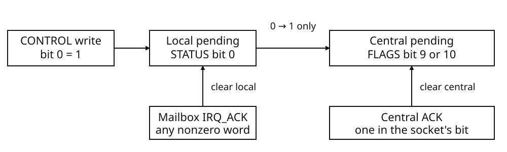

# Cartridge sockets and mapped card devices

A cartridge socket identifies a place for a card, not a fixed collection of devices. BMSX provides two sockets, numbered 0 and 1. Each socket can be occupied independently. An occupied socket establishes that a card is present; it does not establish that the card supplies ROM, RAM, or a mailbox, and it does not establish that the card is bootable.

## Installed resources

A card definition may supply ROM, RAM, and a mailbox independently, with at most one of each device. The following distinctions apply when describing a supplied card.

| Installed resource | Composition | What its presence establishes |
| --- | --- | --- |
| Card | Occupies socket 0 or socket 1 | Socket occupancy, not device inventory or boot readiness |
| ROM | Optional, independent of RAM and mailbox | The package bytes are available as a ROM device |
| RAM | Optional; 1–15,728,640 bytes in the card definition | The card supplies that amount of RAM |
| Mailbox | Optional, independent of ROM and RAM | The card supplies a mailbox device |

The package descriptor declares which devices the card supplies. It is a media definition, not runtime electrical enumeration. In particular, a package without a ROM declaration supplies no ROM device merely because package bytes exist. Likewise, neither socket occupancy nor the presence of another device implies that RAM or a mailbox is installed.

RAM capacity comes from the supplied card definition. Do not derive installed capacity from the size of an address aperture. An aperture describes an access region; it is not the card's declaration of installed RAM.

## Boot selection

The installed BIOS examines present sockets in order, socket 0 before socket 1, using SELECT while inspecting them. It chooses the first card that satisfies its ROM boot-readiness checks. A card can therefore occupy a socket without becoming a boot candidate, and the first occupied socket need not be the socket from which startup proceeds. These checks describe the installed BIOS boot policy, not a cartridge-discovery BIOS interface available to software.

For the ROM header, startup requirements, and boot routes, see [Book I: Memory — Cartridge startup](../book1/memory.md#rom-header-fields). Those definitions remain authoritative; card composition alone does not replace their requirements.

## Selection and execution

SELECT and the active instruction-fetch domain are distinct. Cartridge instruction fetching follows the socket bound to the active execution domain. Changing SELECT alone does not redirect active cartridge instruction fetching to the other socket, execute that socket, or initialize it.

Software must therefore distinguish inspecting a selected card from entering cartridge execution. Refer to **Book I: Memory and CPU startup** for the execution-binding and startup rules rather than treating socket selection as an execution handoff.


## Cartridge controller

The cartridge controller provides two independent physical sockets, numbered 0 and 1. Either socket may contain a cartridge or be empty. The controller selects a socket without testing whether a cartridge is present; software must distinguish socket selection from cartridge presence.

### Controller registers

| Address | Name | Access | Controller-reset value |
|---|---|---|---|
| `0x08010420` | `SELECT` | Read/write | `0x00000000` |
| `0x08010424` | `STATUS` | Read-only | Installed-cartridge presence bits; bit 16 clear |

`SELECT` retains the complete raw 32-bit selection word. A read returns that word, including bits 31:1. Only bit 0 participates in ordinary socket selection. The other bits remain stored and readable; they neither select additional sockets nor report cartridge properties.

| Register | Bits | Meaning |
|---|---|---|
| `SELECT` | 0 | Ordinary socket selection: 0 selects socket 0; 1 selects socket 1. |
| `SELECT` | 31:1 | Retained raw bits; no effect on socket selection. |
| `STATUS` | 0 | 1 when socket 0 contains a cartridge. |
| `STATUS` | 1 | 1 when socket 1 contains a cartridge. |
| `STATUS` | 16 | Ordinary selected socket: 0 for socket 0; 1 for socket 1. |
| `STATUS` | 15:2, 31:17 | Read as zero. |

### Selection and presence

A `SELECT` write takes effect immediately for subsequent ordinary cartridge accesses. It changes selection only: it does not reset either cartridge, generate a cartridge interrupt, or republish cartridge DMA requests.

An individual bus transaction may explicitly select a socket instead of using `SELECT`. Such an override does not modify the retained selection word. `STATUS` continues to report ordinary selection, not the socket chosen by that transaction.

<div class="keep-together">

`STATUS` is a computed report, not a writable status latch. Its two presence bits describe both sockets independently of selection. Thus selecting an empty socket still changes bit 16, while the presence bits remain unchanged. Reads from an empty selected socket return zero; writes to it have no effect and generate no cartridge effects.

</div>

### Controller reset

Controller reset clears the entire `SELECT` word, resets each present cartridge, and republishes DMA request lines for both sockets. Empty sockets contribute no asserted request lines. Reset does not change which sockets contain cartridges, so `STATUS` need not read as zero afterward. The controller itself neither raises nor clears an interrupt as part of this reset sequence; cartridge-specific reset behavior is defined separately.


## Card storage and MMIO access

A card may provide ROM, RAM, and an MMIO attachment independently. The presence of one does not imply the presence of either other region. The address windows below reserve locations on the cartridge bus; their sizes are not a statement of the storage capacity installed on a particular card. ROM and RAM offsets are measured in bytes from their respective window bases.

| Region | First address | Exclusive limit | Window size |
| --- | --- | --- | --- |
| ROM | `0x10000000` | `0x30000000` | 512 MiB |
| RAM | `0x30000000` | `0x30f00000` | 15 MiB |
| MMIO | `0x30f00000` | `0x31000000` | 1 MiB |

A ROM or RAM read returns zero when that region is absent or when its byte offset is outside installed capacity. Addresses do not wrap around the installed region: a smaller ROM or RAM is not mirrored through the remainder of its window. A write cannot create missing RAM or extend installed RAM capacity. Writes to ROM are ignored.

ROM and RAM scalar values are little-endian: the lowest-addressed byte occupies
bits 7:0. For scalar ROM and RAM reads, the starting address selects the region. A multi-byte read remains a read of that selected region, including when fewer than the requested number of installed bytes remain. Available bytes occupy the low-order portion of the result; missing high-order bytes are zero. This differs from a byte sequence spanning address windows, where each byte is selected by its own address.

| Operation | Width, capacity, tail, or reset behavior |
| --- | --- |
| ROM/RAM byte read | Returns the addressed installed byte, otherwise zero. |
| ROM/RAM 16-bit read | At a one-byte tail, returns that byte in bits 0–7 and zero in bits 8–15. Returns zero beyond capacity. |
| ROM/RAM 32-bit read | Assembles remaining bytes into successive low-order byte lanes; unavailable high-order lanes are zero. Returns zero beyond capacity. |
| RAM write | An 8-, 16-, or 32-bit write occurs only when its starting address selects RAM and its entire width fits installed RAM. A partial-width tail write changes nothing. |
| MMIO 8-/16-bit write | Ignored, even when the MMIO attachment is present. |
| MMIO 32-bit write | Delivers the word and the unchanged MMIO-relative byte offset to the attached unit; does nothing when that unit is absent. |
| Logical card reset | Resets the attached MMIO unit, if present. Retains RAM contents and leaves ROM unchanged. |

MMIO reads return zero when no attachment is present. Otherwise, the register read uses the byte offset from `0x30f00000` without rounding that offset to a word boundary. An 8-bit read selects the returned word's byte lane using address bits 1–0. A 16-bit read selects its low or high half using address bit 1. A 32-bit read returns the complete word. These lane rules describe read results; they do not make narrower MMIO writes effective.

RAM begins zero-filled when provisioned. That initial state must not be confused with logical card reset, which does not clear RAM.


## Cartridge mailbox

The cartridge mailbox contains two retained 32-bit words, DATA and CONTROL, and a local interrupt-pending latch. STATUS exposes that latch. IRQ_ACK is a write action rather than a retained register. The mailbox base is `30F00000H` on the selected card. The four word ports are
DATA `30F00000H`, CONTROL `30F00004H`, STATUS `30F00008H` and IRQ_ACK
`30F0000CH`. Every register reads `00000000H` after mailbox reset.
All offsets below are relative to that base.

### Register map

| Address | Name | Access | Bits / word-write action | Reset read |
|---|---|---|---|---|
| `30F00000H` | DATA | R/W | Retains all 32 bits; write replaces the complete word | `00000000H` |
| `30F00004H` | CONTROL | R/W + trigger | Bits 31:1 retained; bit 0 requests an IRQ and is excluded from readback | `00000000H` |
| `30F00008H` | STATUS | R; writes ignored | Bit 0 IRQ_PENDING; bits 31:1 zero | `00000000H` |
| `30F0000CH` | IRQ_ACK | R=0; W action | Any nonzero word clears local pending; zero has no effect | `00000000H` |

Read decoding ignores the low two offset bits. Consequently, `+0x00` through `+0x03` read DATA, `+0x04` through `+0x07` read CONTROL, and `+0x08` through `+0x0B` read STATUS. Every other offset group reads zero, including `+0x0C` through `+0x0F`.

Use aligned word stores for the mailbox actions. Only `+0x00`, `+0x04`, and
`+0x0C` perform an action. Writes to STATUS and other aligned offsets are ignored;
byte and halfword writes do not perform mailbox actions.

### DATA and CONTROL

DATA holds the last word written to it. Writing DATA does not change CONTROL or the local interrupt-pending latch.

CONTROL has the following defined fields:

| Bits | Mask | Name | Meaning on a CONTROL write |
|---|---|---|---|
| 0 | `0x00000001` | IRQ_TRIGGER | Requests a local interrupt-pending transition. Not retained by the write. |
| 1 | `0x00000002` | DREQ_READ | Sets the DREQ_READ level. |
| 2 | `0x00000004` | DREQ_WRITE | Sets the DREQ_WRITE level. |
| 31:3 | `0xFFFFFFF8` | Unnamed | Retained exactly as written; no defined IRQ or DREQ contribution. |

A CONTROL write replaces the retained word; it does not set or clear selected retained bits independently. Preserve any retained fields that must remain unchanged when constructing a new CONTROL value. CONTROL readback returns the retained word directly, including unnamed bits. The IRQ_TRIGGER action bit is excluded from the value retained by a CONTROL write, rather than appearing as a latched trigger request in readback.

### Interrupt pending and acknowledgement

An IRQ_TRIGGER write sets local IRQ_PENDING. A new interrupt edge occurs only when this changes the local latch from clear to set. Repeated trigger writes while IRQ_PENDING is already set do not generate additional edges.

Writing CONTROL with IRQ_TRIGGER clear does not clear IRQ_PENDING. To rearm the local edge, write any nonzero word to IRQ_ACK. A subsequent trigger write can then generate another edge; no intervening trigger-clear CONTROL write is required. IRQ_ACK does not alter DATA or CONTROL. This local acknowledgement is distinct from acknowledgement at a central interrupt controller.

### DREQ levels and reset

DREQ_READ and DREQ_WRITE independently follow retained CONTROL bits 1 and 2. Either, both, or neither may be asserted. Interrupt triggering and local acknowledgement do not substitute for programming these levels. Unnamed CONTROL bits do not affect them.

Reset clears DATA, CONTROL, and the local pending latch. DATA, CONTROL, and STATUS therefore read zero, and both DREQ levels are deasserted.


## Interrupts: two latches, two acknowledgements

Socket 0 raises central interrupt bit 9 (`00000200H`); socket 1 raises bit 10
(`00000400H`). These are distinct from each card's local STATUS bit 0.
The central FLAGS port is `08000000H`, ACK is `08000004H` and MASK is
`08000008H`. A central ACK clears the pending bits selected by its written
ones. It does not clear the card's local pending latch.



Central pending records an edge even with its MASK bit clear. MASK affects
delivery, not pending storage. A FLAGS read changes neither latch. Conversely,
mailbox IRQ_ACK clears only the local latch; an already pending central bit
remains until central ACK. Neither latch counts repeated events.

<div class="keep-together">

For one socket, starting with both pending latches clear:

| Accepted operation | Local pending | Central socket bit |
|---|---:|---:|
| CONTROL = `1` | 1 | 1 |
| Central ACK = socket mask | 1 | 0 |
| CONTROL = `1` again | 1 | 0 |
| Local IRQ_ACK = `1` | 0 | 0 |
| CONTROL = `1` again | 1 | 1 |
| Local IRQ_ACK = `1` | 0 | 1 |
| Central ACK = socket mask | 0 | 0 |

</div>

The third row demonstrates why acknowledging only the central controller does
not rearm a mailbox edge. When handling both sockets, select the intended card
before touching its local registers and acknowledge only the central bits owned
by that handler. The complete CPU-enable, `irq(flags)` and predicate-wait route
is in [Book I: Interrupt controller](../book1/irq.md#cpu-delivery-and-waiting).
A card-local trigger or a central pending bit is not a remote-work completion
protocol.

## DMA between sockets

A DMA channel can address both cartridge sockets in one transfer without changing the CPU’s cartridge selection. Each endpoint’s request field supplies its own socket override. `READ_REQUEST` controls the source endpoint; `WRITE_REQUEST` controls the destination endpoint. For either field, selectors 7–10 choose the following request and socket:

| Selector | Request condition | Endpoint socket override |
| --- | --- | --- |
| 7 | Socket 0 `DREQ_WRITE` | Socket 0 |
| 8 | Socket 0 `DREQ_READ` | Socket 0 |
| 9 | Socket 1 `DREQ_WRITE` | Socket 1 |
| 10 | Socket 1 `DREQ_READ` | Socket 1 |

The two overrides are independent of one another and of `CART_SELECT`. Selecting a cartridge request does not constrain the endpoint to a particular cartridge address range: its address may target ROM, card RAM, or mailbox MMIO. The request controls admission and socket routing; the addressed region controls the access itself.

Both programmed request conditions must be asserted before a block is admitted. `FORCE` (selector 0) is always asserted; `DISABLED` (selector 15) never is. Mailbox `CONTROL` bit 1 drives `DREQ_READ`, and bit 2 drives `DREQ_WRITE`. Both may be asserted together. These are request levels, not FIFO occupancy indications or a sequence of per-word requests. An absent card, or a card without a mailbox, supplies no asserted cartridge requests.

<div class="keep-together">

For example, a four-word copy from socket 0 to socket 1, incrementing both addresses, uses source selector 8 and destination selector 9:

| `CONTROL` field | Value | Contribution |
| --- | --- | --- |
| Read increment, bit 0 | 1 | `00000001H` |
| Write increment, bit 1 | 1 | `00000002H` |
| Read request, bits 5:2 | 8 | `00000020H` |
| Write request, bits 9:6 | 9 | `00000240H` |
| Block words minus 1, bits 13:10 | 3 | `00000C00H` |
| **Combined `CONTROL`** | | **`00000E63H`** |

</div>

Each increment advances four bytes per word. This block requires socket 0 `DREQ_READ` and socket 1 `DREQ_WRITE`; the CPU’s current selection cannot reroute either endpoint.

Admission and completion are distinct. Admission snapshots the channel’s addresses, remaining count, control, and the number of words in the next block, then establishes its service deadline. No endpoint transfer occurs at admission. At service, each word is read and then written; addresses and remaining count are updated after the block. A zero remaining count completes the channel. An admitted block is nonpreemptible: deasserting a request can prevent a later block from being admitted, but does not cancel or shorten the active block.

Selectors other than 7–10 supply no cartridge socket override. Such an endpoint uses `CART_SELECT` when its cartridge access is serviced. `CART_SELECT` is not part of the admitted snapshot, so changing it after admission can redirect a pending, unoverridden access. Keep the selection unchanged until that access completes, or use an explicit cartridge request override.

The installed timing basis is 33,868,800 Hz. For a contiguous N-word endpoint span, cartridge service costs `8N + 4` cycles. This includes card RAM and mailbox MMIO: neither receives main-RAM pricing. Main RAM costs `N + 1` cycles. Two cartridge endpoints have additive costs, even when they select different sockets:

| Transfer, wholly within each endpoint’s region | Cycles | Four words | Sixteen words |
| --- | --- | --- | --- |
| Cartridge ↔ main RAM | `8N + 4` | 36 | 132 |
| Cartridge ↔ cartridge | `16N + 8` | 72 | 264 |
| Cartridge ↔ installed I/O | `8N + 4` | 36 | 132 |

Thus the example ROM(socket 0) → RAM(socket 1) block costs 72 cycles from admission. Incrementing across a cartridge ROM, RAM, or MMIO boundary starts a new span and incurs setup again. These figures are admitted-block service costs, not physical sustainable bandwidth or CPU-launch delay. Request waiting, channel competition, and software programming or polling are additional. See [Book I: DMA](../book1/dma.md) for the general channel programming sequence.

## Access faults

The mapped-bus rules below are separate from ordinary CPU admission. Ordinary
halfword accesses require two-byte alignment and word accesses four-byte
alignment. A misaligned ordinary load or store enters its address-error
exception before reaching the bus. A new mapped fault during an ordinary load
enters a data-bus-error exception before committing the read value; a new fault
during an ordinary store enters the same exception. A bus-level zero return is
not a successful ordinary CPU load of zero. See [Book I: Memory — Scalar memory
accesses](../book1/memory.md#scalar-memory-accesses).

Installed I/O and cartridge MMIO have different mapped-access rules. The installed-I/O `CART_SELECT` and `CART_STATUS` registers use word-aligned slots. An unaligned mapped 32-bit access raises `UNALIGNED_IO` (2). An 8-bit read at an aligned register address returns its low byte; other byte lanes fault. All mapped 16-bit reads and all mapped 8-bit or 16-bit stores to installed I/O also fault. Faulting reads return zero and faulting stores are suppressed.

A mapped 32-bit store to `CART_STATUS` raises `READ_ONLY` (3), leaving the register unchanged. This differs from storing to mailbox `STATUS`, which is ignored without that fault.

Cartridge mapped accesses have no aperture-wide word-alignment gate; card decoding and byte lanes determine their effect. Mailbox 8-bit and 16-bit stores are ignored. Mailbox 32-bit stores decode the exact relative offset, so unaligned offsets are ignored rather than rounded to a register.

The entire access must fit inside the cartridge aperture. The highest admitted addresses are `30FFFFFCH` for 32 bits, `30FFFFFEH` for 16 bits, and `30FFFFFFH` for 8 bits. Crossing that final boundary raises `UNMAPPED` (1), returning zero or suppressing the store. An absent selected card returns zero and ignores stores without a fault; ROM stores are likewise ignored.

DMA uses these same mapped-access rules, but a fault does not abort its programmed read, write, and count progression. `DONE` therefore does not prove that endpoint addresses were valid. The first outstanding bus fault retains its code, address, and access; later faults do not replace it. See [Book I: Memory — Bus faults](../book1/memory.md#bus-fault-status-and-cpu-exceptions) for the fault registers and acknowledgement procedure.


## ROM resources

The ROM address window exposes package bytes. A resource directory describes
where particular data and metadata reside within those bytes; it does not
create another device, allocate a destination or configure a hardware unit.
Keep the package base distinct from the embedded executable-image base and
from the destination of a transfer.

### Package offsets and source spans

The [ROM package header](../book1/memory.md#rom-header-fields) gives the
table-of-contents offset at byte `10H` and its byte count at `14H`.
For cartridge ROM, let `B = 10000000H` and `T = B + toc_offset`.
Directory words are unsigned, 32-bit and little-endian. All offsets below
are **byte offsets**, not word indices.

| Base | Byte offset | Field and unit |
|---|---|---|
| `T` | `00H` | Magic: `434F5442H` |
| `T` | `04H` | Header size: 48 bytes |
| `T` | `08H` | Entry size: 84 bytes |
| `T` | `0CH` | Entry count |
| `T` | `10H` | Entry-table offset from `T`; emitted as 48 |
| `T` | `14H` | String-table offset from `T`; emitted as `48 + entry_count × 84` |
| `T` | `18H` | String-table byte count |

Entry `i`, counting from zero, begins at `E = T + 48 + i × 84`.
The following fields locate its identity and source spans.

| Base | Byte offset | Field and unit |
|---|---|---|
| `E` | `00H`, `04H` | Resource token, low and high words |
| `E` | `08H` | Resource kind |
| `E` | `10H`, `14H` | Resource-ID offset from the **string table**, and UTF-8 byte count |
| `E` | `28H`, `2CH` | Main-data start and exclusive end, both from `B` |
| `E` | `34H`, `38H` | Metadata start and exclusive end, both from `B` |
| `E` | `44H`, `48H` | Collision-data start and exclusive end, both from `B` |

For a present span, its source address is `B + start` and its byte count is
`end − start`. Do not add the package DATA offset, TOC offset,
metadata-section offset or executable-image offset again. An absent span has
both endpoint words set to `FFFFFFFFH`; a present empty span instead has equal
start and end offsets. Finding an entry does not establish that it has a
nonempty main-data span.

Primary and collision-data starts are four-byte aligned. Metadata records are
packed without a separate alignment requirement for each record; do not assume
that a metadata address is suitable for an ordinary word load.

### Data format determines the next operation

The resource kind does not make every payload a directly usable hardware
source. The ordinary packed resource routes are:

| Kind | Stored representation | Next hardware-related operation |
|---|---|---|
| Image, 1 | Image metadata and optional collision data; no primary pixel blob | The image entry is not a raw-pixel source or a GP0 upload packet. |
| Texture, 11 | An IMGDEC stream and texture metadata | Decode the stream through [IMGDEC](../book1/imgdec.md); its output supplies the GPU upload words. |
| Audio, 2 | A BADP container and audio metadata | Program the [APU source descriptor](../book1/apu.md#library-playback-routes) from the container header and byte extent. |

Metadata is serialized descriptive data, not a device command packet.
Resolving a ROM source, decoding or transporting its bytes, committing them to
device storage, and using that storage are separate operations. The adjacent
unit's completion and source-lifetime rules still apply.

### Software resource records

The `cartlib/rom_dir` library returns a table describing a located entry.
Its source fields have these meanings:

| Field | Meaning |
|---|---|
| `resid` | The ID used when this cached record was constructed |
| `type` | The recognized resource-kind name; `image`, `texture` or `audio` for the routes above |
| `addr` | Source ROM base plus `data_start` for a present main-data span; zero when absent |
| `len` | Main-data byte count; zero when absent |
| `meta` | Optional decoded metadata |
| `imgmeta`, `texturemeta`, `audiometa` | Aliases for `meta` on image, texture and audio records, respectively |
| `collision_addr` | Image collision-data source address, or zero when absent; no corresponding length field is returned |

Metadata is decoded when the record is first constructed. Ordinary lookup does
not decode the main payload. The table is neither a GPU destination nor an APU
source binding, and obtaining it performs no upload.

Repeated lookup returns the same cached record and metadata tables, not private
copies. The directory indexes system ROM at `00000000H` and the currently
mapped cartridge at `10000000H` when initialized. Each record uses its source
ROM's base; not every record is a cartridge-ROM address.
After changing that mapping, `reload_cartridge_directory()` rebuilds its
cartridge indexes and decoded-record cache; it leaves the system directory
unchanged and does not update previously returned tables. It neither reads nor
writes SELECT and does not detect mapping changes automatically.

A retained cartridge address is still a mapped address, not a socket-encoded
handle. Ordinary CPU data accesses follow SELECT, not the active instruction
socket. Rebuilding a directory does not pin a source or complete an outstanding
hardware operation. Preserve the selection and source lifetime required by the
[DMA](../book1/dma.md) or [APU](../book1/apu.md) operation that uses the bytes.

## Two-card programming example

This example gives the bootable card in **socket 0** ROM, 256 bytes of RAM and a
mailbox. A separate **socket 1** card supplies 256 bytes of RAM and a mailbox but
no ROM. Both card definitions are printed below. This is not a card with two
banked RAM pages: each physical socket retains its own RAM and mailbox state.

Start with fresh card RAM. The program owns DMA0, both mailboxes, central
cartridge pending bits 9/10 and card-RAM bytes 0–31 in each socket. No other
producer uses those resources during the sequence. Logical card reset retains
RAM, so a warm rerun does not establish the initial zero-valued untouched words.
The result record uses explicitly allocated BSS, not an assumed free address or
storage borrowed from a reserved system range.

The program deliberately keeps interrupt delivery masked and polls raw pending
bits. It first proves selection/raw readback and independent RAM. For each
mailbox it generates one edge, clears central pending, attempts a suppressed
retrigger, then acknowledges the source and produces a new edge. It finally
copies four readonly words from socket 0 ROM into socket 1 RAM while CPU data
selection remains 1. Both DMA endpoints name their socket explicitly.

For exact project locations, module names, both builds, physical socket placement
and the retained-result check, see the development companion **Build and inspect
example cartridges — Build and inspect two cartridge sockets**. That section is
also available in the [public development guide](../programming/getting-started.md#build-and-inspect-two-cartridge-sockets).
The earlier hardware examples are not prerequisites.

### Card definitions

<div class="keep-together">

Socket 0 — bootable program card:

```yaml
title: Cartridge Sockets Manual Example
hardware:
    - type: rom
    - type: ram
      bytes: 256
    - type: mailbox
```

</div>

<div class="keep-together">

Socket 1 — data card, with no program entry and no ROM device:

```yaml
title: Cartridge Sockets Manual Data Card
hardware:
    - type: ram
      bytes: 256
    - type: mailbox
```

</div>

### Result module

The complete `results.lua` module supplies the typed result record. It has the
project-relative module name `results`, used by the entry's static import.

```lua
module<const>

struct cartridge_manual_result
	completed: word
	boot_status: word
	selection_word: word
	selected_status: word
	ram_words: word[2]
	mail_data: word[2]
	mail_control: word[2]
	local_pending: word[2]
	first_edge: word[2]
	coalesced: word[2]
	rearmed: word[2]
	after_ack: word[2]
	data_card_rom: word
	seed_address: word
	dma_selection: word
	dma_control: word
	dma_status: word
	dma_count: word
	dma_read_end: word
	dma_write_end: word
	dma_pending: word
	requests: word[2]
	received: word[4]
	untouched: word[4]
end

bss result: cartridge_manual_result

return { result = result }
```

<div class="keep-together">

### Entry module

The following consecutive listings are the complete `cart.lua` entry, in order.
Do not omit its port declarations or substitute an ordinary Lua value table for
the declared word ports and BSS.

```lua
module<entry>

local state<const> = require('results')
local result<const>: *cartridge_manual_result = state.result
local irq_flags<const>: *word = 0x08000000
local irq_ack<const>: *word = 0x08000004
local irq_mask<const>: *word = 0x08000008
local dma_read<const>: *word = 0x0800000c
local dma_write<const>: *word = 0x08000010
local dma_count<const>: *word = 0x08000014
local dma_control<const>: *word = 0x08000018
local dma_status<const>: *word = 0x0800001c
local dma_trigger<const>: *word = 0x08000020
local cart_select<const>: *word = 0x08010420
local cart_status<const>: *word = 0x08010424
local card_rom<const>: *word = 0x10000000
local card_ram<const>: *word = 0x30000000
local mail_data<const>: *word = 0x30f00000
local mail_control<const>: *word = 0x30f00004
local mail_status<const>: *word = 0x30f00008
local mail_ack<const>: *word = 0x30f0000c

rodata seed: word[4] = {
	0x01234567, 0x89abcdef, 0x55aa33cc, 0xf00dcafe,
}
```

</div>

<div class="keep-together">

Entry continued:

```lua

-- Own DMA0, both mailboxes and card-RAM bytes0..31 on both sockets.
-- Mask delivery and poll raw pending bits; do not install a DMA service.
*irq_mask = 0
*irq_ack = 0x00000601
result.boot_status = *cart_status
*cart_select = 0x80000001
result.selection_word = *cart_select
result.selected_status = *cart_status
result.data_card_rom = card_rom[0]

*cart_select = 0
card_ram[0] = 0x10203040
*cart_select = 1
card_ram[0] = 0x50607080

for slot = 0, 1 do
	*cart_select = slot
	result.ram_words[slot] = card_ram[0]
	local source_bit<const> = 0x00000200 << slot
	*mail_data = 0x6d61696c | slot
	*mail_control = 0x80000001
	result.mail_data[slot] = *mail_data
	result.mail_control[slot] = *mail_control
	result.local_pending[slot] = *mail_status
	result.first_edge[slot] = *irq_flags & source_bit
	-- Central ACK alone does not rearm the card's local edge latch.
	*irq_ack = source_bit
	*mail_control = 0x80000001
	result.coalesced[slot] = *irq_flags & source_bit
	*mail_ack = 1
	*mail_control = 0x80000001
	result.rearmed[slot] = *irq_flags & source_bit
	*mail_ack = 1
	*irq_ack = source_bit
	result.after_ack[slot] = *mail_status
end
```

</div>

<div class="keep-together">

Entry continued:

```lua

-- Slot0 READ request, slot1 WRITE request. No FIFO is implied.
*cart_select = 0
*mail_control = 2
result.requests[0] = *mail_control
*cart_select = 1
*mail_control = 4
result.requests[1] = *mail_control
result.seed_address = seed
*dma_read = seed
*dma_write = 0x30000010
*dma_count = 4
-- Block4; READ_REQUEST8; WRITE_REQUEST9; increment both addresses.
*dma_control = 0x00000e63
*dma_trigger = 1
while (*dma_status & 1) ~= 0 do
end
result.dma_selection = *cart_select
result.dma_control = *dma_control
result.dma_status = *dma_status
result.dma_count = *dma_count
result.dma_read_end = *dma_read
result.dma_write_end = *dma_write
result.dma_pending = *irq_flags & 1
for index = 0, 3 do
	result.received[index] = card_ram[4 + index]
end
*mail_control = 0
*cart_select = 0
*mail_control = 0
for index = 0, 3 do
	result.untouched[index] = card_ram[4 + index]
end
*irq_ack = 0x00000601
result.completed = 1

while true do
	halt_until_irq
end
```

</div>

<div class="keep-together">

### Retained observations

The completed run retains the following values in `result`. Numbers are
hexadecimal unless a row states otherwise. The source address is linked from
`seed`; its exact absolute value need not match between cartridge builds.

| Selection and storage observation | Value |
|---|---|
| Boot STATUS | `00000003` |
| Raw SELECT, then derived STATUS | `80000001`, `00010003` |
| Data-card ROM word 0 | `00000000` |
| Socket 0 and socket 1 RAM sentinels | `10203040`, `50607080` |
| DATA, socket 0 / socket 1 | `6D61696C` / `6D61696D` |
| CONTROL after IRQ_TRIGGER, each socket | `80000000` |
| Local pending after trigger / final acknowledgement | `1` / `0` |
| First edge, socket 0 / socket 1 | `00000200` / `00000400` |
| Retrigger after central ACK only, each socket | `0` |
| Retrigger after local ACK, socket 0 / socket 1 | `00000200` / `00000400` |

</div>

| DMA and result observation | Value |
|---|---|
| Programmed request controls, socket 0 / socket 1 | `2` / `4` |
| CPU SELECT at DMA completion | `1` |
| DMA CONTROL | `00000E63` |
| DMA STATUS / remaining words | `2` / `0` |
| Final read / write address | `seed + 16 bytes` / `30000020` |
| Masked central DMA0 pending bit | `1` |
| Received socket 1 words | `01234567`, `89ABCDEF`, `55AA33CC`, `F00DCAFE` |
| Untouched socket 0 words at the same destination offsets | Four zero words |
| `completed` | `1` |

The received words, independent untouched words and endpoint addresses show
which card each side accessed. The mailbox/central observations show that
source rearming and central acknowledgement are different actions. An unchanged
display or silence would not establish either result.

The 72-cycle budget for this one admitted four-word DMA block is a conditional
transfer calculation, not the elapsed time between two BLua statements. CPU
setup, polling and result stores consume additional time. DONE and masked
pending are observed after completion; they do not measure the exact admission
edge or interrupt-entry latency.
