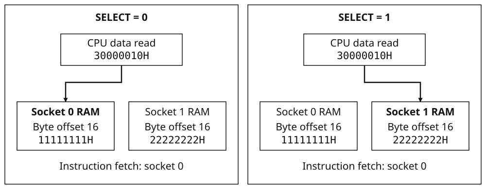
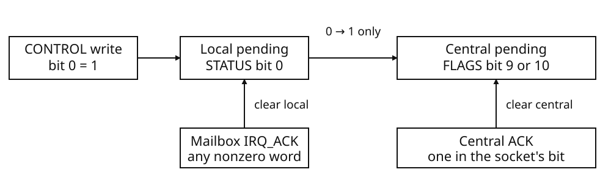

# Cartridge sockets {#sec-cartridge}

The BMSX has two cartridge sockets, 0 and 1. A program can run from the ROM of
the cartridge in one socket and use the data or RAM of the cartridge in the
other. A cartridge can hold ROM, RAM and a mailbox, in any combination: a
cartridge with only RAM can extend the program on the other cartridge.

Both sockets use the same addresses. The **SELECT** register chooses the socket
that ordinary reads and writes reach; the program's own instructions keep
coming from the socket it was started from.

## Cartridge contents {#sec-cartridge-card-composition}

| Device | Use | Size |
| --- | --- | --- |
| ROM | Program and data | Up to 512 MiB |
| RAM | Writable data | Up to 15 MiB |
| Mailbox | Data word, interrupt, DMA request | 4 registers |

STATUS shows which sockets hold a cartridge; ROM_BYTE_COUNT and RAM_BYTE_COUNT
give the sizes of ROM and RAM on the selected cartridge. The cartridge's own
documentation describes its devices.

## Selection and execution {#sec-cartridge-selection-and-execution}

A program runs from socket 0; both cartridges have RAM. Address `30000010H`
is byte 16 of the RAM of the selected cartridge: with SELECT = 0, of socket 0;
with SELECT = 1, of socket 1.

{#fig-cartridge-selection}

| Access | Socket |
| --- | --- |
| Ordinary read and write | SELECT |
| Instruction fetch | The socket of the running program |
| DMA | READ_SLOT and WRITE_SLOT of the channel |

EXEC of a cartridge function takes the socket from SELECT. A closure runs in
the socket from which its function record was read; a function record in main
RAM takes the socket of the code that creates the closure. Because both
sockets have the same addresses, a program runs in either socket without
change. See [[EXEC](../book1/program-images.md#sec-memory-exec-and-cartridge-entry)]{.content-visible when-format="html"}[Book II, §11.3.3]{.content-visible when-format="pdf"}
and [[CP0](../book1/cpu.md#sec-cpu-cp0-and-execution-control)]{.content-visible when-format="html"}[Book II, §12.13]{.content-visible when-format="pdf"}.

## Cartridge controller {#sec-cartridge-cartridge-controller}

The controller registers can always be accessed, also when the selected
socket is empty. The ROM size of each socket can also be read without changing
SELECT; see
[[ROM sizes](../book1/memory.md#sec-memory-fitted-rom-byte-counts)]{.content-visible when-format="html"}[Book I, §2.6.3]{.content-visible when-format="pdf"}.

### Registers {#sec-cartridge-controller-registers}

| Address | Name | Access | Reset |
|---|---|---|---|
| `08010420H` | SELECT | R/W | `00000000H` |
| `08010424H` | STATUS | R | Presence bits |
| `08010440H` | ROM_BYTE_COUNT | R | ROM size of the selected cartridge |
| `08010444H` | RAM_BYTE_COUNT | R | RAM size of the selected cartridge |

| Register | Bit | Meaning |
|---|---|---|
| SELECT | 0 | Socket: 0 or 1 |
| SELECT | 31–1 | Stored; no function |
| STATUS | 0 | 1: cartridge in socket 0 |
| STATUS | 1 | 1: cartridge in socket 1 |
| STATUS | 16 | Selected socket |
| STATUS | other | 0 |
| ROM_BYTE_COUNT | 31–0 | Bytes of ROM; 0: none |
| RAM_BYTE_COUNT | 31–0 | Bytes of RAM; 0: none |

### Programming {#sec-cartridge-programming-route}

1. Read STATUS to see which sockets are occupied.
2. Write the socket to SELECT.
3. Read ROM_BYTE_COUNT or RAM_BYTE_COUNT.

Reading both RAM words of @fig-cartridge-selection:

```lua
local card_word<const>: *word = 0x30000010
mem[0x08010420] = 0
local first = *card_word        -- 11111111H from socket 0
mem[0x08010420] = 1
local second = *card_word       -- 22222222H from socket 1
```

SELECT stays 1. A program running from socket 0 selects socket 0 again before
it reads its own cartridge.

### Selection {#sec-cartridge-selection-and-presence}

A SELECT write applies to the following accesses; both cartridges keep their
contents and state. Instruction fetch and DMA do not use SELECT, and STATUS
bit 16 shows only SELECT.

Instructions can be fetched from cartridge ROM and RAM, not from the mailbox;
a fetch there raises an instruction bus error.

When an empty socket is selected, the sizes read 0 and accesses give
`UNMAPPED`.

### Reset {#sec-cartridge-controller-reset}

A controller reset clears SELECT and resets the cartridges; the presence bits
remain. It raises no interrupt.

## Address areas {#sec-cartridge-card-storage-and-mmio-access}

| Area | Address | Size |
| --- | --- | --- |
| ROM | `10000000H`–`2FFFFFFFH` | 512 MiB |
| RAM | `30000000H`–`30EFFFFFH` | 15 MiB |
| Devices | `30F00000H`–`30FFFFFFH` | 1 MiB |

ROM and RAM are little-endian and can be accessed in bytes, halfwords and
words. An access must lie wholly within the ROM or RAM of the cartridge;
otherwise it gives `UNMAPPED` and nothing is transferred. Writes to ROM have no
effect. RAM is 0 at power-on and keeps its contents at a cartridge reset.

Devices are written in words. Byte and halfword reads give the byte or half of
the word addressed; byte and halfword writes are ignored. Without a device the
area gives `UNMAPPED`.

## Boot {#sec-cartridge-boot-selection}

At startup the BIOS examines socket 0, then socket 1. It skips a cartridge
whose ROM is too small for a header and starts the first one with a valid
header; see
[[ROM header](../book1/program-images.md#sec-memory-rom-header-fields)]{.content-visible when-format="html"}[Book II, §11.4]{.content-visible when-format="pdf"}.

## Mailbox {#sec-cartridge-cartridge-mailbox}

The mailbox has a data word, DATA, and a control word, CONTROL, with which a
program raises an interrupt from the socket or sets the DMA requests of the
cartridge. DATA holds one word, the last one written. The meaning of the word
is defined by the cartridge.

Writing DATA does not raise an interrupt; an interrupt does not change DATA.
Write the word first, then raise the interrupt.

An interrupt is recorded twice: in the mailbox (STATUS bit 0) and in the
interrupt controller. Both must be acknowledged.

### Programming {#sec-cartridge-mailbox-programming-sequence}

1. Select the cartridge.
2. Write the word to DATA.
3. Write CONTROL with bit 0 set (and the DREQ bits as required).
4. In the interrupt routine: select the cartridge, process DATA, write 1 to
   IRQ_ACK and acknowledge the socket's bit in the interrupt controller.

For DMA to the mailbox, set the DREQ bits; see
[DMA between sockets](#sec-cartridge-dma-between-sockets).

### Registers {#sec-cartridge-register-map}

| Address | Name | Access | Reset |
|---|---|---|---|
| `30F00000H` | DATA | R/W | `00000000H` |
| `30F00004H` | CONTROL | R/W | `00000000H` |
| `30F00008H` | STATUS | R | `00000000H` |
| `30F0000CH` | IRQ_ACK | W | — |

A read at `+01H`–`+03H` reads DATA, at `+05H`–`+07H` CONTROL, at `+09H`–`+0BH`
STATUS. Other addresses read 0. Writes take effect only as aligned words.

### DATA and CONTROL {#sec-cartridge-data-and-control}

DATA keeps the word written; reading does not clear it.

| CONTROL bit | Name | Function |
|---|---|---|
| 0 | IRQ_TRIGGER | 1: raise an interrupt; reads 0 |
| 1 | DREQ_READ | DMA may read from the cartridge's devices |
| 2 | DREQ_WRITE | DMA may write to the cartridge's devices |
| 31–3 | — | Stored; no function |

A write replaces bits 31–1.

### Interrupt {#sec-cartridge-interrupt-pending-and-acknowledgement}

| Register | Bit | Function |
|---|---|---|
| STATUS | 0 | IRQ_PENDING: 1 after IRQ_TRIGGER |
| IRQ_ACK | — | Writing a value other than 0 clears IRQ_PENDING |

An interrupt is raised only when IRQ_PENDING changes from 0 to 1. While it is
1, further IRQ_TRIGGER writes raise no interrupt.

### DREQ and reset {#sec-cartridge-dreq-levels-and-reset}

DREQ_READ and DREQ_WRITE follow CONTROL bits 1 and 2 until CONTROL is written
again. Reset clears DATA, CONTROL and IRQ_PENDING.

### Interrupt controller {#sec-cartridge-interrupts-two-latches-two-acknowledgements}

| Socket | IRQ bit |
|---|---|
| 0 | 9 (`00000200H`) |
| 1 | 10 (`00000400H`) |

{#fig-cartridge-irq}

ACK in the interrupt controller (`08000004H`) clears the controller bit, not
IRQ_PENDING; IRQ_ACK clears IRQ_PENDING, not the controller bit. Example:

| Write | IRQ_PENDING | Controller bit |
|---|---:|---:|
| CONTROL = 1 | 1 | 1 |
| ACK = socket bit | 1 | 0 |
| CONTROL = 1 | 1 | 0 |
| IRQ_ACK = 1 | 0 | 0 |
| CONTROL = 1 | 1 | 1 |
| IRQ_ACK = 1 | 0 | 1 |
| ACK = socket bit | 0 | 0 |

The third row raises no interrupt because IRQ_PENDING is still 1. See
[[Interrupt controller](../book1/irq.md#sec-irq-cpu-delivery-and-waiting)]{.content-visible when-format="html"}[Book I, §3.3]{.content-visible when-format="pdf"}.

## DMA between sockets {#sec-cartridge-dma-between-sockets}

Bits 3 and 4 of the DMA CONTROL register choose the source and destination
sockets:

| Source | Destination | CONTROL (COPY) |
|---:|---:|---|
| 0 | 0 | `00000000H` |
| 1 | 0 | `00000008H` |
| 0 | 1 | `00000010H` |
| 1 | 1 | `00000018H` |

| Bit | Name | Function |
|---|---|---|
| 3 | READ_SLOT | Source socket |
| 4 | WRITE_SLOT | Destination socket |

### Devices and blocks {#sec-cartridge-dma-block-operation}

ROM and RAM need no request. For the device area, the source cartridge must set
DREQ_READ and the destination cartridge DREQ_WRITE. Blocks to devices are at
most 16 words. While the channel is busy its registers cannot be changed;
SELECT does not affect the transfer. Do not change the source until the end of
the transfer. See [DMA](../book1/dma.md).

### Example settings {#sec-cartridge-dma-control-example}

ROM of socket 0 to RAM of socket 1: CONTROL = `00000010H` (COPY, READ_SLOT 0,
WRITE_SLOT 1). No DREQ is needed.

### Timing {#sec-cartridge-dma-transfer-timing}

For N words, in cycles of 33,868,800 Hz:

| Transfer | Cycles | 4 words | 16 words |
| --- | --- | --- | --- |
| Cartridge ↔ main RAM | 9N + 5 | 41 | 149 |
| Cartridge ↔ cartridge | 16N + 8 | 72 | 264 |
| Cartridge ↔ device port | 9N + 4 | 40 | 148 |

A cartridge area costs 8N + 4, main RAM N + 1. Crossing from ROM to RAM or to
the device area starts a new area. See
[[DMA](../book1/dma.md#sec-dma)]{.content-visible when-format="html"}[Book I, Chapter 4]{.content-visible when-format="pdf"}.

### Example: copying between cartridges {#sec-cartridge-two-card-programming-example}

Four words from the ROM of socket 0 to RAM of socket 1, with SELECT = 1:

```lua
rodata seed: word[4] = {
    0x01234567, 0x89abcdef, 0x55aa33cc, 0xf00dcafe,
}
mem[0x08000008] = 0           -- MASK: no interrupts
mem[0x08000004] = 1           -- ACK: clear DMA0
mem[0x0800000c] = seed        -- READ_ADDR: ROM of socket 0
mem[0x08000010] = 0x30000010  -- WRITE_ADDR: RAM of socket 1
mem[0x08000014] = 4           -- 4 words
mem[0x08000018] = 0x00000010  -- COPY, socket 0 to socket 1
mem[0x08000020] = 1           -- START
while (mem[0x0800001c] & 1) ~= 0 do
end
```

After the transfer: STATUS = 2, COUNT = 0, READ_ADDR = `seed + 16`,
WRITE_ADDR = `30000020H`. Check for
[[bus errors](../book1/memory.md#sec-memory-attribute-a-bus-fault-before-start)]{.content-visible when-format="html"}[Book I, §2.10.1]{.content-visible when-format="pdf"}
before using the data.

```lua
local destination<const>: *word = 0x30000010
local first = destination[0]  -- 01234567H
local last = destination[3]   -- F00DCAFEH
mem[0x08000004] = 1
```

The transfer takes 72 cycles.

## Faults {#sec-cartridge-access-faults}

A halfword access must be aligned to 2, a word access to 4; otherwise the CPU
raises an address exception. A bus fault raises a bus exception. See
[[scalar access](../book1/memory.md#sec-memory-scalar-memory-accesses)]{.content-visible when-format="html"}[Book I, §2.7]{.content-visible when-format="pdf"}.

SELECT and STATUS are I/O registers:

| Access | Result |
| --- | --- |
| Aligned word read | The register |
| Byte read at the register address | Low byte |
| Other addresses, halfword access, byte write | `UNALIGNED_IO` (2) |
| Word write to SELECT | Sets SELECT |
| Word write to STATUS | `READ_ONLY` (3) |

A word write to mailbox STATUS is ignored. An access outside the ROM or RAM
of the cartridge gives `UNMAPPED` (1). A DMA transfer continues after a bus
fault; check the fault registers after the transfer. See
[[bus faults](../book1/memory.md#sec-memory-bus-fault-status-and-cpu-exceptions)]{.content-visible when-format="html"}[Book I, §2.8]{.content-visible when-format="pdf"}.
