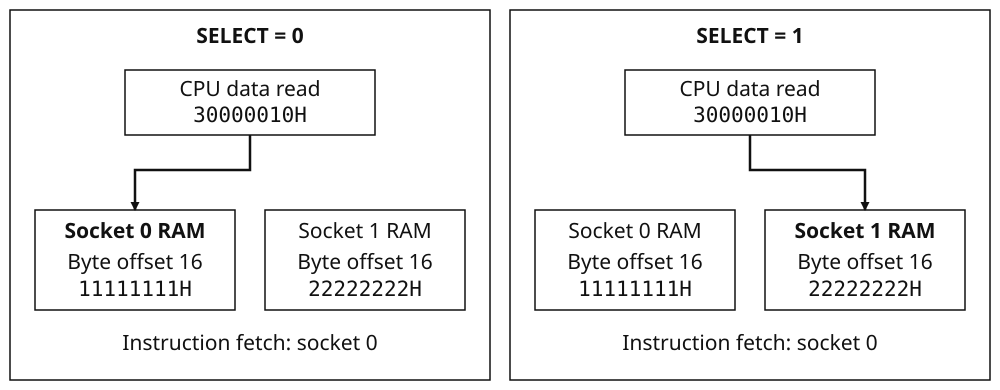

# Cartridge sockets and mapped card devices {#sec-cartridge}

The BMSX has two cartridge sockets, numbered 0 and 1. A program can execute
from the ROM in one socket while using data or writable memory on the card in
the other. A card may contain ROM, RAM, a word mailbox, or a combination of
these devices; a RAM-only card can therefore extend a program on a second card.

Both sockets use the same cartridge addresses. To read a card, software must
choose both **an address within the card** and **the socket to which the access
is directed**. The address determines whether the access reaches ROM, RAM or a
mapped device. The socket selection determines which card supplies that region.
Changing the data selection does not change the socket supplying the program's
instructions.

## Card composition {#sec-cartridge-card-composition}

ROM holds the card's read-only bytes, including any program and resource data.
RAM provides writable memory at separate cartridge addresses. A mailbox adds a
word port, an interrupt latch and DMA-request controls; it is described as a
separate device later in this chapter. None of these devices requires the other
two to be present. Consult the card specification for its installed devices and
capacities.

| Resource | Use | Capacity |
| --- | --- | --- |
| Socket | Connection for one card | Two sockets, numbered 0 and 1 |
| Card ROM | Program and read-only data | Card-specific, within the 512-MiB ROM window |
| Card RAM | Writable data | Card-specific, within the 15-MiB RAM window |
| Mailbox | Word exchange, interrupt and DMA-request control | DATA and CONTROL words with a local interrupt latch |

The controller's STATUS register reports which sockets are occupied, not the
devices or capacities fitted to a card. An occupied socket need not contain a
bootable ROM. The address windows accommodate cards of different capacities;
locations beyond installed ROM or RAM read as zero rather than repeating the
smaller memory.

## Selection and execution {#sec-cartridge-selection-and-execution}

Consider a program executing from socket 0, with RAM fitted to both cards.
The word at `30000010H` is at byte offset 16 within either card's RAM. If
software selects socket 0 and reads that address, it obtains socket 0's word.
Selecting socket 1 and reading the same address obtains socket 1's word; the
address itself has not changed.

{#fig-cartridge-selection}

The ordinary data selector is the controller's SELECT register. Its value
applies to subsequent ordinary cartridge reads and writes until software
changes it. Selection neither copies memory between cards nor resets either
card. In the example, the two words keep their separate values as SELECT
changes.

Instruction fetch uses a separate **execution-socket latch**. A program entered
from socket 0 continues to fetch its cartridge instructions from socket 0 even
when SELECT is changed to 1 for data access. This is what permits a running
program to use the second card: selecting its data does not redirect the next
instruction to the same address on that card.

A cartridge-targeted `CP0.EXEC` samples SELECT and establishes the execution
socket for the new entry. Since cartridge addresses are identical in both
sockets, insertion in the other socket does not by itself require relocation.
A cartridge-function closure contains a function-record address, not a socket
selection; calling it uses the current execution socket. See [[Program images and startup — EXEC and cartridge entry](../book1/program-images.md#sec-memory-exec-and-cartridge-entry)]{.content-visible when-format="html"}[Book II, “Program images and startup”, under “EXEC and cartridge entry”]{.content-visible when-format="pdf"}
and [[CPU execution control](../book1/cpu.md#sec-cpu-cp0-and-execution-control)]{.content-visible when-format="html"}[Book II, “CPU and BLua32 instruction reference”, under “CP0 and execution control”]{.content-visible when-format="pdf"}.

DMA also distinguishes the address from the socket. Its source and destination
request fields can select different sockets, allowing a direct copy from one
card to the other. Those endpoint selections are independent of the CPU data
selector; their encodings and request conditions are given under
[DMA between sockets](#sec-cartridge-dma-between-sockets).

## Cartridge controller {#sec-cartridge-cartridge-controller}

The controller has two installed-I/O registers: SELECT chooses the socket for
ordinary data accesses, and STATUS reports socket occupancy and that selection.
They are separate from the registers on either card, so both remain accessible
regardless of which socket is selected.

### Controller registers {#sec-cartridge-controller-registers}

| Address | Name | Access | Controller-reset value |
|---|---|---|---|
| `0x08010420` | `SELECT` | Read/write | `0x00000000` |
| `0x08010424` | `STATUS` | Read-only | Installed-cartridge presence bits; bit 16 clear |

`SELECT` retains the complete 32-bit word written to it. Bit 0 selects the
socket; bits 31:1 are retained and read back without affecting selection.

| Register | Bits | Meaning |
|---|---|---|
| `SELECT` | 0 | Ordinary socket selection: 0 selects socket 0; 1 selects socket 1. |
| `SELECT` | 31:1 | Retained raw bits; no effect on socket selection. |
| `STATUS` | 0 | 1 when socket 0 contains a cartridge. |
| `STATUS` | 1 | 1 when socket 1 contains a cartridge. |
| `STATUS` | 16 | Ordinary selected socket: 0 for socket 0; 1 for socket 1. |
| `STATUS` | 15:2, 31:17 | Read as zero. |

### Accessing a card {#sec-cartridge-programming-route}

For ordinary data access:

1. Read STATUS to determine which sockets are occupied. Use the card's own
   specification to determine its memory and devices.
2. Write 0 or 1 to SELECT for the intended card.
3. Access the required address within that card's ROM, RAM or MMIO window.

For the two-RAM example in @fig-cartridge-selection, these are the complete
selection and read operations. Both cards are assumed to contain at least
20 bytes of RAM, with the illustrated words already stored at offset 16.

```lua
local card_word<const>: *word = 0x30000010
mem[0x08010420] = 0
local first = *card_word        -- 0x11111111 from socket 0.
mem[0x08010420] = 1
local second = *card_word       -- 0x22222222 from socket 1.
```

SELECT remains 1 after the second read. Any later ordinary cartridge access
therefore uses socket 1 until SELECT is changed again. Code still executing
from socket 0 must select socket 0 again before an ordinary data read of its
own card.

### Selection and presence {#sec-cartridge-selection-and-presence}

A `SELECT` write takes effect for subsequent ordinary cartridge accesses.
Both cards retain their device state, interrupt latches and DMA-request levels
across the selection change.

Instruction fetch and the explicit DMA socket selections bypass SELECT without
changing it. STATUS bit 16 continues to report ordinary data selection, not
the socket used by an instruction fetch or by a DMA endpoint.

The presence bits are independent of selection. Selecting an empty socket
changes STATUS bit 16 while leaving bits 1:0 unchanged. Reads from that socket
return zero and writes have no effect.

### Controller reset {#sec-cartridge-controller-reset}

Controller reset clears the entire SELECT word and resets each present card.
The DMA-request levels then reflect the reset state of those cards; empty
sockets assert no requests. Occupancy is unchanged, so STATUS may still report
present cards with socket 0 selected. Controller reset does not itself raise or
acknowledge a central interrupt. The storage and mailbox reset effects are
specified below.

## Card storage and MMIO access {#sec-cartridge-card-storage-and-mmio-access}

Each selected card uses the following address windows. ROM and RAM offsets
are byte offsets from their respective bases; the card's installed capacity
may be smaller than the window.

| Region | First address | Exclusive limit | Window size |
| --- | --- | --- | --- |
| ROM | `0x10000000` | `0x30000000` | 512 MiB |
| RAM | `0x30000000` | `0x30f00000` | 15 MiB |
| MMIO | `0x30f00000` | `0x31000000` | 1 MiB |

Absent or unpopulated ROM and RAM locations read as zero. Smaller memories
are not mirrored through the remaining window. ROM writes are ignored; a RAM
write takes effect only when its complete width fits the installed memory.

ROM and RAM scalar values are little-endian: the lowest-addressed byte occupies
bits 7:0. The starting address of a scalar read selects the region for the
complete value. If fewer installed bytes remain than the requested width,
available bytes occupy the low-order lanes and missing high-order lanes read
as zero. A sequence of individual byte reads instead selects the region at
each byte's address, so such a sequence can cross into the next window.

| Operation | Width, capacity, tail, or reset behavior |
| --- | --- |
| ROM/RAM byte read | Returns the addressed installed byte, otherwise zero. |
| ROM/RAM 16-bit read | At a one-byte tail, returns that byte in bits 0–7 and zero in bits 8–15. Returns zero beyond capacity. |
| ROM/RAM 32-bit read | Assembles remaining bytes into successive low-order byte lanes; unavailable high-order lanes are zero. Returns zero beyond capacity. |
| RAM write | An 8-, 16-, or 32-bit write occurs only when its starting address selects RAM and its entire width fits installed RAM. A partial-width tail write changes nothing. |
| MMIO 8-/16-bit write | Ignored, including on a card with a mapped device. |
| MMIO 32-bit write | Writes the complete word at the exact MMIO-relative byte offset. Has no effect when no mapped device is present. |
| Logical card reset | Resets the mapped device, if present. Retains RAM contents and leaves ROM unchanged. |

MMIO reads return zero when no device is present. Otherwise, the device decodes
the byte offset from `0x30f00000` without prior rounding to a word boundary.
An 8-bit read selects the decoded word's byte lane using address bits 1:0.
A 16-bit read selects its low or high half using address bit 1. A 32-bit read
returns the complete word. Use the device's register map for the word selected
by each offset; the mailbox's read decoding is given below. These read-lane
rules do not enable byte or halfword stores.

Card RAM initially contains zero. A logical card reset retains its contents.

## Boot selection {#sec-cartridge-boot-selection}

At startup, the BIOS examines socket 0, then socket 1, selecting each present
card and reading its ROM header. It enters the first card whose ROM passes the
startup checks. A RAM-only card, or a card whose ROM does not meet those
requirements, is skipped. This entry establishes the execution socket as
described under [Selection and execution](#sec-cartridge-selection-and-execution).

[[Program images and startup — Cartridge startup](../book1/program-images.md#sec-memory-rom-header-fields)]{.content-visible when-format="html"}[Book II, “Program images and startup”, under “ROM header fields”]{.content-visible when-format="pdf"}
specifies the ROM header, startup requirements and entry sequence.

## Cartridge mailbox {#sec-cartridge-cartridge-mailbox}

A mailbox adds a retained DATA word and separate controls for notification and
DMA requests. Software can use DATA for a value defined by the card's own
protocol. Writing it replaces the previous word; DATA is a single word, not a
queue. CONTROL can request an interrupt from that socket or set the request
levels that permit DMA transfers involving the card.

Data and notification are separate operations. Writing DATA does not request an
interrupt, and an interrupt request does not change DATA. A protocol that uses
both can therefore write its value first, then request notification. The card's
programming specification defines the value and what its recipient should do
with it. A DMA completion reports the end of transport, not an application
response from the card.

The mailbox's **local pending latch** records whether its interrupt has been
requested. Clearing this latch rearms the next interrupt edge. A separate
pending bit in the installed interrupt controller records that edge for CPU
delivery; servicing an interrupt requires both acknowledgements, as explained
below. Mailbox transfers and interrupts are optional operations, not
prerequisites for ordinary ROM or RAM access.

The mailbox base is `30F00000H` on the selected card. It has two retained
32-bit words, DATA and CONTROL; STATUS reads the local pending latch and
IRQ_ACK provides its acknowledgement action. All offsets below are relative
to the mailbox base.

### Mailbox programming sequence {#sec-cartridge-mailbox-programming-sequence}

For a protocol that publishes one DATA word and requests an interrupt:

1. Select the card containing the mailbox. The following accesses use that
   card's MMIO window.
2. Starting with the local pending latch clear, write the word to DATA.
3. Write CONTROL with IRQ_TRIGGER set, retaining any DREQ or other CONTROL
   fields that must remain unchanged. This sets local pending and raises the
   socket's central interrupt source.
4. In the service routine, handle DATA according to the card protocol, clear
   local pending through IRQ_ACK to rearm the edge, and acknowledge the
   socket's central pending bit separately. Select the correct card before
   accessing its mailbox.

For DMA, program the required DREQ levels instead; both endpoint requests and
the channel's address, count and control registers must be ready before START.
The mailbox fields are defined next, and
[DMA between sockets](#sec-cartridge-dma-between-sockets) shows how they
connect to a transfer.

### Register map {#sec-cartridge-register-map}

| Address | Name | Access | Bits / word-write action | Reset read |
|---|---|---|---|---|
| `30F00000H` | DATA | R/W | Retains all 32 bits; write replaces the complete word | `00000000H` |
| `30F00004H` | CONTROL | R/W + trigger | Bits 31:1 retained; bit 0 requests an IRQ and is excluded from readback | `00000000H` |
| `30F00008H` | STATUS | R; writes ignored | Bit 0 IRQ_PENDING; bits 31:1 zero | `00000000H` |
| `30F0000CH` | IRQ_ACK | R=0; W action | Any nonzero word clears local pending; zero has no effect | `00000000H` |

Read decoding ignores the low two offset bits. Offsets `+0x00` through `+0x03`
therefore select DATA, `+0x04` through `+0x07` select CONTROL, and `+0x08`
through `+0x0B` select STATUS. The read width then selects the byte lanes as
described under [Card storage and MMIO access](#sec-cartridge-card-storage-and-mmio-access).
Every other offset group reads zero, including `+0x0C` through `+0x0F`.

Use aligned word stores for the mailbox actions. Only `+0x00`, `+0x04`, and
`+0x0C` perform an action. Writes to STATUS and other aligned offsets are ignored;
byte and halfword writes do not perform mailbox actions.

### DATA and CONTROL {#sec-cartridge-data-and-control}

DATA holds the last complete word written to it. Its read does not consume the
word. A DATA write leaves CONTROL and the local pending latch unchanged.

CONTROL has the following defined fields:

| Bits | Mask | Name | Meaning on a CONTROL write |
|---|---|---|---|
| 0 | `0x00000001` | IRQ_TRIGGER | Requests a local interrupt-pending transition. Not retained by the write. |
| 1 | `0x00000002` | DREQ_READ | Sets the DREQ_READ level. |
| 2 | `0x00000004` | DREQ_WRITE | Sets the DREQ_WRITE level. |
| 31:3 | `0xFFFFFFF8` | Unnamed | Retained exactly as written; no defined IRQ or DREQ contribution. |

A CONTROL write replaces bits 31:1, including unnamed bits. Preserve any of
those fields that must remain unchanged when constructing a new value.
Bit 0 performs the IRQ_TRIGGER action and reads as zero; it is not stored in
CONTROL. Setting this bit can request notification without a later
trigger-clear write.

### Interrupt pending and acknowledgement {#sec-cartridge-interrupt-pending-and-acknowledgement}

An IRQ_TRIGGER write sets local IRQ_PENDING. Only its clear-to-set transition
generates a new interrupt edge. Once pending is set, further trigger writes
leave it set without generating additional edges.

To rearm the edge, write any nonzero word to IRQ_ACK. A subsequent IRQ_TRIGGER
can then generate another edge. A zero IRQ_ACK write and a CONTROL write with
IRQ_TRIGGER clear both leave local pending unchanged. IRQ_ACK changes neither
DATA nor CONTROL. It acknowledges the mailbox latch, not the central
interrupt-controller latch.

### DREQ levels and reset {#sec-cartridge-dreq-levels-and-reset}

DREQ_READ and DREQ_WRITE follow retained CONTROL bits 1 and 2 independently.
Software may assert either level, both, or neither. The levels remain asserted
until replaced by a CONTROL write or cleared by reset. IRQ_TRIGGER and IRQ_ACK
do not replace this programming, and unnamed CONTROL bits do not affect DREQ.

Reset clears DATA, CONTROL and local pending. All four register ports then
read zero and both DREQ levels are deasserted.

### Interrupts: two latches, two acknowledgements {#sec-cartridge-interrupts-two-latches-two-acknowledgements}

Socket 0 raises central interrupt bit 9 (`00000200H`); socket 1 raises bit 10
(`00000400H`). These are distinct from each card's local STATUS bit 0.
The central FLAGS port is `08000000H`, ACK is `08000004H` and MASK is
`08000008H`. A central ACK clears the pending bits selected by its written
ones. It does not clear the card's local pending latch.

{#fig-cartridge-irq}

Central pending records an edge even with its MASK bit clear. MASK affects
delivery, not pending storage. A FLAGS read changes neither latch. Conversely,
mailbox IRQ_ACK clears only the local latch; an already pending central bit
remains until central ACK. Neither latch counts repeated events.

For one socket, starting with both pending latches clear:

| Accepted operation | Local pending | Central socket bit |
|---|---:|---:|
| CONTROL = `1` | 1 | 1 |
| Central ACK = socket mask | 1 | 0 |
| CONTROL = `1` again | 1 | 0 |
| Local IRQ_ACK = `1` | 0 | 0 |
| CONTROL = `1` again | 1 | 1 |
| Local IRQ_ACK = `1` | 0 | 1 |
| Central ACK = socket mask | 0 | 0 |

The third row demonstrates why acknowledging only the central controller does
not rearm a mailbox edge. When handling both sockets, select the intended card
before touching its local registers and acknowledge only the central bits owned
by that handler. The complete CPU-enable, `irq(flags)` and predicate-wait route
is in [[Interrupt controller](../book1/irq.md#sec-irq-cpu-delivery-and-waiting)]{.content-visible when-format="html"}[Book I, “Interrupt controller”, under “CPU delivery and waiting”]{.content-visible when-format="pdf"}.

## DMA between sockets {#sec-cartridge-dma-between-sockets}

To copy ROM data from socket 0 into RAM on socket 1, the DMA channel needs two
addresses and two socket selections. Its read address chooses the source
location in card ROM, while its write address chooses the destination in card
RAM. The source and destination request fields supply their socket selections
independently. The CPU's SELECT register need not change during the copy.

Each request field has two effects: it selects a request condition that must be
satisfied before a block starts, and, for a cartridge request, it selects that
endpoint's socket. `READ_REQUEST` controls the source; `WRITE_REQUEST` controls
the destination. In either field, selectors 7–10 mean:

| Selector | Request condition | Endpoint socket override |
| --- | --- | --- |
| 7 | Socket 0 `DREQ_WRITE` | Socket 0 |
| 8 | Socket 0 `DREQ_READ` | Socket 0 |
| 9 | Socket 1 `DREQ_WRITE` | Socket 1 |
| 10 | Socket 1 `DREQ_READ` | Socket 1 |

These selections are independent of one another and of SELECT. An endpoint
with any of these four selectors may address ROM, card RAM or mailbox MMIO;
the address selects the region within the chosen socket. In particular, the
READ or WRITE name in a request condition does not itself restrict the
endpoint's address range.

### Request levels and block operation {#sec-cartridge-dma-block-operation}

Both endpoint requests must be asserted for a block to start. Mailbox CONTROL
bit 1 drives DREQ_READ and bit 2 drives DREQ_WRITE. Since the requests are
levels, one CONTROL write can keep a condition asserted for successive blocks;
there is no separate request pulse for each word. They do not report FIFO
occupancy. An absent card, or one without a mailbox, asserts neither cartridge
request. `FORCE` (selector 0) is always asserted and `DISABLED` (selector 15)
is never asserted.

At the start of a block, DMA captures its read and write addresses, remaining
count, control and block length. The transfer cost elapses before the endpoint
accesses occur. At completion, DMA reads each word and then writes it, then
updates the channel's addresses and count. A remaining count of zero completes
the channel. A request that drops after a block has started holds off the next
block; it does not shorten the block already in progress.

Selectors other than 7–10 supply no independent cartridge socket selection.
A cartridge endpoint then uses SELECT **at the time of its access**, not the
selection present at START. Changing SELECT during an active block can
therefore redirect that endpoint. Keep selection unchanged until completion
or use an explicit cartridge request selector.

### Four-word control value {#sec-cartridge-dma-control-example}

For the socket-0 ROM to socket-1 RAM copy, use source selector 8 and destination
selector 9. Increment both addresses and choose a four-word block:

| `CONTROL` field | Value | Contribution |
| --- | --- | --- |
| Read increment, bit 0 | 1 | `00000001H` |
| Write increment, bit 1 | 1 | `00000002H` |
| Read request, bits 5:2 | 8 | `00000020H` |
| Write request, bits 9:6 | 9 | `00000240H` |
| Block words minus 1, bits 13:10 | 3 | `00000C00H` |
| **Combined `CONTROL`** | | **`00000E63H`** |

Each increment advances four bytes per word. The resulting `00000E63H`
requires socket 0 DREQ_READ and socket 1 DREQ_WRITE. Once both levels permit
the block to start, the CPU's current selection cannot reroute either endpoint.

### Transfer timing {#sec-cartridge-dma-transfer-timing}

DMA timing uses the 33,868,800 Hz system clock. A contiguous N-word cartridge
span costs `8N + 4` cycles, whether it addresses card ROM, card RAM or mailbox
MMIO. A main-RAM span costs `N + 1` cycles. Two cartridge endpoints have
additive costs even when they select different sockets:

| Transfer, wholly within each endpoint’s region | Cycles | Four words | Sixteen words |
| --- | --- | --- | --- |
| Cartridge ↔ main RAM | `8N + 4` | 36 | 132 |
| Cartridge ↔ cartridge | `16N + 8` | 72 | 264 |
| Cartridge ↔ installed I/O | `8N + 4` | 36 | 132 |

The four-word ROM(socket 0) → RAM(socket 1) block therefore takes
`(8 × 4 + 4) + (8 × 4 + 4) = 72` cycles once started.
Incrementing across a ROM, RAM or MMIO boundary starts another span and incurs
setup again. Add request waiting, channel competition and CPU setup or polling
to obtain the complete operation time. [[DMA](../book1/dma.md#sec-dma)]{.content-visible when-format="html"}[Book I, “Direct memory access”]{.content-visible when-format="pdf"} gives the general
channel programming sequence.

### Two-card programming example {#sec-cartridge-two-card-programming-example}

The following sequence copies four ROM words from socket 0 to RAM on socket 1.
Assume a bootable card in socket 0 with ROM and a mailbox, and a data card in
socket 1 with at least 32 bytes of RAM and a mailbox. The sequence owns DMA0,
both mailbox controls, socket-1 RAM bytes 16–31 and central DMA0 pending bit 0.
No other writer changes these resources or the selected request levels.
Completion is polled with interrupt delivery masked. The transfer only needs
the two programmed mailbox request levels; it does not require an interrupt
request from either card.

Declare four words in socket 0's ROM, assert the read request on
socket 0 and the write request on socket 1, then program the idle channel:

```lua
rodata seed: word[4] = {
    0x01234567, 0x89abcdef, 0x55aa33cc, 0xf00dcafe,
}
mem[0x08000008] = 0           -- Mask delivery; retain pending source bits.
mem[0x08000004] = 1           -- Acknowledge this owner's old DMA0 pending bit.
mem[0x08010420] = 0
mem[0x30f00004] = 2           -- Socket 0 DREQ_READ.
mem[0x08010420] = 1
mem[0x30f00004] = 4           -- Socket 1 DREQ_WRITE.
mem[0x0800000c] = seed        -- DMA0 READ_ADDR: socket-0 ROM.
mem[0x08000010] = 0x30000010  -- DMA0 WRITE_ADDR: socket-1 RAM.
mem[0x08000014] = 4           -- Four words, not four bytes.
mem[0x08000018] = 0x00000e63  -- Increment both; requests 8/9; four-word block.
mem[0x08000020] = 1           -- START.
while (mem[0x0800001c] & 1) ~= 0 do
end
```

The explicit endpoint overrides keep the source on socket 0 and destination on
socket 1 while ordinary CPU selection remains 1. After normal completion,
DMA STATUS is 2 and COUNT is zero. READ_ADDR is `seed + 16`, WRITE_ADDR is
`30000020H`, and the masked DMA0 pending bit is set. Before consuming the data,
check for new bus faults using the [[Memory fault-attribution procedure](../book1/memory.md#sec-memory-attribute-a-bus-fault-before-start)]{.content-visible when-format="html"}[Book I, “Memory and bus access”, under “Attribute a bus fault before START”]{.content-visible when-format="pdf"};
DMA DONE does not imply valid endpoint accesses.

Read socket 1's destination while it remains selected:

```lua
local destination<const>: *word = 0x30000010
local first = destination[0]
local last = destination[3]
mem[0x30f00004] = 0           -- Deassert socket-1 requests after completion.
mem[0x08010420] = 0
mem[0x30f00004] = 0           -- Deassert socket-0 requests.
mem[0x08000004] = 1
```

The destination words are `01234567H`, `89ABCDEFH`, `55AA33CCH` and
`F00DCAFEH`; `first` and `last` read the first and fourth. Socket-0 RAM is
unchanged. The destination survives a logical card reset, so a warm rerun
must not assume that untouched card RAM has returned to zero. The block takes
72 system cycles, plus CPU setup, request waiting, polling and result reads.

## Access faults {#sec-cartridge-access-faults}

CPU alignment checks precede the cartridge bus access. Ordinary
halfword accesses require two-byte alignment and word accesses four-byte
alignment. A misaligned ordinary load or store enters its address-error
exception before reaching the bus. A new mapped fault during an ordinary load
enters a data-bus-error exception before committing the read value; a new fault
during an ordinary store enters the same exception. A bus-level zero return is
not a successful ordinary CPU load of zero. See [[Memory — Scalar memory accesses](../book1/memory.md#sec-memory-scalar-memory-accesses)]{.content-visible when-format="html"}[Book I, “Memory and bus access”, under “Scalar memory accesses”]{.content-visible when-format="pdf"}.

Installed I/O and cartridge MMIO have different mapped-access rules. The
controller's SELECT and STATUS registers occupy installed-I/O word slots.
For mapped accesses to these two registers:

| Access | Result |
| --- | --- |
| Aligned 32-bit read | Reads the complete register word. |
| 8-bit read at the aligned register address | Reads the low byte. |
| Unaligned 32-bit access or 8-bit read at another byte lane | `UNALIGNED_IO` (2). |
| 16-bit read, 8-bit store or 16-bit store | `UNALIGNED_IO` (2). |
| Aligned 32-bit store to SELECT | Replaces the selection word. |
| Aligned 32-bit store to STATUS | `READ_ONLY` (3); STATUS is unchanged. |

Faulting mapped reads return zero and faulting stores are suppressed. In
contrast to controller STATUS, a word store to mailbox STATUS is ignored
without a READ_ONLY fault.

At cartridge addresses, the mapped access uses the card's offset decoding and
byte lanes rather than the installed-I/O alignment rule. Mailbox byte and
halfword stores are ignored. Its word stores decode the exact relative offset;
an unaligned mailbox store therefore changes no register. An ordinary CPU
halfword or word instruction is still subject to the CPU alignment check
described above.

The entire access must fit inside the cartridge aperture. Its highest admitted
starting addresses are `30FFFFFCH` for a word, `30FFFFFEH` for a halfword and
`30FFFFFFH` for a byte. An access that crosses the final boundary raises
`UNMAPPED` (1), returning zero or suppressing the store. Within the aperture,
an absent card returns zero and ignores writes without a fault; ROM writes
are also ignored.

DMA uses these mapped-access rules, but continues its programmed reads, writes
and count progression after a fault. Check for new bus faults as well as DONE
before using the result. The first outstanding bus fault retains its code,
address and access; later faults do not replace it. See
[[Memory — Bus faults](../book1/memory.md#sec-memory-bus-fault-status-and-cpu-exceptions)]{.content-visible when-format="html"}[Book I, “Memory and bus access”, under “Bus-fault status and CPU exceptions”]{.content-visible when-format="pdf"}
for the fault registers and acknowledgement procedure.
