# External connections and cartridges {#sec-physical-connectors}

The keyboard and four accessory sockets are on the front of the console. The
power inlet and RGB/audio socket are at the rear. Two cartridge openings with
independent dust doors are in the top cover.

| Location | Connection or control | Function |
|---|---|---|
| Front, left | Keyboard | Six-contact PS/2 mini-DIN |
| Front, 1–4 | Accessories | Four keyed, nine-contact BMSX pad ports |
| Rear | DC inlet | Locking, centre-positive 9 V input |
| Rear | Audio/video | RGB, composite sync and stereo audio through SCART |
| Top, front band | POWER, indicator, RESET | Main-rail enable, indication and reset |
| Top | Slots 1 and 2 | Vertical cartridge insertion |

BMSX accessory and cartridge connections are specific to this console. Do
not connect another system's device by connector shape alone. Switch off and
disconnect the external supply before inserting or removing cartridges or
peripherals. Hold a plug by its body and align its key with the socket.

## Connecting and starting the console

1. Place the console on its feet with clearance above the cartridge slots and
   behind the rear sockets. Leave POWER off and disconnect the external supply.
2. Connect an RGB-capable display at the rear and the keyboard and desired
   BMSX accessories at the front. Insert a cartridge as described below.
3. Connect an isolated, regulated, centre-positive 9 V supply. The required
   adapter current, including cartridges and accessories, is not yet specified.
4. Select the display's RGB input if necessary, then move POWER to ON. The
   green indicator shows the 3.3 V rail is present; it is not a complete
   startup or fault indication. The BIOS checks slot 1 before slot 2 for a
   bootable cartridge.
5. To change cartridges or peripherals, turn POWER off and disconnect the
   external supply. RESET restarts the console without disconnecting it.

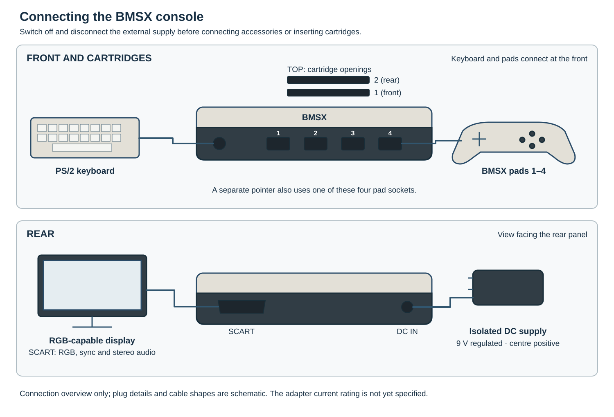{#fig-console-connection-setup}

## Keyboard {#sec-physical-keyboard}

The keyboard is a separate wired accessory connected to the front PS/2 socket.
The reference socket is a Same Sky MD-60S six-contact mini-DIN. It supplies
5 V; clock and data pass through level shifters to the INPUT controller.
The contact diagram faces the console socket, with the key at the top.

The proposed receiver expects a keyboard that sends PS/2 scan-code set 2 at
power-up. It receives key data but does not send commands to select a scan-code
set or control keyboard indicator LEDs. A six-contact plug alone does not
establish compatibility; in particular, a USB keyboard and passive adapter
must themselves support this PS/2 mode. The reference keyboard and complete
integrated receiver have not yet been qualified together.

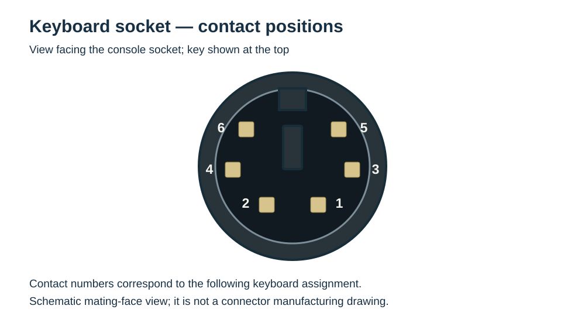{#fig-keyboard-socket-contacts}

| Contact | Connection |
|---:|---|
| 1 | Keyboard data |
| 2 | Not assigned |
| 3 | Ground |
| 4 | +5 V supply |
| 5 | Keyboard clock |
| 6 | Not assigned |
| Earth terminal (SH) | Ground |

: Keyboard socket contact assignment. Numbers identify contacts, not their mirrored solder-side positions. {#tbl-keyboard-contacts}

Contacts 2 and 6 are not connected. J301 carries data, ground, 5 V and clock
to the separate keyboard board. For a harness, follow contact numbers rather
than the apparent left/right order: the mating and wire-entry views are mirrored.

The keyboard shown below is an 83-key design concept, not a qualified accessory.
Its proposed controller must report Ctrl+Alt+F12 simultaneously for the
supervisor function in @sec-keyboard-supervisor-request. The illustrated Fn key
has no assigned function, and the layout does not promise unrestricted key rollover.

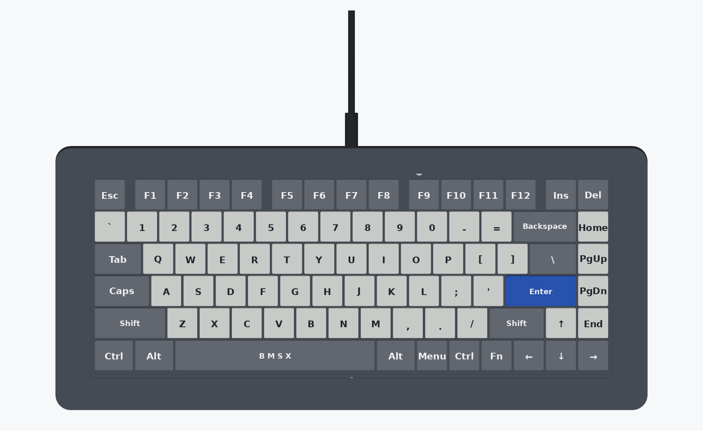{#fig-keyboard-reference}

## Game pads and pointer {#sec-physical-pads}

The four front sockets use the BMSX-PAD serial interface. Each port has its own
command, data and active-low select signals; the clock is shared. Signals use
3.3 V levels. The 5 V and 3.3 V contacts are supplies, not signal connections.
Front markings 1–4 correspond to controller records 0–3.

A pointer also uses one of these ports. An accessory providing both a pad and
pointer record can share one port; otherwise a separate pointer occupies one
port. The selected pointer record and serial protocol are described in
@sec-physical-pad-link. These are not USB or Bluetooth sockets; an accessory
using another protocol requires a suitable translator.

The contact diagram faces the console socket; contact 1 is at lower left.

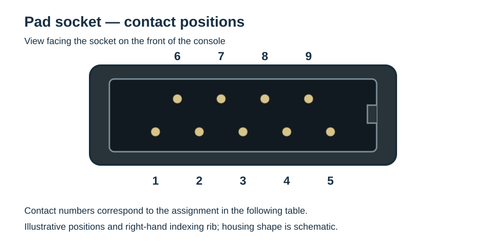{#fig-pad-socket-contacts}

| Contact | Connection | Signal direction at the console |
|---:|---|---|
| 1 | Ground | Return |
| 2 | Pad data | Input |
| 3 | Pad command | Output |
| 4 | Pad clock | Output; shared by the four ports |
| 5 | Pad select, active low | Output; separate for each port |
| 6 | +5 V | Supply |
| 7 | Ground | Return |
| 8 | +3.3 V | Supply |
| 9 | Not assigned | No connection |

: BMSX pad contact assignment. Signals are 3.3 V. {#tbl-pad-contacts}

The proposed mating plug has staggered contacts and an indexing groove. Its
body and channels are a connector concept, not an established manufactured
part or proof of fit. The figure shows alignment looking through the plug from
the cable side; a view into the mating face is mirrored.

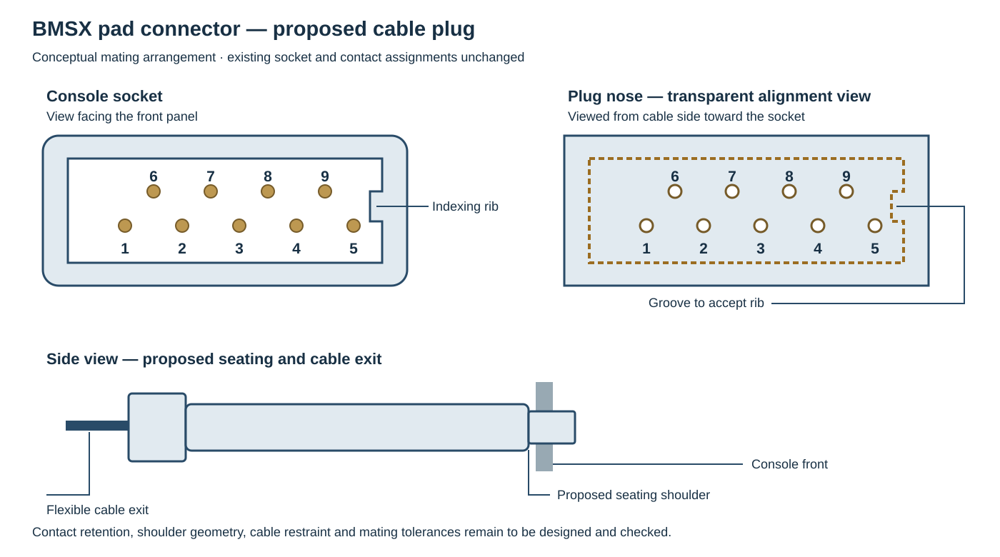{#fig-pad-plug-concept}

The proposed cable plug uses a spring socket around each round console contact.
Each socket is joined to its conductor and retained in an insulating housing;
the cable jacket is secured separately so that a pull on the cable is not
carried by the electrical joints. An indexing groove aligns the plug with the
console socket. The sectional view shows the arrangement of one contact, not
the physical dimensions of a finished connector.

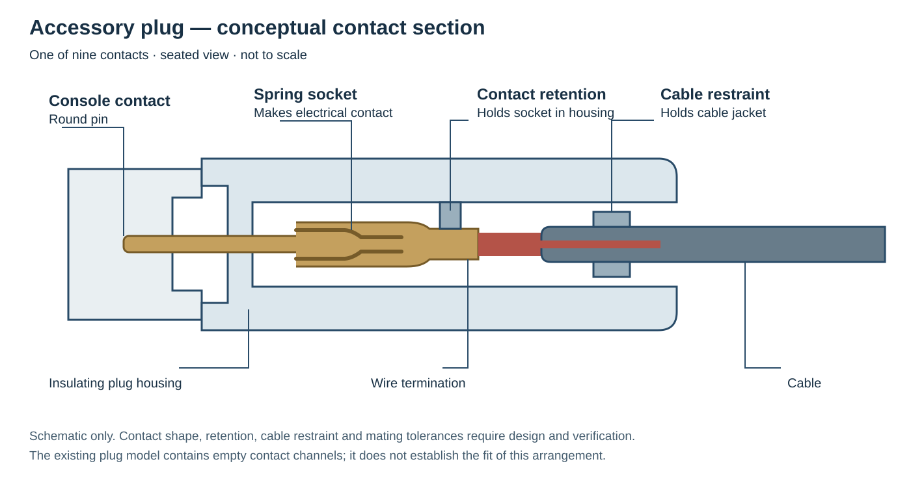{#fig-pad-plug-section}

Contact geometry and finish, contact retention, cable restraint and mating
tolerances remain to be designed and checked. The existing model has empty
channels; it does not establish that a particular socket contact fits or that
the assembled plug can be inserted, retained or removed reliably.
The proposed plug construction has stepped contact cavities, a transverse
retainer and a cable-exit boot. Its wider nose leaves a nominal 0.70 mm at the
thinnest contact cavity. The terminal shapes are space allocations, not working
spring contacts; electrical contact, material strength and cable restraint
remain to be designed.

### Reference accessories

The proposed gamepad has a directional pad, A/B/X/Y buttons, two pressable
sticks, bumpers, analogue triggers, Select, Start, Home and a clickable touchpad
switch. A vibration-equipped accessory can advertise that capability and accept
output requests. Home and the touchpad switch are ordinary game-visible inputs;
they do not themselves request the supervisor function.

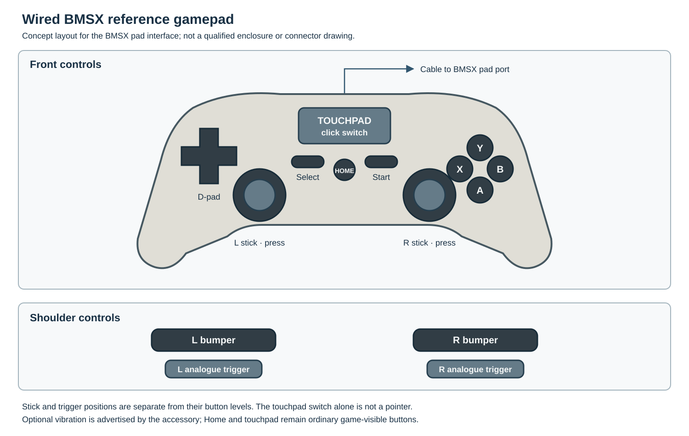{#fig-reference-gamepad}

The pointer concept supplies buttons, absolute display coordinates and a wheel
through the same serial interface. A combined pad and pointer may supply both
records on one port. Its pictured form is a concept, not a qualified assembly.

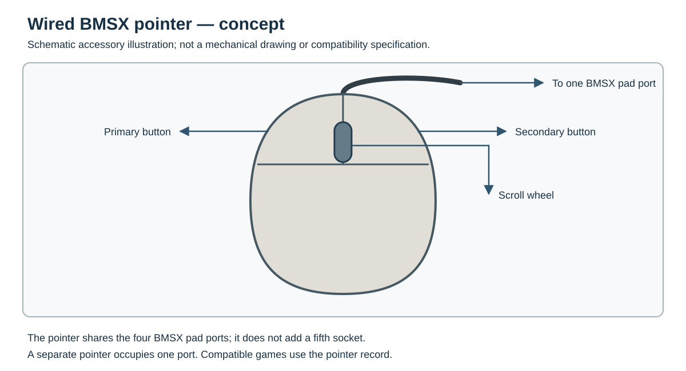{#fig-reference-pointer}

The four pad sockets are carried on the front board. Mainboard J300 connects
to that board by a keyed 20-contact harness:

| J300 contact | Connection | J300 contact | Connection |
|---:|---|---:|---|
| 1 | PAD_CLK_EXT | 11 | PAD_SELECT1_N_EXT |
| 2 | PAD_CMD0_EXT | 12 | PAD_SELECT2_N_EXT |
| 3 | PAD_CMD1_EXT | 13 | PAD_SELECT3_N_EXT |
| 4 | PAD_CMD2_EXT | 14 | V3V3 |
| 5 | PAD_CMD3_EXT | 15 | V5 |
| 6 | PAD_DATA0_EXT | 16 | Ground |
| 7 | PAD_DATA1_EXT | 17 | Ground |
| 8 | PAD_DATA2_EXT | 18 | Ground |
| 9 | PAD_DATA3_EXT | 19 | Ground |
| 10 | PAD_SELECT0_N_EXT | 20 | Ground |

## DC inlet {#sec-physical-dc}

Use an isolated, regulated 9 V DC supply with centre positive and sleeve return.
The reference inlet is a Switchcraft L722A with a nominal 2.0 mm centre pin;
its mating S761K plug has a locking ring. Support the plug while locking or
releasing it. The required adapter capacity and allowable accessory and
cartridge loads are not yet established. The input design-basis current in
@sec-physical-power is not a continuous console or adapter rating.

The inlet's internal red and black leads connect to J61.1 (`RAW9`) and J61.2
(ground), respectively. The inlet is supported from inside the case. POWER
controls the main converters; disconnect the supply to isolate the input harness.

## RGB, synchronisation and audio {#sec-physical-av}

The reference Kycon K-SCART-021 socket provides analogue RGB, separate composite
sync and stereo line audio. Use a directionally correct SCART cable and an
RGB-capable display. There is no composite-colour or RF output.

| SCART contact | Console connection | Associated return |
|---:|---|---:|
| 15 | Red output | 13 |
| 11 | Green output | 9 |
| 7 | Blue output | 5 |
| 19 | Composite synchronisation output | 17 |
| 3 | Left audio output | 4 |
| 1 | Right audio output | 4 |
| 16 | RGB selection output | 18 |
| 21 | Socket shield | Ground |

: Connections used by the reference audio/video harness. Output synchronisation is on contact 19, not contact 20. {#tbl-scart-contacts}

Contact 8, the television's input and aspect-ratio selection, is not connected.
RGB selection on contact 16 does not by itself guarantee automatic selection
of the television input; select the RGB input manually when necessary. The
reference circuit supplies no 4:3 switching voltage on contact 8.

For a console-to-television cable, sync output 19 connects to the display's
input 20; audio outputs 3 and 1 connect to inputs 6 and 2 respectively. RGB,
RGB selection and their associated returns connect to the corresponding
numbered contacts. The display must accept RGB with the supplied composite
synchronization signal; an RGB socket alone does not establish that
compatibility.

## Cartridge sockets and dust doors {#sec-physical-cartridges}

A BMSX cartridge encloses its circuit board in a shell with an exposed contact
edge and side channels for the guides. The proposed reference shell has a
leading plastic skirt. It is styled after MSX cartridges, but BMSX uses its
own electrical and mechanical interface; the resemblance does not establish
interchangeability with MSX cartridges. The label face, skirt and guide
channels face the console front, toward POWER and RESET.

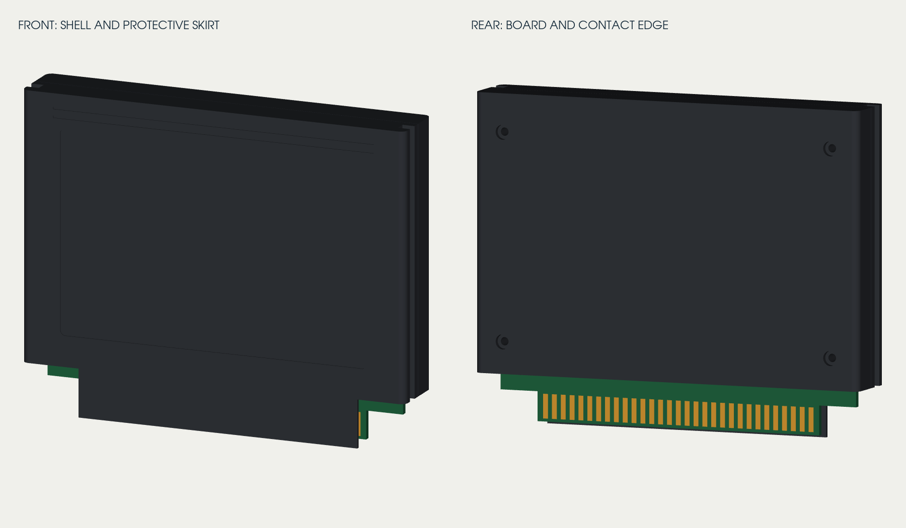{#fig-cartridge-editions-msx-native}

Each 113 × 21 mm opening accepts a nominal 110 × 18 mm cartridge shell. The
slot centres are 30 mm apart; two seated shells have nominally 12 mm between
them. A frame carries the guides and seating stops above two EDAC
395-062-520-202 62-contact sockets. The pictured seated arrangement is a
nominal proposal; grip and withdrawal with both cartridges fitted need a
physical usability check.

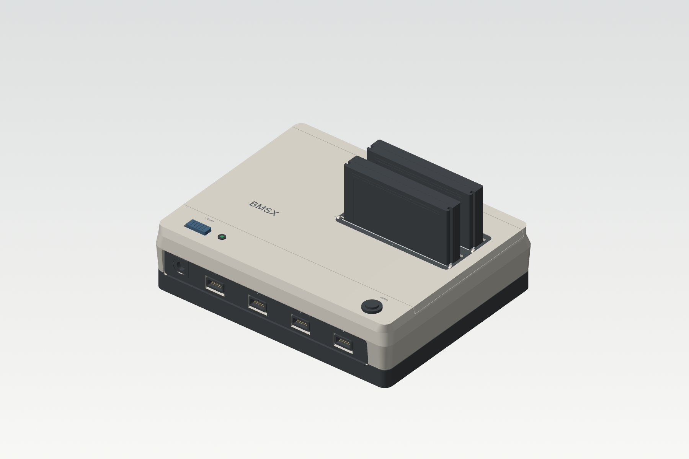{#fig-cartridges-dual-seated}

### Socket selection and reset

Case marking **1** is controller socket **0**, at the front; marking **2** is
controller socket **1**, at the rear. At startup the BIOS checks slot 1 first,
then slot 2, for a bootable cartridge. A card containing only RAM is not a
bootable program.

Both sockets receive the console's 3.3 V and 5 V rails while powered. Selection
chooses the bus target; it does not switch either card's power or reset the
other card. Presence, interrupt and DMA-request signals are separate per slot.
The candidate board has shared supply rails without independent socket
protection, and no per-card current allowance has yet been established.

Book III specifies that cartridge RAM initially contains zero and that a
logical card reset retains its contents. One physical card design can meet
this by clearing its own SRAM after power-up before acknowledging memory
accesses; selecting a socket does not clear it. The initialization time and
its integration with a complete card remain to be established.

Instruction fetch remains bound to the execution socket while ordinary data
access can select either card. DMA source and destination can select sockets
independently. See Book III for the programmer-visible selection, address
windows and card operations.

### Cartridge contacts

@fig-cartridge-terminal-orientation looks down into the console with the front
at the bottom. Mainboard row A is toward the front and row B toward the rear;
each runs from position 1 at left to 31 at right. Contact pitch is 2.54 mm in a
row and 5.08 mm between rows. The rear socket repeats this arrangement 30 mm
behind the front socket. The apparent orientation of a cartridge finger differs
between its front and underside views; identify each by its mating terminal.

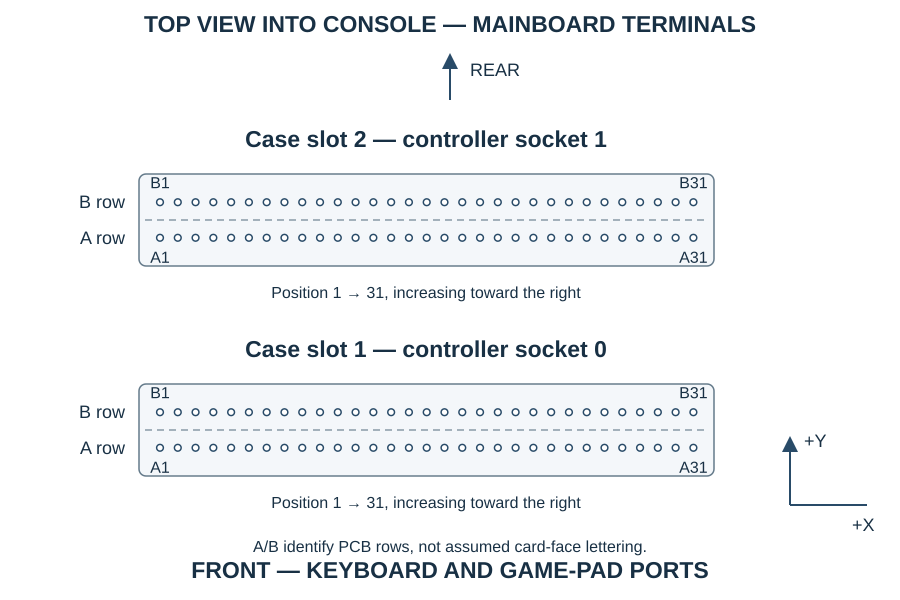{#fig-cartridge-terminal-orientation}

Position *n* identifies terminals A*n* and B*n*. A slash separates socket-0 and
socket-1 signal names where they differ.

| Position | A row, toward console front | B row, toward console rear |
|---:|---|---|
| 1 | `CAD0` | `GND` |
| 2 | `CAD1` | `GND` |
| 3 | `CAD2` | `GND` |
| 4 | `CAD3` | `GND` |
| 5 | `CAD4` | `GND` |
| 6 | `CAD5` | `GND` |
| 7 | `CAD6` | `GND` |
| 8 | `CAD7` | `GND` |
| 9 | `CAD8` | `GND` |
| 10 | `CAD9` | `GND` |
| 11 | `CAD10` | `GND` |
| 12 | `CAD11` | `GND` |
| 13 | `CAD12` | `GND` |
| 14 | `CAD13` | `GND` |
| 15 | `CAD14` | `GND` |
| 16 | `CAD15` | `GND` |
| 17 | `CAL_LO` | `GND` |
| 18 | `CAL_HI` | `GND` |
| 19 | `CART_CLK` | `GND` |
| 20 | `CRD_N` | `CWR_N` |
| 21 | `CBE0_N` | `CBE1_N` |
| 22 | `CART_RESET_N` | `GND` |
| 23 | `CS_CART0_N` / `CS_CART1_N` | `CART_READY0_N` / `CART_READY1_N` |
| 24 | `IRQ_CART0_N` / `IRQ_CART1_N` | `DREQ_C0_W` / `DREQ_C1_W` |
| 25 | `DREQ_C0_R` / `DREQ_C1_R` | `CART_PRESENT0_N` / `CART_PRESENT1_N` |
| 26 | `V3V3` | `GND` |
| 27 | `V3V3` | `GND` |
| 28 | `V3V3` | `GND` |
| 29 | `V5` | `GND` |
| 30 | `V5` | `GND` |
| 31 | `V3V3` | `GND` |

: Mainboard assignment of the 62 cartridge terminals. {#tbl-cartridge-terminals}

CAD[15:0] carries multiplexed address and data; CAL_LO and CAL_HI latch the
address portions. These suffixes do not indicate active-low polarity.

| Signal group | Direction at console | Function |
|---|---|---|
| CAD[15:0] | Bidirectional | Address portions and data halves |
| CAL_LO, CAL_HI | Output | Address-latch controls |
| CART_CLK | Output | Cartridge timing reference |
| CRD_N, CWR_N | Output | Read and write strobes |
| CBE0_N, CBE1_N | Output | Byte-lane enables |
| CS_CARTs_N | Output | Selected socket |
| CART_RESET_N | Output | Common card reset |
| CART_READYs_N | Input | Selected-card acknowledgement |
| IRQ_CARTs_N | Input | Card interrupt |
| DREQ_Cs_R, DREQ_Cs_W | Input | Read and write DMA requests |
| CART_PRESENTs_N | Input | Card-presence contact |

Here *s* is controller socket 0 or 1. The signal levels are 3.3 V even on a
card using the 5 V supply. The physical bus is a construction proposal; Book
III describes the public card operations.

Each B25 presence input has its own 10 kΩ pull-up to 3.3 V. The reference
cartridge connects its B25 finger to cartridge ground, for example B26. An
empty socket reads high and an inserted card reads low, independently of
selection. Presence does not report the fitted ROM capacity or bootability.
The proposed connection must be included in the actual card artwork. It does
not establish hot-plug support.

### Example ROM-only card

One possible card uses an 8 MiB, 4M × 16 SST39VF6401B flash and a card-side
interface controller. The controller receives the multiplexed address, selects
its own installed ROM, returns data and acknowledges transfers. The console
does not discover that capacity from presence. Under the current Book III
contract, the card must return zero for unpopulated locations rather than
mirror a smaller ROM, and writes to ROM have no effect.

In this proposed card, a local power-on reset supervises the controller and
flash as their 3.3 V supply starts. The console's `CART_RESET_N` separately
resets the controller's logical state. The controller waits for the flash to
recover from its power-on reset before acknowledging a ROM read. During console
operation the flash's write-enable input is held inactive; flash programming is
a separate operation. The flash's block-protection input alone does not protect
the whole device.

This is a functional example, not a complete circuit or a minimum cartridge
size. The controller, local reset circuit, programming method and card artwork
remain to be designed and qualified. Other cartridges may use different
capacities and add RAM or devices.

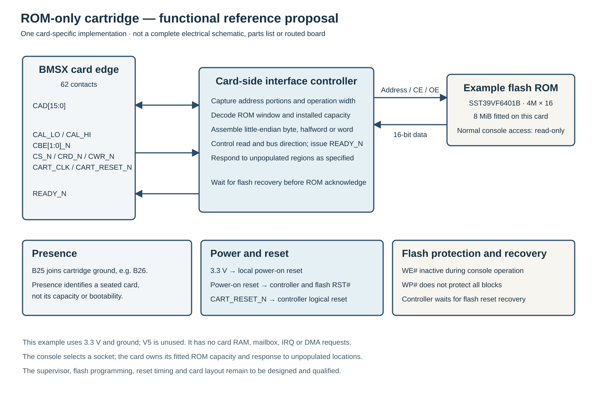{#fig-cartridge-rom-reference}

### Mechanical polarisation

Two frame keys project into the guide path at the ends of each slot. Matching
channels face the console front on both cartridge side walls. A reversed shell
presents its solid walls to the keys before the contact edge reaches the socket.
The keys use none of the 62 electrical contacts; the channel returns maintain
the closed shell. Do not force a cartridge against the guides.

| Feature | Nominal dimension |
|---|---:|
| Channel depth / width | 3.5 / 3.2 mm |
| Key projection / width | 3.0 / 2.4 mm |
| Channel-bottom clearance | 0.5 mm |
| Clearance at each flank | 0.4 mm |
| Returned shell wall | 1.5 mm |

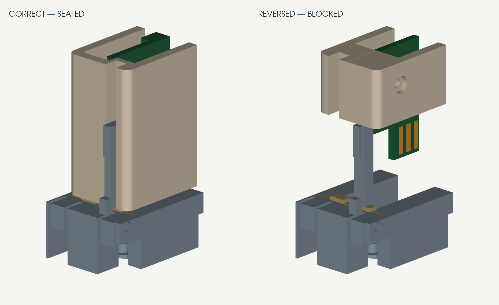{#fig-cartridge-polarisation}

### Dust-door operation

Each leaf has its own pivot and return spring. The proposed reference
cartridge's leading plastic skirt pushes its leaf inward before the exposed
board reaches it; the other slot remains closed. A matching channel in the
supporting frame accepts the skirt as the cartridge seats. The leaf stands
alongside the seated cartridge and returns to its stop when it is withdrawn.
The proposed skirt and frame are shown at nominal insertion positions; their
complete insertion clearance and durability have not been established.

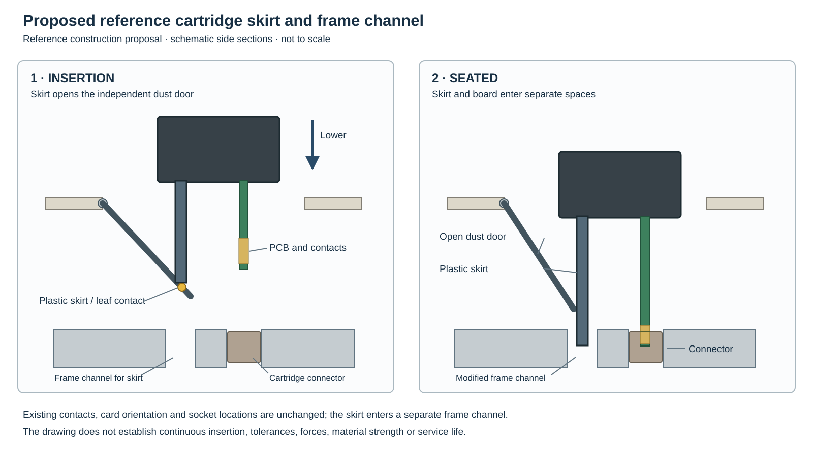{#fig-cartridge-protective-skirt}

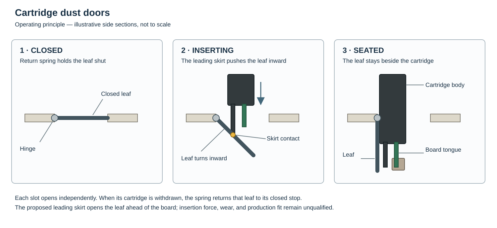{#fig-connector-door-operation}

### Inserting and removing a cartridge

1. Switch POWER off and disconnect the external supply.
2. Check that the door returns freely and that the contacts and opening are
   clean. Leave space above the slot for a straight approach.
3. Face the label and skirt toward the console front and align both shell
   channels with the frame keys. Hold the cartridge squarely and lower it
   vertically.
4. Seat it against its stops without rocking the connector or forcing a leaf.
5. To remove it, grip the shell and lift vertically. Allow the door to return.

If insertion stops early, withdraw the card and check its orientation, channels,
guides and door. Inspection of the door assembly is in @sec-service-cartridge-doors.

## Controls and indication {#sec-physical-controls}

POWER enables the main rails; RESET restarts the console. The green indicator
lights when the 3.3 V rail is present. It does not prove that all supplies or
startup functions are correct. Disconnect the external supply before servicing,
even when the indicator is dark.

## Internal harness assembly {#sec-physical-internal-harnesses}

Three numbered harnesses connect the mainboard and connector boards:

- Mainboard J300 connects to front-board J5, contact 1 to 1 through 20 to 20.
- Mainboard J301 connects to keyboard-board J2, contact 1 to 1 through 4 to 4.
- Mainboard J500 connects through its cable socket and 16-conductor ribbon to
  A/V-board J1, with contact 1 to 1 through 16 to 16. J1 is a soldered ribbon
  termination, not a second mating header.

J60 connects the POWER and RESET controls and the indicator. J61 connects the
rear DC inlet. The A/V board connects separately to the SCART contact board.
@fig-internal-harness-overview shows the connections; it is a functional
diagram rather than a cable-routing drawing.

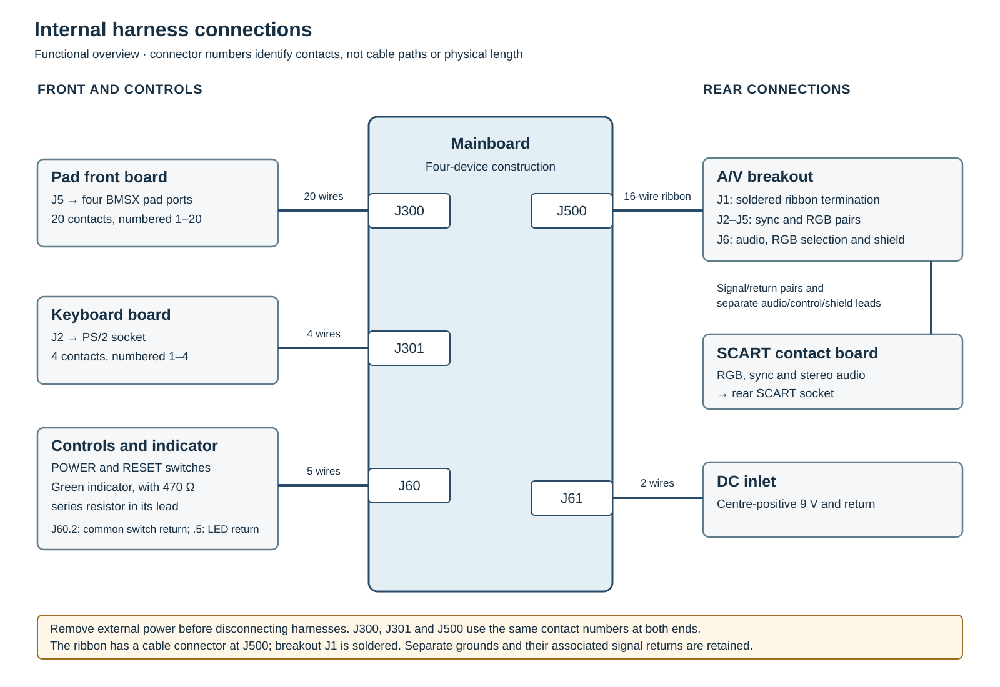{#fig-internal-harness-overview}

| J60 contact | Mainboard signal | Control connection |
|---:|---|---|
| 1 | `POWER_SW` | POWER switch contact 2 |
| 2 | Ground | POWER contact 3 and RESET contact 4, through an insulated branch |
| 3 | `RESET_SW` | RESET switch contact 3 |
| 4 | `V3V3` | Indicator anode through a 470 Ω series resistor |
| 5 | Ground | Indicator cathode |

: Control and indicator harness at the mainboard. {#tbl-controls-harness}

The reference indicator resistor is 1%, rated at least 0.25 W, and fitted and
insulated in the indicator lead. The two switches share the contact-2 return;
the indicator uses the separate contact-5 return.

In the reference harness, the J300 supply and return contacts, J301 ground and
the J500 grounds use separate numbered conductors. Preserve the return paths,
connector orientation, strain relief and numbering when replacing a harness.
The harness construction and wire lengths are not fixed external-interface
requirements. The service procedure is in @sec-servicing.

| Board connection | Cable-side housing | Termination |
|---|---|---|
| J300 and front J5 | JST PHDR-20VS, 20 positions | SPHD-002T-P0.5 signals; SPHD-001T-P0.5 supplies and returns |
| J301 and keyboard J2 | JST PHR-4, four positions | SPH-002T-P0.5S contacts |
| J500 | Würth 61201623021, 16 positions | IDC ribbon with strain relief |
| J61 | Molex 39-01-2025, two positions | Mini-Fit Jr female contacts |

The following signals travel through J500 to the A/V board:

| J500 contact | Signal | J500 contact | Signal |
|---:|---|---:|---|
| 1 | Red | 2 | Ground |
| 3 | Green | 4 | Ground |
| 5 | Blue | 6 | Ground |
| 7 | Composite sync | 8 | Ground |
| 9 | Left audio | 10 | Ground |
| 11 | Right audio | 12 | Ground |
| 13 | RGB selection | 14 | Ground |
| 15 | Ground | 16 | Ground |

Four separate video and sync signal/return pairs connect the A/V board to the
SCART contact board. Maintain each signal's associated return. Composite sync
is the console output at SCART contact 19, not contact 20. Separate conductors
carry the audio channels, RGB selection and socket shield. The socket's mounting
ears and internal carrier, rather than its solder tails, carry cable loads.

On the A/V breakout, J2 carries sync, J3 red, J4 green and J5 blue; each uses
contact 1 for the signal and contact 2 for its return. J6 contacts 1–8 carry
left audio and return, right audio and return, RGB selection and return, then
two shield leads, in that order. The SCART contact board maps these to the
external connections in @tbl-scart-contacts.

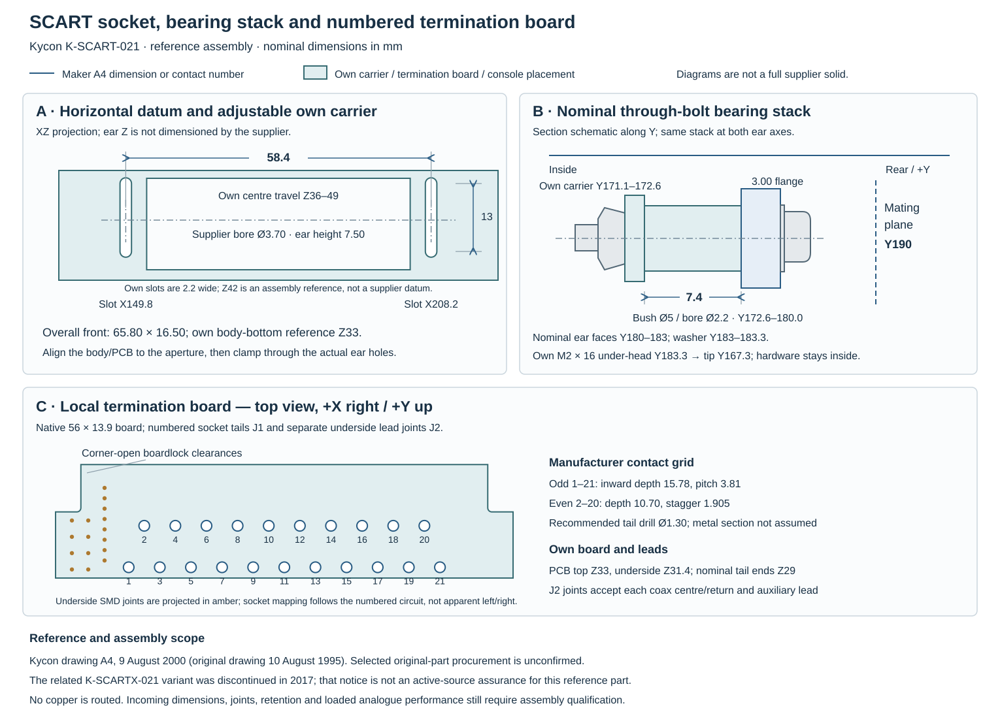{#fig-scart-assembly-datums}

The numbered socket tail pattern and installation depend on the selected
connector. Restore the carrier, restraints and individual return paths during
service; do not substitute a similar-looking socket without checking its
contact assignment and mounting. Measurement points and service procedures
are described in @sec-physical-power and @sec-servicing.

### Loaded sync check

The proposed sync output has a 75 Ω series resistor. Measure across a single
75 Ω termination with a high-impedance probe and a local return. The following
are design check targets, not measured or qualified product limits:

| Quantity | Target or condition |
|---|---|
| Sync amplitude | 0.25–0.35 V from sync tip to reference level, into 75 Ω |
| Rise and fall | 100–300 ns at 10% and 90% amplitude |
| CSYNC/RGB edge displacement | At most one 13.5 MHz sample, 74.074 ns |
| V3V3 during the check | 3.0–3.43 V at the output circuitry |

Check both transitions with the intended harness and cable; avoid a second
parallel 75 Ω termination. The video path is described in @sec-physical-mainboard.
