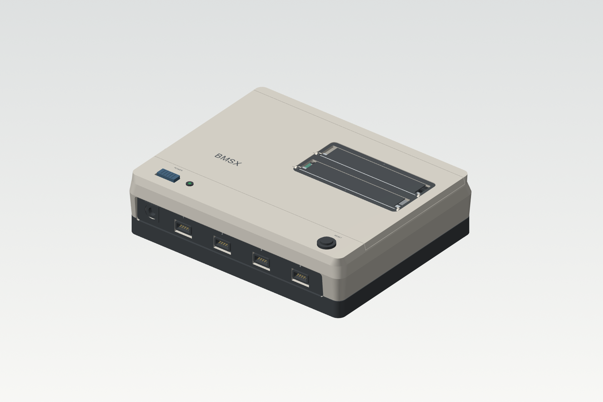
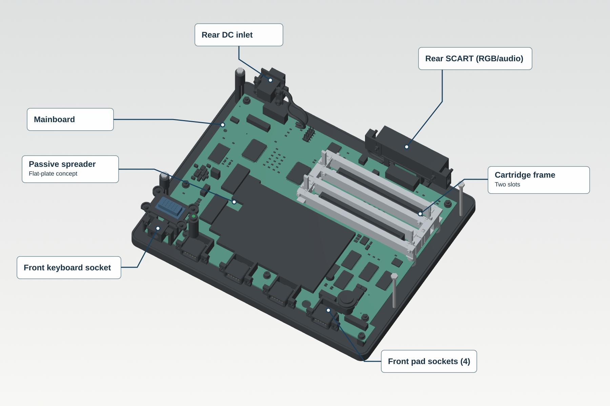
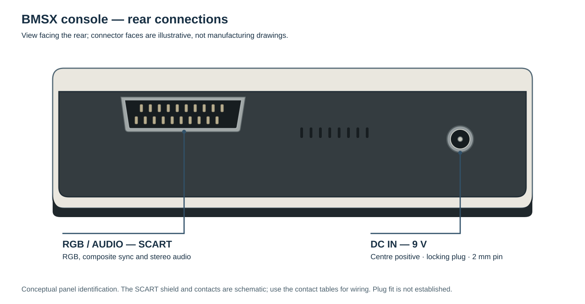
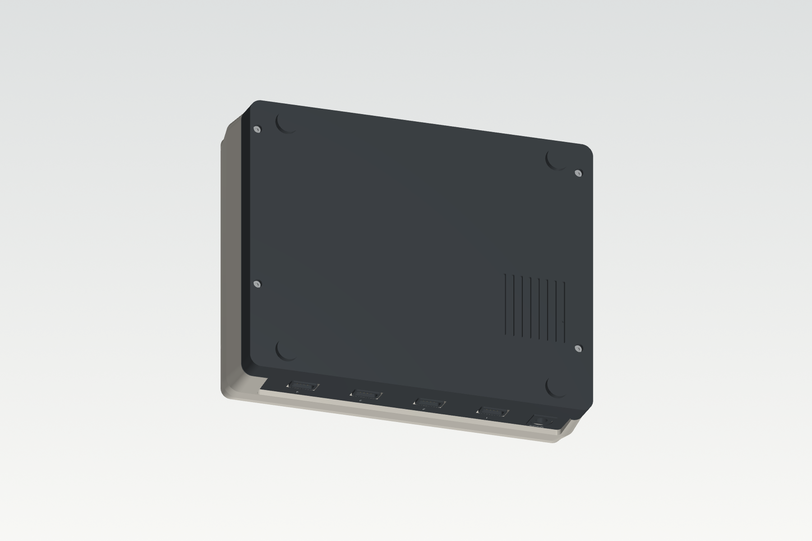
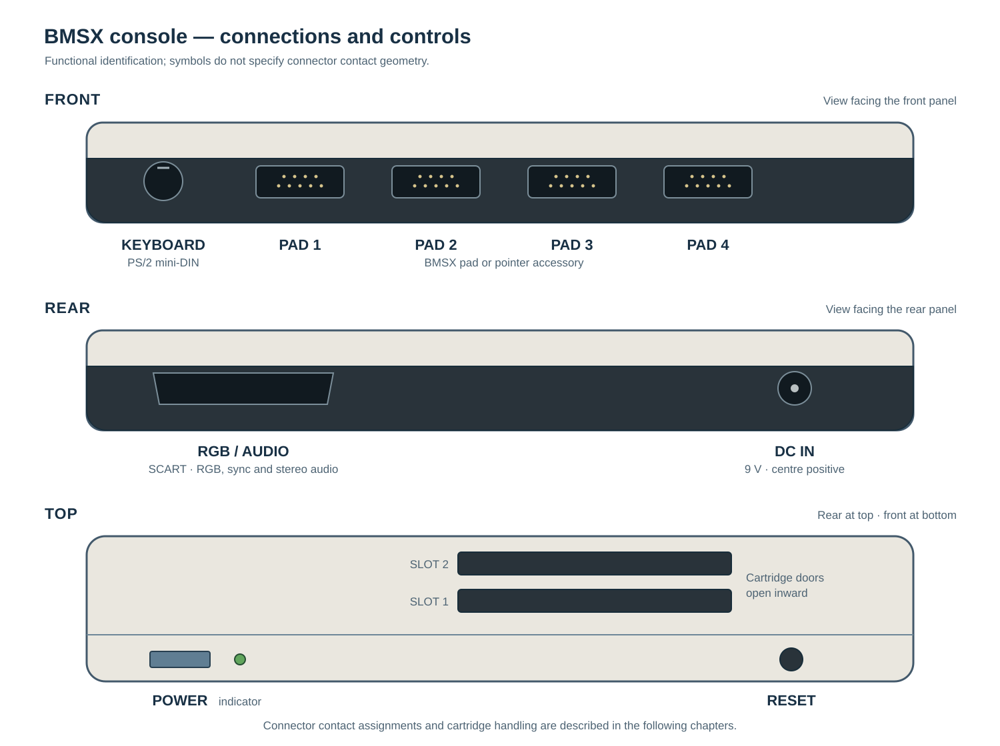
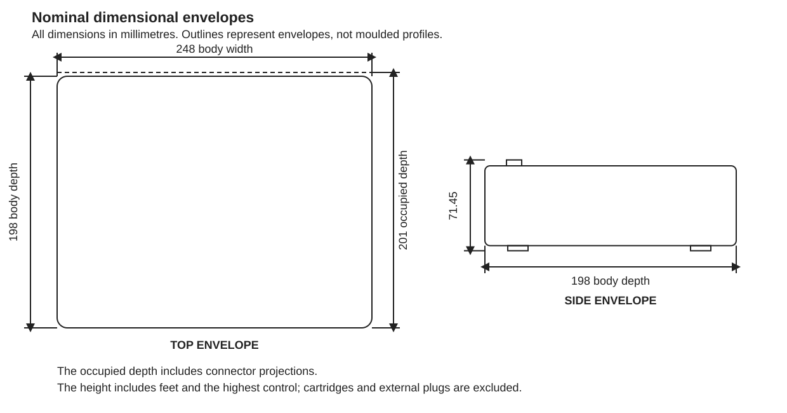

# Construction and mechanical arrangement {#sec-construction}

The BMSX reference console places the mainboard, connector boards and cartridge
frame on an aluminium deck inside an enclosure with removable upper and lower
covers. Four recessed screws
underneath secure the removable covers. The front and rear connectors and the
POWER and RESET controls remain with the fixed body when the covers are removed.

The upper cover contains two independent cartridge dust doors. Each door opens
inward as a cartridge is inserted and returns when it is removed. The frame
guides the cartridges and transfers insertion forces to the deck. The proposed
reference cartridge has a leading plastic skirt; a channel in the frame accepts
it alongside the connector as the cartridge seats.

{#fig-construction-exterior}

The keyboard socket is at the front beside four accessory ports. The proposed
front opening has a round lip; the socket face in the illustration is a
presentation model. Its plug clearance and strength are not yet qualified.

{#fig-construction-interior}

The interior illustration shows the proposed mainboard placement and a flat
passive heat spreader. It omits the fixed body for clarity; it does not show
the console immediately after cover removal. The model is not a completed
assembly-fit or thermal qualification.

{#fig-rear-connections-concept}

The rear view identifies the audio/video and DC connections; connector faces
are illustrative. Contact assignments are given in @sec-physical-connectors.

{#fig-construction-underside}

## Identification and nominal envelope {#sec-construction-envelope}

The front carries the keyboard socket and four numbered pad sockets. The
rear carries DC input and RGB/audio. POWER, the indicator and RESET occupy
the upper front band; cartridge slots 1 and 2 are behind them.

{#fig-construction-connections}

| Item | Nominal dimensions | Extent included |
|---|---:|---|
| Console, without cartridges | 248 × 201 × 71.45 mm | Connector projections, feet and controls |
| Mainboard | 220 × 150 × 1.6 mm | Board outline and thickness |
| Aluminium deck | 240 × 190 × 2 mm | Flat deck, excluding local pads and ribs |
| Cartridge opening | 113 × 21 mm | Each opening |
| Cartridge slot centres | 30 mm apart | Front-to-rear spacing |
| Cartridge shell | 110 × 18 × 75 mm | Main body, excluding leading skirt and exposed contacts |

: Nominal dimensions for the proposed construction. {#tbl-construction-envelope}

{#fig-construction-dimensions}

Stand the console on its feet on a firm surface. Allow room behind it for
plugs and cable bends and above it for cartridge removal. Keep the underside
intakes and upper-rear outlets clear.

## Structural assemblies {#sec-construction-assemblies}

| Assembly | Function |
|---|---|
| Aluminium deck | Supports the mainboard, cartridge frame and cooling supports |
| Fixed body | Locates connector carriers and controls |
| Upper cover | Carries the cartridge dust doors |
| Lower cover | Protects the underside and carries feet and intake openings |
| Cartridge frame | Guides cards, provides seating stops and polarising keys |
| Front and rear connector assemblies | Carry the keyboard, pads, DC and audio/video connections |

The proposed mainboard is 1.6 mm thick with eight copper layers and uses
insulating board supports. The metal cooling supports pass through separate
board-clearance holes and bear on the deck without clamping the PCB.
Construction and servicing procedures are described in @sec-servicing.

One construction proposal connects the aluminium deck deliberately to system
ground near the power return and rear interfaces, while retaining the
insulating mainboard supports and non-plated mounting holes. The electrical
relationships between the deck, cartridge frame and connector shells would
also need to be defined. This connection is not present in the current
circuit. It is a system reference, not protective earth: the external 9 V
supply is isolated and supplies no earth conductor. The proposed connection
does not establish EMC performance or electrical safety.

## Passive cooling arrangement {#sec-construction-cooling}

CORE and GFX contact a shared passive cooling component through separate
insulating thermal pads. The component spreads heat; its supports also provide
a path to the aluminium deck. Air enters through the underside and leaves
through the upper rear. The cartridge doors may remain closed during use.
There is no fan.

A flat spreader is shown in @fig-construction-interior. A finned profile is
also retained as an alternative. The final cooling component and interface
materials depend on the actual device loads, contact conditions and measured
temperatures; neither option is yet thermally qualified. The cooling interface
and reassembly procedure are described in @sec-service-cooling.
