# Mainboard and interconnect {#sec-physical-mainboard}

The mainboard connects four custom devices to their memories, the two
cartridge sockets and the external interfaces. CORE executes the program and
controls main memory and cartridge access. GFX draws and displays the image;
APU produces stereo sound. The firmware bridge supplies system-ROM data. In
the proposed integration, GFX also receives keyboard and accessory input.

The devices communicate over a shared system bus, while the main, video and
sample memories have separate local interfaces. These local memories are not
one shared bank: data is transferred between them through the appropriate
CPU, DMA or device port.

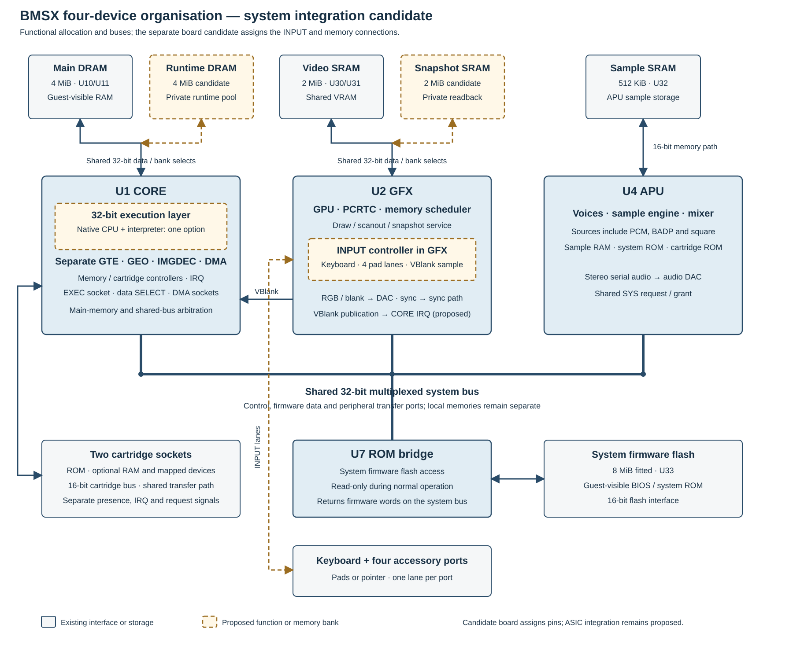{#fig-four-chip-system-candidate}

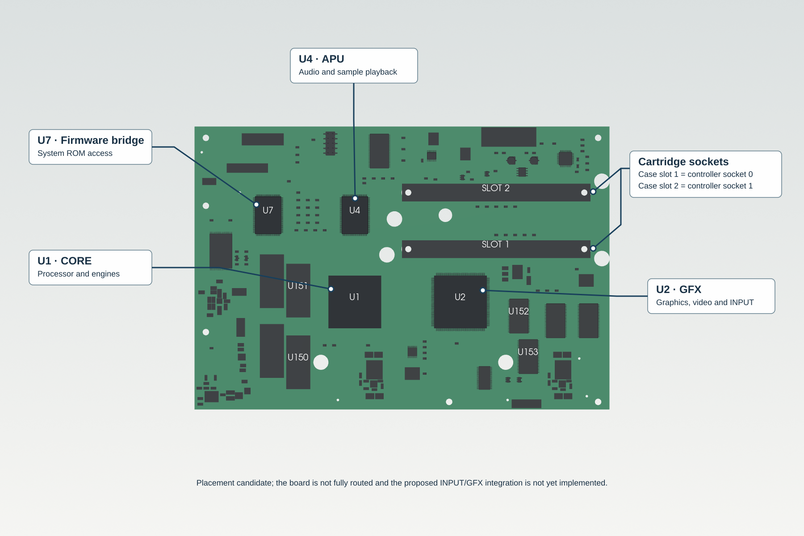{#fig-physical-mainboard-input-candidate}

The placement drawing shows the proposed four-device mainboard and the two
cartridge connectors. It is not a routed board or a complete assembly-fit
qualification. The proposed INPUT allocation and private memory devices are
included in a separate schematic and PCB candidate; the combined GFX/INPUT
logic remains to be implemented.

## Device and memory arrangement

| Device | Package terminals | Principal functions |
|---|---:|---|
| U1 CORE | 208 | Processor execution, GTE, GEO, IMGDEC, DMA, main-memory and cartridge control, interrupts |
| U2 GFX | 208 | Drawing, display and video-memory control; proposed keyboard and accessory input |
| U4 APU | 128 | Voice playback, mixing, sample-memory control and serial audio |
| U7 firmware bridge | 128 | System firmware-flash access |

CORE contains separate GTE, GEO, IMGDEC and DMA functions; they are not
separate motherboard chips. GTE and GEO perform calculations, while GFX draws
the resulting images. IMGDEC expands image data for upload to GFX. Book I
specifies the programming interfaces and Book II specifies BLua32 and BIOS.

| Storage | Devices in this construction | Capacity | Controller |
|---|---|---:|---|
| Main RAM | U10/U11, two 1M × 16 DRAMs | 4 MiB | CORE |
| Video memory | U30/U31, two 512K × 16 SRAMs | 2 MiB | GFX |
| Sample memory | U32, one 256K × 16 SRAM | 512 KiB | APU |
| Firmware flash | U33, one 4M × 16 device | 8 MiB fitted | Firmware bridge |
| Private runtime memory | U150/U151, two 1M × 16 DRAMs | 4 MiB proposed | CORE |
| Private graphics snapshot memory | U152/U153, two 512K × 16 SRAMs | 2 MiB proposed | GFX |

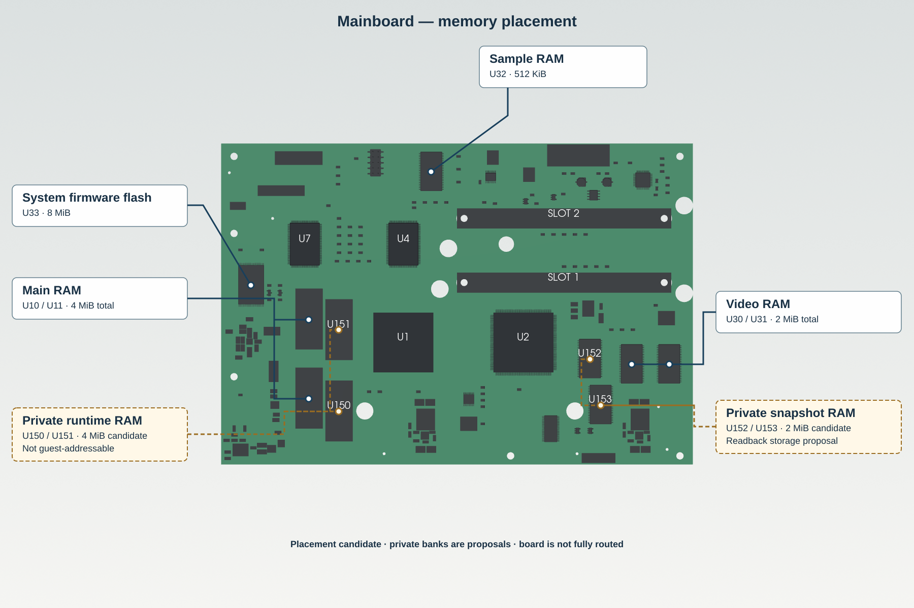{#fig-mainboard-memory-placement}

The two private banks are construction proposals. They do not increase the
public main, video or sample memory capacities and do not change the memory
map. Their need, capacity and implementation remain to be established.

### CORE main and runtime DRAM

CORE routes CPU, DMA and GEO requests to the public main-memory service or
their other selected targets. In the proposed execution arrangement, the CPU
runtime can also request the separate private DRAM bank; DMA and GEO do not
address that bank. It does not expand the public 4 MiB main-memory map.

The public and proposed private banks share a single DRAM controller and its
address, data and byte-control conductors. Separate row and output enables
select the bank for a memory access; they are not two independent memory
ports. The controller initialises and refreshes the banks. A system reset of
the controller does not itself clear their contents; retention through loss of
power is not specified.

The candidate request router retains the owner of each target response, so a
waiting access to another target need not occupy the DRAM controller while it
services other admitted work or refreshes. The CPU runtime and complete GEO
connection remain proposals; this organisation does not establish their
timing or throughput.

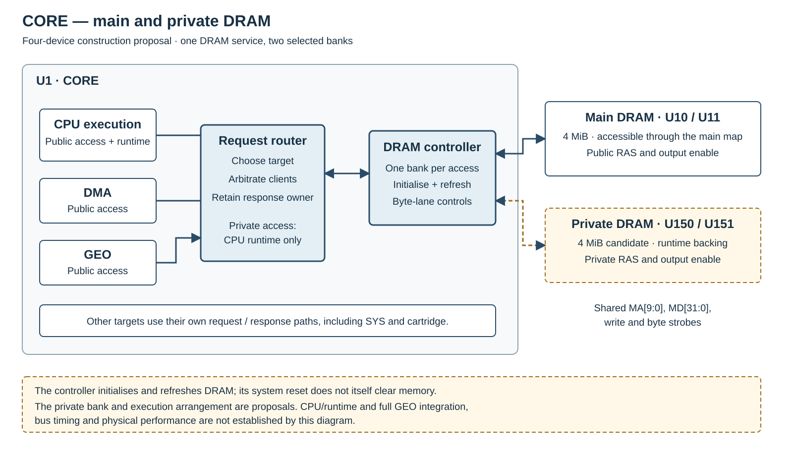{#fig-core-memory-banks}

### Sample-memory word service

APU has its own 16-bit sample-memory interface. A 32-bit transfer is handled
as two halfwords; playback and sample uploads share the memory service. The
number of programmable voices alone does not guarantee that every source and
upload combination can be serviced at the same time. See
@sec-physical-apu-memory-envelope.

### Firmware flash {#sec-physical-firmware-flash}

U7 reads the 16-bit firmware flash and supplies system-ROM data to the shared
bus. Normal console accesses are read-only. The fitted flash and the 16 MiB
system-ROM address window are distinct. The programmed 8 MiB flash contains the
firmware followed by zero fill; U7 returns zero for the upper 8 MiB without
mirroring or reading the flash. The BIOS and startup interfaces are described
in Book II.

The construction uses an 8 MiB device, with its write enable held inactive
during console operation. Programming is an external service operation, not a
command supplied by the console system bus. The image layout, power-up and
reset behavior must be established for the fitted part.

## U1 CORE internal organisation {#sec-physical-core-internal}

CORE brings together processor execution and separate engines for geometry,
image decompression and DMA. The processor supplies operands and commands;
each engine performs its own operation and returns results through registers
or memory. The main-memory and cartridge controllers arbitrate their shared
paths, and the interrupt controller records events for software.

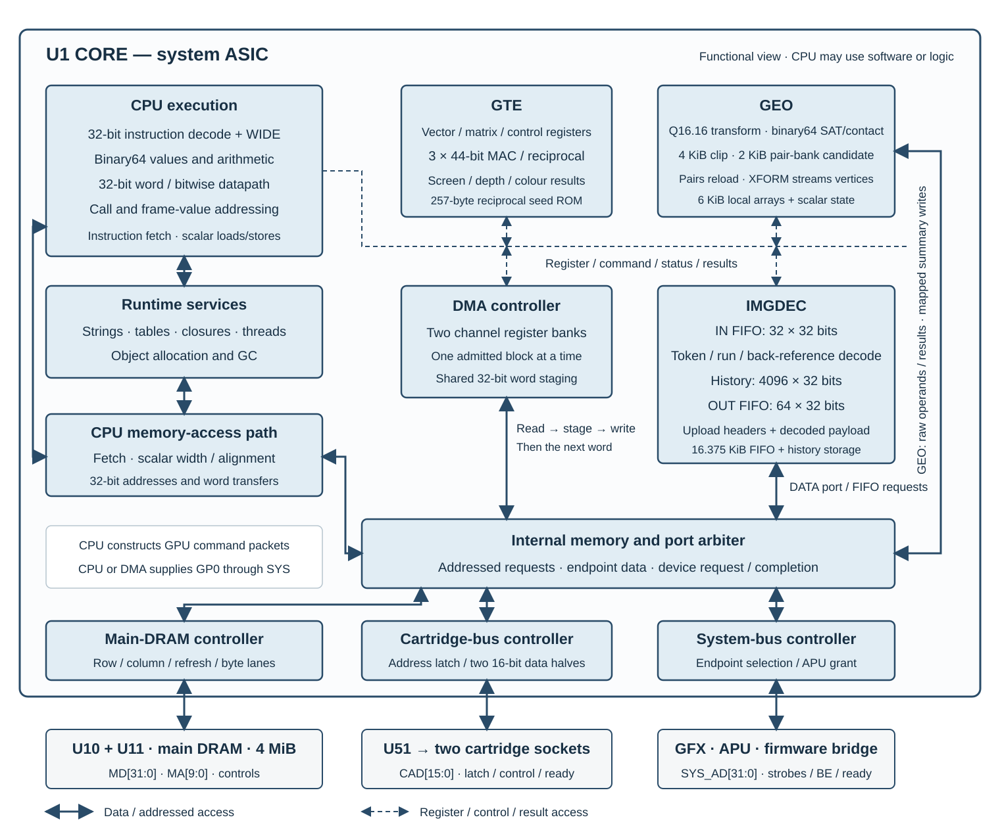{#fig-physical-core-internal}

BLua32 specifies the instruction and value model presented to software; it
does not require a hardwired implementation of the language runtime. The
physical CPU, the work required by its instructions and the resulting timing
are not yet established. Book II remains the programming reference.

### Native-processor execution candidate {#sec-core-native-execution}

One possible execution layer uses a conventional 32-bit processor with a
resident interpreter. Its private program and working storage are separate
from the BIOS in system ROM and from the public 4 MiB main RAM. This is an
implementation candidate, not an established processor or timing guarantee.

In this option, CORE could hold the interpreter's native program in a private
on-chip ROM. After power and reset establish the hardware, the native processor
starts from that private store and initializes the BLua32 execution state. The
chosen main and private memories must be initialized before they are used. It
then enters the guest-visible reset sequence, reading the BMSX BIOS through U7
and its system firmware flash. The BIOS initializes the system and selects a
bootable cartridge. The native bootstrap and the BLua32 reset entry are thus
different stages; the private interpreter code is not part of the guest-visible
BIOS image or its zero-filled space.

The private ROM's size and contents are not specified, and this interpreter
and boot sequence have not been implemented or shown to meet the published
timing. Other execution implementations are possible without changing the
software-visible reset interface.

### Runtime memory {#sec-core-private-memory}

A candidate adds a private 4 MiB DRAM bank for runtime values, objects, frames
and management data. It is not guest-addressable main RAM. One physical pool
can back the ordinary and system namespaces while preserving their separate
logical roles. The bank size, allocation and failure behavior still require a
product decision; fitting the devices does not prove that every workload fits.

### Runtime lifetime and collection {#sec-runtime-pool-and-collection}

An execution implementation must retain reachable system and cartridge state
across the transitions described in Book II. The allocation and collection
mechanism is an implementation choice; the logical behavior is not defined
by the presence of a particular private memory bank.

### GTE command path {#sec-physical-gte-command-path}

GTE accepts commands and operands, performs geometry and projection
calculations, and publishes results, histories and flags through its register
interface. The CPU supplies operands and reads results through those registers;
GTE does not fetch vertex buffers itself or submit drawing commands to GFX.
Software uses the returned positions, depth and colours to prepare drawing
packets, which the CPU or DMA supplies to GFX.

GTE PLUS has its own operands, command and result state. Normal GTE commands
can be used while a PLUS command is pending; PLUS command submission belongs
to the CPU and cannot be issued by DMA. The physical arithmetic organisation
and completion timing have not yet been qualified. Book I specifies the
command, register and result interfaces.

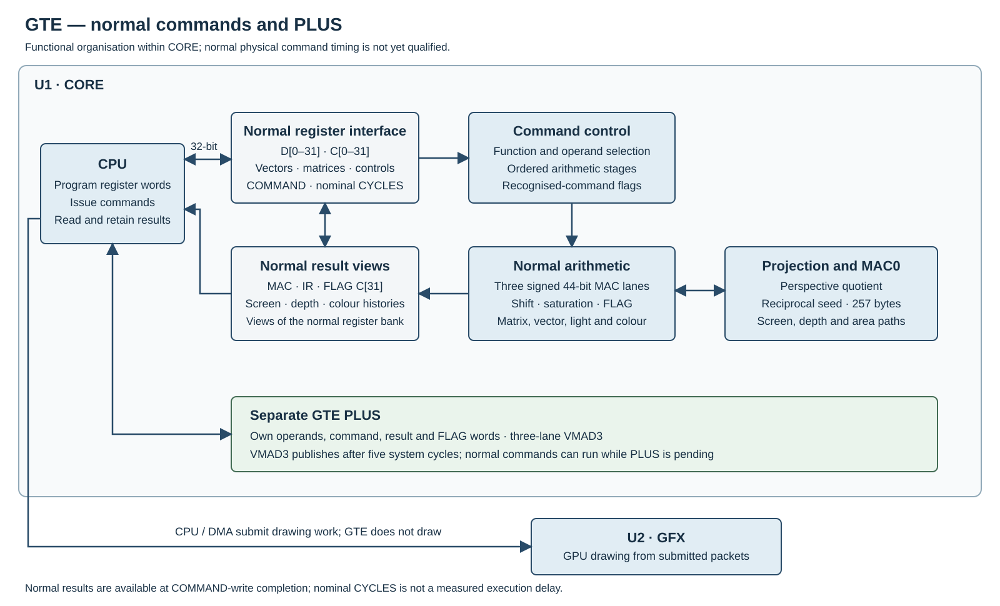{#fig-physical-gte-datapath}

### IMGDEC stream path {#sec-physical-imgdec-path}

IMGDEC accepts compressed image input and produces upload data for the CPU or
DMA to send to GFX. GFX, rather than IMGDEC, performs the video-memory writes.
Input, output and completion are controlled through the interface in Book I.

For a streamed upload, one DMA channel can feed compressed words from ROM or
main RAM into IMGDEC while the other is armed to drain its output to GPU GP0
or RAM. The channels share one block engine; their input and output requests,
and the destination's request where applicable, govern block admission. If
output cannot be drained, backpressure can eventually fill the input path.
IMGDEC completion requires its output to be read; it does not mean the GPU has
already processed the upload.

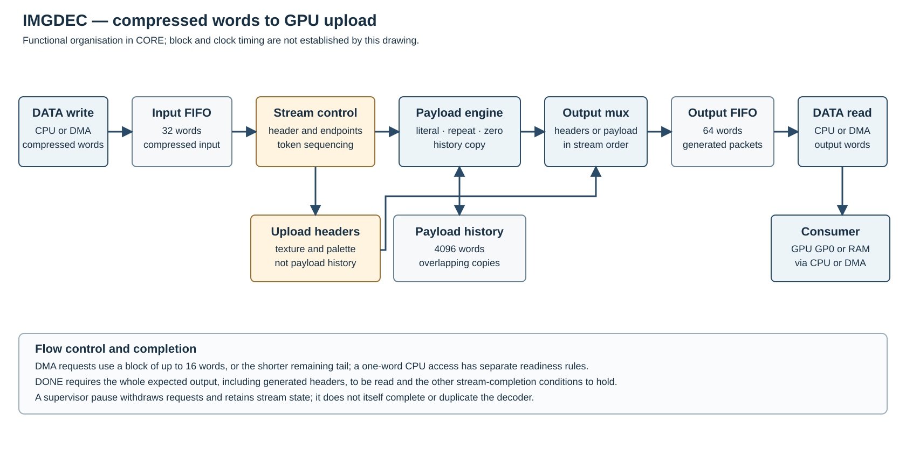{#fig-physical-imgdec-path}

## Shared system bus

The system bus carries control accesses, firmware data and transfers between
CORE, GFX, APU and the firmware bridge. The 32-bit address/data conductors are
shared between phases of a transaction. Selection and READY signals identify
the target and its acceptance of a transfer; turnaround separates drivers.
The bus is an internal construction interface, not a cartridge connector or
an additional software-visible memory bank.

### Diagnostic output

CORE provides the line-oriented diagnostic output described in Book I. A
proposed service path would make completed lines available to an instrument
through J302. This is a service connection, not an additional
cartridge-visible register. The service path and the complete scan chain have
not yet been integrated; the connector alone does not establish their operation.

### Supervisor coordination across devices

In the four-device proposal, SYSTEM in U1 coordinates supervisor entry and
return. GEO, IMGDEC, DMA and the central IRQ context are local to U1; GPU and
display context belong to U2, and playback state belongs to U4. The Book I
entry sequence first waits for the GEO and IMGDEC producer boundary, then for
the admitted DMA block, and finally for the GPU boundary. An admitted DMA
block must still be able to deliver its words to the GPU before GPU ingress is
stopped. IRQ state is banked before the supervisor GPU context is initialized.
U4 holds playback positions for supervisor service while sample-transfer work
already in progress remains separate. On return, the supervisor's DMA and GPU
work reaches its boundaries before the retained cartridge contexts resume.

One possible physical arrangement uses separate internal requests and
completion responses between U1 and the U2/U4 owners. If these exchanges use
the shared system bus, a request can release the bus while the destination
reaches its boundary, with a later response reporting completion; otherwise a
waiting control transaction could prevent work needed to reach that boundary.
This does not remove an existing unbounded wait for an external cartridge or
establish a maximum supervisor transition time. The internal transport,
acceptance ordering and reset interaction are not yet specified or integrated;
no additional public register or completed cross-chip handshake is implied.

### Physical DMA sequencing

In the physical transfer proposal, a DMA block reads a source word and
completes the corresponding destination write before proceeding to the next
word. Endpoint waits, bus arbitration and memory refresh contribute to the
elapsed time. Completion and request handshakes, not an assumed single
external-bus cycle, govern reuse of transferred data.

The two channels retain separate register banks but share one block engine.
Each channel selects its source and destination requests independently. GFX,
APU and the cartridge sockets provide their requests to CORE; IMGDEC provides
its requests inside CORE. Both selected conditions must allow a block to start.
Once admitted, the block continues even if a request later drops; that change
affects admission of the next block.

Each word uses the appropriate CORE path to main RAM, a cartridge or a system
device. A cartridge request may select the source or destination socket for
its own endpoint, independently of the other endpoint and of the CPU's SELECT
register. With no cartridge request selection, a cartridge endpoint uses the
ordinary SELECT value at the time of that access. For a
GPU transfer, the final word of a block carries the block-end indication to
the GPU DMA ingress. DMA completion and its interrupt report completion of
the transfer, not completion of the GPU's drawing or the APU's sample-memory
commit. Book I and Book III specify the request and port rules.

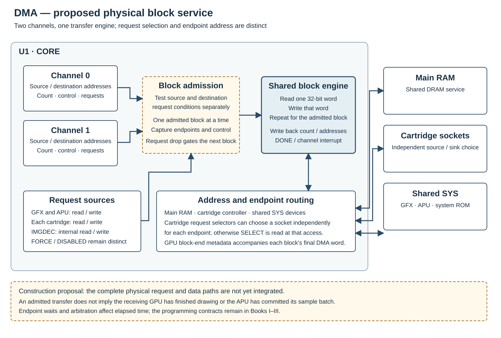{#fig-dma-physical-service}

The existing Book I numerical charges remain the current programming
contract. The approved multi-cycle direction has not yet replaced those
charges or fixed all software-visible timing and progress rules. Integration
of the complete physical data, request and device paths remains to be done.

### Physical GEO service

GEO operates on geometry and writes its results to memory. Its XFORM2, SAT2
and OVERLAP2D operations have different inputs and result formats; the game
selects the data and uses the results. GEO does not draw or submit GPU packets.
Book I specifies the records and completion interface.

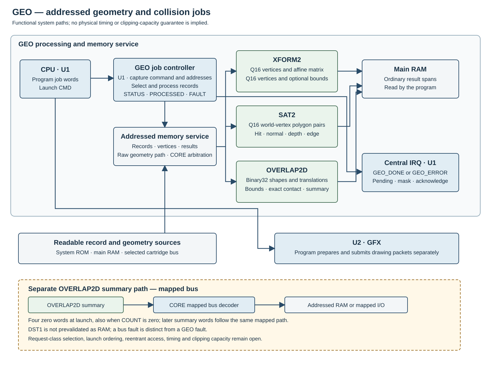{#fig-physical-geo-datapath}

A physical operation must account for the work and memory accesses it
performs. Work- and memory-dependent timing is an approved direction, but its
concrete public timing and progress rules have not replaced Book I.

GEO's addressed operand and ordinary result accesses use the geometry memory
path; in main RAM these do not address mapped I/O registers. OVERLAP2D summary
writes are different: the four separate summary words use ordinary mapped bus
writes, including the initial zero writes when COUNT is zero. A programmed
summary address can therefore select an I/O register rather than RAM. A bus
fault from such a write and a GEO operation fault are separate indications;
completed writes are not undone.

The proposed CORE memory fabric distinguishes these access classes per
request. Connecting the GEO producer and defining command acceptance and
summary-write ordering are still open, particularly if a summary write
addresses GEO's own registers. The physical design must not replace that
mapped access with a RAM-only write or add an unrequested retry.

## Cartridge bus

CORE connects both cartridge sockets to a shared 16-bit multiplexed
address/data path. Socket selection, READY, byte controls, reset, interrupt
and DMA-request signals accompany the data path. The two sockets have
independent presence and request signals. The contact assignments and card
handling are in @sec-physical-cartridges; Book III describes the address
windows and programming interface.

### Physical ROM read profile

The following is the proposed physical cartridge protocol, not an adopted
replacement for the logical interface in Book III. `CAD[15:0]` carries byte
addresses and data. The console drives the address and control signals; the
selected card drives the data during a read and acknowledges each data phase
using `CART_READY_N`. `CART_CLK` follows the system clock. Socket selection is
held for the complete transfer.

For an aligned 32-bit ROM read at byte address A, the console reads two
halfwords at A and A+2. Each halfword has its own complete address sequence:

| Interval | Proposed action |
|---|---|
| Low address | Drive A[15:0] for one clock, pulse CAL_LO high for one clock, then hold the address for one clock. The card captures on the falling edge. |
| High address | Repeat with A[31:16] and CAL_HI. |
| Turnaround | Release the console's CAD driver and allow two clocks before the card drives the bus. |
| Read | Assert CRD_N and both byte enables. The card presents data, then asserts CART_READY_N low. |
| Release | The console deasserts CRD_N after observing READY; the card releases data and returns READY high. Two release clocks precede the next address. |

During the low-address capture, CBE_N is `11` for this ROM-read profile.
In this proposal the card drives READY as a 3.3 V push-pull signal. It presents
data at least 20 ns before asserting READY low, holds it through CRD_N rising,
and releases data and drives READY high within one system clock. Normal reads
wait for the card; the selected READY must return high before the next data
phase. These values still require electrical and timing qualification.

The console does not learn the installed ROM size from card presence. The card
implements the response for its own address ranges; the current Book III
contract specifies zero for unpopulated locations. For an empty socket there is
no card to acknowledge a transfer. The proposed controller uses the presence
input to complete such accesses locally: reads return zero and writes have no
effect. The controller and complete card interface remain integration
proposals.

### Scalar cartridge transfers

For a byte, halfword or word scalar operation, the console presents the
original 32-bit byte address in the same two address portions. At CAL_LO,
while both read and write strobes are inactive, CBE_N identifies the width:
`00` for one byte, `01` for two and `10` for four. The card retains the
address and width for the complete operation, including an unaligned word.

During a data phase, CBE_N is an active-low byte mask: `10` for one byte on
CAD[7:0], or `00` for a halfword on CAD[15:0]. A word uses two `00` phases,
low half first. These are little-endian portions of the requested value; the
card maps them to its own memory. Unused high bits of a byte read are zero.

For a read the console releases CAD before asserting CRD_N; the card drives
data before asserting READY and holds it until CRD_N rises. For a write the
console drives data and the byte mask before asserting CWR_N and holds them
until the card acknowledges. The card accepts each asserted strobe once. The
console releases the strobe and waits for READY high before the next phase.
For a multi-phase write, the card commits the complete operation before its
final acknowledgement. Book III specifies the logical memory, mailbox and
interrupt effects; the physical commit and error timing remain proposals.

### Cartridge interrupt and request inputs

Each cartridge has separate interrupt and DMA-request inputs at CORE. Their
logical use is described in Book III. The permitted electrical output classes,
input thresholds and physical timing still need to be specified for the final
interface; the presence of board bias resistors is not a complete electrical
contract.

## Keyboard and accessory input

The keyboard and four accessory sockets are at the front of the console. The
keyboard uses PS/2 clock and data; the accessory sockets use the serial pad and
pointer interface in @sec-physical-pad-link. Input is received independently
of program sampling. At a requested VBlank, the controller publishes a stable
snapshot for software as described in Book I.

### Four-device integration candidate {#sec-gfx-input-integration-candidate}

The proposed four-device arrangement places the INPUT register bank,
keyboard and accessory controllers in U2 GFX alongside display timing. U7
then retains the firmware-flash interface. This leaves the external socket
assignments and software-visible input addresses unchanged.

The candidate assigns U2 terminals 97–101 to input selection, keyboard and
supervisor signals; 159–170 and 173 to the accessory links; 102 to the
proposed snapshot-memory select; and 174 remains reserved. The separate
candidate schematic and unrouted PCB carry these connections. They do not
implement the combined INPUT/GFX logic or prove the complete event path.

At VBlank the intended ordering is display-state latch, armed input snapshot,
then the event to CORE's interrupt controller. The ordering of concurrent
writes, reset and event transfer is still to be established. The keyboard's
supervisor request is a separate path from ordinary input data.

The keyboard receiver keeps a live record of key changes independently of the
software-visible input snapshot. In one proposed reset arrangement, a system
reset clears the snapshot but preserves that live record while keyboard power
remains on. A held key need not send another make code after the console
resets. Power-on initialization, interrupted frames and loss of the keyboard
connection remain open; this separation has not been implemented in U2.

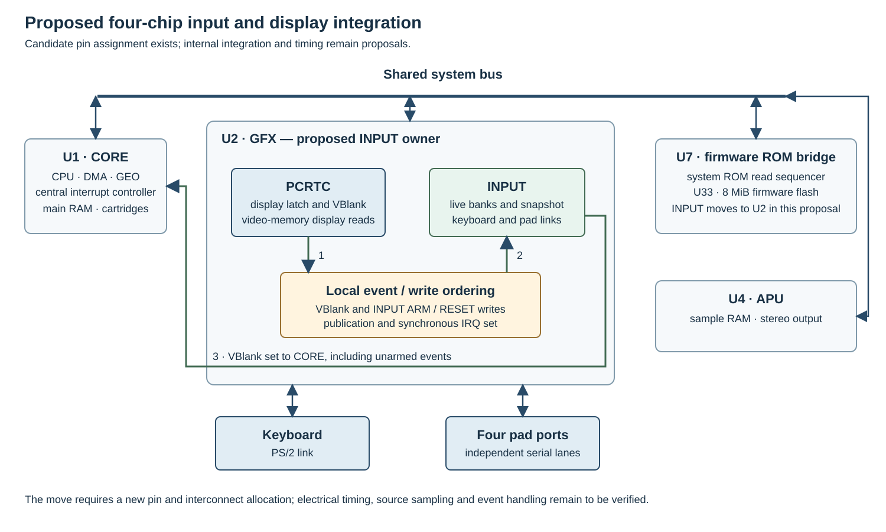{#fig-gfx-input-integration-proposal}

GFX supplies the accessory interface with the logical display width, height
and epoch. A pointer uses that context for its reported raster coordinates;
@sec-physical-pad-link describes the accessory exchange.

## Clocks and reset

The construction uses a nominal 33.8688 MHz system reference for the four
custom devices and a separate 13.5 MHz video reference for GFX. Reset reaches
all four devices and firmware flash; each clock domain must release reset
appropriately. Main DRAM initialization precedes normal memory use. The supply
and reset sequence is described in @sec-physical-power.

SYSTEM's frame-period readouts reflect the currently programmed PCRTC timing,
not the display state last presented at VBlank. One possible construction
routes these existing reads from U1 to the PCRTC timing owner in U2 over the
system bus. This requires both a U1 route for the SYSTEM addresses and U2
decoding and production of the two frame values; selecting the existing PCRTC
endpoint alone is not sufficient. The route must preserve the Book I values,
access rules, stopped-beam behavior and ordering relative to timing writes.
The complete cross-device route and its access timing have not yet been
integrated; this adds no public registers.

## GFX drawing and memory paths

GFX accepts drawing commands from the CPU and DMA. Its drawing engine uses
local video memory for images and textures; the display circuits read and
combine the picture for output. A DMA transfer delivering commands is not, by
itself, completion of the drawing they request. Book I gives the GPU and
PCRTC programming interfaces.

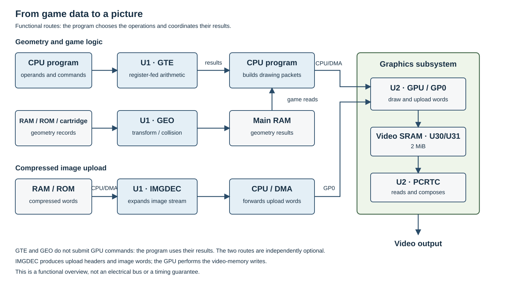{#fig-physical-geometry-image-flow}

### GPU system-bus access {#sec-physical-gfx-gpu-system-access}

The system bus connects the GPU's command, control, status and readback
ports to CORE. In the proposed U2 integration, a shared bus front end retains
the selected GPU, PCRTC or INPUT endpoint for the transaction and connects
that endpoint to the common data and READY pins. The selected endpoint alone
supplies read data or the response word. Each endpoint decides when its bus
data phase can complete; a bus wait is distinct from a completed access whose
device operation is refused. Acknowledging a word is not the same as completing
the drawing or readback that the word requests.

The GPU endpoint distinguishes GP0 writes from GP1 controls, GP0 reads from
GPUSTAT reads, and CPU accesses from DMA accesses. It forwards the DMA block-end
indication with the last word to the GPU's DMA ingress. A CPU GP0 write uses
the CPU admission rules, not GPUSTAT's DMA packet-acceptance bit; DMA ingress
uses its own rules. GP0 reads return the retained GPUREAD latch or consume the
next ready word according to the existing CPU/DMA port ownership. These are
separate operations, not ordinary reads and writes of a shared register.
Book I specifies their behavior, including accesses that a device does not
accept; the physical bus proposal does not add a retry after a completed
access that the device has declined.

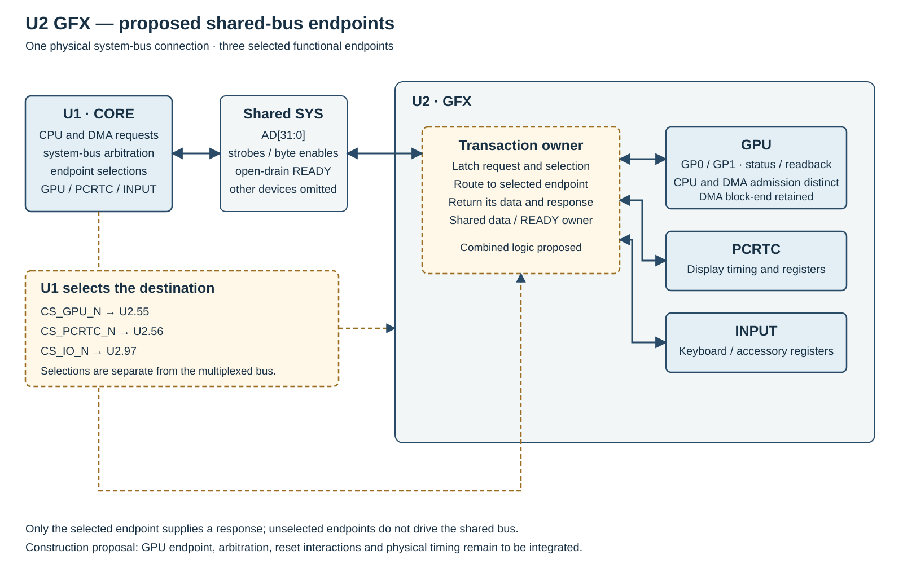{#fig-gfx-system-bus-endpoints}

The existing physical endpoint work does not yet implement the complete GPU
path or the combined U2 front end. Their arbitration and elapsed timing remain
to be established; this arrangement does not replace the Book I programming
contract.

### Graphics interrupt transport

GPU and PCRTC retain their local event status in U2; the central interrupt
controller in U1 retains its own pending bits. U2 must convey the interrupt
requests to U1 in addition to maintaining its local status. The board assigns
separate `IRQ_GPU_N` and `IRQ_PCRTC_N` connections, but those connections alone
do not establish the complete event transport.

For example, acknowledging the central GPU pending bit does not clear
GPUSTAT's local request. A continuously asserted local status must not by
itself set the central bit again; a later GPU request follows the local
re-arming rules in Book I. PCRTC can also request an interrupt when an already
pending event is unmasked. A proposed internal transport may use a receipt
handshake to deliver requests; such a receipt is not a new software-visible
acknowledgement and does not clear local status or the central pending bit.
Transport ordering with concurrent requests, acknowledgements and reset remains
to be implemented and verified. No new interrupt-latency guarantee is implied.

### Local-memory schedule {#sec-physical-gfx-memory-schedule}

Drawing, display and readback share video-memory service. The construction
proposes a local scheduler and separate snapshot storage for the supervisor
context. The storage and arbitration do not by themselves establish that every
display mode and simultaneous drawing load meets its deadline.

The existing scheduler candidate reserves fixed scanout and renderer slots.
An alternative under consideration gives scanout timely reservations and
assigns remaining slots dynamically. A bounded write-combining buffer could
merge adjacent sixteen-bit updates and forward pending data to later consumers.
It must preserve the specified ordering and observations for drawing, display,
readback and supervisor transitions. Overlapping copies must see their own
earlier writes as specified; the complete source rectangle cannot simply be
captured before the copy. A GP0 interrupt marker is not a display fence and
does not by itself require a physical buffer drain.

This is an alternative architecture, not an implemented replacement. A buffer
can absorb bursts but cannot make a sustained memory demand fit an insufficient
bus. The memory write cycle, scanout demand and simultaneous drawing workload
remain to be established before claiming the existing GPU completion times.

### Readback storage across supervisor use

The proposed snapshot SRAM can be divided into a 1 MiB cartridge half and a
1 MiB supervisor half. The largest readback is 1024 × 512 sixteen-bit pixels,
so either half can hold one complete result. These halves hold readback data,
not copies of all VRAM; both contexts continue to use the same video memory.

For a readback, GFX first waits for the earlier drawing work to reach the
ordered fence, then copies the requested pixels into the active context's
half. READY is published only when the complete result is available. Reads
consume its pixels in order; the context retains its own read position,
readback state and GPUREAD latch. A stream clear or reset discards an
incomplete result rather than publishing it as READY.

At supervisor entry, the cartridge's completed unread result and position
remain in its half while the supervisor uses the other half. Supervisor
changes to shared VRAM do not change the saved result. On return, the
cartridge resumes at its retained position; the supervisor's scratch result
is discarded. Book I specifies the command and supervisor boundaries.

The proposed snapshot SRAM and VRAM share GFX's address and data conductors
but have separate selects. GFX therefore reads the source and writes the
snapshot in separate memory-service turns, coordinated with drawing and
display; they are not two independent simultaneous memory ports. The copy
engine, its arbitration and context integration are not yet implemented or
timing-qualified.

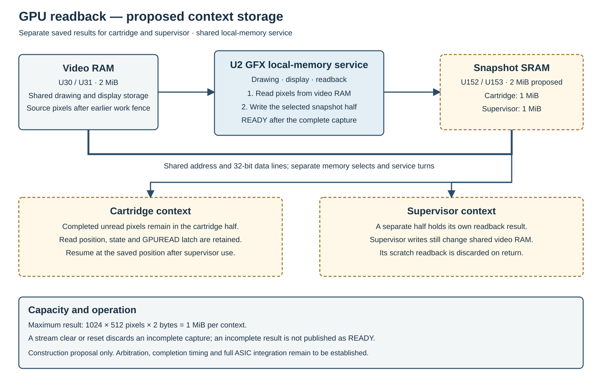{#fig-gfx-readback-context-storage}

## Video signal generation

GFX combines its display circuits and supplies the video DAC. RGB, separate
composite synchronisation and stereo audio reach the rear SCART connection;
this construction does not provide composite-colour or RF output. See
@sec-physical-av for the connector signals.

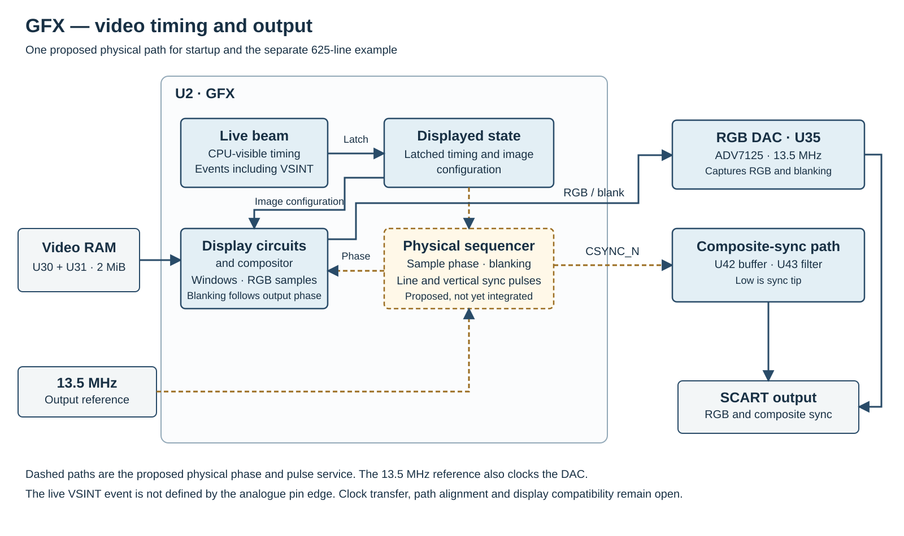{#fig-physical-video-path}

### Proposed scanout organisation

The physical video proposal uses the 13.5 MHz reference for output samples,
while the programmable PCRTC describes the logical beam. Output timing,
clock-domain transfer and supported physical modes require a final product
choice and qualification. The approved direction is a physically bounded video
baseline; stored register values and the current Books I–III remain unchanged.

One horizontal output proposal derives sync, porches and the active interval
from the displayed timing fields. A window extending into blanking is masked
at the physical output; its programmed coordinates are not changed. For one
proposed interlaced 625-line, 50-field/s RGB mode, a vertical composite-sync
sequence is also specified. A separate startup-sync proposal places short,
broad and short pulses within the existing vertical blanking interval. The
complete scanout and sync generation are not implemented.

Both examples use the same proposed output path: a sample-clock timing
generator reads the displayed timing configuration, generates RGB blanking and
combines ordinary line sync with the vertical pulse sequence. It carries the
half-line phase across field boundaries, so an odd-length interlaced field
changes phase while the even-length startup picture repeats its phase. The
software-visible beam and interrupt events retain their own timing; the
relationship to physical output edges still needs integration.

The installed BIOS initializes a non-interlaced 320 × 240 startup picture.
At the nominal reference clock its programmed timing gives 864 physical
sample periods per line and 314 lines per picture, approximately 49.76 pictures
per second. The 320 × 240 picture is the logical image area, not the total
number of samples in the video signal. Its horizontal window supplies 320
logical pixels over 320 nominal 13.5 MHz sample periods, so the selected DAC
rate is sufficient for a one-sample-per-pixel representation in that window.
This is an arithmetic screening of the startup setting, not a demonstrated
composite-sync waveform or a guarantee that a particular display will lock.
The physical beam-to-sample path, sync generation and video output remain to
be integrated and tested.

The separate 625-line proposal uses 625 half-lines per field and two
interlaced fields per frame: 50 fields or 25 frames per second. Its 576 active
half-lines per field correspond to 576 active lines over the two fields. It
uses 864 output samples per line, including 702 active samples; this is a
physical sample count, not a required framebuffer width. Software must select
the proposal; the existing BIOS startup does not select it. The output is
RGB with separate composite sync, not a PAL colour-encoded signal. Neither
the proposed mode nor the startup output is guaranteed to work with a given
display.

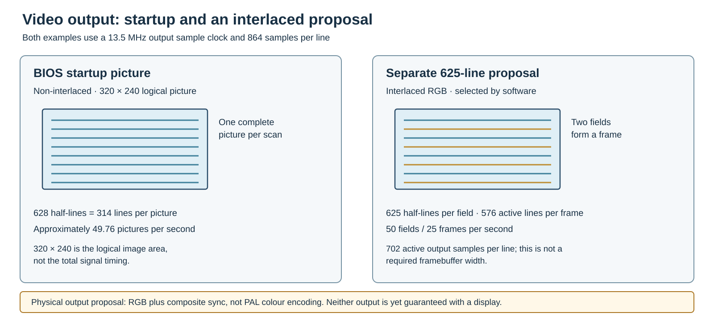{#fig-video-startup-and-interlace}

## Audio output

APU reads sample data from its local 512 KiB memory or the supported system
and cartridge ROM paths, processes voices and mixes a stereo output. Main RAM
and cartridge RAM are not direct voice sources; data stored there is
transferred to sample memory for playback. A square-wave source is generated
without a sample-memory read.

APU sends digital stereo samples to U34, a PCM1754 audio DAC. Its analogue
outputs pass through the output filters to the rear A/V connector. The output
rate is 44,100 stereo frames per second. Book I specifies the current voice,
source and command interfaces.

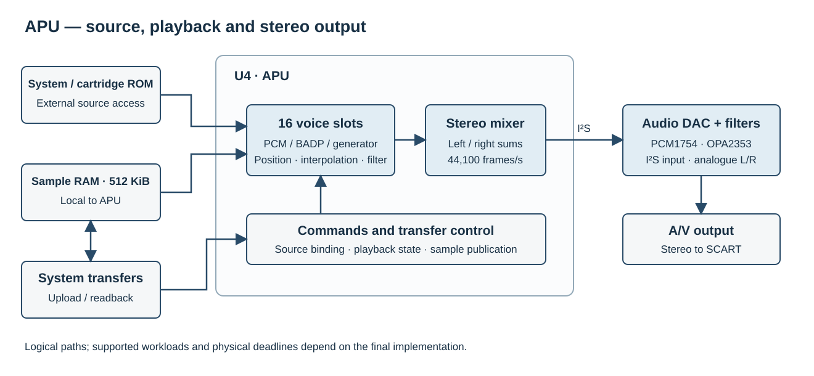{#fig-physical-audio-signal-path}

Each of the sixteen programmable slots represents one voice, whether its
source is mono or stereo. Mono as the default source, with independent left
and right levels, is a product proposal; it has not silently replaced the
current programming interface. Cartridge-ROM binding must not assume that the
console can discover a card's actual ROM size from its presence contact.

On an output-reported voice end, U4 publishes the end-event words before
requesting the central APU interrupt in U1. The event words retain the latest
end; multiple requests can combine in the central pending bit. One possible
physical transport uses a request from U4 and an internal acknowledgement when
U1 accepts it. That acknowledgement is distinct from software acknowledging
the central interrupt: neither action clears the retained event words. The
existing `IRQ_APU_N` connection does not by itself establish that transport.
Its return path, ordering of repeated events and concurrent acknowledgements,
reset behavior and timing remain to be integrated and verified; no additional
software-visible event acknowledgement is specified.

For a cartridge-ROM source, PLAY binds the selected socket when the command
executes, not when it is queued. A live source-field write binds again using
the selection at that access. A later SELECT change does not move a voice that
is already bound. Book I specifies these operations.

In the proposed four-device construction, U1 owns the socket selection and the
cartridge bus. U4 requests cartridge-ROM words over the shared system bus; U1
services the physical socket bound to the voice. A proposed ordered exchange on
that same system bus gives U4 the selection needed at each binding point; no
separate SELECT pin is assigned to U4. This exchange and its timing are not
yet integrated. The shared path is shown in @fig-apu-cartridge-binding.

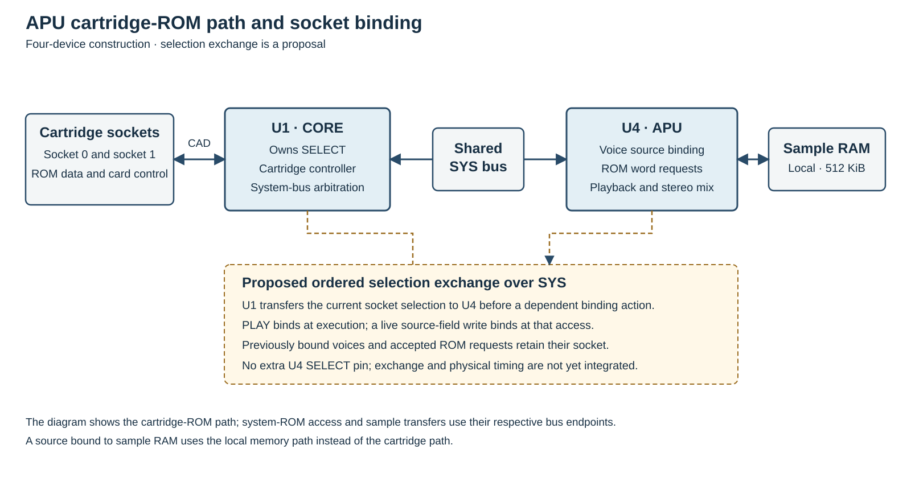{#fig-apu-cartridge-binding}

### Sample RAM reset

APU reset clears the 512 KiB sample RAM as well as the APU's playback and
transfer state. U32 is an external 16-bit SRAM, so resetting the APU's logic
alone does not clear its contents. The proposed memory controller writes zero
through the SRAM interface across the whole device before admitting sample
memory requests. A playback STOP or transfer-mode change is not a sample-RAM
reset and preserves its contents.

The clear operation's duration and the behavior of accesses while it is in
progress depend on integration with the complete APU and system bus; they have
not yet been established as a physical timing guarantee. Book I specifies the
software-visible APU reset and transfer behavior.

### Memory service and output budget {#sec-physical-apu-memory-envelope}

Book I specifies that all playing slots contribute at the 44,100-frame output
cadence. The physical candidate has not demonstrated that guarantee for every
combination of sources, formats, rates, loops, starts and uploads, particularly
when an external ROM access waits. No new active-voice limit or unconditional
eight-stereo physical guarantee has been established. Any change to the current
contract requires an explicit product decision.

## Service scan connection

J302 provides a 3.3 V reference for a service scan instrument; it is not a
console power input. The proposed serial path connects CORE, GFX, APU and the
firmware bridge. The complete scan chain is not yet integrated. Connect
service equipment with power disconnected and use the configuration
appropriate to the installed devices.

| J302 contact | Connection | J302 contact | Connection |
|---:|---|---:|---|
| 1 | 3.3 V reference | 2 | Ground |
| 3 | TCK | 4 | Ground |
| 5 | TMS | 6 | TDI |
| 7 | TDO return | 8 | TRST_N |
| 9 | RESET_N | 10 | Ground |
