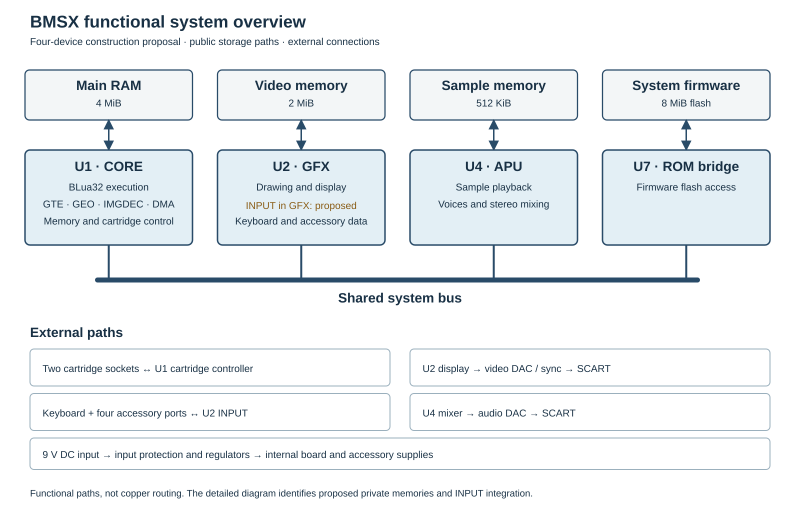

# BMSX Console — Technical and Service Reference

This volume describes the proposed BMSX reference console: its arrangement,
external connections, circuit organisation and access for service. It is
intended to be read alongside the programming and cartridge references in
Books I–III.

The reference construction is a design proposal, not an assembled or qualified
product. Its mainboard is not fully routed, and its custom devices, power and
mechanical and thermal assemblies have not been established by a physical
build. Dimensions and circuit descriptions identify the proposed construction,
not production or safety approval.

## System organisation

The console divides its work among four custom devices, shown with their
principal memory and external interface paths in @fig-system-functional-overview.

| Device | Principal functions |
|---|---|
| U1 CORE | BLua32 execution, geometry, image decompression, DMA, main memory and cartridge control |
| U2 GFX | Drawing, display generation and, in this construction, keyboard and accessory input |
| U4 APU | Sample playback, mixing and stereo audio output |
| U7 firmware bridge | Access to system firmware flash |

CORE contains separate GTE, GEO, IMGDEC and DMA functions. GTE transforms and
projects three-dimensional coordinates and returns positions, depth and colours
through registers. GEO transforms two-dimensional vertex arrays and tests
shapes for overlap, writing its results to main memory. Neither unit draws the
objects: the game uses their results to prepare work for GFX. IMGDEC expands
compressed images into upload words, which the processor or DMA sends to GFX.
GFX draws into its video memory, then reads and combines the picture for output.

INPUT receives keyboard and accessory data, publishes requested input at VBlank
and carries output requests to pads. Its allocation to GFX is part of this
construction proposal; the combined internal logic remains to be implemented.
The BLua32 instruction model specifies the programmer-visible processor, not a
requirement to hardwire the language runtime into a CPU. A native processor with
an interpreter is one possible execution design.

{#fig-system-functional-overview}

The overview shows the principal programmer-visible storage paths. The
separate proposed private memories and the candidate INPUT allocation are
shown in greater detail in @fig-four-chip-system-candidate.

The construction provides 4 MiB of main RAM, 2 MiB of video memory and
512 KiB of sample RAM. These are separate resources: DMA and device transfer
ports move data between them rather than treating them as one shared memory.
Private runtime and graphics readback memories are also proposed; they do not
change the programmer-visible capacities.

The two cartridge sockets supply program data and optional cartridge storage.
The front opening marked **1** is controller socket **0**; the rear opening
marked **2** is controller socket **1**. The BIOS checks the front socket first,
then the rear socket, for a bootable cartridge. During execution, instruction
fetches stay bound to the execution socket while software can select either
card for ordinary data access. DMA can
choose its cartridge endpoints independently.

The system uses a 33.8688 MHz processor timebase, a 13.5 MHz video reference
and 44,100 stereo audio frames per second. The construction's physical CPU, DMA,
GEO and video timing interpretations remain proposals; they have not replaced
the programming contracts in Books I–III. The detailed construction chapters
show the relationships and the remaining physical choices.

The console contains a mainboard, front connector board, keyboard connector
board, rear audio/video breakout and a separate SCART contact board. An aluminium deck supports the
boards, cartridge guides and passive cooler. The external 9 V supply connects
through protected power entry; the POWER slide enables the main regulated
rails. Four pad sockets and the keyboard socket face forward; the DC and
audio/video connections face rearward. Two cartridge openings in the upper
cover have inward-moving dust doors. The proposed reference cartridge uses a
leading plastic skirt and a matching frame channel to open its door ahead of
the exposed board. Disconnect the external supply before
opening the enclosure or disturbing an internal connection.

## Console reference at a glance

| Feature | Reference construction |
|---|---|
| Console envelope | 248 × 201 × 71.45 mm, including feet and controls; cartridges excluded |
| Mainboard | 220 × 150 × 1.6 mm |
| Cartridge access | Two vertical sockets, independent inward-opening dust doors and proposed leading skirts |
| Front connections | Four BMSX pad sockets and one PS/2 keyboard socket |
| Rear connections | Centre-positive regulated 9 V DC input; RGB, composite sync and stereo audio through SCART |
| Cooling | Passive cooler and enclosure air path; no fan |

A separate pointer uses a pad socket; an accessory combining pad and pointer
can share one socket. The audio/video connector does not provide an RF or
composite-colour output. The DC input's adapter-current capacity and the
allowable cartridge and accessory loads are not yet established. For the
contact assignments, fitting and nominal mechanical details see the
construction, power and connector chapters.

Read the construction chapter for subassembly locations and access. The
mainboard and power chapters trace signals and supplies through the circuits.
The connection chapter gives contact assignments and cartridge handling; the
pad chapter specifies serial exchanges. The final chapter gives disassembly,
inspection, fault-isolation and reassembly procedures.

Books I–III provide the companion programming reference: system registers and
memory access in Book I, processor and BIOS operation in Book II, and cartridge
selection and mapped devices in Book III.

Dimensions are nominal millimetres unless stated otherwise. Connector views
are identified beside their drawings and tables. Signal names ending in `_N`
are active low. Rail names identify circuit nets; calculated voltages are
identified separately from measured values.
