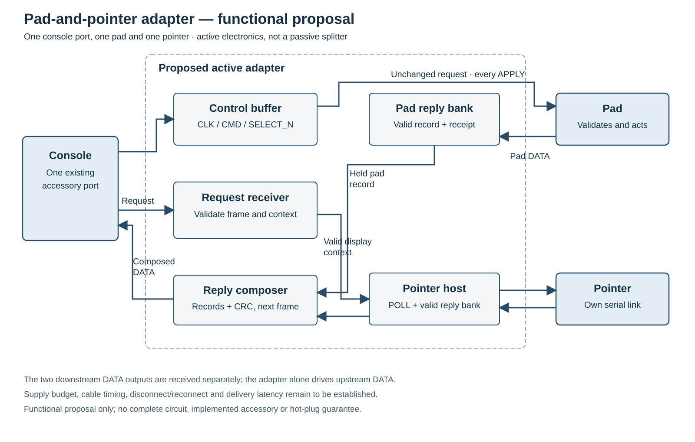
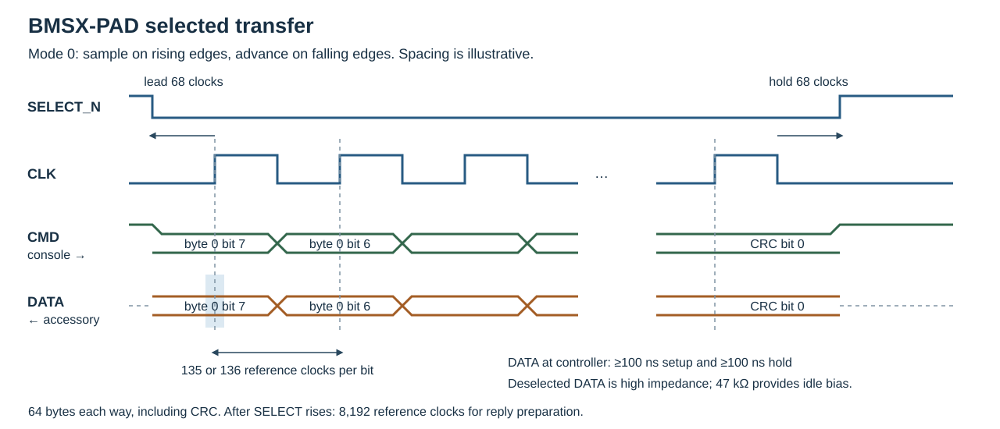

# Pad and pointer serial interface {#sec-physical-pad-link}

BMSX-PAD version 1 connects the four front accessory sockets. Each lane has its
own CMD, DATA and SELECT_N conductors and shares CLK with the other lanes.
During one exchange the console sends output parameters and display context,
while each accessory returns its controls, pointer position and capabilities.
Four records therefore travel in parallel.

This serial link is a proposed construction for the INPUT interface. Book I
defines the logical APPLY write as submitting an output request; in this
construction the request is carried in a subsequent serial frame. The exact
physical bus-wait and delivery timing have not replaced the Book I contract,
and the interface adds no software-visible output-completion status.
The proposed four-device construction places this interface in U2 GFX, as
described in @sec-gfx-input-integration-candidate. An earlier circuit assigns
it to U7; the combined GFX/INPUT logic has not yet been implemented.

A separate pointer uses one of these four sockets; there is no additional
dedicated pointer socket. Four separate gamepads therefore leave no socket for
a separate pointer. An accessory that supplies both pad and pointer data can
use one socket for both records. The single pointer record is selected from the
lowest-numbered accessory that supplies pointer data.

An optional **pad-and-pointer adapter** is a construction proposal for using
four separate pads and a separate pointer together. It occupies one console
socket and supplies one pad socket and one pointer socket. The other three
console sockets remain available for pads. The adapter is active electronics,
not a passive splitter.

To give its pointer priority over pointer-capable accessories on the other
ports, connect the adapter to front port 1. The console selects the
lowest-numbered lane advertising a pointer.

On the pad branch, buffered CLK, CMD and SELECT_N carry the console's request
unchanged to the pad. The pad validates and accepts its own frame, including
each APPLY; the adapter does not combine repeated tags or queue, retry or
acknowledge output requests in the pad's place. The adapter receives pad DATA
separately, and relays the pad's last reported APPLY receipt rather than
claiming that its own reception proves pad actuation.

The pointer branch has its own controller and serial signals. After a complete
valid console request, the adapter can forward its display context, including
the CONTEXT_VALID state, to that branch in a subsequent POLL. It receives pad
and pointer replies independently,
retains each last complete valid record, and prepares a new upstream reply with
the pad record and pointer record and a newly calculated CRC. The upstream DATA
driver belongs to the adapter; the two downstream DATA drivers are not wired
together. A failed or partial downstream reply does not replace that branch's
held record. Since the upstream reply is prepared before its exchange starts,
its records and receipt can be older than the concurrently transmitted request.

The combined reply advertises the features present in its held pad and pointer
records. It copies all seven pad words unchanged from the last valid pad
reply, including when that reply does not advertise PAD: the console publishes
those words independently of the feature flag. Its local vibration capability
comes from the pad; bits 31–4 of the two local capability contributions are
combined with bitwise OR. The console still constructs the global capability
word from the four upstream lanes.

{#fig-pad-pointer-adapter-proposal}

This is a functional proposal, not an implemented accessory or a guarantee of
latency, hot-plug operation or accepted electrical loads. Connector and cable
propagation, startup, disconnect and reconnect behavior, and the shared 3.3 V
and 5 V supply budget remain to be established. A connection may fail after a
pad has acted but before its receipt is observed.

The console supplies the logical display extent; the pointer converts its
sensor position to absolute raster coordinates before transmission. Acquisition
runs continuously. ARM and VBlank select when complete held observations
become the program's input snapshot. The socket contact assignment is in
@sec-physical-pads; Book I, *Input*, gives the register access sequence.

## Signals and timing

The console drives CLK, CMD and SELECT_N. A selected accessory drives DATA as
a 3.3 V push-pull signal and releases it when SELECT_N rises. The mainboard's
47 kΩ DATA pull-up establishes the deselected idle level. Each of the thirteen
pad conductors has a 47 Ω series resistor. The separate +5 V supply contact is
not a signal-level reference.

CLK idles low, SELECT_N high and CMD high. Both directions present the first
bit before the first rising edge, sample on rising edges and advance on falling
edges. Bytes travel most-significant bit first. Fields spanning several bytes
travel in increasing byte-offset order.

The nominal bit rate is 250 kbit/s. A fractional edge accumulator distributes
67- and 68-clock half-periods from the 33.8688 MHz system reference. Source-clock
tolerance scales the following nominal times.

| Quantity | Reference clocks | Nominal time |
|---|---:|---:|
| Short half-period | 67 | 1.978222 µs |
| Long half-period | 68 | 2.007748 µs |
| Complete bit | 135 or 136 | 3.985969 or 4.015495 µs |
| SELECT assertion to first rising edge | 68 | 2.007748 µs |
| SELECT assertion through final falling edge | 69,364 | 2.048021 ms |
| Hold after final falling edge | 68 | 2.007748 µs |
| Deselected preparation interval | 8,192 | 241.874528 µs |
| Earliest successive frame acceptance | 77,625 | 2.291932 ms |

Each selected frame contains exactly 512 rising edges. The burst count includes
the initial 68-clock lead interval. Individual bit periods vary by one reference
clock as the accumulator distributes the edges.

Prepare the whole accessory reply before selection and freeze it for the
transfer. The first DATA bit must be available within the select lead interval.
At the receiving pins, allow at least 100 ns setup and 100 ns hold around each
sampling edge. For DATA these times are measured at the receiving controller;
the shortest half-cycle
leaves 1.878222 µs for accessory output delay, cable delay, skew and input
settling before the setup interval.

{#fig-pad-link-timing}

## Exchange sequence

1. While deselected, each accessory prepares a complete reply and checksum from
   its current controls and retained display context.
2. At a frame boundary, the console captures one request per lane. All lanes
   share the new 32-bit request tag and current display context. One lane can
   carry APPLY; the others carry POLL.
3. SELECT_N falls and 64 bytes travel in each direction simultaneously.
4. SELECT_N rises after the final hold. Each accessory recognises the complete
   request and commits an accepted APPLY or context update.
5. The console clocks each recognised reply into that lane's held bank.
   The deselected preparation interval follows before the next exchange.

The reply sent in step 3 was prepared before the simultaneous request arrived.
It describes earlier state, including the receipt tag of an earlier APPLY.

## Frames, words and checksum

Requests and replies each occupy 64 bytes with their own CRC. Four-byte words
are little-endian, retaining all 32 bits. For example, FFFF8000H travels as
`00 80 FF FF` and represents −0.5 when interpreted as signed 16.16.

CRC-16/IBM-3740 (CCITT-FALSE) uses polynomial 1021H, initial FFFFH, no reflection
and no final exclusive-OR. Process bytes 0–61 in wire order, each bit 7 first.
Transmit the resulting CRC high byte at offset 62 and low byte at offset 63.
The check value for ASCII `123456789` is 29B1H.

### Console request

| Byte offset | Length | Contents |
|---:|---:|---|
| 0 | 4 | ASCII `BMSX`: `42 4D 53 58` |
| 4 | 1 | Version: 01H |
| 5 | 1 | Opcode: 00H POLL, 01H APPLY |
| 6 | 1 | Flags: bit 0 CONTEXT_VALID; bits 1–7 zero |
| 7 | 1 | Reserved, zero |
| 8 | 4 | Unsigned request tag |
| 12 | 4 | Unsigned 16.16 output intensity |
| 16 | 4 | Unsigned output duration in milliseconds |
| 20 | 2 | Logical display width, little-endian |
| 22 | 2 | Logical display height, little-endian |
| 24 | 4 | Display-size epoch, little-endian |
| 28 | 34 | Reserved, zero |
| 62 | 2 | CRC, high byte then low byte |

POLL exchanges input and display context without changing the running effect.
Its intensity and duration are zero and do not constitute a stop request.
APPLY replaces the selected lane's effect using its intensity and duration.
An unrecognised opcode leaves the effect unchanged.

The request tag advances modulo 2³² at every accepted frame and is shared by
all four lanes. Each complete valid APPLY is a new request, including a
repeated tag or repeated parameters. Recognition requires the BMSX header,
version 1, correct CRC and exactly 512 rising edges before deselection. Short
or overlong frames leave the command unaccepted.

### Accessory reply

| Byte offset | Length | Contents |
|---:|---:|---|
| 0 | 4 | ASCII `BPAD`: `42 50 41 44` |
| 4 | 1 | Version: 01H |
| 5 | 1 | Feature and receipt flags |
| 6 | 2 | Manufacturer-assigned model identifier, little-endian |
| 8 | 4 | Local capability contribution |
| 12 | 4 | Tag of last accepted APPLY |
| 16 | 4 | Pad buttons |
| 20 | 4 | Left-stick X, signed 16.16 |
| 24 | 4 | Left-stick Y, signed 16.16 |
| 28 | 4 | Right-stick X, signed 16.16 |
| 32 | 4 | Right-stick Y, signed 16.16 |
| 36 | 4 | Left trigger, signed 16.16 |
| 40 | 4 | Right trigger, signed 16.16 |
| 44 | 4 | Pointer buttons |
| 48 | 4 | Pointer X, signed 16.16 absolute raster coordinate |
| 52 | 4 | Pointer Y, signed 16.16 absolute raster coordinate |
| 56 | 4 | Pointer wheel, signed 16.16 latest-update delta |
| 60 | 2 | Reserved, zero |
| 62 | 2 | CRC, high byte then low byte |

| Flag bit | Meaning |
|---:|---|
| 0 | PAD: pad controls supplied |
| 1 | POINTER: pointer record supplied |
| 2 | APPLY_SEEN: at least one APPLY accepted since accessory reset |
| 3–7 | Not decoded in version 1 |

Feature flags describe the supplied records; the model identifier identifies
the product. Input words are retained without button masking, axis limiting or
ADC-width conversion. Book I gives their logical interpretation.

Capability-contribution bit 0 describes that accessory's vibration support.
For controller socket *s*, it contributes to global capability bit *s*. Local
bits 1–3 do not contribute. The high 28 bits of all four held contributions are
bitwise ORed into the high 28 bits of the global word. For example, local
A5A50001H at socket 3 contributes A5A50008H. This word is captured with the
input snapshot.

## Display context and standard pointer mapping

The context fields describe the combined logical PCRTC output image. Width
and height count image pixels, independently of the 13.5 MHz physical video
sample count. GFX derives them from its displayed windows and, in the proposed
integration, supplies them locally to INPUT. A changed width or height advances
the size epoch. An unchanged-size display latch leaves that epoch unchanged.

A complete valid request updates the accessory's context bank at deselection.
The reply currently leaving the accessory still uses its earlier context;
subsequent prepared replies use the new bank. CONTEXT_VALID identifies a
complete context, including an empty rectangle. Before receiving one, a
standard pointer accessory leaves POINTER clear.

The standard accessory's sensor supplies signed 16.16 normalised positions:
zero at the upper/left endpoint and one at the lower/right endpoint. It maps
and clips each axis before constructing the reply. For raw signed sensor word
*s* and extent *e*, the transmitted signed 16.16 word is:

\[
m=s(e-1),\qquad
p=\min\left(\max(m,0),(e-1)\,65536\right).
\]

The multiplication and comparison use signed wide intermediates. For width
640, sensor X = 00008000H gives raster X = 013F8000H, or 319.5 pixels. Values
below zero clip to the first pixel and values above one to pixel 639. The same
arithmetic with extent zero yields FFFF0000H, or −1 pixel. A valid zero extent
does not freeze the previous position.

Pointer buttons and wheel accompany those coordinates. Wheel is the latest
sensor-update delta, positive downward, not a sum accumulated since ARM.
Attachments supplying nonstandard raw coordinates can carry those words
unchanged; the receiving controller does not remap or clip them.

## Held banks and input publication

A complete reply with the BPAD header, version 1 and correct CRC clocks that
socket's entire held bank. A failed or partial reply leaves it unchanged and
sets the lane's internal link-error indication. Cold reset zeroes the banks.
Reading input registers neither restarts serial acquisition nor consumes a
reply.

An armed VBlank copies keyboard observations, all four pad records, one pointer
record and the constructed capability word into the input registers. It then
advances the sample sequence and consumes ARM. The physical ordering of
simultaneous serial updates, writes and VBlank remains a construction choice.

The pointer source is the lowest-numbered held reply advertising POINTER. Its
buttons, X, Y and wheel are selected together. With no pointer source, the
previous published pointer words remain; they are zero after cold reset.
Home and Touchpad remain ordinary pad bits, separate from the supervisor wire.

Serial acquisition proceeds independently of blanking, so successive input
publications can use the same held record. The sample sequence counts
publications rather than peripheral frame arrivals.

INPUT RESET clears publication and output-parameter registers but does not
clear the independent held banks or issue a vibration stop. Keyboard receive
state and supervisor detection have the separate lifetimes described in
@sec-physical-mainboard.

## Output acceptance and actuation

Software selects the pad and supplies intensity and duration before writing
APPLY. In the proposed serial link, the request travels to that accessory in a
subsequent frame. Book I defines the software-visible request; the relationship
between the write and physical delivery remains to be established.

In the proposed transport, bus acknowledgement means that it has captured the request.
The accessory commits it when SELECT_N rises after a complete valid frame.
At that point it replaces the previous effect, retains the full intensity and
duration words and restarts its independent millisecond timer from phase zero.
Serial clocks can stop while the effect timer continues.

Zero intensity or zero duration stops the effect at acceptance. The actuator
limits intensity above 00010000H to its maximum; the programmed and transmitted
word remains unchanged. An accessory without vibration capability produces no
motor effect. The timer's remaining milliseconds are local actuator state,
not a replacement for the retained duration word.

A later reply reports APPLY_SEEN and the last accepted tag. These describe
receipt, not mechanical completion. Tags wrap and can survive a console-only
reset in the independently powered accessory. The transport does not
retransmit a request after a failed reply. A response fault after acceptance
does not cancel the effect.

Console reset releases SELECT_N. A partial frame is discarded. If all 512
valid command bits have already arrived, deselection can commit it; clearing
console registers is not an actuator-stop command.

## Example request

This frame requests half intensity for 100 ms with tag 10203040H. It also
supplies a valid 640 × 480 logical extent at size epoch 3.

```text
00: 42 4D 53 58 01 01 01 00 40 30 20 10 00 80 00 00
10: 64 00 00 00 80 02 E0 01 03 00 00 00 00 00 00 00
20: 00 00 00 00 00 00 00 00 00 00 00 00 00 00 00 00
30: 00 00 00 00 00 00 00 00 00 00 00 00 00 00 1B 6E
```

Left labels are hexadecimal byte offsets and do not travel on the wire. The
final 1B 6EH is the CRC of bytes 0–61. The other three lanes carry POLL with the
same tag and context, zero intensity/duration, and their recalculated CRCs.

## Keyboard supervisor request {#sec-keyboard-supervisor-request}

The reference keyboard control for the separate supervisor request is
**Ctrl+Alt+F12**: hold either Ctrl, either Alt and F12 together. The keyboard
controller must report that combination simultaneously; this does not require
an unrestricted rollover guarantee for every combination. INPUT derives the
request from the live key state, independently of ARM. The individual keys
remain visible to the game as ordinary keys.

At VBlank, a newly asserted request enters the existing supervisor path. A
held combination does not repeat it; the combined request level must be
observed inactive at a VBlank before a later press can produce a new edge.
INPUT RESET does not erase that edge history. Depending on SYSTEM state, a
request can enter or leave the monitor as specified in Book I.

The reference INPUT logic combines the keyboard chord with its separate
supervisor input. The proposed combined GFX/INPUT device and its complete
connection to SYSTEM are not yet implemented, and the reference keyboard's
simultaneous-key reporting remains to be established. Home and Touchpad remain
ordinary pad bits and do not themselves generate the supervisor request. A separate accessory-origin
request is considered in the design proposals; it is not part of the present
version-1 pad link. Without the keyboard, that proposed control is therefore
unavailable. If the live display beam is stopped, it supplies no VBlank at
which the request can be sampled; the key combination is not a separate
asynchronous entry path. A complete press and release between VBlanks need not
be observed.

{#fig-supervisor-sources-proposal}
