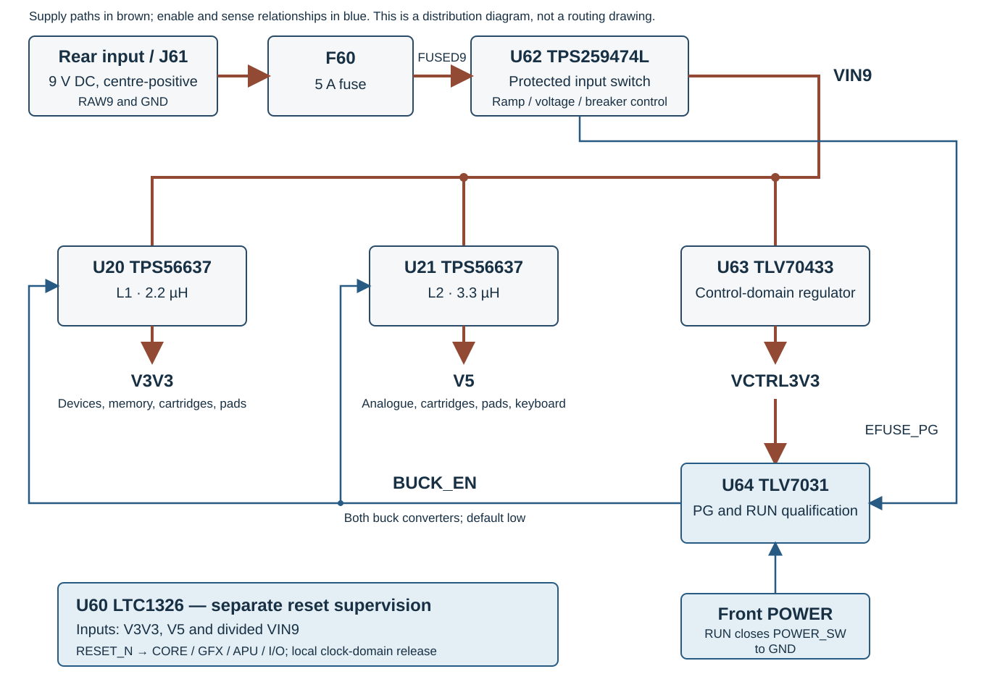
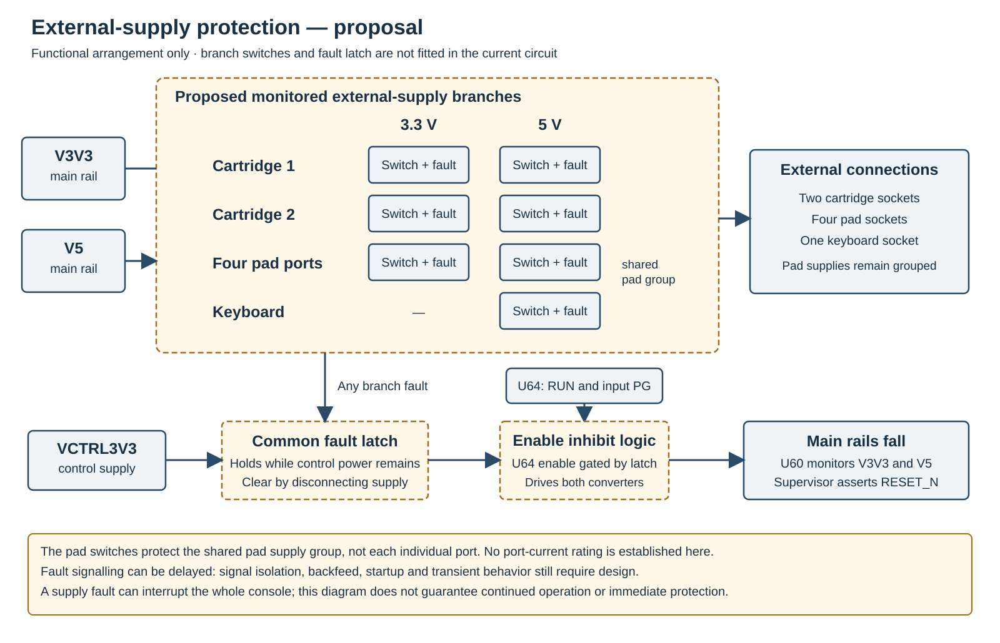
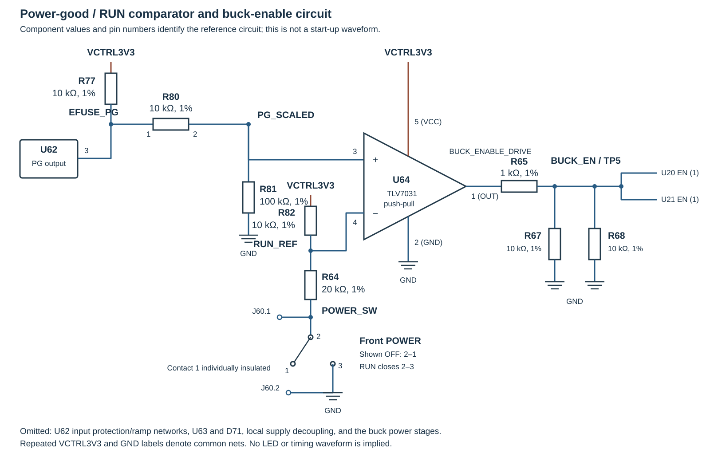

# Power distribution and start-up {#sec-physical-power}

An isolated, regulated 9 V DC supply connects to the centre-positive rear
inlet. Input protection feeds two converters for the 3.3 V digital rail and
the 5 V rail. A separate control supply operates the POWER switch circuit and
power-good logic. POWER enables the two main converters together.

The input and control circuits can remain powered with POWER off. Disconnect
the external supply before opening the case, releasing an internal harness or
changing a cartridge.

{#fig-physical-power-distribution}

## Input connection and protection

The reference inlet is a Switchcraft L722A with an S761K locking plug and a
2.0 mm centre contact. Its centre is positive; the sleeve is ground. The
centre lead connects to mainboard J61.1 (`RAW9`) and the return to J61.2.
The external adapter capacity and the permitted total cartridge and accessory
load are not yet specified.

The input path is `RAW9` → F60 → `FUSED9` → U62 → `VIN9`. F60 is a
0451005.MRL 5 A fast fuse, and U62 provides input switching, undervoltage and overvoltage
lockout, reverse-current blocking and circuit-breaker protection. The 5 A
component design basis is not a continuous console or adapter-current rating.

If U62 latches off after a fault, the POWER switch alone does not clear it.
Disconnect the adapter, let the input discharge and correct the fault before
reconnecting it. Replace F60 with the specified type and rating; do not bridge
or uprate it.

The reference input-ramp components give a calculated nominal VIN9 rise of
about 2.12 seconds after adapter connection. This is a design calculation,
not a guaranteed startup time. Switching POWER to RUN with the adapter already
connected does not restart the input ramp.

## Regulated rails

| Rail | Source | Circuit supplied |
|---|---|---|
| RAW9 | Rear inlet, J61 | Input before F60 |
| FUSED9 | F60 | U62 protected input |
| VIN9 | U62 | Main converters and control regulator |
| V3V3 | U20 and L1 | Custom devices, memories, clocks and 3.3 V support circuits |
| V5 | U21 and L2 | Audio analogue circuits and 5 V connector supplies |
| VCTRL3V3 | U63 | POWER enable and power-good logic |

U20 and U21 are buck converters with calculated nominal output setpoints of
3.318 V and 4.992 V respectively. Actual voltages depend on the components,
load and distribution losses; these values are not measurement tolerances.
The two outputs share the protected input and enable signal `BUCK_EN`.

### Cartridge and accessory supplies

Both cartridge sockets receive V3V3 and V5 when the main rails are enabled,
regardless of the selected socket. Four V3V3 contacts and two V5 contacts are
assigned on each socket. The front-board harness carries both rails to the
four pad sockets; the keyboard connection uses V5. See
@sec-physical-cartridges, @sec-physical-pads and @sec-physical-keyboard for
the contact assignments.

These connections share the console rails. The present circuit does not
provide an independently switched or current-limited branch for each socket.
Input and converter protection do not by themselves establish a safe current
limit for each cartridge, peripheral, contact or harness. Branch protection
and allowable external loads remain open design choices. Removing power from
a branch alone would also not necessarily isolate its signal paths.

A proposed protection revision detects branch faults and shuts down both main
rails together rather than leaving a dual-supply accessory partly powered. It
is not fitted in the present circuit; its fault detection, signal isolation
and recovery behavior are not yet established.

{#fig-external-supply-fault-proposal}

The required external supply must cover the console and its connected devices
on both rails, including converter losses. Its budget must account for both
cartridges, the keyboard and all four accessory ports; a combined pad-and-pointer
adapter also draws power for itself and both attached devices. The permissible
loads and adapter rating have not yet been established.

## POWER switch and enable circuit

U63 derives VCTRL3V3 from VIN9. The front POWER switch supplies a control
signal to comparator U64; it does not carry the raw input current. U64 enables
both main converters only when the input power-good signal is high and POWER
is in RUN.

{#fig-physical-power-enable}

| Input power-good | POWER | Main converter enable |
|---|---|---|
| Low | Either position | Off |
| High | Off | Off |
| High | RUN | On |

## Reset and start-up sequence

U60 monitors V3V3, V5 and a divided VIN9 signal and drives `RESET_N`. The
front RESET button also requests reset through the monitored input. RESET
restarts the system; it does not disconnect the external supply. U60 holds
reset through undervoltage and for a delay after its monitored inputs recover.
The selected device specifies a 140–300 ms delay over −40°C to +85°C with
the reference pull-up, nominally 200 ms. The assembled circuit determines the
interval seen by its receivers.

A normal start proceeds in this order:

1. The external adapter supplies RAW9; input protection establishes VIN9.
2. The control regulator starts and input power-good becomes active when the
   protected input is ready.
3. With POWER in RUN, U64 enables the 3.3 V and 5 V converters.
4. U60 holds RESET_N active while the monitored supplies recover and during
   the subsequent reset delay.
5. The devices initialise and the firmware begins system startup when its
   reset, clock and memory conditions are met.

RESET_N also reaches the system firmware flash. Its write-enable is held
inactive during normal operation. Memory control must complete active memory
waveforms safely during system reset; volatile-memory retention is not
specified if its supply or clock is lost.

U1 supplies the common `CART_RESET_N` to both cartridge sockets. A proposed
reset sequence keeps the cards in logical reset while the system resets and
releases them after U1 is ready to service the cartridge bus. This is distinct
from removing cartridge power: a logical card reset retains card RAM. The U1
output's reset-time drive and release have not yet been implemented or
electrically established.

The card reset must also be assertable by U1 independently of a whole-system
reset, so the two reset nets cannot simply be tied together. With valid power,
one possible U1 pad design asserts the card reset asynchronously while
`RESET_N` is active. Behavior before U1 has valid power, including brownout,
remains to be established together with the card's own power-on reset.

### Software-requested system reset

Book I specifies a system reset request that is serviced at a CPU execution
boundary. In one proposed physical implementation, U1 uses its currently
reserved terminal 102 to operate a separate switching stage on `RESET_SW`,
the same input used by the front RESET button. This pulls the monitored input
low and causes U60 to assert the common `RESET_N` to the devices. Once the
request is released and the monitored inputs recover, U60 holds reset for its
own delay. The proposed U1 controller holds the request until it observes
`RESET_N` asserted; the switching stage then releases when U1 resets. An
unqualified single-clock pulse is not assumed to trigger the supervisor. The
stage must remain inactive while U1 is reset or unpowered.

The terminal assignment and switching stage are not present in the current
schematic, PCB or integrated RTL. Their pulse and electrical requirements,
the safe handling of in-flight memory or bus operations, and the distinction
between warm reset and power-on initialization remain to be established.
This is a proposed physical route for the existing reset command, not a new
software-visible control.

## Measurement points

Use TP2 or TP64 as the instrument return. Attach probes with power
disconnected. Measure supply rails at their test points, not at a converter's
switching node.

| Point | Signal | Circuit role |
|---|---|---|
| TP1 | VIN9 | Protected input to the converters |
| TP2 | GND | Main measurement return |
| TP3 | V3V3 | Main digital rail |
| TP4 | V5 | Main 5 V rail |
| TP5 | BUCK_EN | Shared converter enable |
| TP60 | RESET_N | Supervised reset output |
| TP61 | POWER_SW | Grounded in RUN |
| TP62 | RESET_SW | Grounded while RESET is pressed |
| TP63 | RAW9 | Positive input before F60 |
| TP64 | GND | Input return |

For startup or supply-fault diagnosis, observe the relevant rail and reset
signals together and record the connected load. POWER off does not isolate
RAW9, FUSED9, VIN9 or VCTRL3V3 while the adapter remains connected. Disconnect
the adapter and verify discharge before handling internal connections. The
service sequence and fault-isolation guidance are in @sec-servicing.

## Cooling and external loads

The main rails supply internal circuits as well as cartridges and accessories.
The construction uses passive cooling; no fan supply is fitted in the passive
board candidate. Installed cartridges may also dissipate heat near the slots.
The permitted load and the temperatures of the assembled console remain to be
established. The cooling arrangement is described in @sec-construction-cooling.
