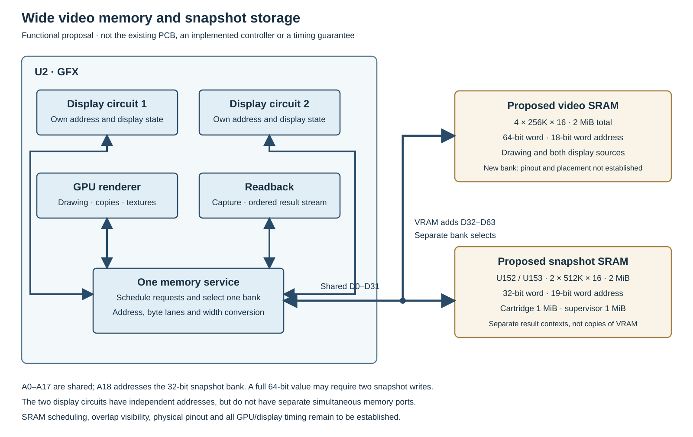
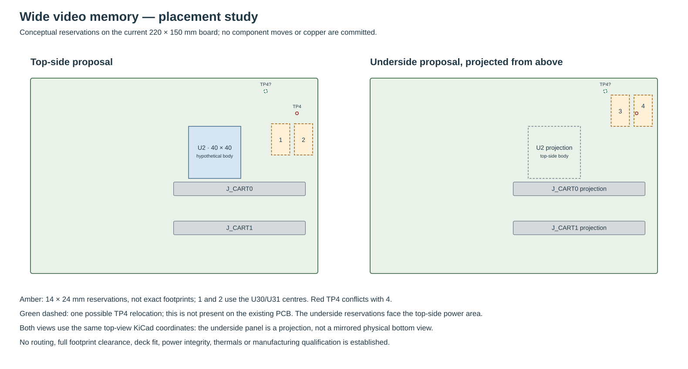
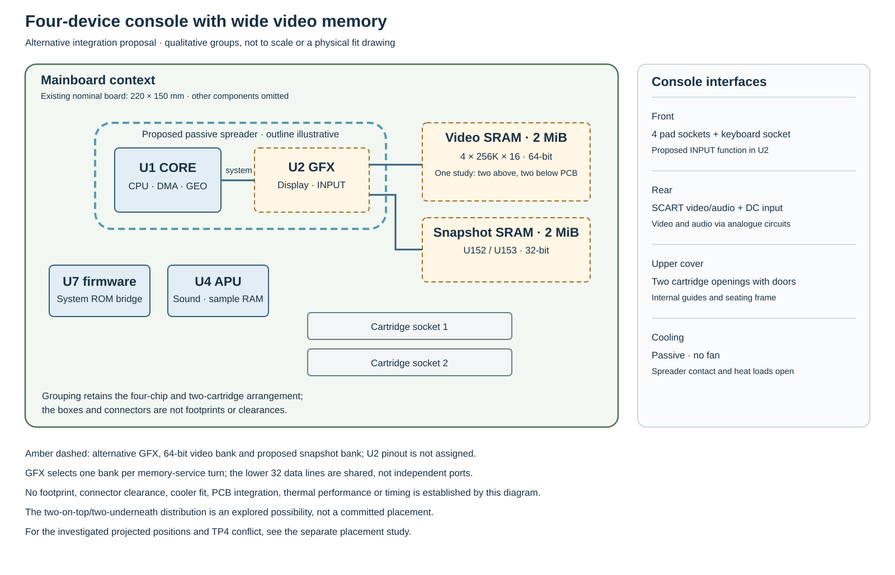
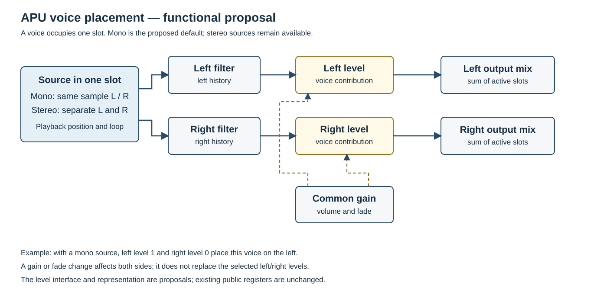
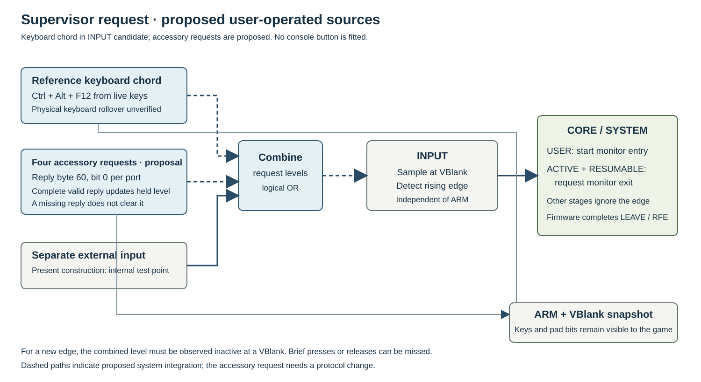
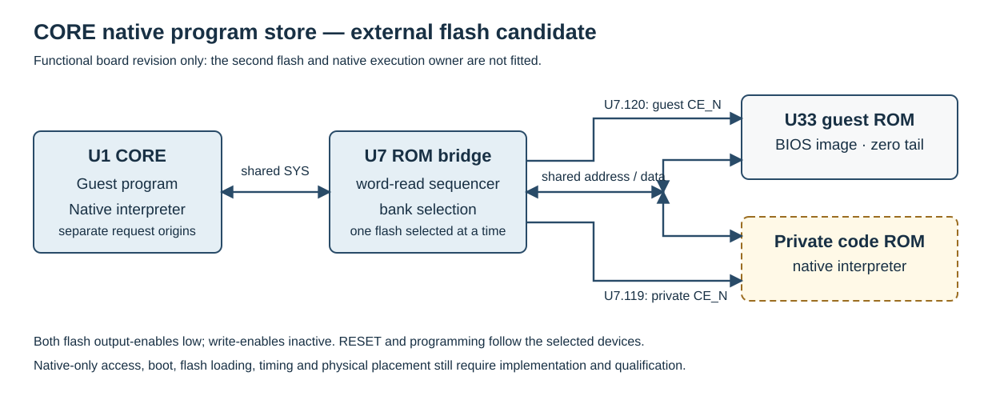
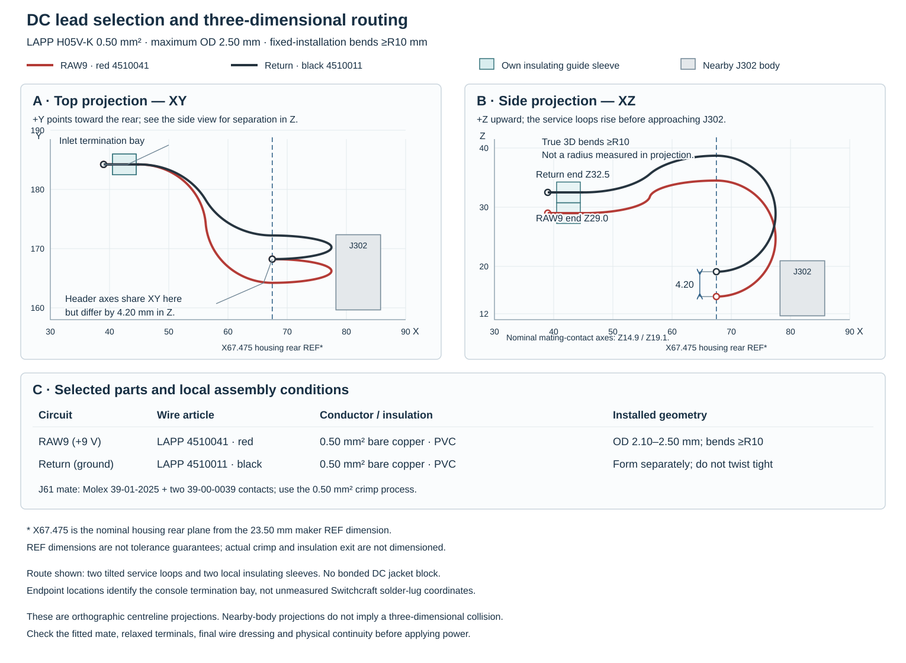

# BMSX — voorgestelde specificatiewijzigingen

Dit document bundelt de productwijzigingen die uit het fysieke consoleontwerp
volgen of daarbij worden overwogen. Het is een **voorstel**, geen vervanging
van de bestaande specificatie. De huidige programmeerbare contracten staan in
[Book I](book1/console.md), [Book II](book1/cpu.md) en
[Book III](book3/cartridge.md); de voorgestelde constructie staat in
[Book IV](book4/index.md). Afwijkingen zijn pas definitieve productregels als
ze in de betrokken handleidingen en implementaties zijn uitgewerkt.

**Status:** de gebruiker heeft de richtingen voor meer-cyclus-DMA,
werkafhankelijke GEO- en CPU-timing en fysiek begrensde video goedgekeurd. Ook is
gekozen voor mono als standaardbron en onafhankelijke linker-/rechtervolumes
per stem, en voor één fysiek budget voor de volledige taalruntime wanneer een
fysieke uitvoering wordt gekozen. De vorm van die CPU-uitvoering wordt opnieuw
beoordeeld: BLua32 is een programmeerarchitectuur en hoeft niet als een volledig
hardwired taalruntime te worden opgevat. De precieze programmeringsinterface en numerieke grenzen hieronder
zijn nog niet vastgesteld. Er is geen specifieke stemlimiet, IRQ-tijd of
voedingsstroom goedgekeurd.

## Plaats van dit document

De console wordt eerst als samenhangend fantasyconsole-ontwerp uitgewerkt. De
onderstaande fysieke analyses blijven bewaard: ze geven aan welke keuzes en
verschillen aandacht vragen als het ontwerp later als echte hardware wordt
uitgevoerd. Een nog niet gekwalificeerde schakeling maakt een beschreven
fantasyconsole-functie niet automatisch ongeldig. Omgekeerd bewijst een
functionele beschrijving niet dat de oorspronkelijke timing fysiek haalbaar is.

De goedgekeurde richtingen voor DMA, GEO, CPU-timing en video blijven staan als
uitgangspunt voor de latere fysieke uitwerking. De bestaande Books I–III en de
emulator blijven de huidige programmeercontracten totdat concrete wijzigingen samen
worden vastgesteld en verwerkt. Ook de keuze voor mono als standaardbron met
onafhankelijke links-/rechtsniveaus blijft bewaard; de precieze interface is
nog een voorstel.

## Overzicht en besluitstatus

| Onderwerp | Richting | Wat nog niet vaststaat |
|---|---|---|
| DMA | Meer-cyclusoverdracht goedgekeurd | Zichtbare voortgang, voltooiing en timinggrenzen |
| GEO | Werk- en geheugenafhankelijke timing goedgekeurd | Timing en voortgang per opdracht |
| GTE | Gedeeld fysiek rekenpad onderzoeken | Voltooiingstijd van gewone commando's en zichtbare wachttijd; niet goedgekeurd |
| Video | Fysiek begrensde uitvoer goedgekeurd | Exacte bemonstering, sync en gekwalificeerde grenzen |
| GPU-uitvoeringstijd | Geheugenplanning en zichtbare commandovoltooiing verenigen | Fysieke architectuur of mogelijke timingwijziging; niet goedgekeurd |
| GPU-readback | Snapshot van beide supervisorcontexten behouden | Of fysieke leeswachttijd de CPU-/DMA-timing of zichtbare volgorde verandert |
| CPU-timing | Werk- en geheugenafhankelijke fysieke timing goedgekeurd, met C++-/assemblyachtige prestatie-intentie voor normaal BLua-gebruik | Concrete instructieduur, implementatie en gevolgen voor devicevolgorde en compatibiliteit |
| CPU-taalopslag | Eén fysiek runtimebudget inclusief globals, frames en beheer; 4 MiB publiek RAM blijft | Exacte grootte, allocatie- en OOM-regels en compatibiliteit |
| APU-bron en stereoplaatsing | Mono als standaard; onafhankelijke niveaus links en rechts | Programmeringsinterface, representatie en compatibiliteit |
| APU-belasting | Garantie op basis van werkelijk haalbare belasting onderzoeken | Garantiedomein, eventuele stemlimiet en gedrag bij bereiken daarvan |
| APU-broncontrole | Bestandsgroottecontrole vervangen door fysiek busgedrag onderzoeken | Exacte adres-, lege-kaart-, BADP- en foutregels en compatibiliteit |
| APU-supervisorhold | Stemtoestand behouden; sampletransfers blijven afzonderlijk | Teller tijdens hold verschilt tussen Book I en emulator; DAC-uitvoer is open |
| Cartridge-IRQ en DREQ | Fysiek uitvoerbare signalering onderzoeken | Keuze van het IRQ-contract en elektrische timing |
| Pointer | Gedrag bij een lege beeldextent onderzoeken | Of en hoe de nul-extent openbaar wordt gespecificeerd |
| Pad- en accessoireprotocol | Fysieke seriële aansluiting uitgewerkt als voorstel | Openbare interface, moment van uitvoer en verhouding tot het inputcontract |
| Fysieke cartridge-interface | Aansluiting en bus uitgewerkt als voorstel | Openbare elektrische, mechanische en timingvoorwaarden |
| Constructie en kwalificatie | Passieve koeling; originele pinouts behouden waar overeengekomen | Onder meer voeding, componentgrenzen en connectorpassing |

De goedkeuring van een **richting** legt niet automatisch de genoemde
voorbeeldwaarden of een nieuwe registerinterface vast. Omgekeerd zijn open
constructiepunten niet vanzelf wijzigingen van het programmeercontract. Dit
overzicht is de centrale lijst voor de voorgestelde wijzigingen; de huidige
boeken en emulator blijven ongewijzigd totdat de concrete contracten worden
vastgesteld en gezamenlijk worden verwerkt. De volledige bewaarde uitvoeringsstudies
staan achter de twaalf hoofdonderwerpen in de bijlage.

## 1. DMA: fysieke voortgang en voltooiing

**Huidig contract.** De [DMA-specificatie](book1/dma.md#sec-dma-calculating-a-blocks-charge)
kent een berekende blokduur toe. Een blok van maximaal zestien woorden tussen
I/O-poorten heeft zelfs bij zestien lees-/schrijfparen een blokcharge van één
systeemcyclus, ongeveer 29,5 ns.

**Goedgekeurde richting.** Een fysieke overdracht gebruikt meerdere cycli.
Het ontwerp leest een woord, wacht op de bron, schrijft dat woord naar de
bestemming en wacht op voltooiing voordat het volgende paar wordt verwerkt.
Wachttijden, arbitrage en geheugenverversing beïnvloeden de duur. De volgorde,
blokgrootte, registerwoorden, verzoeken, voltooiingsstatus en interrupts blijven
functioneel behouden. Zie [fysieke DMA-volgorde](book4/hardware.md#physical-dma-sequencing).

**Nog uit te werken.** De openbare timingtekst moet bepalen wanneer BUSY,
resterende count, DONE en IRQ zichtbaar worden, inclusief wachttijden en
concurrente bronnen. De huidige numerieke blokcharges mogen niet ongemerkt als
fysieke verstreken cycli blijven gelden. Een concrete vervangende
maximumdoorvoer of exacte latentie is nog niet vastgesteld. De emulator,
de [cartridgetransfertiming](book3/cartridge.md#sec-cartridge-dma-transfer-timing)
en eventuele APU-upload- en andere bandbreedtevoorbeelden moeten met de
uiteindelijke keuze in overeenstemming worden gebracht.

**Voorstel voor waarneembare voortgang.** De volgende volgorde maakt de
goedgekeurde meer-cyclusrichting concreet zonder de registerindeling te wijzigen:

1. START met een niet-nulcount zet de gekozen channel op BUSY. START terwijl
   BUSY is, wordt genegeerd. Bij een nulcount volgt DONE en de channel-IRQ
   zonder een blok of verzoek af te wachten.
2. Bij een blokgrens beoordeelt de controller de verzoeken en legt hij de
   adressen, resterende count en CONTROL voor het toegelaten blok vast. Een
   later wegvallend verzoek of DISABLED onderbreekt dat blok niet. Als er geen
   blok is toegelaten, kan een softwarewrite die de count op nul zet de
   channel laten voltooien zonder op verzoeken te wachten.
3. Voor ieder woord voltooit hij eerst de bronlezing en daarna de bijbehorende
   bestemmingswrite. Een gewone DMA-busfout blijft een afzonderlijke
   geheugenfoutmelding: na een foutieve bronlezing wordt de write nog steeds
   geprobeerd en het toegelaten blok gaat verder. Er is geen automatische
   herhaling of terugdraaiing van eerdere effecten.
4. Adressen en count worden pas na het laatste woord van het blok in de
   channelregisters teruggeschreven. Een tussentijdse softwarewrite naar die
   woorden kan daardoor door de blokresultaten worden overschreven; CONTROL
   blijft het laatst geprogrammeerde woord. De volgende bloktoelating gebruikt
   de dan aanwezige registerwaarden.
5. Na het laatste blok worden de eindadressen en nulcount gepubliceerd vóór
   DONE en wordt daarna de bijbehorende centrale IRQ aangevraagd. DONE is
   geen bewijs dat iedere bestemming de write accepteerde of dat een
   ontvangend apparaat zijn eigen werk al heeft afgerond.

De huidige runtimes voeren de woordparen op één geplande blokdeadline uit;
de fysieke kandidaat spreidt ze over afzonderlijke busvoltooiingen. Daardoor
kan de volgorde ten opzichte van CPU- en apparaatwerk veranderen, niet alleen
de totale duur. De precieze randvolgorde van gelijktijdige registerwrites,
reset en blokvoltooiing en de opname in beide runtimes moeten nog worden
vastgesteld. Normale verzoeken krijgen hier geen nieuwe timeout of foutregister.

**Kandidaat voor registerarbitrage.** De channelregistreigenaar bepaalt de
volgorde op het moment van *acceptatie*, niet wanneer een andere busmaster een
write voor het eerst aanbiedt. Een gewone write die vóór de blokpublicatie is
geaccepteerd, is direct leesbaar, maar een later gepubliceerd blokresultaat
overschrijft adres en count. Een conflicterende write die tijdens publicatie op
hetzelfde channel wacht, wordt pas daarna geaccepteerd en blijft vervolgens
staan. CONTROL is geen deel van de blokwriteback. Registers van het andere
channel blijven afzonderlijk programmeerbaar; de twee kanalen delen wel één
toegelaten blok en rouleren op blokgrenzen.

Dit onderscheid bepaalt ook START: een geaccepteerde START met BUSY hoog
wordt genegeerd. Een aangeboden START die pas na DONE wordt geaccepteerd, ziet
een idle channel en kan een nieuwe transfer starten. De kandidaat verandert
hiermee mogelijk de waarneembare volgorde ten opzichte van de huidige
blokdeadline, maar verandert niet ongemerkt de betekenis van een al
gaccepteerde BUSY-START. Zichtbaarheid van een gelijktijdige registerread,
reset op de publicatierand en de gevolgen voor CPU-wachttijd blijven apart
vast te stellen; dit is nog geen definitieve openbare timingregel.

**Verzoeken, busacceptatie en apparaatresultaat.** Een requestselector bepaalt
of een nieuw blok wordt toegelaten. Na toelating wordt de selector niet opnieuw
gebruikt om een woordpaar te annuleren. Een fysieke bus-DATA-wacht betekent
dat het aangevraagde woord nog niet is afgehandeld; het blok houdt die
transactie vast. Een daadwerkelijk afgeronde DMA-write die het doelapparaat
volgens zijn bestaande poortregels weigert, is iets anders: er ontstaat
hierdoor niet automatisch een busfout of herhaling, en het woord telt wel mee.
Daarom moeten de apparaatpoort en busrespons die afhandeling onderscheiden;
een gedeassert request mag niet stilzwijgend veranderen in een afgebroken blok,
maar evenmin mag iedere geweigerde devicewrite automatisch oneindig gaan
wachten. Er wordt geen nieuwe fout of timeout opgelegd.

## 2. GEO: werk- en geheugenafhankelijke timing

**Huidig contract.** De [GEO-specificatie](book1/geo.md#sec-geo-work-budget-and-timing)
rekent één record in drie cycli af en kent geen extra tijd toe aan het werk
binnen dat record.

**Goedgekeurde richting.** De uitvoering duurt afhankelijk van de werkelijke
geheugentransfers en rekenstappen. Bewaar de commandowoorden, formaten,
precisie, volgorde van resultaten, foutgedrag en `PROCESSED`-betekenis. Een
voorbeeld met 64 vertices en bounds omvat in de onderzochte organisatie 140
woordlezingen, 132 woordschrijvingen en 256 producten. Zelfs 272 ideaal
achtereenvolgende DRAM-paginatransfers van 20 ns kosten 5,44 µs, zonder de
verdere verwerking. Dit voorbeeld is geen universeel GEO-doorvoercijfer.
[Constructie en aannames](book4/hardware.md#physical-geo-service).

**Nog uit te werken.** Definieer timing en waarneming van voortgang en
voltooiing voor alle opdrachten; kwalificeer de echte engine. De oude vaste
recordrate is geen aangetoonde fysieke eigenschap. Werk Book I en de emulator
na keuze van het contract bij.

**Voorstel voor waarneembare voortgang.** De engine houdt één taak actief en
verhoogt `PROCESSED` pas nadat een buitenrecord en zijn vereiste transacties
zijn afgerond. Een summarywrite kan een afzonderlijk geregistreerde busfout
opleveren; dat is niet automatisch een GEO-fout. Eerder uitgevoerde writes
kunnen al zichtbaar zijn; het record is geen automatisch atomair
geheugenresultaat. Bij succes publiceert de engine het eindresultaat en DONE
vóór GEO_DONE. Bij een uitvoeringsfout publiceert zij DONE, ERROR en de
foutgegevens vóór GEO_ERROR; het falende record telt niet mee. Eerder
uitgevoerde effecten worden niet teruggedraaid. De lokale foutbevestiging en
de centrale IRQ-bevestiging blijven afzonderlijk.

Een belangrijk geval is `OVERLAP2D_PASS` met count nul: volgens het huidige
contract gaan vier nulwrites naar de samenvatting aan de countcontrole vooraf.
Een fysieke uitvoering kan óf BUSY zichtbaar houden tot die writes klaar zijn,
óf de CMD-write laten wachten voordat DONE zichtbaar wordt. Dit zijn nog te
kiezen alternatieven; beide kunnen de huidige onmiddellijk zichtbare afhandeling
veranderen. Ook de volgorde van ABORT of een afgewezen CMD ten opzichte van een
al geaccepteerde geheugentransfer moet nog worden gekozen. Geen van beide
gevallen krijgt hier stilzwijgend een nieuwe timingregel.
Een nieuwe CMD tijdens BUSY blijft een afwijzing die de oude taak beëindigt;
ABORT blijft een foutieve beëindiging. Reeds uitgevoerde geheugenwerkingen
blijven in beide gevallen bestaan.

De vier initiële summarywrites zijn gewone buswrites, ook wanneer `DST1` naar
een I/O-register wijst. De CORE-geheugenroute heeft nu een afzonderlijke
verzoekbit voor raw GEO-operandtoegang of gewone, gemapte bustoegang. Een
gerichte simulatie controleert beide routes op hetzelfde adres en controleert
een gemapte I/O-write. De GEO-verzoekproducer is nog niet aangesloten en moet
die bit per verzoek leveren. Dit is nog geen volledige GEO-integratie.
Een CMD-write laten wachten op een summarywrite naar diezelfde bezette
I/O-eigenaar kan anders vastlopen; bij een adres naar GEO zelf is bovendien de
herintrede en volgorde zichtbaar. Geen adresbeperking, stille omzetting naar RAM
of oplossing voor die gevallen is hier vastgesteld.

De referentierichting leest geometrie uit de opgegeven bron wanneer een
berekening die nodig heeft. Een onderzochte werkbank die elk polygonenpaar
eenmalig inlaadt kan bij veranderende waarden of een cartridgeapparaat met
leesbijwerkingen ander gedrag geven dan herhaalde bronlezingen. Stel eerst de
zichtbare leesvolgorde vast voordat die werkbank als gelijkwaardige uitvoering
wordt gekozen; de huidige TypeScript- en C++-eigenaars lezen onder meer bij
SAT2 de coördinaten meermalen.

**Clippingwerkruimte bij ongebruikelijke invoer.** Book I noemt convexe
polygonen, maar schrijft ook voor dat onder meer convexiteit en winding niet
worden gecontroleerd of gerepareerd. Een gerichte proef met de bestaande
TypeScript-clippingkern gebruikte 64 representabele, zichzelf kruisende
vertices tegen een AABB en bereikte 144 tussenvertices, terwijl de werkruimte
128 vertices bevat. Die smalle interne proef leverde een niet-getal als
contactpunt; het is geen volledige registerpadtest. De C++-eigenaar gebruikt
ook een vaste array van 128 vertices en zijn ongecontroleerde arraytoegang is
voor deze situatie niet veilig bewezen; er is geen C++-proef met die invoer
uitgevoerd. De representatie en het gedrag bij volle werkruimte moeten voor
beide runtimes en de fysieke engine worden verenigd. Hier is geen verborgen
clamp, vervangend resultaat of nieuw afkeurpad gekozen.

### GTE: voltooiing van normale commando's

De [GTE-specificatie](book1/gte.md#sec-gte-completion-and-throughput) laat de
resultaten van een normaal commando beschikbaar zijn wanneer de COMMAND-write
voltooit. De nominale `CYCLES`-waarde is geen wachttijd; een directe store
heeft twee CPU-basisklokken. PLUS kan daarnaast onafhankelijk een opdracht
uitvoeren en publiceert VMAD3 na vijf systeemklokken.

Een fysieke kandidaat hergebruikt de normale rekenpaden over meerdere stappen
en rondt de write pas af nadat de resultaten klaarstaan; PLUS behoudt zijn
afzonderlijke pad. Daarmee blijft de resultaatvolgorde bedoeld, maar de
verstreken tijd van de write kan veranderen. Book I noemt zowel de gewone
basiskosten en eventuele device-waits als het ontbreken van een normale
GTE-busy-wacht. Of deze fysieke wachttijd daarmee verenigbaar is, moet samen
met de emulator en gelijktijdige toegang worden vastgesteld. Een mogelijke
wijziging van zichtbare timing is **nog niet goedgekeurd**; er is geen nieuwe
limiet of commandolatentie gekozen. De gedeelde paden zijn evenmin bewijs dat
de huidige tijdseis onmogelijk is. Zie [de GTE-organisatie](book4/hardware.md#sec-physical-gte-command-path).

### GPU: uitvoeringstijd en lokaal geheugen

Book I geeft een lokale copy van 3 × 5 zestienbitwoorden een uitvoeringsduur
van 15 systeemcycli vanaf de start van het commando. De onderzochte
[geheugenplanner](../hardware/rtl/gfx_memory_scheduler.sv) draait op 54 MHz,
reserveert per 64 klokken maximaal 14 aaneengesloten slots voor rendererwerk
en gebruikt twee slots per 32-bit schrijfoperatie. Vijftien systeemcycli
beslaan ongeveer 23,92 van die geheugenklokken; zelfs een ruim geteld venster
van 25 klokken bevat hoogstens 14 renderer-slots.

Als de copy zijn vijftien verschillende doelwoorden na commandostart binnen
die tijd rechtstreeks in het gedeelde SRAM moet schrijven, zijn ook bij ideaal
gepaarde woorden minstens acht 32-bit schrijfacties nodig. De planner kan in
dat venster hoogstens zeven van zulke writes afhandelen, nog zonder de
bronreads. Deze kandidaat met directe SRAM-publicatie draagt die vaste
voltooiingstijd dus niet. De scheduler bevat geen complete renderer; een
andere planning, extra parallelisme of een correct doorgestuurde schrijfbuffer
kan de grens veranderen en moet ook de zichtbaarheid voor latere GPU- en
displaylezingen behouden. Dit is geen bewijs dat alle fysieke uitvoeringen
onmogelijk zijn. Er is **geen GPU-timingwijziging goedgekeurd** en geen nieuwe
voltooiingsregel of snelheidslimiet vastgesteld.

Een alternatieve architectuurrichting combineert tijdige scanoutreserveringen
met dynamische toewijzing van vrije slots en een begrensde schrijfbuffer.
Die buffer moet eerdere writes doorgeven aan latere GPU- en displaylezingen;
een overlappende copy moet de voorgeschreven lees-/schrijfvolgorde behouden.
Een GP0-IRQ-marker is geen displayfence en verplicht op zichzelf niet tot het
legen van de buffer. Zo'n buffer vangt pieken op, maar lost een structureel
tekort aan geheugencycli niet op. Een snellere schrijfcyclus, extra parallel
geheugen of een andere fysieke timing kan nodig blijken; geen daarvan is hier
gekozen of bewezen. De [geheugenorganisatie](book4/hardware.md#sec-physical-gfx-memory-schedule)
beschrijft de voorgestelde richting.

Een concrete verbredingsoptie is vier 256K × 16-geheugens parallel te
gebruiken als één 64-bit datapad. Dat blijft 2 MiB logisch videogeheugen,
maar vervangt de huidige twee 512K × 16-geheugens en hun 32-bit datapad.
De grotere overdracht kan bij geschikte uitlijning de druk op het geheugen
verminderen; hij bewijst niet dat overlappende copies, beide beeldcircuits
en andere workloads hun huidige timing halen. Deze variant vraagt een andere
ASIC-pinindeling of interface en een bijpassende print en planner. De huidige
print en geheugenkandidaat zijn hiervoor niet aangepast.

Voor verdere fysieke uitwerking is 64-bit SRAM met flexibele planning de
concreetste onderzochte richting zonder de GPU-specificatie te verlagen. Het
is nog geen vastgestelde productkeuze: de toegangsvolgorde, prestaties en
fysieke inpassing zijn niet bewezen. Verbreding alleen verhelpt de starre
slotverdeling niet; de planner moet eveneens worden aangepast.

Een mogelijke aansluiting behoudt de bestaande 32-bit snapshotbank: de
64-bit hoofdbank gebruikt 18 woordadreslijnen, de snapshotbank 19. U2 houdt
daarvoor A18 beschikbaar en selecteert per geheugentoegang één bank; de
laagste 32 datalijnen worden gedeeld. Een volledig 64-bit bronwoord kan dan
waar nodig in twee 32-bit snapshotwrites worden opgeslagen. De controller
moet de adresomrekening, byte-enables, pixelvolgorde en oneven eindstukken
verzorgen. Dit maakt de snapshotbank niet tot een onafhankelijke tweede
geheugenpoort en bewijst geen timing of complete implementatie.

Voor dit voorstel bepaalt de GPU of PCRTC eerst het bestaande 20-bit
zestienbit-woordadres `W`, inclusief zijn eigen adressering en omloop. De vier
videogeheugens krijgen daarna hetzelfde fysieke woordadres `W >> 2`:

| `W & 3` | Videogeheugen | Databits | Actieve byte-enablegroep |
|---:|---|---|---|
| 0 | 0 | 15–0 | 1–0 |
| 1 | 1 | 31–16 | 3–2 |
| 2 | 2 | 47–32 | 5–4 |
| 3 | 3 | 63–48 | 7–6 |

Binnen ieder zestienbitwoord staat de lage byte eerst. Een afzonderlijke
woordwrite activeert alleen de twee bijbehorende actieve-lage byte-enables;
de overige geheugens blijven onveranderd. Voor een snapshot met context `c`
en resultaatindex `i` kan de 32-bit bank `(c << 18) | (i >> 1)` als adres
gebruiken; `i & 1` kiest het lage of hoge zestienbitdeel. `c = 0` en `c = 1`
geven de afzonderlijke cartridge- en supervisorhelften. De resultaatindex loopt
over rijen heen door zonder opvulling na een oneven rij; hij is niet het
VRAM-adres. Een oneven laatste resultaat krijgt bij uitlezing een nul in het
ongebruikte hoge deel, ongeacht de oude inhoud van dat deel in de snapshotbank.

Deze aansluitingskeuze verandert de bestaande GPU- of PCRTC-adresformules niet.
Een toegang die fysiek een 64-bit woordgrens overschrijdt, kan meerdere
geheugenbeurten vereisen. Bij een overlappende copy blijft de voorgeschreven
volgorde tussen elke bronread en bestemmingwrite gelden.

Het afzonderlijke [KiCad-deelschema](../hardware/ecad/gfx_wide_vram/GFX_WIDE_VRAM.kicad_sch)
legt deze vier SRAM-aansluitingen vast met de gecontroleerde Micron-pinnummers.
De U2-zijde bestaat uit signaallabels, niet uit vastgelegde ASIC-pinnen. De
snapshotbank, ontkoppeling, timing en volledige printintegratie ontbreken;
het deelschema vervangt het huidige moederbordschema niet.

Een afzonderlijke [gecombineerde schemakandidaat](../hardware/ecad/gfx_vram_snapshot/GFX_VRAM_SNAPSHOT.kicad_sch)
voegt kopieën van de bestaande snapshotbank en haar ondersteuningsblad toe.
De lage datalijnen, adreslijnen en gemeenschappelijke besturing zijn gedeeld;
de twee banken behouden afzonderlijke chipselects. De ontkoppeling en
besturingspull-ups voor de nieuwe VRAM-bank, de U2-pintoewijzing en
bankselectielogica, timing en printintegratie zijn nog niet uitgewerkt.
Deze partiële aansluiting bewijst geen elektrische of timingkwalificatie en
wijzigt het oorspronkelijke moederbord niet.

Dit is geen geheugenorganisatie die pas bij moderne consoles denkbaar werd:
Micron beschreef in zijn [SRAM-databoek van 1993](https://device.report/m/78d1e0932ff677fc0bf36080f8a6c2fb131f8db3612f0649add4a79b5e554bf9)
een 3,3V-geheugen van 256K × 16. Die vermelding is als *advance* gemarkeerd;
zij bewijst geen beschikbaarheid, prijs of BMSX-timing in 1993. Bij behoud van
de huidige parallelle aansluiting en 32-bit snapshotbank zijn voor de bredere
hoofdbank 32 extra datalijnen en vier extra byte-enable-lijnen nodig. U2 heeft
in de huidige kandidaat slechts één reservepin. Een nieuwe pin- en
behuizingsindeling is dus nodig; de huidige plaatsing en behuizingspassing
kunnen niet automatisch worden overgenomen.

Voor een voorlopig pinplan blijven de bestaande lage 32 datalijnen en vier
byte-enables gedeeld met de snapshotbank; de hoofdbank krijgt daarnaast 32
datalijnen en vier byte-enables. De adreslijnen blijven beschikbaar voor beide
banken, inclusief A18 voor de snapshot. Bij een denkbeeldige 304-pins QFP zijn
er 76 posities per zijde. De huidige geheugeninterface gebruikt 59 pennen en
de verbreding brengt dat op 95; die groep moet dus over minstens twee zijden
worden verdeeld. Systeem-, video-, input- en kloksignalen blijven afzonderlijke
groepen. Dit is een functionele verdeling, geen definitieve pintoewijzing of
garantie voor voedingspennen, fanout of koeling.

Een globale ruimteverkenning voor een hypothetische U2-body van 40 × 40 mm op
de huidige middenpositie geeft geen overlap met de bestaande bovenzijdige
footprint-omgrenzingen zonder tekst. Het eerste cartridgesocket begint in die
projectie wel op ongeveer 2,8 mm van de body. Een groter gereserveerd vlak
raakt andere footprints; de aansluitpennen, onderzijde, koeler en productiepassing zijn in
deze eenvoudige controle niet aangetoond. Dit is geen keuze voor een concrete
chipbehuizing en geen bewijs dat de kast of print groter moet worden.

De bestaande vlakke koelplaat dekt deze denkbeeldige grotere U2-body in
bovenaanzicht niet volledig. Dat betekent niet automatisch dat de koeling
tekortschiet: de werkelijke chipwarmte en het benodigde contactoppervlak zijn
niet bekend. Bij een keuze voor die body moeten het contact en de plaatsing van
de passieve plaat opnieuw worden bekeken; een ventilator volgt hier niet uit.

Voor de twee extra geheugens raakt één onderzochte globale bovenzijdereservering
naast de huidige videogeheugens bestaande voedingsonderdelen. De overeenkomstige
projectie aan de onderzijde is een
mogelijke onderzoekslocatie, maar afstand tot het deck en invloed van de
voeding zijn daarin niet vastgesteld. Een andere plaatsing of verplaatsing van
supportonderdelen blijft mogelijk; dit is nog geen componentenplaatsing.

Een eerste globale indeling behoudt twee geheugenposities aan de bovenzijde en
reserveert twee plaatsen aan de onderzijde. In die specifieke proef raakt één
onderste reservering de doorgangspad van meetpunt TP4; het meetpunt moet dan
worden verplaatst. De gebruikte 14 × 24 mm-rechthoeken zijn globale
ruimteclaims, geen fabrikantfootprints. Het huidige model geeft 7 mm tussen
het printondervlak en de vlakke bovenzijde van het deck. De oorspronkelijke
[Micron-maattekening uit 1993](https://ftpmirror.your.org/pub/misc/bitsavers/components/micron/_dataBooks/1993_Micron_SRAM_Data_Book.pdf),
pagina 7-21, geeft voor het 54-pins TSOP-pakket maximaal 1,20 mm hoogte vanaf
het montagevlak, maximaal 22,33 mm bodylengte en 11,86 mm pootspan. Deze
onderdeelmaten passen binnen de globale 14 × 24 mm-reservering, maar zijn geen
printfootprint met soldeerpads. De eenvoudige hoogtemaatvergelijking laat dan
nominaal circa 5,8 mm over, vóór soldeer, isolatie en toleranties. Dat is geen volledige
passingscontrole. De onderzijde ligt bovendien tegenover de voeding; warmte,
interferentie en de werkelijke montage blijven open. De bestaande print is
niet gewijzigd.

De volgende vergelijking plaatst de onderzochte variant naast de bestaande
constructiekandidaat. Zij kiest geen definitieve geheugenarchitectuur en
vervangt de bestaande print en de bijbehorende afbeeldingen niet.

| Onderdeel | Bestaande constructiekandidaat | Onderzochte brede variant |
|---|---|---|
| Vier hoofdchips en externe aansluitingen | CORE, GFX, APU en firmwarebrug; twee cartridges, vier pads, keyboard, SCART en DC | Zelfde functionele indeling; INPUT blijft een voorstel in GFX |
| GFX-behuizing | 208 pennen in de bestaande kandidaat | Grotere of anders ingedeelde interface nodig; 304 pennen is slechts een rekenvoorbeeld |
| Videogeheugen | 2 × 512K × 16; 32-bit, 2 MiB | 4 × 256K × 16; 64-bit, 2 MiB |
| Snapshotgeheugen | Voorgestelde 32-bitbank U152/U153, 2 MiB | Dezelfde bank; deelt de lage datalijnen en krijgt afzonderlijke selectie |
| Passieve koeling en plaatsing | Bestaande voorgestelde spreidplaat en printindeling | Aansluiting van de koeler en de plaatsing opnieuw te beoordelen; geen ventilator voorgesteld |

Dit is een functionele groepering, geen tekening op schaal. Eén eerder
onderzochte mogelijkheid plaatst twee videogeheugens boven en twee onder de
print; de projectie hierboven toont ook het bestaande TP4-conflict. De figuur
bewijst geen vrije ruimte, definitieve pinindeling, montage, koeling of
GPU-timing. Een fysiek moederbord voor deze variant is nog niet uitgewerkt.

Voor de GFX-aansluitingen is een logische groepering mogelijk met systeem en
interrupts aan de kant van U1, geheugen aan de zijde van de geheugens, video
richting de video-onderdelen en input richting de frontaansluitingen. In één
304-pins rekenvoorbeeld vullen de geheugen- en videozijde samen met de huidige
voedingsaansluitingen al hun beschikbare posities. Vrije posities aan andere
zijden bewijzen dus niet dat daar voldoende extra voeding of signaalscheiding
kan worden geplaatst. De daadwerkelijke pinvolgorde en footprint blijven open.

Een andere historische richting is afzonderlijke displaytoegang. Sony's
[PlayStation-hardwarehandleiding](https://psx.arthus.net/sdk/Psy-Q/DOCS/Devrefs/Hardware.pdf)
beschrijft een dual-port framebuffer voor gelijktijdig tekenen en weergeven.
Ook Microns [VRAM-databoek uit 1993](https://www.bitsavers.org/components/micron/_dataBooks/1993_Micron_Specialty_DRAM_Data_Book.pdf)
beschrijft geheugen met een willekeurige DRAM-poort en een afzonderlijke
seriële displaypoort. Dat is een ontwerpreferentie, geen bewijs dat dit
specifieke geheugen de twee onafhankelijk programmeerbare BMSX-beeldcircuits,
hun formaten of de vereiste GPU-timing ondersteunt. Een eventuele overstap
verandert bovendien de fysieke geheugeninterface en moet eerst als geheel
worden uitgewerkt.

De onderzochte MT42C4256 uit dat databoek heeft één seriële uitleespoort;
zijn gesplitste seriële register biedt geen twee onafhankelijk adresseerbare
displaypoorten. Voor BMSX zijn daarom aanvullende organisatie en buffering
nodig als beide beeldcircuits tegelijk verschillende gebieden lezen. De
samengestelde uitvoer moet ook de volgorde en zichtbaarheid van GPU-writes
behouden. Dit is een grens van dit geheugenvoorbeeld, niet van alle mogelijke
VRAM-architecturen.

Een mogelijke hybride behoudt één logisch 2 MiB-geheugen: de seriële poort
levert bruikbare aaneengesloten stroken voor één beeldbron, terwijl de andere
beeldbron en overige GPU-toegang via de willekeurige poort met eigen buffers
worden gepland. Niet alle ondersteunde beeldformaten hebben aaneengesloten
rijen; de seriële route kan dus niet zonder meer voor elke instelling worden
gebruikt. Geheugenverversing, bronwisselingen, samenloop en zichtbaarheid van
writes zijn daarmee nog niet opgelost. Dit is geen geselecteerde nieuwe
printopbouw of garantie voor de bestaande GPU- en displaytiming.

## 3. Video: logische instellingen en fysieke uitvoer

**Huidig contract.** De [PCRTC-specificatie](book1/pcrtc.md) definieert
logische beam- en pixelinstellingen zonder bijbehorende fysieke uitvoerlimiet.

**Goedgekeurde richting.** Behoud de volledige programmeerbare registerwoorden,
maar geef een expliciete fysieke weergavebaseline. In het huidige constructie-
voorstel klokt de DAC op **13,5 miljoen samples per seconde**. Een
instelling met snellere logische veranderingen kan daardoor meerdere logische
pixels tussen twee fysieke samples laten vallen. Dat is zichtbare
onderbemonstering, geen verborgen registerclamp en geen zwarte fallback. De
**54 MHz** van het lokale videogeheugen is een andere klok dan de DAC-sampleklok.
[Video-ontwerp](book4/hardware.md#video-signal-generation).

**Voorstel voor de programmeerbare uitvoer.** Gebruik de bestaande 625-lijnen-/
50-veldenreferentie als een beoogd RGB-uitvoervoorbeeld. Bij
13,5 MHz duurt een lijn 864 fysieke samples; daarvan zijn er in dit voorbeeld
702 voor het actieve interval en 162 voor synchronisatie en porches. Twee
geïnterlinieerde velden vormen één frame. Dit zijn aantallen fysieke
uitvoersamples, geen nieuwe framebufferbreedte of beperking van de
registervelden. Het voorbeeld moet door software worden ingesteld: de huidige
resetbeam heeft 628 halflijnen en selecteert dit profiel niet automatisch.

**Bestaand opstartbeeld.** Naast dit geïnterlinieerde voorbeeld moet de fysieke
video-uitgang ook het bestaande BIOS-opstartbeeld kunnen weergeven: 320 × 240,
niet-geïnterlinieerd, met de huidige PAL-achtige timinginstelling. Deze 320 × 240
betreft de logische beeldinhoud en is niet het totale aantal DAC-samples. De
BIOS-preset gebruikt de huidige resetwaarden voor de verticale timing: 628
halflijnen van nominaal 32 µs, oftewel 314 lijnen en circa 49,76 beelden per
seconde. Een lijn bevat bij 13,5 MHz nominaal 864 uitgangssamples. In het
320-pixelvenster liggen logische pixelstap en nominale sample-afstand gelijk:
de DAC-samplefrequentie vormt op zichzelf dus geen obstakel voor één sample per
beeldpixel in dit venster. Dit is een eenvoudige toets van de bestaande
registerinstelling, geen nieuwe modus of wijziging van BIOS, registers of
emulator.

**Kandidaat voor de opstartsynchronisatie.** Voor de stabiele opstartinstelling
kan de fysieke syncgenerator de bestaande verticale blanking gebruiken:
halflijnen 576–627 van de 628. Een concreet voorstel plaatst vijf korte
voorpulsen in halflijnen 580–584, vijf brede syncpulsen in 585–589 en vijf
korte napulsen in 590–594. Bij 432 samples per halflijn zijn de korte pulsen
32 samples laag en de brede pulsen 368 samples laag; de rest van de halflijn
staat op het hogere referentieniveau. Buiten deze reeks loopt de voorgestelde
gewone lijnsync door. RGB blijft tijdens de verticale blanking afgedekt.

Dit voorbeeld gebruikt dezelfde pulsbreedten als het afzonderlijke
625-halflijnenprofiel, maar behoudt de 628 halflijnen en de niet-geïnterlinieerde
opstart van de BIOS. Het verandert geen registerwoorden en claimt geen
PAL-conformiteit of televisiecompatibiliteit. Halflijn 585 is het logische
VSINT-landmerk, geen bewezen gelijktijdige fysieke uitgangsflank: overdracht
tussen klokdomeinen en de uitvoerpipeline zijn nog niet geïntegreerd. De
vertaalslag voor andere programmeerbare instellingen blijft open.

Als de horizontale velden van de BIOS-preset op dezelfde manier naar fysieke
sync en blanking worden vertaald als in het 625-halflijnenvoorbeeld, levert
dat nominaal circa 0,89 µs front porch en 10,44 µs totale horizontale blanking,
tegenover respectievelijk 1,56 µs en 12 µs in dat voorbeeld. Deze vergelijking
is afhankelijk van die **voorgestelde vertaling**: Book I schrijft die
analoge interpretatie niet zelfstandig voor. Zij bewijst niet dat een
televisie de opstartmodus niet kan weergeven. De sync- en blankingmapping voor
de opstart en voor andere programmeerbare waarden blijft een voorstel; er is
geen verborgen registeraanpassing of nieuwe beperking gekozen.

**Kandidaat voor horizontale uitvoer.** Voor een lopende, gelatchte timing kan
GFX de fysieke lijnfase rechtstreeks vergelijken met de geprogrammeerde
velden: eerst een syncinterval ter lengte van HS, daarna de achterporch HBP,
en aan het einde van de lijn de voorporch HFP. De tussenliggende ruimte is het
horizontale actieve interval. De vergelijking gebruikt de oorspronkelijke fase,
niet een op de pixelstap afgeronde positie. Een beeldvenster buiten het actieve
interval wordt op de fysieke uitgang door blanking afgedekt; de registerwoorden
en logische beam worden niet aangepast. Ook nulvelden volgen deze vergelijking
zonder een speciale BIOS-modus of verborgen clamp.

Voor de bestaande BIOS-waarden bevat het actieve interval nominaal de samples
129–851; het 320-pixelvenster gebruikt samples 170–489. Dit maakt de bedoelde
horizontale organisatie concreet, maar kiest nog geen volledige videoregel.
Onder meer stilstaande of opnieuw gestarte timing, de gelatchte beeldstatus,
verticale pulsen, synchronisatie tussen klokdomeinen en de ontvangen analoge
golfvorm moeten afzonderlijk worden uitgewerkt. Deze kandidaat is niet
geïmplementeerd of als televisiecompatibel gekwalificeerd.

Deze uitkomst bewijst geen PAL-conformiteit of compatibiliteit met een
televisie. De daadwerkelijke SCART-synchronisatie, horizontale en verticale
pulsvorm, fase, klokdomeinoverdracht en aansluiting van de fysieke scanout
zijn nog niet als complete keten aangetoond. Een eventuele wijziging van de
bestaande opstarttiming blijft een aparte productkeuze.

Een cartridge kan zijn bestaande twee leesvensters, framebufferformaten en
registerwoorden blijven gebruiken. De gewenste afbeelding wordt echter pas
één-op-één zichtbaar als de relatie tussen logische pixels en die fysieke
samples, de synchronisatie en de geheugendienst voor die configuratie zijn
uitgewerkt. Een waarde boven de fysieke samplecapaciteit wordt niet op een
ander registerwoord afgerond en geeft niet automatisch zwart; voor zo'n
configuratie is exacte uitvoer op een beeldscherm nog niet gegarandeerd. De
keuze hoe herhaalde of tussen samples vallende logische posities worden
weergegeven moet deel van de uiteindelijke productspecificatie worden en mag
niet stilzwijgend van een emulatorafbeelding worden afgeleid.

**Nog uit te werken.** Beschrijf exact hoe logische beam, sync en pixels op het
fysieke samplemoment worden afgebeeld, inclusief extreme programmeerbare
waarden. Breng emulator en handleiding op die regel; kwalificeer beamgenerator,
PLL, klokovergangen, DAC en analoge uitgang. De 13,5 MHz is de gekozen
constructiebaseline, geen bewijs dat alle programmeerbare modi fysiek
volledig worden weergegeven.

De twee fysieke oscillatoren zijn onafhankelijk; een alleen uit de systeemklok
afgeleide nominale pixelstroom loopt daarom niet vanzelf gelijk met de echte
DAC-klok. De onderzochte kandidaat laat de daadwerkelijke videoklok de
sampleaanvragen bepalen en koppelt beampositie, displaytoestand en systeem-FIELD
met coherente buffers. Het precieze waarnemingsmoment en een vaste uitvoerlatentie
zijn nog niet gekozen. PCRTC-stores mogen volgens het huidige contract niet op
PCRTC-ready wachten; blokkeren bij een volle overdrachtsbuffer zou dus een
afzonderlijke productwijziging zijn, geen reeds goedgekeurde videobegrenzing.

Het [scanoutvoorstel](book4/hardware.md#proposed-scanout-organisation) verbindt
die toestand aan twee onafhankelijke leeskanalen, de gezamenlijke VRAM-scheduler,
compositie en de fysieke uitgang. Het maakt onderscheid tussen de direct
herstartende live beam en de bij VBlank overgenomen displaybank. FIELD komt van
de live systeemtoestand. De buffers bewaren de relatie tussen een geheugenwoord
en de bijbehorende displaytoestand; de precieze verhouding tot gelijktijdige
GPU-schrijfacties is nog niet vastgesteld. Dit is een architectuurvoorstel, geen
nieuwe garantie voor latency, bandbreedte of gedrag bij een gemiste pixeldeadline.

## 4. APU: mono standaard en stereoplaatsing

**Huidig contract.** De [APU](book1/apu.md) heeft zestien slots en een stereo
uitgang op 44,1 kHz. Mono en stereo PCM/BADP zijn allebei al ondersteund;
`SOURCE_CHANNELS = 1` betekent mono en `2` stereo. Een mono- of stereobron
gebruikt één slot. De stagingwaarde van `SOURCE_CHANNELS` reset nu naar `0`.
Een stem heeft één gemeenschappelijke `GAIN_Q12`; er is geen onafhankelijke
linker-/rechterregeling.

**Goedgekeurde richting.** Maak mono de standaard voor de bron en behoud
stereo als mogelijkheid. Voeg per stem afzonderlijke regelingen toe voor de
bijdrage links en rechts, zodat een monobron in het stereobeeld geplaatst kan
worden. De stereo-einduitgang blijft bestaan. Voorkom dat een bestaande
volumewijziging of fade een eerder gekozen plaatsing onbedoeld wist.

**Functionele voorkeursopzet.** Behoud de zestien programmeerbare slots en
laat een monobron én een expliciet ingestelde stereobron elk één slot gebruiken.
De standaard broninstelling is één kanaal; twee kanalen kiezen een stereobron.
Standaard begint een nieuwe stem gecentreerd met beide kanaalniveaus op één;
een PLAY kan in plaats daarvan de ingestelde stagingniveaus overnemen. De
bestaande gemeenschappelijke gain blijft de sterkte en fade bepalen; een
wijziging daarvan verandert de ingestelde links-/rechtsverdeling niet.

Een PLAY neemt de gekozen bron- en niveau-instellingen samen over wanneer de
bronbinding slaagt; een mislukte PLAY laat de vorige stem intact. Een latere
niveauwijziging verandert de verdeling voor volgende uitvoerframes zonder de
bron opnieuw te starten. Bij mono ontvangt elk uitgangskanaal dezelfde bron;
bij een stereobron regelt het linkerniveau links en het rechterniveau rechts,
zonder de kanalen onderling te mengen. Ook de blokgolfgenerator levert één
monosignaal aan deze twee niveaupaden, zonder samplebron te binden of de
kanaalkeuze voor zijn golfvorm te gebruiken. De afzonderlijke filtergeschiedenissen
blijven bestaan.

Gecentreerd betekent in dit voorstel voor beide niveaus een factor één: er
wordt geen automatische −3 dB-correctie of andere equal-power-panwet toegepast.
Een monostem op unity/unity heeft daarmee dezelfde bijdrage per uitgangskanaal
als onder het huidige gemeenschappelijke-gaincontract; de totale mix kan nog
steeds verzadigen. Dit beschrijft de voorgestelde niveauregeling, geen nieuw
reeds beschikbaar register.

Dit is een samenhangend voorstel, geen reeds toegevoegde registerinterface.
De onderstaande adressering en teruglezing zijn één concrete kandidaat; het
gedrag voor expliciet geschreven kanaalwoorden anders dan één of twee en de
overgang van oude savestates blijven afzonderlijk te bepalen. Behoud de
bestaande stereo- en slotfunctionaliteit; stel hier geen nieuwe limiet voor
gelijktijdige stemmen vast.

**Historische toets.** De PlayStation-SPU gebruikt 24 gelijktijdige
ADPCM-stemmen uit 512 KiB lokaal samplegeheugen en heeft per stem aparte
linker- en rechtervolumeregelingen; de stereo-einduitgang maakt de afzonderlijke
stem dus niet zelf stereo. De fabrikant beschrijft ook DMA naar dat lokale
geheugen tijdens geluidsweergave. Zie het
[PlayStation Hardware Reference, Sound System](https://psx.arthus.net/sdk/Psy-Q/DOCS/Devrefs/Hardware.pdf)
en de [MAME SPU-implementatie](https://github.com/mamedev/mame/blob/master/src/devices/sound/spu.cpp).
Dit ondersteunt mono als gebruikelijk uitgangspunt met stereoplaatsing, maar
bewijst geen aantal stemmen of timinggarantie voor de BMSX. De bestaande
BMSX-stereobron blijft in dit voorstel mogelijk en gebruikt in de
voorkeursopzet één logisch slot. Het gedrag van andere kanaalwoorden en de
latere fysieke uitvoering zijn daarmee nog niet vastgesteld.

**Ontwerprichting vanuit de geluidsarchitectuur.** Een stem is in de eerste
plaats een mono samplepad met een eigen afspeelpositie; de mixer verdeelt de
uitkomst met afzonderlijke volumefactoren over links en rechts. Dat levert al
stereoplaatsing op en is niet hetzelfde als een stereosample. De SNES-DSP
verwerkt eveneens een stemuitkomst afzonderlijk voor beide mengkanalen; zie de
[MAME-implementatie van de SNES-DSP](https://github.com/mamedev/mame/blob/master/src/devices/sound/s_dsp.cpp).
Dit is een ontwerpvergelijking, geen bewijs dat de BMSX dezelfde codec,
interpolatie of timing moet gebruiken.

Een stereosample bevat twee onafhankelijke samplepaden. De voorkeursrichting
behoudt de bestaande BMSX-programmeerfunctie van één logisch slot en verwerkt
beide paden met gedeelde besturing en afzonderlijke decoderstatus; een andere
mogelijkheid laat twee programmeerbare monostemmen samenwerken.
Dat laatste zou de slotbezetting en synchronisatie voor bestaande programma's
veranderen. Werk de voorkeursrichting samen met de volledige software-interface,
lus- en startregels uit. De haalbare fysieke belasting en implementatiekosten
worden later getoetst, niet afgeleid uit het aantal bits van de voorlopige
decoder. Een monostem telt als
één bronpad; hoeveel parallelle bronpaden iedere combinatie gegarandeerd kan
gebruiken, is nog niet bewezen. De gebruiker heeft stereo als mogelijkheid
behouden; verwijder die functie niet stilzwijgend.

De eerdere vraag suggereerde dat iedere extra kanaalwaarde noodzakelijk een
eigen fysieke decodertoestand vereist. Dat volgt niet zonder meer: als een
definitief contract alleen bepaalde kanalen uitvoert, kunnen ongebruikte
kanalen mogelijk worden overgeslagen, mits hun layout en alle waarneembare
effecten correct worden gevolgd. Omgekeerd is daarmee geen correct gedrag van
de huidige implementaties voor meer dan twee kanalen aangetoond. De huidige
BADP-lus schrijft alle niet-eerste kanalen achtereenvolgens naar rechts, terwijl
beide runtime-decoders slechts twee toestandsplaatsen hebben. Dit wijkt af van
de PCM-beschrijving waarin kanaal 1 rechts levert; C++-toegang voorbij die twee
plaatsen heeft geen gedefinieerde uitkomst. Een historische vergelijking
bepaalt daarom niet vanzelf wat registerwaarden 0 of hoger dan 2 moeten doen.
Een wijzigingsvoorstel moet die volledige registersemantiek expliciet kiezen,
inclusief reset, readback, adresberekening en compatibiliteit, zonder een
verborgen afkapping tot twee bits.

**Woorddecodering als mogelijke productkeuze.** Eén kandidaat bewaart de
volledige 32-bit woorden voor staging, commando-opname en slotreadback, maar
definieert de volgende fysieke functies van hun bits:

| Woord | Gedecodeerd bit | Functie bij 0 | Functie bij 1 |
|---|---:|---|---|
| `SOURCE_CHANNELS` | 1 | Eén bronkanaal, verdeeld over links en rechts | Twee bronkanalen, links en rechts |
| `GENERATOR_KIND` | 0 | Samplebron, inclusief bronbinding | Blokgolf, zonder samplebronbinding |

De overige bits blijven bij schrijven, opname en readback behouden, maar
selecteren in deze kandidaat geen extra kanalen of generatoren. PCM gebruikt
de geselecteerde één- of tweekanaalsframebreedte; BADP gebruikt dezelfde
kanaalkeuze voor blokheaders, nibblevolgorde en decoderstatus. Dit is een
expliciete wijziging van de formaat- en registerbetekenis, geen onzichtbare
afkapping van het opgeslagen woord. Voorbeelden: `SOURCE_CHANNELS` van `0`
en `1` selecteren mono, `2` en `3` selecteren stereo; `FFFFFFFFH` selecteert
stereo terwijl het volledige woord leesbaar blijft. Een `GENERATOR_KIND` van
`2` selecteert de samplebron en een waarde van `3` de blokgolf. De stagingreset
en het stagingherstel na elk niet-nulcommando, ook een onbekend commando,
gebruiken respectievelijk `1` en `0` als standaardwoorden. `CMD=NONE` laat de
staging ongemoeid. De bestaande opnamevolgorde blijft uitgangspunt.

Een geselecteerde-slotwrite naar een van deze bronwoorden blijft een live
bronvervanging bij een actieve of gepauzeerde stem. Ook als alleen een niet
voor de selectie gebruikt bit verandert, wordt het ruwe woord eerst opgeslagen
en wordt daarna opnieuw gebonden met de actuele cartridgeselectie. Dit kan de
BADP-toestand opnieuw initialiseren of een bronfout geven. Bij een mislukte
live binding blijft het geschreven woord behouden en wordt de stem gestopt;
een mislukte PLAY laat daarentegen de bestaande stem intact. De ongebruikte
selectiebits zijn dus niet hetzelfde als een write zonder neveneffecten.

De stagingdefault `SOURCE_CHANNELS=1` is afzonderlijk van de live slotbank.
Reset en slot-clear zetten het ruwe slotwoord op `0`; dat woord selecteert in
deze kandidaat mono, maar activeert een inactief slot niet. De stagingwaarde
wordt pas bij een geslaagde PLAY in de stem opgenomen.

Deze bitindeling is **niet vastgesteld**. Zij verandert de huidige
PCM-adresberekening en BADP-layout voor kanaalwoorden buiten `1` en `2`.
Ook verandert zij bij generatorwoorden buiten `0` en `1` de huidige regel
dat niet-nulwaarden bronbinding overslaan, terwijl daarvoor geen golfvorm is
vastgelegd. Beoordeel bestaande cartridges en beide runtime-eigenaars voordat
een definitieve woordindeling wordt gekozen; Books I–III en de emulator blijven
tot dan ongewijzigd. Een andere expliciete woordindeling blijft mogelijk.

**Concreet ontwerpvoorstel, nog niet vastgesteld.**

- Zet de stagingreset voor `SOURCE_CHANNELS` op `1`; een programma kan nog
  steeds expliciet `2` schrijven. Leg ook het gedrag na een commando vast.
- Behoud `GAIN_Q12` als gezamenlijke sterkte en fade-regeling. Bewaar daarnaast
  twee onafhankelijke kanaalfactoren per stem, met voor beide een standaard van
  1, zodat bestaande gecentreerde weergave behouden blijft.
- Een mogelijke compacte representatie is één woord met twee signed 16-bit
  Q2.14-factoren; `40004000H` betekent links en rechts 1. Eerst wordt de
  kanaalfactor met de actuele mastergain gecombineerd met rekenkundige
  rechtsverschuiving; vervolgens wordt per kanaal het product opgeteld en na
  de som volgens de bestaande Q12-regel verschoven en begrensd. Deze
  voorstelling, afronding en de betekenis van alle bitpatronen moeten nog
  definitief worden gekozen. Een berekende kanaalgain heeft tot **34 signed
  bits** nodig; stilzwijgend terugknippen naar 32 bits is niet toegestaan.
- Deze kandidaat laat ook negatieve factoren en versterking boven 1 toe;
  die eigenschappen volgen niet vanzelf uit de keuze voor links/rechts-volume.
  Bij een stereobron beïnvloedt de linkerfactor het linkerkanaal en de
  rechterfactor het rechterkanaal; het voorstel mengt ze niet onderling.
- Behoud afzonderlijke linker-/rechterfilterhistorie. Een monobron leidt niet
  noodzakelijk tot gelijke samples na een eerdere live-bron- of filterwijziging.

De voorgestelde kanaalberekening is inmiddels als afzonderlijk fysiek
mengdatapad getest, inclusief een monobron die alleen links wordt weergegeven.
Dat bevestigt nog geen registerinterface, volledige fadeverwerking of
gerealiseerd silicium; de bestaande openbare regels blijven tot de gezamenlijke
wijziging van kracht.

**Concrete interfacekandidaat, nog niet vastgesteld.** De bestaande staging- en
geselecteerde registerblokken zijn vol. Een mogelijke uitbreiding voegt twee
woordregisters toe aan het einde van de huidige I/O-apertuur, zonder bestaande
APU-woorden te verplaatsen:

| Adres | Register | Toegang en functie |
|---|---|---|
| `08010440H` | `CHANNEL_LEVEL_LR` | Lezen/schrijven: niveaus voor het volgende vastgelegde commando |
| `08010444H` | `SLOT_CHANNEL_LEVEL_LR` | Lezen/schrijven: niveaus van de met staging `SLOT` gekozen stem |

Beide registers bevatten één volledig 32-bit woord. Bits 15:0 zijn het
linkerniveau en bits 31:16 het rechterniveau, elk een signed Q2.14-factor. Alle
bitpatronen hebben rechtstreeks hun signed betekenis: `40004000H` is links en
rechts unity, `00004000H` uitsluitend links unity en `40000000H` uitsluitend
rechts unity. `4000C000H` keert links de polariteit om en laat rechts op unity.
Er is geen saturatie of herinterpretatie bij het schrijven; negatieve factoren
keren de polariteit om en representabele factoren groter dan één versterken.

De stagingwaarde wordt `40004000H` bij reset en na iedere CMD-write die de
bestaande stagingdefaults herstelt, ook na een onbekend niet-nulcommando. CMD
`NONE` laat staging ongemoeid. Een geldig niet-nulcommando legt het nieuwe
stagingwoord tegelijk met de andere stagingwoorden vast. Alleen een geslaagde
PLAY installeert die vastgelegde niveaus in het geselecteerde slot; een mislukte
PLAY laat het oude slot onveranderd. STOP, PAUSE, RESUME en SET_SLOT_GAIN
gebruiken het vastgelegde niveauwoord niet. Ook `SOURCE_CHANNELS` krijgt als
stagingdefault `00000001H` bij reset en dezelfde stagingherstelmomenten.

Het gekozen-slotregister leest en schrijft de volledige niveaus van het slot
dat door de lage vier bits van het bestaande stagingregister `SLOT` wordt
gekozen. Een geselecteerde write verwerkt eerst de outputframes tot en met de
toegangscyclus, zoals de bestaande live-slotwrites; de nieuwe niveaus gelden
voor volgende frames. Een write in een inactief slot activeert het niet. De
write start geen nieuwe bronbinding en verandert cursor, lus, filterhistorie of
lopende fade niet. Reset en onmiddellijk STOP wissen de live slotbank, inclusief
dit woord, naar nul; stagingdefaults zijn daarvan gescheiden.

Voor iedere linker- en rechterfactor wordt de actuele signed `GAIN_Q12`, ook
tijdens een fade, ermee vermenigvuldigd en rekenkundig 14 bits naar rechts
verschoven. De resulterende signed gain heeft maximaal 34 bits; de bestaande
mengregel vermenigvuldigt hem met de gefilterde sample, telt alle bijdragen
per kanaal op, verschuift de som 12 bits rekenkundig en verzadigt alleen het
uiteindelijke 16-bit uitgangssample. Bij unity/unity is het resultaat identiek
aan de huidige mengregel, ook voor negatieve gain en tijdens een fade.

**Zichtbare compatibiliteitswijziging.** Deze adressen zijn nu geen registers:
ze bereiken onderliggend hoofd-RAM binnen de gereserveerde 256 KiB. De kandidaat
vergroot de gedecodeerde I/O-apertuur van `[08000000H, 08010440H)` tot
`[08000000H, 08010448H)`. Daardoor veranderen mapped CPU-/DMA-toegangen en de
regels voor transfers over de apertuurgrens; bijvoorbeeld wordt de tweede
woordtoegang van een F64 bij `0801043CH` voortaan het stagingregister in plaats
van RAM. GEO's ruwe RAM-toegang onder I/O blijft afzonderlijk en ongewijzigd.
De geheugenkaart, breedte-/uitlijnregels en fault-/volgordesemantiek moeten met
de twee nieuwe registers samen worden uitgewerkt. De keuze is niet vastgesteld;
een nieuw CMD binnen de bestaande apertuur zou in plaats daarvan het gedrag
van onbekende commando's veranderen en vereist een andere readbackoplossing.

**Alternatief binnen de bestaande apertuur.** De woorden `08000204H` en
`08000208H` liggen direct na het huidige APU-blok en buiten andere
apparaatregisters. De apertuurgrens zou daarmee ongewijzigd blijven. Het zijn
echter geen vrije adressen: Book I kent beide woorden behouden I/O-opslag toe,
met gedefinieerde lees-, schrijf- en resetwerking. Herbestemming zou het
aantal van die woorden van 16.385 naar 16.383 verlagen en die werking voor
beide adressen vervangen door APU-registergedrag. Ook aangrenzende F64- en
DMA-toegangen moeten met de nieuwe registerregels worden getoetst. GEO's
afzonderlijke toegang tot het onderliggende RAM blijft behouden. De decoder
en fysieke routering zouden moeten wijzigen, evenals beide runtimes en de
handleiding. Dit alternatief voorkomt de verschoven apertuurgrens, maar is
evenmin automatisch compatibel of vastgesteld; cartridges kunnen deze
behouden woorden gebruiken.

De mono-stagingdefault verandert programma's die `SOURCE_CHANNELS` niet
schrijven; bestaande expliciet geprogrammeerde mono-/stereobronnen behouden bij
unity/unity hun bestaande mix. De volledige 32-bit SOURCE_CHANNELS-woorden
anders dan één of twee worden niet stilzwijgend afgeknipt of heringevuld: hun
PCM- en BADP-betekenis en fouten zijn nog een expliciete open productkeuze.
Oude savestates vergen een versiegebonden migratie van staging-, queued- en
live-niveaus, inclusief het vastleggen van inactieve-slotreadback; er wordt
géén generieke runtimefallback voorgeschreven.

**Implementatie-impact.** Werk de twee runtime-eigenaars, commando-opslag,
slotbanken, geselecteerde writes, fade, savestates, adresdecode, fysiek
rekendatapad en [Book I](book1/apu.md) gezamenlijk bij. Controleer oude
programma's, reset- en commandovolgorde, extremen en geheugenranden. De
resetwijziging kan met name programma's beïnvloeden die `SOURCE_CHANNELS` niet
schrijven en nu anders falen. Bepaal ook hoe bestaande savestates worden
ingelezen. De stereofunctie wordt niet verwijderd.

## 5. APU: eventuele belasting- en timinggrenzen

**Supervisorhold en sampleteller: bestaande tegenstrijdigheid.** Book I
beschrijft bij supervisorservice stilstaande stemposities en toestaan van
voltooiing van een reeds aanvaarde sampletransfer. De APU-specificatie zegt
daarnaast dat SAMPLE_SEQUENCE eenmaal per 768 systeemcycli loopt. Zowel de
TypeScript- als de C++-eigenaar stopt echter tijdens supervisorhold de
voortgang vóór de tellerverhoging; bij loslaten blijft de eerder bewaarde
fractionele samplefase in gebruik. Dit verschil is nog niet opgelost. Een
fysieke DAC behoudt zijn seriële klok, maar de uitgangswaarde en eventuele
gewenste overgang tijdens hold zijn niet door deze vergelijking vastgesteld.
Kies en specificeer de teller- en uitvoerregels expliciet vóór implementatie;
er is hier geen specwijziging of stille vervangwaarde vastgesteld.

**Status: open; geen stemlimiet vastgesteld.** De zestien programmeerbare
slots zijn niet hetzelfde als een bewezen garantie dat iedere combinatie van
zestien bronnen, snelheden, filters, loops en uploads fysiek elke uitvoerperiode
haalt. Een mogelijke limiet op gelijktijdig spelende stemmen zou zichtbaar
moeten zijn, inclusief wat PLAY doet wanneer die limiet is bereikt; er mag
geen stille stemvervanging of verborgen vertraging worden ingevoerd.

Een stemlimiet alléén lost niet elk geval op. De huidige analyse bevat een
voorwaardelijk voorbeeld waarbij achterwaarts zoeken binnen een lang
mono-BADP-blok, zonder bewaarde decoderstatus of payloadprefix en met seriële
SRAM-lezingen, al voor één stem langer dan een uitvoerperiode vraagt. Een
andere cache-, voorbereidings- of parallelle architectuur kan anders uitkomen;
dit is geen bewijs dat één monostem onmogelijk is. Een cartridge kan bovendien
READY onbepaald uitstellen, zodat niet iedere externe bron een onvoorwaardelijke
tijdgarantie kan krijgen.

**Externe bronnen en uitvoergrens.** Het voorgestelde fysieke cartridgeprotocol
laat READY onbeperkt uitblijven; Book III legt hiervoor nog geen elektrische
maximumwachttijd vast. Stel twee kaarten leveren bij de eerstvolgende benodigde
sample verschillende waarden, maar beide maken die pas ná de uitvoergrens
beschikbaar. De APU heeft vóór die grens dezelfde informatie over beide kaarten
en kan dan niet voor beide de juiste verschillende sample uitvoeren. Extra
FIFO-capaciteit of minder stemmen neemt die informatiegrens niet weg. Dit is
geen bewijs dat lokale bronnen of normale cartridges onbruikbaar zijn.

Een historisch passende voorkeursrichting is lokaal samplegeheugen voor de
gegarandeerde playbackbasis, met behoud van directe ROM-bronnen als afzonderlijk
te kwalificeren mogelijkheid. Hun garantie vereist afspraken over tijdige
gegevens, arbitrage, voorbereiding en het zichtbare gedrag bij een gemiste
deadline. Een ruwe dubbelbuffer voor volgende blokken is een kandidaat, maar
mag niet vooruitlopen op een veranderlijke kaartmapping alsof de ROM-inhoud
altijd onveranderlijk is. Book III verbiedt ROM-writes, maar legt niet vast dat
iedere kaart haar ROM-mapping tijdens playback constant houdt. Geen van deze
aanvullende voorwaarden of een nieuwe PLAY-latentie is vastgesteld.

**Mono en stereo zijn niet alleen een kwestie van bronkanalen.** In één
gemeten klasse gebruiken acht stereoslots en zestien monoslots allebei zestien
bronkanalen, maar hun piek is respectievelijk 32 en 48 lokale woordlezingen.
Met een gekozen worstcase van 39 uploadwoorden zijn dat 575 en 687 van de
768 geheugenklokken, vóór een complete reken- en besturingsplanning. Extra
slotstatus, filters en loops tellen mee; een garantie van acht stereoslots
bewijst dus niet automatisch een garantie van zestien monoslots. Dit is een
werkbelasting voor het ontwerp, geen nieuwe stemlimiet.

**Kanaalveld en adresberekening: nog open.** Het bestaande kanaalveld is een
volledig 32-bit woord, terwijl de huidige fysieke BADP-decoder bij binding
slechts twee bits ontvangt. Een waarde zoals 5 kan daardoor als 1 binnenkomen.
De gedragstests voor gemengde PCM/BADP-stemmen dekken mono en stereo, niet de
overige representabele kanaalwoorden. Bovendien is de fysieke PCM-adresrekening
32-bit, terwijl de bestaande runtime-eigenaars bij grote metadata geen bewezen
gezamenlijke grens- en wikkelregel hebben. Stel eerst de bedoelde behandeling
vast en werk de complete eigenaars op elkaar af; er is hier geen clamp, nieuwe
waardegrens of stilzwijgende productspecificatie gekozen.

**Generatorwoord: nog open.** De bestaande handleiding laat ook andere
niet-nulwaarden dan `1` de bronbinding overslaan, maar kent daaraan geen
golfvorm toe. In beide huidige software-eigenaars selecteert alleen `1` de
blokgolf; andere niet-nulwaarden komen bij PCM-lezingen terecht terwijl geen
bronbytes zijn gebonden. Daarvoor is geen gemeenschappelijk fysiek resultaat
aangetoond. Definieer het gedrag van het volledige registerwoord en werk de
eigenaars daarop af, zonder stilzwijgende clamp, verborgen stilte of reeds
gekozen specificatiewijziging.

**Beperkte uitvoeringsvoorbeelden.** In een bestaande proef verwerken zes
actieve slots (elk mono en stereo voor PCM8, PCM16 en BADP) 48 frames op halve
bronsnelheid met korte lussen en vijf actieve filters. De onderzochte cursor-,
decoder- en mixerketen gebruikt maximaal 273 van 768 systeemklokken per getest
frame; het woordgeheugen is daarbij een testpartner met wachttijden, niet het
volledige SRAM-pad. Een tweede proef voert twee frames met twee PCM16-/BADP-
stemmen door het samplegeheugen, een SRAM-model en de I²S-uitgang, met een
sample-upload ertussen. De geteste mixen worden binnen hun seriële grenzen
geaccepteerd, met maximaal 139 klokken tot mixacceptatie; binding en
initialisatie zijn door de proef voorbereid. Dit zijn beperkte voorbeelden,
geen garantie voor een aantal stemmen, koude starts, alle lussen of langdurige
belasting. De grenzen en aannames blijven bepalend voor de interpretatie.

**Nog te bepalen:** het garantiedomein, bronopslag, toegestane belasting,
voorbereiding/PLAY-timing en het effect van loops, reverse, filters en uploads.
Geen specifieke limiet of latentie wordt nu opgelegd. Zie de
[APU-geheugenanalyse](book4/hardware.md#sec-physical-apu-memory-envelope).

**Cartridgeselectie bij directe ROM-weergave.** De passieve vierchipprint
verbindt U4 met de gedeelde SYS-bus en met U1 voor busaanvraag en -toekenning.
U1 beheert `SELECT`; er is geen afzonderlijke geselecteerde-socketlijn naar U4.
Book I vereist de selectie bij uitvoering van PLAY, niet bij het vullen van de
commandowachtrij, en opnieuw bij een live wijziging van de bronvelden. De
gecombineerde uitvoering die die selectie op U4 beschikbaar maakt, is nog niet
af. Een actieve stem en een reeds begonnen ROM-verzoek behouden hun eerder
gebonden socket wanneer software later `SELECT` wijzigt.

Een **uitvoeringsvoorstel** gebruikt de bestaande SYS-verbinding om U4 een
interne kopie van selectiebit 0 te geven. U1 en U4 ordenen iedere
`SELECT`-write met een voorbereiding en bevestigde overdracht: U4 houdt nieuwe
selectie-afhankelijke bindingsacties aan zolang een nieuwe selectie wordt
gesynchroniseerd; U1 maakt de nieuwe registerwaarde zichtbaar en U4 neemt
vervolgens de nieuwe kopie over voordat zulke acties verdergaan. Een actie die
vóór deze overdracht wordt toegelaten gebruikt de oude selectie; een actie die
erna wordt toegelaten gebruikt de nieuwe. Dat vereist een expliciete
commit-/bevestigingsafspraak tussen beide chips en een geselecteerde SYS-eigenaar,
niet alleen een gewone kopie die later toevallig aankomt. Het volledige
`SELECT`-woord blijft bij U1 behouden; de aparte U4-kopie is geen extra
publiek register.

Een wachtende PLAY blijft in de bestaande commandovolgorde; bij de werkelijke
uitvoering gebruikt hij de dan geldende kopie. Een live source-write wordt pas
geaccepteerd wanneer zijn selectie op dezelfde manier kan worden vastgelegd.
Reeds gebonden stemmen en aanvaarde ROM-verzoeken houden hun eerdere socket.
Een langdurig wachtende SYS- of cartridgeoverdracht kan een selectie-update
ophouden; het voorstel verzint geen timeout of teruggedraaide write. Na een
gemeenschappelijke reset beginnen beide selecties op socket 0; een afzonderlijke
reset of onderbreking van één chip vraagt nog een synchronisatieafspraak.

De exacte fysieke transportcodering, clocksynchronisatie, gelijktijdige
commitvolgorde en tijdgevolgen voor CPU-, DMA- en APU-verkeer zijn nog niet
uitgewerkt. Deze overdracht is dus een **voorgestelde integratie**, geen bewijs
dat de bestaande schakeling of RTL de regel al realiseert. Als de extra
wachttijd met de huidige publieke uitvoerings- of devicevolgorde botst, moet dat
apart worden vastgesteld; Books I–III en beide emulators blijven ongewijzigd.

**Broncontrole: voorstel voor eenvoudiger fysiek gedrag.** Book I vereist nu
dat de bron binnen de werkelijk geïnstalleerde bytes van het firmwarebeeld of
de gekozen cartridge-ROM valt; anders volgt `SOURCE_RANGE`. De huidige
emulator controleert dat tegen de lengte van zijn beeldbuffers. Een fysieke
ROM-bus kent de lengte van het oorspronkelijke bestand echter niet automatisch.
De kaartbus geeft die lengte niet door; uit nuldata is de lengte niet af te
leiden. Het is niet aangetoond dat deze regel historisch uit de emulator is
ontstaan, maar het huidige contract vereist wel extra, nog niet aanwezige
hardware om de bestandsgrootte te kennen.

Dit is iets anders dan een adresvenster of de vaste omvang van het eigen
samplegeheugen: die grenzen zijn eigenschappen van de console en kunnen wel
door zijn adresdecoder worden bepaald. `SOURCE_BYTES` is bovendien een door
software opgegeven bronlengte, geen door de cartridge gemelde capaciteit.
Ook een aanwezigheidsbit identificeert de ROM-capaciteit niet. Een afwezige
kaart en een aanwezige kaart met nulbytes zijn op basis van leesdata alleen
niet van elkaar te onderscheiden.

Een concreet **voorstel**, nog niet vastgesteld, is om bij de binding de
volgende adresvensters te gebruiken, niet de lengte van een ROM-bestand:

| Bron | Halfopen byteadresbereik |
|---|---|
| Systeem-ROM | `[00000000H, 01000000H)` |
| Geselecteerde cartridge-ROM | `[10000000H, 30000000H)` |
| Lokaal sample-RAM | `[40000000H, 40080000H)` |

`SOURCE_BYTES` blijft een door het programma opgegeven, niet-nul lengte: de
hele bron moet binnen één venster passen. De eindberekening mag niet op 32 bits
terugwikkelen; er is geen nieuwe uitlijningseis. Bij een ongeldige binding
blijft `SOURCE_RANGE` het bestaande foutpad gebruiken: een mislukte PLAY laat
de vorige stem intact, terwijl een mislukte live bronwijziging het geschreven
woord behoudt en de stem deactiveert. De generator blijft van samplebinding
vrijgesteld. De cartridgekeuze wordt bij binding vastgelegd en verandert niet
mee met een latere SELECT-write.

Een passende ROM-bron bindt onder dit voorstel ook als de kaart afwezig is of
de gevraagde locatie niet is bevolkt. Die locaties leveren de buswaarde uit
Books I en III: nul voor de oningevulde systeem-ROM of cartridge-ROM. Dat is
geen door de APU ingevoerde stilte: bij PCM8 decodeert byte `00H` bijvoorbeeld
als −32768. Andere ROM- en BADP-gegevens gaan ongewijzigd naar de decoder.
Een bron die de grens van zijn venster overschrijdt bindt niet, ook niet als
een ander venster daar begint. Dit verandert dus zichtbaar de huidige
`SOURCE_RANGE`-regel voor lege of kortere ROMs.

**Gevolg voor BADP.** Een lege socket levert onder dit voorstel wel nuldata,
maar daarmee is niet bewezen dat die bytes een afspeelbare BADP-bron vormen.
Een volledig nulblok heeft `BLOCK_FRAMES = 0` en `BLOCK_BYTES = 0`. Bij een
niet-lege bronframebeschrijving kunnen de huidige TypeScript- en C++-decoders
in hun zoeklus dan steeds hetzelfde blok blijven laden zonder voortgang. Dit
volgt uit broninspectie; er is geen hangtest uitgevoerd. Het huidige
bestandsgroottecontract kan een PLAY voor een lege socket eerder afwijzen, maar
een bindbaar nulgevuld gebied kan dit probleem eveneens bevatten. De ruimere
ROM-binding en het gedrag van zulke BADP-blokken moeten daarom samen worden
vastgesteld en in beide uitvoeringen overeenkomen. Er is hier geen stilzwijgende
blokklem, vervangende sample of nieuwe foutcode gekozen.

**Kandidaat: begrensde decoderstappen zonder nieuwe formaatfout.** De fysieke
BADP-engine verwerkt het zoeken als afzonderlijke geheugenverzoeken en
rekenstappen in plaats van een ononderbreekbare hostlus. Een blok draagt zijn
ruwe `BLOCK_FRAMES` en `BLOCK_BYTES`: een blok met beide woorden nul verplaatst
het zoekadres en het aantal gevonden frames niet. Voor een gevraagde frame die
nog niet is gevonden, vraagt de engine dan opnieuw hetzelfde blok op. Een stabiel
nulgevuld brongebied levert zo geen voltooid decoderresultaat op. De nulwaarden
worden niet als eindmarkering, geldige sample, fout of verzoek om een andere
bron behandeld. Een veranderlijke bron mag bij een volgende leesactie andere
bytes leveren; een eenmalig gelezen nulblok vastzetten en herhaalde buslezingen
weglaten zou dat gedrag veranderen.

De sequencer kan tussen deze stappen andere aanvragen toelaten; dat bewijst
niet dat bij een niet-afrondend verzoek nog complete uitvoerframes verschijnen
of dat een bepaalde voicebelasting wordt gegarandeerd. Een wachtende of trage
kaart heeft geen foutantwoord gegeven en krijgt geen verzonnen timeout. Een
werkelijk foutantwoord blijft afzonderlijk: daarvoor is hieronder
`SOURCE_ACCESS` als kandidaat beschreven. Voor een gewone niet-geluste bron
eindigt een stem uitsluitend volgens de bestaande cursor-/framegrens, niet
omdat het blok nul is; de engine schakelt een ingestelde lus ook niet uit.
Precies wanneer PLAY zichtbaar wordt, welk uitvoergedrag het product bij een
wachtende decoder moet bieden en hoe extreme lusposities worden behandeld, blijven product-
en schedulerkeuzes. De beschreven sequencer is geen aanspraak dat de huidige
emulator, RTL of publieke specificatie dit al uitvoert.

**Seriële uitvoer tijdens ontbrekende voortgang: fysieke kandidaat.** De
onderzochte uitvoer gebruikt een stereoregister dat alleen verandert wanneer
een volledig mixresultaat wordt geaccepteerd. De I²S-zender klokt op iedere
uitvoerrand de aanwezige registerwoorden in, onafhankelijk van de oorzaak van
het al dan niet ontbreken van een nieuw mixresultaat. Als het register bij
opvolgende randbemonsteringen ongewijzigd is, worden dezelfde linker- en
rechterwoorden opnieuw verzonden. Een mixresultaat dat precies op een
uitvoerrand wordt geaccepteerd, vervangt het register ná de waarde die de
zender op die rand inlaadt; die nieuwe woorden zijn pas beschikbaar voor een
latere uitvoerrand. Dit volgt uit de onderzochte register- en zendlogica, niet
uit een door de decoder toegevoegde stilte, timeout of foutcode.

Een niet-afrondende decoderzoekactie of een wachtende externe leesactie kan
zo de eerdere gemixte waarde hoorbaar laten aanhouden. Dat is een mogelijk
hoorbaar verschil met de huidige programmeerbeschrijving, niet een garantie
voor ongestoorde playback of een vastgestelde productregel. De afzonderlijke
sampleklok kan blijven lopen terwijl de berekening wacht; voortgang van
stemcursors, commando's, eindmeldingen en eventueel achterstallige frames is
daarmee niet vastgesteld. In de huidige woordroute bezet één onbeantwoord
extern verzoek ook de gedeelde playbackroute. Bovendien kan een eenmaal op SYS
toegelaten cartridgeverzoek de gedeelde bus vasthouden zolang READY uitblijft;
andere SYS-verzoeken kunnen dan niet onafhankelijk worden gegarandeerd. Het
huidige model telt uitstaande framegrenzen en heeft eindige momentopslag; een
onbegrensde wachtduur levert geen bewezen herstel of garantie op. De keuze van
productgedrag bij gemiste deadlines en de uiteindelijke stem- en
commandovolgorde blijft open. Er is geen timeout, frameverliesregel of nieuwe
registerinterface vastgesteld.

Book III beschrijft voor afwezige en onbevolkte cartridge-ROM-locaties nu een
nulwaarde; die regel moet fysiek worden gerealiseerd, niet simpelweg worden
angenomen.
De huidige fysieke ontwerpvoorstellen laten een lege socket door de
cartridgebrug met nul beantwoorden; de voorbeeldkaart geeft nul buiten haar
eigen ROM. De firmwareflash wordt bij programmering met nul gevuld en de
console geeft zelf nul terug voor het resterende firmwarevenster. Andere
kaarten moeten hun nulgedrag zelf waarmaken. Dit zijn ontwerp- en
modelresultaten, geen metingen aan gebouwde hardware.
Dit voorstel verandert het huidige `SOURCE_RANGE`-gedrag en kan verkeerd
geadresseerde samples als data laten horen in plaats van de PLAY te weigeren.
Deze concrete bindregels en hun compatibiliteitsgevolgen moeten nog worden
vastgesteld; ze wijzigen de huidige Books I–III en emulator niet. Ook bij dit
voorstel begrenst `SOURCE_BYTES` de latere decoderlezingen niet automatisch:
die volgen de volledige bron- en formaatwoorden. Wat een latere lezing buiten
het gekozen bronvenster doet, en hoe een daadwerkelijke busfout of wachttijd
doorwerkt naar de stem, blijft een afzonderlijke open productkeuze. Die
gevallen zijn niet stilzwijgend afgeknipt, omgeleid of als stilte vastgelegd.
De huidige emulator gebruikt rechtstreeks host-byteviews en moet bij een
eventuele wijziging dus eveneens de gekozen bussemantiek implementeren.
Er is geen metadata-EEPROM of cartridgecapaciteitsprotocol
gekozen. Zie [APU-bronbinding](book1/apu.md),
[cartridgeleesregels](book3/cartridge.md) en
[fysieke ROM-toegang](book4/hardware.md#physical-rom-read-profile).

**Mogelijke behandeling van een echte leesfout.** Een afzonderlijke kandidaat
laat `SOURCE_RANGE` uitsluitend de mislukte binding melden. Als een later
uitgevoerd bronverzoek daadwerkelijk een busfout terugkrijgt, stopt de APU
alleen de betrokken stem en bewaart zij de ruwe slotwoorden en eerder
uitgevoerde effecten. De foutieve respons wordt niet als sampledata gebruikt.
Een nieuwe APU-fout `SOURCE_ACCESS`, bijvoorbeeld code `00000103H`, meldt het
feitelijke foutadres via de bestaande first-faultregistratie. Een eerder niet
bevestigde APU-fout blijft dus staan. Deze bronfout levert geen `SLOT_ENDED`,
geen nieuwe APU-interrupt en geen CPU-busexceptie; andere stemmen blijven
afzonderlijk actief. Zodra de fout is verwerkt, draagt de gestopte stem niet
meer aan volgende uitvoerframes bij. Dat is een zichtbare foutafhandeling,
geen vervangende sample of terugdraaiing van eerder werk.

Dit is een **nieuw voorstel**, geen huidig Book I-contract. Het bepaalt niet
welke externe adressen een fout opleveren: de gekozen bus en de adresdecoder
moeten die respons leveren. Een kaart die READY nog niet geeft, heeft niet
automatisch een fout gemeld; zonder afzonderlijke timeoutregel kan die toestand
aanhouden. Ook de adreswikkeling, het gedrag buiten het oorspronkelijke
bronvenster en het frame dat op data wacht blijven afzonderlijke keuzes. Geen
van die gevallen krijgt hier stilzwijgend nuldata, een timeout of een clamp.

Als historische context leest [MAME's PlayStation-SPU](https://github.com/mamedev/mame/blob/master/src/devices/sound/spu.cpp)
uit eigen sample-RAM, dat afzonderlijk met DMA wordt gevuld. Dat model legt
geen foutregel voor een directe BMSX-cartridge-ROM-bron op. MAME's
[NES-cartridgemodel](https://github.com/mamedev/mame/blob/master/src/devices/bus/nes/nes_slot.cpp)
illustreert een andere buswaarde bij een afwezige kaart; voor BMSX blijft de
in Book III beschreven nulwaarde leidend zolang die regel niet wordt gewijzigd.

## 6. Cartridge-IRQ en DMA-verzoeklijnen

**Status: open keuze.** Book III legt een lokaal cartridgeverzoek en een
onafhankelijke centrale pending-bit vast; de centrale ACK kan worden gegeven
terwijl de kaartlijn nog actief is. Het huidige fysieke ontvangermodel mist
sommige snelle herhalingen. Een onderzochte gewone synchronizer herkent die
herhaling, maar kan korte pulsen missen. Digitale testpulsen en gekozen
klokfasen zijn geen gekwalificeerde pad- of pulstijden.

Mogelijke richtingen zijn: het bestaande flank/ACK-gedrag behouden met
onderbouwde fysieke actieve/inactieve tijden en grensgedrag, of een
niveaugestuurde interface met bijpassende software-afhandeling. De laatste zou
het zichtbare ACK-gedrag veranderen. Ook DREQ is een afzonderlijk
niveau-signaal en heeft eigen elektrische en timingvoorwaarden nodig. Er is
nog geen keuze, numerieke pulsduur of emulatorwijziging vastgesteld.
[Huidige kaartinterface](book4/hardware.md#cartridge-interrupt-and-request-inputs).

**Flankgestuurde kandidaat met fysieke ingangstijden.** Behoud het bestaande
onderscheid tussen de kaartlatch en de centrale pending-bit, inclusief het
wissen door centrale ACK terwijl de kaartlijn nog actief is. De ontvangende
ASIC synchroniseert de ingang en zet het centrale bit bij een waargenomen
actieve flank. Een mogelijke elektrische interface-eis is dat IRQ aan de
ontvangeringang zowel in de inactieve als in de actieve toestand minstens twee
ontvangerklokperioden geldig blijft. Bij een nominale 33,8688 MHz bedraagt dat
ongeveer 59,1 ns per toestand. Dit is een **ontwerpvoorstel**, geen huidige
cartridgespecificatie of reeds gekwalificeerde ASIC-grens. Een werkelijke eis
moet de ontvangerdrempels, toegestane flanken, kloktoleranties, setup/hold en
metastabiliteit van het gekozen ontwerp omvatten. Kortere pulsen zijn niet
gegarandeerd te worden gezien en meerdere gebeurtenissen kunnen samenvallen
in de ene pending-bit. Ook de vertraging tussen de fysieke flank en centrale
FLAGS, de ACK-race en de banktoewijzing bij contextwissel moeten expliciet
worden gekozen; een centrale ACK tijdens een nog onderweg zijnde flank kan tot
andere zichtbare volgorde leiden dan een onmiddellijk softwaremodel.

Een digitale proef met de centrale IRQ-bank zag beide socketflanken bij 32
invoerfasen elk, met twee volledige klokperioden hoog en laag, en toonde dat
centrale ACK een vastgehouden actieve lijn kan wissen. Een afzonderlijke proef
met de echte referentiekaart en cartridgebus doorliep 72 transacties met deze
ontvanger; de gemeten 767,676 ns tussen de twee geteste mailboxveranderingen
is geen ondergrens voor andere kaarten of toegangspatronen. De proeven bewijzen
geen analoge timing of verwerking van gebeurtenissen tijdens iedere mogelijke
ACK- of contextwissel. Dit alternatief beperkt de fysieke ingangstiming maar
wijzigt de kern van het bestaande ACK-contract niet. Ter vergelijking schrijft
[AMD AXI INTC PG099](https://docs.amd.com/api/khub/documents/ESm7csywkGnmDhvqT3ZVDw/content)
voor asynchrone flankbronnen twee inactieve en twee actieve ontvangerklokken
voor; dat is een onafhankelijk ontwerpvoorbeeld, geen BMSX-kwalificatie.

**Niveaugestuurde kandidaat.** Laat een kaart haar IRQ-lijn actief houden tot
de kaart zelf is bevestigd. Synchroniseer dat niveau naar CORE en laat een
actief gesynchroniseerd niveau de centrale socketbit zetten of gezet houden;
MASK bepaalt alleen de aflevering. Een mogelijke synchrone regel per socket is
`pending_next = (pending AND NOT central_ack) OR active_level`, waarbij zetten
voorrang heeft op gelijktijdig wissen. Na lokale ACK moet de deassertie ook
de synchronizer hebben bereikt voordat een centrale ACK het bit blijvend kan
wissen. Software behandelt het lokale verzoek, bevestigt het lokaal en
bevestigt vervolgens centraal; als de centrale vlag weer actief is, controleert
de handler opnieuw. Een nieuw, afzonderlijk door de kaart vastgehouden verzoek
dat na lokale bevestiging ontstaat, kan zo opnieuw als niveau of centrale
pending zichtbaar worden, mits het de synchronizer bereikt voordat het wordt
bevestigd. Het bit telt geen afzonderlijke gebeurtenissen; samenvallende
lokale trigger en ACK vereisen ook een expliciete kaartregel.

De kandidaat bewaakt beide socketlijnen onafhankelijk van de gewone
cartridgeselectie. Die selectie bepaalt wel welke kaart de software aanspreekt
voor een lokale mailboxbevestiging. Voor één socket geeft de voorgestelde
centrale regel de volgende volgorde; de kolom *niveau* is het al
gesynchroniseerde niveau, niet noodzakelijk de ogenblikkelijke kaartpin:

| Stap | Niveau | Centrale pending na de stap |
|---|---:|---:|
| Verzoek bereikt de ontvanger | Actief | 1 |
| Centrale ACK terwijl het niveau actief is | Actief | 1 |
| Lokale ACK, vóórdat de vrijgave de ontvanger bereikt | Actief | 1 |
| Vrijgave bereikt de ontvanger | Inactief | 1 |
| Centrale ACK na de ontvangen vrijgave | Inactief | 0 |

Dit voorbeeld telt geen gebeurtenissen en veronderstelt geen tweede verzoek.
Het onderscheid tussen kaart- en controllerreset blijft belangrijk: een
cartridgecontroller-reset wist het lokale kaartverzoek maar bevestigt de
centrale pending-bit niet. Een mogelijke centrale-resetregel wist de IRQ-bank
en zijn MASK; als een kaartniveau na reset nog actief is en de ontvanger
bereikt, zet het de pending-bit opnieuw. De aanvankelijke MASK van nul
verhindert dan aflevering totdat software die bron inschakelt.

Een mogelijke supervisorregel behoudt de gebruikers-FLAGS en MASK, begint de
supervisorbank leeg en laat een aanhoudend kaartniveau de actieve
supervisorbank zetten. Bij terugkeer worden de gebruikerswoorden hersteld
zonder oude supervisorflags te mengen. Een al bewaarde gebruikersvlag kan
daardoor na lokale afhandeling in de supervisor opnieuw aandacht vragen; dat
is geen tweede getelde gebeurtenis. De toewijzing van een gebeurtenis precies
tijdens contextwisseling en de prioriteit van gelijktijdige lokale trigger en
ACK blijven nog te kiezen. DREQ blijft een onafhankelijke niveaulijn.

Dit is een **voorstel tot contractwijziging**: anders dan in Book III kan een
centrale ACK de socketbit niet blijvend wissen terwijl het gesynchroniseerde
kaartniveau actief is. De reset- en supervisorregels hierboven zijn mogelijke
keuzes, geen al vastgestelde wijzigingen. Een kaart mag de lijn niet
kort pulsen en verwachten dat een synchroon systeem de puls altijd ziet; de
bron moet zijn verzoek vasthouden tot lokale bevestiging. Exacte padniveaus,
inputtiming, metastabiliteit en resetvrijgave blijven te kwalificeren.

Een gerichte RTL-proef koppelt deze niveaukandidaat aan de bestaande centrale
IRQ-bank. Met een door de proef vastgehouden ingang blijft de vlag gezet bij
centrale ACK; na loslaten en synchronisatie kan centrale ACK haar wissen. De
proef toont ook dat een korte puls tussen twee bemonsteringen verloren kan
gaan. Bij een niveau dat tijdens supervisorintrede actief blijft, krijgt de
supervisorbank eveneens een pending-bit terwijl de eerdere gebruikersvlag
bewaard blijft. Dat laatste is een concrete consequentie van de huidige
banktoewijzing, geen reeds goedgekeurde productregel. De kaart zelf is in deze
proef niet aangesloten en de test levert geen elektrische timinggarantie.

Een tweede proef sluit dezelfde niveauontvanger wél aan op de referentiekaart,
de cartridgebus en de centrale IRQ-bank. Daarin blijft de centrale vlag gezet
zolang het echte kaartverzoek actief is; lokale kaart-ACK gevolgd door centrale
ACK wist de vlag en een volgend kaartverzoek wordt opnieuw ontvangen. Ook de
bestaande flankvariant blijft in zijn eigen proef werken. Dit ondersteunt de
niveauvariant als praktische voorkeursrichting, maar kiest haar nog niet als
productspecificatie en bewijst geen timing voor willekeurige cartridges.

Als historisch vergelijking laat [MAME's SNES-model](https://github.com/mamedev/mame/blob/master/src/mame/nintendo/snes.cpp)
het cartridgeniveau met andere IRQ-bronnen naar de processor samenvoegen;
[MAME's PlayStation-IRQ-controller](https://github.com/mamedev/mame/blob/master/src/devices/cpu/psx/irq.cpp)
heeft daarnaast een centraal pending-/maskermodel. Die voorbeelden maken een
niveauvaste kaartlijn en centrale toestand plausibel, maar schrijven BMSX's
ACK-regel niet voor en bewijzen geen elektrische pulstijden. Met name leidt
MAME's PS1-pendingmodel niet op zichzelf af dat een actief niveau na centrale
ACK opnieuw wordt gezet; de voorgestelde BMSX-regel is een eigen keuze.

## 7. Pointer bij een leeg beeld

**Status: verduidelijking onderzoeken.** Book I beschrijft standaard
pointercoördinaten binnen de beeldextent, maar specificeert niet uitdrukkelijk
een extent van nul. De [fysieke pointerformule](book4/pads.md#display-context-and-standard-pointer-mapping)
levert bij extent nul het woord `FFFF0000H` (−1 pixel). Toets die uitbreiding
tegen de bedoelde software- en accessoirecontracten voordat zij als publieke
regel wordt vastgelegd. Er is geen besluit om nul automatisch te vervangen door
een positieve extent of de vorige positie vast te houden.

## 8. Pad- en accessoireprotocol

**Status: fysieke interface voorgesteld; openbaar contract nog te toetsen.**
Het [BMSX-PAD-voorstel](book4/pads.md) beschrijft vier parallelle seriële
aansluitingen, frames van 64 bytes per richting met CRC en een nominale
bitsnelheid van 250 kbit/s. Het legt ook vast hoe een pointer uit de
ontvangen gegevens wordt gekozen en hoe de laatst geldig ontvangen gegevens
behouden blijven na een mislukte uitwisseling. Deze fysieke aansluiting is
nog niet zonder meer een vastgesteld openbaar accessoirecontract.

De vier fysieke aansluitingen leveren vier onafhankelijke accessoirelinks.
Bij vier losse pads is er daarom geen vrije poort voor een losse pointer. Het
[pad-en-pointeradaptervoorstel](book4/pads.md#sec-physical-pad-link) zou beide
apparaten via één link combineren, zonder de logische inputrecords te wijzigen.
De functionele opzet geeft padverzoeken rechtstreeks door en verzamelt de
pointergegevens afzonderlijk. De schakeling, belasting en leveringsgrenzen zijn
nog niet uitgewerkt of gekwalificeerd.
Of deze voorziening bij de console wordt geleverd is geen vastgestelde productregel.

**Functionele richting voor de fantasyconsole.** Behoud het bestaande logische
INPUT-contract: de geaccepteerde APPLY-write geeft direct een verzoek door met
de op dat moment gekozen poort, intensiteit en duur. Een verzoek met nul
intensiteit of nul duur vraagt onmiddellijk om stoppen. OUTPUT_CTRL leest na
de write nul en is geen voltooiingssignaal; er is geen publieke busy- of
voltooiingsstatus. INPUT RESET verstuurt niet zelf een stopverzoek.

Dit beschrijft het aanbieden van het verzoek, niet dat een fysieke motor zonder
voortplantingsvertraging reageert. De seriële frameoverdracht blijft een
uitvoeringsvoorstel. Voor echte hardware moeten de tijd tussen de write en
frameacceptatie, eventuele wachttijd van de write en het gedrag bij gebrekkige
overdracht nog met het logische contract worden verenigd. Er wordt hier geen
nieuwe maximale vertraging of fysieke ontvangstgarantie aangenomen.

**Nog uit te werken.** Toets pinnen, elektrische en timinggrenzen, protocol,
pointerselectie en ouderdom van input aan het [inputcontract](book1/input.md)
en leg vast wat een accessoireontwikkelaar mag verwachten. Een APPLY wordt in
het fysieke voorstel op een framegrens meegenomen en bereikt het accessoire
na overdracht van het frame. Book I beschrijft dispatch bij de APPLY-write en
een onmiddellijk stopverzoek. Werk uit hoe die beschrijvingen zich tot elkaar
verhouden en welke vertraging zichtbaar en aanvaardbaar is; wijzig het
contract niet stilzwijgend.

**Volgorde van VBlank en INPUT.** Book I vereist eerst de displaylatch, dan
de gewapende inputpublicatie en daarna de centrale VBlank-IRQ. De huidige
constructie verdeelt de GFX-gebeurtenis rechtstreeks naar twee onafhankelijke
ontvangers voor INPUT en CORE. Dat toont de vereiste volgorde niet aan; de
bestaande afzonderlijke pintests bewijzen geen volledige keten. Ook kan een
ARM- of RESET-write tussen de oorspronkelijke gebeurtenis en ontvangst bij INPUT
vallen. Een voorstel ordent de gebeurtenis en die writes bij één logische
eigenaar en geeft de IRQ pas vrij na de bijbehorende verwerking. Een enkele
terugmelding na INPUT is op zichzelf niet voldoende om ook de writevolgorde te
bewijzen. Bepaal nog hoe de live input op het juiste moment wordt vastgelegd,
hoe gebeurtenisoverdracht en reset samenwerken en welke fysieke verbindingen
daarvoor nodig zijn. Het oorspronkelijke schema behoudt de huidige aansluitingen;
een afzonderlijke kandidaat verplaatst de INPUT-pinnen, maar implementeert de
nieuwe interne logica nog niet. Meerdere VBlank-entries tussen waarnemingen
passen niet vanzelf in één toggle. De huidige TypeScript- en C++-eigenaars
tellen meerdere overschreden grenzen, maar geven per service-aanroep één
VBlank-begin door. De blootgestelde fysieke voortelling mag dus niet zonder
nadere contracttoets automatisch als evenveel afzonderlijke INPUT-captures
worden behandeld. Een oude VBlank kan ook samenvallen met een PCRTC-reset;
de volgorde tussen die gebeurtenis, resetdisplay, INPUT en IRQ is nog niet
vastgesteld. De bestaande vectors voor deze hardwaregrens roepen de beamservice
expliciet vóór en na iedere timingwrite aan. Ze tonen daarmee niet automatisch
de volgorde tijdens de echte atomaire CPU-instructie: de runtime kan een oude
deadline pas na de instructie bedienen, terwijl de write de beam al heeft
herstart en opnieuw ingepland. Een gerichte Runtime/MMIO-proef met handmatig
op de deadline geplaatste scheduler bevestigt dat dit verschil waarneembaar
kan zijn: service vóór een timingwrite gaf INPUT_STATUS=1 en IRQ_FLAGS=4;
dezelfde write vóór service gaf beide nul. Een afzonderlijke gerichte proef met
een echte BLua-CPU-store bevestigt dat dit verschil in de TypeScript-runtime
bereikbaar is: een twee-cycli-store die de deadline overschrijdt liet INPUT en
IRQ op nul; dezelfde store na service behield de eerder gepubliceerde waarden.
De gastcode wapende INPUT en schreef zelf het timingregister; de tussentijdse
inactieve periode werd door de test vooruitgezet. Dit karakteriseert het
huidige gedrag, niet de gewenste productregel. De overeenkomstige C++-eigenaars
zijn op bronvolgorde onderzocht, niet in deze proef uitgevoerd. Er is geen
nieuwe snelheidslimiet of verliesregel gekozen.

**Concrete vier-chipkandidaat.** Plaats de INPUT-registerbank en de
toetsenbord- en padbesturing in U2, bij de PCRTC-gebeurteniseigenaar. U7
houdt de firmware-ROM-interface. U2 kan dan VBlank, INPUT ARM/RESET en de
snapshot in één systeemklokdomein ordenen voordat de gebeurtenis naar de
centrale IRQ gaat. Dit verandert op zichzelf geen externe connectoren of
INPUT-adressen. In de oorspronkelijke netlijst heeft U2 19 niet-aangesloten
reservepinnen; de te verplaatsen interface gebruikt 18 signalen. De INPUT- en
passieve kandidaten wijzen die signalen toe en laten U2.174 als reserve. De verdeling
is een architectuurkandidaat. Een afzonderlijk schema en ongerouteerde print
leggen de voorgestelde pinaansluitingen vast; ze bewijzen de interne logica,
elektrische werking of fysieke timing nog niet.
De voorkeursrichting voor die overdracht is een synchrone set op de bestaande
U2–CORE-verbinding. Die gebruikt de gemeenschappelijke systeemreferentie,
maar vereist bewezen pin- en kloktiming; de huidige toggle-ontvanger blijft
vooralsnog ongewijzigd. Bijzonder snelle gebeurtenissen, gelijktijdige ACK en
reset moeten nog worden verenigd met het publieke contract.
Het voorkeursontwerp behoudt één eigenaar per functie: U2 bevat PCRTC, de
ontvangers en INPUT-snapshot; U1 bevat de centrale interruptvlaggen en SYSTEM;
U7 bedient de firmware-ROM. De supervisorroute blijft afzonderlijk van de
VBlank-IRQ. U2 ordent displaylatch, eventueel gewapende snapshot en daarna
IRQ-aanvraag, ook wanneer geen snapshot is gewapend. De gecombineerde RTL en
de precieze behandeling van gelijktijdige writes/reset blijven open; de
bedoelde systeemvolgorde is geen uitspraak over een nog niet bewezen pin- of
klokrandtiming. U2 moet GPU, PCRTC en INPUT als afzonderlijk geselecteerde
eindpunten op dezelfde SYS-pinnen verbinden; het GPU-buseindpunt en de
volledige geordende VBlank-naar-IRQ-keten ontbreken nog in het hardwaremodel.
Het GPU-eindpunt moet het bestaande onderscheid tussen GP0 en GP1, CPU- en
DMA-ingress, het DMA-blokeindstrobe en de GPUREAD-eigenaar behouden. Acceptatie
van een woord is niet gelijk aan voltooide tekening of readback. Dit is de
bestaande functionele grens, geen nieuwe publieke timing of bandbreedtegarantie;
de [GFX-bustoegang](book4/hardware.md#sec-physical-gfx-gpu-system-access)
beschrijft de voorgestelde fysieke organisatie.
Zie [de integratiekandidaat](book4/hardware.md#sec-gfx-input-integration-candidate).

Een [concrete kandidaat voor de U2-pintoewijzing](book4/hardware.md#sec-gfx-input-integration-candidate)
combineert de verplaatste INPUT-signalen met de snapshotselectie. Deze
aansluitingen staan in de afzonderlijke INPUT-en-geheugenkandidaat, niet in
het oorspronkelijke schema. Fysieke fanout is niet aangetoond; externe
connectoren behouden hun bestaande pinout.

**Monitorbediening zonder extra consoleknop.** De huidige fysieke constructie
heeft wel een afzonderlijke supervisoringang en een intern testpunt, maar geen
normale gebruikersbediening voor die ingang. Book I laat INPUT het logische
supervisorverzoek onafhankelijk van ARM bij VBlank bemonsteren; Home en
Touchpad zijn gewone gamepadbits en worden nu niet automatisch omgezet in
zo'n verzoek. Een voorstel is om een accessoire zelf een afzonderlijk
verzoekniveau te laten aangeven, bijvoorbeeld bij een door het accessoire
gekozen toetsencombinatie. Dat vereist geen extra MONITOR-knop op de console.

Ook zonder aangesloten pad biedt het losse toetsenbord een bedieningsroute
in het referentieontwerp. De gekozen combinatie is `Ctrl+Alt+F12`: houd op
hetzelfde toetsenbord een van beide Ctrl-toetsen, een van beide Alt-toetsen en
F12 tegelijk ingedrukt. De INPUT-logica leidt een afzonderlijk verzoekniveau af uit
de live toetsenbordtoestand, niet uit een door ARM gemaakte snapshot. De
toetsen blijven als gewone toetsen zichtbaar voor het programma; een spel kan
die combinatie dus ook zelf verwerken. De oorspronkelijke toetsenbordindeling
bevat deze toetsen en de voorgestelde Set-2-decoder herkent hun codes.

De voorgestelde toetsenbordmatrix en firmware moeten deze specifieke
combinatie gelijktijdig kunnen herkennen. Dat is nog niet aangetoond en vereist
geen algemene garantie op volledige rollover. Ook de functietoets Fn uit de
oude tekening is voor deze kandidaat niet nodig. De INPUT-RTL combineert de
live toetsen met de aparte supervisoringang; een gerichte proef via de U7-pinnen
bevestigt dit pad voor beide zijden van de modificatietoetsen. De gecombineerde
U2-INPUT/GFX-integratie, aansluiting op SYSTEM en de gelijktijdige toetsmelding
van een werkelijk toetsenbord zijn daarmee nog niet aangetoond.

De onderzochte PS/2-ontvanger accepteert scan-code set 2 zonder zelf
toetsenbordcommando's te sturen. In de oudere U7-proef wist fysieke reset ook
de vastgehouden toetsstatus, terwijl een aangesloten toetsenbord mogelijk geen
nieuwe make-code stuurt voor een toets die ingedrukt blijft. Een mogelijke
U2-uitvoering houdt de verworven toetsstatus tijdens een systeemreset vast,
terwijl de softwarezichtbare snapshot wel wordt gereset. Koude start,
toetsenbordverlies en gedeeltelijk ontvangen frames moeten daarbij afzonderlijk
worden uitgewerkt. Dit is geen vastgesteld resetcontract en de U2-uitvoering
is nog niet geïmplementeerd.

Een mogelijke protocoluitbreiding gebruikt bit 0 van reply-byte 60, dat in het
huidige 64-byte versie-1-antwoord gereserveerd en nul is. Een volledige,
geldige reply werkt het vastgehouden verzoekniveau van die poort bij; een
ongeldige of onvolledige reply laat het vorige niveau behouden, net als de
overige vastgehouden invoergegevens. De INPUT-controller combineert de vier
verzoekniveaus met de toetsenbordkandidaat en de afzonderlijke externe
supervisorbron en biedt het resultaat aan de bestaande VBlank-randdetectie aan.
Dat is U2 in de vierchipkandidaat en U7 in de oorspronkelijke indeling. De aanvraag is
onafhankelijk van ARM; de gewone
gamepadbits blijven beschikbaar voor het spel. Een overgang naar actief kan
zowel monitorintrede als een later vertrek aanvragen volgens de bestaande
SYSTEM-toestand. Zolang een bron actief blijft, ontstaat niet steeds een nieuwe
opgaande flank. Voor herbewapening moet het gecombineerde niveau inactief
zijn **op een bemonsterde VBlank**; een korte vrijgave en hernieuwde aanvraag
tussen twee VBlanks levert geen nieuwe waargenomen flank. Een korte aanvraag
die niet op een VBlank wordt waargenomen, heeft geen gegarandeerd effect.
Reset van de gedeelde INPUT-registers wist niet vanzelf de afzonderlijke laatst
geldige accessoirereply. Een actief verzoek kan daarom na loskoppelen actief
blijven zolang geen geldig antwoord de bit wist; cold reset wist de held bank.

Dit is een **protocol- en INPUT-ontwerpvoorstel**, niet de bestaande versie-1-
implementatie. Een oudere, volgens de huidige vorm nul invullende accessoire
geeft geen verzoek; bestaande apparaten die het gereserveerde bit toch zetten
kunnen ander gedrag krijgen. De bediening op de accessoire, fout- en
loskoppelgedrag en de overgang tussen oude en nieuwe implementaties moeten nog
worden vastgesteld. De huidige Books I–III en emulator worden hiermee niet
stilzwijgend gewijzigd.

## 9. Fysieke cartridge-interface

**Status: aanvulling op het publieke contract voorgesteld.** Book III
beschrijft de logische cartridgevensters en toegang, maar niet deze volledige
fysieke aansluiting. Het [constructievoorstel](book4/connectors.md#sec-physical-cartridges)
gebruikt 62 contacten, 3,3 V-signalen, een gemultiplexte adres-/databus,
afzonderlijke READY-signalen en mechanische sleuteling. Dit is niet hetzelfde
als een reeds vastgestelde openbare cartridgepinout.

**Nog uit te werken.** Leg contacttoewijzing, mechanische passing, toegestane
spanningen en stromen, READY- en bustiming en de voorwaarden voor plaatsen en
verwijderen vast en kwalificeer ze. Toets ook de consequenties van wachttijd
en IRQ uit de andere onderdelen van dit document. De aangepaste EDAC-boring
is op zichzelf een constructieaanpassing, geen softwarecontractwijziging.

## 10. Open constructie- en kwalificatiepunten

Deze punten kunnen later tot een productspecificatie leiden, maar zijn nu
**geen vastgestelde specificatieverlaging**:

- **Voeding en accessoires:** beide cartridgevoedingen en de pad- en
  keyboardvoedingen delen momenteel de hoofdrails. Afzonderlijke beveiliging
  is een kandidaat; de toegestane takstromen, opstartgedrag en bescherming
  tegen terugvoeding zijn nog niet gekozen of gekwalificeerd.
- **Passieve koeling:** geen ventilator. Werkelijke component- en
  aanraakgrenzen zijn leidend; 50 °C interne lucht is geen zelfstandige
  productspecificatie. Naast het eerder getekende vinnenprofiel is een lagere
  passieve spreidplaat als alternatief uitgewerkt; geen van beide vormen is
  als minimaal noodzakelijk aangetoond. Vermogen en temperaturen moeten nog
  fysiek worden gekwalificeerd.
- **Connectoren en assemblage:** de goedgekeurde EDAC-contactboringen zijn een
  constructieaanpassing met behoud van contactcentra en pinout. SCART-levering,
  connectorpassing, kabelmontage en het opgebouwde analoge pad blijven te
  verifiëren.
- **Diagnostische uitvoer:** de interne lijnbuffer heeft een byte-interface;
  de fysieke uitvoerroute en geheugenmacro zijn nog niet gekozen.

**Voorkeursrichting bij een externe voedingsfout.** Een ontwerpvariant kan
cartridge-, pad- en keyboardvoedingen van stroombegrenzing en foutdetectie
voorzien. Wanneer zo'n detector een fout meldt, houdt een afzonderlijke
beveiligingsvergrendeling de console in reset en schakelt zij beide hoofdrails
uit. De vergrendeling blijft actief zolang de besturingsvoeding aanwezig is;
zij is geen softwarestatus of nieuwe interrupt. Het systeem blijft dus niet
met één uitgeschakelde cartridgevoeding verder werken en doet geen beroep op
selectieve isolatie van de gedeelde cartridgebus. Dit is een voorstel voor een
nieuw voedingsontwerp, **niet** de werking van de huidige print.

Voor herstel schakelt de gebruiker POWER uit, koppelt de externe voeding los
en verhelpt de oorzaak. Daarna kan de voeding opnieuw worden aangesloten en
POWER worden ingeschakeld; de bestaande resetbewaking houdt de processor vast
terwijl de hoofdrails opkomen. Bij een blijvende fout moet de nieuwe beveiliging
opnieuw uitschakelen, zonder zelfstandig voortdurend te herstarten. De
beveiligingsvergrendeling is afhankelijk van de besturingsvoeding: een fout
in de bestaande ingangsschakelaar kan ook die voeding uitschakelen. De
initialisatie bij terugkeer van die voeding en de precieze herbewapening zijn
nog te ontwerpen; een spanningsloze latch mag niet als blijvend geheugen
worden verondersteld.

Dit groepsgedrag bewijst op zichzelf geen veilige uitschakeling. Een
stroombegrenzende schakelaar kan de spanning al verlagen voordat zijn
vertraagde foutmelding verschijnt; ook bij het wegvallen en terugkomen van
voedingen kunnen gedeelde signaal- en pull-uppaden terugvoeden. De concrete
schakeling moet daarom het gedrag van reset, drivers, beide voedingsrails en
signaalpinnen tijdens die overgangen aantoonbaar beheersen. De bestaande
[onderzoekskandidaat voor takbeveiliging](#sec-proposal-branch-protection)
noemt een mogelijke component en zijn beperkingen. Takstromen,
inschakelgedrag, foutdrempels en adaptercapaciteit zijn nog niet gekozen;
deze richting legt geen grenswaarde, beschikbaar hardwaregedrag of wijziging
van Books I–III of de emulator vast.

**Metalen dek en systeemmassa.** Het aluminium dek draagt de print en het
passieve koelprofiel. De hoofdprint wordt op G10-afstandhouders gemonteerd;
de bijbehorende bevestigingsgaten zijn niet-gemetalliseerd. In de bestaande
schema's is geen expliciete aansluiting van het dek op `GND` aangewezen. Dit
bewijst niet dat het gemonteerde metaal overal elektrisch geïsoleerd is:
bevestigingsmiddelen, connectorbehuizingen en het cartridgeframe kunnen
onbedoeld contact maken.

Een constructievoorstel is een afzonderlijke, herkenbare verbinding van het
dek met systeemmassa, nabij de voedingsretour en achteraansluitingen. Bepaal
daarbij ook het contact met connectorbehuizingen en frame, zodat werkstromen
niet op toevallige metaalcontacten worden gebaseerd. De verbinding is een
signaal-/chassisreferentie, **geen veiligheidsaarde**: de gespecificeerde externe
9 V-adapter is geïsoleerd en levert geen aardleiding aan de console. Waar nodig
kan later binnenafscherming worden onderzocht zonder extra buitenroosters of
een ventilator voor te schrijven. Noch een grondverbinding, noch de bestaande
plaat bewijst EMC-prestaties; de aansluiting en mogelijke gevolgen voor
storingen, aanraking en foutgedrag zijn nog niet uitgewerkt of in het schema
opgenomen.

**Diagnostiek via de interne serviceaansluiting.** De voorgestelde route
gebruikt de bestaande scanverbinding op J302, zonder een extra buitenpoort.
In CORE geeft de SYSTEM-uitvoereigenaar alleen volledig gepubliceerde UTF-8-
bytes door aan een private scanoperatie. De serviceapparatuur leest eerst een
beschikbare byte en bevestigt die vervolgens; pas de door CORE ontvangen
bevestiging neemt de byte uit de gedeelde 8192-bytebuffer. Een gedeeltelijke
regel is niet zichtbaar. Als er geen instrument leest, blijven gepubliceerde
bytes in de buffer en gelden de bestaande overflowregels. `PRINT_CHAR` en
`PRINT_FLUSH` blijven de bestaande registers; er wordt geen nieuwe
softwarezichtbare status of verplicht aangesloten instrument ingevoerd.

Deze route is een fysieke uitvoeringskandidaat, niet een gerealiseerde
verbinding. De scanlogica moet de onafhankelijke scan- en systeemklokken en
bevestigingen ordelijk verbinden; een scanreset mag de SYSTEM-buffer niet
wissen. Een console-reset wist die buffer volgens Book I. Een onderbreking
rond een verzonden bevestiging laat voor de externe ontvanger zonder verdere
afspraken onduidelijk of de byte al is verbruikt. De scaninstructie, reset- en
herstartvolgorde, geheugenmacro en de integratie met de bestaande byte-interface
moeten nog worden uitgewerkt. Zie [diagnostic line storage](book4/hardware.md#diagnostic-line-storage).

Het ontwerp heeft nog geen volledig aangesloten en gekwalificeerde ASICs,
geen gefabriceerde en doorgemeten console en de print is niet volledig gerouteerd.
Een gerichte RTL- of rekentoets is geen vervanging voor die kwalificatie.

## 11. CPU: werkelijke uitvoering en systeemklok

**Status: werk- en geheugenafhankelijke timingrichting goedgekeurd; concrete
productspecificatie nog uit te werken.** De
[instructiereferentie](book1/cpu.md#sec-cpu-cycle-accounting-and-execution-boundaries)
geeft nu vaste basischarges op de 33,8688 MHz-systeemtijd: bijvoorbeeld één
cyclus voor `DIV`, zonder per-registercharge voor `LOADNIL` of per-bytecharge
voor `CONCATN`. Die charges zijn geen garantie voor de doorvoer van een
individuele bus, maar zij bepalen wel de verhouding tussen instructievoortgang
en waarneembare device-events.

De onderzochte kandidaat deelt een binaire64-rekeneenheid tussen CPU en GEO.
In een gerichte corpusproef duurde een geaccepteerde deling daarin maximaal 72
klokken tot het resultaat; die proef is geen maximum voor alle bitpatronen en
omvat niet het complete CPU-pad. De kandidaat toont dus geen overeenstemming
met de huidige ééncycluscharge voor afhankelijke delingen. Dit is geen bewijs
dat iedere andere mogelijke fysieke architectuur onmogelijk is.

**Prestatie-intentie van BLua32.** De oorspronkelijke lage charges zijn bewust
gekozen om normaal programmeerwerk te benaderen zoals dat op vergelijkbare
hardware met C++ of assembly wordt uitgevoerd, niet om de overhead van een
naïeve Lua-interpreter voor te schrijven. Tabellen zijn een fundamenteel
onderdeel van de taal en hebben daarom bewust lage toegangs- en bouwkosten;
een realistisch timingvoorstel moet die ontwerpintentie voor gewone workloads
meewegen in plaats van voor iedere tabeloperatie automatisch de kosten van een
algemene software-hashtabel op te leggen. Dat doel is geen belofte dat ieder
BLua-programma evenveel cycli gebruikt als willekeurige C++- of assemblycode.

De gebruiker bedoelt bovendien dat modules voor de cyclekosten niet als gewone
tabellen moeten worden behandeld. Book II maakt daarbij een relevant
onderscheid: `module<const>` is een statisch opgeloste naamruimte, zonder
runtime-moduletabel; een gewone module kan juist wel een veranderlijke tabel
als waarde exporteren. Toegang tot zo'n waarde behoudt de voorgeschreven
tabelsemantiek, inclusief veranderlijke velden. In de huidige instructietabel
kosten `GETT`, `GETI` en `GETFIELD` één basiscyclus en hun schrijfvarianten twee;
een dynamische tabeltoegang heeft die instructiekosten ook als de tabel uit een
module komt. Er is geen afzonderlijke moduletabeltoeslag. Hoe de gewenste
modulekosten en de bestaande veranderlijke modulewaarden samenkomen in fysieke
timing moet nog worden uitgewerkt; het is geen vrijbrief om veranderlijke
modulevelden statisch vast te zetten.

De uitvoeringslaag kan daarom geschikte compilatie- of decoderoptimalisaties,
compacte representaties en gespecialiseerde tabel- en naamtoegang combineren
met de conventionele processor. Zulke keuzes moeten de dynamische waarden,
aliassen, metatabelgedrag, uitzonderingen en waarneembare geheugen- en
devicevolgorde behouden; ze hoeven geen nieuw publiek bestandsformaat of een
verplichte C++-toolchain te introduceren. Benodigde hardware, ruimte, prestaties
én timing voor elke workload zijn nog niet aangetoond.

**Kandidaat voor efficiënte veldtoegang.** Een statische `module<const>`-export
wordt bij compilatie gekoppeld aan zijn constante of functiedoel en vraagt geen
runtime-moduletabel. Voor een gewone module-export die daadwerkelijk een
veranderlijke gasttabel is, gebruikt de uitvoeringslaag dezelfde veldtoegang als
voor iedere andere gasttabel. Zij brengt geen extra kosten in rekening op basis
van de herkomst van de waarde. Zo behouden verschillende aliases dezelfde
identiteit en zien zij elkaars mutaties.

Een mogelijke snelle veldroute bewaart per uitgevoerde instructielocatie een
private hint naar een tabelslot. Bij een toegang vergelijkt de tabeleigenaar de
werkelijke representatie en sleutel van dat slot met de aangeboden gastsleutel;
alleen een overeenkomende, aanwezige eigen entry levert direct zijn **huidige**
waarde. Is dat slot na verwijderen, herverdelen of hergebruik anders, dan
volgt de gewone tabelopzoeking met de bestaande metatabel- en foutregels. Een
write blijft een mutatie bij de tabeleigenaar, inclusief lengte, collectie en
eventuele gevolgen voor andere aliases. Een slot zonder eigen waarde kan een
overgeërfde waarde zichtbaar maken en wordt daarom niet als vaste uitkomst
vastgezet. De hint is geen publieke objectidentiteit, geen vastgelegde module-
of cartridge-ABI en geen excuus om mutabele modulevelden in te vriezen.

Dit is een concrete uitvoeringsrichting, geen bewijs dat iedere toegang in één
systeemcyclus past. Wisselende sleutels, metatabelketens en allocatie kunnen
meer werk vragen; er is geen vaste kostengarantie voor alle representabele
invoer. De huidige instructieprijs is gelijk voor een dynamische
tabel die via een module is verkregen en dezelfde tabel via een andere alias;
de guestwaarde draagt geen afzonderlijke moduleherkomst. Als de bedoelde regel
zou zijn dat precies dezelfde tabeltoegang via een modulealias een andere prijs
krijgt dan via een gewone alias, vraagt dat een afzonderlijke productkeuze over
hoe die herkomst machinezichtbaar blijft. Die keuze wordt hier niet gemaakt.
Een vergelijkbare afzonderlijke slothint voor constant-genaamde toegang wordt
gebruikt in de [Luau-uitvoeringskern](https://github.com/luau-lang/luau/blob/master/VM/src/lvmexecute.cpp);
dit is een organisatievoorbeeld, geen bewijs voor BMSX-prestaties of een keuze
voor Luau-semantiek.

**Samenhangende kandidaatrichting.** De systeemklok blijft 33,8688 MHz. De
uitvoeringslaag realiseert dezelfde BLua32-instructies en waarden, maar hun
voortgang volgt de feitelijk benodigde instructieophaling, uitvoering,
rekenstappen, geheugenservice en eventuele wachttijd. Onafhankelijk of
parallel verrichte werkzaamheden worden daarbij niet automatisch als losse
vaste kosten bij elkaar opgeteld. De bestaande nominale tabellen zijn voor
deze kandidaat niet langer een garantie van verstreken tijd; exacte minimale
of maximale instructieduren en doorvoer zijn hier niet vastgesteld.

1. **Instructie en zichtbaarheid.** Een gastinstructie wordt volgens haar
   bestaande breedte gedecodeerd, inclusief een eventuele `WIDE`-prefix, en
   behoudt haar bestaande waarde-, PC- en exceptionregels. De interne native
   stappen zijn geen afzonderlijke BLua32-instructies. Resultaten en
   registerwijzigingen worden zichtbaar volgens de instructieregels; een
   meerwoordige geheugenhandeling blijft geordend en wordt niet ineens
   atomair.
2. **Geheugen en wachten.** Toegang duurt tot de betreffende geheugen- of
   apparaattransactie is afgehandeld. Arbitrage, vernieuwing en een niet-gereed
   apparaat kunnen tijd kosten. Een op gereedheid geblokkeerde store voert geen
   write uit terwijl hij wacht; na de passende ready-gebeurtenis begint de
   volgende poging opnieuw volgens het bestaande contract. Er wordt geen
   automatische timeout, busfout of terugdraaiing van eerdere effecten
   toegevoegd. Bij een meerwoordtoegang behouden een fout en eerder uitgevoerde
   woorden hun bestaande volgorde en gevolgen.
3. **Devices en interrupts.** Systeemtijd en deviceklokken lopen door tijdens
   CPU-rekenwerk, buswachttijd en `HALT`; een DMA- of GEO-opdracht heeft zijn
   eigen voortgang. IRQ-bronnen kunnen ondertussen pending worden. De CPU
   accepteert interrupts op de bestaande toegestane guest-grenzen, met de
   bestaande maskering en NMI-/supervisorregels. NMI heeft voorrang; er is geen
   afzonderlijke prioriteitsvolgorde tussen IRQ-bronnen. Dit voorstel verzint
   geen vaste request-naar-handlerlatentie en onderbreekt niet zomaar een
   gedeeltelijk uitgevoerde instructie.
4. **Relatie met andere timing.** De eerder goedgekeurde meer-cyclus-DMA- en
   GEO-richtingen en de fysieke video-output blijven afzonderlijke
   devicecontracten. CPU, devices en de gedeelde bus moeten hun werkelijke
   onderlinge volgorde behouden; een nominale instructiecharge creëert geen
   extra busbandbreedte of voltooiing van apparaatwerk.

Dit is een productvoorstel, geen gemeten prestatie van een PS1-klasse CPU of
voltooide interpretatie-implementatie. Programma's die op aantallen
instructies of op oude charge-afstanden vertrouwen, kunnen andere timing en
interleavings zien. De daadwerkelijke uitvoering, zichtbaarheid van
samenvallende events en compatibiliteit moeten nog worden geconcretiseerd en
getoetst. Books I–III en beide emulatorimplementaties blijven ongewijzigd tot
de nieuwe contracten afzonderlijk zijn uitgewerkt en overgenomen.

## 12. CPU: fysieke capaciteit van taalwaarden en naamruimten

**Status: budgetrichting goedgekeurd, uitvoering opnieuw te beoordelen; exacte capaciteit en contract niet vastgesteld.** Het publieke
hoofdgeheugen is 4 MiB en de taalallocatie heeft een afzonderlijk budget van
3,5 MiB. De huidige fysieke print heeft nog geen toegewezen private backing
voor die taaltoestand. De bestaande software-eigenaars registreren bovendien
afbeeldingsnamen en hun globale slots buiten de taalheapcharge. De handleiding
noemt wel de naamrecords en het budget, maar stelt niet expliciet een maximum
aan het aantal globale namen of hun fysieke opslag vast.

Een grensgeval met drie miljoen verschillende namen en onafhankelijk
veranderde 32-bit globale waarden heeft alleen voor die waarden al 12 miljoen
bytes aan onderscheidbare toestand nodig. Het bijbehorende ruwe record-,
tekst- en instructievoorbeeld past in het 512-MiB-cartridgevenster, maar is
niet daadwerkelijk als volledig programma uitgevoerd. Dit toont dat de
[4-MiB-private-bankkandidaat](book4/hardware.md#sec-core-private-memory) en de
onderzochte grotere variant van 8 MiB op zichzelf geen algemene capaciteit
bewijzen; het bewijst niet dat elke denkbare BMSX-architectuur faalt. ROM-venstergrootte is bovendien niet hetzelfde als
een economisch haalbare cartridge in de jaren negentig.

De goedgekeurde richting telt globals, frames en het beheer van de volledige
taalruntime mee in één fysiek budget. Dat kan eerder tot een geheugenfout
leiden dan de huidige afzonderlijke 3,5-MiB-heapcharge en is een zichtbare
productwijziging. Onderzoek compacte waarden, naam-/frame-/GC-opslag, private
DRAM en een passende totale capaciteit aan de hand van BIOS en bestaande games.
De exacte grootte, het moment van de fout, opstartgedrag en de
compatibiliteitsgevolgen zijn nog niet vastgesteld. Het publiek adresseerbare
4-MiB-hoofdgeheugen blijft ongewijzigd; behoud de bestaande handleidingen en
emulator totdat het concrete contract gezamenlijk kan worden verwerkt.

De BLua32-processor is het zichtbare uitvoeringsmodel; dat vereist niet dat
tabellen, frames en garbagecollection afzonderlijk als digitale hardware worden
ontworpen. Een gewone processor met een native interpreter, een hybride
uitvoering of gespecialiseerde logica zijn verschillende mogelijke realisaties.
Een [concrete referentiekandidaat](book4/hardware.md#sec-core-native-execution)
plaatst de uitvoeringssoftware in een eigen on-chip ROM, laat die de openbare
BIOS starten en gebruikt afzonderlijke runtimeopslag naast het publieke RAM.
Dit kiest geen ROM- of poolgrootte en is nog niet in het moederbord gerealiseerd.
De huidige BIOS is zelf BLua32 en levert niet vanzelf de native uitvoeringslaag
voor zo'n interpreter. Die uitvoering vereist een afgeschermde native
programmageheugenroute, niet noodzakelijk een afzonderlijke chip: de huidige U33-systeem-ROM en zijn nulstaart zijn
zichtbaar voor de BLua32-programma's. Het fysieke ontwerp heeft die route nog
niet gekozen; zie [CORE-organisatie](book4/hardware.md#sec-physical-core-internal).
Geen van deze opties heeft al een bewezen passende
rekensnelheid, geheugenomvang, stroomopname of overeenstemming met de bestaande
eventvolgorde. Het eerdere private DRAM- en RTL-werk blijft daarom een
onderzoekskandidaat, geen vastgestelde eis aan het moederbord.

## Bijlage: bewaarde ontwerpstudies

De volgende onderzochte uitvoeringen en berekeningen zijn geen vastgestelde
productspecificaties. Zij blijven beschikbaar voor de latere fysieke uitwerking.

### Takbeveiliging: onderzochte kandidaat {#sec-proposal-branch-protection}

De volgende bewaarde analyse beschrijft een niet-gemonteerde kandidaat,
geen vastgestelde productregel of beschikbare beveiliging.

A distribution revision can place one current-limited switch in each supply
path: one on each voltage to each cartridge socket, one on each of the two
J300 supplies, and one on the J301 supply. This gives seven separately sensed
branches. The J300 switches would protect their harness conductors but still
feed four common pad-port supplies on the front board. Individual pad-port
isolation would require separate front-board branches. None of these switches
is fitted in the present board.

For a coherent fault response, the proposed revision reports a sustained
branch fault to a common latch on the control supply VCTRL3V3 that inhibits
both main converters through an enable-logic stage. U64 has a push-pull output;
the latch must not be wired directly against it. The existing rail supervisor
then asserts reset as its
monitored rails fall; an immediate or simultaneous reset is not implied. The
control supply holds the fault after the switched rails fall. Disconnecting
the adapter clears the latch after the supply has discharged; the fault must
be corrected before reconnecting. This avoids
claiming continued operation with only one rail of a cartridge or accessory
available. It is a proposed mainboard change, not behavior supplied by the
present circuit. The latch, detection and signal paths still need design;
the switch's delayed FAULT indication alone does not prevent transient
back-powering. In particular, the common latch must not assume that an
unpowered branch switch drives a valid FAULT level: input isolation and
power-on reset still need to be specified. The existing illustrative
combined-load calculation remains a scenario, not an adapter rating or
permitted per-port current.

The TPS2553-1 is a candidate latch-off switch for these 3.3 V and 5 V paths.
Its input operating range is 2.5–6.5 V. An external resistor sets its current
threshold. On a sustained overload it limits current and then latches off;
recovery requires the enable to be toggled or the supply cycled. The switch
also reports a fault, and has overtemperature and reverse-voltage protection.
Its fault indication and latch do not make the other voltage of a dual-supply
cartridge or accessory safe automatically. The design must specify the behavior
of both supplies and all connected signal pins during startup, branch faults,
and restart, including any current through signal protection structures.

The two cartridge sockets also share the 16 CAD lines and eight control
outputs. Each socket has its own select and five return signals. READY, IRQ
and PRESENT each have a 10 kΩ pull-up to the shared V3V3; the two DREQ lines
have pull-downs to ground. The common U51 transceiver cannot isolate only one
socket. Switching off a socket's supplies alone therefore does not isolate its
signal pins or the pull-ups, and the other supply may still be active. Ground
remains connected.

The keyboard's PS/2 clock and data also have 4.7 kΩ pull-ups R461 and R463
to the common V5 rail, through the Q300/Q301 level-shifting circuits. A
switch in the J301.3 supply lead alone would leave those pull-ups powered.
A branch revision could instead feed J301.3 and both 5 V pull-ups from the
same protected output, but the 3.3 V sides of the level shifters can still
provide a signal-pin current path. Such a revision is not fitted, and its
off-state behavior and branch limits remain to be established.

Book III does not promise hot insertion or continued operation of one socket
during a fault on the other. If selective socket shutdown is adopted, both
supplies and all signal and bias paths need a coordinated isolation design;
a common shutdown is another possibility. For example, a dual-supply
[SN74LVC16T245](https://www.ti.com/lit/ds/symlink/sn74lvc16t245.pdf) has
16 bidirectional lines and high-impedance ports when either supply is at
ground. It is not a complete socket isolator: control and return lines, rail
ramps, enables, bus timing and fault recovery require separate design. Neither
strategy is fitted by the present circuit.

The TPS2553-1's FAULT indication is deglitched for 5–10 ms for an
overcurrent condition. Its current limiter can already have reduced the
affected output voltage during that interval. Using FAULT alone to disable
shared signal drivers therefore does not establish protection against
back-powering before that indication. Signal isolation or fault sequencing
must be assessed with the actual rail and pin waveforms.

The following examples show why a resistor value cannot be selected from a
nominal load alone. They use the manufacturer's specified device limits at the
stated exact resistances, before resistor tolerance, wiring losses and system
temperature are included. They are not BMSX current ratings:

| Current-setting resistor | Specified current-limit interval | Consequence |
|---|---:|---|
| 49.9 kΩ | 0.475–0.565 A | A 0.50 A continuous load is not guaranteed below the minimum threshold. |
| 20 kΩ | 1.200–1.375 A | A 1.00 A load is below the minimum threshold in this device screen; the branch still needs a 1.375 A protection and thermal assessment. |

For the SOT-23 package, the specified on-resistance is at most 135 mΩ over
the specified junction-temperature range. At 1 A this corresponds to up to
135 mV switch drop and 135 mW switch dissipation, excluding the supply,
connectors and conductors. Startup charging current, temporary short-circuit
peaks, the remaining voltage at each load and the heat flow through the actual
board must also be evaluated. The allowable loads and startup behavior of the
cards and accessories must be defined before assigning settings or selecting
the switch. See the [TPS2552/TPS2553 data sheet](https://www.ti.com/lit/ds/symlink/tps2553.pdf).

### Kabelbevestiging: onderzochte kandidaat

One uninstalled L-bracket proposal uses a rear frame mounting position and a
short sideways offset in the straight part of the receiving trunk. Its nominal
gap to an inserted cartridge is 2.0 mm in the nominal model, before tolerances. The
full fastener, tie passage, individual wire bends, mounting loads and cover
removal have not been qualified; this bracket is not part of the current
assembled design.

### Voedingsrail: bewaarde belastings- en foutanalyses

#### Inductor current and heating

The selected inductors are L1 IHLP3232DZER2R2M11 and L2
IHLP3232DZER3R3M11. For continuous conduction, their current ripple depends
on input and output voltage, inductance and switching frequency. At 9 V input,
6 A output, the calculated rail setpoints and a 500 kHz switching assumption,
the triangular-current estimate is:

| Rail | Inductance used | Ripple, peak-to-peak | Peak current | RMS current |
|---|---:|---:|---:|---:|
| V3V3 | 2.2 µH | 1.904 A | 6.952 A | 6.025 A |
| V3V3 | 1.76 µH | 2.380 A | 7.190 A | 6.039 A |
| V5 | 3.3 µH | 1.347 A | 6.674 A | 6.013 A |
| V5 | 2.64 µH | 1.684 A | 6.842 A | 6.020 A |

The lower inductance values illustrate the manufacturer's −20% no-load
100 kHz tolerance as a sensitivity; they are not guaranteed inductance at
working current. The assumed switching frequency is not a guaranteed frequency
limit. Each rail is considered separately: the shared input does not guarantee
that both can deliver 6 A simultaneously.

Vishay specifies, at 25°C, typical currents of 10.2 A for a 20% inductance
decrease and 14.5 A for an approximately 40°C temperature rise for L1. For L2
the corresponding typical currents are 9.7 A and 10.5 A. These are typical DC
characteristics, not worst-case operating limits or proof of adequate cooling.
Using the calculated RMS currents with the maximum 25°C DC resistances gives
approximately 0.34 W in L1 and 0.54 W in L2 in this example. These figures omit
increased winding resistance at operating temperature and AC/core losses.

The converter limits **valley** current; its specified interval is 6.3–8.6 A,
not a limit on the current peak. As a sensitivity only, adding the nominal-L
ripple above to an 8.6 A valley gives peaks of approximately 10.50 A in L1
and 9.95 A in L2. These exceed the respective typical 20%-inductance-reduction
currents. The estimate neither predicts the actual protection waveform nor
proves a fault: inductance, ripple, switching and temperature change during
overcurrent. Check current limiting, hot inductance and temperatures on the
assembled design. Measure the inductor part temperature and keep it within the
manufacturer's stated limit. See the [IHLP-3232DZ-11 data sheet](https://www.vishay.com/docs/34313/ihlp3232dz-11.pdf).

For an alternative with greater typical current before inductance falls, Vishay
lists IHLP3232DZER2R2M01 and IHLP3232DZER3R3M01 in its high-saturation series.
These use the same stated nominal inductances and 3232DZ body and recommended
pad geometry. Their 25°C typical currents for a 20% inductance decrease are
23 A and 20 A respectively, but their maximum 25°C DC resistances are higher:
13.7 mΩ and 17.7 mΩ. At the example currents above, the estimated winding
losses become approximately 0.50 W and 0.64 W, compared with 0.34 W and
0.54 W for the fitted parts. The −01 figures are typical characteristics, not
guaranteed fault-current limits; increased winding resistance, core losses,
loaded inductance and heat must also be considered. The fitted −11 parts remain
the reference until supplier, control-loop, overcurrent, mounting and assembled
thermal performance of an alternative are verified. [IHLP-3232DZ-01 data sheet](https://www.vishay.com/docs/34316/ihlp-3232dz-01.pdf).

#### Reference and divider error

The converter's 0.591–0.609 V feedback interval is specified at a 5 V output,
continuous mode and −40°C to +150°C junction temperature. Applying it to the
fitted divider ratios and their 0.1% initial resistor tolerances gives this
reference-error calculation:

| Rail | Calculated low | Calculated high |
|---|---:|---:|
| V3V3 | 3.2629 V | 3.3733 V |
| V5 | 4.9085 V | 5.0758 V |

This is not a full rail-voltage guarantee. In particular, using the reference
interval for the V3V3 divider does not independently qualify its 3.3 V operating
point. Resistor temperature drift, feedback bias, regulation, ripple and
distribution losses are not included. Compare measured pin voltages, rather
than these divider calculations alone, with each receiving device's limits.

#### Capacitor loading

The fitted capacitors directly between V3V3 and ground total 100.33 µF nominal.
Counting every capacitor with a terminal on V3V3 gives 100.43 µF, but that
includes C523, 0.1 µF between V3V3 and VDAC_COMP. That compensation connection
is not another grounded decoupling capacitor. The capacitors directly between
V5 and ground total 55.3 µF nominal.

These are nominal component-value sums, not effective output capacitance.
DC bias, tolerance, temperature and ESR, together with attached cartridge and
peripheral capacitance, remain to be established for the connected load.
The converter's recommended 20–100 µF effective output-capacitance range is not
an absolute rating; comparing a nominal sum with it does not establish
control-loop stability or instability.

For a net current deficit, before additional converter current arrives,
the ideal capacitor contribution is

\[
\Delta V=\frac{\Delta I\,\Delta t}{C_{\mathrm{eff}}}.
\]

A diagnostic 1 A deficit for 10 µs gives 0.0997 V on V3V3 and 0.1808 V on V5
using the nominal sums; halving effective capacitance doubles those values.
These are sensitivities, not assigned ASIC loads, permitted ripple or predicted
converter response. ESR, ESL and wiring add separate voltage changes.

#### Shared input loading

The two converters share the protected input. Their individual 6 A component
ratings do not guarantee simultaneous 6 A operation on both rails. At the
nominal rail setpoints, that combination would deliver 49.86 W.

For a reference calculation, take 9 V at RAW9 and 3.960 A, the protected-switch
minimum breaker threshold at the published 750 Ω test point. Let η represent
aggregate RAW9-to-main-rail efficiency, including input-path, control-supply
and converter consumption. The conditional sharing boundary is

\[
3.318\,I_{3V3}+4.992\,I_5
\leq \eta\,(9.0)(3.960)\ \mathrm{W},
\]

with currents expressed in amperes. At \(I_{3V3}=6\ \mathrm{A}\), the remaining
5 V current at that boundary is:

| Aggregate efficiency scenario, η | I5 at the sharing boundary |
|---|---:|
| 0.80 | 1.724 A |
| 0.85 | 2.081 A |
| 0.90 | 2.438 A |
| 0.95 | 2.794 A |

These efficiencies are sensitivity scenarios, not measurements or guaranteed
ratings. The 750 Ω device test point does not include the fitted programming
resistor's tolerance. Actual ASIC and attached-load consumption, adapter and
cable performance, converter response and closed-case temperatures still
require qualification; the calculation establishes no continuous console load
rating. Converter and protected-switch limits are given in the
[TPS56637](https://www.ti.com/lit/ds/symlink/tps56637.pdf) and
[TPS25947](https://www.ti.com/lit/ds/symlink/tps25947.pdf) data sheets.

The fuse is a separate consideration from U62's breaker threshold. For the
same 9 V input and efficiency scenarios, substituting F60's 3.75 A
continuous-design reference at 25°C gives 33.75 W before losses, or
\(\eta\,33.75\ \mathrm{W}\) at the two main rails. At
\(I_{3V3}=6\ \mathrm{A}\), the corresponding 5 V currents are:

| Aggregate efficiency scenario, η | I5 at the fuse design reference |
|---|---:|
| 0.80 | 1.421 A |
| 0.85 | 1.759 A |
| 0.90 | 2.097 A |
| 0.95 | 2.435 A |

This comparison illustrates the 25°C fuse-selection reference; it does not
replace the U62 table or guarantee operation at any of these combinations.
Additional fuse temperature rerating, actual efficiencies, sustained and
transient loads, adapter capability and conductor temperatures remain relevant.

#### Connected-console planning example

The following is one **illustrative simultaneous load**, not an allowance for
any port or a measurement of a BMSX. It gives the physical design a concrete
load to consider without assuming that the two converter ratings can be added.

| Assumed load | 3.3 V current | 5 V current |
|---|---:|---:|
| Internal console | 3.00 A | 0.30 A |
| Each of two cartridges | 0.25 A | 0.10 A |
| Each of four pads | 0.05 A | 0.10 A |
| Keyboard | — | 0.10 A |
| **Total** | **3.70 A** | **1.00 A** |

At the nominal 3.318 V and 4.992 V setpoints this is 17.27 W at the two
rails. With 80% assumed aggregate efficiency it corresponds to about 21.59 W,
or 2.40 A at a nominal 9 V input. This arithmetic is below the preceding
25°C fuse-design reference, but does not establish an electrical or thermal
rating. In particular, the internal consumption, cartridge and accessory
currents, converter efficiency and transient loads are assumptions. Cartridge
power can be dissipated near the slots and inside the enclosure; the pads and
keyboard dissipate their power outside it.
The actual circuit has no separate port current limits. This example neither
sets such limits nor guarantees that the components, wiring or passive cooler
can sustain the load. The 9 V / 4.45 A adapter family discussed in the retained
adapter screen is a possible supply starting point, not a fitted or validated
adapter; its standard plug is not the selected locking plug.

### Private geheugenbanken: onderzochte belasting

An additional private bank of 4 MiB is one investigated option, not a fitted
component or a requirement. It would add two memory devices and separate bank
selection and output-enable signals, as well as loading and power demand. A
larger option with two private banks totalling 8 MiB has also been studied.
Neither proves that every
program under the existing logical contract fits. The existing PCB, main-memory
map and component list have not been changed to install either option.

#### Candidate private-memory load

The currently fitted main-memory bank has two IS41LV16100-50 devices. Adding
one private 4 MiB bank would add two more; it is an option, not a fitted part
of the design. ISSI specifies a maximum average supply current of 160 mA per
device for its -50 random-access and CBR tests at minimum cycle time, with
outputs open. The following sums use those test figures and the nominal
3.318 V converter setpoint, not measured console consumption:

| Organisation | Devices | Sum of specified test currents | Corresponding arithmetic power |
|---|---:|---:|---:|
| Fitted public bank only | 2 | 0.32 A | 1.06 W |
| Public plus one candidate private bank | 4 | 0.64 A | 2.12 W |
| Public plus two candidate private banks | 6 | 0.96 A | 3.19 W |

The two-bank controller candidate accesses one bank at a time and refreshes
both together; actual device duty and output loading are not the data-sheet
test conditions. These sums are neither instantaneous peak currents nor
system thermal measurements. They exclude CORE drivers, converters, other
parts and external loads, and do not demonstrate available regulator or
cooling margin. The [ISSI data sheet](https://www.mouser.com/catalog/specsheets/issi_IS41C16100.pdf#page=6)
also makes clear that the currents depend on cycle rate.

### Native programmageheugen: onderzochte kandidaat {#sec-proposal-native-program-storage}

De volgende Engelstalige constructienotitie bewaart de onderzochte optie; het
is geen vastgesteld onderdeel of prestatiegarantie.

If CORE uses a native interpreter, it needs a native program store as well as
the runtime data store. On reset, the native execution block starts that
interpreter; it establishes the BLua32 execution state and reads the installed
BLua32 BIOS image through U7. The interpreter maintains the guest instruction
position, values and exception/interrupt state while the surrounding engines
continue to operate. Native execution addresses and guest addresses are
distinct.

The native program store is not allocated in the present schematic. It may be
internal to CORE or supplied by a private access path to shared or separate
storage. Its size, implementation and internal native boot sequence remain to
be selected; the guest-visible BLua32 reset and startup sequence remains as
defined in Book II. The U33 image and
its zero-filled remainder are guest-visible system ROM, so replacing bytes in
that remainder with native interpreter code would change guest reads. A private
code path cannot be inferred from the existing U33 connection; a shared physical
flash would require private access and guest-side zero masking. This software
execution option does not establish the performance or event timing of the
published BLua32 instruction model.

One external-store candidate adds a second x16 flash device alongside U33.
Both devices share the address and data conductors and use separate active-low
chip selects; their output enables are held low and their write enables remain
inactive. U7 terminal 120 selects the guest ROM and terminal 119, currently
used for U33 output enable, selects the private code device. The U7 control
logic must release one device before selecting the other. Its native-code
request is distinct from a guest system-ROM read; only the native execution
owner may issue that request. Normal guest accesses retain the existing U33
image, zero tail and fault behavior.

This arrangement is a proposed board and U7 revision, not a fitted second
flash. Device placement, extra loading, reset and boot sequencing, source
isolation and timing remain to be established. In particular, the native CPU
implementation and any instruction cache are not selected; sharing this
70 ns flash path does not establish that an interpreter meets the published
BLua32 instruction costs.

{#fig-core-native-program-store}

### Runtimecapaciteit en onderzochte belasting

Een gerichte inventaris van bestaande beeldbestanden helpt de keuze afwegen,
maar meet geen draaiende programma's. De onderzochte BIOS met `nemesis_s.rom`
heeft samen 814 gewone en 108 systeem-globals, en 4.435 unieke naam- en
constantstrings. Met `pietious.debug.rom` zijn er 4.984 unieke strings. Een
grens van 4.096 voor *alle* stringidentiteiten zou die laatste combinatie dus
niet dekken; eenzelfde getal voor alleen globals is een andere grens. De
inventaris, beeldhashes en het reproduceerbare hulpmiddel horen bij de
engineering-oplevering. Live heap, tijdelijke pieken, diepe frames en behoud
van compatibiliteit zijn hiermee niet vastgesteld.

Als eerste uitvoeringstoets zijn daarnaast BIOS met `nemesis_s.rom` en BIOS
met `starcatch.debug.rom` elk 120 beeldgrenzen zonder invoer door de bestaande
headless runtime uitgevoerd. De hoogste op die grenzen waargenomen huidige
heapcharges waren respectievelijk 1.467.098 en 984.617 bytes; beide cartridges
waren tijdens de steekproef actief. Dit zijn softwarecharges, geen fysieke
byteaantallen en geen maxima tijdens gameplay of tussen beeldgrenzen. Met name
globals, niet-gechargeerde metadata, tijdelijke groei en GC moeten voor de
nieuwe totale begroting nog apart worden meegerekend.

Een aanvullende observatie na iedere succesvolle reservering in dezelfde
120 beeldperioden vindt hogere logische charges: 1.478.842 bytes voor Nemesis
en 1.048.400 bytes voor Starcatch. Ook deze proef gebruikt geen controllerinvoer
en meet geen fysieke opslag; wijzigingen buiten `reserve` en pieken binnen
collectie zijn niet afzonderlijk bemonsterd. Het blijft een beperkte
opstartsteekproef, geen garantie voor gameplay of voor een bepaalde poolgrootte.

Eén mogelijke fysieke inrichting is een extra private DRAM-bank van 4 MiB
naast de ongewijzigde 4 MiB publieke RAM. Dit is een constructiekandidaat,
geen reeds vastgestelde totale capaciteit of bewijs dat alle onderzochte games
passen. De exacte OOM- en opstartregels moeten nog worden uitgewerkt.
Deze bank is ook de [werkende referentiekandidaat](book4/hardware.md#sec-core-private-memory)
voor de native processor, niet een al aangebrachte printwijziging.
De bestaande CORE-geheugenroute is inmiddels als twee-bankenkandidaat
uitgebreid: een interne CPU/VM-tag kiest de private bank en publieke CPU-,
DMA- en GEO-adressen blijven op de publieke bank. De kandidaat gebruikt nu per
bank een aparte output-enable. Een aangepast geheugenmodel laat oude EDO-data
bij lage CAS behouden; een proef met opzettelijk gedeelde output-enable toont
buscontensie, terwijl de aparte aansturing in de gerichte simulatie slaagt.
Dit is geen fysieke signaalintegriteits- of volledige timingkwalificatie. De
echte VM-allocator en tagbron, extra chips en printverbindingen zijn nog niet
gerealiseerd.
Voor een latere print-ECO zijn de nu onverbonden U1-aansluitingen 50 en 101
onderzocht als respectievelijk private RAS en output-enable. Dit is geen
toegewezen pinout; plaatsing en elektrische belasting zijn niet gekwalificeerd.

Voor die kandidaat wordt de fysieke pool één keer verdeeld over disjuncte
blokken: waardeslots, globals en naamindices, dynamische objecten en strings,
frames en continuations, beeldidentiteiten, allocatormetadata, handle- en
hashstructuren en werkruimte voor collectie en herstructurering. De fysieke
grootte van ieder blok omvat ook zijn headers en uitlijning; wanneer bij groei
oud en nieuw tegelijk bestaan tellen beide mee zolang zij bestaan. Vaste,
afzonderlijk benoemde CPU-registers hoeven geen poolruimte te gebruiken.
Systeem- en cartridgecontexten delen de pool en blijven beide bereikbaar
volgens hun bestaande levensduurregels. De bestaande runtime probeert bij
ontoereikende capaciteit eerst collectie en meldt daarna, als de aanvraag nog
steeds niet past, een Lua-geheugenfout; als die niet wordt afgehandeld volgt
de bestaande `OUT_OF_MEMORY`-trap. Behoud die foutweg als uitgangspunt voor
het nieuwe budget, zonder te suggereren dat eerdere effecten worden teruggedraaid.
De precieze capaciteit en het gedrag wanneer al tijdens reset of beeldactivatie
onvoldoende ruimte beschikbaar is, vereisen nog een concreet contract. Met name
zijn het geheugen voor gelijktijdig aanwezige oude en nieuwe beeldtoestand en
een uitvoerbare opstartfoutmelding nog niet aangetoond.

Bij een [niet-verplaatsende pool](book4/hardware.md#sec-runtime-pool-and-collection)
kan een grote aanvraag
falen door versnippering, ook als het totaal aan vrije bytes groter is dan de
aanvraag. Een productspecificatie moet daarom méér vastleggen dan alleen een
aantal bytes: de zichtbare allocatie- en foutregels, de uitvoering van een
geheugenfout bij beschermde aanroepen en coroutines, en het gedrag bij een
tekort tijdens opstarten of beeldwissel moeten uitvoerbaar zijn. De bestaande
functie- en collectieregels voor zwakke tabellen blijven uitgangspunt; ook de
gevolgen van collectorwerk voor tijd en interrupts zijn nog niet vastgesteld.
Dit is een onderzoekskandidaat, geen keuze om automatisch eerder fouten te
geven of de huidige foutafhandeling te wijzigen.

Ter illustratie van de nieuwe telling: de `nemesis_s`-momentopname bevatte
7.080 tabellen, 5.096 arrayplaatsen en 30.853 hashplaatsen. Een voorbeeld-
organisatie met 48 bytes per tabeldescriptor, 8 bytes per arrayplaats en
20 bytes per hashplaats vraagt hiervoor samen **997.668 bytes**, exclusief
blokheaders, globals, andere objecten, strings, frames, handles en tijdelijke
groei. De 48-byte descriptor is een ontwerpaanname, geen meting van het
uiteindelijke silicium. Dit voorbeeld bewijst niet dat de 4-MiB-pool volstaat.

### Frame-start reservation for APPLY

An output APPLY can arrive while the pad sequencer is transmitting its current
frame or observing the minimum SELECT-high gap. Holding SYS DATA throughout
that interval would also prevent the APU from fetching ROM. CORE therefore
reserves the next frame-start opportunity before presenting an untimed APPLY.

| HEADER BE_N | Transport operation | DATA result |
|---|---|---|
| `FH` | Ordinary access | Register or memory data |
| `EH` | Reserve/query the next pad frame | Conservative number of system clocks until ready; zero means ready is held |
| `DH` | Cancel the frame reservation | Zero |

Reserve/query and cancel are complete, aligned, full-word reads of
`0800011CH`, the OUTPUT_CTRL address. They do not execute its architectural
read or write operation. An invalid reserve/cancel form or unsupported HEADER
operation at the selected INPUT endpoint returns UNMAPPED without changing an
INPUT register. Their RESPONSE uses the same full 32-bit fault word as an
ordinary access.

On reserve/query DATA acceptance, U7 prevents the next automatic POLL from
starting. The active frame and its minimum high gap finish normally. A query
accepted at an already idle boundary holds that boundary too; an automatic
POLL cannot consume it on the same clock. A busy result includes a conservative
two-clock allowance beyond the sequencer's remaining-count value. The longest
reported interval is 77627 system clocks, about 2.292 ms.

CORE retains the original logical write, releases SYS and counts the returned
interval locally. It queries again after that deadline rather than repeatedly
polling the bus. Once the result is zero, the frame-start opportunity remains
reserved until the ordinary APPLY write, cancellation or hardware reset.
The actual APPLY is sent once with HEADER `FH`. Only its DATA acknowledgement
captures PORT, intensity and duration and starts the frame. Neither query nor
reservation freezes those operands or queues an output command.

The query and cancellation packets each use a 16-clock DATA allowance. A
failed query is followed by one explicit cancellation packet before the
logical request completes with its fault or timeout. Cancellation is release
of an uncommitted frame reservation, not retry or rollback of an accepted
write. If cancellation also fails, release of the reservation is not assured;
hardware reset clears it. A timed diagnostic APPLY bypasses reservation and
uses its direct DATA deadline. The pad framing and minimum interframe gap are
unchanged in either case.

### DC-leiding: onderzochte uitvoering

For the selected 0.50 mm² wire, measure the insulation diameter and choose the
corresponding production process:

| Measured insulation diameter | Contact and tool | Strip length | Conductor crimp height | Minimum pull force |
|---|---|---:|---:|---:|
| 2.10–2.30 mm | 39-00-0039 loose, 63819-0900 hand tool, 20–24 AWG profile | 3.00–3.30 mm | 0.83–0.93 mm, reference | 58.7 N |
| Over 2.30–2.50 mm | 39-00-0038 reel, 63902-4900 applicator in a compatible press | 3.00–3.50 mm | 0.95–1.04 mm, guideline | 58.7 N |

The tool's insulation-diameter ranges are manufacturer recommendations for
crimp selection, not proof of an accepted assembly. Inspect and qualify both
conductor and insulation crimps, perform the pull test without insulation-grip
contribution, and verify retention. Leave each wire relaxed behind its contact
so the contact can float in its cavity. The
[housing drawing](https://www.molex.com/content/dam/molex/molex-dot-com/products/automated/en-us/salesdrawingpdf/555/5557/039012025_sd.pdf),
[hand-tool specification](https://www.molex.com/content/dam/molex/molex-dot-com/products/automated/en-us/applicationtoolingspecificationpdf/638/63819/ATS-638190900-001.pdf)
and [applicator specification](https://www.molex.com/content/dam/molex/molex-dot-com/products/automated/en-us/applicationtoolingspecificationpdf/639/63902/ATS-639024900-001.pdf)
give the mating, tooling and inspection conditions.

One checked DC lead arrangement uses LAPP H05V-K 0.50 mm² stranded PVC wire:
article 4510041, red, for RAW9 and
4510011, black, for its return. The specified insulation diameter is
2.10–2.50 mm. Fixed-installation bends require at least four wire diameters:
use a minimum 10 mm radius for the installed route at the maximum diameter.
The smaller allowance for careful bending is not the installed-route limit.
Form the two leads separately in their supports without loading the contacts.
The [LAPP product data](https://products.lappgroup.com/online-catalogue/power-and-control-cables/control-cabinet-single-cores/various-applications/h05v-k.html)
give the dimensional and installation conditions.

For this LAPP wire, install at 5°C or above and keep its conductor within the specified
fixed-installation range, −40°C to +70°C. The bare-copper class-5 conductor's
maximum resistance is 39 Ω/km at 20°C, according to
[LAPP's conductor table](https://camunacavi.lappgroup.com/fileadmin/DAM/Lapp_Camunacavi/catalog_pages_1_17/T11_Conductor_resistances_and_strand_structure.pdf).
Calculate loom drop and heating from the actual cut lengths and operating
current. These wire properties do not assign a new continuous console-current
rating.

The corresponding two proposed free-lead routes use tilted spatial loops with no centreline radius
below 10 mm. This keeps the lower supply lead clear of the neighbouring
header instead of forcing it along the board at pin height. The nominal
contact axes are Z14.9 for J61.1 and Z19.1 for J61.2, separated by 4.2 mm.
The drawing's complete-mated height is a roof dimension, not a wire axis.

{#fig-dc-harness-routing}

For the nominal seated mate, X67.475 is the rear plane of the cable housing.
It is derived from the [Molex header drawing](https://www.molex.com/content/dam/molex/molex-dot-com/products/automated/en-us/salesdrawingpdf/556/5569/039300020_sd.pdf):
the header back at X43.975 and the 23.50 mm reference length from that face
to the cable-housing rear. The drawing gives a 13.80 mm reference mated height
above the PCB, or Z25.4 on the mainboard. These are nominal reference dimensions,
not guaranteed tolerance limits or dimensions of the crimp and wire insulation.
The [two-contact housing drawing](https://datasheet.octopart.com/39-01-2060-Molex-datasheet-14711155.pdf)
also gives a nominal 19.6 mm housing length and 5.4 mm width. Together with the
13.8 mm mated-height reference, these nominal dimensions fit the reserved J61
assembly space. This comparison is not a complete housing profile or tolerance
stack; verify the actual connector and lead clearance during assembly.
Confirm the fitted mate and relaxed lead dressing before fixing the loom's cut
lengths. The modelled free
leads are 71.03 mm and 64.96 mm between their stated reference points. Contact
engagement, jack termination, insulation and final assembly slack are separate
cut-length allowances. Insulating abrasion sleeves protect the passages through
the G10 carrier; they are not adhesive pull-load anchors.
