# Connections and cartridges

| Location | Connection | Function |
|---|---|---|
| Front, left | Keyboard | PS/2, 6-pin mini-DIN |
| Front, 1–4 | Pads | Four BMSX pad sockets, 9 contacts |
| Rear | DC | 9 V, centre positive, locking |
| Rear | Audio/video | RGB, composite sync, stereo audio on SCART |
| Top front | POWER, indicator, RESET | Main supply, indication, reset |
| Top | Slots 1 and 2 | Cartridges, inserted vertically |

The pad and cartridge connections are specific to the BMSX. Switch off and
disconnect the supply before inserting or removing cartridges or accessories.
Hold a plug by its body and align its key with the socket.

## Setting up

1. Place the console on its feet with room above the cartridge slots and
   behind the rear sockets. POWER off, supply disconnected.
2. Connect an RGB display at the rear and the keyboard and pads at the front.
   Insert a cartridge.
3. Connect an isolated, regulated 9 V supply, centre positive.
4. Select the RGB input of the display and switch POWER on. The green
   indicator shows that the 3.3 V rail is on. The BIOS starts the cartridge in
   slot 1, or else in slot 2.
5. To change cartridges or accessories, switch POWER off and disconnect the
   supply. RESET restarts the console.

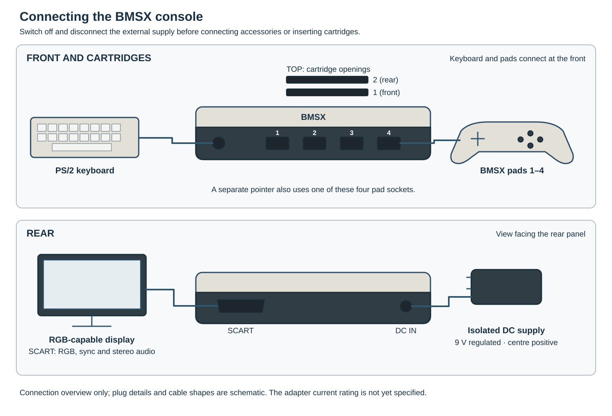

## Keyboard

Socket: Same Sky MD-60S, 6-pin mini-DIN; 5 V supply; clock and data through
level shifters to INPUT. The keyboard must send PS/2 scan-code set 2 after
power-on; the console does not send commands to the keyboard (no scan-code
selection, no LEDs). A USB keyboard with a passive adapter works only if it
supports PS/2.

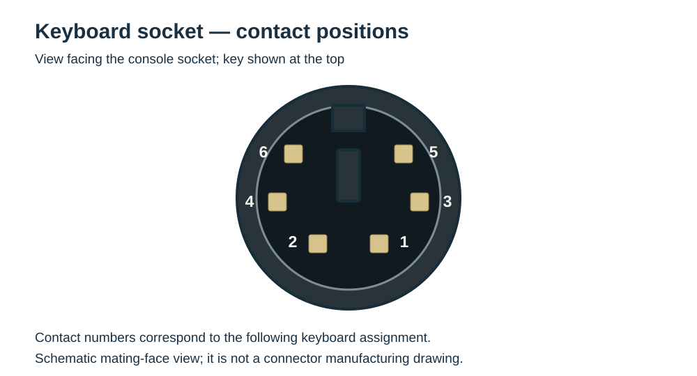

| Contact | Signal |
|---:|---|
| 1 | Data |
| 2 | — |
| 3 | Ground |
| 4 | +5 V |
| 5 | Clock |
| 6 | — |
| Shield | Ground |

*Keyboard socket. Numbers are contact numbers; the solder side is mirrored.*

J301 carries data, ground, 5 V and clock to the keyboard board.

The reference keyboard has 83 keys. It must report Ctrl+Alt+F12 pressed
together, for the supervisor request ([Supervisor key](pads.md#supervisor-key)). The
Fn key has no function.

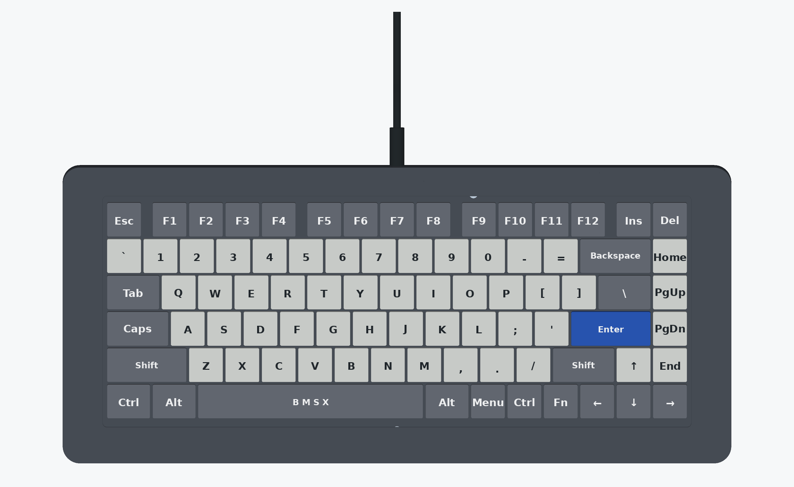

## Pads and pointer

The four front sockets use the BMSX-PAD serial interface. Each socket has its
own command, data and select lines; the clock is common. Signals are 3.3 V.
Sockets 1–4 are pad records 0–3.

A pointer uses one of the sockets; an accessory with pad and pointer uses one
socket for both. See [Pad interface](pads.md#pad-interface).

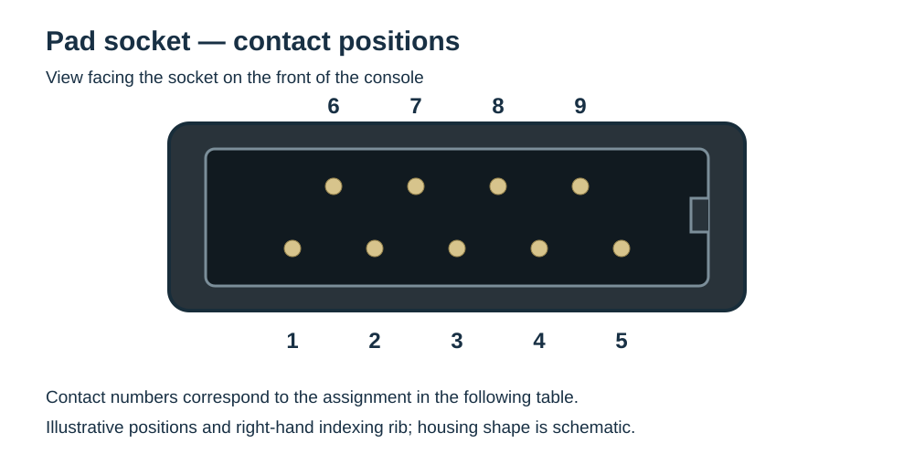

| Contact | Signal | Direction |
|---:|---|---|
| 1 | Ground | |
| 2 | Data | Input |
| 3 | Command | Output |
| 4 | Clock | Output, common to all sockets |
| 5 | Select, active low | Output, one per socket |
| 6 | +5 V | Supply |
| 7 | Ground | |
| 8 | +3.3 V | Supply |
| 9 | — | |

*Pad socket. Signals are 3.3 V.*

The plug has staggered contacts and an indexing groove. The figure shows the
plug seen from the cable side.

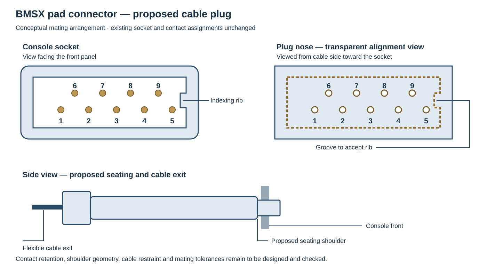

Each contact of the plug is a spring socket on a round console pin, held in
an insulating housing; the cable is clamped separately.

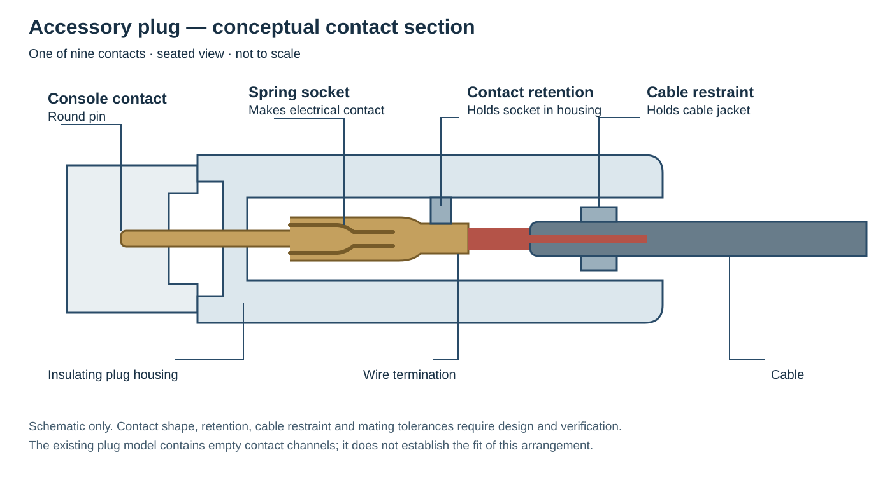

### Reference accessories

The reference pad has a direction pad, A, B, X, Y, two pressable sticks, two
bumpers, two analogue triggers, Select, Start, Home and a pressable touchpad.
A pad with vibration reports this and accepts output requests. Home and the
touchpad are ordinary inputs.

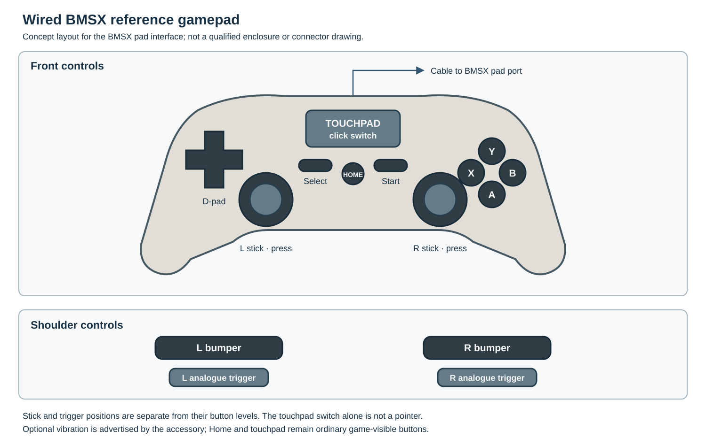

The pointer gives buttons, screen coordinates and a wheel.

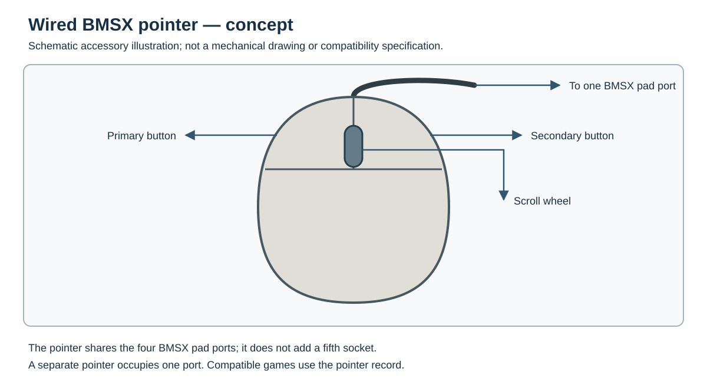

The pad sockets are on the front board, connected to mainboard J300 by a
20-wire harness:

| J300 | Signal | J300 | Signal |
|---:|---|---:|---|
| 1 | PAD_CLK_EXT | 11 | PAD_SELECT1_N_EXT |
| 2 | PAD_CMD0_EXT | 12 | PAD_SELECT2_N_EXT |
| 3 | PAD_CMD1_EXT | 13 | PAD_SELECT3_N_EXT |
| 4 | PAD_CMD2_EXT | 14 | V3V3 |
| 5 | PAD_CMD3_EXT | 15 | V5 |
| 6 | PAD_DATA0_EXT | 16 | Ground |
| 7 | PAD_DATA1_EXT | 17 | Ground |
| 8 | PAD_DATA2_EXT | 18 | Ground |
| 9 | PAD_DATA3_EXT | 19 | Ground |
| 10 | PAD_SELECT0_N_EXT | 20 | Ground |

## DC input

Use an isolated, regulated 9 V supply, centre positive. Inlet Switchcraft
L722A, 2.0 mm pin, for the S761K plug with locking ring. Hold the plug while
locking or unlocking it. Internally, the red lead goes to J61.1 (`RAW9`), the
black lead to J61.2 (ground). POWER switches the converters; disconnect the
supply to make the input dead. See [Power supply](power.md#power-supply).

## Audio and video

Socket: Kycon K-SCART-021. Analogue RGB, composite sync and stereo line
audio. Use an RGB display. There is no composite-colour or RF output.

| SCART contact | Console connection | Associated return |
|---:|---|---:|
| 15 | Red output | 13 |
| 11 | Green output | 9 |
| 7 | Blue output | 5 |
| 19 | Composite synchronisation output | 17 |
| 3 | Left audio output | 4 |
| 1 | Right audio output | 4 |
| 16 | RGB selection output | 18 |
| 21 | Socket shield | Ground |

*SCART contacts. Sync output is contact 19.*

Contact 8 (input and aspect selection) is not connected; select the RGB input
of the display by hand if needed. In the cable to the display, console contact
19 goes to display contact 20, audio 3 and 1 to 6 and 2; RGB, RGB select and
their returns go to the same numbers.

## Cartridges

A cartridge holds its board in a shell with an exposed contact edge, side
channels for the guides and a leading skirt. Insert it with the label, skirt
and channels toward the front of the console.

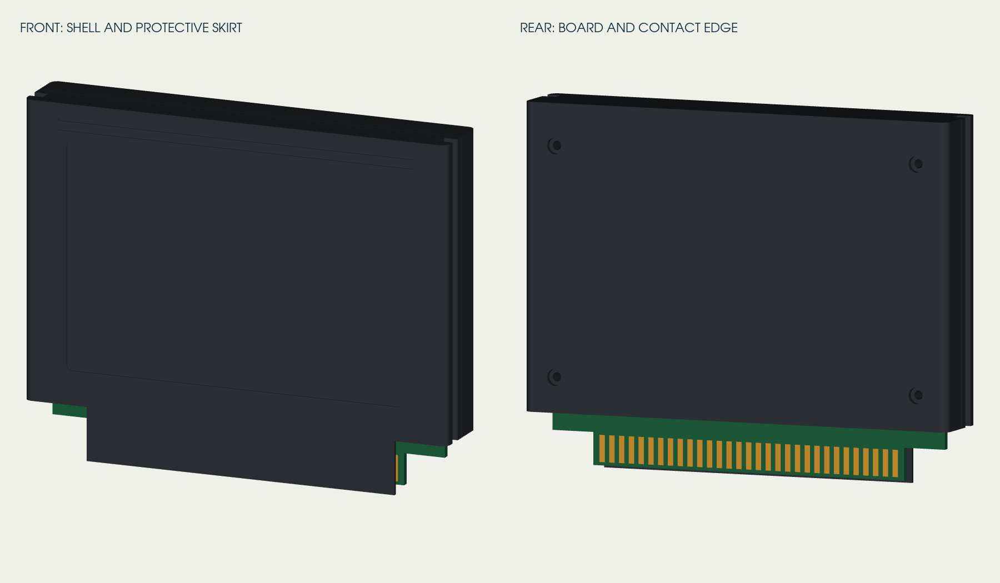

Each 113 × 21 mm opening takes a 110 × 18 mm shell. The slots are 30 mm apart;
two cartridges have 12 mm between them. A frame holds the guides and stops
above two EDAC 395-062-520-202 62-contact sockets.

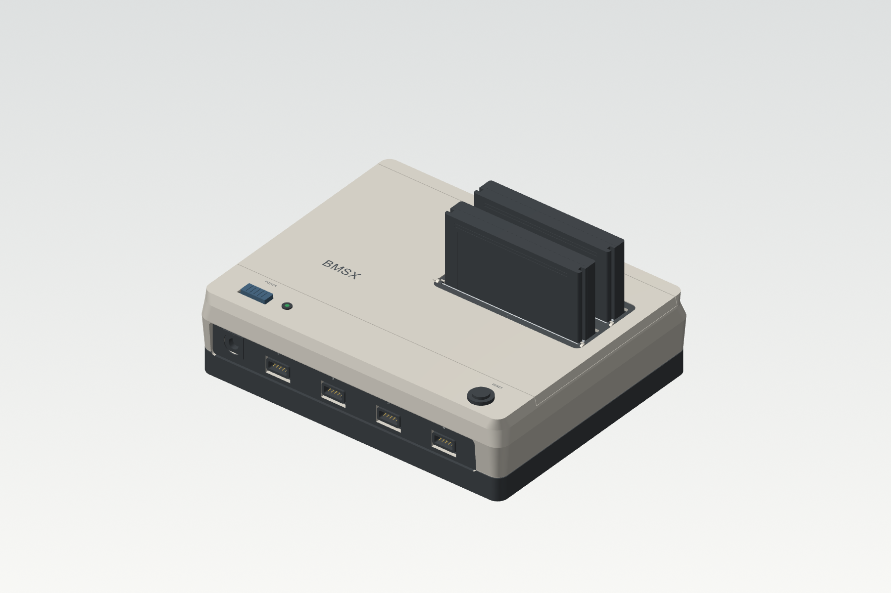

### Sockets

Slot **1** (front) is socket 0; slot **2** (rear) is socket 1. The BIOS starts
from slot 1 first. A cartridge with only RAM cannot be started.

Both sockets have 3.3 V and 5 V while the console is on; selecting a socket
does not switch power or reset. Presence, interrupt and DMA-request signals are
separate per socket.

Cartridge RAM must read 0 after power-on and keep its contents at a cartridge
reset (Book III); a cartridge can clear its RAM itself after power-on, before
it answers accesses.

### Contacts

The figure below looks down into the console, front at the
bottom. Row A is toward the front, row B toward the rear; positions 1 to 31
from left to right. Pitch 2.54 mm in a row, 5.08 mm between rows. The rear
socket is the same, 30 mm behind.

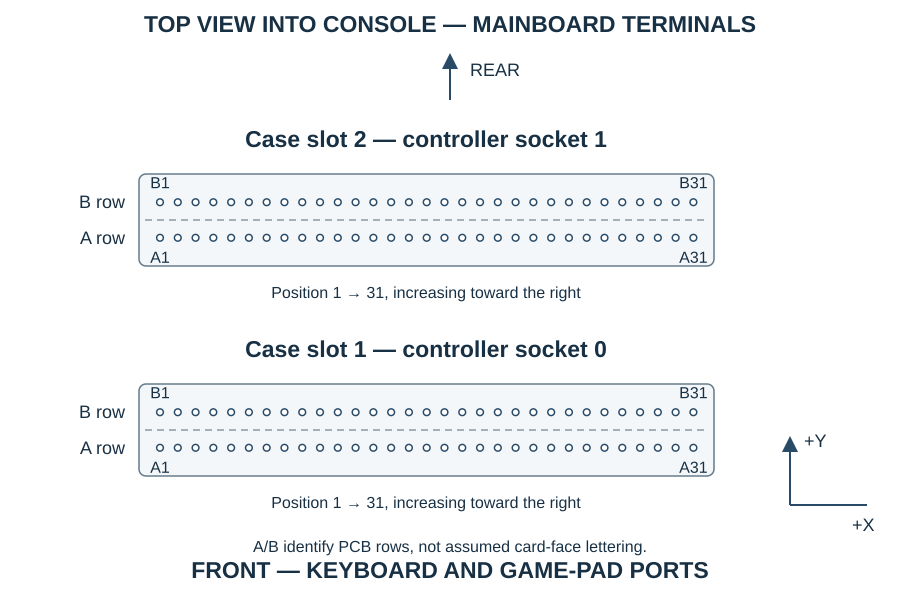

Socket 0 / socket 1 where the signals differ:

| Position | Row A (front) | Row B (rear) |
|---:|---|---|
| 1–16 | `CAD0`–`CAD15` | `GND` |
| 17 | `CAL_LO` | `GND` |
| 18 | `CAL_HI` | `GND` |
| 19 | `CART_CLK` | `GND` |
| 20 | `CRD_N` | `CWR_N` |
| 21 | `CBE0_N` | `CBE1_N` |
| 22 | `CART_RESET_N` | `GND` |
| 23 | `CS_CART0_N` / `CS_CART1_N` | `CART_READY0_N` / `CART_READY1_N` |
| 24 | `IRQ_CART0_N` / `IRQ_CART1_N` | `DREQ_C0_W` / `DREQ_C1_W` |
| 25 | `DREQ_C0_R` / `DREQ_C1_R` | `CART_PRESENT0_N` / `CART_PRESENT1_N` |
| 26–28 | `V3V3` | `GND` |
| 29, 30 | `V5` | `GND` |
| 31 | `V3V3` | `GND` |

*Cartridge contacts.*

| Signal | Direction | Function |
|---|---|---|
| CAD[15:0] | In/out | Address and data |
| CAL_LO, CAL_HI | Out | Address latch (active high) |
| CART_CLK | Out | Clock |
| CRD_N, CWR_N | Out | Read, write |
| CBE0_N, CBE1_N | Out | Byte enables |
| CS_CARTs_N | Out | Socket select |
| CART_RESET_N | Out | Reset, both sockets |
| CART_READYs_N | In | Acknowledge |
| IRQ_CARTs_N | In | Interrupt |
| DREQ_Cs_R, DREQ_Cs_W | In | DMA requests |
| CART_PRESENTs_N | In | Cartridge present |

s is the socket, 0 or 1. Signals are 3.3 V, also on a cartridge that uses
5 V. Bus protocol: [Mainboard](hardware.md#mainboard).

Each presence input B25 has a 10 kΩ pull-up to 3.3 V; the cartridge connects
B25 to ground (for instance B26). Empty socket: high; cartridge: low.

### Example: ROM cartridge

A ROM cartridge with an 8 MiB SST39VF6401B flash (4M × 16) and an interface
controller. The controller latches the address, reads its flash, returns the
data and answers READY. Outside its ROM it returns 0; writes have no effect.

A power-on reset circuit on the cartridge resets controller and flash when
3.3 V comes up; `CART_RESET_N` resets the controller. The controller waits
until the flash is ready before it answers a read. The flash write enable is
held inactive; the flash is programmed outside the console.

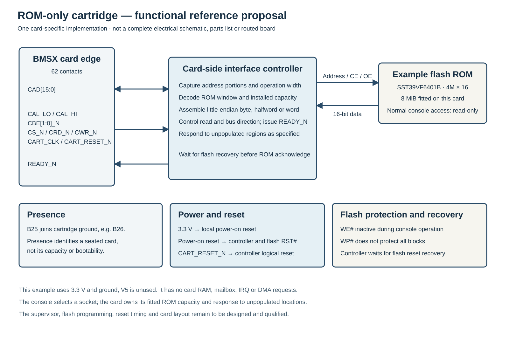

### Polarisation

Two keys in the frame project into the guide path at the ends of each slot;
both side walls of the shell have matching channels toward the front. A
reversed cartridge stops against the keys before its contacts reach the
socket.

| Feature | Dimension |
|---|---:|
| Channel depth / width | 3.5 / 3.2 mm |
| Key projection / width | 3.0 / 2.4 mm |
| Clearance at channel bottom | 0.5 mm |
| Clearance at each side | 0.4 mm |
| Shell wall at the channel | 1.5 mm |

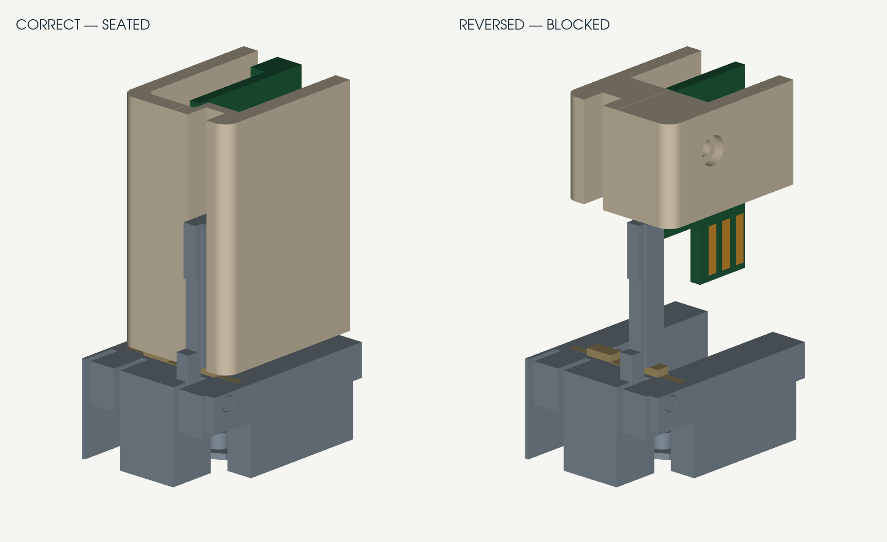

### Dust doors

Each door has its own pivot and return spring. The skirt of the cartridge
pushes the door open before the board reaches it, and runs into a channel in
the frame. The door stands beside the seated cartridge and closes when the
cartridge is withdrawn.

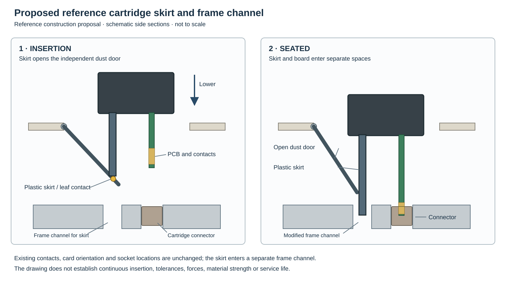

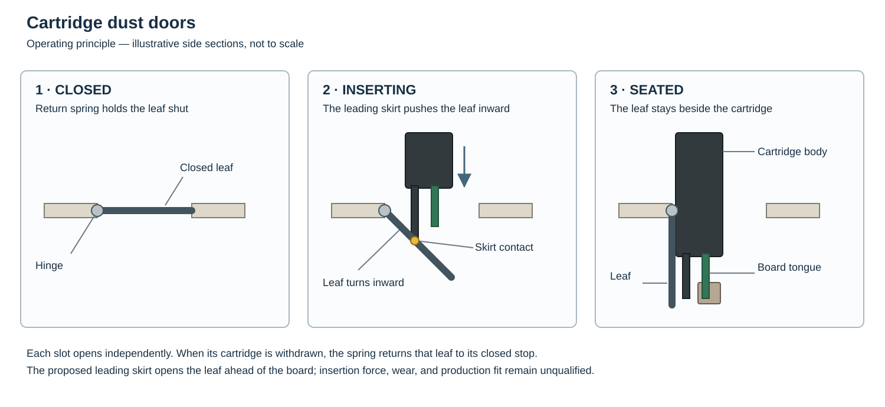

### Inserting and removing

1. Switch POWER off and disconnect the supply.
2. Check that the door moves freely and that contacts and opening are clean.
3. Hold the cartridge with label and skirt toward the front, the channels on
   the keys, and lower it straight down.
4. Press it down to the stops without rocking.
5. To remove it, hold the shell and lift it straight up.

If the cartridge stops early, take it out and check its orientation, the
guides and the door. Door servicing: [Cartridge frame and dust doors](servicing.md#cartridge-frame-and-dust-doors).

## Controls

POWER turns on the main rails; RESET restarts the console. The green indicator
shows the 3.3 V rail.

## Internal connections

| From | To | Contacts |
|---|---|---|
| Mainboard J300 | Front board J5 | 1–20 to 1–20 |
| Mainboard J301 | Keyboard board J2 | 1–4 to 1–4 |
| Mainboard J500 | A/V board J1 (16-wire ribbon, soldered) | 1–16 to 1–16 |
| Mainboard J60 | POWER, RESET, indicator | |
| Mainboard J61 | DC inlet | |

The A/V board connects separately to the SCART contact board.

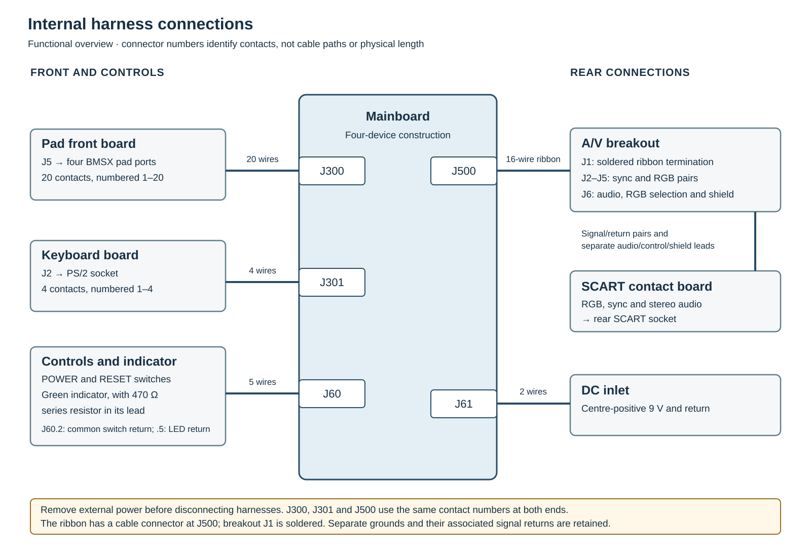

| J60 | Signal | Connection |
|---:|---|---|
| 1 | `POWER_SW` | POWER contact 2 |
| 2 | Ground | POWER contact 3, RESET contact 4 |
| 3 | `RESET_SW` | RESET contact 3 |
| 4 | `V3V3` | Indicator anode through 470 Ω |
| 5 | Ground | Indicator cathode |

*Controls and indicator.*

The 470 Ω resistor (1 %, at least 0.25 W) is in the indicator lead, insulated.

| Connection | Housing | Contacts |
|---|---|---|
| J300, front J5 | JST PHDR-20VS | SPHD-002T-P0.5 signals; SPHD-001T-P0.5 supply and ground |
| J301, keyboard J2 | JST PHR-4 | SPH-002T-P0.5S |
| J500 | Würth 61201623021 | IDC ribbon with strain relief |
| J61 | Molex 39-01-2025 | Mini-Fit Jr female |

| J500 | Signal | J500 | Signal |
|---:|---|---:|---|
| 1 | Red | 2 | Ground |
| 3 | Green | 4 | Ground |
| 5 | Blue | 6 | Ground |
| 7 | Composite sync | 8 | Ground |
| 9 | Audio left | 10 | Ground |
| 11 | Audio right | 12 | Ground |
| 13 | RGB select | 14 | Ground |
| 15 | Ground | 16 | Ground |

| A/V board | Contact 1 | Contact 2 |
|---|---|---|
| J2 | Sync | Return |
| J3 | Red | Return |
| J4 | Green | Return |
| J5 | Blue | Return |

J6 contacts 1–8: audio left and return, audio right and return, RGB select and
return, two shield leads. The SCART contact board connects these as in
the table in [Audio and video](#audio-and-video). Keep every signal with its own return; the socket's
mounting ears carry the cable force, not its solder tails.

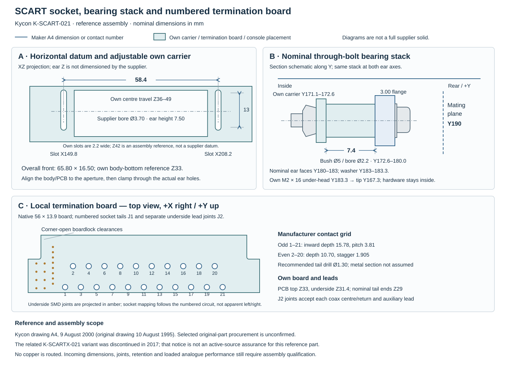

### Sync check

The sync output has a 75 Ω series resistor. Measure across one 75 Ω
termination with a high-impedance probe:

| Quantity | Value |
|---|---|
| Sync amplitude | 0.25–0.35 V into 75 Ω |
| Rise and fall time | 100–300 ns (10–90 %) |
| CSYNC to RGB | At most one 13.5 MHz sample (74.074 ns) |
| V3V3 | 3.0–3.43 V |

Use the normal cable and only one 75 Ω termination.
