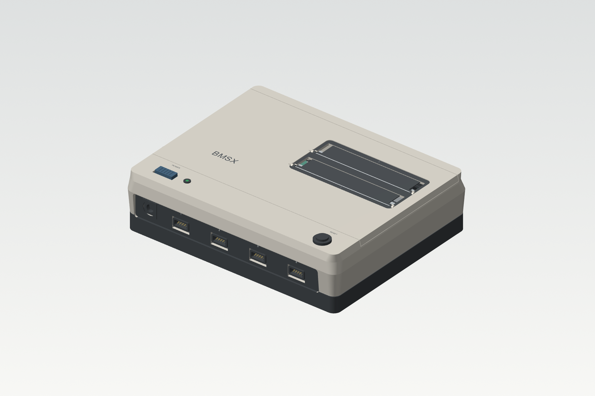
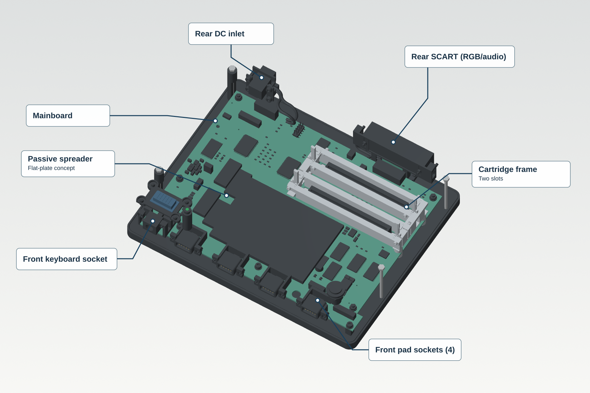
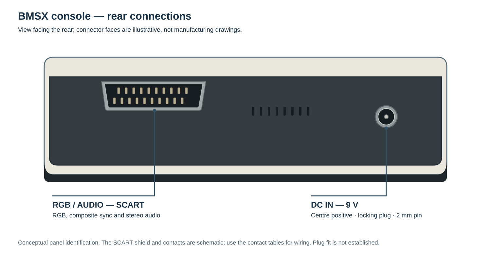
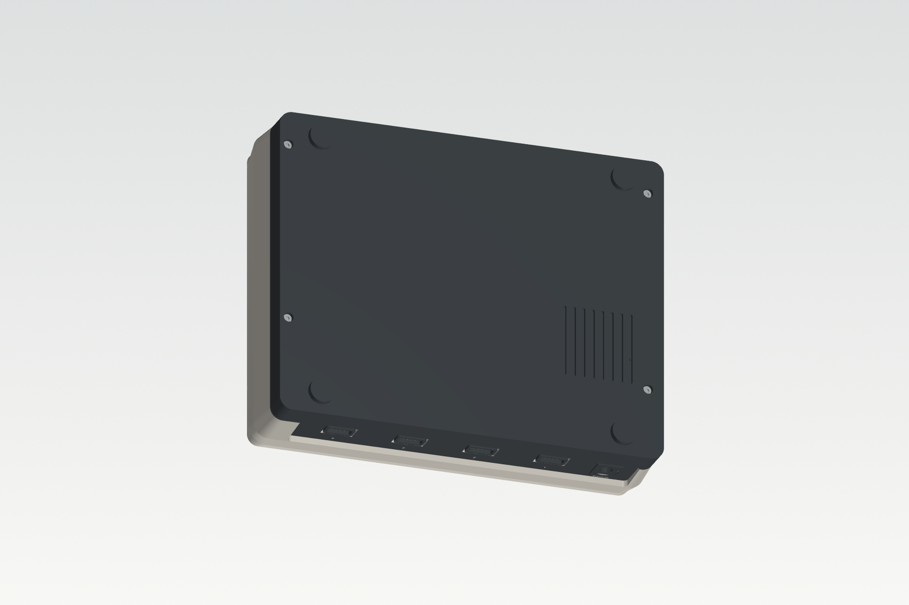
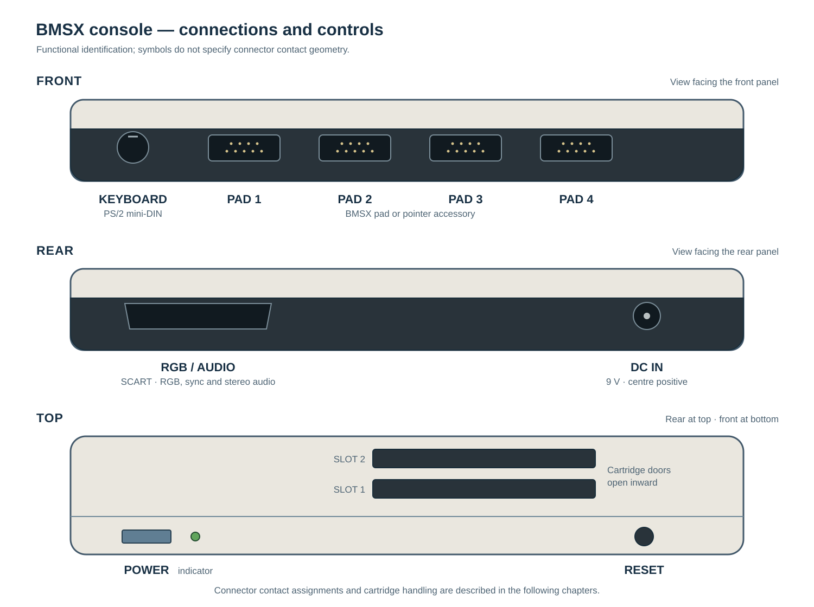
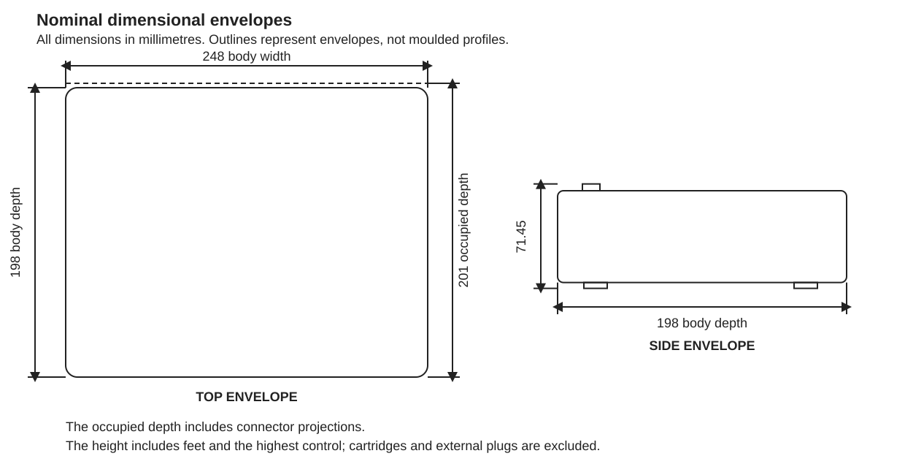

# Construction

The mainboard, connector boards and cartridge frame are mounted on an
aluminium deck inside an enclosure with removable upper and lower covers,
held by four recessed screws underneath. The front and rear connectors and the
POWER and RESET controls stay with the fixed body when the covers are removed.

The upper cover holds two cartridge dust doors. Each opens inward when a
cartridge is inserted and closes when it is removed. The frame guides the
cartridges and takes the insertion force to the deck. A channel in the frame
takes the leading skirt of the cartridge.

The keyboard socket is at the front, beside the four pad sockets.

Contact assignments: [Connections and cartridges](connectors.md#connections-and-cartridges).

## Dimensions

Front: keyboard socket and pad sockets 1–4. Top front: POWER, indicator,
RESET, and behind them cartridge slots 1 and 2. Rear: DC input and SCART.

| Item | Dimensions | Includes |
|---|---:|---|
| Console, without cartridges | 248 × 201 × 71.45 mm | Connectors, feet, controls |
| Mainboard | 220 × 150 × 1.6 mm | |
| Aluminium deck | 240 × 190 × 2 mm | Flat deck |
| Cartridge opening | 113 × 21 mm | Each |
| Cartridge slot spacing | 30 mm | Centre to centre |
| Cartridge shell | 110 × 18 × 75 mm | Body, without skirt and contacts |

*Dimensions.*

Place the console on its feet on a firm surface, with room behind it for the
plugs and above it for the cartridges. Keep the intakes underneath and the
outlets at the upper rear clear.

## Assemblies

| Assembly | Function |
|---|---|
| Aluminium deck | Holds the mainboard, cartridge frame and cooler supports |
| Fixed body | Holds the connector carriers and controls |
| Upper cover | Holds the cartridge dust doors |
| Lower cover | Feet and air intakes |
| Cartridge frame | Guides, stops and polarising keys |
| Front and rear connector assemblies | Keyboard, pads, DC, audio/video |

The mainboard has eight copper layers and rests on insulating supports. The
cooler supports pass through clearance holes in the board to the deck, without
clamping the board.

The deck is not connected to ground in the present circuit. The 9 V supply is
isolated and has no earth conductor. Servicing: [Servicing](servicing.md#servicing).

## Cooling

CORE and GFX each contact a passive heat spreader through an insulating
thermal pad. The spreader's supports conduct heat to the deck. Air enters
underneath and leaves at the upper rear; the cartridge doors may remain
closed. There is no fan.

The cutaway figure above shows the flat spreader; a finned spreader is an
option. See [Cooler](servicing.md#cooler).
