# Mainboard

The mainboard connects four custom devices to their memories, the two
cartridge sockets and the external connections. CORE runs the program and
controls main memory and the cartridges; GFX draws, displays and receives the
input; APU produces the sound; the firmware bridge reads the system firmware.
The devices share one system bus; each memory has its own interface.

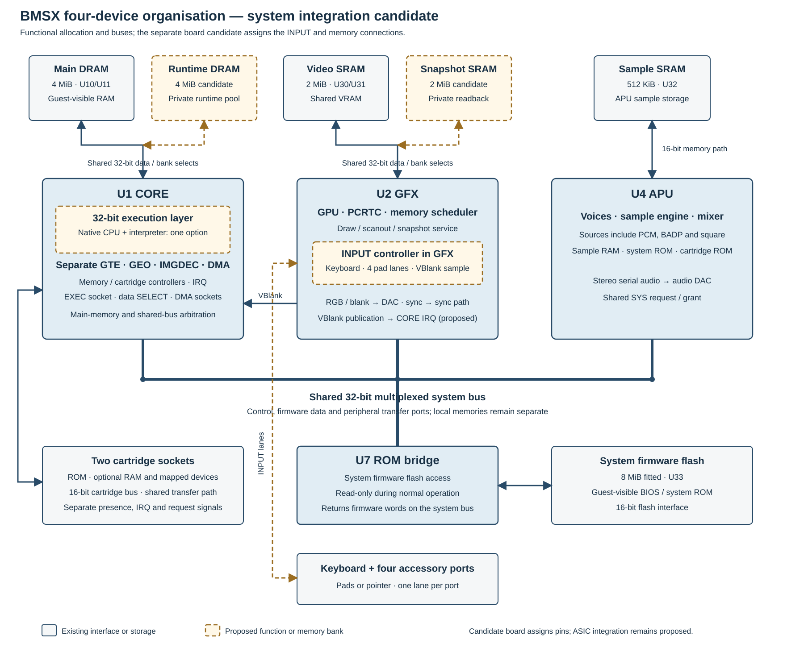

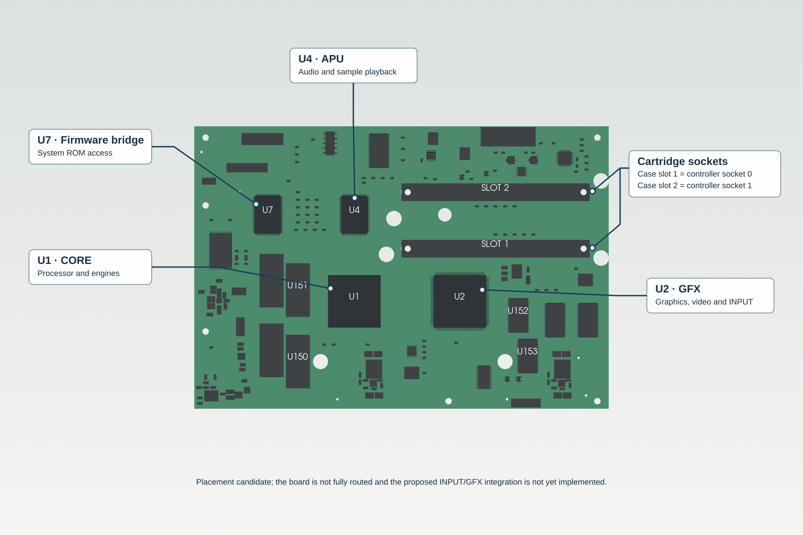

## Devices and memories

| Device | Terminals | Functions |
|---|---:|---|
| U1 CORE | 208 | Processor, GTE, GEO, IMGDEC, DMA, main memory, cartridges, interrupts |
| U2 GFX | 208 | Drawing, display, video memory, keyboard and pads |
| U4 APU | 128 | Voices, mixing, sample memory, serial audio |
| U7 firmware bridge | 128 | Firmware flash |

GTE, GEO, IMGDEC and DMA are units inside CORE. Programming: Books I and II.

| Memory | Devices | Size | Controller |
|---|---|---:|---|
| Main RAM | U10, U11: 1M × 16 DRAM | 4 MiB | CORE |
| Video memory | U30, U31: 512K × 16 SRAM | 2 MiB | GFX |
| Sample memory | U32: 256K × 16 SRAM | 512 KiB | APU |
| Firmware flash | U33: 4M × 16 | 8 MiB | Firmware bridge |
| Readback memory (option) | U152, U153: 512K × 16 SRAM | 2 MiB | GFX |

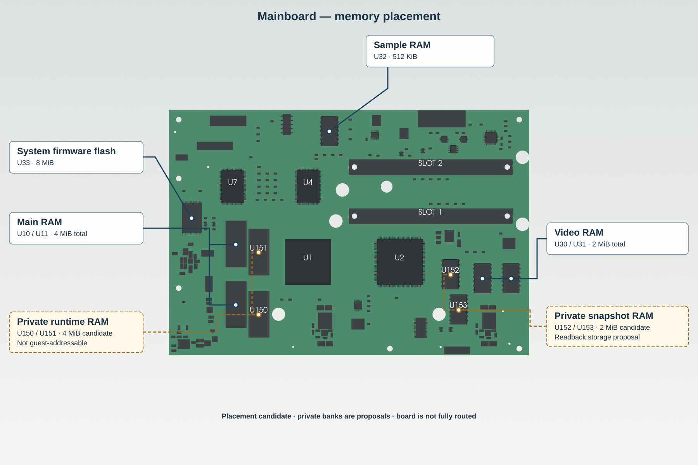

The readback memory is not part of the memory map.

### Main DRAM

CORE passes CPU, DMA and GEO requests to main memory. The DRAM controller
initializes and refreshes the DRAM. A system reset does not clear it.

### Sample memory

The APU has a 16-bit sample-memory interface; a 32-bit transfer takes two
halfword cycles. Playback and transfers share the memory. See
[Memory load](#memory-load).

### Firmware flash

U7 reads the 16-bit firmware flash and supplies its data on the system bus.
The 8 MiB flash holds the firmware followed by zeros; the upper 8 MiB of the
16 MiB System ROM area reads 0. The write enable of the flash is held inactive;
the flash is programmed externally.

## CORE

CORE contains the processor and the GTE, GEO, IMGDEC and DMA units, the
main-memory and cartridge controllers and the interrupt controller.

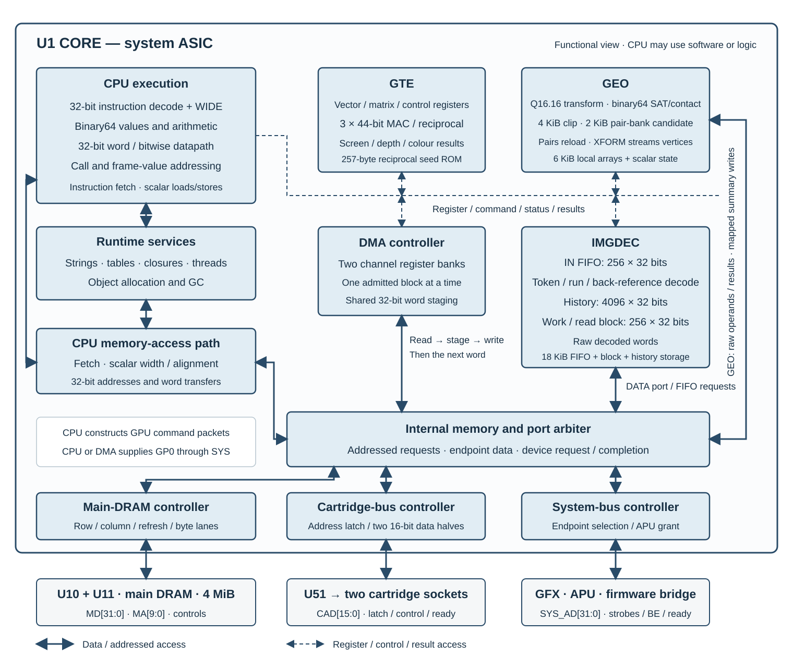

### Processor

The processor can be a 32-bit processor running an interpreter from a ROM
inside CORE. After reset it initializes main memory and the BLua32 state, then
starts the BIOS from the firmware flash. The interpreter's ROM is not part of
System ROM.

### Runtime memory

Variables and tables are kept in main RAM above the program's static storage
(Book I).

### Collection

The storage management is part of the processor implementation.

### GTE

The CPU writes operands to the GTE registers, gives a command and reads the
results. The GTE does not read memory and does not send commands to GFX.
GTE PLUS has its own registers; a normal GTE command can run while a PLUS
command is in progress. Only the CPU can start a PLUS command.

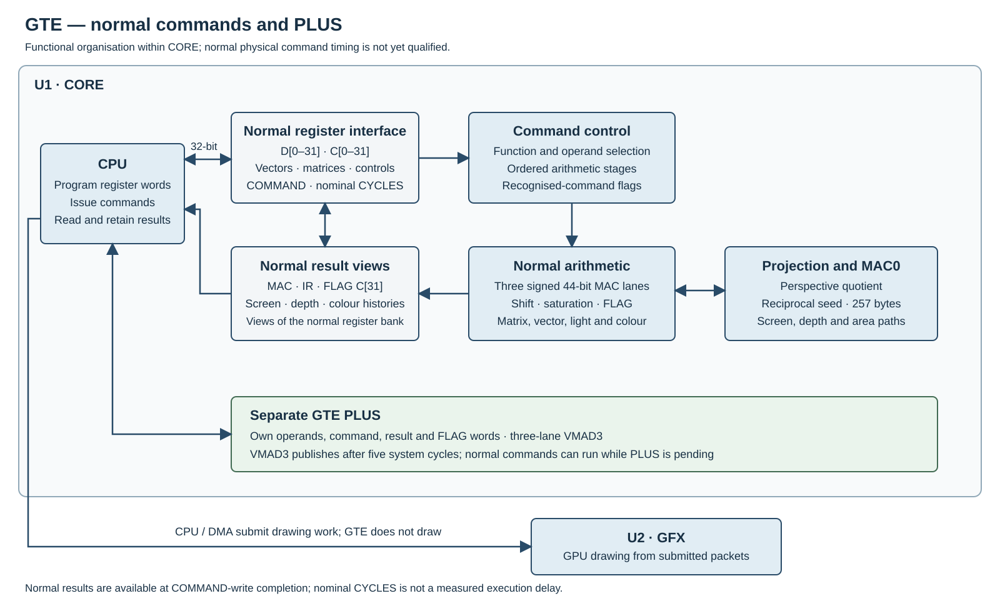

### IMGDEC

IMGDEC has an input FIFO, a 4096-word history and one output block. DMA
supplies the compressed data from ROM or main RAM and takes the decoded words
to a device or RAM. The CPU supplies the GPU command headers; GFX writes the
data to video memory.

## System bus

The system bus connects CORE, GFX, APU and the firmware bridge. It has 32
multiplexed address/data lines, select signals and READY.

### Diagnostic output

CORE's diagnostic output (Book I) can be read through J302.

### Supervisor entry

SYSTEM in U1 controls supervisor entry and return. GEO, IMGDEC, DMA and the
interrupt controller are in U1, GPU and display in U2, playback in U4. At
entry the system waits for GEO and IMGDEC, then for the DMA block in progress,
then for the GPU. U4 holds the playback positions during the supervisor.

### DMA

CORE has two DMA channels and one transfer engine. The DMA connects memory to
GP0, GPUREAD, IMGDEC or the APU transfer port, or IMGDEC directly to GP0.

During a block the DMA holds the bus; the CPU waits. Requests from the devices
decide when a block starts. The channel registers hold the addresses, count
and CONTROL and cannot be written while BUSY. READ_SLOT and WRITE_SLOT select
the cartridge sockets; cartridge DREQ applies only to cartridge devices.

The last word of a block is marked for the GPU input. DMA completion is
separate from GPU drawing and APU transfers. Programming and timing: Books I
and III.

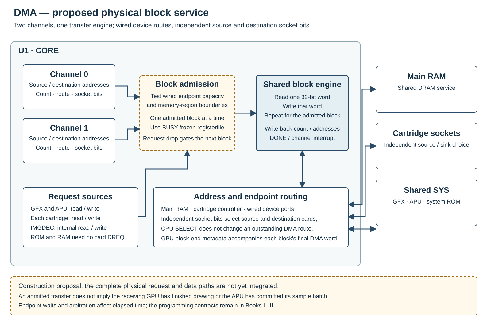

### GEO

The GEO reads geometry from memory and writes results to memory: XFORM2,
SAT2 and OVERLAP2D. It reads and writes memory directly, also in the I/O area
of main RAM, without accessing I/O registers.

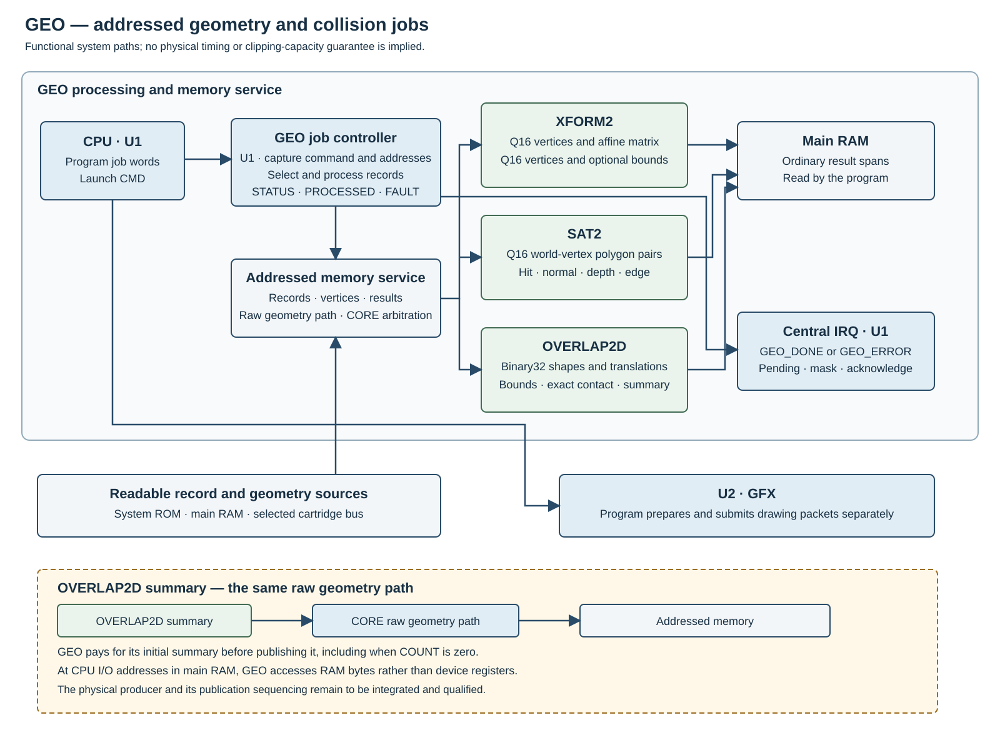

## Cartridge bus

CORE connects both sockets to a 16-bit multiplexed address/data bus with
select, READY, byte enables, reset, interrupt and DMA-request signals. Each
socket has its own presence, select, READY, interrupt and request signals.
Contacts: [Cartridges](connectors.md#cartridges); programming: Book III.

### ROM read

`CAD[15:0]` carries addresses and data; `CART_CLK` is the system clock. The
console drives address and control; the cartridge drives the data during a
read and answers each data phase with `CART_READY_N`. The socket select is held
for the whole transfer.

A 32-bit ROM read at address A consists of two halfword reads at A and A+2:

| Phase | Action |
|---|---|
| Address low | A[15:0] on CAD for one clock, CAL_LO high for one clock, address held one more clock; the cartridge latches on the falling edge |
| Address high | The same with A[31:16] and CAL_HI |
| Turnaround | The console releases CAD; two clocks |
| Read | CRD_N and both byte enables low; the cartridge drives the data, then CART_READY_N low |
| End | The console raises CRD_N; the cartridge releases the bus and raises READY; two clocks before the next address |

CBE_N is `11` at the low-address phase of a ROM read. READY is a 3.3 V
push-pull output of the cartridge. The cartridge presents the data at least
20 ns before READY goes low, holds it until CRD_N rises, and releases the bus
and raises READY within one clock.

The cartridge answers for its own address range and returns 0 where it has no
memory. For an empty socket, the console completes the access itself: reads
give 0, writes have no effect.

### Byte, halfword and word transfers

At CAL_LO, with both strobes inactive, CBE_N gives the transfer size:

| CBE_N | Size |
|---|---|
| `00` | Byte |
| `01` | Halfword |
| `10` | Word |

The cartridge holds the address and size for the whole transfer. In a data
phase CBE_N is the byte mask: `10` for a byte on CAD[7:0], `00` for a halfword
on CAD[15:0]. A word uses two `00` phases, low half first.

For a read the console releases CAD before CRD_N; the cartridge drives the data
before READY and holds it until CRD_N rises. For a write the console drives
data and mask before CWR_N and holds them until READY. The console releases the
strobe and waits for READY high before the next phase. The cartridge completes
a multi-phase write before its last READY.

### Interrupt and request inputs

Each cartridge has its own interrupt input and two DMA-request inputs at CORE.
Their use is described in Book III.

## Keyboard and pads

The keyboard (PS/2 clock and data) and the four pad sockets are at the front.
The pads use the serial interface of [Pad interface](pads.md#pad-interface). Input is received
continuously; at the requested VBlank INPUT publishes it (Book I).

### INPUT in GFX

The INPUT registers and the keyboard and pad receivers are in U2 GFX, next to
the display timing.

| U2 terminals | Signals |
|---|---|
| 97–101 | Input select, keyboard, supervisor |
| 159–170, 173 | Pad lines |
| 102 | Readback-memory select |
| 174 | Reserved |

At VBlank, the display settings are latched first, then the input snapshot is
taken, then the interrupt is sent to CORE. The keyboard's supervisor request
has its own path.

The keyboard receiver keeps the state of the keys independently of the input
snapshot. A system reset clears the snapshot but keeps the key state while the
keyboard has power: a key held through a reset need not be pressed again.

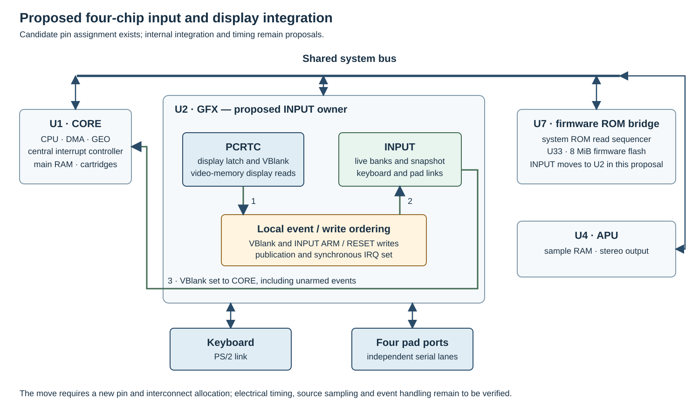

GFX gives INPUT the display width, height and size epoch, which are sent to a
pointer for its coordinates; see [Pad interface](pads.md#pad-interface).

## Clocks and reset

A 33.8688 MHz system clock drives the four devices; a separate 13.5 MHz video
clock drives GFX. Reset goes to all four devices and the firmware flash. The
main DRAM is initialized before use. Supply and reset: [Power supply](power.md#power-supply).

The frame-period readouts of SYSTEM (in U1) are read from the PCRTC timing in
U2 over the system bus.

## GFX

GFX receives drawing commands from the CPU and DMA, draws into video memory
and produces the picture from it. A completed DMA transfer of commands does
not mean the drawing is finished. Programming: Book I.

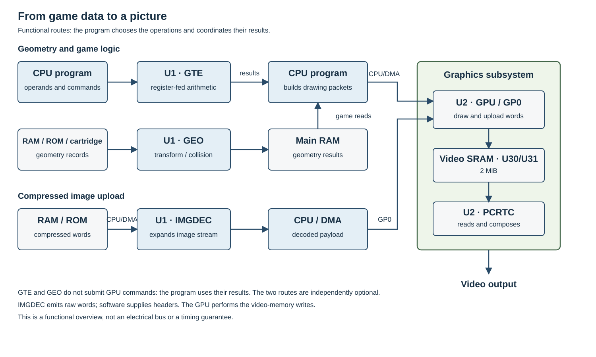

### System-bus interface

One bus interface in U2 connects the system bus to the GPU, PCRTC and INPUT;
the addressed unit supplies the data and READY. The GPU distinguishes GP0
writes, GP1 writes, GP0 reads and GPUSTAT reads, from the CPU and from the DMA.
It passes the end-of-block mark of the DMA with the last word.

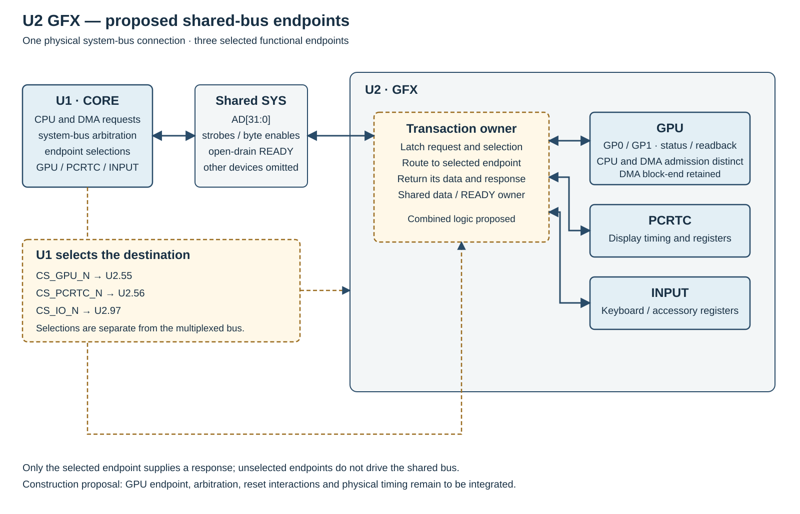

### Interrupts

GPU and PCRTC keep their own status in U2; the interrupt controller in U1 has
its own pending bits. `IRQ_GPU_N` and `IRQ_PCRTC_N` carry the requests to U1.
Acknowledging the GPU bit in the interrupt controller does not clear GPUSTAT.

### Video-memory access

Drawing, display and readback share the video memory. A scheduler gives
display and drawing fixed time slots.

### Readback memory (option)

The 2 MiB readback memory has two 1 MiB halves, one for the cartridge program
and one for the supervisor; each holds one readback of up to 1024 × 512
pixels. For a readback, GFX first finishes the earlier drawing, copies the
pixels into the half of the active context and then sets READY. At supervisor
entry the cartridge's unread readback stays in its half; on return the
cartridge continues where it was. The readback memory shares the address and
data lines of the video memory, with its own select.

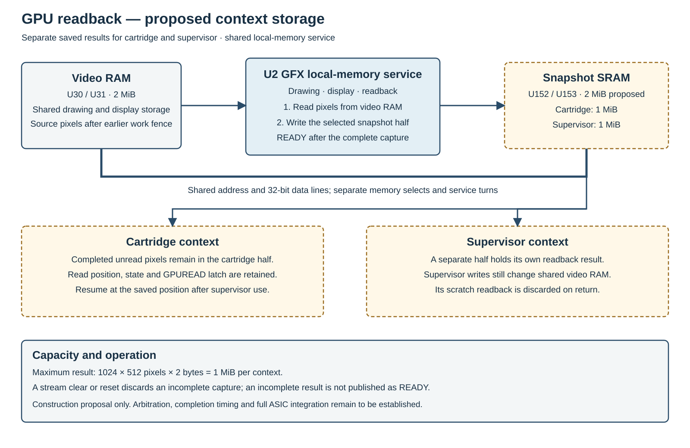

## Video output

GFX combines the two display circuits and drives the video DAC. RGB, composite
sync and stereo audio go to the rear SCART socket. See [Audio and video](connectors.md#audio-and-video).

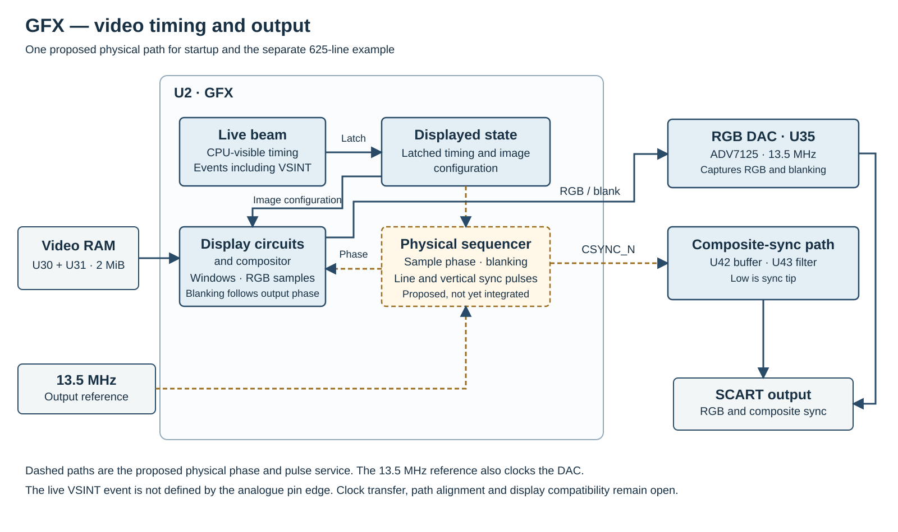

### Timing

The output is sampled at 13.5 MHz. Sync, porches and active area follow the
PCRTC timing registers; a window that reaches into blanking is masked at the
output.

| Mode | Samples per line | Lines | Rate |
|---|---:|---:|---|
| BIOS start screen, 320 × 240, non-interlaced | 864 | 314 | 49.76 Hz |
| 625 lines, interlaced | 864 (702 active) | 312.5 per field | 50 fields/s |

The start screen has 320 pixels in 320 samples. The 625-line mode has 576
active lines and is selected by the program. Output is RGB with composite
sync, not PAL.

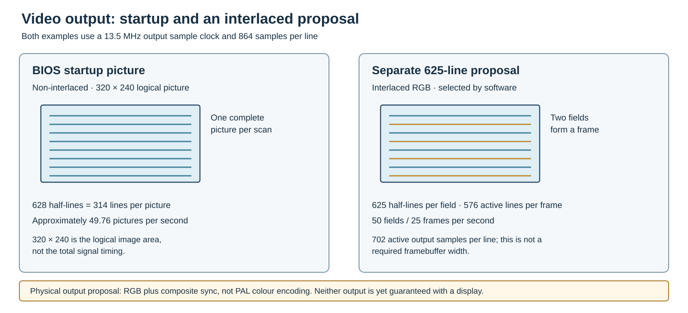

## Audio output

The APU plays samples from sample memory, System ROM or cartridge ROM and
mixes them to stereo; samples in main or cartridge RAM are first transferred to
sample memory. A square wave needs no memory.

The APU sends the digital samples to U34, a PCM1754 DAC; the analogue outputs
go through filters to the SCART socket. Rate: 44,100 stereo frames per second.

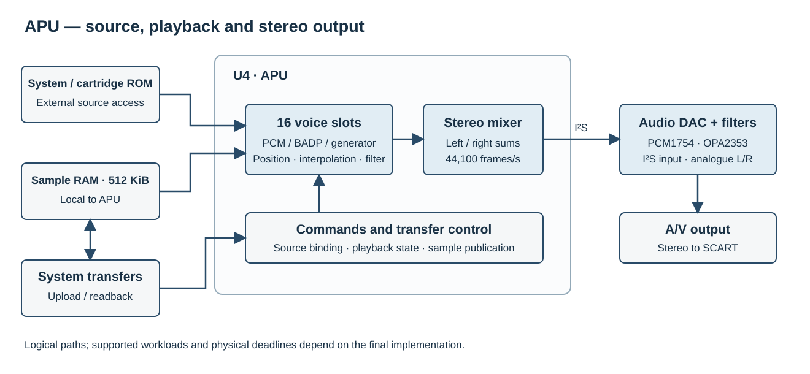

At the end of a voice, U4 writes the end-event words and then requests the APU
interrupt in U1 over `IRQ_APU_N`.

A voice playing from cartridge ROM uses the socket selected at PLAY (or at a
source change); a later SELECT change does not move it. U4 reads cartridge ROM
over the system bus; U1 accesses the socket. See the figure below.

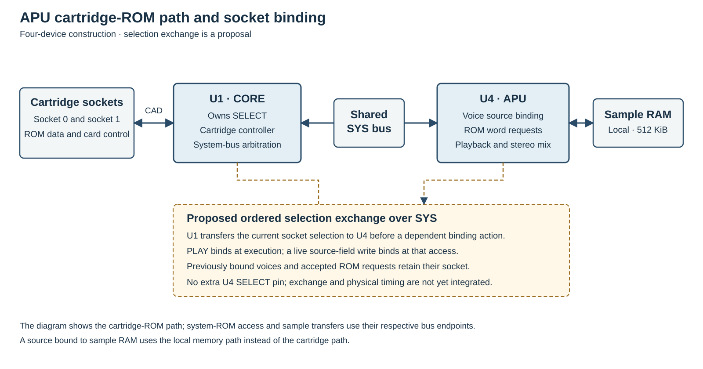

### Sample RAM reset

An APU reset clears all 512 KiB of sample RAM: the memory controller writes
zero to the whole SRAM before it accepts requests. STOP and a change of
transfer mode leave the sample RAM unchanged.

### Memory load

Each active voice reads sample memory at the output rate; transfers use the
same memory. Waiting for cartridge ROM adds to the load.

## Service connection

J302 is a JTAG connection to CORE, GFX, APU and the firmware bridge. Contact 1
is a 3.3 V reference for the instrument, not a supply input. Connect with
power off.

| J302 | Signal | J302 | Signal |
|---:|---|---:|---|
| 1 | 3.3 V reference | 2 | Ground |
| 3 | TCK | 4 | Ground |
| 5 | TMS | 6 | TDI |
| 7 | TDO | 8 | TRST_N |
| 9 | RESET_N | 10 | Ground |
