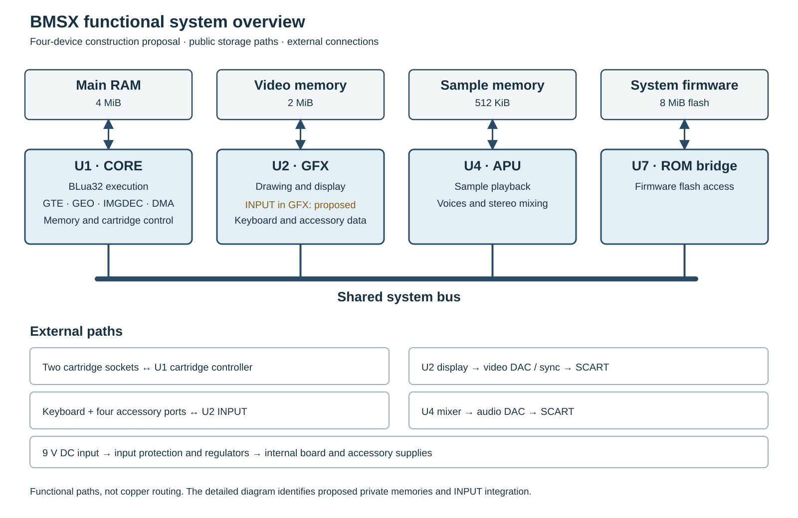

# BMSX console construction reference

Internal design reference for the BMSX reference console: its construction,
external connections, circuits and servicing. The product manuals in
[`docs/`](../../docs/index.md) describe the programming: registers and memory
in Book I, processor and BIOS in Book II, cartridges in Book III.

**Status.** This reference describes the construction as designed. The
console has not yet been built: dimensions, voltages and timing are design
values, and the mainboard is not yet fully routed. Parts marked *option* are
provided for in the design but not fitted in the present circuit.

## System organisation

The console has four custom devices (see the figure below):

| Device | Functions |
|---|---|
| U1 CORE | BLua32 processor, GTE, GEO, IMGDEC, DMA, main memory, cartridge control, interrupts |
| U2 GFX | Drawing, display, keyboard and pad input |
| U4 APU | Sample playback, mixing, stereo output |
| U7 firmware bridge | System firmware flash |

The GTE transforms and projects 3D coordinates and returns the results in
registers. The GEO transforms 2D shapes and tests them for overlap, with the
results in main memory. The program uses these results to build drawing
commands for GFX. IMGDEC decompresses images, which the CPU or DMA sends to
GFX. GFX draws into its video memory and produces the picture.

INPUT receives the keyboard and pad data, publishes it at VBlank and sends
output requests to the pads.

The BLua32 processor is defined by its instruction set (Book II); it can be
built as a native processor running an interpreter.

| Memory | Size |
|---|---:|
| Main RAM | 4 MiB |
| Video memory | 2 MiB |
| Sample RAM | 512 KiB |

The three memories are separate; data moves between them by CPU, DMA or the
transfer ports of the devices. See the organisation figure in [Mainboard](hardware.md).

The front cartridge opening, marked **1**, is socket 0; the rear opening,
marked **2**, is socket 1. The BIOS starts from the front socket first.

| Clock | Frequency |
|---|---|
| System | 33.8688 MHz |
| Video | 13.5 MHz |
| Audio output | 44,100 stereo frames per second |

The console consists of a mainboard, front connector board, keyboard
connector board, rear audio/video board and SCART contact board, mounted on an
aluminium deck with the cartridge guides and a passive cooler. A 9 V supply
connects at the rear; the POWER switch turns on the main rails. Pads and
keyboard connect at the front, DC and audio/video at the rear. The two
cartridge openings in the upper cover have dust doors that open inward.
Disconnect the supply before opening the console.

## Specifications

| Item | Specification |
|---|---|
| Size | 248 × 201 × 71.45 mm, with feet and controls, without cartridges |
| Mainboard | 220 × 150 × 1.6 mm |
| Cartridges | Two vertical sockets with dust doors |
| Front | Four BMSX pad sockets, one PS/2 keyboard socket |
| Rear | 9 V DC, centre positive; RGB, composite sync and stereo audio on SCART |
| Cooling | Passive, no fan |

A pointer uses a pad socket; a combined pad and pointer uses one socket.
There is no RF or composite-colour output.

## Conventions

Dimensions are in millimetres. Signal names ending in `_N` are active low.
Rail names are circuit net names. Connector views are stated with each
drawing.

| Chapter | Contents |
|---|---|
| [Construction](construction.md) | Assemblies and their locations |
| [Mainboard](hardware.md) | Devices, buses and signal paths |
| [Power supply](power.md) | Supplies and start-up |
| [Connections and cartridges](connectors.md) | Contact assignments and cartridges |
| [Pad interface](pads.md) | Serial pad protocol |
| [Servicing](servicing.md) | Disassembly, inspection and reassembly |
