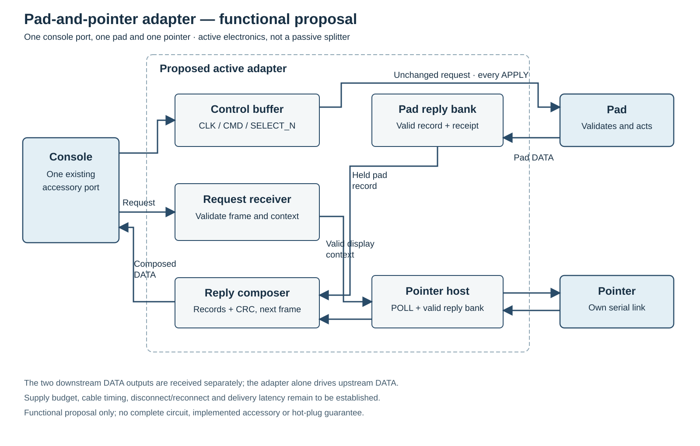
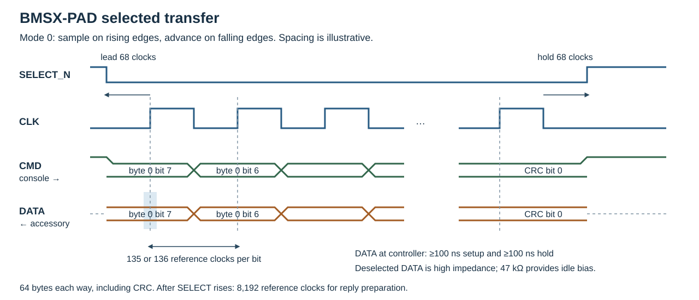

# Pad interface

BMSX-PAD version 1 connects the four pad sockets. Each socket has its own CMD,
DATA and SELECT_N lines; CLK is common. In one exchange the console sends each
accessory an output request and the display size, and each accessory returns
its buttons, sticks, pointer position and capabilities. The four exchanges
take place at the same time. INPUT is in U2 GFX
([INPUT in GFX](hardware.md#input-in-gfx)).

A pointer uses one of the four sockets. An accessory that gives both pad and
pointer data uses one socket for both. The console takes the pointer from the
lowest-numbered socket that gives pointer data.

## Pad-and-pointer adapter (option)

The adapter connects a separate pad and a separate pointer to one socket.
Connect it to socket 1 so that its pointer comes first.

The adapter passes CLK, CMD and SELECT_N unchanged to the pad; the pad accepts
its own requests, including APPLY. The adapter has its own controller for the
pointer, to which it sends the display size. It keeps the last valid pad and
pointer replies and builds from them one reply with a new CRC: the seven pad
words unchanged, the vibration capability of the pad, bits 31–4 of both
capability words ORed, and the last APPLY receipt of the pad. A faulty reply
from the pad or pointer does not replace the kept record. The reply is built
before the exchange, so it describes the state of an earlier exchange.



The pointer converts its position to screen coordinates using the display size
sent by the console. Contacts: [Pads and pointer](connectors.md#pads-and-pointer); registers: Book I, *Input*.

## Signals and timing

The console drives CLK, CMD and SELECT_N; the selected accessory drives DATA
(3.3 V push-pull) and releases it when SELECT_N goes high. A 47 kΩ pull-up on
the mainboard holds DATA high when no accessory drives it. All thirteen pad
lines have 47 Ω series resistors.

At rest CLK is low, SELECT_N high, CMD high. Both sides present the first bit
before the first rising edge, sample on the rising edge and change on the
falling edge. Bytes are sent most significant bit first, multi-byte fields
lowest byte first.

Rate: 250 kbit/s. Half-periods of 67 and 68 clocks of 33.8688 MHz alternate
to give this rate.

| Interval | Clocks | Time |
|---|---:|---:|
| Short half-period | 67 | 1.978222 µs |
| Long half-period | 68 | 2.007748 µs |
| Bit | 135 or 136 | 3.985969 or 4.015495 µs |
| SELECT low to first rising edge | 68 | 2.007748 µs |
| SELECT low to last falling edge | 69,364 | 2.048021 ms |
| Hold after last falling edge | 68 | 2.007748 µs |
| Pause between exchanges | 8,192 | 241.874528 µs |
| Exchange period, minimum | 77,625 | 2.291932 ms |

An exchange has 512 rising edges. Setup and hold at the receiver: at least
100 ns each. The accessory has 1.878222 µs in the shortest half-period for its
output delay, cable delay and settling. Prepare the whole reply before SELECT_N
goes low.



## Exchange

1. With SELECT_N high, each accessory prepares its reply and CRC.
2. The console prepares one request per socket, with a common 32-bit tag and
   the display size. One socket may receive APPLY; the others receive POLL.
3. SELECT_N goes low; 64 bytes are sent in each direction.
4. SELECT_N goes high. Each accessory checks the request and carries out an
   APPLY or a new display size.
5. The console stores each valid reply. The pause follows.

The reply was prepared before the request arrived: it reports the state
before this exchange.

## Frames

Requests and replies are 64 bytes with a CRC. Words are 4 bytes,
little-endian: FFFF8000H is sent as `00 80 FF FF` (−0.5 as signed 16.16).

CRC: CRC-16/IBM-3740 (CCITT-FALSE), polynomial 1021H, initial value FFFFH, not
reflected, no final XOR, over bytes 0–61, bit 7 first. The high byte is sent
at offset 62, the low byte at 63. Check value of ASCII `123456789`: 29B1H.

### Request

| Offset | Bytes | Contents |
|---:|---:|---|
| 0 | 4 | `BMSX` (`42 4D 53 58`) |
| 4 | 1 | Version 01H |
| 5 | 1 | 00H POLL, 01H APPLY |
| 6 | 1 | Bit 0 CONTEXT_VALID; bits 1–7 zero |
| 7 | 1 | 0 |
| 8 | 4 | Tag |
| 12 | 4 | Intensity, unsigned 16.16 |
| 16 | 4 | Duration, milliseconds |
| 20 | 2 | Display width |
| 22 | 2 | Display height |
| 24 | 4 | Display-size epoch |
| 28 | 34 | 0 |
| 62 | 2 | CRC |

POLL exchanges input and display size; its intensity and duration are 0 and
do not stop a running effect. APPLY replaces the effect of the socket. An
unknown command is ignored.

The tag increases by 1 with each exchange (modulo 2^32^) and is the same for
all sockets. A request is valid with header `BMSX`, version 1, correct CRC and
exactly 512 rising edges.

### Reply

| Offset | Bytes | Contents |
|---:|---:|---|
| 0 | 4 | `BPAD` (`42 50 41 44`) |
| 4 | 1 | Version 01H |
| 5 | 1 | Flags |
| 6 | 2 | Model number |
| 8 | 4 | Capabilities |
| 12 | 4 | Tag of the last APPLY accepted |
| 16 | 4 | Pad buttons |
| 20 | 4 | Left stick X, signed 16.16 |
| 24 | 4 | Left stick Y |
| 28 | 4 | Right stick X |
| 32 | 4 | Right stick Y |
| 36 | 4 | Left trigger |
| 40 | 4 | Right trigger |
| 44 | 4 | Pointer buttons |
| 48 | 4 | Pointer X, signed 16.16, screen coordinate |
| 52 | 4 | Pointer Y |
| 56 | 4 | Wheel, signed 16.16, change since the last update |
| 60 | 2 | 0 |
| 62 | 2 | CRC |

| Flag bit | Meaning |
|---:|---|
| 0 | PAD: pad data present |
| 1 | POINTER: pointer data present |
| 2 | APPLY_SEEN: an APPLY has been accepted since reset |
| 3–7 | — |

The input words are passed on unchanged; their meaning is given in Book I.

Capability bit 0 is the vibration of the accessory; for socket s it becomes
bit s of the capability register. Bits 1–3 are not used. Bits 31–4 of the four
sockets are ORed into bits 31–4 of the register: A5A50001H on socket 3 gives
A5A50008H.

## Display size and pointer

Width and height are the size of the displayed picture in pixels. GFX gives
them to INPUT; the epoch increases when the size changes.

An accessory uses the display size of a valid request from the next reply on.
CONTEXT_VALID shows that the size is valid; until then a pointer does not set
POINTER.

The pointer sensor gives a position from 0 (top, left) to 1 (bottom, right),
signed 16.16. For position s and size e:

$$
m=s(e-1),\qquad
p=\min\left(\max(m,0),(e-1)\,65536\right).
$$

Width 640, X = 00008000H gives 013F8000H, pixel 319.5. Size 0 gives
FFFF0000H (−1). The wheel is the change since the last sensor update, positive
downward.

## Input publication

A valid reply (header `BPAD`, version 1, correct CRC) replaces the stored
record of the socket; a faulty reply leaves it unchanged. Reset clears the
records.

At an armed VBlank, INPUT copies the keyboard, the four pad records, one
pointer record and the capability word to the input registers, increases the
sample number and clears ARM. The pointer comes from the lowest-numbered
socket with POINTER; without one, the previous pointer values remain (0 after
reset). Exchanges continue independently of VBlank, so two publications can
contain the same record.

INPUT RESET clears the published values and output registers, not the stored
records, and stops no vibration.

## Vibration

The program selects the pad, writes intensity and duration and then APPLY.
The request is sent in the next exchange. The accessory accepts it when
SELECT_N goes high after a valid frame: it replaces the running effect and
starts its millisecond timer from 0.

Intensity 0 or duration 0 stops the effect. Intensities above 00010000H give
full strength. An accessory without vibration ignores the request.

A later reply has APPLY_SEEN set and the tag of the accepted request; this
shows reception, not completion. Requests are not repeated.

A console reset raises SELECT_N; an incomplete frame is discarded.

## Example

Half intensity for 100 ms, tag 10203040H, display 640 × 480, epoch 3:

```text
00: 42 4D 53 58 01 01 01 00 40 30 20 10 00 80 00 00
10: 64 00 00 00 80 02 E0 01 03 00 00 00 00 00 00 00
20: 00 00 00 00 00 00 00 00 00 00 00 00 00 00 00 00
30: 00 00 00 00 00 00 00 00 00 00 00 00 00 00 1B 6E
```

1B 6EH is the CRC. The other sockets receive POLL with the same tag and
display size, intensity and duration 0, and their own CRC.

## Supervisor key

**Ctrl+Alt+F12** (either Ctrl, either Alt) requests the supervisor. INPUT
detects the combination from the key state, independently of ARM; the keys
are also reported to the program as normal keys.

The request is taken at VBlank when the combination is newly pressed. Holding
it does not repeat the request; the keys must be released at a VBlank before
the next request. INPUT RESET does not affect this. The request enters or
leaves the monitor as described in Book I. While the display is stopped there
is no VBlank and no request. Home and the touchpad do not request the
supervisor.
