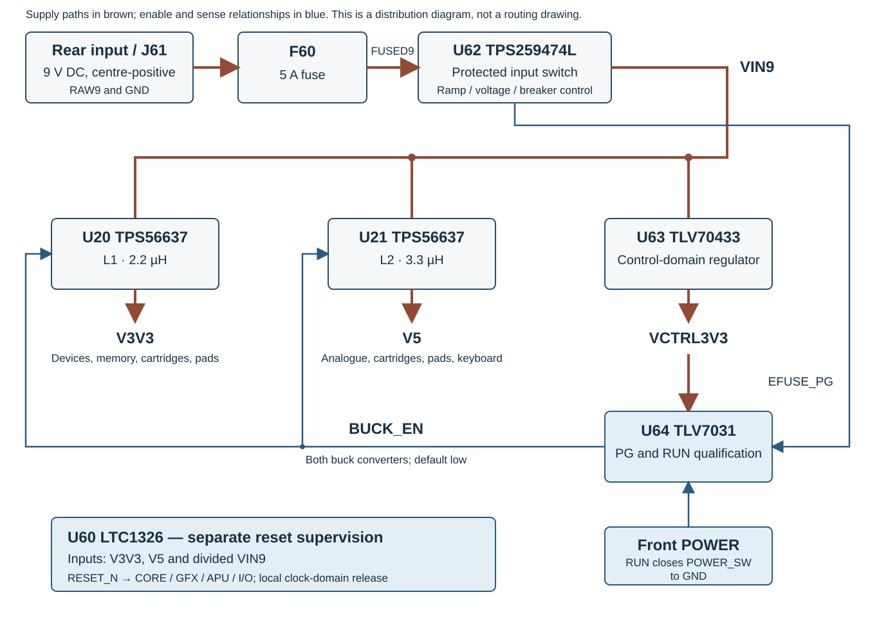
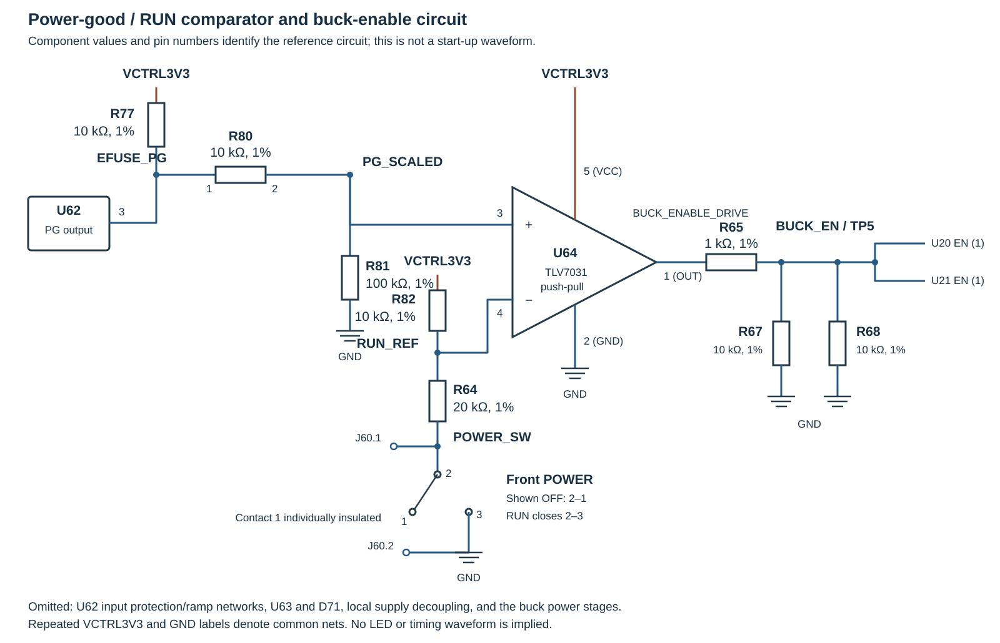

# Power supply

An isolated, regulated 9 V DC supply connects to the rear inlet (centre
positive). After the input protection, two converters supply the 3.3 V and
5 V rails. A separate control supply powers the POWER switch circuit. POWER
turns both converters on together.

The input and control circuits remain powered with POWER off. Disconnect the
supply before opening the console, unplugging an internal cable or changing a
cartridge.



## Input

Inlet: Switchcraft L722A, 2.0 mm centre pin, for an S761K locking plug.
Centre positive, sleeve ground; centre to J61.1 (`RAW9`), sleeve to J61.2.

```text
RAW9 → F60 → FUSED9 → U62 → VIN9
```

| Part | Function |
|---|---|
| F60 | Fuse 0451005.MRL, 5 A fast |
| U62 | Input switch: undervoltage and overvoltage lockout, reverse-current block, circuit breaker |

When U62 has switched off after a fault, POWER does not reset it: disconnect
the supply, let the input discharge and remove the fault. Replace F60 only
with the same type and rating.

VIN9 rises in about 2.1 s after the supply is connected.

## Rails

| Rail | Source | Supplies |
|---|---|---|
| RAW9 | Inlet, J61 | F60 |
| FUSED9 | F60 | U62 |
| VIN9 | U62 | Converters, control regulator |
| V3V3 | U20, L1 | Custom devices, memories, clocks, 3.3 V logic |
| V5 | U21, L2 | Audio analogue circuits, 5 V on the connectors |
| VCTRL3V3 | U63 | POWER switch circuit, power-good |

| Converter | Output |
|---|---|
| U20 | 3.318 V |
| U21 | 4.992 V |

Both converters are enabled by `BUCK_EN`.

### Cartridges and accessories

Both cartridge sockets receive V3V3 (four contacts) and V5 (two contacts)
while the main rails are on, whichever socket is selected. The front board
supplies both rails to the four pad sockets; the keyboard receives V5.
Contacts: [Cartridges](connectors.md#cartridges), [Pads and pointer](connectors.md#pads-and-pointer),
[Keyboard](connectors.md#keyboard). The sockets share the console rails without separate
fuses.

## POWER switch

U63 makes VCTRL3V3 from VIN9. The POWER switch gives a control signal to the
comparator U64; it does not carry the supply current. U64 turns on both
converters:



| Power-good | POWER | Converters |
|---|---|---|
| Low | Either | Off |
| High | OFF | Off |
| High | RUN | On |

## Reset and start-up

U60 monitors V3V3, V5 and VIN9 (divided) and drives `RESET_N`. The RESET button
also acts through U60. U60 holds reset during undervoltage and for 200 ms
(140–300 ms) after the supplies have recovered.

Start-up:

1. The supply delivers RAW9; the input protection gives VIN9.
2. The control regulator starts; power-good goes high.
3. With POWER in RUN, U64 turns on the converters.
4. U60 holds RESET_N low until the supplies are up and for the reset delay.
5. The devices initialize; the firmware starts.

RESET_N also goes to the firmware flash, whose write enable stays inactive.

U1 drives `CART_RESET_N` to both cartridge sockets. It holds the cartridges in
reset during a system reset and releases them when the cartridge bus is ready.
A cartridge reset keeps the cartridge RAM. U1 can also reset the cartridges
alone, so `CART_RESET_N` and `RESET_N` are separate.

## Test points

Use TP2 or TP64 as ground. Connect probes with power off. Measure the rails at
the test points, not at the converter switching nodes.

| Point | Signal | Function |
|---|---|---|
| TP1 | VIN9 | Protected input |
| TP2 | GND | Ground |
| TP3 | V3V3 | 3.3 V rail |
| TP4 | V5 | 5 V rail |
| TP5 | BUCK_EN | Converter enable |
| TP60 | RESET_N | Reset |
| TP61 | POWER_SW | Low in RUN |
| TP62 | RESET_SW | Low while RESET is pressed |
| TP63 | RAW9 | Input before F60 |
| TP64 | GND | Input ground |

With the supply connected, RAW9, FUSED9, VIN9 and VCTRL3V3 are live also with
POWER off. For start-up and supply faults, observe the rails and RESET_N
together and note what is connected. Servicing: [Servicing](servicing.md#servicing).

## Heat

The rails also supply the cartridges and accessories. The console is cooled
passively; cartridges also give off heat near the slots. Cooling:
[Cooling](construction.md#cooling).
